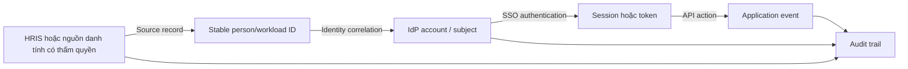
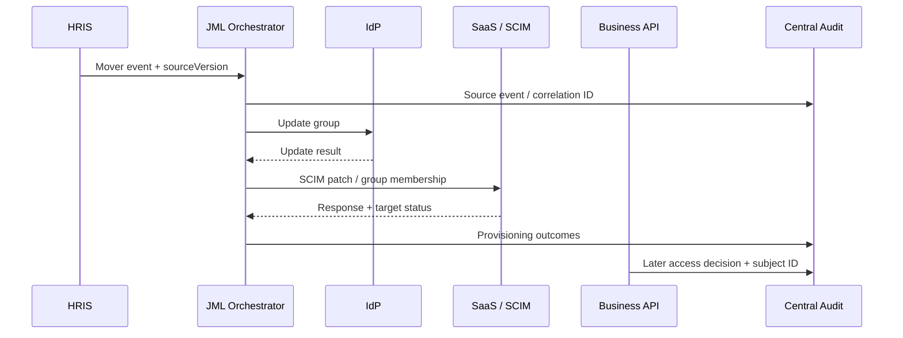
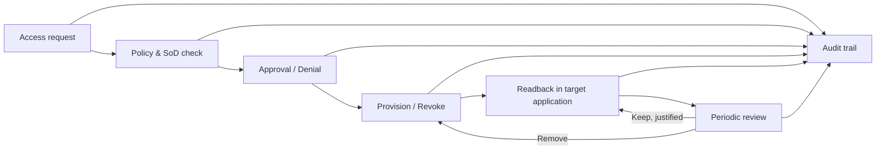

# Accountability trong IAM: truy vết hành động và xác định trách nhiệm trong suốt vòng đời danh tính

**Accountability** trong quản lý định danh và truy cập (**Identity and Access Management – IAM**) là khả năng **xác định ai hoặc hệ thống nào chịu trách nhiệm cho việc cấp, sử dụng, thay đổi và thu hồi quyền**, đồng thời cung cấp bằng chứng đáng tin để kiểm tra, giải thích và xử lý các quyết định đó. Không đủ để biết một thao tác “đã xảy ra”; tổ chức còn cần biết **chủ thể nào, nhân danh ai, với quyền gì, trên tài nguyên nào, do ai phê duyệt, vào lúc nào và kết quả ra sao**.

Trong quản lý vòng đời danh tính (**Identity Lifecycle**) theo mô hình **Joiner–Mover–Leaver (JML)**, accountability xuyên suốt từ việc xác minh một người khi gia nhập, cấp tài khoản và quyền qua IdP/SCIM, xác thực SSO, thay đổi vai trò theo RBAC/ABAC, tới thu hồi quyền khi nghỉ việc. Đặc biệt, nó giúp phát hiện và giải thích **quyền truy cập tồn dư**: quyền nào còn hoạt động, do đâu được cấp, ai có trách nhiệm xử lý và lúc nào đã xác nhận thu hồi.

Một hệ thống cho phép nhân viên đăng nhập bằng tài khoản cá nhân nhưng không ghi lại ai đã cấp quyền `ADMIN`, quyền đó dùng để làm gì hoặc khi nào hết hạn sẽ rất khó điều tra. Accountability giúp biến các khái niệm chính sách IAM thành **trách nhiệm có thể kiểm chứng bằng sự kiện, trạng thái và bằng chứng**.

## 1. Mục tiêu học tập

Sau bài này, người học có thể:

1. Giải thích accountability trong IAM và phân biệt nó với **authentication**, **authorization**, **auditing**, **responsibility** và **non-repudiation**.
2. Xác định các chủ thể chịu trách nhiệm: người dùng, người yêu cầu, người phê duyệt, chủ sở hữu tài nguyên, quản trị viên, dịch vụ tự động và đơn vị vận hành.
3. Thiết kế khả năng **gán hành động cho định danh ổn định** qua IdP, SSO, tài khoản cục bộ, phiên và API.
4. Mô hình hóa chuỗi bằng chứng khi cấp, điều chỉnh, sử dụng, rà soát và thu hồi entitlement trong JML.
5. Xử lý việc truy vết trong các tình huống **ủy quyền, impersonation có kiểm soát, tài khoản đặc quyền, tài khoản dịch vụ và job chạy nền**.
6. Lập bản ghi kiểm toán hữu ích, bảo vệ tính toàn vẹn, giới hạn truy cập và tránh lộ bí mật trong log.
7. Thiết kế cơ chế phát hiện quyền mồ côi, quyền được cấp ngoài luồng và sai lệch giữa IdP với ứng dụng đích.
8. Đề xuất các phép kiểm thử và chỉ số vận hành để đánh giá khả năng giải trình của hệ thống IAM.

## 2. Accountability khác những khái niệm dễ nhầm thế nào?

| Khái niệm | Câu hỏi chính | Ví dụ |
| --- | --- | --- |
| **Identification – định danh** | Đây là chủ thể nào trong hệ thống? | Định danh ổn định `P-1842`. |
| **Authentication – xác thực** | Có đủ bằng chứng kiểm soát phương thức xác thực gắn với tài khoản không? | Đăng nhập SSO bằng passkey/MFA. |
| **Authorization – ủy quyền truy cập** | Chủ thể có được làm thao tác này trên tài nguyên này không? | Cho phép `invoice:approve` trong tenant A. |
| **Accounting/Auditing – ghi nhận, kiểm toán** | Sự kiện và quyết định nào đã diễn ra? | Log thời điểm, hành động, tài nguyên, kết quả. |
| **Accountability – trách nhiệm giải trình** | Ai phải giải thích/chịu trách nhiệm và bằng chứng nào chứng minh được chuỗi quyết định, hành động? | Truy vết người phê duyệt và người thực thi quyền duyệt. |
| **Non-repudiation – chống chối bỏ** | Bằng chứng có đủ mạnh để một bên khó phủ nhận một hành vi cụ thể không? | Chữ ký số hoặc bằng chứng xác thực được thiết kế theo mức bảo đảm yêu cầu. |

**Có log không tự động đồng nghĩa có accountability.** Nếu log chỉ ghi `user=admin`, không biết người nào đã sử dụng tài khoản dùng chung và quyền đó được cấp từ đâu. Nếu một job chạy bằng service account, chỉ biết tên job cũng chưa đủ để xác định ai sở hữu quy trình và ai duyệt thao tác nhạy cảm.

**Accountability cũng không đồng nghĩa non-repudiation.** Log ứng dụng có thể hỗ trợ điều tra và giải trình, nhưng bản thân một dòng log không phải bằng chứng pháp lý hay bằng chứng mật mã chứng minh chắc chắn một người cụ thể đã hành động. Mức độ chứng minh phụ thuộc phương thức xác thực, chất lượng gắn kết phiên, tính toàn vẹn dữ liệu và chuỗi quản lý bằng chứng.

## 3. Bốn câu hỏi cần trả lời cho mỗi hành động quan trọng

Một bản ghi IAM có giá trị khi giúp trả lời bốn nhóm câu hỏi:

1. **Ai và với tư cách gì?** Chủ thể thật, định danh kỹ thuật, vai trò, loại quan hệ, tenant, tài khoản gốc, tài khoản được ủy quyền.
2. **Hành động nào và đối tượng nào?** Loại thao tác, quyền được sử dụng, tài nguyên, phạm vi, bản ghi ảnh hưởng.
3. **Vì sao được phép và ai chấp thuận?** Chính sách RBAC/ABAC, ticket công việc, người phê duyệt, thời hạn, điều kiện truy cập.
4. **Điều gì thực sự xảy ra?** Kết quả cho phép/từ chối, trạng thái nghiệp vụ, thay đổi ở ứng dụng đích, mốc thời gian và bằng chứng hậu kiểm.

Ví dụ khi một kế toán duyệt hóa đơn:

| Yếu tố | Dữ liệu cần tìm |
| --- | --- |
| Người thực hiện | Subject ID ổn định và issuer của IdP. |
| Phiên sử dụng | Tham chiếu phiên, phương thức xác thực đủ điều kiện, thời điểm xác thực. |
| Hành động | `invoice:approve`. |
| Tài nguyên | Hóa đơn `INV-409`, tenant A, số phiên bản tại thời điểm duyệt. |
| Quyền hiệu lực | Role `FINANCE_APPROVER`, scope tenant A, hạn mức, SoD. |
| Căn cứ cấp quyền | Yêu cầu/chiến dịch cấp quyền, approver và ngày hiệu lực. |
| Quyết định API | ALLOW/DENY, mã chính sách và lý do. |
| Kết quả nghiệp vụ | Hóa đơn được duyệt hoặc bị từ chối, thời điểm giao dịch commit. |

Có đủ dữ liệu này cho phép đội kiểm toán phân biệt **quyền được cấp đúng nhưng bị dùng sai ngữ cảnh** với **quyền đã bị cấp quá rộng** hoặc **lỗ hổng authorization của API**.

## 4. Quy định rõ trách nhiệm: ai yêu cầu, ai phê duyệt, ai thực thi?

Accountability cần cơ chế quản trị, không thể chỉ giao cho đội triển khai log. Mỗi bước có một hoặc nhiều vai trò tham gia; một số vai trò có thể do cùng bộ phận đảm nhiệm theo cơ cấu tổ chức.

| Vai trò | Trách nhiệm điển hình | Bằng chứng cần giữ |
| --- | --- | --- |
| **Nguồn có thẩm quyền** (HRIS, quản lý nhà thầu) | Xác nhận quan hệ làm việc, ngày hiệu lực, thay đổi vai trò và kết thúc hợp đồng. | Hồ sơ nguồn, source ID, thời điểm/phiên bản sự kiện. |
| **Người quản lý trực tiếp** | Xác nhận nhu cầu công việc, thay đổi nhiệm vụ. | Yêu cầu có lý do, xác nhận phạm vi cần thiết. |
| **Resource/Data Owner** | Chấp thuận ai được truy cập tài nguyên và với phạm vi nào. | Phê duyệt, quy tắc phân loại, kết quả access review. |
| **IAM/IGA Operations** | Quản lý role catalog, provisioning, deprovisioning, đối soát. | Job, chính sách, phiên bản, kết quả từng ứng dụng. |
| **Đội ứng dụng** | Thực thi permission tại API và bảo vệ hoạt động ghi log. | Authorization decision, kết quả thao tác và dữ liệu đích. |
| **PAM/Privileged Access Owner** | Kiểm soát truy cập đặc quyền, JIT, break-glass. | Phê duyệt, thời hạn, phiên đặc quyền, hậu kiểm. |
| **Đội vận hành/SOC** | Phát hiện bất thường, điều tra sự cố và phối hợp xử lý. | Alert, incident, timeline, quyết định ứng phó. |
| **Kiểm toán/đánh giá độc lập** | Kiểm tra bằng chứng và độ hiệu lực của kiểm soát. | Kết luận, sai lệch và hành động khắc phục. |
| **Chủ sở hữu workload** | Xác nhận mục đích, scope và vòng đời service account. | Danh mục workload, owner, credential/role, phiên bản triển khai. |

Có thể áp dụng mô hình **RACI** (*Responsible – Accountable – Consulted – Informed*) để tránh bỏ trống trách nhiệm. Tuy nhiên, mô hình không thay thế bằng chứng: ghi một người là “Accountable” trên sơ đồ nhưng không có quy trình duyệt, xác nhận hay xử lý sai lệch vẫn chưa đạt mục tiêu.

### 4.1. Ví dụ phân công cho một quyền nhạy cảm

Giả sử nhân viên A xin quyền xuất bảng lương trong 24 giờ:

- **Requester:** A cung cấp lý do và phạm vi.
- **Manager:** xác nhận nhu cầu công việc.
- **Data owner:** phê duyệt quyền trên dữ liệu lương.
- **IAM:** kích hoạt entitlement có thời hạn.
- **Ứng dụng:** kiểm tra quyền và ghi lại từng lần export.
- **Owner/kiểm toán:** rà soát quyền và việc sử dụng khi cần.

Khi xuất dữ liệu trái phép, tổ chức có thể kiểm tra **lỗi phê duyệt, lỗi cấp quyền, lỗi thực thi hay hành vi vượt thẩm quyền** thay vì chỉ nhìn tên người đã đăng nhập.

## 5. Gắn hành động với định danh ổn định và phiên cụ thể

Để quy trách nhiệm, IAM cần có đường liên kết đáng tin giữa **chủ thể thực** và **tài khoản kỹ thuật**:



### 5.1. Vì sao không dùng email làm khóa kiểm toán?

Email và tên hiển thị có thể thay đổi. Một địa chỉ có thể được tái sử dụng theo chính sách tổ chức; alias có thể trùng hoặc bị chuyển cho người khác. Nếu log chỉ lưu `lan@example.org`, việc đổi email có thể khiến truy vết các sự kiện lịch sử bị mơ hồ.

Nên dùng một định danh nội bộ ổn định, không tái sử dụng để liên kết về chủ thể. Khi sử dụng các giao thức liên kết đăng nhập, cần hiểu **namespace của subject**: hai IdP có thể phát hành cùng chuỗi `sub` cho hai người khác nhau. Một ánh xạ thường phải xét **issuer + subject** hoặc định danh tương đương được xác minh.

### 5.2. Session và thiết bị không chứng minh tuyệt đối ai ngồi trước máy

Một phiên có thể bị chiếm đoạt, thiết bị có thể được dùng chung hoặc credential có thể bị lộ. Log phiên là bằng chứng một **tài khoản/credential đã thực hiện yêu cầu**, không tự chứng minh chắc chắn người sở hữu danh tính là người trực tiếp bấm nút.

Để nâng mức tin cậy, có thể yêu cầu MFA chống phishing, giới hạn session, xác thực tăng cường cho hành động quan trọng, kiểm tra thiết bị và giám sát phiên. Mức độ bảo đảm phải tương xứng với rủi ro và khả năng hệ thống.

### 5.3. Lưu danh tính nào khi dịch vụ gọi thay người dùng?

Khi frontend → API A → API B → database, nếu chỉ ghi `service-account-B` ở mọi log thì mất dấu người yêu cầu ban đầu. Với các thao tác **thay mặt người dùng**, cần truy được:

- **End-user subject:** ai khởi tạo yêu cầu nghiệp vụ.
- **Delegated/acting identity:** dịch vụ nào trực tiếp gọi API đích.
- **Delegation context:** nguồn ủy quyền, hành động và phạm vi cho phép.
- **Correlation ID:** tham chiếu kết nối các bước.

Không tin một trường `requestedByUserId` do client tự khai nếu nó chưa được xác thực. Mỗi bước phải ràng buộc ngữ cảnh với token/chứng thực đáng tin và áp dụng quyền tương ứng.

## 6. Accountability trong Joiner – Mover – Leaver

### 6.1. Joiner: vì sao danh tính và quyền này được tạo?

Khi người mới gia nhập, accountability bắt đầu từ **nguồn xác minh và lý do cấp quyền**. Bằng chứng nên cho biết:

1. Nguồn có thẩm quyền xác nhận quan hệ và thời điểm bắt đầu.
2. Bản ghi nguồn liên kết tới chủ thể nào; kiểm tra trùng đã thực hiện ra sao.
3. Ai hoặc chính sách nào tạo tài khoản IdP.
4. Những role/entitlement nền nào được gán và theo quy tắc nào.
5. Quyền đặc biệt nào được người có thẩm quyền phê duyệt riêng.
6. SCIM/API provisioning đã tạo, đồng bộ nhóm và quyền tại từng đích như thế nào.
7. Tài khoản và quyền thực sự đã sẵn sàng sử dụng hay còn lỗi cần xử lý.

Ví dụ, một nhân viên hỗ trợ mới nhận role `SUPPORT_AGENT` từ catalog chuẩn. Nhật ký cần cho biết **role được gán từ chính sách nào và phiên bản nào**. Nếu có thêm quyền `CUSTOMER_EXPORT_ALL`, phải tìm được một yêu cầu ngoại lệ và người phê duyệt cụ thể.

### 6.2. Mover: ai quyết định giữ, chuyển hoặc thu hồi quyền?

Khi chuyển vai trò, hệ thống cần so sánh **quyền mục tiêu** với **quyền thực tế**, thay vì chỉ thêm role mới. Accountability phải ghi được:

- Sự kiện thay đổi từ nguồn và ngày hiệu lực.
- Người/bộ phận xác nhận nhiệm vụ mới.
- Quyền nào bị thu hồi, quyền nào được thêm và vì sao.
- Ngoại lệ bàn giao nào được giữ, ai phê duyệt và thời điểm hết hạn.
- Hệ thống đích nào đã xác nhận gỡ quyền, hệ thống nào chưa.
- Quyền tồn dư nào được phát hiện qua ACL, nhóm kế thừa, role cục bộ hoặc token.

**Ví dụ:** nhân viên A chuyển từ hỗ trợ sang tài chính. SCIM đã gỡ nhóm hỗ trợ nhưng ứng dụng ticket vẫn giữ quyền export được cấp thủ công. Bằng chứng chuyển vai trò phải chỉ ra entitlement nào còn tồn tại, owner nào chịu trách nhiệm và ticket xử lý thu hồi.

### 6.3. Leaver: có thể chứng minh quyền đã bị thu hồi không?

Khi nhân viên nghỉ việc hoặc nhà thầu hết hạn, một dòng log “HRIS gửi Leaver” chưa đủ để xác nhận hoàn tất. Cần biết **mốc phải chặn truy cập** và trạng thái của từng đường truy cập:

| Lớp truy cập | Bằng chứng cần có |
| --- | --- |
| IdP/SSO | Thời điểm khóa tài khoản, kết quả xử lý phiên/refresh token khi có hỗ trợ. |
| SaaS / SCIM | Tài khoản đích đã bị vô hiệu hóa; nhóm/role nào đã được gỡ. |
| Cloud và database | Quyền console/API, policy binding hoặc tài khoản cục bộ đã được thu hồi. |
| Repository / CI/CD | PAT, SSH key, quyền thành viên và credential liên quan đã được xử lý. |
| Tài nguyên chia sẻ | ACL, quyền owner, nhóm dự án, share link được rà soát. |
| PAM / JIT | Đặc quyền đang kích hoạt và phiên quản trị đã được xử lý theo chính sách. |
| Workload được sở hữu | Chủ sở hữu mới được giao; identity không cần thiết bị thu hồi. |

**Phản hồi SCIM thành công không đồng nghĩa phiên và token độc lập đã mất hiệu lực.** Cần phân biệt **lệnh thu hồi đã gửi**, **ứng dụng xác nhận đã áp dụng**, và **đường truy cập thực tế không còn sử dụng được**. Bằng chứng và mốc thời gian của ba giai đoạn này giúp đánh giá cửa sổ rủi ro.

## 7. Bản ghi kiểm toán cần chứa gì?

Một schema sự kiện có thể tổ chức theo nhóm trường:

| Nhóm | Trường minh họa | Tác dụng |
| --- | --- | --- |
| Định danh sự kiện | `eventId`, `correlationId` | Chống xử lý trùng, nối các hệ thống. |
| Nguồn | `sourceSystem`, `serviceId`, `eventType` | Biết ai phát sự kiện và loại hoạt động. |
| Chủ thể | `actorSubjectId`, `actorIssuer`, `onBehalfOf` | Phân biệt người thực hiện kỹ thuật với người yêu cầu. |
| Đích | `targetSubjectId`, `resourceType`, `resourceId`, `tenantId` | Xác định ai hoặc tài nguyên nào bị tác động. |
| Hành động | `action`, `permission`, `entitlementId` | Mô tả hành động và quyền liên quan. |
| Căn cứ | `policyId`, `policyVersion`, `approvalId` | Giải thích quyết định và ai phê duyệt. |
| Thời gian | `occurredAt`, `effectiveAt`, `receivedAt`, `confirmedAt` | Phân biệt lúc xảy ra, lúc xử lý, lúc hiệu lực. |
| Kết quả | `decision`, `outcome`, `reasonCode` | Phân biệt cho phép, từ chối, lỗi và kết quả nghiệp vụ. |
| Ngữ cảnh | `sessionRef`, `authnAssurance`, `requestId` | Liên kết phiên, mức xác thực và yêu cầu. |

Không phải mọi sự kiện đều cần mọi trường. Chẳng hạn, một lần đọc tài liệu có thể không có `approvalId` riêng nếu quyền lấy từ role chuẩn; khi đó cần thể hiện **nguồn quyền/role và chính sách đã áp dụng**, tránh điền mã phê duyệt giả.

### 7.1. Ví dụ sự kiện cấp quyền

```json
{
  "eventId": "evt-grant-8042",
  "correlationId": "req-9210",
  "sourceSystem": "IAM_ORCHESTRATOR",
  "eventType": "ENTITLEMENT_GRANTED",
  "actorSubjectId": "service:iam-provisioner",
  "onBehalfOf": "P-0105",
  "targetSubjectId": "P-1842",
  "entitlementId": "ERP-INVOICE-APPROVE",
  "resourceScope": "TENANT-A",
  "approvalId": "APR-732",
  "policyId": "finance-access-v3",
  "effectiveAt": "2026-12-01T02:00:00Z",
  "occurredAt": "2026-12-01T02:00:03Z",
  "outcome": "SUCCEEDED"
}
```

Đây là **ví dụ schema nội bộ**, không phải tiêu chuẩn bắt buộc của SCIM/OIDC. `actorSubjectId` thể hiện tài khoản dịch vụ đã thực thi việc cấp quyền; `onBehalfOf` đại diện người yêu cầu sau khi đã được xác minh; `approvalId` truy tới người phê duyệt hợp lệ. Với một hệ thống thật, cần lưu riêng danh tính và thời điểm quyết định phê duyệt.

### 7.2. Ví dụ sự kiện API bị từ chối

```json
{
  "eventId": "evt-authz-8043",
  "correlationId": "req-9211",
  "eventType": "AUTHORIZATION_DECISION",
  "actorSubjectId": "P-1842",
  "actorIssuer": "https://idp.example.org",
  "action": "invoice:approve",
  "resourceType": "INVOICE",
  "resourceId": "INV-409",
  "tenantId": "TENANT-A",
  "policyId": "invoice-approval-v5",
  "decision": "DENY",
  "reasonCode": "SEPARATION_OF_DUTIES",
  "occurredAt": "2026-12-01T03:00:00Z"
}
```

Log từ chối cũng hữu ích: nó giúp phát hiện thao tác vượt quyền, lỗi client hoặc kiểm soát đang hoạt động. Tuy nhiên, phản hồi cho người dùng nên cân bằng tính giải thích với việc tránh lộ thông tin nhạy cảm của tài nguyên ngoài phạm vi.

## 8. Liên kết các sự kiện xuyên IdP, SSO, SCIM và ứng dụng

Một hành động có thể tạo nhiều log ở nhiều hệ thống khác nhau. Nếu không có cách liên kết, đội vận hành phải ghép bằng địa chỉ email và thời gian, dễ nhầm lẫn khi có nhiều yêu cầu đồng thời.



### 8.1. Correlation ID là gì?

**Correlation ID** là mã giúp nối các bước cùng một yêu cầu/quy trình. Ví dụ sự kiện Mover có mã `change-602`, các thao tác tới IdP và ba ứng dụng cùng mang mã này trong log nội bộ.

Tuy nhiên, một ID từ client **không được mặc nhiên tin cậy để xác định danh tính hoặc quyền**. Hệ thống có thể tiếp nhận/chuẩn hóa ID để hỗ trợ theo dõi nhưng phải ràng buộc nó với nguồn, phiên và yêu cầu được xác thực.

### 8.2. Lưu kết quả từng hệ thống đích

Ví dụ một sự kiện Leaver:

| Đích | Lệnh | Trạng thái quan sát | Trách nhiệm tiếp theo |
| --- | --- | --- | --- |
| IdP | Disable account | `SUCCEEDED` | Xác nhận phiên/token theo khả năng. |
| CRM | SCIM `active=false` | `SUCCEEDED` | Kiểm tra tài khoản/role cục bộ nếu có. |
| Git | Revoke PAT | `FAILED` | Retry, cảnh báo owner và xử lý thủ công. |
| VPN | End session | `PENDING` | Đối soát tới khi xác nhận. |

Không được báo “hoàn tất toàn bộ Leaver” khi một hệ thống trọng yếu còn `FAILED` hoặc `PENDING` mà không có quyết định xử lý ngoại lệ có thẩm quyền.

### 8.3. Trình tự sự kiện và đồng hồ

Mạng và hệ thống phân tán có thể tạo sự kiện trễ hoặc đảo thứ tự. Nên phân biệt:

- **Event time:** thời điểm sự kiện diễn ra ở nguồn.
- **Effective time:** thời điểm thay đổi có hiệu lực theo chính sách.
- **Processing time:** lúc hệ thống xử lý.
- **Confirmation time:** lúc ứng dụng đích xác nhận.

Cần đồng bộ đồng hồ và lưu timestamp có timezone; khi xác định thứ tự cập nhật trạng thái, nên ưu tiên **source version hoặc quy tắc thứ tự đáng tin** thay vì chỉ so giờ nhận sự kiện tại từng service.

## 9. Accountability của quyền đặc quyền và phiên quản trị

Quyền đặc quyền có thể thay đổi cấu hình, cấp quyền cho người khác hoặc truy cập dữ liệu nhạy cảm. Vì tác động lớn, cần mức truy vết cao hơn quyền đọc thông thường.

### 9.1. Tài khoản quản trị riêng và PAM

Nếu mọi nhân viên vận hành dùng chung tài khoản `root` hoặc `admin`, log chỉ phản ánh tài khoản kỹ thuật chung. Một hệ thống **Privileged Access Management (PAM)** có thể giúp:

- Xác định người yêu cầu sử dụng quyền quản trị.
- Xác minh và phê duyệt yêu cầu theo phạm vi/tác vụ.
- Cấp **Just-in-Time (JIT)** hoặc **Just Enough Access (JEA)**.
- Ghi thời gian, phiên, mục tiêu và thao tác theo khả năng nền tảng.
- Thu hồi quyền khi hết hạn và kiểm tra hậu điều kiện.
- Cảnh báo hành động bất thường và yêu cầu hậu kiểm.

Mức ghi phiên và cách bảo vệ nội dung phiên phụ thuộc chính sách riêng tư, khả năng hệ thống và rủi ro. Không nên thu thập tràn lan dữ liệu bí mật mà không có mục đích.

### 9.2. Break-glass vẫn cần trách nhiệm giải trình

Tài khoản khẩn cấp có thể được dùng khi IdP hoặc PAM bình thường không hoạt động. Trường hợp này cần xác định **ai kích hoạt, vì sao, ai được thông báo, thời gian sử dụng và bằng chứng hậu kiểm**. Nếu có credential dùng chung cho tình huống khẩn cấp, cần cơ chế kiểm soát người nắm giữ, bảo vệ bí mật, cảnh báo và thay đổi credential sau sự kiện khi phù hợp.

Một tài khoản “khẩn cấp” nhưng dùng để quản trị thường ngày mà không có log/owner chính là khoảng trống accountability.

## 10. Tài khoản dùng chung, ủy quyền và thao tác thay mặt

### 10.1. Tại sao tài khoản dùng chung gây khó truy vết?

Nếu ba nhân viên dùng chung `finance-admin`, log cho biết tài khoản nào thực thi, nhưng không đủ để kết luận người nào làm. Các biện pháp ưu tiên gồm:

1. Dùng tài khoản cá nhân cho công việc thường ngày.
2. Liên kết quyền quản trị với danh tính cá nhân qua PAM, JIT và quy trình có phê duyệt.
3. Nếu tài khoản dùng chung là ngoại lệ bắt buộc, kiểm soát người mượn credential, thời hạn, phiên và bằng chứng quản lý.
4. Rà soát ngoại lệ và giảm thời gian dùng chung.

Không nên gán trách nhiệm cá nhân dựa trên một trường tên người tự nhập trong yêu cầu nếu không có cơ chế xác minh gắn kết với phiên.

### 10.2. Delegation: phân biệt người yêu cầu với người hành động

Ví dụ trợ lý B được trưởng nhóm A ủy quyền phê duyệt một loại tài liệu. Log cần thể hiện **B là người thực hiện** và **quyền B có nguồn ủy quyền từ A**, cùng phạm vi/hiệu lực. Ghi sự kiện như thể chính A trực tiếp nhấn nút sẽ gây sai lệch chứng cứ.

Với tính năng **impersonation** dành cho hỗ trợ khách hàng, cần có quy trình có thẩm quyền, mục đích, thời hạn, giới hạn hành động và log nhận dạng **nhân viên hỗ trợ thực tế**; không chỉ hiển thị tên khách hàng đang được hỗ trợ.

## 11. Accountability của service account và workload identity

Danh tính phi con người phải có **chủ thể kỹ thuật** và **người/đội chịu trách nhiệm**. Trường `owner` không nhất thiết là người trực tiếp kích hoạt từng request, nhưng cần truy được dịch vụ, bản phát hành, pipeline và hệ thống nguồn của hoạt động.

| Thành phần | Cần gắn trách nhiệm |
| --- | --- |
| **Service account** | Service/workload nào sử dụng, purpose, owner, môi trường, tài nguyên. |
| **API key/secret** | Được cấp cho client nào, ai phê duyệt, hạn sử dụng và cơ chế rotation/thu hồi. |
| **CI/CD pipeline** | Repository, workflow/job, lần chạy, artifact và người/quy trình kích hoạt. |
| **Workload runtime** | Namespace, cluster/project, workload identity, phiên bản triển khai. |
| **Tác vụ nền** | Người yêu cầu ban đầu hoặc sự kiện nguồn, job ID, quyền được ủy quyền. |
| **Tích hợp bên thứ ba** | Đối tác, hợp đồng, sponsor, scope, ngày hết hạn, người liên hệ khi sự cố. |

### 11.1. Ví dụ job xuất dữ liệu

Một job `billing-exporter-prod` tạo báo cáo hằng đêm. Có thể ghi:

```json
{
  "eventId": "job-exec-308",
  "eventType": "DATA_EXPORT",
  "actorServiceId": "billing-exporter-prod",
  "workloadEnvironment": "production",
  "jobRunId": "run-308",
  "deploymentRef": "release-2026-12",
  "ownerTeam": "finance-platform",
  "resourceId": "billing-report-dataset",
  "requestedBy": "scheduler:nightly",
  "outcome": "SUCCEEDED",
  "occurredAt": "2026-12-01T01:00:00Z"
}
```

Trong hệ thống thật, các ID và metadata phải đến từ cơ chế xác thực workload, scheduler và hệ triển khai đáng tin. Không được coi một chuỗi service name do process tự khai là chứng cứ đầy đủ.

### 11.2. Khi owner rời tổ chức

Leaver của người sở hữu workload không luôn có nghĩa phải tắt service đang vận hành. Nhưng IAM phải kích hoạt **rà soát/chuyển ownership**, xác nhận ai chịu trách nhiệm tiếp, credential nào còn hợp lệ và permission nào thực sự cần. Tài khoản dịch vụ không còn owner hoặc workload hợp lệ cần được thu hồi theo quy trình.

## 12. Tính toàn vẹn và độ tin cậy của log

Một log có giá trị kiểm toán cần **khó bị sửa trái phép, khó bị xóa không dấu vết và đủ tin cậy để phân tích**. Tuy nhiên, không có cơ chế nào tự bảo đảm bằng chứng tuyệt đối khi chính hệ thống ghi log bị xâm nhập.

Những biện pháp thực tiễn:

- **Tách nơi ghi và nơi lưu:** chuyển log bảo mật quan trọng từ ứng dụng sang hệ thống thu thập tập trung trong thời gian phù hợp.
- **Phân quyền ghi/đọc/xóa:** dịch vụ chỉ được gửi sự kiện, không được tùy ý sửa hoặc xóa bản ghi đã lưu; tách quyền quản trị kho log.
- **Lưu giữ khó sửa:** sử dụng chính sách lưu giữ bất biến/append-only hoặc cơ chế WORM nơi cần thiết và được hỗ trợ.
- **Kiểm tra toàn vẹn:** chữ ký hoặc chuỗi hash có thể giúp phát hiện thay đổi trong những điều kiện xác định; muốn có giá trị phải bảo vệ khóa và điểm neo tin cậy.
- **Giám sát thiếu log:** cảnh báo khi nguồn ngừng gửi, backlog lớn, mất sequence hoặc sink bị lỗi.
- **Đồng bộ thời gian:** timestamp chính xác, timezone thống nhất, nhận biết clock skew.
- **Kiểm soát đường truyền:** xác thực nguồn và mã hóa khi chuyển log qua mạng.
- **Bản sao/khôi phục:** đảm bảo bằng chứng không mất khi dịch vụ lưu trữ gặp sự cố.

### 12.1. Hash log không phải lá chắn tuyệt đối

Tính hash cho từng dòng log giúp phát hiện chỉnh sửa **nếu có bản hash hoặc chữ ký được bảo vệ ngoài quyền của kẻ sửa**. Nếu một người có thể sửa cả log lẫn hash đi kèm, tính hash đơn lẻ không tạo bảo đảm đáng kể. Hệ thống cần thiết kế **mô hình đe dọa, khóa ký, quyền truy cập và khả năng phát hiện thiếu sự kiện**.

### 12.2. Log thành công và log lỗi

Đối với thay đổi quyền, nên ghi riêng:

- Yêu cầu được tiếp nhận.
- Quyết định cấp/từ chối.
- Lệnh provisioning được gửi.
- Kết quả từ ứng dụng đích.
- Trạng thái đã được đối soát.
- Lỗi/retry và hành động thủ công nếu có.

Nếu chỉ ghi “grant requested” thì không biết quyền đã được cấp chưa. Nếu chỉ ghi “grant succeeded” mà không biết ai phê duyệt thì thiếu căn cứ của việc cấp quyền.

## 13. Tránh để kiểm toán trở thành nguồn rò rỉ dữ liệu

Sự kiện IAM thường chứa dữ liệu nhạy cảm: subject ID, IP, thông tin thiết bị, tài nguyên và lý do bị từ chối. Log có thể hữu ích nhưng cũng tạo rủi ro nếu lưu quá mức hoặc cho quá nhiều người đọc.

**Không nên ghi:** mật khẩu, access token đầy đủ, refresh token, session cookie, khóa riêng, mã khôi phục MFA, secret, nội dung tài liệu mật hoặc bản sao giấy tờ định danh không cần thiết.

Nên:

1. Lưu **tham chiếu an toàn**, ví dụ session ID đã được thay thế bằng mã tham chiếu không thể dùng để đăng nhập.
2. Chỉ ghi những trường phục vụ mục đích bảo mật/điều tra rõ ràng.
3. Giới hạn quyền truy cập log theo nhiệm vụ, tenant và độ nhạy cảm.
4. Thiết kế thời hạn lưu và xóa theo quy định áp dụng.
5. Ghi lại hoạt động truy cập/xuất log nhạy cảm của chính người vận hành kiểm toán.
6. Cẩn thận với `request body` hoặc header vì có thể chứa bí mật hoặc dữ liệu do người dùng cung cấp.

**Accountability tốt không đòi hỏi thu thập mọi dữ liệu cá nhân.** Nó đòi hỏi bằng chứng đúng mục đích và đủ mạnh để trả lời các câu hỏi trách nhiệm.

## 14. Accountability trong việc thiết kế authorization ở API

Một backend nên kiểm tra quyền trên từng hành động và tài nguyên thực, rồi gắn quyết định với chứng cứ.

Ví dụ logic minh họa:

```text
approveInvoice(request):
    principal = verifyToken(
        issuer = expectedIssuer,
        audience = expectedAudience,
        token = request.accessToken
    )
    actor = loadTrustedSubject(principal)
    invoice = loadInvoice(request.invoiceId)
    context = loadPolicyContext(actor, invoice)

    decision = policy.evaluate(
        subject = actor,
        action = "invoice:approve",
        resource = invoice,
        context = context
    )

    auditAuthorizationDecision(
        correlationId = request.correlationId,
        actorId = actor.id,
        invoiceId = invoice.id,
        policyVersion = decision.policyVersion,
        decision = decision.result,
        reasonCode = decision.reason
    )

    if decision.result != ALLOW:
        denyRequest()

    result = approveWithConcurrencyCheck(invoice, actor.id)

    auditBusinessOutcome(
        actorId = actor.id,
        invoiceId = invoice.id,
        transactionRef = result.transactionRef,
        status = result.status
    )
    return result
```

Đây là **pseudocode**, không phải một implementation đầy đủ. Hệ thống thật cần xử lý nguyên tử hoặc mẫu **transactional outbox** để tránh trường hợp giao dịch đã commit nhưng sự kiện kết quả bị mất. Với dữ liệu nhạy cảm, cần có chiến lược nếu hệ thống audit không khả dụng: có thể chặn thao tác hoặc lưu bền ở một hàng đợi nội bộ, tùy yêu cầu về độ tin cậy và khả năng phục hồi.

### 14.1. Vì sao phải tách quyết định và kết quả?

Một yêu cầu có thể **được phép** nhưng **không thành công** vì hóa đơn đã bị duyệt ở phiên khác. Nếu chỉ ghi `ALLOW`, người điều tra có thể nhầm thành “hóa đơn đã được duyệt”. Nên phân biệt:

- **Authorization decision:** ALLOW/DENY.
- **Business outcome:** SUCCEEDED/FAILED/NO_CHANGE.
- **Persistence confirmation:** thay đổi đã commit hay chưa, transaction reference nếu có.

### 14.2. Khi không tìm thấy tài nguyên

Một request tới ID tài liệu ngoài tenant có thể trả HTTP 404 theo chính sách che giấu sự tồn tại của tài nguyên. Log nội bộ vẫn cần ghi đủ nguyên nhân và đối tượng **nếu việc lưu thông tin đó được phép**, không đưa chi tiết nhạy cảm ra response cho người không có quyền.

## 15. Quy trình kiểm toán quyền: từ yêu cầu đến thu hồi

Một quy trình quản trị quyền đáng tin nên tạo chuỗi bằng chứng khép kín:



Mỗi entitlement nên có:

- **Nguồn gốc:** tự động theo baseline hay được cấp qua một yêu cầu ngoại lệ.
- **Owner:** người chịu trách nhiệm quyết định entitlement có còn cần thiết không.
- **Scope:** môi trường, tenant, tài nguyên, role, thời hạn.
- **Phê duyệt:** ai, khi nào, dựa trên chính sách nào.
- **Thực thi:** hệ thống nào cấp/gỡ quyền và trạng thái đích.
- **Rà soát:** kết luận giữ hay thu hồi, lý do và ngày thực thi.
- **Lịch sử:** các lần gia hạn, chuyển role, thay scope hoặc xử lý ngoại lệ.

Một dòng ghi “approved” trong công cụ IAM không đủ nếu ứng dụng đích không thực thi được việc cấp/gỡ hoặc phát sinh quyền cục bộ ngoài luồng.

## 16. Ví dụ xuyên suốt: người dùng chuyển bộ phận rồi rời tổ chức

Giả sử **Hà** bắt đầu làm nhân viên hỗ trợ, chuyển sang đội tài chính rồi nghỉ việc. Hệ thống có HRIS, IdP, ứng dụng ticket, ERP, VPN và hệ thống quản lý repository.

### 16.1. Giai đoạn Joiner

HRIS tạo hồ sơ `P-1842` và xác nhận Hà là nhân viên hỗ trợ, bắt đầu ngày 01/12. IAM tạo tài khoản IdP, cấp role `SUPPORT_AGENT`, đồng bộ qua SCIM tới ứng dụng ticket.

Bằng chứng cần có: nguồn hồ sơ, mã chủ thể ổn định, chính sách role nền, danh sách ứng dụng, thời điểm cấp, trạng thái readback. Nếu role `SUPPORT_EXPORT_ALL` được cấp riêng, phải có yêu cầu và phê duyệt giải thích lý do.

### 16.2. Giai đoạn Mover

Hà chuyển sang tài chính. IAM dự kiến thu hồi role hỗ trợ, cấp `FINANCE_READER` và chỉ cấp quyền duyệt có thời hạn nếu có yêu cầu hợp lệ. Một role export cũ được gán trực tiếp ở ticketing và không đi qua nhóm SCIM.

**Phát hiện:** bản đối soát sau Mover cho thấy Hà vẫn có `ticket:export-all`.

**Truy vết:** entitlement đó được cấp thủ công bởi tài khoản admin trong đợt xử lý sự cố cũ; không có thời hạn và không có bản ghi phê duyệt hợp lệ.

**Xử lý:** resource owner và đội IAM xác nhận không còn nhu cầu, thu hồi ở ứng dụng đích, kiểm tra trạng thái sau thu hồi, ghi sự kiện và báo cáo lỗ hổng trong quy trình cấp quyền ngoài luồng.

Accountability giúp điều tra **vì sao quyền còn tồn tại** và **ai cần sửa quy trình**, bên cạnh thao tác gỡ quyền cụ thể.

### 16.3. Giai đoạn Leaver

HRIS phát sự kiện chấm dứt quan hệ, hiệu lực 18:00. IdP khóa đăng nhập đúng mốc; ERP xác nhận SCIM `active=false` lúc 18:01; repository vẫn còn một PAT cá nhân hoạt động tới 18:06.

| Thành phần | Mốc hiệu lực | Xác nhận | Nhận xét |
| --- | --- | --- | --- |
| IdP | 18:00 | 18:00 | Khóa tài khoản được xác nhận. |
| ERP | 18:00 | 18:01 | Cần biết trạng thái phiên riêng nếu có. |
| Repository PAT | 18:00 | 18:06 | Có cửa sổ credential tồn dư cần điều tra. |

Bản báo cáo đúng phải giữ **mốc hiệu lực ban đầu**, các mốc xác nhận và lý do trễ, không đổi mốc nghỉ việc để kết quả trông đúng hạn. Đội vận hành xác định PAT được cấp khi nào, hệ thống nào quản lý, nguyên nhân không bị thu hồi theo sự kiện Leaver và biện pháp ngăn lặp lại.

## 17. Chỉ số đo accountability trong IAM

Chỉ số cần xác định rõ mẫu số, hệ thống phạm vi và **bằng chứng xác nhận**.

| Chỉ số | Định nghĩa tham khảo | Ý nghĩa |
| --- | --- | --- |
| **Tỷ lệ tài khoản có chủ thể/owner hợp lệ** | Tài khoản liên kết được với một chủ thể hoặc workload owner đang hiệu lực / tổng tài khoản. | Phát hiện tài khoản mồ côi, dùng chung không kiểm soát. |
| **Tỷ lệ quyền có nguồn cấp truy vết được** | Entitlement có policy/approval và nguồn gốc rõ / tổng entitlement cần quản trị. | Đánh giá khả năng giải thích vì sao quyền tồn tại. |
| **Tỷ lệ sự kiện quan trọng có audit đầy đủ** | Sự kiện có các trường bắt buộc, correlation và kết quả / tổng sự kiện trong phạm vi. | Phát hiện thiếu log hoặc log không dùng được. |
| **Tỷ lệ Leaver có xác nhận đầy đủ** | Sự kiện Leaver có readback từ mọi đích bắt buộc / tổng Leaver cần xử lý. | Đo lường độ hoàn tất thu hồi. |
| **Độ trễ thu hồi quyền** | `confirmedRevokedAt - effectiveRevocationAt` theo từng hệ thống. | Phát hiện cửa sổ truy cập tồn dư. |
| **Tỷ lệ access review được thực thi** | Quyết định review đã hoàn tất hành động cấp/gỡ và readback / tổng quyết định. | Tránh rà soát chỉ ký xác nhận trên giấy. |
| **Số tài khoản/quyền ngoài luồng** | Tài khoản hoặc role trong ứng dụng không liên kết chính sách/nguồn phê duyệt hợp lệ. | Phát hiện cấu hình không quản trị tập trung. |
| **Số service account không owner** | Danh tính phi con người không có người/đội chịu trách nhiệm. | Đánh giá khoảng trống vòng đời. |
| **Thời gian xử lý sai lệch quyền** | Từ lúc phát hiện đến khi khắc phục/đóng ngoại lệ có chứng cứ. | Đo năng lực phản ứng IAM. |
| **Tỷ lệ hành động đặc quyền gắn danh tính cá nhân** | Hành động admin có thể liên kết đúng người và phiên được phê duyệt / tổng hành động đặc quyền. | Giảm vùng mù từ tài khoản dùng chung. |

Chỉ số đẹp không thay thế kiểm chứng thực tế. Ví dụ “100% có owner” không có ý nghĩa nếu owner đã nghỉ việc hoặc không có quyền phê duyệt; “100% thu hồi” không đáng tin nếu chỉ tính lệnh đã gửi mà không xác nhận trạng thái đích.

## 18. Kiểm thử khả năng giải trình

Accountability phải được kiểm thử như một thuộc tính của hệ thống, không chỉ xem có tệp log xuất hiện hay không.

### 18.1. Ma trận tình huống

| Kịch bản | Bằng chứng kỳ vọng |
| --- | --- |
| User đăng nhập SSO rồi thực hiện thao tác | Có subject ổn định, issuer, phiên, action, resource và outcome. |
| User bị từ chối do thiếu quyền | Có sự kiện DENY, policy/reason, không rò rỉ dữ liệu ra response. |
| Admin cấp entitlement ngoài baseline | Có requester, approver, scope, effective time, provisioning và hậu kiểm. |
| User đổi vai trò | Có source event, tập quyền cần gỡ/cấp và trạng thái từng ứng dụng. |
| Leaver khi một SaaS mất kết nối | Có trạng thái `PENDING/FAILED`, owner, retry và cảnh báo; không đánh dấu hoàn tất sớm. |
| Tài khoản dùng chung khẩn cấp | Có người sử dụng được xác minh, lý do, phiên, thời hạn và hậu kiểm. |
| Job chạy thay người dùng | Có user nguồn, service identity thực thi, job ID và scope được ủy quyền. |
| Service account không còn owner | Có phát hiện, yêu cầu chuyển giao hoặc thu hồi. |
| Sự kiện trùng hoặc đến sai thứ tự | Có event ID/source version, ghi nhận xử lý idempotent hoặc bỏ qua event cũ. |
| Logging pipeline bị lỗi | Có cảnh báo và chính sách xử lý cho thao tác nhạy cảm. |

### 18.2. Một số kiểm thử chuyên sâu

- **Đổi email hoặc họ tên:** log cũ vẫn truy về cùng chủ thể.
- **Hai IdP có cùng `sub`:** không hợp nhất nhầm người nếu issuer khác nhau.
- **Access token bị dùng qua phiên trái phép:** log đủ để điều tra nhưng không khẳng định quá mức người thật trực tiếp hành động.
- **Phê duyệt bị hủy:** quyền chưa được cấp, hoặc thu hồi với lý do rõ.
- **Role gán qua nhóm lồng nhau:** báo cáo nêu được đường cấp quyền thực tế.
- **API export dữ liệu:** ghi được chủ thể nguồn, job và phạm vi tài nguyên xuất, không chỉ service account.
- **Clock skew:** sự kiện có timezone và thứ tự nguồn đủ để tái dựng timeline chính xác.
- **Xóa/sửa log không được phép:** kiểm tra phân quyền và khả năng phát hiện thay đổi/thiếu bản ghi.
- **Quyền đã thu hồi nhưng token còn hiệu lực:** log làm rõ mốc yêu cầu thu hồi, mốc chặn thực tế và đường truy cập tồn dư.
- **Truy cập log nhạy cảm:** chính người xem hoặc xuất bản ghi audit cũng có trách nhiệm giải trình.

## 19. Các sai lầm thường gặp

| Sai lầm | Hệ quả | Cách cải thiện |
| --- | --- | --- |
| Mọi thao tác đều ghi dưới `admin` | Không phân biệt người thực hiện. | Tài khoản cá nhân hoặc PAM gắn phiên với người dùng. |
| Chỉ ghi email hoặc tên hiển thị | Đổi tên/email làm gián đoạn truy vết. | Subject ID ổn định và issuer/source correlation. |
| Log chỉ có `SUCCESS` | Không biết tài nguyên, chính sách, người phê duyệt. | Schema sự kiện có actor/action/resource/reason/outcome. |
| Đồng nhất người yêu cầu với service thực thi | Mất chuỗi ủy quyền, không xác định tác nhân kỹ thuật. | Log riêng actor, on-behalf-of và delegation context. |
| Chỉ lưu log cấp quyền, không lưu log thu hồi | Không chứng minh quyền đã mất hiệu lực. | Ghi cả yêu cầu, lệnh, phản hồi và trạng thái readback. |
| Coi SCIM `200 OK` là hoàn tất offboarding | Bỏ sót phiên, token/ACL cục bộ. | Đối soát mọi đường truy cập thuộc phạm vi. |
| Không biết ai sở hữu service account | Không ai rà soát credential và quyền tồn dư. | Danh mục owner, purpose, workload và chu kỳ rà soát. |
| Cho app tự sửa/xóa audit log | Dấu vết có thể bị phá hủy. | Hệ thống tập trung, phân quyền và kiểm tra toàn vẹn. |
| Dùng hash nội bộ rồi tuyên bố chống chối bỏ | Bằng chứng có thể bị sửa cùng hash. | Xác định mô hình đe dọa, khóa/điểm neo tin cậy và quy trình chứng cứ. |
| Ghi token, password hoặc toàn body | Log thành nguồn lộ bí mật. | Redaction, tham chiếu an toàn và dữ liệu tối thiểu. |
| Chỉ đo “lệnh đã gửi” | Báo cáo thu hồi đúng hạn nhưng quyền còn dùng được. | Đo mốc xác nhận và hành vi thực tế. |
| Log lệch thời gian không có correlation | Khó dựng timeline sự cố. | Timezone rõ, đồng bộ giờ, correlation và source version. |

## 20. Tình huống thực hành

### Tình huống A – Tài khoản chung trong đội vận hành

Bốn kỹ sư dùng chung tài khoản `prod-admin`. Nhật ký cho thấy tài khoản này xóa một bảng lúc 02:15 nhưng không có cách biết ai đăng nhập.

**Câu hỏi:** Điều gì thiếu để đạt accountability? Biện pháp ưu tiên là gì?

**Gợi ý:** Thiếu liên kết hành động với danh tính cá nhân và phiên. Ưu tiên tài khoản cá nhân/PAM với phê duyệt, scope, thời hạn và log phiên. Nếu dùng chung bắt buộc, cần kiểm soát người mượn, kênh cấp credential và bằng chứng hậu kiểm; không khẳng định đã tìm được thủ phạm chỉ từ tên account.

### Tình huống B – Quyền tồn dư sau Mover

Nhân viên chuyển từ hỗ trợ sang tài chính, nhưng vẫn xuất được danh sách khách hàng từ SaaS cũ. IdP đã gỡ nhóm hỗ trợ.

**Câu hỏi:** Cần kiểm tra những sự kiện nào để xác định trách nhiệm?

**Gợi ý:** Bản ghi cấp quyền ban đầu, các lần cấp ngoài luồng, nguồn sự kiện Mover, trạng thái nhóm IdP, SCIM provisioning, role/ACL thực tế ở SaaS, ai sở hữu entitlement và bằng chứng thu hồi sau đối soát.

### Tình huống C – Service account không rõ owner

Một API key có quyền đọc dữ liệu production đã hoạt động hai năm; hệ thống không ghi ai tạo key, workload nào dùng và đội nào chịu trách nhiệm.

**Câu hỏi:** Vì sao đây là vấn đề accountability và lifecycle?

**Gợi ý:** Không truy ra nguồn cấp quyền, chủ sở hữu hay tiêu chí thu hồi. Cần điều tra dựa trên bằng chứng hiện có, xác lập owner, mục đích/scope, thay key theo kế hoạch an toàn và ngừng các quyền không còn có nhu cầu.

### Tình huống D – Khác biệt giữa ALLOW và SUCCEEDED

Một API ghi log `ALLOW` cho yêu cầu duyệt hóa đơn nhưng giao dịch thất bại vì hóa đơn đã bị duyệt ở phiên khác. Dashboard kiểm toán hiển thị “Người dùng đã duyệt hóa đơn”.

**Câu hỏi:** Sai ở đâu?

**Gợi ý:** Đã đồng nhất **quyết định ủy quyền** với **kết quả nghiệp vụ**. Phải tách authorization decision và business transaction outcome, liên kết cùng correlation ID và xác nhận commit/rollback.

### Tình huống E – Nghỉ việc nhưng token cũ còn dùng được

HRIS đánh dấu người dùng nghỉ việc lúc 18:00. IdP khóa đúng giờ; repository PAT bị thu hồi lúc 18:06. Báo cáo IAM ghi “offboarding hoàn tất lúc 18:00”.

**Câu hỏi:** Báo cáo cần sửa thế nào?

**Gợi ý:** Ghi mốc hiệu lực 18:00, mốc xác nhận của từng ứng dụng, cửa sổ token còn hoạt động và nguyên nhân trễ. Đánh giá rủi ro, owner khắc phục và kiểm tra khả năng phát hiện những đường truy cập độc lập với IdP.

### Tình huống F – Log có hash nhưng vẫn bị sửa

Ứng dụng tạo hash cho mọi bản ghi nhưng lưu log và hash trong cùng database; người quản trị có thể sửa cả hai.

**Câu hỏi:** Vì sao chưa đủ?

**Gợi ý:** Không có điểm neo tin cậy ngoài quyền quản trị đang bị xét; kẻ tấn công có thể thay nội dung và hash tương ứng. Cần phân tách quyền, chuyển log tới kho có kiểm soát, bảo vệ khóa/ký khi cần, và giám sát trường hợp log bị thiếu.

## 21. Checklist triển khai accountability trong IAM

- [ ] Mỗi tài khoản người dùng và workload có **định danh ổn định** và owner hợp lệ.
- [ ] Hệ thống phân biệt **actor kỹ thuật**, **người yêu cầu** và **người phê duyệt** khi có ủy quyền.
- [ ] Role/entitlement có nguồn cấp, owner, scope, thời hạn và chính sách/phê duyệt truy vết được.
- [ ] Sự kiện Joiner, Mover, Leaver có source ID, phiên bản, mốc hiệu lực và kết quả.
- [ ] Khi Mover, mọi đường cấp quyền được rà soát, kể cả ACL, nhóm lồng nhau và role cục bộ.
- [ ] Khi Leaver, có readback và mốc xác nhận từ từng hệ thống đích trong phạm vi.
- [ ] Ứng dụng ghi được hành động, tài nguyên, subject, policy version và kết quả thực hiện.
- [ ] Hệ thống phân biệt rõ authorization ALLOW/DENY với commit nghiệp vụ SUCCEEDED/FAILED.
- [ ] Job nền và truy cập dịch vụ thay người dùng giữ được correlation và phạm vi ủy quyền.
- [ ] Tài khoản dùng chung/đặc quyền được hạn chế và có phiên sử dụng truy vết.
- [ ] Hệ thống log có phân quyền, giám sát toàn vẹn, giới hạn lưu giữ và khả năng phát hiện mất sự kiện.
- [ ] Không ghi credential, token đầy đủ hoặc dữ liệu cá nhân nhạy cảm không cần thiết.
- [ ] Có quy trình xử lý ngoại lệ, quyền mồ côi và quyền truy cập tồn dư với người chịu trách nhiệm.
- [ ] Có chỉ số audit coverage, thời gian thu hồi, access review và accountability của workload.
- [ ] Kiểm thử định kỳ khả năng tái dựng một timeline từ phê duyệt đến cấp, sử dụng và thu hồi quyền.

## 22. Ghi nhớ

**Accountability** là khả năng giải thích và chứng minh **chuỗi trách nhiệm và hành động** trong IAM. Đăng nhập SSO, có role RBAC/ABAC hay gửi lệnh SCIM chỉ là những mắt xích; cần liên kết chúng thành bằng chứng về **ai, làm gì, vì sao, trên tài nguyên nào, khi nào, kết quả thật ra sao**.

Trong vòng đời **Joiner–Mover–Leaver**, accountability giúp biết vì sao một danh tính/quyền được tạo, ai chấp thuận thay đổi và quyền tồn dư nào vẫn chưa thu hồi. Với tài khoản đặc quyền, dùng chung, ủy quyền hoặc danh tính workload, phải phân biệt **chủ thể kỹ thuật** với **người/đội chịu trách nhiệm**. Nhật ký cần đủ chính xác, an toàn, liên kết được và được kiểm tra sau các thao tác quan trọng.

Khi đánh giá một thiết kế, hãy hỏi: **“Nếu hôm nay phát hiện một thao tác trái phép hoặc một quyền còn sót, chúng ta có thể xác định nguồn cấp, người phê duyệt, chủ thể thực thi, điểm kiểm soát, kết quả và người chịu trách nhiệm khắc phục bằng chứng cứ nào?”**
