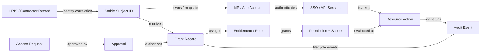
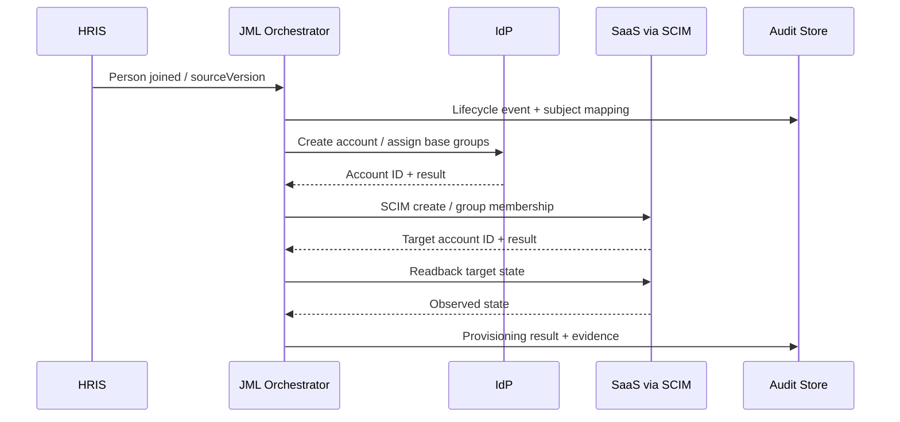
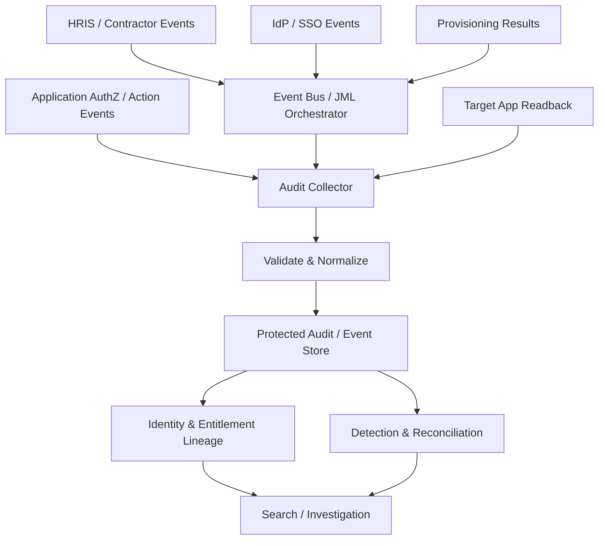

# Khả năng truy vết trong IAM: nối được danh tính, quyền và hành động từ đầu đến cuối

**Khả năng truy vết** (*traceability*) trong quản lý định danh và truy cập (**Identity and Access Management – IAM**) là khả năng lần theo các mối liên hệ và sự kiện để trả lời: **một danh tính được tạo ra từ đâu, quyền được cấp bởi ai hoặc chính sách nào, đã được sử dụng ở đâu, đã thay đổi như thế nào và khi nào thực sự bị thu hồi?**

Một bản ghi “người dùng đăng nhập thành công” chỉ phản ánh một điểm của quá trình. Truy vết đầy đủ cần nối hồ sơ gốc tại HRIS hoặc hệ thống đối tác, định danh tại **IdP**, phiên đăng nhập **SSO**, nhóm và entitlement được cấp qua **SCIM** hoặc API, quyết định **RBAC/ABAC** trong ứng dụng, các hành động thực tế và bằng chứng thu hồi tại hệ thống đích.

Trong quản lý vòng đời danh tính theo mô hình **Joiner–Mover–Leaver (JML)**, khả năng truy vết giúp phát hiện các quyền không còn gắn với nhiệm vụ hiện tại: một role cục bộ được cấp thủ công, nhóm chưa được gỡ, token vẫn còn hiệu lực hoặc một tài khoản dịch vụ không rõ người sở hữu. Truy vết không tự động ngăn truy cập trái phép, nhưng nó tạo cơ sở để **kiểm tra, điều tra, đối soát và cải thiện kiểm soát**.

## 1. Mục tiêu học tập

Sau bài này, người học có thể:

1. Định nghĩa traceability và phân biệt nó với **logging, distributed tracing, audit, accountability** và giám sát bảo mật.
2. Truy vết **xuôi** từ một sự kiện nhân sự đến tài khoản, entitlement và ứng dụng; truy vết **ngược** từ một quyền hoặc hành động tới nguồn cấp và phê duyệt.
3. Chọn định danh ổn định để liên kết **HRIS → IdP → SSO → SCIM → ứng dụng** mà không phụ thuộc hoàn toàn vào email hay tên hiển thị.
4. Thiết kế sơ đồ dữ liệu truy vết cho **subject, account, entitlement, grant, policy, resource, session, action và lifecycle event**.
5. Phân biệt **quyền được yêu cầu**, **quyền đã gửi lệnh cấp/thu hồi** và **quyền có hiệu lực tại ứng dụng đích**.
6. Thiết kế correlation ID, event ID, source version và timestamp để dựng lại chuỗi sự kiện phân tán.
7. Điều tra quyền truy cập tồn dư trong Mover/Leaver và những đường cấp quyền gián tiếp.
8. Áp dụng truy vết cho tài khoản đặc quyền, ủy quyền thay mặt và service account/workload identity.
9. Đề xuất phương pháp xác minh tính đầy đủ, toàn vẹn, bảo vệ dữ liệu và chỉ số đánh giá độ phủ truy vết.

## 2. Khả năng truy vết là gì và cần truy vết những gì?

Trong IAM, một đối tượng thường có nhiều loại quan hệ:

- **Danh tính nguồn:** hồ sơ nhân viên, nhà thầu, đối tác hoặc workload nào là gốc?
- **Tài khoản:** danh tính nguồn liên kết với những account nào tại IdP và các ứng dụng?
- **Quyền:** permission hoặc entitlement nào đã được cấp, qua role, nhóm, ACL, chính sách hay ngoại lệ?
- **Căn cứ:** cấp quyền vì nhiệm vụ, yêu cầu, phê duyệt, chính sách và phiên bản nào?
- **Thời gian:** quyền bắt đầu, thay đổi, hết hạn và bị thu hồi vào các mốc nào?
- **Sử dụng:** quyền nào đã được dùng trong thao tác nào trên tài nguyên nào?
- **Kết quả:** lệnh đã thực hiện thành công thật hay chỉ được hệ thống tiếp nhận?

Một hệ thống có khả năng truy vết tốt cho phép trả lời hai chiều:

| Hướng truy vết | Câu hỏi | Ví dụ |
| --- | --- | --- |
| **Xuôi – forward traceability** | Từ một nguồn/sự kiện, điều gì đã xảy ra tiếp theo? | Sự kiện Leaver của Hà đã vô hiệu hóa account nào, thu hồi nhóm nào và tác động tới hệ thống nào? |
| **Ngược – backward traceability** | Từ trạng thái/quyền/hành động, nguồn gốc là gì? | Vì sao account trong ERP vẫn có `invoice:approve` và ai đã phê duyệt? |
| **Theo thời gian – temporal traceability** | Tại thời điểm T, hệ thống biết và cho phép điều gì? | Tài khoản còn quyền `ADMIN` lúc 10:15 trước hay sau sự kiện Mover? |
| **Xuyên hệ thống – cross-system traceability** | Các bản ghi ở nhiều nền tảng có thuộc cùng một quá trình? | Bản cập nhật nhóm IdP và role cục bộ trong SaaS có cùng yêu cầu cấp quyền không? |

### 2.1. Truy vết không chỉ dành cho sự cố

Các trường hợp sử dụng bình thường gồm: giải thích lý do một người không đăng nhập được, xác định vì sao ứng dụng còn role cũ, xác nhận nhân viên mới đã nhận đúng quyền, rà soát chủ sở hữu entitlement, tính thời gian thu hồi và cung cấp bằng chứng cho access certification.

Nếu chỉ lưu log khi có sự cố, chuỗi lịch sử cần thiết có thể đã mất trước khi điều tra bắt đầu. Truy vết là **năng lực thiết kế và vận hành thường xuyên**, không chỉ là thao tác tìm kiếm ad hoc.

## 3. Phân biệt traceability, audit và accountability

| Khái niệm | Trọng tâm | Một kết quả điển hình |
| --- | --- | --- |
| **Logging** | Ghi lại sự kiện từ một thành phần. | IdP ghi sự kiện đăng nhập. |
| **Distributed tracing** | Theo dõi một request hoặc tác vụ qua nhiều service. | Trace ID nối API gateway → IAM policy service → ứng dụng. |
| **IAM traceability** | Nối nguồn gốc, thay đổi, sử dụng và thu hồi danh tính/quyền qua thời gian và hệ thống. | Role đang tồn tại → grant → phê duyệt → HR role → lịch sử Mover. |
| **Auditing** | Đánh giá hoạt động và kiểm soát dựa trên bằng chứng. | Kiểm tra liệu mọi Leaver đã thu hồi quyền theo thời hạn. |
| **Accountability** | Xác định chủ thể/đơn vị phải giải thích và chịu trách nhiệm. | Ai phê duyệt grant; ai xử lý ngoại lệ chưa thu hồi? |
| **Monitoring/Detection** | Phát hiện trạng thái bất thường hoặc vi phạm có thể xảy ra. | Cảnh báo account nghỉ việc vẫn có token hoạt động. |

**Có trace ID chưa đủ để có traceability.** Distributed tracing thường quan sát một request kéo dài vài mili giây hoặc phút; vòng đời danh tính có thể kéo dài nhiều năm. Một entitlement được cấp ba tháng trước thường không chia sẻ trace ID với hành động API hôm nay. Cần **liên kết nghiệp vụ bền vững** như `grantId`, `entitlementId`, `subjectId` và `policyVersion`.

**Có audit log cũng chưa chắc truy vết được.** Log kiểu `user=admin, action=update, success=true` không nói tài khoản nào, quyền nào, tài nguyên nào bị thay đổi; càng không cho biết nguyên nhân cấp quyền và trạng thái đích.

## 4. Mô hình đối tượng và liên kết truy vết

Có thể xem dữ liệu IAM như một đồ thị gồm các thực thể và quan hệ:



Đây là mô hình khái niệm. Không cần lưu tất cả nút trong một database, nhưng phải có **khóa liên kết và nguồn sự thật** để ghép chúng một cách đáng tin.

### 4.1. Các định danh cần phân biệt

| Định danh | Ý nghĩa | Lỗi thường gặp |
| --- | --- | --- |
| `personId` / `subjectId` | Chủ thể ổn định do hệ thống có thẩm quyền hoặc IAM định nghĩa. | Dùng email làm khóa chính rồi mất liên kết khi đổi tên. |
| `issuer + sub` | Danh tính liên kết khi token được cấp bởi IdP. | Chỉ so `sub` và gộp nhầm các issuer khác nhau. |
| `accountId` | Account cụ thể tại một hệ thống đích. | Một người có nhiều account nhưng chỉ kiểm tra một account. |
| `entitlementId` | Loại quyền, nhóm hoặc role được quản lý. | Đồng nhất hai role cùng tên ở hai ứng dụng. |
| `grantId` | Lần cấp hoặc quan hệ cấp quyền cụ thể. | Không phân biệt quyền nền và quyền ngoại lệ cấp riêng. |
| `approvalId` | Quyết định phê duyệt có thẩm quyền. | Chỉ lưu tên approver ở ghi chú tự do. |
| `resourceId` | Tài nguyên đích trong namespace có kiểm soát. | Truy vết nhầm hai đối tượng có ID giống nhau ở hai tenant. |
| `sessionRef` / `requestId` | Tham chiếu phiên/yêu cầu đang sử dụng. | Lưu nguyên session cookie hoặc access token vào log. |
| `eventId` | Định danh sự kiện phục vụ khử trùng lặp và đối soát. | Retry tạo nhiều dòng nhưng không biết cùng một sự kiện gốc. |
| `correlationId` | Nối các bước của một quá trình xuyên hệ thống. | Coi correlation ID do client tự nhập là bằng chứng danh tính. |

Trong nhiều ứng dụng, định danh chỉ duy nhất **trong một tenant hoặc hệ thống**. Có thể cần khóa ghép dạng `(systemId, tenantId, resourceId)`. Không nên xây dựng giả định toàn bộ tổ chức dùng chung một namespace.

### 4.2. Bản đồ nguồn dữ liệu

Mỗi loại thuộc tính phải có nguồn có thẩm quyền:

- **Quan hệ nhân sự và ngày hiệu lực:** HRIS hoặc hệ thống quản lý đối tác.
- **Liên kết danh tính và trạng thái đăng nhập:** IAM/IdP.
- **Nhóm và trạng thái provisioning:** IdP, SCIM service hoặc ứng dụng đích tùy hệ thống.
- **Permission thực tế:** ứng dụng, policy engine, cloud IAM hoặc database.
- **Tài nguyên/owner/tenant:** hệ thống nghiệp vụ sở hữu dữ liệu.
- **Phê duyệt:** IGA, công cụ yêu cầu quyền hoặc workflow có thẩm quyền.
- **Sử dụng quyền:** log kiểm tra authorization và kết quả thao tác từ điểm thực thi đáng tin.

Một trường `role=ADMIN` trong token có thể phản ánh trạng thái tại thời điểm token phát hành; **không tự chứng minh quyền hiện thời** sau khi role đã bị gỡ. Truy vết phải bảo toàn thông tin nguồn, thời điểm và tính mới.

## 5. Truy vết nguồn gốc của quyền hiệu lực

Tập **effective permissions** có thể đến từ nhiều đường: role trực tiếp, nhóm lồng nhau, role kế thừa, ACL, quyền chia sẻ trên file, entitlement tạm hoặc policy tài nguyên. Truy vết tốt phải cho biết **đường dẫn nào thực sự tạo ra quyền**.

Ví dụ:

```text
Subject P-1842
    -> MemberOf group: finance-apac
    -> Group mapped to role: FINANCE_READER in ERP
    -> Role includes permission: invoice:read
    -> Scope: TENANT-A / FINANCE
    -> Valid during employment relationship ACTIVE
```

Một quyền có thể có **hai đường cấp đồng thời**:

```text
P-1842 -> group finance-apac -> role FINANCE_READER
P-1842 -> direct grant EX-2026-311 -> permission invoice:read
```

Nếu gỡ nhóm nhưng quyền trực tiếp vẫn còn, kết luận “đã thu hồi quyền đọc hóa đơn” sẽ **không chính xác**. Phải kiểm tra lại quyền hiệu lực và toàn bộ đường cấp hợp lệ.

### 5.1. Một bản ghi cấp quyền nên chứa gì?

Ví dụ minh họa:

```yaml
grantId: GRANT-20911
subjectId: P-1842
targetSystem: ERP
entitlementId: FINANCE_READER
resourceScope:
  tenantId: TENANT-A
  departmentId: FINANCE
grantSource: ACCESS_REQUEST
requestId: REQ-827
approvalId: APR-391
approvedBySubjectId: P-0105
policyVersion: finance-access-v5
validFrom: "2026-12-01T02:00:00Z"
validUntil: "2027-02-01T00:00:00Z"
provisioningState: CONFIRMED
```

Schema này chỉ để học, không phải định dạng chuẩn của SCIM. Nó giúp trả lời:

- Quyền này thuộc **ai**, ở **hệ thống nào**, với **scope nào**?
- Quyền được cấp từ **role nền** hay **yêu cầu ngoại lệ**?
- Ai phê duyệt và theo phiên bản chính sách nào?
- Khi nào quyền có hiệu lực và phải hết hạn?
- Ứng dụng đích đã thực sự xác nhận cấp hay chưa?

Nếu nguồn cấp là role nền tự động, có thể không có `approvalId` riêng cho từng người; khi đó ghi **chính sách baseline, owner và phiên bản**, không tạo phê duyệt giả.

## 6. Truy vết xuôi từ sự kiện Joiner

Một sự kiện Joiner đi qua nhiều hệ thống:



Truy vết xuôi trả lời: **“Nhân viên mới đã có những account và entitlement nào, trong ứng dụng nào, do quy tắc nào cấp, và ứng dụng nào còn thất bại?”**

### 6.1. Các mốc quan trọng của Joiner

1. Nhận sự kiện có `sourceRecordId`, `sourceVersion` và `effectiveAt`.
2. Xác minh và liên kết tới `subjectId`; không tự tạo thêm một chủ thể khi người này đã tồn tại.
3. Ghi role/entitlement được tính từ nhiệm vụ và chính sách baseline.
4. Lưu thao tác tạo account và gán nhóm tại IdP, kèm `targetAccountId`.
5. Lưu lệnh provisioning tới từng ứng dụng đích và phản hồi.
6. Đọc lại account/group/permission khi hệ thống hỗ trợ để xác minh **observed state**.
7. Đánh dấu rõ quyền đặc biệt còn chờ phê duyệt thay vì coi đã cấp.

**Ví dụ:** HRIS đã xác nhận ngày bắt đầu, IdP tạo account thành công nhưng một SaaS trả lỗi. Không được báo “Joiner hoàn thành mọi ứng dụng”; kết quả truy vết cần hiển thị ứng dụng còn `FAILED` và owner xử lý.

## 7. Truy vết thay đổi quyền trong Mover

**Mover** là thời điểm khó truy vết vì danh tính thường không đổi, nhưng tập quyền nên thay đổi đáng kể. Hệ thống phải nối được **role cũ – role mới – quyền cần cấp – quyền cần gỡ – trạng thái đích**.

Ví dụ một nhân viên chuyển từ đội hỗ trợ sang tài chính:

| Thành phần | Trước Mover | Sau Mover mong muốn | Cần xác nhận |
| --- | --- | --- | --- |
| HRIS | CUSTOMER_SUPPORT | FINANCE | Sự kiện vai trò và mốc hiệu lực. |
| IdP group | `support-agent` | `finance-reader` | Nhóm cũ gỡ, nhóm mới thêm. |
| Ticketing | `ticket:reply` và ACL chia sẻ | Không còn quyền hỗ trợ | ACL cục bộ và nhóm kế thừa đã gỡ. |
| ERP | Không có quyền tài chính | `invoice:read` tenant A | Quyền đích được cấp đúng scope. |
| Quyền ngoại lệ | `customer:export-all` đã cấp trước | Thu hồi nếu không còn lý do | Quyền được cấp trực tiếp có bị bỏ sót không? |

### 7.1. Ghi nhận chênh lệch thay vì chỉ lưu trạng thái cuối

Một thay đổi vai trò có thể thể hiện thành:

```text
desiredEntitlements = baseEntitlements(newRole)
                    + approvedActiveExceptions

toGrant  = desired - current
toRevoke = current - desired
```

Công thức trên là khái niệm. Khi thực thi, phải xét scope, đường kế thừa, quyền cấp từ nhiều nguồn và hành vi deny/allow của ứng dụng.

Trace record nên ghi **lý do** quyền nằm trong `toGrant` hoặc `toRevoke`, và mỗi thao tác có trạng thái:

- `PLANNED`: hệ thống đã xác định thay đổi.
- `REQUESTED`: đã gửi lệnh tới hệ thống đích.
- `APPLIED`: đích phản hồi đã áp dụng theo giao thức.
- `CONFIRMED`: đã đối chiếu trạng thái quyền hiệu lực.
- `FAILED/PENDING`: chưa đạt mục tiêu, cần xử lý.

Tên trạng thái có thể tùy nền tảng; quan trọng là **không đánh đồng đã gửi lệnh với đã xác nhận đạt trạng thái mong muốn**.

### 7.2. Ngoại lệ bàn giao có thời hạn

Nếu nhân viên cần đọc ticket cũ thêm ba ngày, phải truy vết được ai phê duyệt, giới hạn dự án nào và đến khi nào hết hạn. Hệ thống nên tự động tìm các ngoại lệ đã quá hạn vẫn hoạt động để ngăn privilege creep.

## 8. Truy vết thu hồi trong Leaver

Khi nhân viên rời tổ chức, truy vết cần chứng minh **từng đường truy cập đã được đóng đúng lúc**. Một sự kiện Leaver có thể phát sinh nhiều tác vụ độc lập: khóa IdP, vô hiệu hóa tài khoản SaaS, hủy phiên, gỡ ACL, thu hồi PAT, SSH key và thay owner tài nguyên.

### 8.1. Ba trạng thái cần phân biệt

| Trạng thái | Diễn giải | Có đủ để kết luận thu hồi? |
| --- | --- | --- |
| **Requested** | IAM đã phát yêu cầu deprovision/revoke. | **Chưa**. |
| **Applied** | Đích báo thao tác thành công. | **Chưa chắc**; cần hiểu hệ thống có thể còn phiên/token độc lập. |
| **Confirmed effective** | Đã xác nhận không còn đường truy cập trong phạm vi kiểm tra. | Mạnh hơn; vẫn cần ghi rõ phạm vi, độ mới và giới hạn phương pháp. |

Ví dụ sau khi HRIS phát Leaver có hiệu lực lúc 18:00:

| Hệ thống | Yêu cầu gửi | Trạng thái xác nhận | Kết luận vận hành |
| --- | --- | --- | --- |
| IdP | 18:00:03 | Account disabled 18:00:05 | Đăng nhập mới bị chặn tại IdP. |
| ERP via SCIM | 18:00:08 | Target inactive 18:00:12 | Đã xác nhận trạng thái tài khoản đích; kiểm tra phiên cục bộ khi cần. |
| Git PAT | 18:00:10 | PAT revoked 18:05:00 | Có độ trễ token tồn dư cần điều tra. |
| SaaS ngoài luồng | Không có lệnh | Account vẫn active | **Chưa hoàn tất**; thiếu đường quản lý tài khoản. |

Một báo cáo Leaver đúng phải giữ mốc **18:00 là thời điểm phải hết quyền**, không sửa thành 18:05 để làm đẹp kết quả. Truy vết giúp xác định nguồn lỗi: sự kiện chậm, thất bại API, thiếu connector, credential độc lập hay quy trình không biết ứng dụng.

### 8.2. Vì sao khóa IdP chưa đủ?

SSO có thể sử dụng access token đã cấp từ trước. Một ứng dụng có thể giữ session riêng; API key/PAT có vòng đời độc lập. SCIM có thể vô hiệu hóa account nhưng không tự bảo đảm mọi share link hoặc khóa đã cấp đều bị thu hồi. Cần **bản đồ các đường truy cập thực tế** và bằng chứng đối soát theo từng hệ thống đích.

## 9. Truy vết từ một quyết định authorization tới nguồn quyền

Giả sử API nhận:

```http
POST /api/invoices/INV-409/approve
Authorization: Bearer <access_token>
```

Muốn giải thích vì sao thao tác được cho phép, cần lần theo:

1. Token/phiên đã được xác minh đúng issuer, audience, chữ ký và thời hạn.
2. `(issuer, sub)` được liên kết với subject nội bộ hợp lệ.
3. Subject đang có quan hệ/role nào theo nguồn có thẩm quyền.
4. Role/entitlement đến từ grant hoặc nhóm nào, đang có hiệu lực không.
5. Permission `invoice:approve` có đúng scope tenant, hạn mức và trạng thái không.
6. Chính sách SoD có cho phép người này duyệt giao dịch không.
7. Policy version, dữ liệu tài nguyên và ngữ cảnh được sử dụng cho quyết định là gì.
8. Quyết định ALLOW/DENY và kết quả **thực hiện nghiệp vụ** có giống nhau không.

Một đường truy vết minh họa:

```text
APPROVE /INV-409
  -> authorization decision: ALLOW
  -> subject: P-1842 (issuer: IdP-A)
  -> entitlement: FINANCE_APPROVER
  -> grant: GRANT-20911
  -> approval: APR-391
  -> business justification: FINANCE_MONTH_END
  -> policy: invoice-approval-v5
  -> scope: TENANT-A / amount <= 50_000_000
  -> resource: INV-409 / tenant A / PENDING
  -> business outcome: SUCCEEDED / transaction TX-9021
```

### 9.1. Không đồng nhất ALLOW với SUCCEEDED

API có thể cho phép thao tác nhưng giao dịch thất bại vì tài nguyên đã đổi trạng thái. Truy vết nên tách:

- **Authorization decision:** request có quyền theo chính sách hay không.
- **Execution outcome:** thao tác thành công, thất bại hoặc không có thay đổi.
- **Persistence/commit state:** thay đổi dữ liệu đã được ghi bền chưa.
- **Audit delivery state:** bản ghi kết quả đã được chuyển tới hệ thống kiểm toán chưa.

Nếu chỉ ghi `ALLOW` mà báo “người dùng đã duyệt hóa đơn”, quá trình điều tra sẽ sai.

## 10. Sơ đồ sự kiện và correlation trong hệ thống phân tán

Có thể dùng một bộ trường chung cho các sự kiện IAM trọng yếu:

```json
{
  "eventId": "evt-iam-20871",
  "correlationId": "jml-change-701",
  "eventType": "ENTITLEMENT_REVOKED",
  "sourceSystem": "IAM_ORCHESTRATOR",
  "sourceVersion": 44,
  "actor": {
    "type": "SERVICE",
    "id": "iam-provisioner"
  },
  "onBehalfOfSubjectId": "P-0105",
  "targetSubjectId": "P-1842",
  "targetSystem": "ERP",
  "targetAccountId": "erp-account-557",
  "entitlementId": "FINANCE_APPROVER",
  "scope": "TENANT-A",
  "reasonCode": "MOVER_ROLE_CHANGED",
  "approvalRef": "APR-391",
  "policyVersion": "finance-access-v5",
  "effectiveAt": "2026-12-01T02:00:00Z",
  "occurredAt": "2026-12-01T02:00:01Z",
  "observedAt": "2026-12-01T02:00:08Z",
  "outcome": "CONFIRMED"
}
```

Đây là **định dạng minh họa**, không phải một schema bắt buộc cho SCIM, OIDC hoặc hệ thống log. Các trường cần đủ để nối sự kiện, xác định nguồn và phân biệt điều đã dự định với điều đã quan sát.

### 10.1. Vai trò của ba mã khác nhau

- `eventId`: một sự kiện cụ thể; hữu ích để khử trùng lặp khi queue gửi lại.
- `correlationId`: nối nhiều sự kiện trong cùng quy trình hoặc tác vụ.
- `grantId` / `subjectId`: liên kết nghiệp vụ bền vững qua thời gian, kể cả khi các event có correlation khác nhau.

Một người có thể đổi vai trò ba lần, mỗi lần có correlation ID khác. Muốn xem toàn bộ lịch sử quyền của người đó, phải dùng subject/account/grant và mốc thời gian, **không chỉ một trace ID**.

### 10.2. Ghi timestamp có ý nghĩa

Nên phân biệt tối thiểu:

| Mốc | Ý nghĩa |
| --- | --- |
| `occurredAt` | Sự kiện diễn ra ở nguồn. |
| `effectiveAt` | Mốc quyền/trạng thái phải có hiệu lực theo nghiệp vụ. |
| `receivedAt` | IAM nhận sự kiện. |
| `processedAt` | Bộ điều phối xử lý sự kiện. |
| `sentAt` | Đã gửi lệnh tới hệ thống đích. |
| `confirmedAt` | Đích đã xác nhận trạng thái mong muốn. |

Các mốc này có thể lệch nhau. Nên lưu instant có timezone hoặc UTC rõ ràng, đồng bộ đồng hồ và theo dõi clock skew. Nếu nguồn có `sourceVersion`, nó thường hữu ích hơn so sánh các timestamp nhận sự kiện trong việc xác định cập nhật mới hơn.

## 11. Tương tác với IdP, SSO và SCIM

Mỗi hệ thống cung cấp **một phần của bằng chứng**, không phải sự thật toàn bộ.

### 11.1. IdP và SSO

IdP có thể ghi log đăng nhập, gán nhóm, xác thực MFA và phát token. SSO giúp ứng dụng xác thực dựa trên IdP, nhưng ứng dụng có thể duy trì quyền hoặc session riêng.

Để truy vết đăng nhập và hành động:

- Lưu issuer, subject và account mapping đáng tin.
- Ghi nhận loại sự kiện xác thực, kết quả và session reference an toàn.
- Không lưu access token, refresh token hoặc session cookie trong log.
- Ghi nhận thời gian thay đổi nhóm/role và biết rằng claim trong token cũ có thể lỗi thời.
- Khi yêu cầu rủi ro cao, kết nối quyết định authorization với trạng thái hiện tại theo chính sách.

### 11.2. SCIM

SCIM hỗ trợ quản lý đối tượng như User/Group và một số cập nhật thành viên nhóm theo triển khai. Truy vết cần biết:

1. Lệnh SCIM hướng tới tài khoản đích nào.
2. Thay đổi cụ thể là gì và bắt nguồn từ yêu cầu JML nào.
3. Ứng dụng trả về trạng thái gì.
4. Khi nào đọc lại trạng thái đích.
5. Còn quyền địa phương, ACL hoặc phiên nào không được SCIM quản lý.

Không phải mọi ứng dụng ánh xạ nhóm theo cùng cách hoặc hỗ trợ thu hồi mọi entitlement qua SCIM. Vì thế, không được xem “SCIM success” là bằng chứng duy nhất của **effective access**.

### 11.3. RBAC/ABAC và bản đồ chính sách

Để giải thích một quyết định, nên giữ phiên bản policy và nguồn thuộc tính của chủ thể/tài nguyên. Ví dụ:

- RBAC: `FINANCE_READER` được ánh xạ từ nhóm `finance-apac`.
- ABAC: subject.department, document.tenantId, document.classification và giới hạn thời gian.
- Resource-based policy: ACL trực tiếp trên file hoặc policy của bucket.
- SoD: người duyệt không được duyệt hóa đơn do chính mình tạo.

Khi policy thay đổi, log cũ cần thể hiện **phiên bản đã áp dụng tại thời điểm đó**; không nên đánh giá lịch sử chỉ bằng chính sách mới nhất.

## 12. Tài khoản dịch vụ, JIT và truy vết tác nhân thực thi

### 12.1. Danh tính phi con người

Một job chạy nền có thể thực hiện nhiều hành động không gắn với một phiên người dùng. Cần ghi:

| Thông tin | Ví dụ |
| --- | --- |
| Workload identity | `billing-exporter-prod`. |
| Owner | Đội `finance-platform`. |
| Mục đích | Tạo báo cáo định kỳ. |
| Môi trường | Production, namespace `billing`. |
| Run/deployment | `run-20261201-07`, version đã triển khai. |
| Cơ chế khởi chạy | Scheduler hoặc sự kiện nghiệp vụ. |
| Entitlement | Quyền đọc dataset A, ghi bucket B. |
| Credential | Tham chiếu định danh/credential an toàn, không ghi bí mật. |

Nếu job thực hiện yêu cầu thay mặt nhân viên, cần phân biệt **user khởi tạo** với **service account thực thi**. Một trường `requestedBy` lấy nguyên từ request body không tự chứng minh người khởi tạo; phải được ràng buộc với phiên và cơ chế ủy quyền tin cậy.

### 12.2. Quyền đặc quyền và PAM/JIT

Với một phiên quản trị production, truy vết cần xác định:

- Kỹ sư nào yêu cầu.
- Ticket hoặc incident nào làm căn cứ.
- Người/chính sách nào phê duyệt.
- Permission, resource scope, thời hạn được cấp.
- Tài khoản/session đặc quyền nào đã được tạo.
- Những hành động quan trọng nào được thực hiện.
- Quyền và phiên được chấm dứt lúc nào; có bằng chứng không.

Một log chỉ ghi `root executed command` không xác định được người thực tế khi cả đội dùng chung credential. PAM có thể giúp liên kết session đặc quyền với danh tính cá nhân; cần vận hành phù hợp với chính sách riêng tư và khả năng nền tảng.

### 12.3. Khi owner rời tổ chức

Leaver của người sở hữu một service account không nhất thiết khiến dịch vụ đang chạy phải tắt ngay. Nhưng cần truy vết được **sự kiện yêu cầu chuyển owner**, chủ mới, trạng thái rà soát permission/credential và thời hạn xử lý. Danh tính phi con người không có owner là một loại **lỗ hổng truy vết và quản trị vòng đời**.

## 13. Thiết kế kiến trúc thu thập và lưu truy vết

Một kiến trúc tham khảo:



Các thành phần có thể tích hợp trong một sản phẩm hoặc nhiều dịch vụ; trọng tâm là **khả năng nối dữ liệu, xác thực nguồn, bảo vệ bản ghi và xác minh trạng thái**.

### 13.1. Yêu cầu đối với luồng ghi sự kiện

- **Không phụ thuộc log dạng văn bản tự do:** dùng schema có trường rõ và version.
- **Không giả định giao hàng chính xác một lần:** event bus có thể gửi trùng, nên consumer xử lý idempotent theo `eventId` hoặc khóa idempotency phù hợp.
- **Không dựa duy nhất vào thứ tự nhận:** xử lý source version, sự kiện đến muộn và việc đảo thứ tự.
- **Kiểm soát độ mất dữ liệu:** xác nhận đã lưu bền, giám sát backlog, lỗi collector và nguồn không gửi.
- **Phân biệt bảo mật với quan sát kỹ thuật:** trace hiệu năng có thể được sampling; sự kiện kiểm toán bảo mật quan trọng không nên bị mất chỉ vì sampling của APM.
- **Định nghĩa xử lý khi audit thất bại:** hành động nhạy cảm có thể cần chặn hoặc ghi bền qua cơ chế dự phòng đã thiết kế.

### 13.2. Tránh giao dịch commit thành công nhưng thiếu log

Ví dụ: ứng dụng đổi role trong database thành công nhưng kết nối tới hệ thống audit lỗi. Một giải pháp có thể là **transactional outbox**: ghi thay đổi nghiệp vụ và sự kiện outbox trong cùng transaction, sau đó worker gửi sự kiện đến collector.

```text
BEGIN TRANSACTION
  UPDATE entitlement_state ...
  INSERT INTO audit_outbox (
    event_id, subject_id, action, target_id, payload_ref
  ) VALUES (...)
COMMIT

Outbox publisher:
  read pending events
  publish with stable event_id
  mark delivered after acknowledgement
```

Đây là pseudocode. Cần thiết kế retry, idempotency, bảo vệ nội dung, khôi phục sau lỗi và giới hạn độ trễ. Outbox tăng khả năng không bỏ sót sự kiện nhưng **không tự tạo tính bất biến** nếu người có đặc quyền vẫn sửa được cả database và outbox.

## 14. Toàn vẹn, tính sẵn có và khả năng tin cậy của bằng chứng

Truy vết chỉ hữu ích khi dữ liệu khó bị sửa trái phép, có nguồn gốc đáng tin và có thể truy cập khi điều tra.

Các biện pháp:

1. **Xác thực nguồn log:** biết ứng dụng hoặc connector nào phát bản ghi.
2. **Phân quyền tách biệt:** ứng dụng chỉ gửi bản ghi, không được sửa/xóa kho audit tùy ý.
3. **Lưu trữ có kiểm soát:** append-only, immutable retention hoặc WORM khi mức rủi ro yêu cầu và nền tảng hỗ trợ.
4. **Kiểm tra toàn vẹn:** chữ ký, hash chain hoặc cơ chế tương đương với khóa/điểm neo tin cậy được bảo vệ.
5. **Giám sát lỗ hổng dữ liệu:** phát hiện nguồn ngừng phát, sequence gap, backlog, lỗi đồng hồ.
6. **Khả năng khôi phục:** backup/replication, kiểm thử khôi phục và chính sách lưu giữ phù hợp.
7. **Truy vết quyền xem log:** người đọc, xuất và thay đổi chính sách log cũng cần có bản ghi kiểm toán.

### 14.1. Hash log có giới hạn gì?

Nếu log và hash được lưu trong cùng kho mà kẻ tấn công có thể sửa cả hai, hash không bảo đảm chống sửa. Muốn phát hiện thay đổi, phải bảo vệ khóa hoặc tham chiếu toàn vẹn tại ranh giới tin cậy độc lập. Tương tự, chữ ký số chỉ có giá trị nếu khóa riêng được quản lý và ngữ cảnh ký có thể được xác minh.

### 14.2. Có thể kết luận chính xác đến mức nào?

Một bản ghi có thể chứng minh **credential/phiên X đã gọi API Y**, nhưng chưa đủ để chứng minh người sở hữu tài khoản trực tiếp thao tác nếu có khả năng chia sẻ hoặc chiếm đoạt phiên. Khi điều tra, cần phân biệt **bằng chứng quan sát được**, **giả thuyết**, **mức chắc chắn** và **giới hạn của dữ liệu**.

## 15. Đối soát: so sánh quyền mong muốn và quyền thực tế

Truy vết dữ liệu lịch sử quan trọng, nhưng cần kết hợp **reconciliation** để phát hiện trạng thái không đúng.

```text
desiredState = quyền theo HRIS + role hiện tại
             + entitlement được duyệt còn hiệu lực

observedState = quyền hiệu lực đọc từ IdP,
                ứng dụng, cloud, database, ACL, token systems

drift = observedState khác desiredState
```

Công thức ở trên mang tính khái niệm. Trong thực tế, quyền hiệu lực cần tính cả nhóm kế thừa, explicit deny, điều kiện tài nguyên, role cục bộ và credential độc lập.

### 15.1. Một phát hiện drift nên truy vết được

Ví dụ hệ thống báo:

```json
{
  "findingId": "DRIFT-902",
  "subjectId": "P-1842",
  "targetSystem": "ticketing",
  "entitlement": "CUSTOMER_EXPORT_ALL",
  "desired": "ABSENT",
  "observed": "ACTIVE",
  "detectedAt": "2026-12-01T03:00:00Z",
  "lastKnownGrantRef": "GRANT-11921",
  "lastMoverEvent": "MOVER-621",
  "ownerTeam": "customer-platform",
  "state": "OPEN"
}
```

Bằng chứng nên giúp trả lời:

- Entitlement được cấp khi nào và thông qua đường nào?
- Tại sao quyền này không thuộc desired state?
- Ai đã phê duyệt hoặc có quyền phê duyệt ngoại lệ?
- Có thể gỡ bằng SCIM hay phải dùng API/công việc thủ công?
- Sau khi gỡ, ứng dụng có xác nhận quyền không còn hiệu lực không?

### 15.2. Không tự động xóa quyền chỉ vì không thấy phê duyệt

Một quyền không truy được nguồn cấp là **bất thường cần xử lý**; việc tự động xóa ngay có thể gây gián đoạn nếu quyền liên quan tới một hệ thống sản xuất trọng yếu. Phản ứng nên phụ thuộc rủi ro: chặn khẩn cấp nếu có nguy cơ nghiêm trọng, hoặc xác định owner, điều tra nguồn cấp và thu hồi có kiểm soát. Truy vết hỗ trợ **quyết định có căn cứ**, không thay thế quản trị thay đổi.

## 16. Hướng dẫn điều tra một quyền truy cập tồn dư

**Tình huống:** An chuyển từ hỗ trợ khách hàng sang tài chính. Hai ngày sau, An vẫn xuất được danh sách khách hàng dù nhóm hỗ trợ tại IdP đã bị gỡ.

Một quy trình điều tra gồm:

1. **Xác nhận sự kiện:** tìm log `customer:export-all`, subject và thời điểm. Phân biệt thao tác được phép với export thật sự thành công.
2. **Xác minh danh tính:** liên kết `issuer + sub` hoặc account đích với cùng subject An; loại trừ account khác hoặc service dùng thay.
3. **Xác định quyền hiệu lực:** ứng dụng ticketing kiểm tra role, nhóm, ACL hoặc policy nào để cho export?
4. **Truy ngược nguồn cấp:** entitlement do role hỗ trợ kế thừa hay grant trực tiếp qua một đợt hỗ trợ khẩn cấp?
5. **Kiểm tra Mover:** sự kiện đổi vai trò có quy định gỡ quyền đó không? Lệnh đã gửi tới ứng dụng đích chưa?
6. **Kiểm tra phản hồi và readback:** SCIM/API có lỗi hoặc chỉ gỡ nhóm, không chạm tới role cục bộ?
7. **Kiểm tra token/cache:** ứng dụng có dùng claim cũ, phiên dài hạn hay cache ALLOW không?
8. **Khắc phục:** thu hồi quyền ở đúng nguồn, xử lý phiên/credential, xác minh export bị từ chối.
9. **Ghi nhận và cải thiện:** nối finding với grant, Mover event, connector, root cause, owner và biện pháp ngăn tái diễn.

**Kết luận có thể xảy ra:** role `CUSTOMER_EXPORT_ALL` được cấp thủ công tại ticketing từ nhiều tháng trước. Vì hệ thống chỉ đồng bộ nhóm IdP và chưa quét role cục bộ, Mover không thu hồi quyền. Để sửa bền vững, cần bổ sung **nguồn entitlement cục bộ vào đối soát**, owner và cơ chế thu hồi có bằng chứng.

## 17. Khả năng truy vết phải tôn trọng quyền riêng tư

Log truy vết IAM có thể chứa tên tài khoản, IP, thiết bị, lịch sử truy cập, thời gian làm việc và định danh tài nguyên. Tích lũy dữ liệu không kiểm soát có thể tạo rủi ro quyền riêng tư và an ninh.

Nguyên tắc thiết kế:

- **Tối thiểu hóa dữ liệu:** chỉ lưu những trường phục vụ quản trị danh tính, bảo mật hoặc kiểm toán được xác định.
- **Không lưu secret:** mật khẩu, access token, refresh token, cookie phiên, API key, private key và mã khôi phục MFA không được đưa vào sự kiện.
- **Lưu tham chiếu an toàn:** thay raw session token bằng mã tham chiếu không thể dùng để xác thực.
- **Phân quyền đọc:** đội IAM, SOC, kiểm toán và owner ứng dụng chỉ xem phần dữ liệu phù hợp nhiệm vụ.
- **Giới hạn thời hạn lưu:** theo rủi ro, chính sách và yêu cầu pháp lý áp dụng; không lưu vô hạn chỉ vì có dung lượng.
- **Bảo vệ xuất log:** việc xuất dữ liệu kiểm toán cũng cần phê duyệt, giới hạn phạm vi và dấu vết.
- **Tách mục đích:** dữ liệu phục vụ điều tra an ninh không mặc nhiên được phép dùng cho mục đích giám sát nhân sự khác.

### 17.1. Truy vết khi dữ liệu định danh bị thay đổi hoặc xóa

Tùy yêu cầu pháp lý và chính sách lưu giữ, hệ thống có thể cần giữ bằng chứng ở dạng giảm dữ liệu định danh, với khả năng nối lại chỉ dành cho người có thẩm quyền. Phải thiết kế các khóa liên kết, vòng đời dữ liệu và quy trình kiểm toán từ đầu; không thể mặc định lưu vĩnh viễn mọi thông tin cá nhân vì “cần trace”.

## 18. Các chỉ số đánh giá độ phủ truy vết

Chỉ số phải có **mẫu số, hệ thống nguồn, phương pháp kiểm tra và thời điểm chốt**.

| Chỉ số | Cách đo tham khảo | Ý nghĩa |
| --- | --- | --- |
| **Tỷ lệ account liên kết được chủ thể** | Account có liên kết chủ thể hoặc workload owner / tổng account. | Tìm account mồ côi hoặc định danh không rõ. |
| **Tỷ lệ entitlement truy ngược được nguồn cấp** | Quyền có grant/policy/phê duyệt hợp lệ / tổng quyền thuộc phạm vi. | Phát hiện quyền ngoài luồng. |
| **Tỷ lệ sự kiện JML có correlation đầy đủ** | Sự kiện gắn được nguồn và thao tác đích / tổng sự kiện JML. | Đo khả năng nối quá trình cấp/thu hồi. |
| **Tỷ lệ thu hồi được xác nhận** | Entitlement cần thu hồi có readback tại đích / tổng entitlement phải thu hồi. | Phân biệt yêu cầu với kết quả thật. |
| **Độ trễ xác nhận thu hồi** | `confirmedAt - effectiveAt` trên từng hệ thống. | Phát hiện cửa sổ quyền tồn dư. |
| **Tỷ lệ log authorization có actor/action/resource/outcome** | Sự kiện đủ bộ trường bắt buộc / tổng sự kiện cần kiểm toán. | Đo chất lượng bằng chứng API. |
| **Tỷ lệ job nền gắn được người yêu cầu hoặc nguồn hợp lệ** | Job có nguồn/owner xác minh được / tổng job thuộc phạm vi. | Giảm vùng mù của service account. |
| **Số trường hợp drift chưa đóng** | Các sai lệch desired/observed chưa có biện pháp hoặc xác nhận hoàn tất. | Phát hiện tồn dư hoặc cấp quyền ngoài luồng. |
| **Tỷ lệ sự kiện bị thiếu/trễ ở audit pipeline** | Sự kiện có gap, backlog hoặc timeout / tổng sự kiện mong đợi. | Đo độ tin cậy của hệ thống truy vết. |
| **Thời gian điều tra đến nguyên nhân cấp quyền** | Từ phát hiện bất thường tới khi có nguồn grant/policy được xác minh. | Đo khả năng truy vết thực tế. |

Không nên cải thiện chỉ số bằng cách loại những hệ thống khó thu thập log khỏi mẫu số mà không công khai phạm vi. Một báo cáo 100% truy vết có thể gây hiểu nhầm nếu tài khoản local và tài khoản dịch vụ không được tính.

## 19. Kiểm thử khả năng truy vết

### 19.1. Bộ tình huống tối thiểu

| Tình huống | Kỳ vọng truy vết |
| --- | --- |
| Joiner cấp quyền theo baseline | Từ HRIS event tìm được account IdP, group và trạng thái ứng dụng đích. |
| Quyền ngoại lệ được phê duyệt | Từ entitlement tìm được request, approver, scope và thời hạn. |
| Mover gỡ nhóm | Có cả lệnh gỡ và readback; biết quyền trực tiếp nào vẫn còn. |
| Leaver có ứng dụng không phản hồi | Báo PENDING/FAILED, owner và thời gian retry; không báo hoàn tất sớm. |
| Một quyền có hai đường cấp | Tìm được cả nhóm và grant trực tiếp; gỡ một đường không bị nhầm là thu hồi toàn bộ. |
| Hai IdP có cùng giá trị `sub` | Không gộp nhầm danh tính vì issuer khác nhau. |
| API duyệt hóa đơn | Gắn được subject, resource, policy version, decision và kết quả nghiệp vụ. |
| Service account chạy job | Tìm được workload, owner, môi trường, run ID và nguồn kích hoạt. |
| JIT hết hạn | Có bằng chứng quyền và phiên đặc quyền thực sự hết hiệu lực. |
| Audit collector bị lỗi | Có cảnh báo, retry và xác định phạm vi sự kiện bị ảnh hưởng. |
| Sự kiện gửi trùng, sai thứ tự | Không tạo grant trùng hay khôi phục quyền đã thu hồi bởi sự kiện mới hơn. |
| Người dùng đổi email | Lịch sử quyền vẫn nối được qua subject ID ổn định. |

### 19.2. Kiểm thử truy vết hai chiều

Đối với một sự kiện cấp quyền, nên thử:

**Truy xuôi:** bắt đầu từ `requestId` → `approvalId` → `grantId` → target account/role → access decision → revoke evidence.

**Truy ngược:** bắt đầu từ `targetAccountId + entitlementId` → nguồn role/nhóm/ACL → grant → chính sách hoặc phê duyệt → người yêu cầu → quan hệ nhân sự tại thời điểm cấp.

Nếu truy xuôi thành công nhưng truy ngược thất bại, dữ liệu có thể thiếu liên kết bền vững ở ứng dụng đích, đặc biệt với các role được gán thủ công.

### 19.3. Kiểm thử độ mới và sự kiện bất thường

- Event Leaver đến trễ sau mốc có hiệu lực.
- Event Mover cũ đến sau event Leaver mới.
- Retry SCIM tạo phản hồi nhiều lần.
- Account được tái sử dụng email sau khi người cũ nghỉ việc.
- Cache quyền chưa cập nhật sau khi ACL bị gỡ.
- Lệnh provisioning được chấp nhận nhưng ứng dụng áp dụng bất đồng bộ.
- Một phiên đặc quyền tiếp tục hoạt động sau khi quyền JIT hết hạn.
- Ứng dụng đã commit giao dịch nhưng audit sink tạm mất kết nối.

Các ca này giúp kiểm chứng truy vết phản ánh **thực tế hệ thống phân tán**, không chỉ một luồng thành công đơn giản.

## 20. Anti-pattern thường gặp

| Thiết kế chưa tốt | Rủi ro | Cách cải thiện |
| --- | --- | --- |
| Chỉ dùng email để nối log | Đổi email hoặc tái sử dụng email làm sai lịch sử. | Subject ID ổn định, issuer và account mapping. |
| Chỉ có request trace ID | Không nối được quyền được cấp từ nhiều tháng trước. | Thêm grant/entitlement/approval ID bền vững. |
| Chỉ ghi thành công | Không giải thích được từ chối và lỗi provisioning. | Ghi decision, failure reason và trạng thái đích. |
| Đánh dấu revoke hoàn tất ngay khi gửi SCIM | Còn phiên/token/role cục bộ chưa xử lý. | Readback và ghi rõ phạm vi xác nhận. |
| Không thu quyền qua ACL/nhóm kế thừa | Không tìm được đường cấp quyền thực sự. | Tính effective permissions và provenance path. |
| Ghi userId do client tự gửi | Có thể giả mạo danh tính người yêu cầu. | Dùng principal đã xác thực và ngữ cảnh ủy quyền tin cậy. |
| Log chỉ có service account | Mất dấu người hoặc sự kiện khởi tạo job. | Ghi actor, on-behalf-of, run/correlation và owner. |
| Log chứa token, cookie hoặc secret | Biến kho audit thành nguồn rò rỉ. | Redact, không ghi secret, lưu tham chiếu an toàn. |
| Không xử lý event trùng/sai thứ tự | Truy vết lặp hoặc trạng thái lịch sử sai. | Event ID, idempotency, source version và reconciliation. |
| Log và hash do cùng admin tùy ý sửa | Không phát hiện được thay đổi trái phép. | Phân tách quyền, lưu trữ có kiểm soát, điểm neo tin cậy. |
| Chỉ lưu trạng thái mới nhất | Không tái dựng được quyền tại thời điểm sự cố. | Lưu lịch sử thay đổi có version/timestamp hợp lệ. |
| Thiếu owner của connector/app | Sai lệch quyền không có người xử lý. | Danh mục ứng dụng, owner và workflow khắc phục. |

## 21. Bài tập tình huống

### Bài 1 – Vì sao quyền này vẫn tồn tại?

Nhân viên Bình chuyển từ vận hành sang tài chính. Nhóm `operations-admin` ở IdP đã bị gỡ. Một tháng sau, Bình vẫn có thể thay đổi cấu hình service sản xuất thông qua tài khoản local.

**Câu hỏi:** Dữ liệu nào cần để truy ngược quyền này, và nguồn sai lệch có thể nằm ở đâu?

**Gợi ý:** Tìm account mapping, tài khoản local, grant/policy gốc, Mover event, provisioning history, ACL/role tại ứng dụng và readback. Quyền local có thể không nằm trong luồng SCIM hoặc đã được cấp ngoại lệ thủ công.

### Bài 2 – Chỉ có trace ID là đủ chưa?

Một API log có `traceId=req-2002` và ghi `200 OK`. Kiểm toán hỏi ai đã phê duyệt cho người dùng quyền xuất báo cáo tháng trước.

**Câu hỏi:** Trace ID giúp gì và còn thiếu gì?

**Gợi ý:** Trace ID giúp nối lời gọi trong request hiện tại; cần thêm subject, entitlement, grant, approval, policy version và lịch sử tài nguyên/quyền để truy ngược nguồn cấp ở thời điểm trước đó.

### Bài 3 – Leaver đã gửi lệnh nhưng chưa thực sự thu hồi

HRIS ghi nhân viên nghỉ từ 18:00. IAM gửi lệnh vô hiệu hóa tất cả ứng dụng lúc 18:01. Dashboard hiển thị 100% success vì các HTTP request trả về mã thành công. Tuy nhiên một SaaS vẫn cho phép session cũ tới 18:20.

**Câu hỏi:** Chỉ số và chứng cứ cần thay đổi gì?

**Gợi ý:** Phân biệt request sent, target state applied và access effectively blocked; đo độ trễ trên hệ thống đích, quản lý session/token độc lập và ghi rõ giới hạn kiểm tra.

### Bài 4 – Job nền không có danh tính người dùng

Một worker `analytics-exporter` xuất dữ liệu khách hàng theo yêu cầu từ UI, nhưng log chỉ ghi service account và mã dataset.

**Câu hỏi:** Cách truy vết người yêu cầu và ngăn giả mạo?

**Gợi ý:** Gắn job với subject đã xác thực, action và resource scope được server cấp, correlation ID, run ID và owner; không tin trường tên người dùng do client tự khai. Worker phải thực thi ủy quyền đúng phạm vi.

### Bài 5 – Hai quyền cùng tên

Hai ứng dụng đều có role `ADMIN`. Báo cáo IAM gộp thành một entitlement vì dùng role name làm khóa.

**Câu hỏi:** Tại sao sai và nên sửa ra sao?

**Gợi ý:** Role name không phải định danh toàn cục. Cần namespace theo application/system/tenant, entitlement ID ổn định, scope và quy tắc kế thừa riêng cho từng hệ thống.

### Bài 6 – Log bị mất sau sự cố

Một admin thay đổi chính sách cấp quyền; giao dịch đã thành công, nhưng hệ thống audit gặp lỗi mạng và không nhận được event. Không ai nhận ra cho đến một tuần sau.

**Câu hỏi:** Biện pháp thiết kế và giám sát nào phù hợp?

**Gợi ý:** Cân nhắc transactional outbox hoặc cơ chế ghi bền tương đương; theo dõi backlog, delivery acknowledgement, sequence gap; với thay đổi rất nhạy cảm, định nghĩa rõ cách xử lý khi không thể ghi bằng chứng đáng tin.

## 22. Checklist xây dựng khả năng truy vết cho IAM

- [ ] Mỗi danh tính người dùng hoặc workload có khóa ổn định và nguồn có thẩm quyền.
- [ ] Có mapping từ hồ sơ nguồn tới account IdP và account từng ứng dụng.
- [ ] Không dùng email, tên hiển thị hay `sub` đơn lẻ từ nhiều issuer làm khóa duy nhất.
- [ ] Grant/entitlement có source, owner, scope, policy/approval và thời hạn khi áp dụng.
- [ ] Hệ thống lưu được đường cấp quyền trực tiếp, qua nhóm, qua role kế thừa hoặc ACL.
- [ ] Sự kiện JML có event ID, source version, effective time và correlation ID.
- [ ] Phân biệt desired state, lệnh đã gửi, trạng thái đích quan sát và quyền hiệu lực.
- [ ] Các quyết định API có subject, action, resource, policy version và kết quả.
- [ ] Tách authorization decision khỏi business outcome và trạng thái commit.
- [ ] SCIM/IdP/ứng dụng có readback và cơ chế xác nhận thu hồi theo rủi ro.
- [ ] Phiên, token, PAT, API key và tài khoản cục bộ được xét trong quy trình Leaver.
- [ ] Quyền JIT/PAM có người yêu cầu, phê duyệt, khoảng hiệu lực và bằng chứng hết quyền.
- [ ] Workload identity có owner, mục đích, environment, run ID và scope cụ thể.
- [ ] Pipeline log có kiểm tra nguồn, schema, retry/idempotency và cảnh báo mất dữ liệu.
- [ ] Lưu trữ audit có phân quyền, kiểm soát toàn vẹn, giới hạn dữ liệu và thời gian lưu.
- [ ] Có quy trình đối soát effective permissions và xử lý drift với owner rõ ràng.
- [ ] Có kiểm thử truy xuôi/truy ngược từ request đến revoke ở nhiều hệ thống.
- [ ] Báo cáo độ phủ truy vết nêu rõ hệ thống nằm ngoài phạm vi hoặc chưa quan sát được.

## 23. Ghi nhớ

**Khả năng truy vết** trong IAM không chỉ là “có log” hoặc “có trace ID”. Nó là khả năng **nối dữ liệu đáng tin xuyên suốt danh tính, tài khoản, quyền, phê duyệt, sự kiện vòng đời, phiên, thao tác và kết quả tại hệ thống đích**.

Trong mô hình **Joiner–Mover–Leaver**, truy vết giúp xác nhận quyền đã được cấp đúng nguồn khi gia nhập, quyền cũ đã thực sự bị gỡ khi chuyển vai trò và mọi đường truy cập đã được xử lý khi rời tổ chức. **IdP/SSO** cung cấp dấu vết xác thực, **SCIM/API provisioning** cung cấp dấu vết đồng bộ, **RBAC/ABAC** cung cấp lý do ủy quyền, còn **ứng dụng và hệ thống kiểm toán** cung cấp bằng chứng thao tác và trạng thái thật.

Một câu hỏi thực dụng để đánh giá thiết kế là: **“Từ quyền hoặc hành động xuất hiện hôm nay, có thể truy ngược tới danh tính, nguồn cấp, chính sách và người phê duyệt — rồi từ một sự kiện Mover/Leaver truy xuôi tới mọi hệ thống cần thu hồi — bằng chứng cứ đã được xác minh hay không?”**
