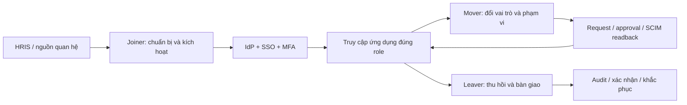
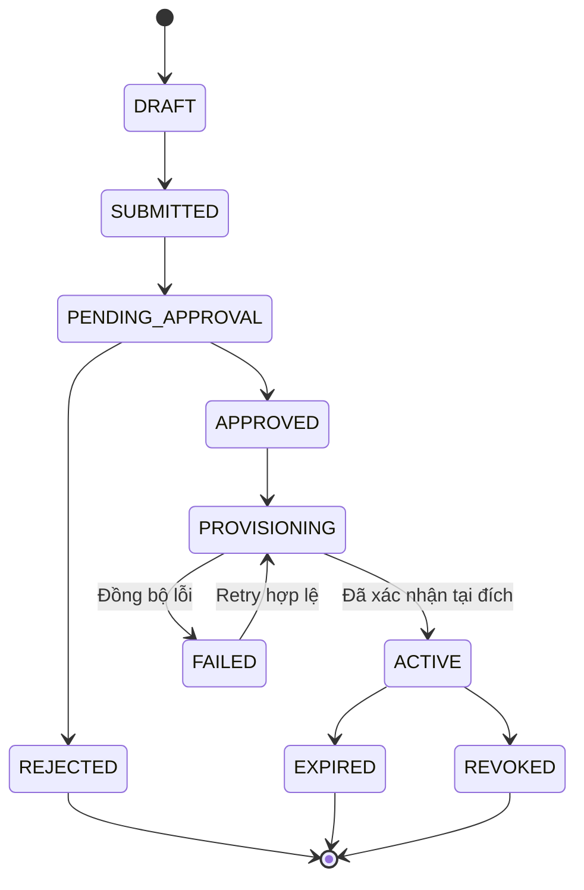

# Trải nghiệm người dùng trong IAM: truy cập thuận tiện nhưng vẫn an toàn suốt vòng đời danh tính

Trong quản lý định danh và truy cập (**Identity and Access Management – IAM**), **trải nghiệm người dùng (User Experience – UX)** là mục tiêu bảo đảm một người hoặc nhóm vận hành có thể **hiểu, yêu cầu, nhận, sử dụng và chấm dứt quyền truy cập** theo cách rõ ràng, nhất quán, kịp thời và ít thao tác thừa. UX không chỉ là giao diện đăng nhập đẹp: trải nghiệm còn bao gồm chờ cấp quyền, đăng nhập một lần (**SSO**), đăng ký MFA, đổi vai trò, xin quyền tạm, thông báo bị từ chối, xử lý tài khoản bị khóa và bàn giao dữ liệu khi nghỉ việc.

Trong mô hình quản lý vòng đời danh tính **Joiner–Mover–Leaver (JML)**, trải nghiệm tốt cần gắn với chính sách: **đúng người, đúng quyền, đúng tài nguyên, đúng thời điểm và đúng ngữ cảnh**. Nếu quá nhiều bước hoặc thông báo khó hiểu, người dùng dễ tìm đường vòng như mượn tài khoản, chia sẻ mật khẩu, xin role quá rộng hoặc sử dụng credential không được quản trị. Nếu chỉ tối ưu cho sự tiện lợi mà bỏ qua kiểm soát, quyền truy cập tồn dư, lộ dữ liệu và giả mạo có thể gia tăng.

> **Nguyên tắc trung tâm:** Làm cho **đường truy cập hợp lệ trở nên dễ hiểu và dễ thực hiện**, đồng thời giữ ranh giới bảo mật có thể kiểm chứng. Mục tiêu không phải xóa mọi bước kiểm soát, mà là loại bỏ **ma sát không tạo giá trị bảo mật**.

Bài học này nằm trong chương **Mục tiêu IAM** và tập trung vào UX của dịch vụ quản lý vòng đời danh tính, có liên hệ với **IdP**, **SSO**, **SCIM**, **RBAC/ABAC**, tài khoản dịch vụ, kiểm toán và giảm quyền truy cập tồn dư.

## 1. Mục tiêu học tập

Sau bài này, người học có thể:

1. Giải thích vì sao UX là một **mục tiêu vận hành và an toàn** của IAM, không chỉ là mỹ thuật của màn hình đăng nhập.
2. Phân biệt **ma sát cần thiết vì rủi ro** với **ma sát do quy trình hoặc tích hợp kém**.
3. Phác họa hành trình IAM cho người mới gia nhập (**Joiner**), người chuyển vai trò (**Mover**) và người rời tổ chức (**Leaver**).
4. Thiết kế luồng IdP/SSO, MFA/passkey, phục hồi tài khoản và yêu cầu cấp quyền theo hướng rõ ràng, có trợ giúp.
5. Giải thích vai trò của **SCIM/provisioning**, **RBAC/ABAC**, **Conditional Access** và **JIT** trong trải nghiệm có thể dự đoán được.
6. Thiết kế thông báo trạng thái, thông báo từ chối và đường khắc phục **không làm lộ dữ liệu nhạy cảm**.
7. Đánh giá quyền riêng tư, khả năng tiếp cận, nhu cầu đa ngôn ngữ và những tình huống ngoại lệ.
8. Lựa chọn chỉ số UX cân bằng với bảo mật, tốc độ cấp/thu hồi, khả năng giải trình và chất lượng hỗ trợ.
9. Xây dựng bộ kiểm thử và tiêu chí nghiệm thu cho các hành trình IAM quan trọng.

## 2. Tại sao trải nghiệm người dùng lại là mục tiêu bảo mật?

Một người chỉ muốn hoàn thành nhiệm vụ công việc. Nếu hệ thống IAM liên tục yêu cầu nhập lại mật khẩu, phê duyệt qua nhiều nhóm không rõ trách nhiệm hoặc không giải thích quyền bị từ chối, người đó có động lực tìm cách tránh quy trình.

Ví dụ, nhân viên chăm sóc khách hàng cần xem ticket của dự án Alpha nhưng mất hai ngày để được cấp role. Trong thời gian chờ, họ có thể đề nghị đồng nghiệp xuất dữ liệu gửi qua chat. Khi đó, một trải nghiệm cấp quyền kém có thể **đẩy công việc sang kênh chia sẻ kém kiểm soát**.

Ngược lại, nếu IAM cấp role `SUPER_ADMIN` ngay cho mọi người chỉ để giảm số ticket hỗ trợ, thao tác có thể thuận tiện trong ngắn hạn nhưng phá vỡ nguyên tắc quyền tối thiểu.

| Mục tiêu UX | Rủi ro nếu thực hiện kém | Hướng thiết kế cân bằng |
| --- | --- | --- |
| **Truy cập nhanh khi có căn cứ** | Người dùng phải chờ lâu, tìm đường vòng. | Cấp role nền tự động, yêu cầu ngoại lệ có trạng thái rõ. |
| **Ít bước xác thực thừa** | MFA fatigue, quên mật khẩu, hỗ trợ quá tải. | SSO, passkey và step-up theo mức rủi ro. |
| **Hiểu rõ mình được làm gì** | Yêu cầu role quá rộng, thử sai nhiều lần. | Catalog quyền theo nhiệm vụ, giải thích phạm vi. |
| **Biết vì sao bị từ chối** | Người dùng lặp lại yêu cầu và mở ticket thiếu thông tin. | Reason code và hướng khắc phục vừa đủ, không lộ tài nguyên ngoài scope. |
| **Thay đổi vai trò liền mạch** | Thiếu quyền mới hoặc giữ quyền cũ quá lâu. | Quy trình Mover tính tập quyền mục tiêu, readback và thông báo. |
| **Thu hồi đúng lúc** | Tài khoản cũ và token tồn dư. | Leaver tự động hóa, xác nhận trạng thái từng ứng dụng. |
| **Hỗ trợ và phục hồi an toàn** | Nhân viên hỗ trợ bỏ qua bước xác minh để giải quyết nhanh. | Phục hồi có chứng thực và nhật ký, đường hỗ trợ rõ. |

**UX tốt không đồng nghĩa với ALLOW cho mọi yêu cầu.** Một quyết định DENY có lý do, phù hợp chính sách và có đường xin quyền hợp lệ có thể là trải nghiệm tốt hơn một quyền mặc định quá rộng.

## 3. Ai là người dùng của IAM?

IAM phục vụ nhiều đối tượng với những nhiệm vụ khác nhau; không thể chỉ thiết kế cho nhân viên đăng nhập ứng dụng mỗi sáng.

| Nhóm người dùng | Nhu cầu chính | Những điểm dễ vấp |
| --- | --- | --- |
| **Nhân viên thông thường** | Đăng nhập, truy cập ứng dụng, xin quyền theo nhiệm vụ. | Quá nhiều tài khoản, MFA lặp, không biết hỏi ai khi thiếu quyền. |
| **Người mới gia nhập** | Xác minh danh tính, kích hoạt tài khoản, đăng ký phương thức đăng nhập, dùng công cụ ngày đầu. | Không nhận được hướng dẫn hoặc quyền chưa sẵn sàng. |
| **Người chuyển vai trò** | Nhận quyền mới, bàn giao công việc, không mất truy cập quan trọng bất ngờ. | Quyền mới chậm, quyền cũ tồn dư hoặc bị cắt trước lúc bàn giao. |
| **Người quản lý / approver** | Xem yêu cầu, hiểu rủi ro, quyết định và theo dõi. | Tên permission khó hiểu, thiếu ngữ cảnh nghiệp vụ. |
| **Data/resource owner** | Duyệt phạm vi, rà soát quyền đang có. | Danh sách review quá dài, thiếu bằng chứng sử dụng. |
| **IT helpdesk** | Xử lý khóa tài khoản, mất MFA, lỗi provisioning. | Không có correlation ID hoặc tình trạng đích đáng tin. |
| **Đội IAM / SOC** | Quản lý policy, vận hành JML, điều tra bất thường. | Dữ liệu lệch giữa IdP và ứng dụng, nhiều bước thủ công. |
| **Nhà thầu / đối tác** | Truy cập đúng hợp đồng, qua liên kết IdP hoặc tài khoản được quản trị. | Quy trình không rõ sponsor, hết hạn đột ngột, thông tin hỗ trợ thiếu. |
| **Developer / platform engineer** | Tạo workload identity, xin scope API, thay credential an toàn. | Phải xin quyền admin rộng mới chạy được pipeline. |
| **Người sử dụng công cụ hỗ trợ tiếp cận** | Điều hướng và xác thực bằng bàn phím, screen reader hoặc phương thức phù hợp. | CAPTCHA khó tiếp cận, time-out không thông báo, hướng dẫn chỉ dựa màu sắc. |

Khi đánh giá UX, nên chọn **một nhiệm vụ và một nhóm người dùng cụ thể**. Ví dụ “thời gian một nhân viên mới truy cập được ứng dụng theo công việc” hữu ích hơn một điểm hài lòng chung không phân biệt hành trình.

## 4. Bản đồ hành trình IAM trong Joiner–Mover–Leaver

Một hành trình tốt nối được **mong đợi của người dùng** với **trạng thái kỹ thuật thực tế**.



### 4.1. Điều người dùng nhìn thấy và điều hệ thống cần thực hiện

| Giai đoạn | Thông điệp hoặc thao tác người dùng thấy | Điều IAM phải xác nhận ở hậu trường |
| --- | --- | --- |
| Trước ngày bắt đầu | “Tài khoản đang được chuẩn bị.” | Hồ sơ nguồn và ngày hiệu lực, pre-provision không mở quyền sớm. |
| Ngày đầu | “Đăng nhập và đăng ký phương thức xác thực.” | Account active, chính sách xác thực, role nền được cấp tại đích. |
| Xin quyền mới | “Yêu cầu đã gửi, người duyệt là ...” | Entitlement, scope, owner, approval workflow. |
| Quyền được duyệt | “Quyền đang được kích hoạt.” | SCIM/API cấp quyền đã xử lý và có readback. |
| Chuyển bộ phận | “Quyền mới sẽ có hiệu lực từ ...” | Desired permissions, quyền cũ cần gỡ, ngoại lệ bàn giao. |
| Hết hạn quyền tạm | “Phiên quyền cao kết thúc lúc ...” | Entitlement đã hết hạn và đường sử dụng thực sự được chặn. |
| Nghỉ việc/hết hợp đồng | “Quyền truy cập công việc sẽ kết thúc theo lịch.” | IdP, ứng dụng, phiên, token và credential độc lập được xử lý. |

Cần phân biệt **trạng thái dự kiến** với **trạng thái đã được xác nhận**. Một màn hình hiển thị “đã cấp” ngay khi gửi request provisioning có thể gây hiểu lầm nếu ứng dụng đích chưa áp dụng.

## 5. Joiner: trải nghiệm ngày đầu không bị chậm vì quyền

### 5.1. Chuẩn bị sớm, kích hoạt đúng thời điểm

Người mới thường được kỳ vọng làm việc ngay ngày đầu. Có thể thực hiện **pre-provisioning** khi hồ sơ được phê duyệt, nhưng không mở quyền sản xuất trước ngày hiệu lực theo chính sách.

Một luồng tham khảo:

1. Nguồn HRIS/contractor management xác nhận quan hệ, ngày bắt đầu, phòng ban, người quản lý và sponsor nếu cần.
2. IAM tạo định danh ổn định và account tại IdP ở trạng thái thích hợp.
3. Xác định **baseline entitlements** từ chức năng công việc; phần đặc quyền được xem xét riêng.
4. Chuẩn bị tài khoản ứng dụng qua SCIM/API nơi được hỗ trợ.
5. Gửi hướng dẫn kích hoạt an toàn qua kênh phù hợp sau khi xác minh người nhận.
6. Khi đến thời điểm hiệu lực, kích hoạt truy cập và cho đăng ký phương thức xác thực.
7. Đối soát trạng thái quyền ở ứng dụng đích, thông báo lỗi cụ thể và chủ động xử lý.

### 5.2. Trải nghiệm kích hoạt tài khoản nên như thế nào?

Một màn hình kích hoạt tốt trả lời:

- Đây là hệ thống của tổ chức nào, tài khoản nào đang được kích hoạt?
- Người dùng cần thực hiện **những bước gì theo thứ tự**?
- Tại sao cần MFA/passkey và phương thức nào được hỗ trợ?
- Mã hoặc liên kết kích hoạt còn hiệu lực bao lâu?
- Nếu đã có tài khoản liên kết hoặc từng làm việc trước đây, cần làm gì để tránh tạo danh tính trùng?
- Nếu không có điện thoại cá nhân hoặc thiết bị tương thích, có đường thay thế hợp lệ không?
- Khi gặp lỗi, kênh hỗ trợ chính thức nào và cần cung cấp mã tham chiếu gì?

Không nên chỉ hiển thị “Something went wrong” hoặc yêu cầu người mới tự đoán tên nhóm IAM.

### 5.3. Người dùng mới chưa có thiết bị/mạng nội bộ

Một vấn đề vòng lặp: để đăng nhập hệ thống nhận thiết bị cần MFA, nhưng đăng ký MFA lại yêu cầu dùng thiết bị công ty chưa được cấp. Thiết kế phải xác định rõ **đường khởi tạo danh tính ban đầu (bootstrap)** và xác minh người dùng mà không đặt điều kiện không thể hoàn thành.

Ví dụ có thể sử dụng quy trình cấp phương thức xác thực qua helpdesk đã xác minh, thiết bị tạm hoặc một bước onboarding giới hạn. Không nên tự hạ mức xác minh danh tính chỉ để tránh vướng mắc trong onboarding.

## 6. SSO và IdP: giảm đăng nhập lặp mà không che giấu kiểm soát

**Single Sign-On (SSO)** giúp người dùng truy cập các ứng dụng tích hợp thông qua một cơ chế xác thực liên kết với **Identity Provider (IdP)**, thay vì duy trì mật khẩu riêng cho từng ứng dụng.

### 6.1. Lợi ích người dùng thực sự nhận được

- Ít điểm nhập credential và ít mật khẩu phải nhớ.
- Có một nơi quen thuộc để thực hiện MFA hoặc sử dụng passkey.
- Quy trình truy cập nhiều ứng dụng nhất quán hơn.
- Dễ nhận ra trang đăng nhập chính thức của tổ chức nếu được truyền thông và cấu hình tốt.
- Đội hỗ trợ có thể chẩn đoán nguồn lỗi ở IdP hoặc ứng dụng dựa trên mã phiên/yêu cầu.

Tuy nhiên, SSO không tự bảo đảm **single logout** hoạt động tức thời ở mọi ứng dụng. Ứng dụng có thể giữ session riêng hoặc access token đã phát vẫn còn hiệu lực. UX cần phản ánh đúng khả năng đăng xuất, chuyển tài khoản và thu hồi phiên.

### 6.2. Phân biệt lỗi xác thực và lỗi ủy quyền

Hai thông báo sau cần hướng người dùng khác nhau:

| Tình trạng | Bản chất | Hướng UX phù hợp |
| --- | --- | --- |
| “Không thể xác minh phiên đăng nhập.” | Authentication/IdP/session. | Đăng nhập lại an toàn, kiểm tra trạng thái phiên hoặc liên hệ hỗ trợ. |
| “Tài khoản đã đăng nhập nhưng chưa có quyền trên dự án này.” | Authorization/scope. | Cho biết cách yêu cầu quyền, người duyệt hoặc mã tham chiếu. |

Nếu mọi lỗi đều đưa về màn hình login, người dùng sẽ đăng nhập lại vô ích và không hiểu rằng entitlement chưa được cấp.

### 6.3. Tránh vòng lặp chuyển hướng

Một lỗi tích hợp thường gặp là ứng dụng chuyển về IdP, IdP xác thực xong lại trả về ứng dụng, ứng dụng không giữ đúng trạng thái phiên và tiếp tục chuyển về IdP. Luồng UX phải có:

1. Giới hạn redirect loop và nhận biết thất bại.
2. Thông báo an toàn, không in token hoặc callback URL chứa dữ liệu nhạy cảm.
3. Mã tương quan cho helpdesk tra log.
4. Hướng dẫn phù hợp với nguyên nhân: phiên hết hạn, đồng hồ sai, tenant chưa được liên kết hoặc ứng dụng chưa có account.
5. Cách thử lại hợp lệ mà không yêu cầu người dùng xóa tất cả dữ liệu trình duyệt như một lời khuyên mặc định.

## 7. MFA, passkey và xác thực thích ứng

### 7.1. MFA là một phần của trải nghiệm, không phải đích cuối

**Multi-Factor Authentication (MFA)** tăng bảo đảm xác thực bằng cách kết hợp các yếu tố thích hợp. Tuy nhiên, yêu cầu người dùng xác nhận liên tục cho mọi thao tác có thể gây **mệt mỏi MFA (MFA fatigue)** và làm người dùng ít chú ý hơn tới yêu cầu thật.

Một thiết kế có thể:

- Ưu tiên phương thức **chống phishing** phù hợp như passkey/FIDO2/WebAuthn khi nền tảng và chính sách hỗ trợ.
- Tránh yêu cầu xác thực tăng cường quá thường xuyên khi phiên vẫn đáp ứng mức bảo đảm và độ mới cần thiết.
- Yêu cầu **step-up** cho thao tác rủi ro cao như thay thông tin nhận lương, phê duyệt số tiền lớn hoặc thay IAM policy.
- Giải thích ngắn gọn vì sao cần xác thực thêm mà không tiết lộ quy tắc phát hiện gian lận nhạy cảm.
- Có quy trình báo cáo yêu cầu MFA bất ngờ và khóa/khôi phục theo chính sách.

### 7.2. Passkey và các giới hạn cần truyền đạt rõ

Passkey có thể giảm việc nhập mật khẩu và hỗ trợ xác thực chống phishing khi dùng đúng. Tuy nhiên, trải nghiệm phụ thuộc trình duyệt, hệ điều hành, thiết bị và cơ chế đồng bộ/lưu khóa.

Hướng dẫn nên phân biệt:

- Passkey dùng trên thiết bị hiện tại và passkey sử dụng thiết bị khác.
- Phương thức có thể bị mất khi thay thiết bị với một số mô hình lưu khóa.
- Cách đăng ký thêm phương thức dự phòng theo chính sách.
- Khôi phục tài khoản khi người dùng mất toàn bộ thiết bị/phương thức.
- Việc passkey đăng nhập thành công **không tự cấp quyền** tới ứng dụng chưa có entitlement.

### 7.3. Conditional Access và step-up theo rủi ro

Một yêu cầu đọc tài liệu công khai không cần mức xác minh như thay chính sách sản xuất. Có thể dùng **Conditional Access** hoặc **Adaptive Authentication** để điều chỉnh trải nghiệm:

```text
Đăng nhập thành công + quyền cơ bản hợp lệ
    -> Cho phép xem chức năng thông thường

Yêu cầu export dữ liệu nhạy cảm
    -> Kiểm tra quyền export và tài nguyên
    -> Kiểm tra mức xác thực/thiết bị/ngữ cảnh
    -> Nếu thiếu mức xác thực có thể khắc phục: STEP_UP
    -> Nếu sai tenant hoặc không có permission: DENY
```

**Step-up không thể sửa việc không có quyền.** Nếu người dùng không thuộc tenant của dữ liệu hoặc không được cấp permission, yêu cầu MFA bổ sung rồi cho phép là lỗi ủy quyền.

## 8. Thiết kế khả năng phục hồi tài khoản an toàn và dễ hiểu

Mất điện thoại, đổi máy, quên phương thức xác thực hoặc bị khóa account là những tình huống phổ biến. Recovery UX kém có thể khiến helpdesk trở thành đường tắt để chiếm tài khoản.

Một quy trình khôi phục nên có:

1. Phân biệt **quên mật khẩu**, **mất MFA**, **phiên hết hạn**, **account suspended** và **thiếu quyền ứng dụng**.
2. Xác minh danh tính bằng cơ chế được phê duyệt, với mức bảo đảm phù hợp với rủi ro tài khoản.
3. Không tin một số thông tin dễ biết công khai như tên, email, phòng ban làm bằng chứng duy nhất.
4. Giới hạn thời gian và phạm vi của mã khôi phục, liên kết hoặc phương thức tạm.
5. Thông báo cho chủ thể qua kênh phù hợp khi phương thức xác thực thay đổi.
6. Ghi audit actor helpdesk, căn cứ, quyết định và thời điểm.
7. Có đường báo cáo nếu người dùng nhận thông báo khôi phục mà mình không yêu cầu.

### 8.1. Tránh chuyển mọi lỗi cho helpdesk

Nhiều lỗi IAM có thể giải quyết bằng self-service an toàn. Ví dụ người dùng đã đăng nhập nhưng thiếu quyền đọc một project: thay vì bắt gọi helpdesk, cho phép mở **yêu cầu cấp quyền có scope**, có owner và lý do rõ.

Ngược lại, việc **reset MFA** hoặc khôi phục tài khoản đặc quyền có thể phải đi qua kênh xác minh mạnh; không nên tự động hóa vô điều kiện chỉ để giảm số phiếu hỗ trợ.

## 9. Mover: chuyển vai trò không biến thành mất quyền hoặc thừa quyền

**Mover** thường là trải nghiệm khó nhất vì công việc và quan hệ tài nguyên thay đổi trong khi tài khoản, thiết bị và nhiều ứng dụng vẫn giữ nguyên.

Một nhân viên chuyển từ hỗ trợ sang tài chính có thể gặp đồng thời:

- Quyền ở ứng dụng tài chính chưa có dù ngày chuyển đã tới.
- Role hỗ trợ cũ còn hiển thị hoặc vẫn có thể sử dụng.
- Tài liệu bàn giao cần xem tạm thời.
- Thiết bị hoặc phương thức MFA cũ chưa đáp ứng quyền mới.
- Một số quyền đến từ nhóm IdP, số khác là ACL trực tiếp tại ứng dụng.

### 9.1. Trải nghiệm chuyển vai trò nên có bản dự báo

Người dùng và người quản lý có thể được thông báo:

| Mục | Thông tin hữu ích |
| --- | --- |
| **Thời điểm chuyển** | Ngày/giờ vai trò mới có hiệu lực. |
| **Ứng dụng sẽ có** | Danh sách công cụ dự kiến cấp và trạng thái kích hoạt. |
| **Quyền sẽ hết** | Phạm vi công việc cũ không còn được phép truy cập. |
| **Ngoại lệ bàn giao** | Những quyền còn giữ, owner phê duyệt, thời hạn. |
| **Việc người dùng cần làm** | Đăng nhập lại, đăng ký xác thực mạnh hoặc chuyển ownership nếu cần. |
| **Trợ giúp** | Kênh xử lý sự cố khi công việc mới bị chặn. |

Thông tin phải được giới hạn theo quyền xem; không nên để một nhân viên đọc toàn bộ cấu trúc role nhạy cảm hoặc chính sách phát hiện rủi ro của tổ chức.

### 9.2. Không đơn giản hóa Mover thành “thêm role mới”

Một quyền không còn cần phải được thu hồi qua **tất cả đường cấp hiệu lực**: nhóm lồng nhau, role cục bộ, ACL, chia sẻ trực tiếp, PAT và các ngoại lệ. Gỡ role ở IdP mà bỏ qua quyền ở ứng dụng sẽ tạo trải nghiệm **sai sự thật**: người dùng vẫn thấy có quyền hoặc có thể dùng dữ liệu cũ.

Trải nghiệm Mover tốt gắn với **desired state** và **observed state**, có cảnh báo khi ứng dụng đích chưa đạt trạng thái mong muốn.

### 9.3. Bàn giao không đồng nghĩa giữ quyền vô hạn

Những quyền cũ cần thiết cho bàn giao có thể được cấp dưới dạng ngoại lệ theo scope và thời gian cụ thể, chẳng hạn đọc 20 ticket chưa đóng trong ba ngày. Người dùng cần thấy thời hạn và đường xin gia hạn hợp lệ nếu công việc thay đổi, thay vì giữ quyền export toàn bộ dữ liệu đội cũ.

## 10. Leaver: trải nghiệm chấm dứt truy cập và bàn giao an toàn

Leaver không chỉ là thao tác khóa tài khoản. Đối với người rời tổ chức, người quản lý và đội vận hành, hệ thống cần giải quyết:

- Mốc chấm dứt quyền có hiệu lực khi nào?
- Dữ liệu, tài liệu, ticket và service account do người này sở hữu được chuyển cho ai?
- Phiên, API key, PAT, SSH key hoặc thiết bị nào cần xử lý?
- Ứng dụng nào chưa xác nhận vô hiệu hóa?
- Nếu tài khoản bị khóa nhầm hoặc ngày nghỉ thay đổi, quy trình điều chỉnh ra sao?

### 10.1. Tránh hai thái cực

**Quá sớm:** khóa tài khoản trước thời điểm đã được phê duyệt khiến người dùng không thể hoàn tất nhiệm vụ, bàn giao hoặc chốt công việc.

**Quá muộn:** giữ quyền sau khi hợp đồng kết thúc tạo cửa sổ truy cập tồn dư, đôi khi cả quyền admin hoặc token độc lập vẫn có thể dùng.

Quy trình phải dựa trên **mốc hiệu lực đáng tin**, ưu tiên chính sách khóa khẩn cấp khi có sự kiện bảo mật, đồng thời ghi nhận độ trễ thực tế tại các hệ thống đích.

### 10.2. Cung cấp tình trạng cho người có trách nhiệm, không cho người không có quyền

Sau khi Leaver có hiệu lực, người quản lý hoặc đội vận hành có thể cần xem dashboard:

```text
Offboarding case: LEAVER-2026-071
Effective time: 18:00
IdP account: CONFIRMED_DISABLED
Finance SaaS: CONFIRMED_INACTIVE
Repository PAT: REVOKE_PENDING
Service ownership transfer: REQUIRES_ACTION
Owner: IT-SECURITY
```

Dashboard cần phân quyền rõ để không lộ thông tin nhạy cảm về nhân sự. Người dùng đã rời tổ chức không nhất thiết được truy cập các dữ liệu nội bộ sau mốc kết thúc; thông báo phù hợp phải qua kênh đã được phê duyệt.

## 11. Self-service access request: xin đúng quyền bằng ngôn ngữ nhiệm vụ

Người dùng thường hiểu nhiệm vụ: “Tôi cần duyệt hóa đơn của đơn vị A” hơn là tên nhóm kỹ thuật như `FIN_APAC_APPRV_L2_WRITE`. Vì vậy, portal yêu cầu quyền nên ưu tiên **ngôn ngữ nghiệp vụ**.

### 11.1. Thông tin nên hiển thị trong catalog

| Trường | Ví dụ hữu ích |
| --- | --- |
| Tên quyền | “Duyệt hóa đơn trong tenant A”. |
| Công dụng | Cho phép duyệt hóa đơn đủ điều kiện, không được tự duyệt hóa đơn do mình tạo. |
| Tài nguyên | ERP → tenant A → phòng tài chính. |
| Mức nhạy cảm | Quyền nghiệp vụ nhạy cảm, cần xác thực mạnh. |
| Người phê duyệt | Owner dữ liệu tài chính và người quản lý khi phù hợp. |
| Thời hạn | Theo vai trò hoặc quyền tạm 30 ngày. |
| Điều kiện | Hạn mức, SoD, trạng thái nhân sự, MFA. |
| Cách thu hồi | Hết hạn, đổi vai trò, kết thúc quan hệ hoặc owner rút quyền. |

Tên role kỹ thuật vẫn có thể xuất hiện trong phần chi tiết cho đội IAM, nhưng không nên bắt mọi nhân viên hiểu cấu trúc nội bộ mới xin được quyền.

### 11.2. Tối thiểu hóa form yêu cầu

Một luồng thường chỉ cần:

1. Chọn **ứng dụng hoặc nhiệm vụ**.
2. Chọn **tài nguyên/phạm vi**.
3. Chọn **thời gian cần quyền** nếu quyền tạm.
4. Cung cấp **lý do công việc/ticket**.
5. Xem trước quyền được yêu cầu và gửi.

Các trường như subject ID, tenant hiện hành, người quản lý và approver có thể được điền từ nguồn đáng tin khi có thể. Tuy nhiên, dữ liệu được điền tự động phải có cách báo lỗi nếu sai; không biến thông tin stale thành quyền được cấp nhầm.

### 11.3. Trạng thái cần mô tả được tiến trình thực tế



Sơ đồ là mô hình gợi ý, không phải trạng thái chuẩn của mọi hệ thống IAM. Điểm quan trọng là **APPROVED khác ACTIVE**. Khi approver đã duyệt nhưng SCIM/API đích còn đang chạy, UI cần hiển thị “đang kích hoạt” thay vì “đã có quyền”.

## 12. Trải nghiệm phê duyệt: giúp approver quyết định đúng

Approver thường không có thời gian tra cứu mọi role kỹ thuật. Nếu màn hình chỉ đưa một chuỗi entitlement khó hiểu kèm nút **Approve**, việc phê duyệt dễ trở thành hình thức.

Một yêu cầu phê duyệt tốt nên cung cấp:

- Người yêu cầu, quan hệ làm việc và người quản lý.
- Nhiệm vụ nghiệp vụ, ticket hoặc dự án liên quan.
- Hành động, tài nguyên, tenant, môi trường và thời hạn.
- Khác biệt so với baseline hoặc quyền đang có.
- Cảnh báo quyền xung đột/SoD, quyền admin, quyền dữ liệu nhạy cảm.
- Các quyền nhỏ hơn có thể đáp ứng cùng nhiệm vụ.
- Hậu quả và đường thay đổi quyết định trước hoặc sau khi cấp.

### 12.1. Tránh thao tác “Approve all” không có ngữ cảnh

Một approver phải quyết định trên 200 quyền trong danh sách dài có thể bấm duyệt hàng loạt để hoàn thành công việc. Có thể nhóm theo nhiệm vụ, lọc các quyền có thay đổi quan trọng, hiển thị đường cấp và sử dụng gần đây, nhưng vẫn phải bảo đảm **có người chịu trách nhiệm** cho những quyết định rủi ro cao.

Tối ưu UX cho approver là **giảm gánh nặng nhận thức**, không che các thuộc tính quyết định.

## 13. Just-in-Time: quyền đặc biệt có trải nghiệm tự phục vụ nhưng giới hạn

**Just-in-Time (JIT)** cho phép kích hoạt quyền khi có nhu cầu thật và hết hiệu lực sau khoảng thời gian được phê duyệt. Nó có thể cải thiện cả bảo mật lẫn UX nếu công cụ hỗ trợ yêu cầu nhanh, quyền đủ hẹp và cấp phát đáng tin.

Ví dụ, kỹ sư vận hành xin quyền restart service X trong 30 phút để xử lý ticket sự cố.

```text
Chọn tác vụ: Restart production service
Tài nguyên: payments-api / production
Lý do: INC-4821
Thời hạn: 30 phút
Quyền yêu cầu: service:restart
Xác thực tăng cường: Required
Phê duyệt: On-call owner hoặc policy phù hợp
```

Sau khi được cấp, giao diện cần hiện **thời điểm hết hạn**, thao tác được phép, và cách yêu cầu gia hạn hợp lệ. Khi quyền hết hạn, hệ thống cần kiểm tra cả **role, session và credential còn sử dụng được** theo khả năng nền tảng, không chỉ đổi badge sang EXPIRED.

### 13.1. JIT không nên biến thành spam MFA hoặc chờ phê duyệt vô hạn

Có thể thiết kế chính sách theo mức rủi ro: một số thao tác an toàn được cấp tự động khi điều kiện thỏa, thao tác rất nhạy cảm cần phê duyệt của owner. Những quyền thường xuyên nên nằm trong baseline nếu có căn cứ, thay vì bắt người dùng xin JIT cho mỗi lần đọc một trang công việc.

### 13.2. Break-glass và phục hồi sự cố

Truy cập khẩn cấp cần lối đi **dễ tìm trong tình huống thật**, nhưng có định danh, lý do, giới hạn thời gian, cảnh báo và hậu kiểm. Một đường break-glass khó tìm hoặc phụ thuộc hoàn toàn vào dịch vụ đang bị sự cố có thể vô dụng khi cần; ngược lại, tài khoản khẩn cấp dùng thường xuyên mà không giám sát tạo rủi ro lớn.

## 14. Trải nghiệm khi bị từ chối: rõ lý do, an toàn dữ liệu

Người dùng cần biết **phải làm gì tiếp theo** nhưng không được biết những thông tin thuộc tài nguyên ngoài quyền.

Ví dụ thông báo khó dùng:

```text
Access Denied. Error 403.
```

Thông báo hữu ích hơn cho trường hợp đã xác định thiếu role:

```text
Bạn đã đăng nhập, nhưng hiện chưa có quyền xuất báo cáo cho dự án này.
Bạn có thể gửi yêu cầu quyền "Xuất báo cáo dự án" tới chủ sở hữu dữ liệu.
Mã hỗ trợ: IAM-REQ-7024.
```

Với một tài nguyên ngoài tenant, hệ thống có thể cố ý **không tiết lộ tài nguyên tồn tại**. Khi đó, hiển thị “Không tìm thấy tài nguyên hoặc bạn không có quyền truy cập” có thể phù hợp hơn giải thích cụ thể owner/tenant của tài nguyên bí mật.

### 14.1. Phân loại lỗi để hướng dẫn đúng

| Loại lỗi | Gợi ý thông điệp cho người dùng | Kênh khắc phục |
| --- | --- | --- |
| **Không xác thực** | “Phiên đã hết hạn. Vui lòng đăng nhập lại.” | IdP/SSO. |
| **Thiếu permission** | “Bạn chưa được cấp quyền này.” | Portal access request. |
| **Ngoài scope tài nguyên** | “Tài nguyên không khả dụng với tài khoản hiện tại.” | Owner hoặc kênh hỗ trợ có phân quyền. |
| **Cần MFA/step-up** | “Thao tác này yêu cầu bước xác minh bổ sung.” | Luồng xác thực tăng cường. |
| **Thiết bị chưa đủ điều kiện** | “Thiết bị chưa đáp ứng yêu cầu cho tính năng này.” | Hướng dẫn quản lý thiết bị hoặc helpdesk. |
| **Quyền chưa đồng bộ** | “Yêu cầu đã duyệt, quyền đang được kích hoạt.” | Trạng thái provisioning; không gửi yêu cầu trùng. |
| **Tài khoản bị tạm khóa** | “Tài khoản đang tạm bị hạn chế. Liên hệ hỗ trợ chính thức.” | Quy trình xác minh/khôi phục. |
| **Hệ thống đích lỗi** | “Không thể xác nhận quyền lúc này; thử lại qua kênh an toàn.” | Vận hành ứng dụng và correlation ID. |

Phản hồi từ API và UI cần nhất quán nhưng không nên trả **chi tiết chính sách bảo mật nội bộ, token, account của người khác hoặc đường dẫn dữ liệu bí mật** cho client.

## 15. Quyền riêng tư, tính dễ tiếp cận và công bằng sử dụng

### 15.1. Accessibility là điều kiện thiết kế cơ bản

Một quy trình xác thực không dùng được bằng bàn phím hoặc screen reader có thể loại người dùng khỏi công việc hợp lệ. Nên:

- Cung cấp nhãn rõ ràng cho ô nhập, nút bấm, mã lỗi và trạng thái loading.
- Không dùng **màu sắc là tín hiệu duy nhất** cho thành công/thất bại.
- Cho phép điều hướng bằng bàn phím và hiển thị focus dễ nhận biết.
- Đảm bảo tương thích với screen reader trong các màn hình MFA, chọn passkey và recovery.
- Cung cấp đủ thời gian hoặc cơ chế yêu cầu thêm thời gian cho thao tác không ảnh hưởng tới ranh giới an toàn bắt buộc.
- Cân nhắc người dùng không có camera, smartphone riêng hoặc khả năng sử dụng một phương thức xác thực nhất định; thiết kế phương án thay thế được phê duyệt.

Không nên thay đổi mức bảo mật tùy tiện theo từng cá nhân; thay vào đó, cần cung cấp **nhiều phương thức có mức bảo đảm phù hợp** để mọi người có thể hoàn thành cùng mục tiêu.

### 15.2. Ngôn ngữ, múi giờ và hướng dẫn theo ngữ cảnh

Một hệ thống đa quốc gia nên tách:

- **Instant lưu trữ:** timestamp có timezone rõ hoặc UTC.
- **Thời gian hiển thị:** múi giờ người dùng hoặc tổ chức theo chính sách.
- **Tên role kỹ thuật:** định danh không thay đổi.
- **Nhãn hướng dẫn:** có thể bản địa hóa để người dùng hiểu.

Ví dụ, “quyền hết hạn lúc 17:00” thiếu múi giờ có thể gây hiểu nhầm. Giao diện nên hiển thị ngày/giờ và timezone phù hợp, đặc biệt với nhà thầu ở nhiều quốc gia.

### 15.3. Giảm dữ liệu thu thập

Tín hiệu như IP, thiết bị, vị trí và lịch sử đăng nhập có thể phục vụ kiểm soát truy cập theo rủi ro. UX nên có giải thích ở mức phù hợp về mục đích bảo mật, kênh hỗ trợ và chính sách riêng tư. Không cần yêu cầu vị trí GPS chính xác chỉ để dùng một ứng dụng nội bộ nếu không có nhu cầu bảo mật hợp lý.

## 16. Nhà thầu, đối tác và danh tính liên kết bên ngoài

Đối tác có thể sử dụng **federation** qua IdP của họ hoặc tài khoản tại tổ chức chủ quản. Trải nghiệm nên phân biệt người dùng **không biết đăng nhập ở đâu** với người dùng **chưa được sponsor/phê duyệt**.

Một hành trình nhà thầu tốt bao gồm:

1. Sponsor nội bộ xác nhận nhu cầu, phạm vi và thời hạn hợp đồng.
2. Danh tính ngoài được liên kết đúng với tenant/đối tác và nguồn xác minh.
3. Người dùng chọn đúng tổ chức/IdP ở bước xác thực; không phải đoán account nội bộ.
4. Chỉ nhận claim/assurance đã được thỏa thuận và xác minh từ federation.
5. Quyền trong hệ thống đích có owner, scope và ngày hết hạn.
6. Trước ngày hết hạn, sponsor được thông báo về nhu cầu gia hạn (nếu chính sách cho phép).
7. Khi chấm dứt, quyền cục bộ được thu hồi ngay cả khi tài khoản ở IdP đối tác vẫn hoạt động.

**Không nên giả định** đối tác dùng cùng tên claim, cùng ý nghĩa role hoặc cùng mức MFA chỉ vì đều sử dụng SSO.

## 17. Trải nghiệm của developer và tài khoản dịch vụ

Nhóm kỹ thuật cũng là người dùng IAM. Developer cần tự tạo luồng xác thực an toàn cho workload mà không bị buộc phải lưu API key dài hạn hoặc xin quyền admin quá rộng.

Một developer portal hoặc tài liệu tích hợp tốt nên giúp trả lời:

- Tạo **workload identity** mới ở đâu, ai là owner?
- Identity được cấp cho môi trường dev, test hay production?
- Quyền API nào thực sự cần và có scope nào?
- Có hỗ trợ workload identity federation, mTLS, credential ngắn hạn hay không?
- Cách thử trong sandbox và nâng quyền production có phê duyệt là gì?
- Khi pipeline lỗi `403`, tìm mã tương quan và chính sách bị vi phạm ở đâu?
- Làm sao rotate hoặc thu hồi credential mà không dừng dịch vụ ngoài ý muốn?
- Khi workload bị xóa hoặc owner rời đội, ai chịu trách nhiệm cleanup?

### 17.1. Ví dụ trải nghiệm thiết kế tốt

Thay vì hướng dẫn “tạo một cloud administrator key rồi đặt vào secret của CI”, portal có thể cung cấp mẫu:

```yaml
workload:
  name: billing-reporter
  environment: production
  ownerTeam: finance-platform
  identitySource: trusted-ci-workload
  permissions:
    - action: invoices:read
      resource: finance-analytics-dataset
    - action: report:write
      resource: billing-report-bucket
  credentialMode: short-lived-federation
```

Đây là **mô hình mô tả nhu cầu**, không phải cú pháp chuẩn của một cloud provider. Hệ thống cần chuyển yêu cầu này thành policy thực tế, kiểm tra owner và phê duyệt trước khi cấp production.

### 17.2. Self-service không đồng nghĩa bỏ governance

Có thể tự động cấp tài nguyên dev trong phạm vi an toàn, đồng thời giữ phê duyệt riêng cho dữ liệu mật hoặc production. Quyền ít rủi ro được cấp nhanh giúp giảm động lực chia sẻ credential, còn ranh giới nguy hiểm vẫn được thực thi.

## 18. Thiết kế hệ thống để UX phản ánh trạng thái IAM thật

Một giao diện tốt phụ thuộc dữ liệu backend đáng tin. Nếu IdP, SCIM và ứng dụng không nhất quán, UI đẹp vẫn đưa ra thông tin sai.

### 18.1. Desired state và observed state

Ví dụ một người đã được duyệt quyền `invoice:read`:

```text
Desired state:
    User should have invoice:read on TENANT-A.

Provisioning state:
    SCIM/API request sent.

Observed state:
    Target application has not yet confirmed role.

UX:
    "Đã duyệt. Đang kích hoạt quyền."
    Không hiển thị "Bạn đã có quyền" khi chưa xác nhận.
```

Khi đích xác nhận, UX chuyển sang trạng thái ACTIVE. Nếu lỗi, cho biết mã hỗ trợ, owner xử lý và cách theo dõi; không yêu cầu người dùng gửi nhiều yêu cầu trùng nhau.

### 18.2. Trạng thái đồng bộ không phải trạng thái tác vụ nghiệp vụ

Một lệnh SCIM tạo account thành công không tự bảo đảm người dùng đã có đúng role, token mới nhận được claim cập nhật hoặc session hiện hữu có hiệu lực. Giao diện có thể cần giải thích thao tác cuối: “Bạn cần đăng nhập lại để ứng dụng nhận trạng thái quyền mới”, **nếu thực sự đúng với kiến trúc đó**, hoặc tiếp tục chờ backend xác nhận quyền thay vì phỏng đoán.

### 18.3. API trạng thái yêu cầu: ví dụ

Một API nội bộ có thể trả thông tin an toàn như:

```json
{
  "requestId": "REQ-2026-409",
  "subjectId": "P-2048",
  "entitlement": "INVOICE_READER",
  "resourceScope": "TENANT-A",
  "requestState": "APPROVED",
  "provisioningState": "PENDING_CONFIRMATION",
  "submittedAt": "2026-11-23T02:00:00Z",
  "lastUpdatedAt": "2026-11-23T02:02:00Z",
  "supportReference": "IAM-INC-8402"
}
```

Đây là ví dụ schema. Endpoint phải phân quyền xem theo người yêu cầu, approver, owner và nhiệm vụ được cấp; không cho user tìm bằng ID của người khác rồi đọc yêu cầu và quyền nhạy cảm.

### 18.4. Xử lý retry và sự kiện đến sai thứ tự

Một người thay đổi ngày bắt đầu, một role vừa được thêm và gỡ liên tiếp, hoặc một request được gửi lại do mạng lỗi. Nếu UI chỉ hiển thị sự kiện đến cuối cùng, có thể báo trạng thái sai.

Các lớp kỹ thuật cần:

- Event ID, request ID và idempotency key khi phù hợp.
- Source version hoặc cơ chế thứ tự đáng tin.
- State machine và kiểm tra transition hợp lệ.
- Xác nhận trạng thái đích sau retry quan trọng.
- Cách trình bày lỗi khi trạng thái chưa được xác nhận, thay vì lạc quan tuyệt đối.

## 19. Helpdesk và vận hành: giảm thời gian giải quyết sự cố

Một trải nghiệm IAM chưa hoàn chỉnh nếu chỉ người dùng cuối có giao diện dễ hiểu; đội hỗ trợ còn phải chẩn đoán được lỗi mà không yêu cầu người dùng cung cấp password, token hoặc ảnh chụp chứa bí mật.

Một màn hình hỗ trợ được phân quyền có thể hiển thị:

| Thành phần | Câu hỏi hỗ trợ cần trả lời |
| --- | --- |
| Định danh | Account này map tới subject nào, thuộc issuer/tenant nào? |
| Quan hệ | Trạng thái HRIS/contractor hiện tại và thời điểm hiệu lực? |
| Đăng nhập | IdP có xác thực thành công gần đây không, có rủi ro/khóa nào? |
| Provisioning | App account đã tạo chưa, nhóm và role có được xác nhận không? |
| Quyền | Người dùng có thiếu entitlement, sai scope hay SoD chặn? |
| Phiên | Có session/token cũ cần xử lý không, theo khả năng hệ thống? |
| Tài nguyên | User có được xem đối tượng theo chính sách không? |
| Tiến trình | Owner đang xử lý là ai, lỗi nào đã retry, khi nào có readback? |

**Hỗ trợ tốt phải an toàn:** nhân viên helpdesk không nên mặc nhiên có quyền xem toàn bộ dữ liệu nghiệp vụ hoặc tự cấp mọi role. Những hành động như reset MFA, unlock hoặc cấp đặc quyền phải có ủy quyền, kiểm toán và mức bảo đảm riêng.

### 19.1. Tự trợ giúp bằng mã tham chiếu

Thay vì nói “gửi ảnh chụp toàn bộ request”, ứng dụng có thể đưa ra mã `IAM-REQ-7024`. Backend liên kết mã này với correlation ID và log đã bảo vệ, giúp helpdesk tìm sự kiện chính xác mà không để người dùng đưa token hoặc dữ liệu nhạy cảm vào chat/ticket.

## 20. Đo trải nghiệm người dùng mà không làm yếu bảo mật

Không nên chỉ đo số lần đăng nhập thành công hoặc số ticket hỗ trợ. Cần đánh giá **khả năng hoàn thành nhiệm vụ hợp lệ** và **chất lượng kiểm soát** cùng lúc.

| Chỉ số | Định nghĩa tham khảo | Cách diễn giải |
| --- | --- | --- |
| **Time-to-first-access** | Từ mốc bắt đầu hợp lệ đến khi app công việc xác nhận truy cập được. | Trễ cấp quyền ảnh hưởng ngày đầu. |
| **Thời gian cấp quyền theo yêu cầu** | Từ request hợp lệ đến quyền được xác nhận ACTIVE. | Phân biệt chờ duyệt và trễ provisioning. |
| **Tỷ lệ request bị gửi trùng** | Yêu cầu trùng cùng subject/action/resource khi một yêu cầu đang xử lý. | Có thể là UX trạng thái kém hoặc mạng lỗi. |
| **Tỷ lệ self-service hoàn tất** | Tác vụ được hoàn thành qua kênh tự phục vụ hợp lệ / tổng tác vụ phù hợp. | Không tính cách bỏ qua phê duyệt an toàn là thành công. |
| **Tỷ lệ phục hồi tài khoản an toàn** | Các ca recovery hoàn tất sau xác minh yêu cầu / tổng ca recovery phù hợp. | Theo dõi cả thất bại và dấu hiệu chiếm tài khoản. |
| **Lỗi SSO theo nhóm nguyên nhân** | Số lỗi redirect, session, issuer, account mapping... | Giúp sửa nguồn gốc thay vì bắt người dùng đăng nhập lại vô hạn. |
| **Tỷ lệ step-up hoàn tất** | Yêu cầu xác thực tăng cường thành công / tổng yêu cầu phù hợp. | Cân nhắc người dùng bị chặn hợp lệ và tín hiệu rủi ro. |
| **Tỷ lệ Mover đúng hạn** | Chuyển role mới và thu hồi role cũ được xác nhận trước hạn. | Đo cả thiếu quyền và quyền tồn dư. |
| **Thời gian thu hồi Leaver** | Từ mốc phải chặn đến lúc đích xác nhận chặn truy cập. | Một UX offboarding dễ chịu không được kéo dài quyền cũ. |
| **Tỷ lệ access request có owner xác định** | Request được gắn owner/approver có thẩm quyền / tổng request. | Giảm yêu cầu bị kẹt trong hàng đợi. |
| **Thời gian hỗ trợ đến nguyên nhân** | Từ ticket hợp lệ đến khi chẩn đoán có căn cứ. | Đo chất lượng correlation và dashboard vận hành. |
| **Mức hài lòng theo hành trình** | Phản hồi Joiner, access request, Mover, recovery theo nhóm. | Tránh điểm trung bình che mất điểm nghẽn nghiêm trọng. |

### 20.1. Không tối ưu một chỉ số bằng cách phá chỉ số khác

Ví dụ giảm **time-to-access** bằng cách cấp `ADMIN` cho mọi Joiner có thể làm tăng rủi ro và giảm chất lượng kiểm soát. Một nhóm IAM nên theo dõi song song:

- Tốc độ nhận đúng quyền.
- Tỷ lệ cấp quá rộng hoặc quyền chưa có phê duyệt phù hợp.
- Cửa sổ quyền tồn dư sau Mover/Leaver.
- Tỷ lệ lỗi authn/authz, khiếu nại và thời gian giải quyết.
- Số ngoại lệ bypass chính sách, account dùng chung và MFA recovery bất thường.

Chỉ số cần nêu rõ mốc thời gian, mẫu số, ứng dụng trong phạm vi và trạng thái được xác nhận; không đánh đồng “lệnh đã gửi” với “đã truy cập được” hoặc “đã chặn được”.

## 21. Nghiên cứu người dùng và kiểm thử hành trình IAM

### 21.1. Tình huống thực tế cần kiểm thử

Một bộ test có thể gồm:

| Hành trình | Tình huống | Tiêu chí nghiệm thu |
| --- | --- | --- |
| Joiner | Tài khoản tạo trước ngày làm | Không truy cập sản xuất trước hiệu lực; kích hoạt đúng giờ. |
| Joiner | Người mới không có smartphone | Có kênh xác minh và đăng ký phương thức tương đương được duyệt. |
| Login | SSO thành công nhưng app chưa có account | Lỗi được phân loại rõ và có đường xử lý; không redirect loop. |
| Login | Session hết hạn | Cho đăng nhập lại an toàn, không làm lộ token hoặc dữ liệu. |
| MFA | Người dùng mất phương thức | Quy trình recovery an toàn, có log và xác minh đủ mức. |
| Access request | User thiếu quyền dự án | Tìm được quyền theo nhiệm vụ, scope và approver rõ. |
| Approval | Quyền nhạy cảm có xung đột SoD | Approver được cảnh báo, không duyệt mù role. |
| Provisioning | Duyệt xong nhưng SCIM chậm | UI hiển thị PENDING, sau readback chuyển ACTIVE. |
| Mover | Chuyển phòng ban, quyền cũ vẫn còn ACL | Hệ thống phát hiện, xử lý và không báo hoàn tất sai. |
| Leaver | Token cũ chưa hết hạn | Quy trình xử lý/revoke và ghi nhận cửa sổ truy cập còn lại theo chính sách. |
| JIT | Quyền hết hạn giữa phiên | Hệ thống đích từ chối thao tác sau hạn; UX không hứa sai. |
| Accessibility | Người dùng dùng keyboard/screen reader | Hoàn thành login, MFA và request mà không cần chuột. |
| Helpdesk | Quyền bị từ chối ngoài scope | Có mã tham chiếu, chẩn đoán đúng nhưng không lộ tài nguyên cấm. |
| Workload | Pipeline staging xin truy cập production | Bị từ chối có thông điệp kỹ thuật hữu ích và kênh xin quyền hợp lệ. |

### 21.2. Kiểm thử bảo mật có tác động UX

- Đăng nhập từ thiết bị chưa quản lý: phản hồi đúng chính sách, không tự cấp ALLOW.
- Thay `tenantId` hoặc `role` trong request: backend không tin giá trị do client tự khai.
- Thử gọi API bằng session đã hết hạn hoặc subject đã Leaver: không tiếp tục thao tác nhạy cảm.
- Thử yêu cầu lại ngay sau timeout: không tạo nhiều grant hoặc nhiều lệnh cấp trùng.
- Thử thay email/đổi tên: lịch sử request vẫn liên kết subject đúng.
- Thử thay ngày bắt đầu/hoãn Joiner: lịch kích hoạt cũ không mở quyền sai thời điểm.
- Thử kết quả phê duyệt thay đổi khi đang provisioning: trạng thái đích không bị cấp theo quyết định cũ đã bị thu hồi.

**Nội dung kiểm thử phải có cả ca thành công và ca bị từ chối.** Một đường từ chối có hướng dẫn an toàn cũng là một kết quả UX cần được nghiệm thu.

## 22. Ví dụ xuyên suốt: nền tảng SaaS nhiều tenant

Giả sử một tổ chức triển khai nền tảng quản lý hợp đồng cho các tenant A và B. Nhân viên Lan làm việc ở tenant A, role ban đầu là người xem hợp đồng trong Project Alpha.

### 22.1. Joiner: ngày đầu của Lan

Nguồn nhân sự xác nhận Lan bắt đầu ngày 01/12. IdP chuẩn bị account, hệ thống tạo nhóm Project Alpha và lên lịch kích hoạt. Lan nhận hướng dẫn chính thức về SSO/passkey, đăng nhập và thấy dashboard tài liệu của Project Alpha.

Điều kiện nghiệm thu gồm: không mở sớm; quyền đọc đúng scope; nếu SaaS chưa xác nhận nhóm, UI thông báo provisioning đang chờ thay vì hiển thị trang rỗng không giải thích.

### 22.2. Yêu cầu xuất dữ liệu

Lan cần xuất báo cáo hợp đồng cho Project Alpha trong một tuần. Portal hiển thị:

```text
Ứng dụng: Contract Manager
Tác vụ: Xuất báo cáo hợp đồng
Phạm vi: Tenant A / Project Alpha
Thời hạn: 7 ngày
Lý do: Tổng hợp báo cáo dự án
Người duyệt: Data Owner của Project Alpha
Trạng thái: Chờ phê duyệt
```

Sau khi duyệt và ứng dụng xác nhận, UI chuyển sang “Có quyền đến ngày ...”. Nếu Lan dùng URL contract của tenant B, API vẫn phải từ chối; không thể lấy việc có role export làm lý do bỏ qua ranh giới tenant.

### 22.3. Mover: Lan chuyển sang Project Beta

Hệ thống thông báo quyền mới và quyền dự kiến hết hiệu lực. Nếu còn 2 tài liệu Alpha cần bàn giao, owner có thể duyệt quyền đọc có hạn. Quyền export Alpha trước đó phải tự hết hạn/thu hồi theo chính sách; role mới không được thêm vào mà bỏ qua ACL cũ.

### 22.4. Leaver: Lan nghỉ việc

IdP khóa đúng mốc, SaaS nhận lệnh SCIM, phiên/PAT và các share được rà soát. Dashboard nội bộ của owner thể hiện ứng dụng nào đã xác nhận và ứng dụng nào còn pending. Các tài liệu do Lan sở hữu được chuyển giao có kiểm soát, không để trở thành dữ liệu không owner.

**Kết quả UX tốt:** Lan có thể làm việc hợp lệ với số thao tác tối thiểu; người quản lý và đội IAM hiểu trạng thái; các quyền tồn dư được xử lý theo thời hạn và bằng chứng thực tế.

## 23. Những sai lầm thường gặp

| Anti-pattern | Hậu quả | Cải thiện |
| --- | --- | --- |
| **Cấp role admin để người dùng đỡ phải xin quyền** | Mở rộng đặc quyền, phá PoLP. | Baseline đúng nhiệm vụ, catalog và JIT cho ngoại lệ. |
| **SSO là đủ, bỏ qua entitlement ở ứng dụng** | User đăng nhập được nhưng không biết vì sao thiếu quyền, hoặc được quá nhiều quyền. | Kiểm tra role/scope và trạng thái ứng dụng đích. |
| **MFA yêu cầu liên tục không xét nhiệm vụ** | MFA fatigue, gián đoạn công việc. | Xác thực mạnh và step-up theo rủi ro, thời điểm và chính sách. |
| **Recovery chỉ dựa thông tin dễ biết** | Helpdesk trở thành đường chiếm tài khoản. | Quy trình xác minh danh tính mạnh và có audit. |
| **Nút Approve không có scope và rủi ro** | Quyết định hình thức, cấp quyền nhầm. | Diễn giải tác vụ, tài nguyên, hạn, SoD và owner. |
| **Hiển thị ACTIVE khi vừa gửi SCIM** | Người dùng thấy “đã cấp” nhưng app chưa hoạt động. | Theo dõi desired/observed, readback, lỗi rõ ràng. |
| **Mọi lỗi đều đưa về màn hình login** | Login loop và ticket không có ngữ cảnh. | Phân biệt authentication, authorization và provisioning. |
| **Hiển thị tenant/owner của tài nguyên ngoài quyền** | Lộ metadata nhạy cảm. | Thông điệp an toàn, mã hỗ trợ và kiểm soát API. |
| **Mover chỉ thêm quyền mới** | Privilege creep và truy cập tồn dư. | Gỡ quyền cũ, xử lý ACL/JIT/token và đối soát. |
| **Leaver chỉ khóa IdP** | Phiên cũ, PAT và tài khoản local còn hoạt động. | Danh mục đường truy cập, thu hồi đa hệ thống và xác nhận. |
| **Bỏ qua accessibility trong MFA** | Một số người không thể hoàn thành đăng nhập. | Hỗ trợ phương thức bảo đảm phù hợp, giao diện dễ tiếp cận. |
| **Yêu cầu screenshot chứa token để hỗ trợ** | Rò rỉ credential qua ticket/chat. | Correlation ID, mã lỗi an toàn và dashboard có phân quyền. |
| **Dev phải dùng cloud admin key để chạy job** | Credential dài hạn quá rộng, khó truy vết. | Workload identity, federation, scope theo môi trường. |
| **Chỉ đo số ticket giảm** | Có thể che đường vòng và bypass bảo mật. | Đo nhiệm vụ hoàn tất cùng tỷ lệ quyền sai, JML và audit. |

## 24. Bài tập vận dụng

### Bài 1 – Người mới không vào được ứng dụng ngày đầu

HRIS đã cập nhật Joiner, IdP xác thực được, nhưng ứng dụng ERP báo “access denied”. Helpdesk hướng dẫn đăng nhập lại nhiều lần; thực tế role chưa được đồng bộ qua SCIM.

**Câu hỏi:** Nên thay đổi điều gì trong kỹ thuật và UX?

**Gợi ý:** Phân biệt xác thực SSO thành công với provisioning/authorization chưa hoàn tất; có readback quyền tại ERP, trạng thái PENDING/FAILED, mã tương quan và đường hỗ trợ. Không đặt kỳ vọng rằng đăng nhập lại luôn giải quyết lỗi.

### Bài 2 – Người phê duyệt không hiểu tên quyền

Approver nhận email “Grant APP_GRP_042_L3_WRITE?”. Không có tài nguyên, thời hạn hay lý do. Người này thường bấm Approve để tránh làm chậm nhân viên.

**Câu hỏi:** Cần thiết kế lại màn hình ra sao?

**Gợi ý:** Chuyển sang tên nhiệm vụ, scope, độ nhạy cảm, requester, lý do, chủ tài nguyên, thời hạn, xung đột SoD và lựa chọn quyền hẹp hơn. Giữ định danh kỹ thuật ở phần chi tiết cho đội IAM.

### Bài 3 – Quyền tạm kết thúc nhưng phiên vẫn hoạt động

Kỹ sư được cấp quyền quản trị trong 30 phút; đồng hồ trên portal hiển thị hết hạn, nhưng session shell vẫn restart được service 20 phút sau đó.

**Câu hỏi:** Đây là lỗi UX hay security?

**Gợi ý:** Cả hai. UX hứa quyền đã hết nhưng enforcement chưa đạt hậu điều kiện. Cần kiểm tra session/credential/PAM và hệ thống đích, đo thời điểm chặn thật, đồng thời hiển thị trạng thái phù hợp.

### Bài 4 – Mover mất quyền mới nhưng còn quyền cũ

Một nhân viên chuyển bộ phận, chưa được vào ứng dụng mới vì provisioning trễ; vẫn mở được file của nhóm cũ qua ACL trực tiếp.

**Câu hỏi:** Những phần nào cần xử lý cùng lúc?

**Gợi ý:** Hoàn tất cấp quyền mới theo mốc hiệu lực, rà soát ACL và entitlement cũ, thông báo trạng thái từng đích, hỗ trợ ngoại lệ bàn giao có hạn. Không cấp role admin tạm thay cho việc sửa provisioning.

### Bài 5 – Mất MFA và helpdesk chịu áp lực

Một quản trị viên báo mất điện thoại lúc đang có sự cố production. Helpdesk định bỏ kiểm tra danh tính để kịp khôi phục dịch vụ.

**Câu hỏi:** Thiết kế quy trình nào giúp vừa nhanh vừa an toàn?

**Gợi ý:** Có đường recovery khẩn cấp đã được phê duyệt với xác minh đủ mức, kiểm soát người thực hiện, credential tạm/JIT, cảnh báo và audit. Không coi áp lực sự cố là lý do để bỏ qua xác minh.

### Bài 6 – Developer không biết xin scope API

Một nhóm phải gửi ticket yêu cầu `CLOUD_ADMIN` mỗi lần chạy migration, vì portal không hiển thị permission cần thiết cho migration.

**Câu hỏi:** Cần xây dựng những thành phần self-service nào?

**Gợi ý:** Catalog permission theo tác vụ migration, workload identity theo môi trường, preview scope, phê duyệt/JIT phù hợp, test sandbox, báo lỗi API và cơ chế hỗ trợ khi thiếu permission.

## 25. Checklist thiết kế và triển khai UX trong IAM

- [ ] Xác định các nhóm người dùng và hành trình cụ thể: Joiner, login, Mover, access request, Leaver, recovery, workload.
- [ ] Tách **xác thực** khỏi **ủy quyền** và **đồng bộ tài khoản/quyền** trong UI và hướng dẫn lỗi.
- [ ] Baseline entitlement của Joiner đáp ứng nhiệm vụ ngày đầu, nhưng không mở quyền trước hiệu lực.
- [ ] SSO/IdP có thông điệp lỗi hữu ích, không tạo redirect loop và không làm lộ token.
- [ ] MFA/passkey có phương thức phù hợp, fallback được phê duyệt và quy trình recovery an toàn.
- [ ] Quyền được trình bày theo nhiệm vụ, tài nguyên, hạn và owner thay vì chỉ role code.
- [ ] Access request có trạng thái rõ: chờ duyệt, đã duyệt, đang cấp, đã xác nhận, lỗi, hết hạn, thu hồi.
- [ ] Approver thấy đủ lý do, scope, tác động và cảnh báo SoD trước khi quyết định.
- [ ] Mover xử lý đồng thời cấp quyền mới, thu hồi quyền cũ và ngoại lệ bàn giao có hạn.
- [ ] Leaver có mốc hiệu lực, đối soát ứng dụng, phiên, PAT và chuyển ownership.
- [ ] JIT/PAM có thời hạn hiển thị rõ và hậu điều kiện thực tế tại hệ thống đích.
- [ ] Thông báo DENY có hướng khắc phục khi phù hợp nhưng không tiết lộ tài nguyên ngoài quyền.
- [ ] Ứng dụng hỗ trợ bàn phím, screen reader và phương thức xác thực tương đương theo chính sách.
- [ ] Thời gian/ngày hiển thị có múi giờ rõ; thông điệp có khả năng bản địa hóa.
- [ ] Có mã tương quan, dashboard hỗ trợ và quy định không yêu cầu gửi credential qua ticket.
- [ ] Developer/workload có đường yêu cầu scope phù hợp, credential ngắn hạn và owner rõ.
- [ ] Dữ liệu ngữ cảnh và log chỉ được thu thập ở mức cần thiết, phân quyền và giữ theo chính sách.
- [ ] Đo time-to-access, độ trễ provisioning, sự cố MFA, chất lượng hỗ trợ cùng quyền tồn dư và tỷ lệ thu hồi.
- [ ] Kiểm thử cả trường hợp thành công, từ chối, lỗi, retry, chậm đồng bộ và sai thứ tự sự kiện.
- [ ] Người dùng không bị ép tìm đường vòng vì thiếu một quy trình hợp lệ có thể sử dụng.

## 26. Ghi nhớ

**Trải nghiệm người dùng trong IAM** là khả năng hoàn thành một nhiệm vụ truy cập hợp lệ **đúng lúc, đúng phạm vi, dễ hiểu và có sự hỗ trợ phù hợp**, trong khi vẫn giữ nguyên những kiểm soát bảo mật cần thiết. Đăng nhập nhanh không có nghĩa là quyền được cấp quá rộng; thông báo rõ ràng không có nghĩa là tiết lộ dữ liệu mật; phục hồi thuận tiện không có nghĩa là bỏ bước xác minh danh tính.

Trong vòng đời **Joiner–Mover–Leaver**, **IdP/SSO** giúp trải nghiệm đăng nhập nhất quán, **SCIM/API provisioning** hỗ trợ tự động cấp và thu hồi account, **RBAC/ABAC** giúp diễn giải và thực thi quyền theo nhiệm vụ, **JIT/PAM** giới hạn đặc quyền, còn **kiểm toán và readback** giúp xác nhận trạng thái mà giao diện thông báo là thật.

Câu hỏi cuối cùng để đánh giá một thiết kế là: **“Một người có nhu cầu chính đáng có thể tự hiểu và hoàn thành đường truy cập an toàn mà không phải tìm cách vượt quy trình không — và khi hệ thống từ chối hoặc thu hồi quyền, người dùng cùng đội vận hành có biết trạng thái, lý do phù hợp và bước tiếp theo hay không?”**
