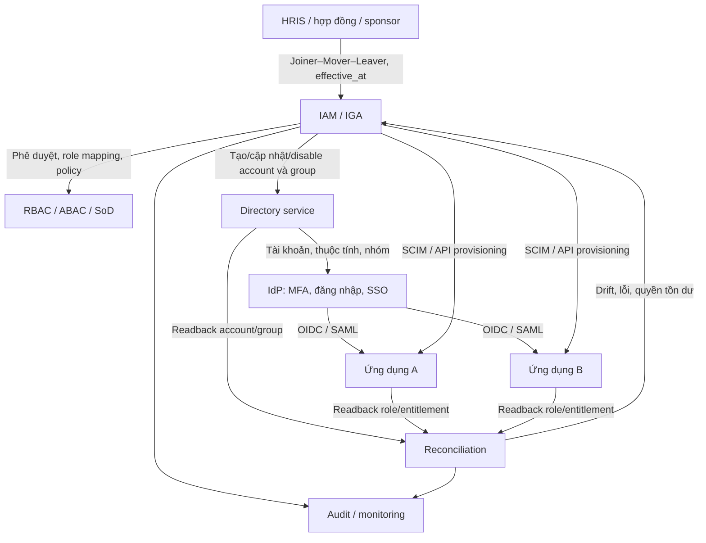

# Directory là gì trong hệ thống quản lý vòng đời danh tính IAM?

## 1. Khái niệm Directory service

**Directory service (dịch vụ thư mục)** là hệ thống dùng để **lưu trữ, tổ chức và tra cứu thông tin về những đối tượng** như người dùng, nhóm, thiết bị, tài khoản dịch vụ và tài nguyên trong một phạm vi quản trị. Khác với một bảng danh bạ chỉ chứa tên và số điện thoại, directory phục vụ cả **định danh, tìm kiếm, quản trị thuộc tính, quan hệ nhóm và các chính sách truy cập**.

Ví dụ: một doanh nghiệp có hàng nghìn nhân viên. Khi một ứng dụng muốn biết tài khoản `linh` thuộc bộ phận nào, có còn hoạt động không hoặc có thuộc nhóm `project-p1-readers` không, ứng dụng hoặc hệ thống IAM có thể tham khảo dữ liệu trong directory đã được quản trị.

Những chức năng thường gặp:

- **Lưu đối tượng**: người dùng, nhóm, thiết bị, máy tính, dịch vụ hoặc đối tượng được mở rộng theo schema.
- **Tổ chức cấu trúc**: sắp xếp đối tượng theo domain, organizational unit, container hoặc tenant tùy sản phẩm.
- **Tra cứu có cấu trúc**: tìm theo thuộc tính, nhóm và phạm vi thư mục.
- **Quản lý quan hệ**: tài khoản thuộc nhóm nào, ai quản lý đối tượng, thuộc tính nào được kế thừa.
- **Hỗ trợ xác thực**: một số directory có thể kiểm tra thông tin xác thực hoặc tích hợp Kerberos/cơ chế khác.
- **Hỗ trợ phân quyền**: dùng group, security identifier, access control list (ACL) và các thông tin khác làm đầu vào quyết định truy cập.
- **Đồng bộ**: cung cấp hoặc tiếp nhận thay đổi từ HRIS, IAM, IdP, ứng dụng và hệ thống provisioning.

**Directory không tự đồng nghĩa với toàn bộ IAM.** Nó là một thành phần dữ liệu và quản trị quan trọng, nhưng việc xác minh danh tính ban đầu, phê duyệt quyền, quản lý Joiner–Mover–Leaver (JML), kiểm toán và thu hồi phiên/token thường cần phối hợp nhiều hệ thống khác.

### 1.1. Một ví dụ ngắn

Giả sử nhân viên **Linh** được tuyển vào nhóm Phân tích dữ liệu:

1. HRIS xác nhận quan hệ công việc và mã nhân viên ổn định.
2. IAM tạo hoặc liên kết danh tính của Linh.
3. Directory có bản ghi tài khoản với các thuộc tính cần thiết: mã nhân viên, tên hiển thị, phòng ban và trạng thái.
4. IAM thêm tài khoản vào nhóm `data-readers` nếu chính sách và phê duyệt cho phép.
5. IdP sử dụng directory hoặc dữ liệu được đồng bộ từ directory để xác thực/định danh.
6. Ứng dụng kiểm tra quyền theo nhóm hoặc entitlement được provision tới đích.
7. Khi Linh chuyển vai trò hoặc nghỉ việc, directory phải được cập nhật **và** các hệ thống liên quan phải đối soát quyền thực tế.

Đây là vòng đời điển hình cho thấy directory giúp **quản lý tập trung đối tượng**, nhưng không thể thay thế các bước cấp và thu hồi quyền.

## 2. Vì sao gọi là “directory”?

Hình dung directory như một **danh bạ có cấu trúc và được quản trị**. Mỗi đối tượng có một danh tính trong phạm vi thư mục và tập thuộc tính mô tả nó.

Ví dụ người dùng có thể có:

| Thuộc tính logic | Giá trị giả định | Mục đích |
|---|---|---|
| `identity_id` hoặc `worker_id` | `W-5210` | Liên kết với nguồn nhân sự có thẩm quyền |
| `uid` hoặc username | `linh` | Tên đăng nhập hoặc thuộc tính tra cứu |
| `displayName` | `Trần Minh Linh` | Hiển thị cho con người |
| `mail` | `linh@example.org` | Liên lạc và tra cứu |
| `department` | `DATA` | Đầu vào RBAC/ABAC theo chính sách |
| `manager` | Tham chiếu quản lý | Quy trình phê duyệt và sơ đồ tổ chức |
| `status` | `ACTIVE` | Điều kiện được sử dụng tài khoản |
| `groupMembership` | `data-readers` | Quan hệ cấp quyền qua nhóm |

Những tên trường trong bảng là **mô hình logic**, không phải một schema LDAP thống nhất: Active Directory Domain Services (AD DS), OpenLDAP và cloud directory có thuộc tính, cú pháp và cách lưu khác nhau.

### 2.1. Đặc tính của directory

Nhiều directory truyền thống được tối ưu cho:

- **Tra cứu nhiều, cập nhật có kiểm soát**.
- **Phân cấp hoặc phân vùng** giúp xác định phạm vi quản trị.
- **Dữ liệu có schema** và quy tắc kiểm tra thuộc tính.
- **Chỉ mục** phục vụ tìm người, nhóm và thuộc tính.
- **Nhân bản (replication)** giữa các máy chủ để tăng khả dụng.
- **Phân quyền đọc/ghi chi tiết** đối với đối tượng và thuộc tính.

Đặc tính cụ thể phụ thuộc sản phẩm. Không nên coi mọi directory là một database quan hệ, một máy chủ LDAP hoặc một IdP hoàn chỉnh.

## 3. Directory khác HRIS, IAM, IdP và cơ sở dữ liệu như thế nào?

Sự phân biệt này đặc biệt quan trọng trong **identity lifecycle**.

| Thành phần | Trách nhiệm chính | Điều không tự đảm bảo |
|---|---|---|
| **HRIS/HCM** | Hồ sơ nhân sự, ngày bắt đầu/nghỉ, hợp đồng và sự kiện công việc | Không chứng minh người đang đăng nhập đúng là nhân viên; không quản lý mọi tài khoản ứng dụng |
| **Directory service** | Lưu/tra cứu đối tượng, thuộc tính và nhóm; đôi khi hỗ trợ xác thực | Không tự phê duyệt mọi quyền hoặc xử lý đầy đủ JML |
| **IAM/IGA** | Điều phối danh tính, phê duyệt, phân quyền, SoD, access review và reconciliation | Cần nguồn dữ liệu cùng cơ chế thực thi tại hệ thống đích |
| **Identity Provider (IdP)** | Xác thực người dùng, MFA, cấp thông điệp SSO/federation, quản lý phiên | Không mặc nhiên biết mọi quyền local tại mọi ứng dụng |
| **SCIM / provisioning** | Giao thức/cơ chế đồng bộ user, group và trạng thái đến ứng dụng | Không thay thế LDAP bind, SSO hoặc chính sách quyền nghiệp vụ |
| **Ứng dụng đích** | Quản lý phiên, tài khoản/role cục bộ, thực thi quyền dữ liệu | Không nhất thiết là nguồn có thẩm quyền của thông tin nhân sự |
| **RDBMS** | Lưu dữ liệu nghiệp vụ và thực thi truy vấn/giao dịch tổng quát | Không mặc nhiên cung cấp schema, giao thức và quan hệ danh tính chuẩn |

Ví dụ: HRIS xác nhận `W-5210` đã nghỉ việc; IAM tính rằng các quyền của người đó phải bị thu hồi; directory disable account hoặc gỡ group; IdP chặn xác thực mới; SCIM/API cập nhật tài khoản tại SaaS; ứng dụng thu hồi phiên và thực thi role mới. **Không bước nào thay thế hoàn toàn các bước còn lại**.

### 3.1. Directory có thể là nguồn sự thật, nhưng không cho mọi thứ

Directory có thể là **nguồn chuẩn cho các thuộc tính kỹ thuật** như username, object ID, group nội bộ hoặc trạng thái tài khoản. Tuy nhiên, **ngày bắt đầu và kết thúc hợp đồng** thường phải lấy từ HRIS hoặc hệ thống hợp đồng được chỉ định.

Cần xác định **authoritative source theo từng thuộc tính** để tránh vòng đồng bộ: directory cập nhật HRIS rồi HRIS lại ghi đè directory mà không có nguyên tắc sở hữu rõ ràng.

## 4. Mô hình dữ liệu thư mục: entry, attribute và schema

Trong hệ thống directory dùng **LDAP (Lightweight Directory Access Protocol)**, dữ liệu thường được thể hiện thành các **entry**. Mỗi entry có **Distinguished Name (DN)** và tập thuộc tính.

### 4.1. Entry là gì?

Một entry có thể đại diện cho:

- Người dùng (user/person).
- Nhóm (group).
- Organizational Unit (OU).
- Máy tính, thiết bị hoặc tài khoản dịch vụ.
- Tài nguyên được schema cho phép.

Entry có các thuộc tính như `cn`, `sn`, `uid`, `mail` hoặc `member` tùy object class và server.

### 4.2. Attribute là gì?

**Attribute** là một trường dữ liệu có tên và kiểu/cú pháp cụ thể. Một số thuộc tính có một giá trị, một số cho phép nhiều giá trị. Ví dụ:

- `cn`: tên thông dụng.
- `sn`: họ hoặc phần tên gia đình theo schema.
- `mail`: email.
- `member`: danh sách DN thành viên của một nhóm dạng `groupOfNames`.
- `objectClass`: mô tả loại đối tượng và những ràng buộc schema.

Không tự giả định mọi thuộc tính đều tồn tại trên mọi server hoặc có ý nghĩa giống nhau. Chẳng hạn `memberOf` có thể là thuộc tính được tính hoặc do tiện ích/sản phẩm hỗ trợ, không phải lúc nào cũng có thể đọc và ghi như một trường lưu cố định.

### 4.3. Schema và objectClass

**Schema** quy định một entry thuộc những lớp đối tượng nào, thuộc tính nào bắt buộc hoặc được phép và cách so sánh giá trị. Ví dụ:

- `person` có thể yêu cầu `sn` và `cn` theo schema LDAP phù hợp.
- `inetOrgPerson` mở rộng các thông tin phổ biến về con người.
- `organizationalUnit` được dùng để biểu diễn OU.
- `groupOfNames` là một kiểu nhóm có danh sách thành viên dưới dạng DN.

Các hệ thống có **schema mở rộng**, nên không lấy ví dụ một server rồi mặc định áp dụng nguyên xi cho AD DS hoặc cloud directory.

## 5. Directory Information Tree, DN và RDN

Trong LDAP truyền thống, các entry thường được sắp theo **Directory Information Tree (DIT)**. DIT là cây định danh, không nhất thiết trùng cấu trúc phòng ban thực tế của công ty.

Ví dụ một cây giả định:

```text
dc=example,dc=org
├── ou=People
│   ├── uid=linh
│   └── uid=an
├── ou=Groups
│   ├── cn=data-readers
│   └── cn=finance-readers
└── ou=Services
    └── uid=svc-report-sync
```

### 5.1. DN (Distinguished Name)

**DN** là tên phân biệt vị trí của entry trong cây, chẳng hạn:

```text
uid=linh,ou=People,dc=example,dc=org
```

Các thành phần DN:

- `uid=linh`: **Relative Distinguished Name (RDN)** của entry trong container cha.
- `ou=People`: đơn vị/container chứa entry.
- `dc=example,dc=org`: các thành phần tên miền theo mô hình thư mục.

DN dùng để tìm entry trong cấu trúc LDAP; **không nên coi DN là ID người dùng bất biến**. Khi entry được di chuyển sang OU khác hoặc đổi tên, DN có thể thay đổi.

### 5.2. Khóa định danh ổn định

Để liên kết danh tính xuyên hệ thống, tổ chức nên dùng **ID nội bộ ổn định** và thuộc tính bất biến/ít thay đổi được nhà cung cấp hỗ trợ, ví dụ `objectGUID` trong Active Directory hoặc `entryUUID` ở một số LDAP server. Những ID này có **phạm vi và quy tắc ổn định theo sản phẩm**; chuyển forest, migration hoặc xóa rồi tạo lại có thể đòi ánh xạ mới.

**Email, DN, tên hiển thị và username không nên là khóa liên kết duy nhất**: chúng có thể đổi, trùng hoặc được tái sử dụng.

## 6. LDAP là gì và directory được truy cập thế nào?

**LDAP** là giao thức cho phép client **tra cứu và quản lý thông tin thư mục**. Một LDAP server triển khai mô hình directory có thể nhận yêu cầu tìm kiếm và thay đổi entry theo quyền được cấp.

Các thao tác tiêu biểu:

| Thao tác LDAP | Ý nghĩa khái quát | Ví dụ IAM |
|---|---|---|
| **Bind** | Thiết lập ngữ cảnh xác thực cho kết nối | Service connector xác thực trước khi tra cứu |
| **Search** | Tìm entry theo base DN, scope, filter và thuộc tính | Tìm tài khoản theo worker ID |
| **Compare** | So sánh thuộc tính với giá trị theo cách server hỗ trợ | Kiểm tra một giá trị thuộc tính |
| **Add** | Tạo entry mới | Provision user hoặc group |
| **Modify** | Thay thuộc tính/giá trị | Cập nhật phòng ban hoặc membership |
| **Modify DN** | Đổi RDN hoặc di chuyển entry nếu được hỗ trợ | Đổi OU/username |
| **Delete** | Xóa entry | Dọn tài khoản sau thời hạn lưu giữ |
| **Unbind** | Kết thúc phiên LDAP | Đóng kết nối có kiểm soát |

**LDAP không đồng nghĩa với HTTP API**. Nó có ngữ nghĩa, schema, cách kiểm soát phiên và thao tác riêng. SCIM là một cách khác để quản lý user/group, thường sử dụng HTTP/JSON ở ứng dụng hiện đại; hai giao thức có thể cùng tồn tại trong một kiến trúc IAM.

### 6.1. Base DN, scope và filter

Một LDAP search cần trả lời:

1. **Tìm bắt đầu từ đâu?** `base DN`.
2. **Tìm sâu đến mức nào?** `scope`: base, một cấp hoặc subtree theo ngữ nghĩa LDAP.
3. **Đối tượng thỏa điều kiện gì?** `filter`.
4. **Muốn đọc thuộc tính nào?** Chỉ yêu cầu dữ liệu cần thiết.

Ví dụ:

```text
Base DN: ou=People,dc=example,dc=org
Scope: subtree
Filter: (&(objectClass=inetOrgPerson)(uid=linh))
Attributes: dn, cn, mail, uid
```

Filter `(&(...)(...))` nghĩa là **AND**. Các toán tử phổ biến có thể gồm `&` (AND), `|` (OR) và `!` (NOT), với biểu thức so sánh đúng cú pháp LDAP.

**Phải escape giá trị do người dùng cung cấp** theo quy tắc LDAP filter tương ứng; không nối chuỗi raw vào filter, vì có thể tạo **LDAP injection**. DN và filter có **quy tắc escaping khác nhau**, không dùng lẫn lộn.

### 6.2. Ví dụ thao tác tra cứu

Một ví dụ với công cụ `ldapsearch` trên môi trường có hỗ trợ; tên máy, tài khoản và DN đều là dữ liệu giả:

```bash
ldapsearch \
  -H ldaps://directory.example.org \
  -x \
  -D "uid=svc-iam-reader,ou=Services,dc=example,dc=org" \
  -W \
  -b "ou=People,dc=example,dc=org" \
  -s sub \
  '(&(objectClass=inetOrgPerson)(uid=linh))' \
  dn cn mail uid
```

`-W` yêu cầu nhập bí mật tương tác thay vì đặt mật khẩu trên dòng lệnh. Trong triển khai sản xuất, connector nên dùng cơ chế xác thực dịch vụ được cho phép, **TLS được kiểm tra certificate/hostname**, quyền tối thiểu, giới hạn số bản ghi và thời gian truy vấn.

Không chạy truy vấn rộng không có filter hoặc quyền đọc quá lớn trên directory sản xuất nếu chưa có chính sách và đánh giá tải.

## 7. Ví dụ LDIF: user và group

**LDAP Data Interchange Format (LDIF)** là định dạng văn bản thường dùng để mô tả entry và thao tác LDAP. Ví dụ đơn giản:

```ldif
dn: uid=linh,ou=People,dc=example,dc=org
objectClass: top
objectClass: inetOrgPerson
uid: linh
cn: Tran Minh Linh
sn: Linh
mail: linh@example.org

dn: cn=project-p1-readers,ou=Groups,dc=example,dc=org
objectClass: top
objectClass: groupOfNames
cn: project-p1-readers
member: uid=linh,ou=People,dc=example,dc=org
```

Ý nghĩa:

- Entry đầu là một người dùng theo schema minh họa.
- Entry thứ hai là nhóm có một thành viên, được tham chiếu bằng DN.
- Những dòng `objectClass` quyết định thuộc tính nào được phép/bắt buộc theo schema.
- `member` là quan hệ nhóm, có thể ảnh hưởng quyền thông qua cơ chế phân quyền bên ngoài LDAP.

**Không sao chép LDIF mẫu vào sản xuất khi chưa kiểm tra schema**. Active Directory có mô hình user/group, thuộc tính và quy tắc thao tác riêng; không phải mọi object class của ví dụ này đều đại diện cách provision user trong AD.

### 7.1. Group membership không phải entitlement cuối cùng

Được liệt kê trong `member` không tự động chứng minh có quyền đọc một báo cáo. Quyền còn phụ thuộc:

- Ứng dụng có dùng nhóm đó không?
- Nhóm có được ánh xạ tới role nào?
- Role có bị deny hoặc giới hạn theo ABAC không?
- Có nhóm lồng nhau, dynamic group hoặc quyền gán trực tiếp không?
- Ứng dụng đã đồng bộ thay đổi nhóm và làm mới cache/phiên chưa?

Cần đối soát **quyền có hiệu lực**, không chỉ tồn tại một dòng membership.

## 8. Active Directory, OpenLDAP và cloud directory khác nhau thế nào?

“Directory” là **khái niệm hệ thống**, không phải tên của một sản phẩm duy nhất.

| Công nghệ | Đặc trưng chính | Lưu ý với IAM |
|---|---|---|
| **Microsoft Active Directory Domain Services (AD DS)** | Directory cho domain Windows, đối tượng user/group/computer, LDAP, Kerberos, Group Policy, domain controller | Có SID/GUID, OU/domain/forest, group scope, quyền và cơ chế replication riêng |
| **OpenLDAP** | Bộ phần mềm triển khai LDAP server có schema và backend tùy cấu hình | Cần thiết kế schema, ACL, replication, connector và bảo trì |
| **Các LDAP server khác** | Cung cấp directory qua LDAP với tính năng quản lý danh tính tùy sản phẩm | Không mặc định mọi thuộc tính/extension giống nhau |
| **Microsoft Entra ID / cloud identity directory** | Quản lý danh tính và nhóm ở tenant cloud, tích hợp xác thực, SSO và API quản trị | Không phải một LDAP server AD DS có thể thay thế trực tiếp; giao diện và policy khác |
| **Directory tích hợp của nền tảng/ứng dụng** | Danh sách user/group nội bộ của một hệ thống | Có thể cần SCIM/API và ánh xạ tài khoản riêng |

### 8.1. AD DS: domain, OU, user, group và SID

Trong AD DS:

- **Domain** là phạm vi directory và quản trị xác thực theo thiết kế AD.
- **Forest** gồm một hoặc nhiều domain với quan hệ tin cậy và schema/kiến trúc nhất định.
- **Organizational Unit (OU)** giúp tổ chức đối tượng, ủy quyền quản trị và áp dụng chính sách trong môi trường thích hợp.
- **Domain Controller (DC)** cung cấp các dịch vụ liên quan directory/domain.
- **Security Identifier (SID)** là mã định danh bảo mật có vai trò trong kiểm soát truy cập Windows.
- **Object GUID** hỗ trợ định danh đối tượng trong directory.
- **Group** có thể có scope/type khác nhau, ảnh hưởng cách sử dụng quyền.

**OU không phải security group.** Đặt một người trong OU `Finance` không tự động làm người đó có cùng quyền với nhóm `Finance-Readers`, trừ khi một chính sách khác ánh xạ rõ ràng.

### 8.2. Entra ID không phải bản sao LDAP của AD DS

Microsoft Entra ID hỗ trợ danh tính cloud, tenant, nhóm, chính sách truy cập và SSO, nhưng **không có ngữ nghĩa LDAP/OU/Group Policy giống AD DS**. Các ứng dụng thường tích hợp qua OIDC/SAML, Microsoft Graph hoặc SCIM theo năng lực cụ thể.

Khi doanh nghiệp kết hợp on-prem AD DS và Entra ID, phải xác định **hướng đồng bộ**, thuộc tính nào do nguồn nào sở hữu, cách xử lý cloud-only accounts và thời điểm thay đổi có hiệu lực. Không tự giả định một thao tác gỡ nhóm tại AD sẽ lập tức thu hồi mọi token và phiên cloud.

## 9. Directory và authentication: bind, Kerberos, IdP

Directory có thể tham gia xác thực nhưng không phải **mọi directory đều là IdP cung cấp SSO**.

### 9.1. LDAP Bind

Một ứng dụng có thể thực hiện LDAP Bind để xác thực tài khoản theo khả năng server. Tuy nhiên:

- **Simple Bind với mật khẩu phải được bảo vệ bằng TLS** và xác minh certificate/server đúng.
- Không gửi thông tin xác thực qua LDAP plaintext trên mạng không được tin cậy.
- Không cho ứng dụng tùy tiện dùng tài khoản bind có quyền quản trị directory.
- Kiểm soát số lần thử, lỗi truy cập và audit.
- Không lưu mật khẩu người dùng vào cache/log ứng dụng chỉ để thực hiện bind.

Tùy server, các cơ chế **SASL, Kerberos hoặc phương thức khác** có thể được dùng theo chính sách. Không nên diễn giải `Bind success` là bằng chứng người dùng đã được cấp mọi quyền nghiệp vụ.

### 9.2. Kerberos và AD

Trong môi trường AD DS, **Kerberos** là thành phần xác thực quan trọng. Nó dùng ticket và quan hệ tin cậy phù hợp để hỗ trợ xác thực mà không yêu cầu ứng dụng truyền lại mật khẩu người dùng ở mọi bước.

Kerberos, LDAP và SAML/OIDC phục vụ mục tiêu khác nhau: LDAP quản lý/tra cứu directory; Kerberos có thể xác thực trong domain; IdP có thể phát hành assertion/token SSO cho ứng dụng web.

### 9.3. Directory trong hệ thống IdP

IdP có thể:

1. Dùng directory làm **user store** hoặc kho thuộc tính.
2. Kiểm tra thông tin xác thực qua nguồn được cấu hình.
3. Áp dụng MFA, policy đăng nhập và session riêng.
4. Phát hành kết quả đăng nhập OIDC/SAML cho từng ứng dụng.

**Thành công khi tìm người dùng trong directory không chứng minh người đó đang có phiên đăng nhập hợp lệ**, và một phiên IdP hợp lệ không tự bảo đảm tất cả quyền trong ứng dụng đích.

## 10. Nhóm, RBAC, ABAC và quyền hiệu lực

Directory thường chứa **nhóm bảo mật và thuộc tính** làm dữ liệu đầu vào cho phân quyền.

### 10.1. RBAC bằng nhóm

**Role-Based Access Control (RBAC)** có thể ánh xạ group sang entitlement:

| Group | Role ứng dụng minh họa | Quyền được phép |
|---|---|---|
| `employees` | `employee_basic` | Truy cập cổng nội bộ |
| `project-p1-readers` | `project_p1_viewer` | Đọc tài liệu P1 |
| `finance-analysts` | `finance_reader` | Xem báo cáo tài chính được giao |
| `production-admins` | `prod_admin` | Đặc quyền quản trị có kiểm soát bổ sung |

Các mapping chỉ có hiệu lực khi **được cấu hình và phê duyệt**. Không nên suy từ tên group rằng nó chắc chắn cấp quyền như mong muốn.

### 10.2. ABAC bằng thuộc tính

**Attribute-Based Access Control (ABAC)** đánh giá thuộc tính người dùng, tài nguyên và ngữ cảnh, ví dụ:

```text
allow(user, "read", report) when
    user.account_status == "ACTIVE"
    and user.department_id == report.owner_department
    and report.classification != "restricted"
    and user.tenant_id == report.tenant_id
```

Nếu `department_id` ở directory bị chậm cập nhật sau Mover, ứng dụng có thể tiếp tục ra quyết định dựa trên thông tin cũ. Với quyền nhạy cảm, cần kiểm soát độ mới dữ liệu và quyền hiệu lực tại **điểm thực thi policy**, không chỉ cập nhật trường hiển thị.

### 10.3. Nhóm trực tiếp, nhóm lồng nhau và nhóm động

- **Nhóm trực tiếp:** tài khoản được gán membership rõ ràng.
- **Nhóm lồng nhau:** nhóm này là thành viên của nhóm khác; quyền có thể được kế thừa khi nền tảng hỗ trợ.
- **Nhóm động:** membership được suy từ thuộc tính/rule, không phải thao tác add/remove trực tiếp theo cách nhóm tĩnh.
- **Nhóm ứng dụng local:** quyền tồn tại trong SaaS hoặc ứng dụng riêng, không nhất thiết xuất hiện trong directory trung tâm.

Để thu hồi đúng, IAM phải kiểm tra **tất cả nguồn quyền có thể quan sát**, không chỉ một nhóm trong directory.

## 11. Directory trong kiến trúc IAM lifecycle

Một kiến trúc mô tả quan hệ giữa HRIS, directory, IdP và ứng dụng:



Trong kiến trúc khác, **IdP có thể tích hợp sẵn directory** hoặc là cloud directory; không nhất thiết luôn có hai sản phẩm riêng. Sơ đồ chỉ thể hiện **vai trò logic**, không áp đặt công nghệ cụ thể.

### 11.1. Vì sao phải có reconciliation?

Một lệnh cập nhật directory thành công **chưa chứng minh** ứng dụng SaaS đã đổi quyền. Có thể xảy ra:

- SCIM connector lỗi hoặc đồng bộ chậm.
- Ứng dụng giữ role local độc lập.
- Token OIDC/SAML hoặc session đã phát hành chứa claim nhóm cũ.
- Một quản trị viên gán quyền trực tiếp tại ứng dụng.
- Nhóm động tự thêm người dùng trở lại.
- Replica directory chưa nhận thay đổi.

Do đó, IAM cần đối soát **desired state** so với **observed state** ở từng đích và ghi kết quả đã xác minh.

## 12. Joiner: đưa danh tính mới vào directory

Trong **Joiner lifecycle**, directory thường tiếp nhận một đối tượng mới sau khi đã có nguồn nghiệp vụ xác nhận.

Quy trình minh họa:

1. **HRIS/HCM** cung cấp worker ID, quan hệ làm việc, ngày bắt đầu và thuộc tính cần thiết.
2. **Identity proofing** xác minh người đang nhận tài khoản đúng với hồ sơ.
3. IAM kiểm tra tài khoản đã tồn tại chưa, xử lý trùng danh tính, rehire hoặc nhiều hợp đồng.
4. IAM tạo directory entry hoặc liên kết với entry sẵn có bằng ID ổn định.
5. Tạo các thuộc tính kỹ thuật như username, DN/OU, trạng thái tài khoản theo chính sách.
6. Thêm các group nền và role theo **RBAC/ABAC** sau kiểm tra phê duyệt và SoD.
7. IdP đăng ký authenticator/MFA và quản lý phiên xác thực.
8. SCIM/API provision tài khoản/nhóm đến ứng dụng có quyền.
9. Kích hoạt theo ngày hiệu lực, không tự mở quyền chỉ vì đã pre-provision.
10. Đối soát từng ứng dụng để xác minh tài khoản và quyền đã sẵn sàng.

### 12.1. Pre-provisioning và thời điểm hiệu lực

Một công ty có thể tạo directory account trước ngày nhân viên bắt đầu để chuẩn bị email và thiết bị. Tuy nhiên, **tạo entry khác với cho phép đăng nhập hoặc truy cập tài nguyên**. Cần tách trạng thái `PREPROVISIONED` khỏi `ACTIVE` và áp dụng điều kiện proofing, MFA, ngày hiệu lực và policy trước khi cấp quyền thực sự.

### 12.2. Không tạo trùng khi retry

Một request tạo user có thể timeout **sau khi directory đã tạo entry**. Khi retry, IAM cần đọc lại bằng **khóa định danh ổn định**, kiểm tra đúng người và tenant/domain trước khi phát lệnh tạo mới. Không tự ghép tài khoản chỉ vì username hoặc email trùng.

## 13. Mover: đồng bộ thuộc tính và tính lại nhóm

**Mover** xuất hiện khi một nhân viên đổi phòng ban, vai trò, dự án, quản lý hoặc phạm vi hợp đồng.

Ví dụ `W-5210` chuyển từ `SALES` sang `FIN`:

| Thông tin | Trước Mover | Sau Mover |
|---|---|---|
| Worker ID | `W-5210` | Giữ nguyên nếu cùng danh tính |
| Bộ phận | `SALES` | `FIN` |
| Nhóm nghiệp vụ | `sales-report-readers` | `finance-report-readers` nếu được duyệt |
| Quyền dự án | Dự án Sales trước đây | Tính lại theo assignment còn hiệu lực |
| IdP account | Vẫn có thể là một tài khoản | Cập nhật thuộc tính, policy theo trạng thái mới |
| Ứng dụng SaaS | Role Sales local có thể còn | SCIM/API thu hồi/cấp quyền và đối soát |

Các bước quan trọng:

1. Nhận sự kiện Mover từ nguồn có thẩm quyền, xác định `effective_at`.
2. Tính **desired groups/entitlements** theo mọi assignment còn hiệu lực.
3. Thu hồi group và role cũ **không còn căn cứ hợp lệ**.
4. Cấp nhóm mới sau phê duyệt, kiểm tra **Separation of Duties (SoD)**.
5. Cập nhật thuộc tính directory, IdP và ứng dụng; xử lý token/session cũ theo rủi ro.
6. Đọc lại quyền thực tế ở từng đích, không chỉ xác minh group ở directory.

### 13.1. Di chuyển OU không tự giải quyết phân quyền

Nếu chuyển một user entry từ `ou=Sales` sang `ou=Finance`, DN có thể thay đổi. Nhưng **chuyển OU không tự động gỡ nhóm Sales hay cấp nhóm Finance**, trừ khi hệ thống có chính sách riêng thực hiện việc đó. Cần làm rõ từng cơ chế cấp quyền.

### 13.2. Tránh tích lũy quyền

Nếu sau mỗi lần Mover chỉ **thêm group mới**, người dùng sẽ tích lũy entitlement và có thể nắm hai quyền xung đột. IAM nên tính chênh lệch giữa **desired access** và **actual effective access**, bao gồm quyền gán trực tiếp, nhóm lồng nhau và các ngoại lệ có hạn.

## 14. Leaver: directory account, group và quyền tồn dư

Khi nguồn có thẩm quyền xác nhận **Leaver**, IAM cần **ngăn truy cập theo thời điểm hiệu lực** và tiếp tục thu hồi quyền ở tất cả đích liên quan.

### 14.1. Thao tác tại directory

Tùy nền tảng và chính sách:

- Đặt trạng thái tài khoản bị disable/không được xác thực.
- Gỡ membership khỏi các nhóm cấp quyền không còn căn cứ.
- Xử lý nhóm đặc quyền, nhóm dự án, quyền ủy quyền và các grant khác.
- Kiểm tra account lock, login restrictions và đường xác thực riêng.
- Giữ lại object trong thời hạn cần thiết cho kiểm toán/quy trình dữ liệu, sau đó mới delete theo chính sách.
- Ghi rõ thao tác nào đã thực hiện và đã readback.

**Disable và delete khác nhau.** Disable nhằm ngăn sử dụng tài khoản; delete có thể ảnh hưởng dữ liệu, quyền sở hữu, quan hệ tham chiếu và khả năng điều tra. Không xóa tự động chỉ vì cần chặn truy cập ngay.

### 14.2. Không chỉ xóa user khỏi directory

Một ứng dụng SaaS có thể giữ:

- Tài khoản local và mật khẩu riêng.
- Phiên ứng dụng, refresh/access token còn hiệu lực.
- Role hoặc membership cấp trực tiếp bên ngoài directory.
- API key, personal access token, SSH key hoặc credential độc lập.
- Quyền trong tenant đối tác hoặc hệ thống legacy.

Vì vậy, **Leaver được coi là đã hoàn tất theo phạm vi kiểm soát chỉ khi từng đích quan trọng được xác minh**. Một lệnh disable tại directory không tự động thu hồi mọi session hoặc token trên cloud.

### 14.3. Cẩn thận với nhiều quan hệ hợp lệ

Nếu một người chấm dứt hợp đồng A nhưng vẫn có hợp đồng B, hệ thống phải xác định **danh tính và account nào chịu ảnh hưởng**. Không tự disable một danh tính dùng chung nếu quan hệ B vẫn còn hiệu lực và policy cho phép tiếp tục truy cập.

## 15. LDAP replication, độ trễ và tính nhất quán

Nhiều directory triển khai **replication** để phục vụ nhiều máy chủ và tăng độ sẵn sàng. Tùy sản phẩm, việc cập nhật trên một node có thể chưa xuất hiện ngay ở node khác.

### 15.1. Ví dụ độ trễ

1. IAM gỡ người dùng khỏi nhóm `finance-readers` tại một directory server.
2. Một ứng dụng đọc membership từ replica chưa nhận thay đổi.
3. Ứng dụng tạm thời vẫn thấy người dùng thuộc nhóm.
4. Sau replication, kết quả tra cứu mới phản ánh membership đã gỡ.
5. Nếu ứng dụng còn cache riêng hoặc session/token cũ, quyền thực tế vẫn có thể tồn tại lâu hơn replication.

Vì thế cần hiểu **độ trễ ở nhiều lớp**: directory replication, IdP sync, SCIM provisioning, application cache, token/session.

### 15.2. Cách thiết kế chịu độ trễ

- Xác định SLA đồng bộ và nguồn đọc phù hợp từng loại tác vụ.
- Dùng version, timestamp và cơ chế đồng bộ của sản phẩm để phát hiện dữ liệu cũ.
- Tách trạng thái `SENT`, `APPLIED` và `VERIFIED`.
- Retry với backoff và idempotency khi lỗi tạm thời.
- Tránh để event Joiner/Mover cũ chạy lại sau khi Leaver đã có hiệu lực.
- Dùng reconciliation theo trạng thái hiện hành thay vì tin hoàn toàn vào một sự kiện.
- Với quyền đặc quyền, áp dụng biện pháp chặn truy cập ở những lớp hỗ trợ thay vì chỉ chờ replication.

**Không dùng một khoảng chờ cố định làm bằng chứng chắc chắn quyền đã thu hồi**. Kiểm tra trạng thái thực tế bằng cơ chế được phép mới là căn cứ đáng tin hơn.

## 16. Đồng bộ directory với HRIS, IdP và SCIM

Trong tổ chức lớn, directory hiếm khi đứng độc lập. Có thể có **đồng bộ hai chiều hoặc một chiều**, nhưng quyền sở hữu dữ liệu phải được thiết kế rất rõ.

### 16.1. Hướng đồng bộ điển hình

| Luồng | Ví dụ | Rủi ro cần quản lý |
|---|---|---|
| HRIS → IAM → directory | Worker status, department, manager | Dữ liệu nguồn sai hoặc đến trễ |
| Directory → IdP | Username, nhóm, thuộc tính người dùng | Claim/phiên IdP có thể chưa mới |
| IAM/IdP → SaaS qua SCIM | Tạo/đổi/disable user và group | Provider chỉ hỗ trợ một phần tính năng |
| SaaS → IAM reconciliation | Observed account/role | Thiếu quyền đọc hoặc dữ liệu đích không đầy đủ |
| Service catalog → IAM | Owner, mục đích của workload | Nhầm tài khoản máy với nhân viên |
| Admin thay quyền tại ứng dụng → audit | Phát hiện direct grant ngoài policy | Không nhìn thấy nếu chỉ đọc directory |

### 16.2. Tránh vòng ghi đè

Nếu HRIS sở hữu `department` nhưng một quản trị viên sửa trong directory, đồng bộ có thể ghi đè lần thay đổi này. Nếu không có quy tắc ownership, hai hệ thống có thể liên tục **ghi qua ghi lại**.

Một hợp đồng dữ liệu nên xác định:

- Thuộc tính nào do hệ thống nào sở hữu.
- ID nào dùng để liên kết một người hoặc một account.
- Bên nào được quyền ghi, bên nào chỉ được đọc.
- Quy tắc xử lý xung đột và khi nguồn không khả dụng.
- Cách xử lý sự kiện đến trễ, hủy hoặc thay đổi hồi tố.
- Trạng thái cuối nào cần được xác minh.

### 16.3. LDAP và SCIM dùng khi nào?

**LDAP** thường phục vụ truy vấn/quản trị một directory có cấu trúc và schema riêng. **SCIM** thường phục vụ đồng bộ danh tính và nhóm giữa hệ thống quản lý danh tính với ứng dụng đích. Có thể dùng **cả hai**: IAM cập nhật AD/LDAP, đồng thời qua SCIM provision tài khoản vào SaaS.

Không nên xem SCIM như thay thế toàn diện cho Kerberos, LDAP Search hoặc mọi chức năng của AD DS.

## 17. Bảo mật directory service

Directory thường chứa **danh sách người dùng, nhóm, tài khoản kỹ thuật và thông tin cấu trúc tổ chức**, nên việc bảo vệ nó ảnh hưởng trực tiếp đến an toàn IAM.

### 17.1. Mã hóa và xác thực kết nối

- Sử dụng **LDAP over TLS** theo cách nhà cung cấp hỗ trợ, chẳng hạn LDAPS hoặc StartTLS với cấu hình đúng.
- Xác minh certificate chain, hostname, phiên bản và chính sách TLS; **không tắt certificate validation để sửa lỗi kết nối**.
- Tránh Simple Bind không mã hóa trên mạng không tin cậy.
- Ưu tiên cơ chế xác thực connector thích hợp theo chính sách và hạ tầng.
- Bảo vệ credential của connector bằng secret manager hoặc cơ chế tương đương, không đưa vào source code hoặc log.
- Giới hạn kết nối đến directory theo mạng, firewall và quyền truy cập cần thiết.

### 17.2. Least privilege và ACL

Mỗi tài khoản kỹ thuật nên chỉ được:

- Đọc những OU/thuộc tính cần thiết.
- Tạo user ở phạm vi cụ thể nếu có nhiệm vụ provisioning.
- Thay group membership trong phạm vi được cấp.
- Disable account theo policy khi Leaver.
- **Không tự động có Domain Admin hoặc quyền write toàn directory** nếu không cần.

Cần phân biệt **quyền đọc một entry** và **quyền sửa/xóa entry**. Một connector chỉ cần tra cứu email không nên được phép sửa thành viên nhóm quản trị.

### 17.3. LDAP injection và tìm kiếm an toàn

Nếu một ứng dụng ghép giá trị do người dùng nhập vào filter mà không escape, attacker có thể sửa ý nghĩa truy vấn. Các biện pháp:

1. Sử dụng thư viện LDAP có hỗ trợ **filter escaping** chính xác.
2. Giới hạn search base và scope thay vì tìm toàn directory.
3. Chỉ đọc các attribute cần thiết.
4. Áp dụng paging, size/time limits và rate limiting thích hợp.
5. Không cho client tùy ý chỉ định base DN hoặc filter nguyên gốc nếu không có chính sách.
6. Ghi audit truy vấn bất thường mà không lộ dữ liệu hoặc credential.

**Escape filter và escape DN là hai thao tác khác nhau.** Không dùng công thức nối chuỗi tổng quát để tạo filter, nhất là với username, email và identifier từ request.

### 17.4. Giảm dữ liệu và bảo vệ riêng tư

Directory có thể chứa dữ liệu cá nhân. Không sao chép toàn bộ hồ sơ HR hoặc thuộc tính nhạy cảm vào mọi directory hoặc token SSO chỉ để tiện lập trình. Cần hạn chế mục đích, quyền đọc thuộc tính, dữ liệu đồng bộ và thời hạn lưu theo pháp lý/chính sách áp dụng.

## 18. Quản lý tài khoản dịch vụ và workload trong directory

Directory không chỉ có tài khoản con người. Nó có thể chứa **service account**, tài khoản máy, tài khoản tích hợp hoặc danh tính workload; mỗi loại có vòng đời khác nhau.

### 18.1. Không gán mọi tài khoản cho HRIS

Một tài khoản `svc-report-sync` có thể chạy đồng bộ báo cáo dù người sở hữu kỹ thuật nghỉ việc. Nguồn có thẩm quyền nên gồm:

- Service catalog hoặc CMDB.
- Owner nghiệp vụ và kỹ thuật.
- Mục đích, ứng dụng, tenant/domain và môi trường.
- Quyền cần thiết, secret/credential và hạn sử dụng.
- Quy trình thay owner, rotation, vô hiệu hóa khi workload không còn cần.

**Không tự xóa service account chỉ vì không tìm thấy trong HRIS.** Đó có thể là workload hợp lệ; nhưng tài khoản không có owner phải được báo và xử lý.

### 18.2. Khi owner trở thành Mover/Leaver

Nếu owner của một tài khoản dịch vụ chuyển phòng hoặc nghỉ việc:

1. Xác định workload nào thuộc trách nhiệm owner đó.
2. Giao lại ownership cho người/nhóm được phê duyệt.
3. Rà soát credential, khóa, quyền truy cập và nơi lưu secret.
4. Rotation credential khi chính sách/rủi ro yêu cầu.
5. Chỉ disable workload nếu có căn cứ nó không còn hợp lệ.
6. Đối soát quyền và cập nhật audit.

MFA phù hợp với **con người quản trị vault/console**; còn workload thường cần danh tính máy và các cơ chế như mTLS, khóa hoặc token ngắn hạn, không nên chia sẻ một TOTP cá nhân cho nhiều hệ thống.

## 19. Tình huống thực tế: directory xuyên suốt JML

Giả sử **An** được nhận làm nhân viên phân tích dữ liệu, mã nhân viên `W-5210`. Công ty dùng AD DS cho một số ứng dụng nội bộ, IdP cho SSO và SCIM cho phần mềm SaaS.

### 19.1. Joiner — tạo danh tính đúng người

- HRIS xác nhận `W-5210` với ngày bắt đầu 01/12.
- Quy trình proofing bảo đảm người kích hoạt đúng là An.
- IAM tạo hoặc liên kết account trong directory với ID ổn định và thuộc tính công việc tối thiểu.
- Nhóm `data-readers` được cấp theo role nền.
- IdP cung cấp MFA/SSO; SCIM tạo account ứng dụng phân tích.
- IAM xác minh quyền tại đích, không chỉ thao tác add group thành công.

### 19.2. Mover — chuyển từ Data sang Finance

- HRIS cập nhật `department_id=FIN` và ngày hiệu lực.
- IAM xác định nhóm `data-readers` không còn căn cứ, trong khi `finance-report-readers` cần được phê duyệt.
- Directory được cập nhật, nhưng việc đổi OU/thuộc tính **không tự thu hồi mọi quyền**.
- SCIM và các connector cập nhật SaaS; token/phiên cũ được đánh giá theo rủi ro.
- Reconciliation tìm một role xuất dữ liệu gán trực tiếp tại app cũ; owner phải thu hồi quyền này.

### 19.3. Leaver — chặn và thu hồi

- HRIS thông báo kết thúc hợp đồng đúng thời điểm.
- IAM disable account ở directory/IdP, thu hồi nhóm và quyền đặc quyền.
- Ứng dụng SaaS được deprovision; phiên/token/credential độc lập được xử lý theo khả năng hỗ trợ.
- Một SaaS vẫn báo account active vì SCIM connector lỗi: hệ thống ghi `RETRY_PENDING` chứ không báo đã hoàn tất.
- Sau khi khôi phục connector, IAM đọc lại trạng thái và ghi `VERIFIED`.

**Bài học:** directory giúp tập trung quản lý danh tính và nhóm, nhưng một quy trình JML thành công đòi **khả năng xác minh quyền đã thực sự thay đổi ở mọi đích quan trọng**.

## 20. Các lỗi thường gặp khi sử dụng directory

| Hiện tượng | Nguyên nhân khả dĩ | Cách xử lý đúng |
|---|---|---|
| Không tìm thấy user qua LDAP | Sai base DN/scope, filter, ACL hoặc tài khoản nằm OU khác | Kiểm tra mapping và phạm vi tìm kiếm; không bỏ kiểm soát truy cập |
| LDAP Bind thất bại | Sai credential, account bị khóa hoặc chính sách xác thực/TLS | Kiểm tra nguyên nhân và cơ chế xác thực; không ghi secret vào log |
| Tài khoản đổi OU làm ứng dụng “mất user” | App liên kết bằng DN thay vì ID ổn định | Dùng mapping ổn định, xử lý rename/move đúng |
| Search chậm hoặc trả quá nhiều bản ghi | Filter rộng, thiếu index, không phân trang | Giới hạn filter, attribute, scope, paging và tải |
| Gỡ nhóm nhưng quyền vẫn còn | Nested group, role app local, token/session cũ | Đối soát quyền hiệu lực tại app |
| Nhóm động tự thêm user trở lại | Rule hoặc thuộc tính nguồn vẫn thỏa điều kiện | Sửa nguồn/rule đúng owner và kiểm tra lại |
| HRIS đã báo Leaver nhưng directory vẫn active | Đồng bộ lỗi, event đến chậm, mapping sai | Ưu tiên chặn truy cập, retry/escalation và readback |
| AD đã đổi group nhưng SaaS chưa cập nhật | SCIM/sync trễ hoặc connector lỗi | Kiểm tra trạng thái đích và hàng đợi đồng bộ |
| Hai tài khoản cùng email | Email được tái sử dụng hoặc có nhiều quan hệ | Không tự gộp; đối chiếu identity ID và nguồn có thẩm quyền |
| LDAP query lỗi sau cert rotation | Trust/certificate không khớp | Sửa chứng thư/CA đúng, không tắt TLS validation |
| Service account bị đánh dấu orphan | Không có trong HRIS | Kiểm tra service catalog/CMDB và owner |
| Người dùng bị sai quyền sau tái cơ cấu | Mapping OU/role hoặc policy thay đổi hàng loạt | Dry-run, kiểm tra SoD, kiểm soát tác động và đối soát |

## 21. Kiểm toán và các chỉ số vận hành

Directory cần có khả năng truy vết **ai thay đổi entry/nhóm nào, vì sao, khi nào và thay đổi đã có hiệu lực chưa**.

### 21.1. Audit metadata gợi ý

| Trường | Ý nghĩa |
|---|---|
| `event_id` / `operation_id` | Liên kết sự kiện HR với thao tác directory |
| `identity_id` / `worker_id` | Gắn đúng người hoặc workload |
| `directory_object_id` / `account_id` | Xác định object thực tế, không chỉ DN/email |
| `source_system` / `source_version` | Nguồn có thẩm quyền và phiên bản |
| `operation_type` | Create, Modify, Add/Remove Group, Disable, Delete |
| `effective_at` / `executed_at` | Mốc nghiệp vụ và thời điểm thực thi |
| `target_server` / `domain_or_tenant` | Nơi thực hiện, phục vụ kiểm tra replica/tenant |
| `policy_version` / `approval_ref` | Căn cứ phân quyền và phê duyệt |
| `result` / `verified_at` | Phân biệt đã gửi lệnh và trạng thái đã kiểm tra |
| `exception_owner` / `deadline` | Quản lý lỗi hoặc quyền tồn dư chưa xử lý |

**Không lưu mật khẩu, token bind, private key, secret hoặc toàn bộ hồ sơ nhân sự nhạy cảm trong audit log**. Dùng correlation ID, thông tin đối tượng và metadata phù hợp.

### 21.2. KPI có ý nghĩa

- **Joiner provisioning latency:** từ khi quan hệ hợp lệ có hiệu lực đến khi directory account sẵn sàng.
- **Mover group-change latency:** thời gian cập nhật và xác minh membership sau đổi vai trò.
- **Leaver account-disable latency:** thời gian chặn tài khoản sau sự kiện có hiệu lực.
- **Residual entitlement count:** số quyền tại đích không còn căn cứ nhưng vẫn tồn tại.
- **Identity-linking error rate:** các bản ghi trùng hoặc mapping sai chủ thể.
- **Directory replication lag:** độ trễ bản ghi lan truyền giữa replica theo khả năng quan sát.
- **SCIM/API sync failure rate:** tỷ lệ cập nhật từ directory/IAM sang ứng dụng bị lỗi.
- **Orphan service account count:** tài khoản kỹ thuật thiếu owner hợp lệ.
- **Reconciliation coverage:** tỷ lệ hệ thống có readback và kiểm tra quyền.
- **Privileged group drift:** quyền nhóm quản trị thay đổi ngoài quy trình.

Đừng tối ưu chỉ số “tạo user nhanh” nhưng bỏ qua xác minh danh tính, quyền bị cấp sai hoặc thời gian thu hồi quyền sau Leaver.

## 22. Những tình huống kiểm thử quan trọng

| Tình huống | Kết quả mong đợi |
|---|---|
| Search user với base DN/scope/filter hợp lệ | Tìm đúng entry và các thuộc tính được phép đọc |
| Username chứa ký tự đặc biệt trong LDAP filter | Escape đúng, không xảy ra LDAP injection |
| Người dùng đổi email | ID liên kết không đổi, không tạo bản ghi trùng |
| Entry được chuyển OU | Account linking vẫn đúng dù DN thay đổi |
| Thêm user vào group tĩnh có phê duyệt | Membership xuất hiện và quyền chỉ trong phạm vi policy |
| User có nested group và direct grant | Quyền hiệu lực được tính đủ nguồn |
| Nhóm động nhận dữ liệu HR trễ | Không tự kết luận quyền đã cập nhật; có cơ chế đối soát |
| Joiner đến sớm trước ngày làm việc | Có thể pre-provision nhưng quyền bị hạn chế |
| Joiner được gửi lặp sau timeout tạo user | Không tạo account trùng |
| Mover Sales → Finance | Thu hồi quyền Sales không còn căn cứ và cấp Finance được duyệt |
| Mover cần quyền xung đột SoD | Không cấp tổ hợp quyền bị cấm |
| Leaver có hiệu lực | Chặn đăng nhập directory/IdP và xử lý quyền ở ứng dụng |
| IdP disable nhưng SaaS vẫn active | Phát hiện và xử lý như lệch trạng thái, chưa VERIFIED |
| Một hợp đồng kết thúc, hợp đồng khác còn active | Không disable sai toàn bộ danh tính |
| Lệnh xóa nhóm tại directory đã chạy nhưng app còn token cũ | Xử lý session/token theo khả năng và ghi rủi ro |
| LDAP endpoint dùng certificate sai/không tin cậy | Từ chối hoặc sửa trust, không bỏ xác minh TLS |
| Service bind account bị gán quyền quá rộng | Phát hiện và giảm quyền connector |
| Service account không có HR record | Kiểm tra nguồn kỹ thuật, không xóa tùy tiện |
| Hai nguồn cùng sửa một thuộc tính | Ownership rule ngăn ghi đè vòng lặp |
| Replica trả trạng thái cũ | Xử lý consistency/retry; không tự báo đã hoàn tất |
| Directory không có khả năng quan sát entitlement của SaaS | Ghi `UNVERIFIED` và workflow xác minh bổ sung |
| Xóa user thay vì disable khi cần chặn khẩn cấp | Bị policy ngăn nếu chưa đủ điều kiện retention/xóa |

## 23. Những hiểu lầm cần tránh

| Hiểu lầm | Cách hiểu đúng |
|---|---|
| “Directory là một bảng người dùng đơn giản” | Directory còn có schema, phân cấp, nhóm, ACL, tìm kiếm và replication |
| “LDAP và Active Directory là cùng một thứ” | LDAP là giao thức; AD DS là hệ thống directory có LDAP cùng cơ chế khác |
| “Entra ID dùng LDAP/OU như AD DS” | Cloud identity directory có mô hình/API và chính sách khác |
| “Directory là HRIS” | HRIS quản lý quan hệ nhân sự; directory quản lý danh tính/tài khoản kỹ thuật theo phạm vi |
| “Có user trong directory là đăng nhập được mọi app” | Còn IdP, phiên, MFA, provisioning và authorization ở app |
| “Có group trong directory là có quyền ngay” | Phải có mapping, đồng bộ và policy đích, cũng như trạng thái phiên |
| “DN hoặc email là ID bất biến” | Chúng có thể đổi; dùng ID ổn định theo nguồn và sản phẩm |
| “Đổi OU là chuyển toàn bộ quyền” | OU khác group/role; entitlement phải được tính và cập nhật riêng |
| “LDAP Bind thành công là có quyền admin” | Bind xác lập ngữ cảnh xác thực; quyền còn phụ thuộc ACL/policy |
| “SCIM là LDAP mới và thay thế Kerberos” | SCIM hỗ trợ đồng bộ user/group, không thay thế mọi vai trò LDAP/Kerberos |
| “Disable trong directory là logout mọi nơi” | Token, ứng dụng SaaS và session local có thể còn hiệu lực |
| “Không tìm thấy HR record nghĩa là account giả” | Có thể là guest, nhà thầu, service account hoặc dữ liệu mapping thiếu |
| “Lệnh update thành công tức quyền đã thu hồi” | Cần xác minh trạng thái thực tế tại từng đích |

## 24. Nguyên tắc thiết kế cần ghi nhớ

**Directory service là nền tảng lưu, tổ chức và tra cứu danh tính cùng các quan hệ nhóm trong nhiều hệ thống IAM**, nhưng phải được đặt đúng vị trí trong vòng đời quản trị quyền.

Để triển khai có trách nhiệm:

1. **Phân biệt vai trò hệ thống:** HRIS là nguồn nghiệp vụ; directory quản lý object/attribute/group; IdP xác thực/SSO; IAM/IGA điều phối phê duyệt và quyền.
2. **Hiểu mô hình LDAP:** entry, schema, objectClass, DIT, DN, RDN, base/scope/filter và quyền ACL.
3. **Không dùng email hoặc DN làm khóa duy nhất:** dùng ID ổn định và mapping theo phạm vi domain/tenant.
4. **Bảo vệ directory:** TLS được xác minh, quyền connector tối thiểu, filter escaping và giới hạn tra cứu.
5. **Quản lý nhóm như một nguồn quyền có điều kiện:** kiểm tra nested/dynamic groups, role trực tiếp và policy RBAC/ABAC.
6. **Liên kết chặt với Joiner:** proofing, pre-provision an toàn, đúng ngày hiệu lực, đăng ký MFA và quyền ban đầu được duyệt.
7. **Thực hiện Mover hai chiều:** cấp quyền mới và thu hồi quyền cũ, không tích lũy nhóm qua nhiều vai trò.
8. **Thực hiện Leaver end-to-end:** disable directory/IdP, thu hồi nhóm/ứng dụng/phiên/token và đối soát.
9. **Tính đến replication và eventual consistency:** không coi một response thành công là bằng chứng mọi đích đã cập nhật.
10. **Xử lý riêng workload và guest:** owner, nguồn có thẩm quyền, credential và thời hạn khác với nhân sự.
11. **Đặt quyền sở hữu dữ liệu rõ ràng:** tránh đồng bộ vòng lặp, tài khoản trùng và quyền tồn dư.
12. **Duy trì audit/reconciliation:** chỉ kết luận thành công khi trạng thái thực tế đã được xác minh trong phạm vi kiểm soát.

**Kết luận:** hiểu đúng directory giúp thiết kế hệ thống IAM có **danh tính nhất quán, tra cứu hiệu quả, nhóm và thuộc tính đáng tin cậy**, đồng thời tránh nhầm lẫn giữa việc lưu tài khoản với việc **cấp hoặc thu hồi quyền truy cập thực tế**. Khi phối hợp với IdP, SSO, SCIM, RBAC/ABAC và JML, directory trở thành thành phần quan trọng để giảm **quyền truy cập tồn dư** trong toàn bộ vòng đời danh tính.
