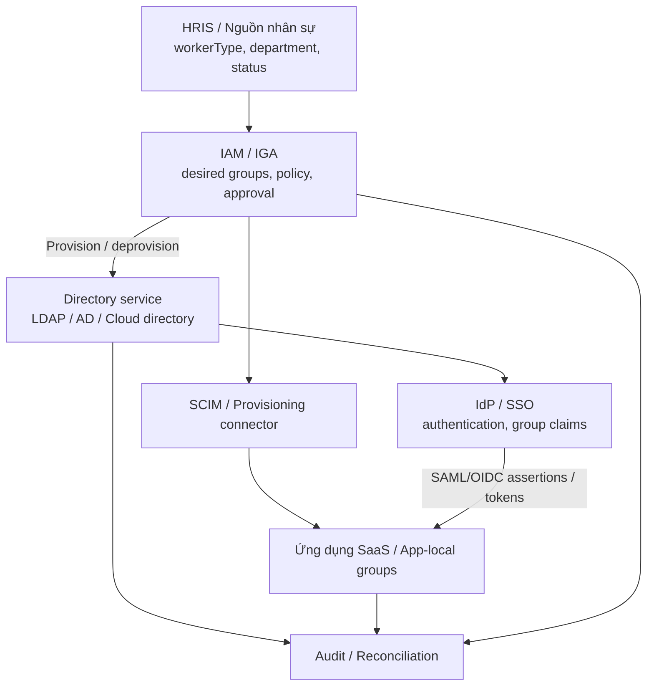
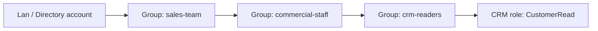
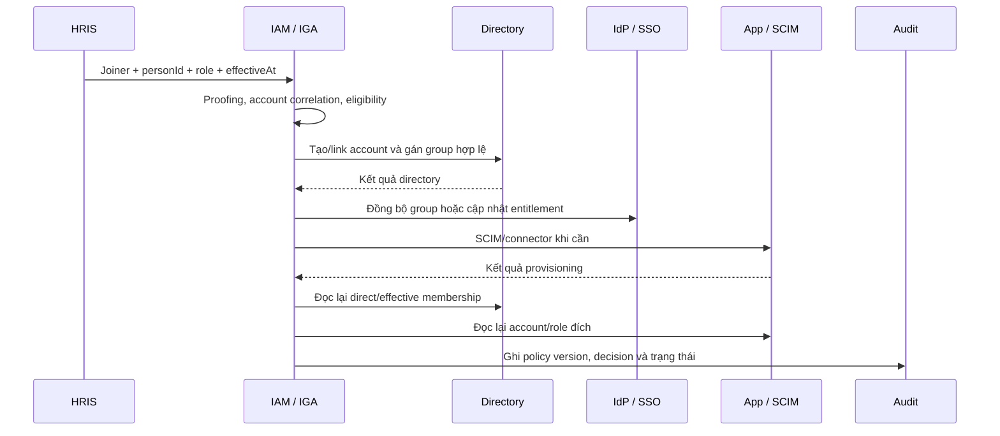

# Group directory trong quản lý vòng đời danh tính IAM

## Mục tiêu học tập

Sau bài học, người học có thể:

1. Giải thích **Group directory** là gì, vai trò của nhóm trong dịch vụ thư mục và phân biệt **group**, **group membership**, **role**, **entitlement** cùng **account**.
2. Mô tả cách biểu diễn nhóm ở **LDAP**, **Active Directory (AD)** và các **cloud identity directory/IdP**, bao gồm identifier, attribute, member, cấu trúc lồng nhau và nhóm động.
3. Đọc được ví dụ **LDAP DN, LDIF, LDAP search**, hiểu sự khác nhau giữa `member`, `memberOf`, `uniqueMember`, `memberUid` và SCIM `Group.members`.
4. Thiết kế chính sách cấp nhóm theo nguồn nhân sự, identity lifecycle **Joiner–Mover–Leaver**, nhóm cơ sở, RBAC/ABAC, least privilege và phân tách nhiệm vụ (SoD).
5. Phân tích quyền hiệu lực do **nested group**, group-to-role mapping, SSO claim, đồng bộ SCIM và app-local role tạo ra.
6. Đối soát **desired membership** với **actual membership**, xử lý đổi tên/di chuyển group, replication delay, lỗi connector, membership ngoài luồng và account mồ côi.
7. Thiết lập ownership, review, audit và cơ chế thu hồi nhằm ngăn **privilege accumulation** và **residual access** trong hệ sinh thái IAM.

## 1. Group directory là gì?

**Directory service** là hệ thống lưu và truy vấn các đối tượng được tổ chức quản lý như người dùng, account, máy tính, nhóm, thiết bị hoặc một số đối tượng dịch vụ. Trong kiến trúc IAM, **Group directory** là phần mô hình và hoạt động quản lý **nhóm cùng quan hệ thành viên** trong một dịch vụ thư mục.

Một group có thể đại diện cho:

- Một tập người dùng có cùng điều kiện, ví dụ nhân viên đang hoạt động.
- Một tập account cần được gán vào ứng dụng hoặc có quyền dùng tài nguyên.
- Một vai trò nghiệp vụ hay kỹ thuật được ánh xạ sang entitlement.
- Một danh sách nhận thông báo, **không nhất thiết mang quyền bảo mật**.
- Một nhóm tập hợp các nhóm con, khi nền tảng hỗ trợ **nested membership**.

Ví dụ: một nhân viên thuộc group `GRP-EMPLOYEE-ACTIVE` và `GRP-HR-PORTAL-USERS`. Group thứ nhất có thể dùng để xác định phân loại nhân sự; group thứ hai được IAM liên kết tới quyền mở ứng dụng cổng nhân sự.

**Tên group không chứng minh group an toàn.** Nhóm có tên “staff” nhưng bị ánh xạ vào ứng dụng nhạy cảm có thể cấp quyền rất rộng. Muốn kiểm soát đúng phải biết **group nào, thành viên nào, nguồn membership nào, ánh xạ sang quyền gì, hiệu lực đến khi nào**.

### 1.1. Group, identity, account và entitlement là các lớp khác nhau

| Khái niệm | Ý nghĩa trong IAM | Ví dụ minh họa |
|---|---|---|
| **Identity** | Thực thể được quản trị xuyên nhiều hệ thống | `identityId=IDN-2401` |
| **Directory account** | Bản ghi principal trong directory | `uid=lan,ou=people,dc=example,dc=org` |
| **Group object** | Đối tượng chứa định danh, loại, chính sách và quan hệ thành viên | `cn=hr-portal-users,ou=groups,dc=example,dc=org` |
| **Membership** | Quan hệ account hoặc group thuộc group khác | Lan là member của `hr-portal-users` |
| **Role** | Tập trách nhiệm/quyền theo RBAC | `EmployeeSelfServiceReader` |
| **Entitlement** | Quyền cụ thể ở ứng dụng/tài nguyên | `hr.profile.read_own` |
| **Effective permission** | Quyền có hiệu lực sau xét nhóm, role, rule và ngữ cảnh | Được đọc hồ sơ nhân sự của chính mình |
| **Birthright access** | Quyền cơ sở được tự động cấp khi đủ điều kiện | Đọc cẩm nang nhân viên |

Không phải directory nào cũng tự quyết định authorization. Directory có thể chỉ là nguồn **nhận diện account và group**; IdP, gateway hoặc ứng dụng mới áp dụng mapping để cấp quyền thực tế.

### 1.2. Lợi ích của việc quản lý group tập trung

Quản lý nhóm giúp giảm việc gán permission đơn lẻ cho hàng nghìn người. Khi chính sách thay đổi, IAM có thể cập nhật thành viên hoặc mapping nhóm thay vì sửa từng account.

Tuy nhiên, càng dùng group làm công cụ cấp quyền thì **blast radius** của một sai sót càng lớn: thêm một account vào group sai hoặc thêm quyền mới cho group rộng có thể ảnh hưởng nhiều hệ thống cùng lúc. Vì vậy group directory cần **owner, policy, audit và cơ chế đối soát**.

## 2. Group directory nằm ở đâu trong kiến trúc IAM?

Một hệ thống tổ chức có thể dùng LDAP directory, Microsoft Active Directory, cloud IdP và nhiều ứng dụng có group local. Chúng không phải luôn dùng chung một kho dữ liệu hoặc cùng một định danh.



Sơ đồ chỉ là một mô hình minh họa. Có tổ chức dùng **AD làm nguồn nhóm chính** rồi đồng bộ lên cloud IdP; có tổ chức dùng cloud directory làm nguồn trực tiếp; có tổ chức để ứng dụng tự duy trì group.

Cần xác định rõ cho từng nhóm:

1. **Source of truth**: bên nào có quyền quyết định sự tồn tại và membership?
2. **Execution point**: membership được ghi tại directory nào?
3. **Synchronization path**: dữ liệu đi qua đồng bộ directory, connector, SCIM hay claim SSO?
4. **Authorization point**: bên nào thực thi quyền với request thật?
5. **Reconciliation point**: hệ thống nào được đọc lại để chứng minh kết quả?

Nếu HR đổi phòng ban thành công nhưng directory hoặc ứng dụng vẫn giữ nhóm cũ, quyền truy cập tồn dư vẫn có thể tồn tại.

## 3. Nhóm trong LDAP directory

**LDAP (Lightweight Directory Access Protocol)** cung cấp cách truy vấn và sửa các bản ghi directory theo schema. Một bản ghi có **Distinguished Name (DN)** và tập attribute. DN xác định vị trí tên trong cây directory; tên có thể thay đổi nếu object bị rename/move.

### 3.1. Group `groupOfNames`

Một kiểu nhóm LDAP quen thuộc là object class `groupOfNames`, chứa thuộc tính `member` trỏ đến DN của thành viên.

Ví dụ LDIF:

```ldif
dn: cn=hr-portal-users,ou=groups,dc=example,dc=org
objectClass: top
objectClass: groupOfNames
cn: hr-portal-users
member: uid=lan,ou=people,dc=example,dc=org
member: uid=an,ou=people,dc=example,dc=org
description: Users eligible for the HR portal
```

Đây là ví dụ **directory thử nghiệm**, không phải dữ liệu thật. Với schema `groupOfNames` chuẩn, `member` là thuộc tính bắt buộc; khả năng tạo group hoàn toàn rỗng phụ thuộc object class/chiến lược directory và không nên mặc định giống nhau trên mọi server.

### 3.2. Các kiểu thành viên khác

| Object class/attribute | Kiểu tham chiếu | Điều cần nhớ |
|---|---|---|
| `groupOfNames` / `member` | DN của user hoặc đối tượng được schema cho phép | Group giữ tham chiếu DN |
| `groupOfUniqueNames` / `uniqueMember` | DN, có thể kèm unique identifier theo schema | Khác tên attribute `member` |
| `posixGroup` / `memberUid` | Giá trị UID/tên thành viên theo schema POSIX | Không mặc định là DN |
| `memberOf` | Thuộc tính quan hệ ngược nếu directory triển khai | Không phải mọi LDAP server đều tự cung cấp |
| AD `group` / `member` | Danh sách DN của thành viên | Có ngữ nghĩa AD riêng, gồm scope/type |
| SCIM `Group.members` | ID resource thành viên ở SCIM target | Không sao chép trực tiếp LDAP DN làm ID nếu không có mapping |

**Không được giả định mọi LDAP group đều có `memberOf` được cập nhật tự động**. Một số hệ thống thực hiện backlink hoặc plugin, số khác yêu cầu tìm group chứa DN của user. Trong Active Directory, `memberOf` cũng có các ngoại lệ đáng chú ý như **primary group**.

### 3.3. Truy vấn group và thành viên

Ví dụ truy vấn LDAP một group theo CN:

```bash
ldapsearch -LLL -x -H ldaps://ldap.example.org \
  -b "ou=groups,dc=example,dc=org" \
  "(cn=hr-portal-users)" dn cn member description
```

Ví dụ tìm các group có member DN cụ thể:

```bash
ldapsearch -LLL -x -H ldaps://ldap.example.org \
  -b "ou=groups,dc=example,dc=org" \
  "(member=uid=lan,ou=people,dc=example,dc=org)" dn cn
```

Đây là **lệnh minh họa để hiểu cấu trúc**, không dùng cho production nếu chưa kiểm tra endpoint, quyền truy vấn, schema, TLS và cấu hình xác thực thực tế. Trong môi trường thật nên dùng **bind có bảo vệ, giới hạn quyền và secret management**, không truyền password trên command line hoặc log.

Nếu xây filter động từ dữ liệu người dùng, phải **escape theo quy tắc LDAP filter**, không ghép chuỗi thô. Escape DN và escape LDAP filter là **hai thao tác khác nhau**.

### 3.4. DN, CN và ID ổn định

Một group có thể đổi `cn` hoặc di chuyển giữa các OU; DN vì thế thay đổi. Trong một số hệ thống, các object có identifier bền hơn:

- **AD `objectGUID`** thường ổn định cho đối tượng trong vòng đời của nó.
- Một số LDAP server cung cấp **`entryUUID`** hoặc thuộc tính riêng.
- Cloud directory có thể cung cấp **object ID** do nền tảng phát hành.
- SCIM Group có **`id`** riêng tại service provider đích.

Một mapping nên giữ **ID chuẩn nội bộ + ID thật của từng hệ thống**. Không sử dụng chỉ `displayName` hoặc `cn` để xác định group cần cấp/gỡ trong môi trường nhiều tenant và nhiều thư mục.

## 4. Group trong Active Directory

**Microsoft Active Directory Domain Services (AD DS)** lưu group như một đối tượng directory với loại, phạm vi và các attribute như `member`, `memberOf`, `groupType` và identifier riêng.

### 4.1. Security group và distribution group

| Loại | Mục đích điển hình | Lưu ý IAM |
|---|---|---|
| **Security group** | Có thể được dùng trong danh sách kiểm soát truy cập, ủy quyền và các cơ chế liên quan | Membership có thể tác động trực tiếp đến quyền |
| **Distribution group** | Nhóm phân phối thông tin, ví dụ email | Không nên coi mọi distribution group là security entitlement |
| **Nhóm từ cloud IdP** | App assignment, conditional access, phân loại hoặc phân quyền | Ngữ nghĩa phụ thuộc nền tảng và mapping |
| **Nhóm ứng dụng** | Quyền/role cục bộ của SaaS hoặc ứng dụng | Có thể không tương ứng một–một với AD group |

Không được cấp quyền nhạy cảm dựa trên **tên nghe giống nhóm bảo mật**. Hãy kiểm tra loại đối tượng và quan hệ thực tế với ACL, role hoặc app assignment.

### 4.2. Group scope trong AD DS

AD DS hỗ trợ các scope phổ biến:

- **Global group**: thường dùng để gom principal theo phạm vi domain phù hợp, rồi cấp quyền qua group khác.
- **Domain local group**: thường dùng để gán quyền với tài nguyên trong domain tương ứng theo các quy tắc AD.
- **Universal group**: dùng khi cần phạm vi rộng hơn trong forest theo điều kiện topology và thành viên được phép.

Quy tắc **ai được làm thành viên, group nào có thể lồng vào group nào và tài nguyên thuộc scope nào** phụ thuộc loại domain, forest và các giới hạn AD cụ thể. Khi xây policy thực tế cần kiểm tra tài liệu sản phẩm và cấu hình forest; không thể suy scope chỉ từ tiền tố trong tên group.

### 4.3. Direct membership, nested membership và primary group

Trong AD, khi user được thêm vào group, thuộc tính `member` của group chứa liên kết tới user; thuộc tính `memberOf` của user thường biểu diễn **membership trực tiếp**, không tự trả toàn bộ chuỗi group lồng nhau.

Hai trường hợp quan trọng:

1. **Nested group**: user thuộc Group A, Group A thuộc Group B; quyền của Group B có thể có hiệu lực tùy ứng dụng và group scope.
2. **Primary group**: cơ chế primary group của AD không được thể hiện như membership thông thường qua `memberOf`. Vì vậy chỉ liệt kê `memberOf` có thể **không đầy đủ** khi cần đánh giá tất cả group liên quan.

Không suy ra quyền thực tế chỉ bằng một câu truy vấn `memberOf` rồi bỏ qua nested groups, group scope, primary group, local group và cách ứng dụng xử lý group.

### 4.4. Group và token đăng nhập

Trong một số môi trường AD/Kerberos/Windows, thông tin group/authorization có thể được đưa vào **logon token** hoặc dữ liệu nhận dạng dùng cho xác thực/ủy quyền. Nếu người dùng bị gỡ khỏi group trong directory nhưng vẫn giữ logon session đã tồn tại, quyền quan sát trong phiên có thể chưa đổi ngay.

Đây là một ví dụ về **stale authorization**. Biện pháp có thể gồm yêu cầu đăng nhập lại, làm mới ticket/token hoặc cơ chế kiểm tra quyền hiện hành theo từng hệ thống. **Directory membership đã cập nhật không chứng minh mọi session đều mất quyền lập tức.**

## 5. Cloud directory, IdP group và SCIM Group

Cloud identity directory hoặc IdP có thể quản lý group dùng cho application assignment, conditional access, quyền truy cập SaaS hoặc phân loại identity. Dữ liệu có thể được đồng bộ từ on-prem AD/LDAP hoặc được tạo trực tiếp trong cloud.

### 5.1. Quyết định ai là owner của membership

Ví dụ doanh nghiệp có group:

- `GRP-STAFF-ACTIVE`: do HR/IAM policy quản lý, dựa trên quan hệ nhân sự hợp lệ.
- `GRP-PROJECT-A`: do người quản lý dự án/phê duyệt nghiệp vụ quản lý.
- `GRP-CLOUD-ADMIN-JIT`: do PAM/JIT policy quản lý.
- `GRP-APP-CRM-USERS`: được provisioning sang ứng dụng CRM qua connector.

Không nên để một thao tác thủ công ở cloud IdP ghi đè membership có nguồn gốc từ HR/IGA mà không có quyết định có thẩm quyền. Ngược lại, không được tự động xóa nhóm do workflow dự án đang sở hữu chỉ vì nó không thuộc danh sách nhóm cơ sở của HR.

### 5.2. SCIM Group là resource ở hệ thống đích

**SCIM 2.0** cung cấp mô hình tài nguyên `User` và `Group` để hỗ trợ provisioning. Trong một Group có thể có `members` chứa tham chiếu tới các resource trong **SCIM service provider**.

Ví dụ Group resource rút gọn:

```json
{
  "schemas": [
    "urn:ietf:params:scim:schemas:core:2.0:Group"
  ],
  "id": "scim-group-401",
  "displayName": "hr-portal-users",
  "members": [
    {
      "value": "scim-user-2401",
      "type": "User",
      "display": "Lan"
    }
  ]
}
```

Trong ví dụ:

- `id` của Group do hệ thống SCIM đích định nghĩa.
- `members[].value` tham chiếu **User/Group resource ID ở SCIM server đích**, không phải LDAP DN hay HR personId.
- `displayName` là tên hiển thị, không phải khóa ổn định để đồng bộ.
- Group membership có thể được quản lý qua `PATCH`, nhưng năng lực của từng service provider cần được kiểm tra.

### 5.3. Ví dụ cập nhật membership qua SCIM

Yêu cầu thêm một user vào Group SCIM khi đích hỗ trợ `PATCH`:

```http
PATCH /scim/v2/Groups/scim-group-401
Authorization: Bearer <redacted>
Content-Type: application/scim+json

{
  "schemas": [
    "urn:ietf:params:scim:api:messages:2.0:PatchOp"
  ],
  "Operations": [
    {
      "op": "add",
      "path": "members",
      "value": [
        { "value": "scim-user-2401" }
      ]
    }
  ]
}
```

Sau khi gửi, connector cần kiểm tra phản hồi, **GET Group hoặc API quyền tương đương** để xác minh trạng thái. HTTP 2xx ở provisioning layer không luôn có nghĩa quyền ứng dụng đã có hiệu lực. Một số app giữ role local, mapping riêng hoặc đồng bộ bất đồng bộ.

### 5.4. SSO claims khác với provisioning groups

| Cơ chế | Truyền tải | Thời điểm | Điều cần kiểm chứng |
|---|---|---|---|
| **SAML group attribute/claim** | Assertion do IdP phát cho SP | Khi giao dịch SSO diễn ra | SP nhận claim nào, có bị giới hạn/cắt bớt không |
| **OIDC group claim** | ID token/userinfo/claim phù hợp theo cấu hình | Theo flow và cơ chế phát claim | Claim nguồn đáng tin, audience và tuổi dữ liệu |
| **SCIM Group provisioning** | API quản trị User/Group tại đích | Theo đồng bộ hoặc event | App group/membership thực tế có đúng không |
| **App-local role** | Cơ sở dữ liệu hoặc policy của app | Runtime/đồng bộ riêng | Effective authorization thật |
| **Directory group** | LDAP/AD/cloud directory | Khi truy vấn hoặc đồng bộ | Membership trực tiếp/gián tiếp và độ tươi |

**SSO là cách xác thực liên thông; SCIM là cơ chế quản lý account/group; directory là nơi lưu/tra cứu đối tượng; ứng dụng là nơi thực thi quyền.** Các lớp này liên quan nhưng không thay thế nhau.

## 6. Membership trực tiếp, lồng nhau và quyền hiệu lực

### 6.1. Nhóm lồng nhau

Trong nhiều directory, một group có thể là thành viên của group khác:



Lan không nhất thiết có membership trực tiếp trong `crm-readers`, nhưng quyền truy cập CRM **có thể** phát sinh qua chuỗi lồng nhau nếu directory, IdP và CRM đều hỗ trợ/ánh xạ như vậy.

Cần kiểm tra:

- Có bao nhiêu tầng nesting?
- Group scope có cho phép chuỗi đó không?
- Công cụ nào tính transitive membership?
- Có vòng lặp group không?
- Một app có thực sự mở rộng nested groups hay chỉ đọc direct members?
- Có thể đánh giá **effective permissions** thay vì chỉ kiểm tra tên group không?

Không kết luận ứng dụng luôn hỗ trợ group lồng nhau chỉ vì AD/LDAP có cấu trúc đó.

### 6.2. Thuật toán duyệt graph membership

Có thể mô hình hóa các group thành đồ thị có hướng. Một BFS/DFS cần tập `visited` để tránh vòng lặp và giới hạn tài nguyên:

```text
function resolveEffectiveGroups(principal, directory):
    pending = getDirectGroups(principal)
    visited = emptySet()

    while pending is not empty:
        group = pending.pop()

        if group in visited:
            continue

        visited.add(group)

        parents = directory.getParentGroups(group)
        for parent in parents:
            if parent not in visited:
                pending.push(parent)

    return visited
```

Pseudocode cho thấy cách tính **group ancestor closure**, không phải thuật toán chuẩn áp dụng nguyên vẹn mọi AD/LDAP. Triển khai thật phải xử lý group scope, primary group, cross-domain links, dynamic rules, quyền đọc và chu kỳ/giới hạn, đồng thời không để dữ liệu directory bất thường gây DoS.

### 6.3. Group ngoài luồng và quyền kế thừa không mong muốn

Ví dụ `employees-active` là nhóm cơ sở theo HR. Sau này một quản trị viên vô tình thêm `employees-active` vào group `finance-exporters`. Một nhân viên mới có thể được nhận quyền xuất dữ liệu dù chưa từng được phê duyệt nghiệp vụ.

Vì vậy, cần giám sát **cả thay đổi membership của người dùng** và **thay đổi quan hệ group-to-group/group-to-role**. Quyền kế thừa có thể xuất hiện mà không cần cập nhật từng user.

## 7. Nhóm tĩnh, nhóm động và tiêu chí đủ điều kiện

### 7.1. Static group

**Static group** chứa membership được thêm/bớt trực tiếp bởi admin, IAM workflow hoặc connector. Nhóm không nhất thiết được gán thủ công; policy engine có thể tự động điều phối thay đổi lên static group.

Ưu điểm: kiểm soát được membership qua API, dễ gắn approval và audit. Nhược điểm: nếu event bị mất hoặc connector lỗi, membership có thể stale và cần reconciliation.

### 7.2. Dynamic group

**Dynamic group** xác định thành viên dựa trên các điều kiện thuộc tính, chẳng hạn account active, worker type, department hoặc location. Engine của nền tảng tính membership theo rule và thời điểm đồng bộ riêng.

Ví dụ logic minh họa:

```text
eligibleForEmployeeGroup(identity, hr, now) =
    identity.proofingStatus == VERIFIED
    AND hr.workerType == EMPLOYEE
    AND hr.employmentStatus == ACTIVE
    AND now >= hr.effectiveStart
    AND (hr.effectiveEnd is null OR now < hr.effectiveEnd)
```

Điều kiện trên chỉ là **pseudocode**, không phải cú pháp của AD, LDAP hay cloud IdP. Khả năng dùng dynamic groups và tập thuộc tính được hỗ trợ tùy sản phẩm.

**Không coi thuộc tính người dùng tự sửa được là nguồn cấp quyền đáng tin.** Nếu một group tài chính dựa trên `department`, thuộc tính đó phải được đồng bộ từ HR source of truth hoặc nguồn được phê duyệt.

### 7.3. Birthright khác role nghiệp vụ và đặc quyền

| Nhóm | Đối tượng | Chính sách |
|---|---|---|
| **Birthright** | Người có quan hệ nhân sự hợp lệ, cần quyền cơ sở | Tự động khi đủ điều kiện, thu hồi khi mất điều kiện |
| **Department group** | Người thuộc đơn vị được HR xác nhận | Có thể tự động, nhưng phải giới hạn quyền nghiệp vụ |
| **Application role group** | Người cần một chức năng rõ | Theo role/job function và owner/phê duyệt |
| **Privileged/PAM group** | Người được ủy quyền quản trị nhạy cảm | MFA mạnh, JIT, giới hạn thời gian, SoD và audit |
| **Project group** | Người tham gia dự án tạm thời | Sponsor/owner, mục tiêu, expiry và review |
| **Workload group** | Service principal hoặc thiết bị chuyên dụng | Vòng đời và quyền riêng cho non-human identity |

Một người thuộc Department Finance **không tự động** có quyền duyệt thanh toán. Nhóm đơn vị có thể giúp xác định phạm vi, nhưng entitlement nhạy cảm vẫn cần role, SoD, approval và điều kiện bổ sung.

## 8. Group directory trong Joiner–Mover–Leaver

### 8.1. Joiner: cấp nhóm mặc định đúng điều kiện

Khi người mới gia nhập, HRIS gửi event đáng tin; IAM tạo/liên kết identity với account rồi tính nhóm phải có.



Ví dụ người dùng Lan là nhân viên active đã qua proofing:

- Có thể đủ điều kiện vào `employees-active`.
- Có thể đủ điều kiện vào `employee-self-service`.
- Có thể cần vào `crm-readers` nếu được gán nhiệm vụ tương ứng.
- **Không** tự được vào `domain-admins` chỉ vì account đã tạo trong cùng directory.

Nếu ngày bắt đầu còn ở tương lai, IAM có thể pre-provision account nhưng giữ quyền truy cập ở trạng thái chờ; **account có mặt trong directory không đồng nghĩa được phép truy cập ngay**.

### 8.2. Mover: tính lại membership và quyền liên đới

Khi Lan chuyển từ Sales sang Finance, quyền cũ phải được đánh giá lại.

```text
Trước Mover:
    employees-active
    sales-team
    crm-readers

Sau Mover, theo policy minh họa:
    employees-active
    finance-team
    expense-readers

Cần gỡ khi không còn hợp lệ:
    sales-team
    crm-readers
```

Chỉ thêm group mới mà giữ group cũ sẽ gây **privilege accumulation**. Nhưng cũng không được xóa mù các nhóm mà workflow khác sở hữu. Cần xác định **source/owner của từng membership**, phê duyệt ngoại lệ, thời gian hiệu lực và nhóm nào đã từng cấp qua dự án khác.

### 8.3. Leaver: chặn truy cập, gỡ nhóm, đối soát

Khi nguồn HR/contractor xác nhận Leaver có hiệu lực, IAM cần:

1. Disable account/SSO theo chính sách.
2. Gỡ các membership và entitlement không còn hợp lệ trong directory và ứng dụng.
3. Thu hồi account local, API key, session, token, credential và đường đăng nhập độc lập khi liên quan.
4. Xử lý group có gán quyền đặc quyền, nested group và quyền trực tiếp.
5. Đọc lại trạng thái directory/app, xử lý replication delay và stale cache.
6. Giữ audit/retention theo chính sách, không re-enable chỉ vì account record vẫn tồn tại.

**Xóa khỏi một group không tương đương deprovisioning hoàn tất**. Một Leaver có thể vẫn có account local hoặc token không phụ thuộc directory.

### 8.4. Rehire: không khôi phục nguyên snapshot cũ

Khi một người quay lại, IAM phải kiểm tra identity/account correlation, proofing và quan hệ nhân sự mới. Một group cũ có thể giữ quyền không còn hợp lệ, nên không được tự tái sử dụng tất cả membership trước đây.

Hãy tính lại **desired groups theo policy hiện hành**, xử lý credential/session cũ và đọc lại effective entitlement sau khi kích hoạt theo quy trình.

## 9. Group directory và RBAC/ABAC

### 9.1. RBAC: từ nhóm tới role

Directory group có thể được dùng làm đầu vào để gán một role:

```text
Directory Group: grp-hr-self-service
    → IdP / App mapping: EmployeeProfileReader
    → Application permission: employee.profile.read_own
```

Một chính sách tốt giữ rõ **ranh giới group-to-role**, và cập nhật mapping phải được review như thay đổi quyền bảo mật, không chỉ là sửa tên nhóm.

### 9.2. ABAC: nhóm không đủ cho mọi quyết định

Ví dụ ứng dụng nhân sự cần cho nhân viên xem hồ sơ của **chính mình**, không được xem hồ sơ người khác chỉ vì cùng nhóm:

```text
ALLOW(subject, action, resource) WHEN
    subject.lifecycleState == ACTIVE
    AND subject.accountState == ENABLED
    AND subject.groups CONTAINS "grp-hr-self-service"
    AND action == "employee.profile.read"
    AND resource.ownerIdentityId == subject.identityId
    AND request.context.meetsSecurityPolicy
```

Đây là pseudocode. **Group membership là một thuộc tính của quyết định authorization**, còn ABAC giới hạn theo resource, môi trường, thời điểm và các điều kiện khác.

### 9.3. Separation of Duties (SoD)

Nếu group `expense-requesters` và `expense-approvers` cho phép cùng một người tạo và duyệt khoản chi của chính mình, có thể phát sinh xung đột SoD. Tùy quy trình nghiệp vụ, chính sách cần phát hiện và ngăn hoặc kiểm soát ngoại lệ.

Vì vậy phải đánh giá **effective roles từ cả group lồng nhau và gán trực tiếp**, không chỉ hai tên group hiển thị trong màn hình quản trị.

## 10. Danh mục và ownership của group

Một group cần metadata quản trị tách khỏi directory object nếu nền tảng không lưu đủ.

Ví dụ bản ghi catalog **minh họa**:

```json
{
  "canonicalGroupId": "GRP-HR-PORTAL-USERS",
  "displayName": "hr-portal-users",
  "groupPurpose": "ACCESS_TO_HR_PORTAL",
  "groupCategory": "APPLICATION_ROLE",
  "directorySystem": "CORPORATE_LDAP",
  "directoryObjectId": "directory-group-0019",
  "targetMappings": [
    {
      "targetSystem": "HR_PORTAL",
      "targetGroupId": "scim-group-401",
      "role": "EmployeeProfileReader"
    }
  ],
  "eligibilityPolicyId": "hr-portal-v4",
  "groupOwner": "HR-APPLICATION-OWNER",
  "technicalOwner": "IDENTITY-PLATFORM",
  "approvalRequired": false,
  "reviewIntervalDays": 90,
  "lifecycleState": "ACTIVE"
}
```

Schema trên không phải chuẩn LDAP/SCIM. Mỗi nhóm nên có:

- **Business owner** giải thích mục đích và đối tượng đủ điều kiện.
- **Technical owner** vận hành directory/connector.
- **Nguồn membership**: HR rule, IGA request, PAM hay quản trị thủ công.
- **Đường mapping quyền** và mức độ nhạy cảm.
- **Ngày hiệu lực/expiry** với nhóm tạm thời.
- **Chu kỳ access review**, approval và SoD.
- **Trạng thái group**: active, đang thay thế, retire.
- **Định danh ổn định** ở từng directory/ứng dụng.

Không nên giữ group không có owner, không biết đang cấp quyền gì nhưng vẫn được dùng rộng rãi trong hệ thống.

## 11. Provisioning nhóm và thành viên an toàn

### 11.1. Các hành động quản lý

Một hệ thống quản trị directory thường cần:

- Tạo group có ID, loại, phạm vi, owner và metadata rõ.
- Đổi tên/mô tả group nhưng giữ mapping đúng.
- Thêm/bớt member trực tiếp theo policy.
- Quản lý nested group với kiểm soát vòng lặp/scope.
- Đồng bộ group tới IdP/ứng dụng.
- Đánh dấu deprecate/retire và gỡ mapping quyền theo quy trình.
- Kiểm toán người/luồng nào đã thay đổi membership.

**Không coi thay đổi group là thao tác vô hại.** Thêm một group vào group đặc quyền có thể cấp quyền cho toàn bộ thành viên của group con.

### 11.2. Ví dụ thay đổi LDAP membership

Ví dụ LDIF mô tả việc thêm một DN vào group thử nghiệm:

```ldif
dn: cn=hr-portal-users,ou=groups,dc=example,dc=org
changetype: modify
add: member
member: uid=binh,ou=people,dc=example,dc=org
```

Ví dụ gỡ member:

```ldif
dn: cn=hr-portal-users,ou=groups,dc=example,dc=org
changetype: modify
delete: member
member: uid=binh,ou=people,dc=example,dc=org
```

Không chạy các thao tác này trong production nếu chưa xác minh đúng DN, owner, policy, quyền connector và hiệu lực. Trong hệ thống khác, thay đổi có thể qua API/PowerShell/SCIM hoặc dynamic rule, không phải LDIF.

### 11.3. Idempotency và kiểm tra trạng thái trước ghi

Nếu Joiner event được xử lý nhiều lần, hệ thống không nên tạo nhiều group trùng tên hoặc gán member lặp vô hạn. Workflow nên dựa trên **desired vs actual** và identifier ổn định:

```text
desired = evaluateAuthorizedMembership(identity, groupPolicy)
actual = readDirectMembership(groupId, directory)

if desired == MEMBER and actual == NOT_MEMBER:
    addMember(groupId, targetAccountId)

if desired == NOT_MEMBER and actual == MEMBER:
    removeMember(groupId, targetAccountId)

readBackDirectoryMembership()
reconcileTargetApplicationEntitlement()
```

Pseudocode bỏ qua exception để làm rõ logic. Trước khi gỡ member, phải kiểm tra workflow này **có sở hữu membership đó** hay không. Khi dữ liệu nguồn mơ hồ hoặc thiếu, không nên tự động xóa quyền hợp lệ của workflow khác.

## 12. Đồng bộ, replication, cache và consistency

Directory service không nhất thiết phản ánh mọi thay đổi tức thời ở tất cả node, miền và ứng dụng.

### 12.1. Những nguồn trễ thường gặp

- **AD replication:** thay đổi ở một domain controller cần được nhân bản theo topology và lịch.
- **LDAP replication:** replica có thể trễ hoặc tạm mất kết nối.
- **Hybrid sync:** group trên AD được đồng bộ sang cloud IdP theo chu kỳ/sự kiện.
- **SCIM provisioning:** connector có thể xếp hàng và ứng dụng xử lý bất đồng bộ.
- **Token/session cache:** group claim hoặc role đã được đưa vào SAML/OIDC token hay app session.
- **Authorization cache:** ứng dụng hoặc gateway giữ danh sách quyền riêng.
- **Dynamic group evaluation:** rule cần thời gian để tính lại thành viên.

Những độ trễ này ảnh hưởng **cả cấp quyền mới (Joiner)** lẫn **thu hồi quyền cũ (Mover/Leaver)**. SLA nên quy định theo rủi ro và hệ thống.

### 12.2. Ví dụ sự kiện Mover bị trễ

```text
09:00  HR cập nhật Lan từ Sales sang Finance.
09:01  IAM tính desired groups mới.
09:02  LDAP/AD chính gỡ sales-team.
09:03  Một replica vẫn trả Lan thuộc sales-team.
09:05  Cloud IdP mới nhận thay đổi.
09:07  Ứng dụng vẫn giữ token cũ có sales-reader.
09:08  Reconciliation phát hiện stale authorization.
09:10  App session/token được xử lý theo chính sách.
```

Các mốc chỉ minh họa. **Không coi bước 09:02 là đã thu hồi quyền ở mọi nơi**. Nếu role nhạy cảm, cần cơ chế revoke hoặc policy check ở runtime để giảm thời gian tồn dư.

### 12.3. “Đã ghi thành công” khác “đã có hiệu lực”

Nên phân biệt:

| Trạng thái | Ý nghĩa |
|---|---|
| `REQUESTED` | IAM gửi yêu cầu |
| `APPLIED_TO_DIRECTORY` | Directory chấp nhận thay đổi |
| `REPLICATED_OR_SYNCED` | Các node/IdP thuộc phạm vi được xác nhận đã cập nhật |
| `APPLIED_TO_TARGET` | App/SCIM connector xử lý membership |
| `EFFECTIVE_ACCESS_VERIFIED` | Quyền thật ở ứng dụng đích phù hợp policy |
| `RETRYABLE_ERROR` | Lỗi tạm thời cần retry |
| `REVIEW_REQUIRED` | Mapping/owner/policy mơ hồ |
| `EXCEPTION_OPEN` | Chưa hoàn tất trong SLA, có owner giảm rủi ro |

Đây là các **trạng thái workflow minh họa**, không phải thuộc tính chuẩn của LDAP hoặc SCIM.

## 13. Reconciliation nhóm: so sánh desired và actual

Một trong những việc quan trọng nhất của IAM là định kỳ so sánh membership theo policy với membership thực tế ở directory và ứng dụng.

### 13.1. Những điều phải đối soát

1. **Group có tồn tại ở directory mong muốn không?**
2. **Group có đúng loại, scope, owner và trạng thái không?**
3. **Nhóm có đúng direct members không?**
4. **Nested groups có sinh effective members ngoài ý muốn không?**
5. **Group-to-role mapping có bị sửa mà không review không?**
6. **Đồng bộ IdP/SCIM có giữ đúng ID và trạng thái không?**
7. **Leaver và người đổi role có còn quyền cũ không?**
8. **Những membership thủ công có chủ sở hữu, lý do và hạn không?**
9. **Service account có được đưa vào group người dùng sai policy không?**
10. **Có group không owner hoặc không còn ứng dụng dùng nhưng vẫn active không?**

### 13.2. Phân loại sai lệch

| Sai lệch | Ý nghĩa | Hành động phù hợp |
|---|---|---|
| **MISSING_GROUP** | Group được policy yêu cầu nhưng không tồn tại ở đích | Xác minh mapping và provisioning |
| **MISSING_MEMBERSHIP** | User đủ điều kiện nhưng chưa được gán | Reprovision theo policy khi chắc mapping |
| **EXCESS_MEMBERSHIP** | Account không đủ điều kiện vẫn nằm trong group | Điều tra, thu hồi và đánh giá quyền tồn dư |
| **UNLINKED_GROUP** | Có group ở đích nhưng chưa map catalog | Review owner, không tự tạo group trùng |
| **ORPHAN_GROUP** | Group không còn owner/nhu cầu hợp lệ | Đánh giá tác động trước retire |
| **WRONG_GROUP_TYPE** | Distribution/security hoặc scope không đúng mục đích | Thay đổi có phê duyệt và kiểm tra quyền |
| **NESTED_PRIVILEGE_DRIFT** | Quyền rộng do quan hệ group-to-group | Phân tích graph, cắt đường quyền bất thường |
| **TARGET_MAPPING_DRIFT** | App role mapping khác catalog được duyệt | Sửa mapping, readback |
| **STALE_SYNC** | Directory và ứng dụng chưa đồng bộ | Theo dõi SLA và retry |
| **INVENTORY_UNKNOWN** | Không đọc đủ do API lỗi, thiếu quyền hoặc thiếu trang | Sửa collector, không kết luận membership sai |

**Không được coi API tìm không thấy member là bằng chứng đã gỡ thành công** nếu truy vấn chưa đủ quyền, chưa phân trang hết hoặc chỉ đọc một replica stale.

### 13.3. Pseudocode đối soát an toàn

```text
function reconcileManagedGroup(groupId, now):
    policy = loadApprovedGroupPolicy(groupId)
    snapshot = readDirectoryGroupSnapshot(groupId)

    if not snapshot.complete or snapshot.wrongTenant:
        return OPEN_COLLECTOR_EXCEPTION

    desired = evaluateMembershipFromAuthoritativeSources(policy, now)
    actual = snapshot.directMembers

    for principal in union(desired, actual):
        if correlationIsAmbiguous(principal):
            openManualReview(principal)
            continue

        if principal in desired and principal not in actual:
            planAuthorizedAdd(principal, groupId)

        if principal not in desired and principal in actual:
            if membershipOwnedByThisPolicy(principal, groupId):
                planAuthorizedRemoval(principal, groupId)
            else:
                openOwnershipReview(principal, groupId)

    applyApprovedChangesIdempotently()
    verifyDirectoryMembershipAndTargetEntitlements()
    writeAuditAndExceptions()
```

Pseudocode chỉ thể hiện cách làm, không phải code sản phẩm. Trong hệ thống thật cần transaction, event version, xử lý concurrency, rate limiting, group nesting, rollback và phê duyệt thay đổi rủi ro cao.

### 13.4. Chống tạo lại quyền từ sự kiện cũ

Nếu event Joiner cũ đến sau Leaver, IAM có thể vô tình thêm lại user vào nhóm mặc định. Cần kiểm tra **source version** và lifecycle state mới nhất ngay trước khi ghi membership. Với event đến muộn, hệ thống phải bỏ qua hoặc tính lại desired state, không áp dụng lại quyền từ snapshot cũ.

## 14. Các tình huống ngoại lệ

### 14.1. Đổi tên hoặc di chuyển group

Một group có thể đổi `cn` hoặc DN; job chỉ dựa trên tên có thể tưởng group cũ đã mất và tạo group mới, làm trùng mapping hoặc bỏ sót membership.

Giải pháp: dùng **identifier ổn định**, quản lý rename/move event và đối soát tên/ID. Nếu nền tảng không có ID đủ ổn định, cần chiến lược correlation và chuyển đổi có kiểm soát.

### 14.2. Xóa group có thành viên hoặc mapping quyền

Xóa group đang cấp quyền cho nhiều ứng dụng có thể gây gián đoạn lớn. Trước khi retire:

- Xác định group owner và lý do.
- Liệt kê direct/effective members, nested parents và role mapping.
- Phân loại quyền còn cần thiết.
- Lập kế hoạch chuyển sang group thay thế nếu có.
- Gỡ mapping, chặn cấp mới, xử lý session/token có quyền cũ.
- Kiểm tra không còn phụ thuộc và lưu audit theo policy.
- Chỉ xóa object khi retention và change approval cho phép.

Không nên xóa group chỉ vì tên có tiền tố `old-`.

### 14.3. Nested cycle

Một directory có thể có hoặc ngăn các vòng lặp group tùy sản phẩm. Thuật toán reconciliation cần giới hạn độ sâu, tập visited và alert khi gặp cấu trúc bất thường, tránh tính group membership vô hạn.

### 14.4. Group được tạo thủ công ngoài IAM

Ứng dụng có thể tồn tại một group local do admin tạo. Nếu IAM không biết group đó, nó có thể mang role nhạy cảm chưa được review.

Cần import inventory, xác định owner và nguồn hợp lệ, rồi đưa vào catalog hoặc kế hoạch retire; không tự gán tất cả group ngoài luồng cho một identity tùy ý.

### 14.5. Account disabled và membership còn trong directory

Nhiều hệ thống giữ membership trong account đã bị disabled để bảo toàn metadata hoặc hỗ trợ audit. Điều đó không tự chứng minh account có thể đăng nhập; ngược lại, **nếu account được re-enable**, các quyền cũ có thể trở lại.

Vì vậy Leaver cần chính sách rõ về giữ/gỡ group, bảo toàn audit và **rehire recertification**.

### 14.6. Group kích thước lớn

Nhóm có hàng chục nghìn thành viên có thể ảnh hưởng hiệu năng LDAP search, token chứa quá nhiều claim, provisioning batch và tốc độ đối soát.

Cần thiết kế pagination/ranged retrieval theo năng lực sản phẩm, truy vấn tối ưu có chỉ mục, rate limiting và không giả định API trả toàn bộ danh sách trong một response. **Không bỏ bớt thành viên một cách âm thầm** rồi đánh dấu snapshot hoàn chỉnh.

## 15. Quản trị bảo mật cho Group directory

### 15.1. Least privilege của tài khoản quản trị directory

Connector hoặc người vận hành không nên có quyền sửa tất cả group nếu chỉ cần quản lý một nhóm ứng dụng.

Một mô hình phân quyền phù hợp:

| Chủ thể | Quyền hợp lý | Không nên mặc định |
|---|---|---|
| **HR source connector** | Cung cấp dữ liệu nhân sự đã được xác minh | Sửa trực tiếp group quản trị domain |
| **IAM/IGA policy engine** | Tính desired access và điều phối trong phạm vi sở hữu | Tự cấp quyền ngoài policy |
| **Provisioning connector** | Đọc/ghi các group được ủy quyền | Toàn quyền directory không giới hạn |
| **Group business owner** | Duyệt mục đích và thành viên theo policy | Thay cấu hình bảo mật toàn directory |
| **Directory admin** | Quản trị schema, group structure và sự cố | Bỏ qua approval của quyền nghiệp vụ nhạy cảm |
| **Auditor** | Đọc log, membership snapshot, evidence | Tự sửa membership trong quá trình review |
| **PAM operator** | Cấp/thu hồi quyền đặc biệt theo workflow | Duy trì quyền đặc biệt vô thời hạn |

Dù dùng LDAP bind, AD delegated permissions hay API cloud, cần giới hạn **scope, credential, thời gian và hành động**. Log thay đổi phải cho thấy ai hoặc service principal nào đã thực thi.

### 15.2. Tránh privilege escalation qua group

Một số đường cấp quyền sai thường gặp:

- Người dùng tự sửa thuộc tính `department` rồi vào dynamic admin group.
- Account cấp phát tự động bị thêm vào nhóm “all-admins”.
- Một group có tên cơ sở được lồng vào group đặc quyền.
- Connector có quyền ghi group ngoài phạm vi khiến lỗi workflow làm thay đổi phân quyền lớn.
- Quản trị viên sửa group-to-role mapping của SaaS mà không được Security review.
- Role cũ vẫn tồn tại trong token hoặc session sau khi gỡ group.

Kiểm soát cần có: authoritative attributes, SoD, approval thay đổi mapping, giới hạn quyền connector, phát hiện drift, step-up/PAM cho quyền cao và readback quyền ở đích.

### 15.3. Dữ liệu thư mục và quyền riêng tư

Directory thường chứa thuộc tính nhân sự và liên hệ. Không nên phát mọi attribute vào SAML/OIDC group claim, API response hoặc audit cho tất cả ứng dụng. Áp dụng **data minimization**: chỉ truyền identifier/group cần thiết cho mục đích authorization, bảo vệ các trường nhạy cảm và định nghĩa retention cho snapshot.

Tương tự, connector đọc group không nên có quyền đọc toàn bộ thông tin HR nếu không cần.

## 16. Audit và đo chất lượng Group directory

Ví dụ sự kiện kiểm toán khi gỡ thành viên:

```json
{
  "eventType": "GROUP_MEMBERSHIP_REMOVED",
  "identityId": "IDN-2401",
  "accountId": "DIR-U-901",
  "canonicalGroupId": "GRP-CRM-READERS",
  "directoryGroupId": "DIR-G-402",
  "targetDirectory": "CORPORATE_DIRECTORY",
  "reason": "MOVER_ROLE_CHANGED",
  "sourceEventId": "HR-MOVE-2201",
  "sourceVersion": 19,
  "policyVersion": "group-access-v4",
  "requestedBy": "IAM-JML-WORKFLOW",
  "applyState": "APPLIED",
  "readbackState": "VERIFIED",
  "targetAppReview": "VERIFIED",
  "correlationId": "IAM-GROUP-8812"
}
```

Đây là schema minh họa. Không đưa password, access token, private key hoặc dữ liệu HR không liên quan vào log.

### 16.1. Các chỉ số vận hành

| Chỉ số | Ý nghĩa |
|---|---|
| **Group ownership coverage** | Tỷ lệ nhóm có business owner và technical owner |
| **Membership accuracy** | Tỷ lệ membership direct khớp với desired policy |
| **Excess membership count** | Số account nằm trong group ngoài điều kiện hợp lệ |
| **Missing membership count** | Số account đủ điều kiện nhưng chưa được thêm |
| **Nested privilege anomaly count** | Số đường quyền không mong muốn qua nesting |
| **Orphan/unlinked group count** | Nhóm thiếu mapping, owner hoặc nhu cầu |
| **Joiner group provisioning latency** | Từ mốc đủ điều kiện tới khi membership được readback |
| **Mover/Leaver revocation latency** | Từ lúc mất điều kiện tới khi quyền được xác minh thu hồi |
| **Directory-to-app sync lag** | Độ trễ từ directory đến target |
| **Reconciliation exception age** | Thời gian sai lệch membership chưa khắc phục |
| **Group review completion rate** | Tỷ lệ review quyền hoàn tất trong chu kỳ |
| **Unauthorized membership change incidents** | Thay đổi membership/mapping không qua nguồn được duyệt |

KPI cần chỉ rõ hệ thống, tenant, mẫu số, snapshot timestamp, độ đầy đủ và định nghĩa `VERIFIED`. **Ghi thành công ở directory không đồng nghĩa application permission đã thay đổi**.

### 16.2. Cảnh báo ưu tiên cao

- Account Leaver vẫn thuộc group cho truy cập production.
- Group mặc định mới được lồng vào nhóm có đặc quyền.
- Một tài khoản lạ được thêm vào group quản trị.
- Directory và app có membership lệch vượt thời hạn đồng bộ.
- Số thành viên nhóm tài chính tăng đột biến sau thay đổi rule.
- Connector provisioning lỗi hàng loạt hoặc thiếu quyền đọc.
- Group owner bị vô hiệu nhưng nhóm còn role cao không ai chịu trách nhiệm.
- App token vẫn mang role cũ sau Mover trong luồng nhạy cảm.

Cảnh báo nên gắn với owner, mức độ rủi ro và runbook xử lý. Với hệ thống không cung cấp log/readback đầy đủ, ghi rõ giới hạn thay vì tự báo “an toàn”.

## 17. Bài tập tình huống: group lồng nhau gây quyền vượt mức

**Bối cảnh:** Tổ chức dùng AD nội bộ, đồng bộ lên IdP và cung cấp group cho CRM. Người dùng Lan thuộc group `sales-team`. Một quản trị viên thêm `sales-team` làm thành viên của `all-staff`. Trước đây `all-staff` chỉ có quyền đọc wiki, nhưng sau đó một dự án khác vô tình ánh xạ `all-staff` vào role `crm-export-full`.

Trong tuần đó:

- Lan được Mover từ Sales sang Finance.
- IAM gỡ membership trực tiếp `sales-team` khỏi Lan.
- Một replica AD chưa nhận thay đổi.
- Ứng dụng CRM giữ session có claim role cũ.
- Nhân viên nhà thầu An vừa hết hạn hợp đồng nhưng account app local vẫn còn active.

### 17.1. Câu hỏi

1. Group nào thực sự là nguồn tạo quyền `crm-export-full` không mong muốn?
2. Vì sao chỉ nhìn group trực tiếp của Lan có thể bỏ sót rủi ro?
3. Sự khác nhau giữa sai lệch directory, sai lệch app role và token/session cũ là gì?
4. Với Mover của Lan, những bước nào cần có ngoài gỡ `sales-team`?
5. Nhà thầu An có thể được xử lý chỉ bằng cách gỡ một group AD không?
6. Những thay đổi nào cần review/approval để tránh lặp lại?
7. Bằng chứng nào cho thấy quyền đã được thu hồi thật?

### 17.2. Hướng giải

**Bước 1 — Truy vết đường quyền.** Nhóm `sales-team` có thể gián tiếp mang quyền từ `all-staff`; mapping `all-staff → crm-export-full` là một nguyên nhân quan trọng của việc mở rộng quyền sai. Cần kiểm tra direct và transitive membership cùng toàn bộ mapping tới CRM.

**Bước 2 — Kiểm tra nhiều lớp.** AD chính đã đổi nhưng replica có thể stale. Cloud IdP cần thời gian đồng bộ, còn CRM session có thể giữ claim cũ. Không thể coi gỡ user trên AD là đủ bằng chứng quyền tại CRM đã mất.

**Bước 3 — Xử lý Mover.** Tính lại desired groups theo vị trí mới, gỡ nhóm Sales không còn hợp lệ, xử lý app-local entitlement và session/token cần thu hồi. Cấp nhóm Finance theo approval và SoD, không sao chép role Sales.

**Bước 4 — Xử lý Leaver nhà thầu.** Xác nhận nguồn hợp đồng và ngày hiệu lực; disable account app local, thu hồi phiên/token/role và mọi đường login liên quan. Gỡ group directory chỉ là một phần.

**Bước 5 — Sửa governance.** Có owner và review cho group-to-role mapping, kiểm tra tác động của nested group trước khi thay đổi, giới hạn quyền connector, cảnh báo quyền lớn được thêm vào group rộng và thực hiện reconciliation định kỳ.

**Bước 6 — Readback.** Kiểm tra membership ở directory và IdP, quyền thực tế tại CRM, sự hết hiệu lực của session/token liên quan và audit các ngoại lệ còn mở.

### 17.3. Câu hỏi đúng/sai

1. “Group directory là một tập quan hệ thành viên, không nhất thiết tự thực thi authorization.”
2. “Mọi LDAP server chuẩn đều tự tính thuộc tính `memberOf` cho user.”
3. “`groupOfNames` thường dùng `member` với giá trị DN.”
4. “`posixGroup`/`memberUid` nhất thiết lưu DN của user.”
5. “SCIM `Group.members[].value` được hiểu theo ID tài nguyên ở SCIM target.”
6. “Một thay đổi group-to-role có thể cấp quyền cho cả group rộng dù không sửa từng user.”
7. “Group nesting được mọi SaaS mở rộng giống Active Directory.”
8. “Khi Mover, chỉ cần thêm group mới; group cũ nên giữ để khỏi gián đoạn.”
9. “Gỡ user khỏi group ở directory chứng minh mọi app session đã mất role cũ.”
10. “Group bị đổi tên có thể giữ cùng một định danh object ổn định.”
11. “Directory snapshot chưa phân trang hết đủ cơ sở để kết luận tất cả member vắng mặt.”
12. “Leaver cần xử lý account, session, credential và quyền app local ngoài group directory.”
13. “Một service account nên mặc định thuộc group nhân viên để dễ quản trị.”
14. “Nên dùng ID ổn định và owner để đối soát group giữa AD, IdP và SCIM.”
15. “Quyền của nhóm có thể bị ảnh hưởng bởi nested group và mapping quyền tại ứng dụng.”

**Đáp án:** 1 Đúng; 2 Sai; 3 Đúng; 4 Sai; 5 Đúng; 6 Đúng; 7 Sai; 8 Sai; 9 Sai; 10 Đúng; 11 Sai; 12 Đúng; 13 Sai; 14 Đúng; 15 Đúng.

## 18. Những nguyên tắc cần ghi nhớ

1. **Group directory lưu nhóm và membership; ứng dụng và chính sách quyết định quyền thực tế.**
2. **Group, role, entitlement, identity và account khác nhau**; một group có thể chỉ phân loại hoặc tạo quyền trực tiếp/gián tiếp.
3. **LDAP có nhiều object class/attribute nhóm**, trong khi AD, cloud IdP và SCIM có cách biểu diễn và ngữ nghĩa riêng.
4. **Định danh ổn định quan trọng hơn tên hiển thị/DN** để tránh gán nhầm hoặc tạo trùng khi đổi tên, chuyển OU hoặc đồng bộ nhiều tenant.
5. **Nested group có thể mở rộng quyền lớn**; phải đánh giá effective membership và group-to-role mappings.
6. **Static/dynamic group đều cần dữ liệu có thẩm quyền**, owner, điều kiện mất quyền và readback.
7. **Joiner cấp nhóm khi đủ điều kiện; Mover tính lại và gỡ quyền cũ; Leaver chặn account/phiên/quyền liên quan** chứ không chỉ xóa membership.
8. **SSO group claim, SCIM Group provisioning và application roles là các lớp khác nhau**, có thể đồng bộ trễ hoặc giữ cache cũ.
9. **Least privilege, SoD, quyền connector, approval và review** phải áp dụng cả khi sửa group member lẫn group-to-role/nesting.
10. **Reconciliation desired-versus-actual, event version và retry idempotent** giúp chống group drift, cấp nhầm và tạo lại quyền sau Leaver.
11. **Audit và bằng chứng quyền thực tế** mới xác nhận đã thu hồi thành công, không chỉ kết quả API directory.

Quản trị **Group directory** tốt giúp tổ chức biến các thay đổi nhân sự thành quyền truy cập nhất quán mà vẫn kiểm soát được rủi ro. Khi được tích hợp với HRIS, Identity Lifecycle, IdP, SSO, SCIM, RBAC/ABAC và quy trình kiểm toán, group trở thành cơ chế cấp và thu hồi quyền có thể truy vết, giảm quyền tồn dư xuyên suốt **Joiner–Mover–Leaver**.
