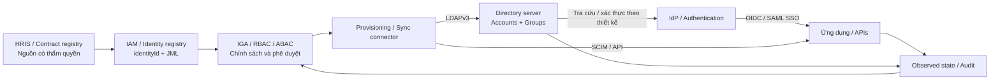

# LDAP trong Directory service và vòng đời danh tính IAM

## 1. LDAP là gì?

**Lightweight Directory Access Protocol (LDAP)** là một giao thức truy cập và quản lý thông tin trong **dịch vụ thư mục** (*directory service*), phổ biến trong hệ thống định danh doanh nghiệp. LDAP cho phép ứng dụng **tìm kiếm, đọc, đối chiếu, thêm, sửa, đổi tên hoặc xóa các entry** theo mô hình dữ liệu có cấu trúc. Nó thường được sử dụng để tra cứu người dùng, nhóm, đơn vị tổ chức, tài khoản dịch vụ và một số thuộc tính phục vụ quản trị truy cập.

Ví dụ, ứng dụng nội bộ cần xác định nhân viên có mã `EMP-1042` đang thuộc nhóm nào. Thay vì tự sao chép toàn bộ hồ sơ nhân viên vào cơ sở dữ liệu ứng dụng, hệ thống có thể truy vấn một dịch vụ thư mục qua LDAP để đọc thuộc tính được cho phép. Một bộ IAM cũng có thể cập nhật account và group membership trong thư mục thông qua kết nối có phân quyền.

**LDAP là giao thức, không phải tên của một sản phẩm hay một nền tảng quản lý vòng đời hoàn chỉnh.** Những hệ thống như OpenLDAP, Active Directory Domain Services (AD DS) và các directory server khác có thể cung cấp giao diện LDAP, nhưng khác nhau về schema, tính năng xác thực, nhóm, chính sách mật khẩu, đồng bộ và khả năng quản trị.

Trong module **SECURITY_IDENTITY_ACCESS_MANAGEMENT_IDENTITY_LIFECYCLE**, LDAP là lớp kỹ thuật có thể hỗ trợ mô hình **Joiner–Mover–Leaver (JML)**: tổ chức tiếp nhận danh tính đã kiểm chứng, tạo account, cập nhật thông tin/nhóm khi đổi vai trò và khóa hoặc thu hồi quyền khi nghỉ việc. Nó thường phối hợp với **IdP, SSO, SCIM, RBAC/ABAC, tài khoản dịch vụ, kiểm toán và đối soát quyền tồn dư**.

Sau bài học, người đọc có thể:

- Diễn giải mô hình cây thư mục, DN/RDN, entry, attribute và schema.
- Phân biệt LDAP bind/search/modify với authentication, authorization, IdP/SSO và SCIM.
- Đọc các ví dụ LDAP filter, LDIF, truy vấn và cập nhật nhóm một cách có kiểm soát.
- Nhận diện yêu cầu bảo vệ đường truyền, credentials, LDAP injection và quyền của connector.
- Thiết kế việc đồng bộ directory với IAM/IGA trong Joiner–Mover–Leaver và xác minh trạng thái đích.

> LDAP rất hữu ích để **truy cập và cập nhật dữ liệu thư mục**, nhưng không tự xác minh pháp lý một con người, không tự phê duyệt quyền nghiệp vụ và không bảo đảm rằng mọi session/token của các ứng dụng đã bị thu hồi khi một entry bị khóa.

## 2. LDAP nằm ở đâu trong kiến trúc IAM?

Một kiến trúc doanh nghiệp có thể có **HRIS** làm nguồn có thẩm quyền về quan hệ lao động, **identity registry** quản lý mã danh tính chuẩn, **directory service** lưu các account/thuộc tính/nhóm cần thiết, **IdP** xác thực và phát kết quả SSO, **IGA** quản lý chính sách/phê duyệt, còn **ứng dụng** thực thi quyền trên tài nguyên.



Sơ đồ là **một cách tổ chức logic**, không phải yêu cầu mọi hệ thống phải kết nối như vậy. Có doanh nghiệp dùng thư mục làm kho dữ liệu chính của IdP; có doanh nghiệp dùng IdP cloud riêng và chỉ đồng bộ một phần tài khoản xuống AD; có ứng dụng legacy trực tiếp LDAP bind/search thay vì nhận SSO.

**Điều cần phân biệt rõ:**

| Thành phần | Công việc chính | LDAP có thay thế được không? |
| --- | --- | --- |
| **HRIS / contract registry** | Xác nhận nhân viên, hợp đồng, ngày hiệu lực và quan hệ nghiệp vụ | LDAP có thể chứa bản sao thuộc tính nhưng không tự là nguồn HR có thẩm quyền |
| **Identity registry** | Liên kết đúng một chủ thể với các account và ID nguồn | Directory có ID entry; vẫn cần chiến lược tương quan giữa nhiều hệ thống |
| **LDAP directory** | Lưu entry và hỗ trợ thao tác tìm kiếm/thay đổi dữ liệu thư mục | Đây là vai trò trung tâm của LDAP |
| **IdP / authentication** | Kiểm tra credential, áp MFA và cấp phiên/token SSO | LDAP bind có thể là đầu vào, nhưng không tự là OIDC/SAML/MFA |
| **IGA** | Quyết định quyền, phê duyệt, SoD, review và JML workflow | LDAP không tự cung cấp toàn bộ governance này |
| **SCIM / API provisioning** | Đồng bộ tài khoản và nhóm tới các hệ thống đích | Giao thức khác LDAP; có thể bổ sung nhau |
| **Ứng dụng / resource server** | Thực thi RBAC/ABAC và kiểm tra quyền trên tài nguyên | Không thể chỉ dựa vào tồn tại entry LDAP |

Không nên biến tất cả dữ liệu trong thư mục thành **source of truth** chỉ vì nhiều ứng dụng đọc nó. Nếu HRIS quyết định `employmentStatus`, việc một account LDAP còn ở trạng thái hoạt động có thể là **sai lệch cần khắc phục**, không phải bằng chứng người đó vẫn làm việc.

## 3. Mô hình dữ liệu LDAP: entry, attribute, DN và DIT

LDAP tổ chức dữ liệu theo một cấu trúc phân cấp được gọi là **Directory Information Tree (DIT)**. Mỗi đối tượng trong cây là một **entry** gồm nhiều **attribute**; mỗi attribute có tên/kiểu và một hoặc nhiều giá trị tùy schema. Các entry được định vị bằng **Distinguished Name (DN)**.

Ví dụ cấu trúc minh họa của thư mục doanh nghiệp:

```text
dc=example,dc=org
├── ou=People,dc=example,dc=org
│   ├── uid=an.nguyen,ou=People,dc=example,dc=org
│   └── uid=mai.tran,ou=People,dc=example,dc=org
├── ou=Groups,dc=example,dc=org
│   ├── cn=finance-readers,ou=Groups,dc=example,dc=org
│   └── cn=project-orion,ou=Groups,dc=example,dc=org
└── ou=Services,dc=example,dc=org
    └── uid=svc-reporting,ou=Services,dc=example,dc=org
```

Đây chỉ là một DIT giả định. Một directory server có thể có cây, tên attribute hoặc nhiều **naming context/base DN** khác, không bắt buộc phải dùng `ou=People` hay `uid=`.

### Distinguished Name (DN) và Relative Distinguished Name (RDN)

- **DN** là tên phân biệt đầy đủ của entry trong cây, ví dụ `uid=an.nguyen,ou=People,dc=example,dc=org`.
- **RDN** là phần định danh tương đối so với entry cha, ví dụ `uid=an.nguyen`.
- **`dc`** là thành phần domain, **`ou`** là organizational unit và **`cn`** là common name trong những schema thường gặp.
- DN có quy tắc escape và so khớp riêng; các dấu phẩy, dấu cộng, dấu bằng và ký tự đặc biệt phải được xử lý đúng theo chuẩn biểu diễn DN.

**DN là vị trí/tên trong cây, không phải khóa danh tính bất biến mặc định.** Khi người dùng được đổi `uid`, chuyển OU hoặc đổi RDN, DN có thể thay đổi. Để liên kết danh tính lâu dài, tổ chức nên dùng **định danh entry ổn định mà sản phẩm cung cấp** cùng identity ID chuẩn trong IAM. Chẳng hạn có triển khai hỗ trợ `entryUUID`, còn AD có `objectGUID`; cách biểu diễn, khả năng duy trì qua di chuyển và phạm vi ổn định khác nhau theo nền tảng.

### Attribute là gì?

Một entry người có thể chứa `cn` (tên hiển thị), `sn` (họ), `givenName`, `mail`, `uid`, `employeeNumber` và các trường do schema cho phép. Một số attribute có thể **đa giá trị**, ví dụ nhiều email hoặc nhiều DN thành viên nhóm. Không được mặc định mọi attribute đều đơn giá trị hoặc luôn hiện diện.

## 4. Schema và objectClass: luật của dữ liệu thư mục

**LDAP schema** định nghĩa loại attribute, cú pháp, quy tắc so khớp, objectClass và những trường **bắt buộc** hoặc **được phép** trên từng loại entry. Thuộc tính `objectClass` giúp server kiểm tra một entry có cấu trúc phù hợp.

Ví dụ một người thường có chuỗi lớp kế thừa như:

```text
top
  └── person
       └── organizationalPerson
            └── inetOrgPerson
```

Ví dụ hồ sơ người dưới dạng **LDIF** (*LDAP Data Interchange Format*):

```ldif
dn: uid=an.nguyen,ou=People,dc=example,dc=org
objectClass: top
objectClass: person
objectClass: organizationalPerson
objectClass: inetOrgPerson
uid: an.nguyen
cn: An Nguyen
sn: Nguyen
givenName: An
mail: an.nguyen@example.org
employeeNumber: EMP-1042
```

**LDIF là định dạng dữ liệu trao đổi**, không phải một lệnh LDAP được tự động thực thi khi hiển thị trong tài liệu. Entry ví dụ giả định server đã có các entry cha và schema cho phép những attribute này; hệ thống thực tế có thể yêu cầu trường khác hoặc áp chính sách tên riêng.

### Các loại objectClass

- **Structural:** xác định dạng chính của entry, chẳng hạn `inetOrgPerson` cho một kiểu hồ sơ người.
- **Auxiliary:** có thể bổ sung tập thuộc tính theo quy tắc schema và server.
- **Abstract:** cung cấp định nghĩa chung để các class khác kế thừa, ví dụ `top`.

**Schema không phải chính sách nghiệp vụ.** Một entry có `departmentNumber=FIN` đúng cú pháp vẫn có thể sai vì nguồn HR chưa xác nhận bộ phận đó. Tương tự, schema cho phép thêm nhóm không có nghĩa người dùng đã được ứng dụng hoặc data owner phê duyệt quyền tương ứng.

### Tên attribute giống nhau chưa chắc có cùng ý nghĩa

Các directory khác nhau có thể lưu `uid`, `sAMAccountName`, `userPrincipalName`, `mail`, `member`, `uniqueMember` hoặc `memberOf` với quy tắc khác nhau. Không nên viết ứng dụng giả định một thuộc tính AD luôn tồn tại ở OpenLDAP, hay `memberOf` luôn là attribute chuẩn có thể sửa tùy ý. Khả năng nhóm và memberOf phụ thuộc schema, overlay/cơ chế server và cấu hình.

## 5. Các thao tác cốt lõi trong LDAPv3

LDAP không chỉ có thao tác “đăng nhập”. Giao thức cung cấp nhiều operation để ứng dụng làm việc với dữ liệu thư mục.

| Operation | Chức năng | Ví dụ trong IAM |
| --- | --- | --- |
| **Bind** | Thiết lập danh tính xác thực của kết nối theo cơ chế phù hợp | Connector đăng nhập với service identity để truy vấn |
| **Search** | Tìm các entry theo base DN, scope, filter và tập attribute | Tìm người có `uid` cụ thể; tra nhóm người dùng |
| **Compare** | Kiểm tra một attribute có giá trị xác định theo quy tắc so khớp | So một thuộc tính được phép thay vì đọc toàn bộ |
| **Add** | Tạo entry | Tạo hồ sơ account khi Joiner |
| **Modify** | Thêm, xóa hoặc thay giá trị thuộc tính | Cập nhật email, bộ phận, membership |
| **Delete** | Xóa một entry theo điều kiện/khả năng server | Dọn account/nhóm sau quyết định deprovision có thẩm quyền |
| **Modify DN / Modify RDN** | Đổi tên hoặc di chuyển entry trong cây khi được phép | Đổi naming attribute hoặc chuyển OU |
| **Extended operation** | Mở rộng chức năng giao thức | StartTLS là một extended operation thường gặp |
| **Unbind** | Kết thúc phiên LDAP ở cấp giao thức | Client đóng kết nối LDAP |

**Bind không đồng nghĩa ứng dụng đã biết người đó được quyền gì.** Bind xác thực danh tính kết nối LDAP theo phương thức cấu hình; kiểm tra quyền LDAP ACL xác định dữ liệu nào kết nối ấy được đọc/sửa. Quyền truy cập hệ thống nghiệp vụ sau đăng nhập vẫn cần cơ chế authorization riêng.

Một số hệ thống còn hỗ trợ **controls** để mở rộng hành vi Search hoặc thao tác khác, chẳng hạn **simple paged results** cho truy vấn số lượng lớn. Các control theo sản phẩm như cơ chế đồng bộ thay đổi không phải tính năng bắt buộc có ở mọi LDAP server.

## 6. LDAP Search: base DN, scope, filter và attributes

Một truy vấn Search gồm bốn quyết định đặc biệt quan trọng:

1. **Base DN:** nhánh của cây bắt đầu tìm, ví dụ `ou=People,dc=example,dc=org`.
2. **Scope:** phạm vi là chỉ entry gốc (**base**), các entry con trực tiếp (**one-level**) hay toàn bộ cây con (**subtree**).
3. **Filter:** điều kiện chọn entry bằng cú pháp LDAP filter.
4. **Requested attributes:** chỉ những trường thật sự cần nhận về, chẳng hạn `dn`, `cn`, `mail`.

Ví dụ LDAP filter:

```text
(uid=an.nguyen)

(&(objectClass=inetOrgPerson)(uid=an.nguyen))

(|(departmentNumber=FIN)(departmentNumber=ACC))

(&(objectClass=inetOrgPerson)(mail=*))

(!(accountStatus=INACTIVE))
```

- `&` là **AND**, `|` là **OR**, `!` là **NOT**.
- `(mail=*)` là kiểm tra attribute hiện diện, không có nghĩa “mọi email đáng tin”.
- `accountStatus` ở ví dụ cuối **không phải attribute chuẩn bắt buộc** của mọi directory; chỉ dùng nếu schema triển khai có định nghĩa nó.
- Cách so khớp chuỗi, dấu tiếng Việt, chữ hoa/thường, khoảng trắng và giá trị đa trị phụ thuộc **matching rule/schema**, không thể suy từ cách ứng dụng so sánh chuỗi.

### Đọc vừa đủ thông tin

Với một request chỉ cần xác nhận `uid` có tồn tại và lấy tên hiển thị, không nên yêu cầu toàn bộ attribute của entry, đặc biệt những trường cá nhân nhạy cảm hoặc dữ liệu vận hành. Directory ACL và tài khoản bind phải giới hạn quyền đọc; nếu client yêu cầu `*` hoặc `+`, cần hiểu đó là các ký hiệu yêu cầu nhóm thuộc tính thông thường/operational ở những triển khai hỗ trợ, **không phải quyền vượt ACL**.

## 7. Ví dụ truy vấn LDAP bằng ldapsearch

Công cụ `ldapsearch` thường có trong bộ LDAP client để kiểm thử truy vấn. Ví dụ dưới đây **chỉ là lệnh minh họa** dành cho máy đã cấu hình tin cậy CA và quyền đọc phù hợp; tên miền, DN và dữ liệu đều giả định.

### 7.1 Kết nối LDAP với StartTLS bắt buộc

```bash
ldapsearch \
  -H ldap://directory.example.org:389 \
  -ZZ \
  -x \
  -D "uid=ldap-reader,ou=Services,dc=example,dc=org" \
  -W \
  -b "ou=People,dc=example,dc=org" \
  -s sub \
  "(&(objectClass=inetOrgPerson)(uid=an.nguyen))" \
  dn cn mail
```

Giải thích:

- `-H`: địa chỉ server LDAP, ở đây dùng cổng **389** phổ biến.
- `-ZZ`: trong **OpenLDAP ldapsearch**, yêu cầu StartTLS và lỗi nếu nâng cấp TLS không thành công; khác với tùy chọn chỉ thử rồi tiếp tục.
- `-x`: dùng **simple authentication** thay vì SASL, nên phải được bảo vệ bởi TLS đã xác thực.
- `-D`: bind DN của tài khoản đọc có quyền tối thiểu.
- `-W`: hỏi mật khẩu tương tác thay vì nhúng mật khẩu vào command line.
- `-b`, `-s`: base DN và scope; chuỗi filter phải là giá trị được xây dựng an toàn.

### 7.2 Kết nối LDAPS (TLS ngay khi mở kết nối)

```bash
ldapsearch \
  -H ldaps://directory.example.org:636 \
  -x \
  -D "uid=ldap-reader,ou=Services,dc=example,dc=org" \
  -W \
  -b "ou=People,dc=example,dc=org" \
  "(uid=an.nguyen)" \
  dn cn
```

**LDAP over TLS** có thể dùng StartTLS trên `ldap://` hoặc kết nối TLS trực tiếp thường được gọi **LDAPS** trên `ldaps://`. Cổng 389/636 là giá trị phổ biến, **không phải quy định rằng mọi triển khai phải chạy đúng hai cổng ấy**. Cả hai hình thức đều phải **xác minh chứng chỉ máy chủ và tên máy đích**, dùng chính sách TLS đáng tin cậy. **Không được tắt kiểm tra certificate** để lệnh “chạy được” trên production.

### 7.3 Cảnh báo khi dùng lệnh mẫu

- Không đặt mật khẩu thật vào `-w`, URL, lịch sử shell hoặc log. Với automation, dùng cơ chế secret manager hoặc phương pháp xác thực dịch vụ được chấp thuận.
- Không thử anonymous bind hoặc truy vấn toàn cây để “tìm cho dễ” trên dữ liệu nhạy cảm nếu không có thẩm quyền.
- Không copy DN/filter cố định sang mọi môi trường: schema, base DN và quyền ACL khác nhau.
- Khi thực thi tìm kiếm diện rộng, cấu hình giới hạn kết quả, timeout, paging và chỉ đọc các attribute cần thiết.

## 8. LDAP filter injection và escape đầu vào đúng ngữ cảnh

Một lỗi rất nguy hiểm là ghép trực tiếp giá trị do người dùng nhập vào LDAP filter. Nếu ứng dụng viết:

```text
# KHÔNG AN TOÀN — không dùng với dữ liệu người dùng tự nhập
filter = "(&(objectClass=inetOrgPerson)(uid=" + userInput + "))"
```

Kẻ tấn công có thể đưa vào những ký tự đặc biệt để thay đổi ý nghĩa biểu thức tìm kiếm hoặc gây lỗi. **LDAP filter injection** có thể dẫn đến chọn sai người, lộ thông tin hoặc vượt qua bước xác định account nếu ứng dụng xử lý kết quả sai.

### Ký tự cần escape trong giá trị filter

Theo cú pháp escape của LDAP search filter, các ký tự sau cần được mã hóa khi chúng là **dữ liệu**, không phải cú pháp chủ ý:

| Ký tự trong dữ liệu | Biểu diễn escape trong filter |
| --- | --- |
| Dấu sao `*` | `\2a` |
| Ngoặc mở `(` | `\28` |
| Ngoặc đóng `)` | `\29` |
| Dấu gạch chéo ngược `\` | `\5c` |
| Byte NUL | `\00` |

Nên dùng **hàm escape filter value** từ thư viện LDAP được duy trì, hoặc API tạo filter với cơ chế tham số hóa nếu có; không tự viết nhiều lệnh `replace()` rời rạc dễ sai thứ tự hoặc sai xử lý UTF-8.

Ví dụ giả mã:

```text
findPersonByUid(rawUid):
    safeValue = ldapLibrary.escapeFilterValue(rawUid)
    filter = "(&(objectClass=inetOrgPerson)(uid=" + safeValue + "))"

    result = ldap.search(
        baseDn = "ou=People,dc=example,dc=org",
        scope = SUBTREE,
        filter = filter,
        requestedAttributes = ["entryUUID", "cn", "mail"],
        resultLimit = 2
    )

    if result.count != 1:
        return NOT_FOUND_OR_AMBIGUOUS

    return mapToCanonicalIdentity(result.one())
```

**Escape DN khác escape filter.** Nếu người dùng cần được đặt vào RDN/DN, phải dùng quy tắc escape DN dành cho ngữ cảnh đó (chẳng hạn quy tắc biểu diễn DN của LDAP), không lấy hàm escape filter rồi dùng cho DN hoặc ngược lại.

### Không chỉ chống injection, còn phải chống nhầm danh tính

Ngay cả khi filter an toàn, việc query bằng tên hoặc email vẫn có thể trả về nhiều người hoặc sai người nếu dữ liệu không duy nhất. Hệ thống nên:

1. Dùng khóa đáng tin từ nguồn có thẩm quyền.
2. Hạn chế search base và attribute theo mục đích.
3. Kiểm tra kết quả **chính xác một entry** khi nghiệp vụ yêu cầu một chủ thể.
4. Đối chiếu ID ổn định của directory với `identityId` và account mục tiêu.
5. Không tự chọn “kết quả đầu tiên” khi có trùng hoặc xung đột.

## 9. LDIF và cách cập nhật entry, nhóm

**LDIF** được dùng để mô tả entry hoặc thay đổi trong directory. Ví dụ một entry nhóm sử dụng class `groupOfNames`:

```ldif
dn: cn=finance-readers,ou=Groups,dc=example,dc=org
objectClass: top
objectClass: groupOfNames
cn: finance-readers
member: uid=an.nguyen,ou=People,dc=example,dc=org
```

Trong mô hình này, attribute `member` chứa **DN** của thành viên. Một số schema yêu cầu nhóm thuộc class `groupOfNames` phải có ít nhất một member, nên cách tạo nhóm rỗng có thể cần loại objectClass khác hoặc chiến lược riêng. **Đừng tự suy group schema giống nhau** giữa AD, OpenLDAP và các server khác.

### Ví dụ thêm thành viên vào nhóm

```ldif
dn: cn=finance-readers,ou=Groups,dc=example,dc=org
changetype: modify
add: member
member: uid=mai.tran,ou=People,dc=example,dc=org
```

### Ví dụ thu hồi thành viên khỏi nhóm

```ldif
dn: cn=finance-readers,ou=Groups,dc=example,dc=org
changetype: modify
delete: member
member: uid=an.nguyen,ou=People,dc=example,dc=org
```

Đây là **ví dụ nội dung thay đổi**, chưa phải hướng dẫn chạy trực tiếp trên môi trường production. Trước khi thực thi, phải xác nhận account đích, DN thành viên, nguồn chính sách, người phê duyệt và trạng thái nhóm hiện tại. Một nhóm có thể được bộ đồng bộ hoặc IGA quản lý; sửa thủ công ở directory không đúng nguồn điều khiển dễ bị **ghi đè ở lần đồng bộ sau**.

### Lưu ý về thuộc tính nhóm và quan hệ tham chiếu

- Một số directory lưu **member DN** trong group; nơi khác lưu **memberUid**, ID riêng hoặc cơ chế nhóm động.
- Thuộc tính **`memberOf`** có thể được suy ra/duy trì tự động theo overlay hoặc implementation. Không coi nó luôn có thể ghi trực tiếp.
- **Nhóm lồng nhau** có thể ảnh hưởng quyền kế thừa, nhưng cách truy vấn/giải quyết nested membership khác theo sản phẩm và ứng dụng.
- Khi **đổi DN hoặc xóa user**, phải kiểm tra cách directory xử lý tham chiếu nhóm: server có hoặc không có cơ chế giữ toàn vẹn tham chiếu. Không mặc định các membership sẽ tự được dọn.

## 10. LDAP Bind: xác thực kết nối không phải SSO

**LDAP Bind** thiết lập trạng thái xác thực cho một kết nối LDAP theo cơ chế được hỗ trợ. Hai nhóm thường gặp là **simple bind** và **SASL bind**.

### Simple bind

Trong **simple bind**, client có thể gửi DN hoặc định danh theo khả năng server cùng bí mật xác thực. Do có credential nhạy cảm trong quá trình trao đổi, **không sử dụng simple bind mang mật khẩu qua kết nối không được bảo vệ**. Tổ chức cần thiết lập TLS được kiểm chứng, bảo vệ credential, giới hạn quyền và tuân thủ chính sách server.

Một ứng dụng legacy đôi khi làm hai bước:

1. Dùng **service account có quyền đọc hạn chế** để tìm DN người dùng theo khóa đã xác minh.
2. Thử bind bằng DN của người dùng và mật khẩu người dùng nhập, trên kết nối TLS được xác thực.

Thiết kế này có thể cung cấp một phép kiểm tra credential, nhưng cần xử lý account bị khóa, anonymous/empty-password bind theo cấu hình server, phân biệt lỗi an toàn và không tạo thêm một đường lưu/truyền mật khẩu không cần thiết. **Không bao giờ coi bind thành công là quyền truy cập mọi dữ liệu ứng dụng.**

### SASL và các lựa chọn mạnh hơn

**Simple Authentication and Security Layer (SASL)** cho phép LDAP dùng các cơ chế xác thực khác nhau, ví dụ cơ chế tích hợp Kerberos như **GSSAPI** trong môi trường thích hợp. Mức bảo đảm phụ thuộc cơ chế và cấu hình channel protection, service principal, trust, khóa và quyền.

**LDAP bind khác Kerberos, OIDC và SAML.**

- LDAP có thể được dùng để đọc thông tin account và nhóm, hoặc xác thực kết nối qua bind.
- **Kerberos** là giao thức xác thực dựa trên ticket với mô hình KDC; AD có thể cung cấp cả LDAP directory và Kerberos nhưng hai giao thức vẫn khác nhau.
- **OIDC/SAML** phục vụ liên kết xác thực/SSO đến ứng dụng theo giao thức federation.
- **SCIM** phục vụ quản lý tài nguyên User/Group ở hệ thống đích; không phải phương pháp người dùng login.

Ứng dụng hiện đại có thể **không cần biết mật khẩu LDAP** nếu dùng IdP/OIDC/SAML. Khi đó directory vẫn có vai trò nguồn account/thuộc tính cho IdP nhưng ứng dụng không nên tự thực hiện simple bind không cần thiết.

## 11. Bảo mật kết nối LDAP: TLS, SASL, ACL và quyền tối thiểu

Directory có thể lưu số nhân viên, thông tin liên hệ, phòng ban, manager, nhóm bảo mật và một số dữ liệu cá nhân. Truy cập LDAP phải được bảo vệ ở cả **kênh truyền**, **danh tính client** và **quyền thao tác trên attribute/entry**.

### Bảo vệ kết nối

- Dùng **StartTLS bắt buộc** hoặc **LDAP over TLS** với chứng chỉ hợp lệ, trust chain được chấp nhận và xác minh tên máy chủ.
- Không hạ cấp về LDAP plaintext khi TLS lỗi. Từ chối kết nối và xử lý sai lệch cấu hình.
- Tránh công khai port directory rộng ngoài mạng tin cậy; dùng phân đoạn mạng/firewall và đường kết nối được phép.
- Đối với kết nối SASL/GSSAPI hoặc cơ chế chuyên biệt, đánh giá các yêu cầu về integrity, confidentiality và channel binding theo server.
- Khi dùng TLS termination/proxy, xác định rõ ranh giới nào chứa thông tin đăng nhập và nơi nào vẫn cần mã hóa.

### Phân quyền directory

**Access Control Lists (ACLs)** và cơ chế phân quyền của sản phẩm xác định account nào có quyền tìm, đọc, tạo hoặc sửa từng entry/attribute. Một connector chỉ cần đọc `uid`, `mail` và nhóm không nên được cấp quyền sửa toàn bộ thư mục hay đọc verifier mật khẩu.

| Tài khoản kết nối | Quyền nên có | Quyền cần tránh |
| --- | --- | --- |
| **LDAP reader của ứng dụng** | Search/read giới hạn dưới base DN và attribute cần thiết | Ghi/xóa user, đọc secret hoặc duyệt toàn bộ DIT không cần |
| **Provisioning connector** | Add/Modify nhóm/entry đúng OU và thao tác đã được chấp thuận | Domain admin toàn quyền khi chỉ cần cập nhật membership |
| **Directory administrator** | Tác vụ quản trị theo quy trình có kiểm soát | Dùng account quản trị chung cho mọi truy vấn ứng dụng |
| **Audit/reconciliation reader** | Readback trạng thái cần thiết, log hoặc báo cáo theo chính sách | Cập nhật quyền để “sửa nhanh” mà không có workflow |
| **Service/workload identity** | Chỉ đọc hoặc thay đổi đối tượng liên quan dịch vụ mình | Sửa người dùng khác, gán nhóm đặc quyền, truy cập thư mục gốc |

Phải bảo vệ **bind credential** của connector trong secret manager hoặc cơ chế danh tính workload phù hợp; không hardcode vào repository, CI logs hoặc file cấu hình có thể bị đọc rộng. Có kế hoạch rotation, vô hiệu hóa khi thay ứng dụng/owner và kiểm tra quyền định kỳ.

### Đừng dùng LDAP để xuất mật khẩu người dùng

Một số schema/triển khai có attribute liên quan password như `userPassword`, nhưng **không nên xây dựng ứng dụng đọc attribute đó để kiểm tra mật khẩu ở phía client**. Password verifier phải được bảo vệ bằng cơ chế lưu trữ/kiểm chứng thích hợp tại nơi quản lý xác thực. AD và các directory khác có cách quản lý credential riêng; không thể giả định mật khẩu được lưu dưới cùng một attribute hoặc có thể đọc ra. Nếu cần authentication, dùng cơ chế bind/IdP được phê duyệt, tránh làm lộ dữ liệu xác thực.

## 12. LDAP trong OpenLDAP và Active Directory: các khác biệt thường gặp

LDAP là chuẩn giao thức, nhưng thư mục được triển khai trong nhiều sản phẩm có đặc trưng riêng.

| Nội dung | Directory LDAP kiểu RFC/OpenLDAP | Active Directory Domain Services |
| --- | --- | --- |
| Naming phổ biến | DIT tùy tổ chức, ví dụ `uid=...`, `ou=...` | DN dạng `CN=...`, `OU=...`, `DC=...` thường gặp |
| Định danh ổn định | Có thể dùng `entryUUID` hoặc ID của server theo cấu hình | Thường sử dụng `objectGUID`; `objectSid` có vai trò riêng |
| Tên đăng nhập | `uid` nếu schema và quy tắc đặt tên quy định | `sAMAccountName`, `userPrincipalName` có vai trò phổ biến |
| Người và nhóm | `inetOrgPerson`, `groupOfNames`, `posixGroup` tùy schema | User/Group theo AD schema; thuộc tính `member`, `memberOf` |
| Trạng thái vô hiệu hóa | Không có một cờ account disable chuẩn áp dụng cho mọi triển khai | Có cơ chế/trường trạng thái account đặc thù AD như `userAccountControl` |
| Authentication | Simple bind, SASL và cơ chế do server hỗ trợ | LDAP kết hợp với Kerberos và các cơ chế Windows/domain phù hợp |
| Sync/thay đổi | Replication, LDAP Sync/overlay/controls tùy sản phẩm | Cơ chế và API đồng bộ riêng như DirSync theo điều kiện triển khai |
| Phân quyền | ACL và chính sách do server định nghĩa | Security descriptor/ACL và cơ chế quản trị AD |
| Thư mục là IdP? | Có thể là kho phía sau IdP | AD có thể là nguồn cho IdP/SSO; LDAP bản thân không phải OIDC |

Bảng nhằm tránh nhầm lẫn **LDAP protocol** với **hành vi cụ thể của sản phẩm**. Khi thiết kế connector phải đọc hợp đồng và khả năng server đích: schema nào, phân quyền nào, có hỗ trợ paging/sync hay không, các matching rule và thao tác an toàn nào.

### OU không tự là ranh giới bảo mật của ứng dụng

Trong AD hoặc LDAP tree, việc đặt người dùng vào `ou=Finance` có thể hỗ trợ quản lý, áp chính sách hoặc lọc dữ liệu theo cấu hình. Tuy nhiên, **một DN chứa `ou=Finance` không tự chứng minh người đó được đọc mọi báo cáo tài chính**. Quyết định quyền cần căn cứ vào nhóm/role và chính sách được quản trị, hoặc thuộc tính đã xác minh bởi nguồn có thẩm quyền.

## 13. Nhóm LDAP, RBAC và ABAC

LDAP thường được dùng để chứa hoặc cung cấp dữ liệu nhóm, nhưng **nhóm thư mục không tự động là một role nghiệp vụ được phê duyệt**.

### RBAC: nhóm là một cách biểu diễn entitlement

Giả sử tổ chức có vai trò nghiệp vụ `FINANCE_ANALYST`. IGA áp policy đã được phê duyệt và yêu cầu provisioning cập nhật nhóm `cn=finance-readers,ou=Groups,...`. Ứng dụng hoặc IdP có thể sử dụng nhóm này để xác định một phần quyền.

```text
HRIS.jobCode = FINANCE_ANALYST
       |
       v
IGA approved role = finance-report-reader
       |
       v
LDAP membership = cn=finance-readers,...
       |
       v
App entitlement = report:read (scoped by resource policy)
```

**Không nên chỉ nhìn nhóm `finance-readers` rồi mở mọi tài liệu Finance.** Application/data owner phải quy định action, scope, resource và điều kiện bổ sung. Nếu nhóm được gán trực tiếp ngoài workflow IGA, quyền đó có thể là **drift** cần đối soát chứ không phải mặc nhiên hợp lệ.

### ABAC: thuộc tính thư mục có thể là input, không phải kết luận

Đối với ABAC, thư mục có thể cung cấp `departmentNumber`, `employeeType` hoặc `manager` như thuộc tính chủ thể. Nhưng nguồn quyết định có thể là HRIS hoặc contract registry; bản sao LDAP cần **tính mới, nguồn gốc và thời điểm hiệu lực** phù hợp.

Một chính sách minh họa:

```text
allowReadReport(subject, report, context):
    return subject.lifecycleStatus == ACTIVE
       and subject.approvedRoles includes "finance-report-reader"
       and subject.legalEntity in report.allowedLegalEntities
       and context.authenticatedAssurance >= report.requiredAssurance
```

Giả mã mô tả quyết định authorization, **không phải LDAP filter**. API vẫn phải áp chính sách khi xử lý request; một người bind LDAP thành công không được bỏ qua kiểm tra tài nguyên.

### Nested groups và rủi ro quyền tích lũy

Nhóm có thể lồng nhau hoặc được ứng dụng diễn giải khác nhau. Khi nhóm A là thành viên của nhóm B, **quyền hiệu lực** có thể bao gồm quyền của B theo thiết kế sản phẩm. IGA phải đối soát cả **group trực tiếp, group lồng nhau, quyền cấp trực tiếp và ngoại lệ**, đặc biệt với vai trò nhạy cảm hoặc xung đột phân tách nhiệm vụ (*Segregation of Duties — SoD*).

## 14. LDAP kết hợp IdP, SSO, federation và SCIM

Một người dùng có thể đăng nhập ứng dụng bằng OIDC/SAML, trong khi IdP lấy hồ sơ user và nhóm từ directory qua LDAP. Điều đó **không biến LDAP thành giao thức SSO**. Hệ thống có thể gồm:

1. Directory giữ account/nhóm do connector IAM hoặc quản trị directory điều khiển.
2. IdP đọc hoặc đồng bộ những thuộc tính cần thiết, xác thực theo kiến trúc được phê duyệt.
3. IdP phát OIDC ID token hoặc SAML assertion cho ứng dụng.
4. Ứng dụng kiểm tra issuer, chữ ký, audience, thời hạn, liên kết subject và authorization.
5. Provisioning qua SCIM/API cập nhật account/quyền cục bộ của ứng dụng theo lifecycle.

| LDAP | SCIM |
| --- | --- |
| Truy cập cây thư mục với DN, schema, search filter, bind, add/modify/delete | API quản lý tài nguyên danh tính giữa provisioning client và service provider |
| Thường gặp trong directory doanh nghiệp và hệ thống legacy | Thường gặp trong SaaS/IdP và tích hợp provisioning |
| Nhóm/schema phụ thuộc server; không có mô hình quyền nghiệp vụ chung | User/Group có schema chuẩn, có thể mở rộng; hành vi entitlement vẫn phụ thuộc provider |
| Không tự phát OIDC/SAML token | Không phải giao thức xác thực hoặc phát SSO token |
| Có thể là nguồn đồng bộ đầu vào/đích cho IAM | Có thể là kênh IAM đồng bộ đến các ứng dụng khác |

**Một hệ thống có thể sử dụng cả LDAP lẫn SCIM.** Ví dụ IAM cập nhật nhóm ở AD qua connector phù hợp, rồi IdP/SCIM đồng bộ một phần thuộc tính đến SaaS. Phải xác định rõ **hướng đồng bộ và nguồn có thẩm quyền** để tránh vòng lặp: ứng dụng A sửa group, LDAP sync ghi đè, SCIM lại đẩy giá trị cũ về A.

### Federation với đối tác

Ứng dụng của tổ chức B có thể tin IdP A qua OIDC/SAML nhưng vẫn giữ local guest identity với sponsor và hợp đồng riêng. LDAP của B **không cần chứa password nhân viên A** để chấp nhận federation. B phải quản lý quan hệ guest, scope và hết hạn truy cập; việc A xác thực người dùng không tự cho phép B cấp nhóm quản trị.

## 15. Joiner: tạo đúng entry và tài khoản

Với **Joiner**, nguồn có thẩm quyền xác nhận một nhân viên hoặc nhà thầu được phép gia nhập. Identity proofing và enrollment liên kết người thật với hồ sơ IAM nếu chính sách yêu cầu. Bộ provisioning có thể tạo entry directory, gán attribute và nhóm ban đầu.

Một luồng Joiner điển hình:

1. **Nhận sự kiện HRIS:** khóa nhân viên, loại quan hệ, ngày bắt đầu, bộ phận, manager.
2. **Kiểm tra và tương quan:** xác nhận danh tính, chống trùng account, liên kết `identityId` với ID directory ổn định.
3. **Quyết định chính sách:** IGA chọn quyền cơ bản, application owner duyệt quyền đặc biệt, áp SoD.
4. **Tạo entry:** Add thông qua connector có quyền đúng nhánh, theo schema đã kiểm chứng.
5. **Cấp nhóm:** Modify membership theo role đã duyệt, với thời điểm hiệu lực phù hợp.
6. **Thiết lập authentication:** IdP đăng ký credential/MFA; không truyền mật khẩu khởi tạo rộng qua các hệ thống.
7. **Đọc lại và đối soát:** xác minh entry, trạng thái account và group ở directory, rồi kiểm tra các ứng dụng đích theo SCIM/API.

### Không tạo trùng vì email hoặc DN đổi

Người mới có email giống nhân viên cũ hoặc dùng lại username có thể dẫn đến trùng bản ghi. Hệ thống nên đối chiếu **khóa nguồn + namespace** và **directory immutable/stable entry ID** với identity ID chuẩn. Nếu account đã tồn tại nhưng mapping không rõ, cần manual review; **không tự thêm hậu tố ngẫu nhiên để vượt kiểm tra rồi cấp quyền**.

### Trạng thái trước ngày đi làm

Có thể tạo entry directory trước ngày bắt đầu nhưng **không kích hoạt đăng nhập hoặc entitlement nhạy cảm sớm** nếu chính sách không cho phép. Directory không có một attribute kích hoạt/khóa tiêu chuẩn áp dụng cho mọi server; connector phải dùng cơ chế account lifecycle thực tế của sản phẩm và IdP.

## 16. Mover: cập nhật thuộc tính và quyền mà không giữ quyền cũ

**Mover** là người đã có danh tính hợp lệ nhưng chuyển bộ phận, vai trò, dự án, pháp nhân hoặc phạm vi công việc. Thay đổi có thể dẫn tới Modify attribute trong directory và cập nhật membership, nhưng mục tiêu không phải chỉ “cộng quyền mới”.

Giả sử nhân viên từ Sales chuyển sang Finance:

```text
Actual before:
  crm-customer-read
  customer-export
  company-portal-login

Desired after:
  finance-report-read
  invoice-review
  company-portal-login

To grant:
  finance-report-read
  invoice-review

To revoke:
  crm-customer-read
  customer-export

To keep:
  company-portal-login
```

IGA tính **desired entitlements** từ nguồn HRIS/contract và chính sách RBAC/ABAC. LDAP connector có thể thêm/bỏ member khỏi các nhóm tương ứng, nhưng phải kiểm tra:

- **Version/effective time:** không áp một sự kiện Mover cũ sau sự kiện mới.
- **SoD:** một số quyền cũ và mới xung đột, cần thu hồi quyền cũ trước khi cấp quyền mới.
- **Nested group:** quyền cũ có thể còn hiệu lực qua nhóm lồng nhau.
- **Grant trực tiếp:** xóa nhóm LDAP không nhất thiết gỡ quyền gán thẳng trong SaaS.
- **Session/token:** ứng dụng có thể cache quyền cũ; cần cơ chế đánh giá lại hoặc xử lý phiên tùy chính sách.

**Di chuyển OU không tự bằng đổi quyền.** Dù DN được đổi thành `ou=Finance`, ứng dụng không được mặc định cho phép truy cập tài chính nếu chưa có phê duyệt/mapping phù hợp. Tương tự, đổi DN có thể làm tham chiếu trong nhóm hoặc ứng dụng bị hỏng nếu server/connector không đảm bảo toàn vẹn.

## 17. Leaver: vô hiệu hóa đúng cách, tránh truy cập tồn dư

Khi nhân viên nghỉ việc hoặc nhà thầu hết hợp đồng, **Leaver** cần ngăn truy cập không hợp lệ tại thời điểm yêu cầu. LDAP có thể là một phần của chuỗi thực thi nhưng không phải toàn bộ.

Một trình tự theo rủi ro:

1. **Xác minh sự kiện Leaver:** nguồn HRIS/contract/sponsor được tin cậy, khóa danh tính và thời điểm có hiệu lực.
2. **Chặn xác thực:** cập nhật trạng thái account tại directory/IdP theo cách nền tảng hỗ trợ; ưu tiên kiểm soát đăng nhập mới.
3. **Thu hồi nhóm/quyền:** loại membership không còn hợp lệ và cập nhật ứng dụng qua SCIM/API hoặc connector riêng.
4. **Xử lý phiên/credential:** xem xét session IdP, ứng dụng, OAuth token, API key, PAT, local password, SSH key hoặc những con đường không do LDAP kiểm soát.
5. **Bàn giao và retention:** xử lý dữ liệu nghiệp vụ, mailbox, owner tài nguyên, legal hold hoặc nghĩa vụ giữ hồ sơ nếu có.
6. **Đối soát:** xác minh directory, IdP và ứng dụng đích đều đạt trạng thái mong muốn; ghi nhận các ngoại lệ.
7. **Xóa khi thích hợp:** chỉ delete entry khi chính sách dữ liệu, dependency và yêu cầu kiểm toán cho phép; không dùng xóa sớm để thay thao tác disable.

### Vì sao xóa LDAP entry chưa chắc đủ?

- Ứng dụng có thể còn **tài khoản local** được cấp phát trước đó.
- Một **SSO session** hoặc JWT access token cũ có thể còn hiệu lực theo TTL nếu hệ thống không kiểm tra trạng thái mới.
- Quyền có thể nằm trong nhóm cloud, vai trò application, key hoặc service credential riêng.
- Xóa entry có thể gây mất tham chiếu, phá dữ liệu bàn giao hoặc làm khó điều tra nếu chưa có retention plan.

**LDAP entry bị xóa không chứng minh “mọi đường truy cập đã bị thu hồi”.** Kết quả phải được xác minh tại các hệ thống thực sự quyết định quyền.

### Ngăn sự kiện cũ kích hoạt lại quyền

Hệ thống đồng bộ có thể nhận một **Joiner/Mover event cũ sau Leaver**. Nếu connector mù quáng tạo lại entry hoặc group, account có thể được tái kích hoạt. Cần **event ID, source version/effective time, trạng thái hiện hành** và cơ chế xử lý trùng/đến sai thứ tự. Rehire phải có workflow riêng, không tự khôi phục toàn bộ quyền trước đây.

## 18. LDAP cho service account và workload identity

Directory có thể chứa các entry của **service account**, ứng dụng hoặc hệ thống tự động. Tuy nhiên, các tài khoản này có **owner và vòng đời khác người dùng**: chúng có thể tiếp tục hoạt động ngay cả khi kỹ sư tạo ra chúng đã nghỉ việc.

Một service identity cần tối thiểu:

| Thông tin | Ý nghĩa |
| --- | --- |
| `serviceId` hoặc khóa ứng dụng | Liên kết account với dịch vụ hoặc workload cụ thể |
| **Owner** và backup owner | Người/nhóm chịu trách nhiệm còn thẩm quyền |
| Mục đích và môi trường | Tài khoản dùng vào việc gì, ở production/test hay nơi nào |
| Phạm vi đọc/ghi LDAP | Những base DN, entry, attribute và thao tác được phép |
| Phương tiện xác thực | SASL/GSSAPI, mTLS hoặc simple bind bảo vệ bằng TLS theo hỗ trợ thực tế |
| Kỳ rà soát | Hạn đánh giá mục đích, quyền, credential và hoạt động |
| Quy trình thu hồi | Khi ngừng workload hoặc đổi owner, xử lý credential và access ra sao |

**Không cấp quyền directory administrator cho mọi connector** chỉ để tránh lỗi permission. Service account đọc danh bạ có thể chỉ cần search/read một nhánh; provisioning connector có thể cần Add/Modify ở nhánh cụ thể, nhưng không nên có Delete rộng hoặc quyền đọc secret. Nên ưu tiên phương thức danh tính workload được quản lý và credential ngắn hạn khi hạ tầng hỗ trợ; với password/secret tĩnh còn tồn tại, dùng secret manager, rotation và giám sát.

### Joiner–Mover–Leaver đối với account máy

- **Joiner:** service owner đăng ký yêu cầu, xác nhận workload và quyền; tạo account/credential đúng môi trường.
- **Mover:** dịch vụ đổi đội phụ trách hoặc phạm vi truy cập, IAM cập nhật ACL/nhóm/trust và người chịu trách nhiệm.
- **Leaver:** workload ngừng, phải disable/revoke account và credential, dọn quyền/nhóm, kiểm tra phụ thuộc trước khi xóa.

**Nhân viên owner nghỉ việc** kích hoạt kiểm tra hoặc chuyển giao ownership của service account, không đồng nghĩa mọi workload cần bị xóa ngay. **Workload đã ngừng** mới là tín hiệu đánh giá deprovisioning riêng.

## 19. Đồng bộ directory: paging, replication và eventual consistency

Tổ chức lớn có thể có nhiều domain controller, nhiều replica directory hoặc bộ kết nối đồng bộ bất đồng bộ. LDAP Search trả về một giá trị **tại thời điểm và replica cụ thể**, không nhất thiết phản ánh tức thì mọi thay đổi ở nơi khác.

### Paging và giới hạn truy vấn

LDAP hỗ trợ những cơ chế **server-side controls** như *Simple Paged Results* trong các triển khai có hỗ trợ. Khi truy vấn hàng chục nghìn entry, client nên dùng paging, size/time limit phù hợp, chỉ đọc attribute cần thiết và đảm bảo bản ghi không bị xử lý trùng khi tập dữ liệu thay đổi trong lúc phân trang.

### Theo dõi thay đổi

Có những lựa chọn như:

- **Polling:** định kỳ tìm bản ghi, kết hợp thông tin cập nhật do server cung cấp khi đáng tin cậy.
- **Change notification/sync:** sử dụng cơ chế LDAP Sync hoặc tính năng riêng của nhà cung cấp.
- **Directory/vendor-specific controls:** ví dụ cơ chế theo dõi thay đổi tại AD.
- **Event từ nguồn nghiệp vụ:** HRIS/contract registry gửi sự kiện JML trực tiếp, còn directory được cập nhật như một đích.

**Không giả định LDAPv3 bắt buộc cung cấp một feed sự kiện JML chuẩn đầy đủ.** Thông tin change log, tốc độ sao chép, quyền đọc dữ liệu thay đổi và khả năng bảo toàn thứ tự phụ thuộc sản phẩm.

### Replication và thứ tự thay đổi

Nếu IAM sửa một nhóm ở server A nhưng IdP đọc replica B ngay sau đó, IdP có thể chưa nhìn thấy membership mới. Do đó:

1. Xác định **consistency/replication latency** của môi trường.
2. Tách trạng thái **đã gửi Modify** khỏi **đã quan sát thấy ở các đích cần thiết**.
3. Sử dụng retry có giới hạn, idempotency và đối soát; không tạo thêm account vì một replica chưa cập nhật.
4. Khi quyền nhạy cảm bị thu hồi, cần kiểm soát các đường truy cập khác cho đến khi thay đổi được phản ánh.
5. Tránh dùng thời gian nhận sự kiện như bằng chứng duy nhất của thứ tự nghiệp vụ; có thể cần **source version** hoặc truy vấn trạng thái cuối từ nguồn có thẩm quyền.

### Referrals và phạm vi tin cậy

Một LDAP server có thể trả **referral** chỉ đến server/naming context khác. Client không nên tự động theo referral tới endpoint không được cấu hình tin cậy và gửi lại bind credentials tùy tiện. Cần chính sách allowlist endpoint, bảo vệ đường truyền, kiểm tra chứng chỉ và kiểm soát credential khi theo referral hoặc truy vấn đa domain.

## 20. Provisioning connector: thiết kế an toàn khi ghi LDAP

Một connector IAM ghi directory cần tối thiểu **identity correlation, policy, mapping, error handling và readback**. Gọi `Add` hoặc `Modify` thành công không tự nói rằng mọi ứng dụng sau đó đã sử dụng đúng dữ liệu.

Ví dụ giả mã điều phối:

```text
provisionDirectoryChange(jmlEvent, trustedSource):
    require sourceIsAuthenticatedAndAuthorized(trustedSource, jmlEvent)
    require validateSchemaAndEffectiveTime(jmlEvent)
    require notDuplicateOrOlderThanCurrentVersion(jmlEvent)

    identity = identityRegistry.correlateStableIdentity(jmlEvent)
    if identity.isMissingOrAmbiguous():
        return PENDING_REVIEW

    policy = iga.evaluateDesiredAttributesAndGroups(identity, jmlEvent)
    require policy.isApprovedAndSoDCompliant()

    target = ldapDirectory.resolveAccountByStableEntryId(identity)
    if target.isAmbiguous():
        return PENDING_REVIEW

    plan = diffObservedVsDesired(
        observed = ldapDirectory.readCurrentState(target),
        desired = policy.directoryState
    )

    persistDecisionAndPlanWithIdempotencyKey(identity, jmlEvent, plan)

    for step in plan.safeOrderedSteps():
        ldapDirectory.applyWithLeastPrivilegedConnector(step)
        recordConnectorResult(step)

    observed = ldapDirectory.readBackState(target)
    if observed.satisfies(policy.directoryState):
        markDirectoryPartVerified(identity, jmlEvent)
    else:
        openReconciliationIssueWithOwnerAndDeadline(identity, jmlEvent)

    return currentWorkflowStatus()
```

Đây là **giả mã mô tả**, không phải thư viện giao thức LDAP. Những thao tác ghi thực tế cần giải quyết race condition, kiểm tra sửa đổi đồng thời, schema constraints, đổi DN, lỗi partial, transaction/queue nếu có, giới hạn retry và mapping theo nền tảng.

### Idempotency và xử lý trùng

Nếu connector mất kết nối sau khi Add thành công, lần retry có thể gặp lỗi entry đã tồn tại. **Không tự tạo DN mới với hậu tố ngẫu nhiên** để né lỗi. Thay vào đó, đọc lại ID entry, đối chiếu với `identityId`, xác định thao tác đã hoàn tất hay có xung đột cần review.

Với Modify group membership, cần so sánh giá trị hiện tại và desired state trước khi Add/Delete. Nếu membership đã đạt trạng thái mong muốn, retry nên kết thúc an toàn, không cố thay đổi tiếp hoặc kích hoạt lại quyền từ một event cũ.

## 21. Kiểm soát dữ liệu cá nhân, quyền đọc và password verifier

LDAP directory có thể chứa dữ liệu cần bảo vệ: email cá nhân, số điện thoại, quan hệ quản lý, nhóm đặc quyền, mã nhân viên và thuộc tính của đối tác. Khi thiết kế IAM:

- **Tối thiểu hóa dữ liệu:** ứng dụng chỉ đọc attribute thật sự cần cho chức năng; không đồng bộ toàn bộ hồ sơ HR cho mọi SaaS.
- **Phân loại dữ liệu:** phân biệt trường công khai trong danh bạ và trường nhạy cảm của nhân sự/hợp đồng.
- **ACL theo entry/attribute:** connector, ứng dụng, auditor và quản trị viên có quyền khác nhau.
- **Kênh bảo vệ:** TLS hoặc cơ chế bảo vệ tương đương phải được kiểm chứng.
- **Log an toàn:** ghi base DN/operation/result theo mức cần thiết, tránh log password, token, toàn bộ PII hoặc LDIF chứa secret.
- **Retention:** khi Leaver, xử lý yêu cầu giữ/xóa dữ liệu theo pháp luật, hợp đồng và chính sách, không delete tất cả entry vô điều kiện.
- **Index và hiệu năng:** chọn index cho trường lookup quan trọng, nhưng cân nhắc chi phí, quyền riêng tư và khả năng dò dữ liệu qua các truy vấn được phép.
- **An ninh tài khoản kết nối:** quản lý secret, rotation, giám sát hành vi bất thường và thu hồi khi ứng dụng ngừng sử dụng.

**Mật khẩu trong directory không phải một thuộc tính mà mọi ứng dụng được quyền tải về.** Nếu directory quản lý password verifier, cách lưu phải tuân thủ cơ chế xác thực/password storage của nền tảng, tránh plaintext và hash nhanh tự chế. Nếu ứng dụng đã đăng nhập qua OIDC/SAML, ưu tiên không lưu thêm bản sao password ở ứng dụng đó.

## 22. Giám sát, kiểm toán và tiêu chí hoàn tất

Để truy vết một thay đổi từ HRIS đến LDAP và ứng dụng, cần một **audit trail** có thể liên kết sự kiện, quyết định và kết quả.

| Nhóm thông tin | Cần ghi nhận | Không nên ghi |
| --- | --- | --- |
| Nguồn JML | `eventId`, nguồn có thẩm quyền, version, `effectiveAt` | Mật khẩu hoặc toàn bộ hồ sơ HR không cần thiết |
| Identity mapping | `identityId`, ID entry ổn định, target directory/OU | Dùng email làm bằng chứng danh tính bất biến |
| Quyết định quyền | Policy/role version, entitlements, SoD, approver | Giả định mọi nhóm đã có đều được phê duyệt |
| LDAP thao tác | Bind service identity, loại Add/Modify/Delete, base/target, result code | Bind password, raw bearer token, secret trong LDIF |
| Readback | Trạng thái entry/nhóm thực tế, timestamp, replica/đích nếu cần | Chỉ dùng mã HTTP/API thành công làm bằng chứng cuối |
| Ứng dụng | SCIM/provisioning status, IdP session, quyền thực tế | Kết luận app đã khóa vì chỉ thay LDAP |
| Ngoại lệ | Owner, rủi ro, hạn xử lý, hành động khắc phục | Đóng ticket khi quyền còn tồn dư |

Các chỉ số vận hành có thể theo dõi:

1. **Directory provisioning latency:** từ quyết định JML đến khi entry/nhóm đích đạt trạng thái yêu cầu.
2. **Replication/sync lag:** độ trễ từ update đến thời điểm các consumer thấy thay đổi.
3. **Orphaned entries:** account không liên kết được với identity hoặc service owner còn hiệu lực.
4. **Stale group membership:** membership thực tế không còn được chính sách cho phép.
5. **Leaver disable/revoke time:** thời gian chặn đăng nhập/thu hồi quyền sau sự kiện Leaver được xác nhận.
6. **Connector error and retry backlog:** lỗi schema, ACL, network, TLS, timeout, conflict và tuổi sự kiện chưa xử lý.
7. **Unsafe bind / TLS failures:** kết nối không đạt chính sách hoặc cố hạ cấp bảo vệ.
8. **Privileged group drift:** quyền đặc biệt cấp ngoài workflow hoặc xung đột SoD chưa được giải quyết.
9. **Service account ownership coverage:** tỷ lệ account phi con người có owner và kỳ rà soát hợp lệ.

**Không nên chỉ đo “LDAP Modify trả success”.** Kết quả IAM cần là **đúng danh tính, đúng quyền, đúng thời điểm, được áp dụng ở hệ thống thực tế**, cùng bằng chứng kiểm toán và cách khắc phục khi không đạt.

## 23. Tình huống xuyên suốt: nhân viên chuyển vai trò và rời tổ chức

Một doanh nghiệp có HRIS, IAM/IGA, LDAP directory, IdP cung cấp SSO và hai ứng dụng: CRM và Finance Reporting. Nhân viên An có `identityId=id-1042`, directory entry `uid=an.nguyen,ou=People,dc=example,dc=org`, account IdP riêng và quyền nhóm theo vai trò.

### Giai đoạn 1 — Joiner vào bộ phận Sales

HRIS xác nhận An bắt đầu làm việc. IAM liên kết đúng chủ thể với ID nhân sự và quyết định role `SALES_SPECIALIST`. Connector LDAP tạo entry có schema hợp lệ và gán `crm-readers` theo phê duyệt. IdP nhận account/thuộc tính cần thiết, yêu cầu An đăng ký MFA và phát phiên SSO khi trạng thái được phép.

**Kết quả kiểm tra:** có đúng một entry tương ứng với identity chuẩn, nhóm được gán trong directory, ứng dụng CRM có account/quyền đúng theo connector và không có vai trò đặc biệt ngoài policy. Việc An bind LDAP thành công không tự chứng minh đã được phép export dữ liệu khách hàng.

### Giai đoạn 2 — Mover sang Finance

Từ ngày 01/12, HRIS xác nhận An chuyển sang Finance. IGA tính quyền đích: cần `finance-readers`, không còn `crm-readers`. IAM tạo kế hoạch grant/revoke có xem xét SoD; connector xóa `member` của An khỏi nhóm CRM và thêm vào nhóm Finance đúng ngày hiệu lực.

Nhưng IdP đang đọc replica khác, nhóm mới chưa đồng bộ đủ. Đồng thời, CRM còn một quyền `export` được ứng dụng gán trực tiếp từ trước. Workflow **chưa được coi là hoàn tất**: LDAP readback có thể đã đúng, nhưng ứng dụng CRM còn quyền không hợp lệ. IGA cần xử lý grant trực tiếp và quan sát trạng thái ở từng đích.

### Giai đoạn 3 — Leaver

Khi An nghỉ việc, HRIS phát event có thẩm quyền. IAM chặn đường đăng nhập và tài khoản theo cơ chế directory/IdP đang sử dụng, thu hồi các nhóm, gửi deprovisioning tới SaaS qua SCIM/API, xử lý session/token ở nơi hỗ trợ và rà soát các credential ngoài SSO. Thông tin nghiệp vụ cần giữ được bàn giao theo chính sách; entry không bị xóa quá sớm khi còn nghĩa vụ retention.

**Kết quả kiểm tra:** An không đăng nhập mới được; các API/ứng dụng không cho dùng quyền tồn dư; group membership và tài khoản đích đạt desired state; ngoại lệ còn mở được ghi owner và hạn khắc phục. Nếu một JWT cũ vẫn còn hiệu lực ở API chưa kiểm tra trạng thái, IAM phải đánh giá và giảm cửa sổ rủi ro, **không tuyên bố LDAP disable đã đủ**.

### Giai đoạn 4 — Rehire hoặc tên thay đổi

Nếu An được tuyển lại, hệ thống phải thực hiện **quy trình rehire**: xác minh danh tính, liên kết đúng bản ghi/quan hệ lao động mới, đánh giá credential và cấp quyền theo vai trò hiện tại. Nếu An đổi họ và DN, IAM cần cập nhật mapping/nhóm theo thiết kế directory; không tạo account trùng chỉ vì DN hoặc email đã thay đổi.

Tình huống cho thấy LDAP là **kho và giao thức thao tác thư mục hữu ích**, nhưng kết quả JML an toàn chỉ có được khi phối hợp nguồn HR, quyết định IGA, xác thực IdP và trạng thái thực tế ở ứng dụng.

## 24. Những sai lầm phổ biến khi dùng LDAP cho IAM

**Sai lầm 1 — “LDAP là một sản phẩm IdP/SSO.”** LDAP là giao thức truy cập directory. Đăng nhập OIDC/SAML, MFA và session có những thành phần riêng.

**Sai lầm 2 — “Bind LDAP thành công nghĩa là có quyền vào ứng dụng.”** Bind xác thực kết nối; authorization vẫn phải được kiểm tra theo tài nguyên và chính sách.

**Sai lầm 3 — “DN hoặc email là khóa danh tính vĩnh viễn.”** DN/email có thể đổi hoặc được tái sử dụng. Dùng ID entry ổn định theo sản phẩm và correlation với `identityId`.

**Sai lầm 4 — “`memberOf` và cờ disable giống nhau ở mọi directory.”** Schema/overlay/AD khác nhau; phải kiểm tra sản phẩm và connector.

**Sai lầm 5 — “Simple bind plaintext vẫn an toàn trong mạng nội bộ.”** Credential cần kênh được bảo vệ; sử dụng TLS đúng cách và xác minh certificate.

**Sai lầm 6 — “Escape DN là đã chống được LDAP filter injection.”** Filter và DN là hai ngữ cảnh cú pháp khác nhau; dùng API escape phù hợp.

**Sai lầm 7 — “Thêm nhóm LDAP sẽ tự cấp đúng mọi entitlement SaaS.”** IdP/SCIM/app có thể đồng bộ chậm hoặc có grant cục bộ độc lập. Cần đối soát.

**Sai lầm 8 — “Di chuyển OU cũng là di chuyển vai trò.”** OU là cấu trúc thư mục; quyền do policy, nhóm và application authorization quyết định.

**Sai lầm 9 — “Một service account nên có quyền admin để tiện tích hợp.”** Quyền quá rộng tạo blast radius; cần least privilege và owner.

**Sai lầm 10 — “Nhận event Leaver thì xóa entry ngay.”** Phải ưu tiên chặn đăng nhập và quyền, xử lý session/data/retention trước khi xóa theo chính sách.

**Sai lầm 11 — “Replica nào cũng thấy thay đổi tức thì.”** Replication có độ trễ, retry cần chống trùng và không tái kích hoạt quyền cũ.

**Sai lầm 12 — “LDAP có thể thay thế kiểm toán JML.”** Directory log không tự chứng minh quyết định HR, approval, SoD và trạng thái ứng dụng đích.

## 25. Checklist thiết kế LDAP trong Identity Lifecycle Management

Trước khi đưa một directory/LDAP connector vào hệ thống IAM, đội vận hành nên trả lời:

1. **Mục đích:** directory làm kho chính, kho sao chép, authentication backend hay provisioning target? Nguồn nào quyết định dữ liệu nghiệp vụ?
2. **Schema:** DIT, base DN, objectClass và attribute cần dùng được xác định theo server thực tế chưa?
3. **Khóa định danh:** ID ổn định của directory có được liên kết tới `identityId`, `sourceSystemId` và `sourceSubjectId` không?
4. **Tìm kiếm:** search base/scope/filter được giới hạn, đầu vào được escape đúng cú pháp và kết quả mơ hồ được xử lý an toàn chưa?
5. **Kết nối:** StartTLS hoặc LDAPS có được cấu hình bắt buộc, kiểm chứng CA/hostname, không hạ cấp sang plaintext chưa?
6. **Bind:** cơ chế simple/SASL/GSSAPI có phù hợp, credential service account được cất an toàn và quyền tối thiểu chưa?
7. **ACL:** connector chỉ có quyền đọc/ghi đúng OU, entry và attribute cần thiết, không dùng domain admin mọi nơi chưa?
8. **Nhóm:** schema `member`/`uniqueMember`/`memberUid`, `memberOf`, nested group và quyền trực tiếp đã được hiểu rõ chưa?
9. **RBAC/ABAC:** quyền được tính từ nguồn có thẩm quyền, catalog IGA và phê duyệt; không cấp trực tiếp từ dữ liệu tự khai chưa?
10. **Joiner:** account được tạo đúng người, không trùng, có proofing/enrollment phù hợp và chỉ kích hoạt theo ngày hiệu lực chưa?
11. **Mover:** đã tính grant/revoke, kiểm tra SoD, cập nhật quyền cũ và xử lý session/claim cache chưa?
12. **Leaver:** có cơ chế disable account theo server, thu hồi nhóm, quyền SaaS, session, token và local credential ngoài LDAP không?
13. **Service account:** có owner, mục đích, environment, credential rotation và thu hồi khi workload ngừng không?
14. **Đồng bộ:** có biết replication lag, cơ chế incremental sync, paging, retry, versioning và cách xử lý event đến muộn không?
15. **Vận hành:** lỗi schema/ACL/referral/TLS, server outage và partial provisioning có alert, owner, hạn khắc phục không?
16. **Đối soát:** sau mỗi thao tác, đã kiểm chứng entry, nhóm, IdP và quyền ứng dụng thực tế thay vì chỉ tin kết quả connector chưa?
17. **Kiểm toán:** có nối được sự kiện HR/JML, identity mapping, phê duyệt, LDAP changes, SCIM/IdP và kết quả cuối không?
18. **Dữ liệu cá nhân:** có minimization, phân quyền đọc attribute, retention và kiểm soát log/backup phù hợp không?

**LDAP là giao thức nền tảng để tổ chức truy cập và quản lý dữ liệu thư mục theo cấu trúc**, đặc biệt hữu ích cho tài khoản và nhóm trong hệ thống doanh nghiệp. Nhưng **quản lý vòng đời danh tính an toàn** đòi hỏi nhiều hơn LDAP: nguồn có thẩm quyền để xác nhận Joiner–Mover–Leaver; IAM/IGA để quyết định và phê duyệt quyền; IdP/SSO để xác thực; SCIM/API để đồng bộ đến ứng dụng; RBAC/ABAC để kiểm tra tài nguyên; cùng giám sát và đối soát để xử lý quyền truy cập tồn dư. Khi mỗi thành phần được dùng đúng vai trò, LDAP có thể phục vụ một kiến trúc IAM đáng tin cậy, dễ giải trình và có khả năng vận hành lâu dài.
