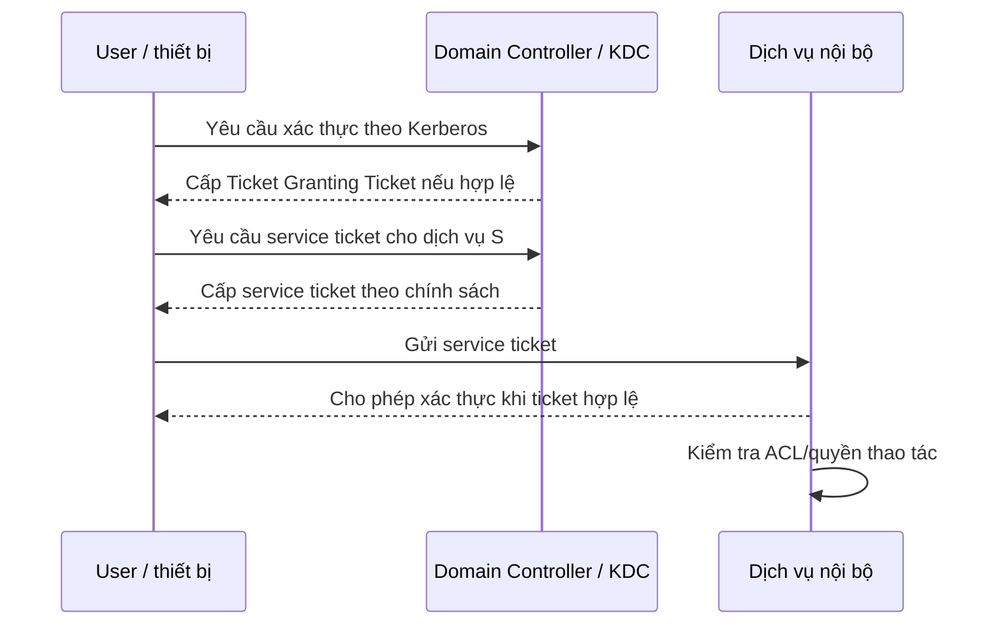
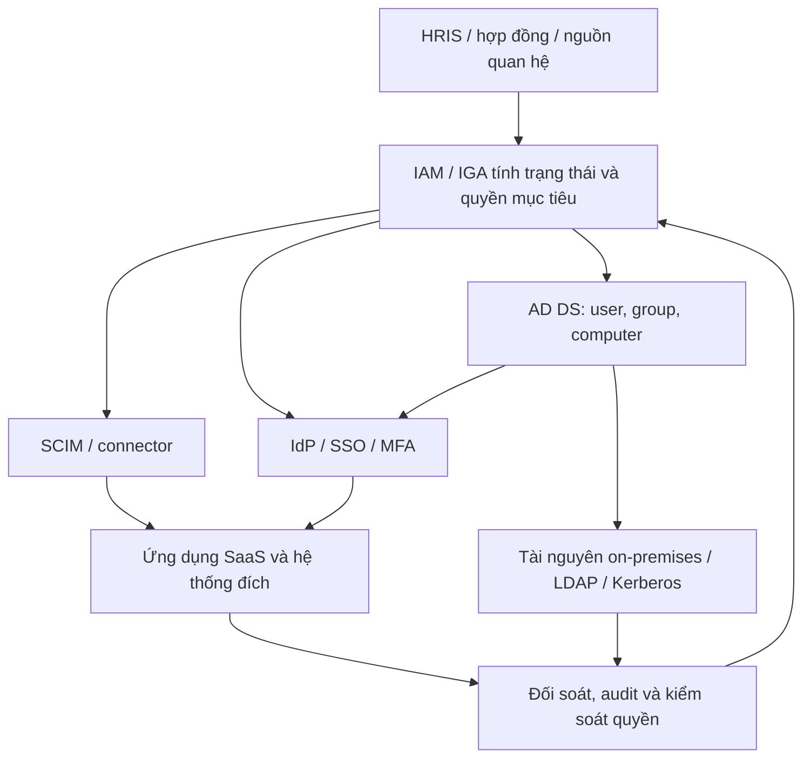

# Active Directory trong Directory service và quản lý vòng đời danh tính IAM

**Active Directory (AD)** là công nghệ thư mục và quản trị danh tính của Microsoft, thường được triển khai dưới dạng **Active Directory Domain Services (AD DS)** để quản lý người dùng, nhóm, máy tính, các đối tượng miền và chính sách trong môi trường Windows doanh nghiệp. AD DS hỗ trợ xác thực, tra cứu thông tin thư mục và cơ chế quản trị tập trung; vì vậy nó thường là một thành phần quan trọng trong hệ thống **Identity and Access Management (IAM)**.

Trong mô hình **Joiner–Mover–Leaver (JML)**, AD có thể là nơi tạo account nhân viên mới, cập nhật nhóm khi chuyển bộ phận, vô hiệu hóa account và thu hồi quyền khi nhân viên nghỉ việc. Tuy nhiên, **AD không tự động bao phủ mọi tài khoản SaaS, ứng dụng cục bộ, phiên SSO, API token hoặc tài khoản dịch vụ**. Để giảm quyền truy cập tồn dư, doanh nghiệp phải phối hợp AD với nguồn nhân sự có thẩm quyền, **Identity Provider (IdP)**, **SSO**, **SCIM/connector**, kiểm soát **RBAC/ABAC**, đối soát và kiểm toán.

## 1. AD DS là gì và giải quyết vấn đề nào?

Trước khi có quản trị thư mục tập trung, một doanh nghiệp có thể phải tạo và quản lý riêng tài khoản, nhóm hoặc quyền ở nhiều máy chủ. AD DS cung cấp một cấu trúc miền để quản lý **đối tượng danh tính** và sử dụng chúng trong xác thực, phân quyền và quản trị hệ thống.

| Nhu cầu | Cơ chế AD DS liên quan | Ví dụ |
| --- | --- | --- |
| Danh tính người dùng | User object và thuộc tính thư mục | Account `lan.nguyen` trong miền nội bộ |
| Nhóm quyền | Security group và membership | Nhóm được cấp quyền truy cập thư mục chia sẻ |
| Danh tính thiết bị | Computer object | Máy tính được tham gia domain |
| Xác thực trong miền | Kerberos và một số cơ chế tương thích khác | Nhân viên truy cập dịch vụ nội bộ qua domain |
| Tra cứu thư mục | LDAP/LDAPS và các API quản trị | Ứng dụng tìm account theo object ID |
| Áp dụng chính sách | Group Policy trong phạm vi áp dụng | Cấu hình bảo mật máy tính domain-joined |
| Quản trị vòng đời | Tạo, đổi thuộc tính, disable, chuyển OU, gỡ nhóm | Thu hồi quyền khi nhân viên chuyển vai trò |

**Active Directory** đôi khi được dùng như tên gọi chung. Khi thiết kế, cần phân biệt **AD DS tại chỗ**, **Active Directory Federation Services (AD FS)** và **Microsoft Entra ID** (dịch vụ danh tính đám mây, trước đây gọi là Azure AD). Các sản phẩm này có thể liên kết với nhau nhưng **không phải cùng một directory hoặc cùng một cơ chế token/session**.

## 2. Các khái niệm nền tảng của Active Directory

| Khái niệm | Vai trò | Lưu ý |
| --- | --- | --- |
| **Domain** | Phạm vi danh tính, xác thực và quản trị theo miền | Ví dụ `corp.example` chỉ là tên minh họa |
| **Domain Controller (DC)** | Máy chủ cung cấp dịch vụ AD DS và lưu bản sao dữ liệu miền | Nhiều DC giúp tăng khả năng sẵn sàng |
| **Forest** | Ranh giới cấu trúc gồm một hoặc nhiều domain chia sẻ schema/configuration | Không xem mọi trust là một quan hệ cho phép tự do |
| **Organizational Unit (OU)** | Container để tổ chức đối tượng, áp dụng GPO và ủy quyền quản trị | OU không đồng nghĩa với security group |
| **User object** | Danh tính tài khoản người dùng | Cần xác định account có còn hợp lệ theo JML |
| **Computer object** | Danh tính máy tính trong domain | Có vòng đời riêng với human identity |
| **Security group** | Nhóm có thể dùng trong ACL và kiểm tra quyền | Phải xét membership lồng nhau |
| **Group Policy Object (GPO)** | Tập cấu hình chính sách áp dụng theo scope | Không tự thay thế phân quyền ứng dụng |
| **Trust relationship** | Quan hệ tin cậy giữa domain/forest theo cấu hình | Cần đánh giá hướng và phạm vi trust |

AD DS sử dụng các định danh như **objectGUID**, **objectSID (SID)**, **distinguished name (DN)** và **userPrincipalName (UPN)**. Chúng phục vụ các mục đích khác nhau; **không nên dùng tên hiển thị hoặc email làm định danh bền vững duy nhất** khi liên kết account qua nhiều hệ thống.

Một tài khoản có thể đổi tên hoặc được chuyển OU mà identity vẫn là cùng một đối tượng. Ngược lại, xóa và tạo lại một account với tên đăng nhập cũ không có nghĩa đây là cùng đối tượng: SID/GUID và quan hệ quyền có thể thay đổi.

## 3. Active Directory xác thực như thế nào?

**Kerberos** là cơ chế xác thực quan trọng trong môi trường AD DS. Người dùng hoặc máy tính có thể nhận **ticket** thông qua Key Distribution Center (KDC) trên Domain Controller, rồi trình ticket phù hợp cho dịch vụ chấp nhận Kerberos.



Sơ đồ chỉ mô tả khái niệm, không đầy đủ mọi bước mật mã Kerberos. **Xác thực thành công không đồng nghĩa được cấp mọi quyền**: dịch vụ vẫn phải kiểm tra ACL, role hoặc chính sách ứng dụng. AD cũng hỗ trợ các giao thức và tình huống kế thừa khác, trong đó **NTLM** có thể còn tồn tại; tổ chức cần đánh giá và giảm các cơ chế cũ theo khả năng ứng dụng.

**LDAP không đồng nghĩa Kerberos**: LDAP là giao thức truy cập thư mục, có thể được dùng để đọc thuộc tính/nhóm hoặc thực hiện bind theo phương thức phù hợp. Khi dùng LDAP, cần bảo vệ đường truyền, quyền tra cứu và credential; ưu tiên **LDAPS hoặc StartTLS đúng cấu hình** khi hỗ trợ, tránh gửi thông tin xác thực qua kết nối không được bảo vệ.

## 4. Account, thuộc tính và nhóm trong AD

Một user object thường có các thuộc tính liên quan:

- `sAMAccountName`: tên đăng nhập kiểu tương thích Windows cũ; có giới hạn phạm vi/định dạng.
- `userPrincipalName`: tên đăng nhập dạng UPN; có thể thay đổi khi tổ chức đổi tên hoặc cấu trúc.
- `objectGUID`: định danh đối tượng thường hữu ích cho liên kết nội bộ theo vòng đời của đối tượng.
- `objectSid`: SID gắn với security principal và kiểm soát truy cập trong miền.
- `manager`, `department`, `title`, `employeeID`: thuộc tính có thể được đồng bộ từ HR hoặc IAM nếu chính sách quy định.
- `memberOf`: phản ánh các liên kết nhóm trực tiếp nhất định; không thay thế phép tính toàn bộ quyền hiệu lực từ nhóm lồng nhau và các cơ chế khác.
- `userAccountControl`: tập cờ mô tả một số thuộc tính/trạng thái account; cần thao tác đúng bit và cơ chế được hỗ trợ.

**Nguồn dữ liệu có thẩm quyền khác nhau cho từng thuộc tính.** Ví dụ HRIS có thể là nguồn chính về ngày bắt đầu/kết thúc, bộ phận và người quản lý; còn AD là hệ thống lưu account/membership phục vụ xác thực. Nếu sửa thủ công thuộc tính HR tại AD mà connector liên tục đồng bộ lại, thay đổi có thể bị ghi đè và sai lệch xuất hiện trở lại.

### OU không phải role

**OU** tổ chức đối tượng và có thể giúp áp dụng GPO/ủy quyền quản trị. **Security group** mới thường là cơ chế được dùng làm đầu vào của ACL và các quyền dựa trên nhóm. Không nên suy rằng chỉ cần di chuyển user sang OU `Finance` thì toàn bộ ứng dụng sẽ tự cập nhật role tài chính.

### Nhóm lồng nhau và quyền hiệu lực

Một user có thể thuộc nhóm A; A nằm trong nhóm B; B được cấp quyền trên tài nguyên. Khi đối soát, **chỉ đọc nhóm trực tiếp** có thể bỏ sót quyền kế thừa. Ngoài ra, quyền có thể được cấp trực tiếp cho SID, qua ACL, qua nhóm cục bộ trên máy hoặc cơ chế của ứng dụng.

## 5. Active Directory trong kiến trúc IAM tổng thể



Sơ đồ nêu **những kiểu tích hợp có thể có**, không có nghĩa tất cả tổ chức đều dùng cùng một chiều đồng bộ. Có nơi đồng bộ một phần danh tính từ AD sang IdP đám mây; nơi khác chủ động quản lý quyền ở IGA và đẩy thay đổi đến cả AD lẫn ứng dụng.

**AD không phải giao thức SCIM**. Một ứng dụng có thể nhận người dùng từ AD thông qua connector, trong khi ứng dụng SaaS khác nhận account qua SCIM. Cần làm rõ hệ thống nào tạo account, hệ thống nào xác thực và hệ thống nào thực thi entitlement.

## 6. Joiner: tạo account và cấp quyền ban đầu

Một quy trình Joiner minh họa:

1. HR xác nhận nhân viên mới đã được identity proofing phù hợp, mã nhân viên và ngày hiệu lực.
2. IAM tạo identity nội bộ và tính **desired state** theo chính sách.
3. Connector tạo user trong AD với định danh ổn định, thuộc tính cần thiết và OU phù hợp.
4. Account có thể được chuẩn bị trước nhưng chỉ được **kích hoạt theo thời điểm cho phép**.
5. Hệ thống gán security group cơ bản dựa trên **RBAC**; quyền nhạy cảm đi qua phê duyệt.
6. Nhân viên đăng ký authenticator/MFA tại IdP hoặc hệ thống được ủy quyền.
7. Account và nhóm cần thiết được đồng bộ tới SaaS/ứng dụng qua SCIM hoặc connector.
8. IAM đối soát AD và hệ thống đích, kiểm tra **đúng quyền, không cấp sớm**.

Ví dụ Lan gia nhập bộ phận hỗ trợ. HR xác nhận `employeeID=EMP-2077` và ngày bắt đầu. IAM tạo account AD, gán nhóm truy cập thư mục công ty và nhóm hỗ trợ phù hợp. Quyền export toàn bộ CRM không nên được cấp chỉ vì Lan thuộc OU của bộ phận hỗ trợ; cần phê duyệt và scope riêng theo chính sách.

**Đặt mật khẩu ban đầu** hoặc đăng ký MFA phải đi qua quy trình enrollment an toàn. Không gửi plaintext password qua email không bảo vệ hoặc lưu bí mật trong ticket.

## 7. Mover: đổi bộ phận và loại bỏ quyền cũ

Mục tiêu của Mover không phải chỉ sửa thuộc tính `department`. Quy trình cần **tính lại quyền mong muốn**, thực hiện phép so sánh và thu hồi các quyền không còn căn cứ.

| Thay đổi | Tác vụ IAM/AD | Điểm phải kiểm chứng |
| --- | --- | --- |
| Đổi department/title/manager | Cập nhật thuộc tính từ nguồn có thẩm quyền | Thuộc tính tại AD và ứng dụng đúng ngày hiệu lực |
| Nhận role mới | Thêm nhóm phù hợp và cấp entitlement theo phê duyệt | User thực sự có quyền cần thiết |
| Rời role cũ | Gỡ nhóm và quyền trực tiếp không còn phù hợp | Không còn quyền cũ qua nhóm lồng nhau/ACL |
| Đổi đơn vị/tenant | Cập nhật scope và điều kiện ABAC | Không xem được dữ liệu ngoài phạm vi mới |
| Đổi mức nhạy cảm công việc | Áp dụng MFA/step-up nếu chính sách yêu cầu | Mức xác thực phù hợp quyền mới |

Ví dụ Hà chuyển từ kế toán sang phân tích dữ liệu. HR xác nhận Mover; IAM gỡ nhóm `ERP-Invoice-Approvers` và thêm `Analytics-Readers`. Nhưng nếu ERP còn một **role cục bộ** đã gán trực tiếp cho Hà, gỡ nhóm AD chưa đủ. Phải đối soát tại ERP để phát hiện quyền tồn dư.

Một số ứng dụng hoặc phiên đã tạo trước đó có thể **cache nhóm/role hoặc ticket**; do đó cần đánh giá khi nào thay đổi quyền có hiệu lực thực tế. Không khẳng định gỡ nhóm AD khiến mọi session ứng dụng và mọi ticket đã phát hành lập tức vô hiệu.

## 8. Leaver: disable, thu hồi quyền và bảo toàn dữ liệu

Khi quan hệ lao động/hợp đồng chấm dứt, một phần quan trọng của Leaver là **vô hiệu hóa khả năng đăng nhập** và **thu hồi quyền** ở các hệ thống liên quan.

| Đối tượng | Cách xử lý cần xem xét | Giới hạn |
| --- | --- | --- |
| **AD user** | Disable account theo sự kiện và thời điểm có thẩm quyền | Không tự chấm dứt mọi phiên/token ngoài AD |
| **Security group/ACL** | Gỡ membership và quyền trực tiếp không còn hợp lệ | Kiểm tra nhóm lồng nhau và ACL cục bộ |
| **IdP/SSO** | Ngăn đăng nhập mới, xử lý session/refresh token | App session có thể tồn tại độc lập |
| **SaaS/app account** | Deprovision qua SCIM/connector/API | AD disable không chắc khiến app account mất hiệu lực |
| **Credential** | Thu hồi hoặc xoay secret, chứng thư, API key liên quan | Cần xử lý tài khoản kỹ thuật được chia sẻ |
| **Dữ liệu và tài nguyên** | Chuyển owner và lưu giữ theo chính sách | Không xóa dữ liệu nghiệp vụ tùy tiện |

**Disable khác delete**. Một account có thể phải giữ hồ sơ, dấu vết kiểm toán và các liên kết cần thiết một thời gian trước khi xóa. Tuy nhiên, giữ bản ghi không có nghĩa phải duy trì quyền đăng nhập.

Với trường hợp Leaver khẩn cấp, đừng dùng khóa tạm thời do nhập sai mật khẩu thay cho disable theo lifecycle. Đồng thời, cần xác minh người đã nghỉ **không còn truy cập thực tế** thông qua session ứng dụng, token hoặc credential độc lập.

## 9. AD, IdP và SSO: phân biệt ranh giới kỹ thuật

**AD DS** có thể là thư mục nền tảng cho xác thực trong miền và là nguồn thông tin cho IdP khác. **SSO** lại là trải nghiệm dùng một lần xác thực để truy cập nhiều ứng dụng; OIDC/SAML có thể được vận hành bởi IdP liên kết với AD hoặc bởi thành phần khác.

Các tình huống minh họa:

- **Kerberos SSO nội bộ:** máy domain-joined truy cập dịch vụ nội bộ và sử dụng ticket Kerberos phù hợp.
- **Federated SSO:** ứng dụng SaaS nhận token OIDC hoặc assertion SAML từ IdP được cấu hình tin cậy.
- **Đồng bộ danh tính:** một connector chuyển một tập account/thuộc tính giữa AD và nền tảng khác.
- **Provisioning:** SCIM/API tạo, cập nhật hoặc disable account ở ứng dụng đích.

Các cơ chế này **không đồng nhất**. Khi AD disable user, các phiên OIDC đã được tạo ở ứng dụng khác có thể còn hoạt động tùy thiết kế. Khi SCIM báo cập nhật account thành công, quyền ACL cục bộ hoặc access token cũ vẫn cần được kiểm tra.

## 10. RBAC, ABAC và nhóm Active Directory

**RBAC** (*Role-Based Access Control*) gắn quyền với vai trò. AD security group thường được dùng làm một cách biểu diễn vai trò hoặc tập quyền tại hạ tầng. **ABAC** (*Attribute-Based Access Control*) còn đánh giá thuộc tính của subject, tài nguyên và bối cảnh để quyết định truy cập.

Ví dụ giả mã:

```text
ALLOW read_customer_ticket IF
    subject.lifecycle_status == "active"
    AND subject.has_effective_group("Support-Readers")
    AND subject.region == resource.region
    AND resource.classification IN subject.allowed_classifications
ELSE DENY
```

Đây là chính sách minh họa, **không phải cú pháp mặc định của AD**. AD group không tự thực thi toàn bộ điều kiện region hoặc classification trên ứng dụng. API/ứng dụng phải có **Policy Enforcement Point (PEP)** và dữ liệu thuộc tính đáng tin để kiểm tra quyền.

**Không đồng nhất nhóm AD với quyền thực tế tại mọi SaaS**: ứng dụng có thể dùng role riêng, ACL cục bộ hoặc claim đã cache. Cần đối soát tại hệ thống đích.

## 11. Service account, tài khoản máy và quyền đặc quyền

AD không chỉ lưu tài khoản nhân viên. Nó có thể lưu **service accounts**, computer accounts và các loại đối tượng phục vụ workload. Với môi trường Windows phù hợp, **Group Managed Service Account (gMSA)** có thể giúp quản lý mật khẩu dịch vụ tốt hơn account dùng mật khẩu tĩnh thủ công, nhưng phải kiểm tra khả năng hỗ trợ của workload.

Quy trình quản lý service account nên xác định:

1. **Owner** nghiệp vụ/kỹ thuật và dịch vụ sử dụng account.
2. **Mục đích, môi trường và quyền tối thiểu** của account.
3. **Credential lifecycle:** cơ chế lưu, xoay vòng và thu hồi bí mật.
4. **Không đăng nhập tương tác** nếu workload không cần và chính sách cho phép hạn chế.
5. **Phụ thuộc:** ứng dụng, tác vụ lịch, dịch vụ Windows và tích hợp đang sử dụng.
6. **Offboarding:** chuyển owner khi kỹ sư phụ trách nghỉ việc; thu hồi bí mật khi workload kết thúc.

Không xóa ngay service account chỉ vì người tạo ra nó đã Leaver. Trước hết cần kiểm tra phụ thuộc và chuyển ownership, đồng thời loại bỏ quyền của cá nhân đã nghỉ khỏi công cụ quản trị, vault và môi trường triển khai.

Tài khoản đặc quyền và nhóm như các nhóm quản trị miền cần kiểm soát chặt, phân tách account admin khỏi account thường khi thích hợp, áp dụng MFA ở các điểm hỗ trợ và quản lý truy cập đặc quyền (**PAM**) theo rủi ro. Tham gia nhóm quyền cao không phải phần mặc định của mọi Joiner.

## 12. Bảo vệ Active Directory ở mức vận hành

Một môi trường AD ảnh hưởng đến nhiều ứng dụng; nếu domain bị chiếm quyền, hậu quả có thể lan rộng. Các biện pháp cần đánh giá gồm:

| Rủi ro | Hậu quả | Kiểm soát phù hợp |
| --- | --- | --- |
| Quyền quản trị AD quá rộng | Thay đổi danh tính và quyền trên diện rộng | Least privilege, ủy quyền giới hạn, PAM, kiểm tra định kỳ |
| Lạm dụng tài khoản dịch vụ | Truy cập dai dẳng và lan truyền đặc quyền | gMSA khi phù hợp, secret rotation, owner, giới hạn logon |
| Dịch vụ LDAP không bảo vệ | Rò credential hoặc sửa đổi luồng | TLS, binding/signing theo cấu hình hỗ trợ, kiểm tra client |
| Nhóm lồng nhau khó quan sát | Quyền dư sau Mover | Đối soát membership hiệu lực và ACL |
| Trust giữa domain cấu hình rộng | Chuyển dịch ranh giới tin cậy | Rà soát trust, phân đoạn và giới hạn phạm vi |
| Đồng bộ danh tính lỗi | Tài khoản orphan hoặc attribute drift | Monitoring connector, retry an toàn, reconciliation |
| Quản trị viên dùng chung account | Khó truy trách nhiệm | Danh tính quản trị cá nhân, audit và kiểm soát truy cập |
| Không kiểm chứng Leaver | Phiên và entitlement tồn dư | Disable, revoke, readback ở từng đích |

**Group Policy** có thể áp dụng nhiều cấu hình bảo mật cho máy domain-joined, nhưng không thay thế chính sách ứng dụng SaaS hoặc việc thu hồi token. Ngoài ra, cần kiểm soát sao lưu, khôi phục DC, phân quyền quản trị, thời gian hệ thống và các kết nối đồng bộ có đặc quyền.

## 13. Account reconciliation: so sánh AD với hệ thống đích

Một quy trình đối soát đáng tin phải tính **desired state** từ quan hệ nhân sự, phê duyệt, RBAC/ABAC và ngoại lệ có hạn; sau đó đọc **observed state** từ AD và từng ứng dụng liên quan.

```text
desired = quyền hợp lệ theo identity, ngày hiệu lực và chính sách
actual  = quyền quan sát được tại AD + ứng dụng đích

missing = desired - actual
extra   = actual - desired
```

Mô hình trên chỉ mô tả phép đối chiếu ở mức logic. Cần chuẩn hóa account ID, nhóm lồng nhau, quyền trực tiếp, role ứng dụng và các điều kiện thời gian. **Không tự xóa mọi chênh lệch** nếu có ngoại lệ đã phê duyệt hoặc account kỹ thuật chưa xác định owner; phải điều tra đúng nguồn và mức rủi ro.

Ví dụ một nhân viên đã nghỉ không còn ở nhóm `Finance` của AD nhưng account ERP còn active. Nếu chỉ kiểm tra AD, báo cáo có thể nói hoàn tất; nhưng **quyền truy cập thực tế tại ERP** mới là bằng chứng cần thiết.

## 14. Các tình huống vận hành

### Tình huống A — Joiner có account nhưng chưa có quyền

IT đã tạo account AD cho Minh, nhưng Minh chưa truy cập được thư mục nhóm. Cần kiểm tra ngày hiệu lực, policy cấp quyền, security group, ACL tài nguyên, đồng bộ và thời điểm cập nhật membership được phản ánh. Không giải quyết bằng cách thêm Minh vào nhóm quản trị rộng.

### Tình huống B — Mover giữ quyền kế toán

Hà chuyển sang Analytics. Thuộc tính `department` đã đổi ở AD nhưng Hà vẫn thuộc nhóm kế toán do workflow không thu hồi. Cần xác định desired state, gỡ membership không còn hợp lệ, kiểm tra nhóm lồng nhau và entitlement ERP; sau đó đọc lại quyền thực tế.

### Tình huống C — Leaver vẫn dùng được SaaS

IdP liên kết với AD đã chặn đăng nhập mới, nhưng phiên CRM được tạo trước đó vẫn còn sống. Khóa AD chưa đủ; phải phối hợp revoke session/token và deprovision SaaS theo cơ chế phù hợp, đồng thời xác minh truy cập bị từ chối.

### Tình huống D — Service account bị mất owner

Một service account chạy tác vụ sao lưu không có owner vì kỹ sư tạo nó đã nghỉ. Không nên xóa mù. Cần xác minh workload, giao owner mới, đánh giá credential/permission, xoay bí mật có rủi ro và lên kế hoạch thay thế nếu phù hợp.

## 15. Kiểm toán và chỉ số đánh giá

AD và các hệ thống liên quan cần ghi nhận thay đổi tài khoản, nhóm, quyền đặc biệt, sự kiện xác thực đáng chú ý, thay đổi chính sách và kết quả provisioning/deprovisioning. Dấu vết cần gắn với **identity ổn định, nguồn sự kiện JML, người hoặc tiến trình thực thi, thời gian, hệ thống đích và kết quả kiểm chứng**.

Các chỉ số hữu ích:

- **Joiner provisioning latency:** thời gian từ sự kiện hiệu lực đến khi quyền mục tiêu được cấp đúng.
- **Mover excess entitlement count:** số nhóm/quyền cũ tồn dư sau chuyển vị trí.
- **Leaver time to revoke:** thời gian để account và quyền tại các đích thực sự mất hiệu lực.
- **Orphaned account rate:** tỷ lệ account thiếu identity hoặc owner hợp lệ.
- **Privileged group membership drift:** biến động nhóm đặc quyền ngoài phê duyệt.
- **Directory-to-app reconciliation coverage:** mức bao phủ đối soát AD với SaaS/ứng dụng.
- **Service account ownership coverage:** tỷ lệ tài khoản kỹ thuật có owner và vòng đời rõ ràng.

Không ghi mật khẩu, Kerberos ticket, access token, API key hay private key thô vào log thông thường. Dữ liệu định danh cần được phân quyền, lưu trữ và xóa theo chính sách.

## 16. Câu hỏi tự kiểm tra

**Tình huống 1:** User được chuyển sang OU mới. Có chắc toàn bộ quyền ứng dụng đã thay đổi theo bộ phận mới không? **Không.** OU không phải role; cần kiểm tra nhóm, ACL và entitlement ở đích.

**Tình huống 2:** Tài khoản Leaver bị disable trong AD. Có thể xem mọi session SaaS đã mất hiệu lực không? **Không.** Cần thu hồi và đối soát tại IdP/ứng dụng.

**Tình huống 3:** Hai account có cùng tên đăng nhập qua các giai đoạn khác nhau. Có chắc chúng là cùng một đối tượng AD không? **Không.** Cần xem định danh ổn định và vòng đời của đối tượng, không chỉ tên.

**Tình huống 4:** Một ứng dụng cần quyền theo khu vực. Chỉ dùng security group AD là đủ cho mọi trường hợp không? **Không mặc nhiên.** Cần thiết kế RBAC/ABAC và enforcement dựa trên thuộc tính đáng tin.

**Tình huống 5:** Kỹ sư nghỉ việc, service account của tác vụ sản xuất vẫn hoạt động. Có nên xóa account ngay? **Không.** Cần xác minh phụ thuộc, chuyển owner, giảm quyền và quản lý credential.

## Ghi nhớ

**Active Directory Domain Services** là nền tảng thư mục, tài khoản, nhóm và xác thực quan trọng trong môi trường Windows doanh nghiệp; nhưng **AD không tự thay thế toàn bộ IAM**. Trong **Joiner–Mover–Leaver**, phải phối hợp nguồn nhân sự, **AD DS, IdP/SSO, SCIM/connector, RBAC/ABAC, tài khoản dịch vụ và kiểm toán** để tạo account đúng lúc, điều chỉnh và thu hồi quyền đúng phạm vi, rồi **đối soát tại hệ thống đích** nhằm phát hiện và giảm quyền truy cập tồn dư.
