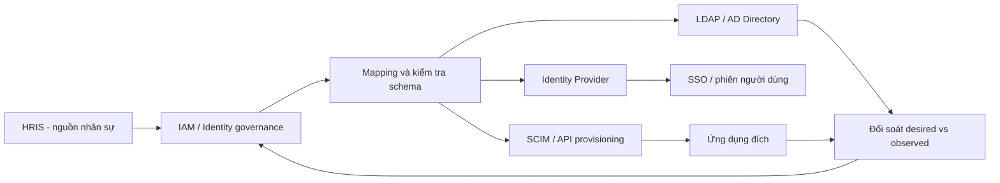
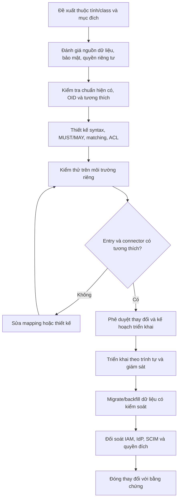

# Directory schema trong IAM: Cấu trúc thuộc tính, object class và quản lý vòng đời danh tính

**Directory schema** là tập quy tắc xác định **đối tượng nào được lưu trong directory, mỗi đối tượng có những thuộc tính nào, kiểu dữ liệu và quy tắc so sánh ra sao, và thuộc tính nào bắt buộc hoặc tùy chọn**. Trong các directory sử dụng LDAP (*Lightweight Directory Access Protocol*), schema giúp ứng dụng, quản trị viên và hệ thống đồng bộ thống nhất ý nghĩa của user, group, thiết bị, tổ chức và những quan hệ định danh.

Schema là phần nền của **directory service**, nhưng không phải toàn bộ mô hình quản lý truy cập. Schema có thể nói thuộc tính `member` là danh sách DN thành viên của một nhóm, song **không tự chứng minh** thành viên đó được phép truy cập một API nhạy cảm; quyết định này còn phụ thuộc ánh xạ nhóm–role, RBAC/ABAC, chính sách ứng dụng, thời điểm và ngữ cảnh.

Bài thuộc chương **Directory service** của module `SECURITY_IDENTITY_ACCESS_MANAGEMENT_IDENTITY_LIFECYCLE`. Nội dung liên kết directory schema với dữ liệu nhân sự (HR), IdP, SSO, SCIM, cấp phát/thu hồi tài khoản và mô hình **Joiner–Mover–Leaver (JML)**. Mục tiêu là thiết kế dữ liệu định danh đủ chính xác để provision, tìm kiếm, đối soát và kiểm toán, đồng thời giảm quyền truy cập tồn dư khi người dùng chuyển vai trò hoặc rời tổ chức.

Sau bài học, bạn có thể phân biệt **DIT, entry, DN/RDN, attribute type và object class**; đọc mô hình `MUST`/`MAY`; thiết kế user/group entry; giải thích những khác biệt giữa LDAP chung và Active Directory; phân tích tác động của schema lên đồng bộ SCIM và vòng đời IAM; và xác định quy trình mở rộng/migration schema an toàn.

## 1. Directory, schema và DIT khác nhau thế nào?

**Directory** là dịch vụ lưu và tra cứu thông tin định danh theo một mô hình cấu trúc. **Directory Information Tree (DIT)** là cây phân cấp các **entry**. **Schema** xác định những loại entry và thuộc tính nào được phép. **Directory ACL/chính sách ứng dụng** quyết định ai được đọc/sửa dữ liệu và dữ liệu đó được sử dụng để cấp quyền như thế nào.

| Khái niệm | Vai trò | Ví dụ |
| --- | --- | --- |
| **Directory service** | Hệ thống lưu, tìm kiếm và phục vụ dữ liệu directory | LDAP directory, Active Directory |
| **DIT** | Tổ chức entry thành cây | `dc=example,dc=org` có nhánh `ou=People`, `ou=Groups` |
| **Entry** | Một đối tượng dữ liệu tại vị trí trong cây | Bản ghi nhân viên, nhóm truy cập hoặc organizational unit |
| **Distinguished Name (DN)** | Tên phân biệt vị trí entry trong cây | `uid=an.nguyen,ou=People,dc=example,dc=org` |
| **Relative Distinguished Name (RDN)** | Thành phần dùng để đặt tên entry tương đối với parent | `uid=an.nguyen` |
| **Attribute** | Tên thuộc tính cùng một hoặc nhiều giá trị | `mail: an.nguyen@example.org`, `cn: An Nguyen` |
| **Object class** | Tập quy tắc/đặc điểm entry thuộc loại nào | `inetOrgPerson`, `groupOfNames` |
| **Schema** | Định nghĩa attribute types, object classes và các quy tắc dữ liệu | `cn` có syntax và matching rule; `person` yêu cầu `cn`, `sn` |
| **Access control** | Bảo vệ thao tác đọc, sửa, tìm kiếm và xác thực | Helpdesk được xem một số thuộc tính nhưng không được sửa role đặc quyền |

Một cây ví dụ:

```text
dc=example,dc=org
├── ou=People
│   ├── uid=an.nguyen
│   └── uid=binh.tran
├── ou=Groups
│   ├── cn=crm-readers
│   └── cn=finance-approvers
└── ou=Services
    └── uid=svc-report-sync
```

Đây chỉ là **cách bố trí DIT minh họa**; không phải mọi directory đều có cùng nhánh. Một hệ thống có thể sử dụng `cn=` cho user, OU theo tổ chức hoặc cấu trúc khác. **Đừng suy ra vai trò hoặc quyền từ vị trí OU một cách mặc định**: quyền phải được tính từ chính sách và ánh xạ được quản trị.

### DN có phải ID bất biến của người dùng không?

**Không nên mặc định DN là khóa danh tính bất biến.** Khi entry bị đổi RDN hoặc di chuyển sang một OU khác, DN có thể thay đổi. Ví dụ từ `uid=an.nguyen,ou=People,...` sang `uid=an.nguyen,ou=Contractors,...` sau một quy trình thay đổi. Nếu ứng dụng liên kết tài khoản bằng DN mà không có cơ chế xử lý rename/move, nó có thể tạo tài khoản trùng hoặc làm đứt liên kết.

Trong thiết kế IAM, nên dùng **khóa định danh ổn định** do hệ thống có thẩm quyền cung cấp, đồng thời lưu ánh xạ đến các account trong IdP/ứng dụng. Một số directory cung cấp ID riêng như `entryUUID` trong những triển khai LDAP hoặc `objectGUID` trong Active Directory; **chúng không phải thuộc tính phổ quát của mọi LDAP server** và cần hiểu phạm vi, hành vi khi đồng bộ/migration.

## 2. Thành phần của LDAP schema

LDAP schema thường mô tả các loại định nghĩa như **attribute types**, **object classes**, **syntaxes**, **matching rules** và một số quy tắc bổ sung tùy khả năng directory. Các định nghĩa chuẩn sử dụng **Object Identifier (OID)** để định danh, bên cạnh tên dễ đọc như `cn` hoặc `inetOrgPerson`.

### 2.1. Attribute type — loại thuộc tính

Một attribute type xác định **ý nghĩa, cú pháp, cách so sánh và giới hạn** của thuộc tính. Những yếu tố quan trọng:

| Thuộc tính schema | Mục đích | Ví dụ/ý nghĩa |
| --- | --- | --- |
| **OID** | Định danh duy nhất cho định nghĩa trong namespace thích hợp | Một OID đã được chuẩn hóa hoặc phân bổ cho tổ chức |
| **NAME** | Tên thuộc tính dễ sử dụng trong truy vấn/entry | `cn`, `sn`, `mail`, `uid` |
| **DESC** | Giải thích ý nghĩa thuộc tính | Mô tả mã nhân sự hay địa chỉ thư |
| **SYNTAX** | Dạng giá trị hợp lệ và cách xử lý | Directory String, Integer, Boolean, Distinguished Name |
| **EQUALITY** | Quy tắc so sánh bằng | Case-insensitive với một thuộc tính chuỗi được khai báo phù hợp |
| **SUBSTR** | Quy tắc tìm kiếm theo chuỗi con nếu hỗ trợ | Tra tên có chứa một chuỗi |
| **ORDERING** | Quy tắc so sánh thứ tự nếu có | So sánh số hoặc chuỗi theo matching rule |
| **SINGLE-VALUE** | Giới hạn một giá trị trong một entry | Một thuộc tính mã nhân sự chỉ một giá trị theo thiết kế |
| **USAGE** | Phân loại thuộc tính ứng dụng hoặc thuộc tính vận hành | Một số thuộc tính do server tự quản lý |

**Syntax khác matching rule.** Một thuộc tính có thể có kiểu chuỗi nhưng quy tắc so sánh có phân biệt hay không phân biệt chữ hoa/chữ thường, tùy định nghĩa. Nếu áp quy tắc tìm kiếm bằng cách so chuỗi thô trong ứng dụng rồi coi đó là hành vi chuẩn của LDAP, kết quả có thể sai.

**SINGLE-VALUE không có nghĩa giá trị duy nhất trên toàn directory.** Thuộc tính đơn trị chỉ giới hạn số giá trị **trong một entry**, không tự cấm hai entry khác nhau cùng có `employeeNumber` hoặc `mail`. Kiểm soát duy nhất toàn hệ thống cần thiết kế riêng theo khả năng server và chính sách enrollment.

### 2.2. Object class — loại đối tượng

Object class mô tả tập thuộc tính và quan hệ kế thừa giữa các loại entry. Trong LDAP, cần phân biệt:

| Loại object class | Vai trò | Ví dụ và lưu ý |
| --- | --- | --- |
| **STRUCTURAL** | Xác định loại thực thể chính của entry trong cấu trúc directory | `person`, `organizationalPerson`, `inetOrgPerson`, `groupOfNames` |
| **AUXILIARY** | Bổ sung nhóm thuộc tính cho entry theo thiết kế schema | Một auxiliary class chuyên biệt được cho phép cho mục đích phù hợp |
| **ABSTRACT** | Là lớp nền để các class khác kế thừa | `top` là ví dụ quen thuộc |

Một entry thông thường có **chuỗi kế thừa structural class hợp lệ**, và có thể có các auxiliary class được directory cho phép. Không thể tùy ý gắn hai class structural không có quan hệ hợp lệ rồi mong server chấp nhận. Các quy tắc chi tiết phụ thuộc schema và những ràng buộc bổ sung được server triển khai.

Hai nhóm thuộc tính của object class:

- **`MUST`**: thuộc tính bắt buộc đối với entry thuộc class đó, bao gồm những yêu cầu kế thừa.
- **`MAY`**: thuộc tính có thể có nếu được phép và đáp ứng syntax/constraint, nhưng không bắt buộc.

Ví dụ trong chuỗi class người dùng:

```text
top (ABSTRACT)
  └── person (STRUCTURAL)
      └── organizationalPerson (STRUCTURAL)
          └── inetOrgPerson (STRUCTURAL)
```

Theo các định nghĩa chuẩn quen thuộc, `person` yêu cầu `cn` (*common name*) và `sn` (*surname*). `inetOrgPerson` kế thừa những yêu cầu này và bổ sung các thuộc tính tùy chọn phục vụ dữ liệu con người. **Entry là `inetOrgPerson` vẫn phải thỏa điều kiện của các lớp cha**.

### 2.3. Schema không tự định nghĩa chính sách nghiệp vụ

Schema có thể cho phép thuộc tính `mail`, nhưng không đảm bảo:

1. Email đó đã được xác minh thuộc đúng người.
2. Email đó là duy nhất trong mọi hệ thống của tổ chức.
3. Người có email đó được cấp quyền CRM hay quyền quản trị.
4. Giá trị cập nhật đúng thời điểm từ HRIS.
5. Quy trình Leaver sẽ tự hủy tất cả phiên SSO.

Những điều trên thuộc về **quản trị dữ liệu, quy tắc đồng bộ, xác thực, chính sách IAM và đối soát**. Đừng nhầm tính hợp lệ ở mức schema với việc danh tính hoặc quyền đã được chứng minh hợp lệ.

## 3. Ví dụ directory entry: User và Group

LDIF (*LDAP Data Interchange Format*) thường được dùng để biểu diễn entry khi học tập, trao đổi dữ liệu hoặc thực hiện thao tác quản trị phù hợp. Dưới đây là ví dụ **giả định**, không chứa mật khẩu:

```ldif
dn: uid=an.nguyen,ou=People,dc=example,dc=org
objectClass: top
objectClass: person
objectClass: organizationalPerson
objectClass: inetOrgPerson
uid: an.nguyen
cn: An Nguyen
sn: Nguyen
givenName: An
mail: an.nguyen@example.org
employeeNumber: EMP-0102
```

Ý nghĩa:

- `dn` cho biết vị trí entry trong DIT; các parent entry phải tồn tại theo mô hình server.
- `objectClass` mô tả chuỗi class cần được server chấp nhận.
- `cn` và `sn` đáp ứng các thuộc tính bắt buộc từ lớp `person`.
- `uid`, `mail` và `employeeNumber` là thông tin có thể được sử dụng cho tìm kiếm/đồng bộ khi schema cho phép.
- **Không có mật khẩu trong LDIF này**; cơ chế quản lý credential phụ thuộc IdP/directory và chính sách, không nên trộn với ví dụ cấp phát dữ liệu định danh.

Tên được viết dạng ASCII để ví dụ LDIF ngắn và dễ đọc. **Tên tiếng Việt thực có dấu phải được bảo toàn ở nguồn dữ liệu**; khi xuất LDIF cần dùng cách biểu diễn/encoding hợp lệ theo định dạng LDIF, không tùy tiện loại bỏ dấu rồi biến đó thành tên pháp lý.

Một group dùng `groupOfNames`:

```ldif
dn: cn=crm-readers,ou=Groups,dc=example,dc=org
objectClass: top
objectClass: groupOfNames
cn: crm-readers
member: uid=an.nguyen,ou=People,dc=example,dc=org
```

Trong schema LDAP thông dụng, `groupOfNames` yêu cầu `cn` và `member`; `member` chứa **DN của entry thành viên**, không phải username trần. Ví dụ trên cần parent `ou=Groups` và user DN tồn tại trong môi trường thực tế. Các directory khác có thể dùng nhóm với cấu trúc khác hoặc có quy tắc đặc biệt cho nhóm rỗng.

**Group không tự đồng nghĩa với role ứng dụng.** Nếu ứng dụng CRM ánh xạ `crm-readers` thành `customer.read`, chính sách ánh xạ đó phải được phê duyệt và kiểm thử. Nếu group bị cấp thêm quyền rộng ở ứng dụng, schema không ngăn việc cấp quá mức.

### Vì sao DN không nên là khóa tích hợp duy nhất?

Nếu người dùng đổi RDN từ `uid=an.nguyen` sang `uid=an.nguyen2`, tham chiếu `member` theo DN có thể phải được cập nhật hoặc được server duy trì theo khả năng hỗ trợ. Không nên giả định mọi directory và connector tự sửa mọi tham chiếu, cache hoặc quyền ở ứng dụng đích khi entry được rename/move.

Để đồng bộ bền vững, cần **định danh bất biến** và cơ chế xử lý thay đổi DN, đồng thời đối soát thành viên nhóm ở đích sau các thao tác cập nhật.

## 4. Các thuộc tính quan trọng trong vòng đời định danh

Một schema phục vụ IAM cần thiết kế ranh giới dữ liệu rõ ràng: thuộc tính nào được HR làm nguồn có thẩm quyền, thuộc tính nào do IdP cấp, thuộc tính nào chỉ phục vụ ứng dụng, và thuộc tính nào tuyệt đối không được tự suy ra.

| Thuộc tính / định danh | Mục đích thường gặp | Lưu ý vòng đời và bảo mật |
| --- | --- | --- |
| `cn`, `givenName`, `sn`, `displayName` | Hiển thị/tìm kiếm tên | Có thể thay đổi; không dùng làm khóa liên kết bất biến |
| `uid` hoặc login name | Tên đăng nhập trong một số directory | Có thể đổi hoặc bị trùng giữa các namespace; cần chính sách riêng |
| `mail` | Liên lạc hoặc đăng nhập nếu hệ thống cấu hình | Có thể đổi, có alias; không dùng làm chứng minh sở hữu account |
| `employeeNumber` | Tham chiếu hồ sơ nhân sự khi có | Kiểm tra namespace HR, tính ổn định, tái tuyển dụng và quyền xem |
| `manager` | Quan hệ quản lý nếu schema hỗ trợ | DN của người quản lý có thể đổi; HR phải xác nhận quan hệ |
| `member` / thành viên nhóm | Quan hệ nhóm trong schema có hỗ trợ | Cần đối soát cấp và thu hồi theo JML, tránh lồng nhóm ngoài ý muốn |
| ID nội bộ của IAM | Khóa ổn định liên kết chủ thể giữa các hệ thống | Không nhất thiết là thuộc tính LDAP chuẩn; có thể lưu trong hệ thống IAM |
| ID kỹ thuật của directory | Liên kết entry ổn định theo năng lực server | Ví dụ `entryUUID` hay `objectGUID` tùy sản phẩm; cần kiểm tra khi migration |
| Trạng thái quan hệ nhân sự | Căn cứ kích hoạt/ngừng quyền | Có thể được đồng bộ qua thuộc tính riêng; không tự tồn tại trong mọi schema |
| Phân loại worker/đơn vị | Điều kiện RBAC/ABAC | Phải có nguồn có thẩm quyền và kiểm soát thay đổi |

**Không phải thuộc tính nào trong bảng cũng tồn tại với đúng tên trên mọi directory.** Active Directory, directory LDAP thông thường và cloud IdP có thể dùng schema hoặc tên/semantics khác nhau. Việc tạo thuộc tính có tên giống nhưng không rõ ý nghĩa có thể dẫn tới ghép sai và cấp quyền ngoài ý muốn.

### Thuộc tính có tính định danh và thuộc tính có thể thay đổi

Nên phân tách:

- **Khóa ổn định:** `identityId` nội bộ và định danh nguồn đã được xác minh, dùng để liên kết lâu dài.
- **Thuộc tính hiển thị:** tên, email, số điện thoại, tên đăng nhập; có thể đổi theo chính sách.
- **Thuộc tính nghiệp vụ:** phòng ban, người quản lý, trạng thái hợp đồng, ngày hiệu lực; thay đổi qua sự kiện HR.
- **Thuộc tính phân quyền:** role, entitlement, group membership và phê duyệt; cần kiểm soát nguồn quyền.
- **Thuộc tính kỹ thuật:** ID entry, timestamp thay đổi hoặc trạng thái replication nếu nền tảng cung cấp; dùng cho đồng bộ và kiểm toán.

Một email trùng người hoặc đổi tên công việc **không được biến thành thao tác ghép hai danh tính khác nhau**. Việc ghép account xuyên HRIS, directory, IdP và SCIM cần khóa tin cậy và quy trình giải quyết xung đột.

## 5. Matching rule, normalization và tra cứu chính xác

Schema không chỉ quy định dữ liệu có “kiểu chuỗi” hay “kiểu DN”. Nó còn quy định **cách so sánh** với các matching rule tương ứng. Điều này ảnh hưởng lớn đến đăng nhập, tìm kiếm, phát hiện trùng username và đối soát.

### 5.1. So sánh chuỗi và quy tắc duy nhất

Giả sử một ứng dụng cho phép tạo username `An.Nguyen` trong khi directory tìm kiếm `uid` theo một matching rule không phân biệt hoa/thường. Nếu lớp cấp username lại cho rằng `an.nguyen` là tên khác, hai tiến trình có thể tạo xung đột khi provision.

Quy tắc thiết kế:

1. Xác định **matching rule thật** của thuộc tính và của các hệ thống đích.
2. Chuẩn hóa giá trị theo chính sách được thống nhất, đặc biệt với Unicode, dấu và khoảng trắng.
3. Kiểm tra duy nhất trong **đúng namespace** và thực thi ràng buộc nguyên tử nếu nền tảng hỗ trợ.
4. Không dùng phép so sánh chuỗi đơn giản bên ứng dụng làm “nguồn sự thật” thay thế quy tắc directory.
5. Theo dõi collision và đưa các trường hợp không thể xác định duy nhất sang xử lý ngoại lệ.

**Schema không tự bảo đảm uniqueness giữa các entry**, ngay cả khi một thuộc tính `SINGLE-VALUE`. Một thuộc tính `uid` có thể cần quy tắc gán và cơ chế kiểm tra duy nhất của tổ chức, chứ không thể dựa hoàn toàn vào cú pháp của attribute type.

### 5.2. LDAP filter và an toàn dữ liệu đầu vào

Khi truy vấn directory theo dữ liệu người dùng nhập, **không nối trực tiếp chuỗi không đáng tin vào LDAP filter**. Các ký tự như `*`, `(`, `)`, `\\` và NUL có ngữ nghĩa đặc biệt. Cần dùng cơ chế escape đúng theo cú pháp LDAP filter (ví dụ quy tắc RFC 4515) và thư viện tin cậy.

Ví dụ ý tưởng:

```text
Không an toàn:
    filter = "(uid=" + rawUserInput + ")"

An toàn hơn:
    escaped = ldapFilterEscape(rawUserInput)
    filter = "(uid=" + escaped + ")"
    searchWithBoundParametersOrTrustedLdapLibrary(filter)
```

Đoạn trên là giả mã, không phải tên hàm chuẩn của mọi SDK. **Escape giá trị trong LDAP filter khác với escape thành phần DN/RDN**: không được dùng nhầm hai cơ chế.

### 5.3. Tối ưu truy vấn và index

Những thuộc tính dùng thường xuyên để tìm người dùng, kiểm tra account hoặc nhóm có thể cần **index** theo khả năng directory. Nhưng index là quyết định vận hành, không phải chỉ định tính hợp lệ của schema. Index không phù hợp có thể làm tăng chi phí ghi và replication; thiếu index có thể làm truy vấn chậm hoặc gây tải cao.

Trong thiết kế, cân nhắc tần suất đọc/ghi, kích thước nhóm, độ phân tán, giới hạn truy vấn và cách filter thực tế hoạt động. Không lập danh sách index chỉ vì mọi thuộc tính đều có vẻ hữu ích.

## 6. Group schema, membership và phân quyền RBAC

Nhóm trong LDAP có thể được biểu diễn bằng **DN thành viên**, các giá trị `memberUid` hoặc cách riêng của từng nền tảng. Đây là điểm dễ tạo lỗi khi di chuyển giữa directory hoặc đồng bộ sang IdP.

| Cách biểu diễn | Đặc điểm | Rủi ro khi tích hợp |
| --- | --- | --- |
| `groupOfNames` với `member` | Thành viên thường là DN | Rename/move entry và tham chiếu DN phải được xử lý đúng |
| `groupOfUniqueNames` với `uniqueMember` | Thành viên dựa trên DN và định dạng theo schema | Phải hiểu syntax/matching rule, không thay bằng username thô |
| `posixGroup` với `memberUid` | Mô hình nhóm hay gặp trong môi trường POSIX/NSS | Thường dùng login name thay vì DN; mapping tới IAM cần kiểm chứng |
| AD group với `member` | Quan hệ nhóm trong Active Directory | Nhiều chi tiết như membership nesting, scope và thuộc tính liên quan là đặc thù AD |
| Nhóm động theo filter/policy | Thành viên được suy ra từ điều kiện, tùy sản phẩm | Không nhất thiết thấy toàn bộ thành viên dưới dạng giá trị `member` lưu tĩnh |

**Không được giả định `memberOf` là thuộc tính có thể ghi phổ quát của mọi LDAP server**. Ở nhiều hệ thống, nó là thuộc tính phản chiếu/backlink hoặc do tính năng/plugin cung cấp, và chính quan hệ thành viên được cập nhật từ group. Khi tích hợp, phải xác minh **hệ thống nào sở hữu thay đổi thành viên**.

### Nested group và quyền hiệu lực

Giả sử `crm-admins` là thành viên của `all-operations`. Nếu ứng dụng coi mọi thành viên `all-operations` có quyền dữ liệu nhạy cảm, việc gán một nhóm con có thể mở rộng quyền ngoài dự kiến.

Quy trình đối soát cần phân biệt:

- **Direct membership:** entry xuất hiện trực tiếp trong group.
- **Inherited/transitive membership:** quyền phát sinh qua nhóm lồng nhau theo quy tắc của sản phẩm.
- **Application mapping:** nhóm directory được ánh xạ thành role hoặc entitlement tại ứng dụng.
- **Effective access:** hành động thực tế sau khi API áp RBAC/ABAC và các điều kiện khác.

Một directory entry hợp lệ theo schema **không đồng nghĩa tập quyền hiệu lực đã được kiểm tra**. Cần phát hiện quyền thừa do nested group, cấp thủ công hoặc chính sách ứng dụng sai.

## 7. Directory schema và chuỗi Joiner–Mover–Leaver

### 7.1. Joiner: tạo entry đúng class và đúng danh tính

Khi HRIS gửi sự kiện nhân viên mới đã được duyệt, IAM phải kiểm tra **nguồn, ID nhân sự, trạng thái và thời điểm có hiệu lực** trước khi tạo directory entry. Quy trình:

1. Xác minh bản ghi HR và identity ID ổn định; không ghép chỉ bằng tên/email.
2. Chọn **đúng object class** và những thuộc tính `MUST` bắt buộc theo schema directory đích.
3. Sinh RDN/username theo quy tắc cho phép; tránh xung đột trong namespace và không đặt thông tin nhạy cảm vào login name.
4. Provision các thuộc tính được phép từ nguồn có thẩm quyền; không tự bịa `manager`, trạng thái hoặc role.
5. Chuẩn bị account trong IdP/directory và chỉ mở đăng nhập theo thời điểm hợp lệ.
6. Cấp nhóm và quyền ứng dụng theo RBAC/ABAC, phê duyệt và điều kiện SoD.
7. Đọc lại entry, account, group và kết quả cấp quyền tại các ứng dụng đích.

**Ví dụ lỗi schema:** connector gửi entry kiểu `person` nhưng thiếu `sn`. LDAP server có thể từ chối vì vi phạm thuộc tính bắt buộc; không nên giải quyết bằng cách điền một họ giả cố định mà không đánh giá dữ liệu và quy tắc nghiệp vụ. Cần xác định đầu vào thiếu, chuyển xử lý ngoại lệ và sửa nguồn hoặc mapping hợp lệ.

### 7.2. Mover: thay đổi thuộc tính mà không làm đứt định danh

Khi nhân viên chuyển phòng ban hoặc có người quản lý mới, HR cập nhật những thuộc tính nghiệp vụ liên quan. Nếu hệ thống tự di chuyển entry sang OU theo bộ phận, **DN có thể thay đổi**, và mọi công cụ phụ thuộc DN phải xử lý rename/move đúng.

Đồng thời, IAM cần:

- Tính lại role/entitlement theo trạng thái và thời điểm mới.
- Gỡ nhóm/quyền cũ không còn căn cứ; cấp quyền mới theo phê duyệt.
- Kiểm tra group membership, kể cả các nhóm lồng nhau và quyền cấp trực tiếp ngoài directory.
- Cân nhắc thứ tự gỡ/cấp khi có xung đột SoD, không để người dùng đồng thời tạo và duyệt giao dịch trái chính sách.
- Đối soát dữ liệu directory với IdP, SCIM và ứng dụng sau khi đồng bộ.

**Không nên thay đổi identity ID khi Mover** chỉ vì tên hiển thị, email, OU hoặc chức danh thay đổi. Khóa ổn định giúp duy trì lịch sử, quyền sở hữu và bằng chứng kiểm toán.

### 7.3. Leaver: schema hợp lệ không bảo đảm account đã vô hiệu hóa

Khi hợp đồng kết thúc, sự kiện Leaver có thẩm quyền phải dẫn tới **chặn đăng nhập mới, thu hồi quyền và xử lý các đường truy cập tồn dư** theo chính sách.

Directory có thể cung cấp các thuộc tính/trạng thái riêng để disable account; **không có một thuộc tính disable chuẩn phổ quát cho mọi directory LDAP**. Ví dụ Active Directory sử dụng cơ chế trạng thái account đặc thù của AD; một ứng dụng LDAP khác có thể dùng phương thức khóa do sản phẩm hỗ trợ. Không nên thêm thuộc tính tùy tiện `isDisabled=true` rồi giả định IdP/ứng dụng tự hiểu và từ chối đăng nhập.

Các bước cần kiểm chứng:

1. Entry/account đích được gắn đúng `identityId` và sự kiện `effectiveAt`.
2. Đường xác thực ở IdP/directory bị chặn theo chính sách.
3. Group membership, app role và entitlement không còn căn cứ được thu hồi.
4. Tài khoản đích qua SCIM/API, tài khoản local và các quyền trực tiếp được xử lý.
5. Session, refresh token, access token và credential liên quan được đánh giá theo khả năng thu hồi của từng hệ thống.
6. Dữ liệu công việc và audit được giữ theo chính sách mà không mở lại quyền truy cập của Leaver.

**Xóa entry khỏi directory không chứng minh mọi quyền đã được thu hồi.** Ứng dụng có thể đã cache group, có session độc lập hoặc dùng token tự chứa còn hạn. Ngược lại, giữ entry ở trạng thái vô hiệu hóa để phục vụ đối soát không có nghĩa người nghỉ việc vẫn được phép đăng nhập.

### 7.4. Rehire: tài khoản cũ và danh tính mới phải được phân biệt đúng

Người từng nghỉ việc quay lại cần được đối chiếu bằng ID nguồn và quy trình xác minh hợp lệ. Có tổ chức tái sử dụng identity/account; có tổ chức tạo account mới theo chính sách. Trong cả hai trường hợp, **không phục hồi mọi group, role, quyền đặc quyền, phiên hoặc credential cũ** chỉ vì `uid` hoặc email giống lần làm việc trước.

Đặc biệt, một DN cũ có thể được tái sử dụng nếu entry đã bị xóa và namespace cho phép. Vì vậy, **DN/username không phải bằng chứng hai lần sử dụng là cùng một chủ thể**.

## 8. Active Directory và LDAP chung: không thể coi là một schema

**LDAP** là giao thức/mô hình directory, còn **Microsoft Active Directory Domain Services (AD DS)** là một triển khai directory có schema, thuộc tính và quy tắc bảo mật riêng. Một thuộc tính quen thuộc của AD không mặc nhiên có trong OpenLDAP hoặc server khác.

| Nội dung | LDAP directory theo schema phổ biến | AD DS |
| --- | --- | --- |
| **User entry** | Có thể dùng `inetOrgPerson` theo RFC/triển khai | Có object class `user` và các lớp/thuộc tính đặc thù; có hỗ trợ các class khác tùy cấu hình |
| **Khóa kỹ thuật** | Có thể có `entryUUID` hoặc ID riêng do server cung cấp | `objectGUID` và những ID đặc thù khác |
| **Tên đăng nhập** | `uid` hoặc schema/thuộc tính được chọn | `sAMAccountName`, `userPrincipalName` và những thuộc tính liên quan |
| **Trạng thái account** | Phụ thuộc server/IdP và cơ chế khóa hỗ trợ | Có các trạng thái/bit điều khiển như `userAccountControl` theo cách AD xử lý |
| **Group** | Có thể dùng `groupOfNames`, `posixGroup`, v.v. | AD group có scope/type, nested membership và cơ chế riêng |
| **Thành viên nhóm phản chiếu** | `memberOf` không phải thuộc tính writable ở mọi LDAP server | `memberOf` thường là backlink trong mô hình AD, với các lưu ý về cách đọc |
| **Schema extension** | Phụ thuộc quyền schema và cấu hình server | Thay đổi schema forest có ảnh hưởng rộng, phải theo quy trình AD |

**Không copy một đoạn LDIF của LDAP generic sang AD rồi coi là tương đương.** Trong triển khai thực cần biết schema server, những thuộc tính bắt buộc, cách provision account, kiểm soát ACL, quan hệ group và cơ chế replication. Ví dụ thuộc tính `userAccountControl` có ngữ nghĩa ở AD; ứng dụng kết nối một LDAP server khác không có nghĩa sẽ hiểu hoặc thực thi những bit đó.

## 9. Directory schema khác SCIM schema thế nào?

**SCIM 2.0** là giao thức quản lý danh tính liên hệ thống, thường trao đổi tài nguyên **User**, **Group** và các thuộc tính theo biểu diễn JSON. **LDAP schema** mô tả entry/object class/attribute type trong directory. Hai hệ thống có thể biểu diễn cùng một người nhưng **không đồng nhất về tên trường, quyền sở hữu dữ liệu hay ngữ nghĩa**.

| Ý tưởng dữ liệu | LDAP / directory có thể biểu diễn | SCIM có thể biểu diễn | Điểm cần kiểm tra |
| --- | --- | --- | --- |
| Tên đăng nhập | `uid`, `userPrincipalName` hoặc thuộc tính khác | `userName` | Namespace, chuẩn hóa, rename và uniqueness |
| Tên hiển thị | `cn`, `displayName`, `givenName`, `sn` | `name`, `displayName` | Cấu trúc họ tên, Unicode, dữ liệu nguồn |
| Email | `mail` hoặc thuộc tính có liên quan | `emails` (có thể nhiều giá trị) | Loại, chính/phụ, xác minh và cập nhật |
| Account ID | ID kỹ thuật directory | SCIM `id` do service provider quản lý | Không ghép bằng email hoặc tự suy `id` |
| ID liên kết của client | Thuộc tính ID/ánh xạ do thiết kế lựa chọn | SCIM `externalId` do client cung cấp | Nguồn sở hữu và tính ổn định |
| Thành viên group | `member`, `memberUid` hoặc mô hình riêng | `Group.members` | Định danh thành viên, nested groups, quyền cập nhật |
| Trạng thái hoạt động | Cơ chế disable theo directory/IdP | `active` khi đích hỗ trợ | `active=false` có thực sự chặn đăng nhập/session không? |

**Không phải có cùng tên thuộc tính là có cùng ý nghĩa.** Ví dụ `userName` trong SCIM và `uid` ở LDAP có thể có cách chuẩn hóa/giới hạn khác nhau; `SCIM id` do phía đích cấp không phải lúc nào cũng bằng `entryUUID`; và nhóm SCIM không nhất thiết chứa toàn bộ những nhóm hệ thống IdP đang dùng.

### Luồng đồng bộ có kiểm soát



Thực tế một IdP có thể đọc trực tiếp directory hoặc làm hệ thống trung gian; chiều đồng bộ phụ thuộc kiến trúc và **nguồn có thẩm quyền của từng thuộc tính**. Không nên để ứng dụng đích ghi ngược `employmentStatus` hoặc `manager` vào HR mà thiếu cơ chế phê duyệt, vì dữ liệu sai có thể lan thành quyền sai.

## 10. Schema extension: khi nào nên tạo thuộc tính hoặc object class riêng?

Tổ chức có thể cần lưu một thuộc tính không nằm trong schema chuẩn, chẳng hạn **mã liên kết IAM** hoặc **phân loại nghiệp vụ đặc thù**. Tuy nhiên, **mở rộng schema là thay đổi cấu trúc có ảnh hưởng rộng**: entry, connector, replication, truy vấn, index, công cụ quản trị và các ứng dụng đang đọc dữ liệu đều có thể chịu tác động.

Trước khi tạo một attribute type mới, cần hỏi:

1. Có thuộc tính chuẩn hoặc extension đã được nhà cung cấp hỗ trợ với **ngữ nghĩa phù hợp** chưa?
2. Dữ liệu thật sự nên nằm trong directory, hay chỉ cần lưu tại IAM/HRIS để tránh mở rộng dữ liệu cá nhân không cần thiết?
3. Thuộc tính có **nguồn có thẩm quyền** rõ không; ai được ghi/sửa và ai chỉ được đọc?
4. Có cần đơn trị/đa trị, syntax và matching rule nào; có cần index không?
5. Có bắt buộc mọi entry đều có giá trị hay chỉ một số loại? Nếu thiếu dữ liệu HR thì Joiner có bị từ chối hàng loạt không?
6. Thuộc tính có dữ liệu nhạy cảm không; có được đưa vào search filter, log hoặc SCIM ra SaaS bên ngoài không?
7. Thay đổi được triển khai, kiểm thử, giám sát và **khôi phục/bù trừ** như thế nào khi gặp lỗi?

### 10.1. OID và tên phải được quản trị

Trong LDAP schema, **OID định danh định nghĩa**; tổ chức không nên tùy ý chọn một OID của đơn vị khác hoặc đặt trùng với định nghĩa đã tồn tại. Với extension riêng, cần sử dụng **nhánh OID được phân bổ hợp lệ cho tổ chức**, quản lý registry nội bộ, tài liệu schema và phiên bản.

Ví dụ mô tả **ý tưởng** cho một thuộc tính (không phải đoạn schema dùng ngay để triển khai):

```text
Attribute type: iamSourceIdentityKey
Mục đích: liên kết entry với identity ID do IAM quản lý
Syntax: Directory String theo chính sách đã chọn
Cardinality: một giá trị trên mỗi entry thuộc phạm vi quy định
Equality rule: phù hợp định dạng ID ổn định
Owner: IAM platform
Được ghi bởi: connector IAM có phân quyền
Được đọc bởi: thành phần cần đối soát/provisioning
OID: phải được cấp từ namespace OID hợp lệ của tổ chức
```

**Không thêm thuộc tính `iamSourceIdentityKey` vào một entry production chỉ vì bài học nêu tên đó.** Muốn dùng thật phải có định nghĩa attribute type và object class/extension được server cho phép, quy tắc dữ liệu, ACL và kế hoạch migration đã phê duyệt.

### 10.2. Tránh gắn mọi dữ liệu HR vào directory

Directory thường phục vụ tra cứu danh tính và hỗ trợ xác thực/ủy quyền. Không cần đưa số định danh cá nhân, ngày sinh, hồ sơ lương hoặc mọi thay đổi nhân sự vào directory chỉ để “dự phòng tích hợp”. Dữ liệu càng nhiều, càng nhiều ứng dụng có thể truy cập sai nếu ACL thiếu chặt chẽ.

Nên áp **data minimization**: chỉ đồng bộ thuộc tính cần cho use case rõ ràng, phân quyền truy cập theo nhóm hệ thống, có lịch giữ/xóa dữ liệu và cơ chế audit phù hợp.

## 11. Quy trình thay đổi schema an toàn



**Bước 1 — Đánh giá trước khi đổi:** xác định entry nào chịu ảnh hưởng, ứng dụng nào đọc/ghi thuộc tính, replication có chịu tải không, và thao tác dự kiến có làm lỗi Joiner/Mover/Leaver hay không.

**Bước 2 — Kiểm thử schema và dữ liệu:** dùng entry hợp lệ, thiếu `MUST`, giá trị sai syntax, giá trị trùng, Unicode, DN rename, nhóm lồng nhau và kết quả tìm kiếm. Kiểm thử hành vi chính xác trên **server mục tiêu**, không chỉ dựa vào một môi trường LDAP tương tự.

**Bước 3 — Triển khai có trình tự:** cập nhật schema khi cần trước khi connector bắt đầu gửi thuộc tính mới; triển khai mapping có kiểm soát, ghi phiên bản và theo dõi lỗi. Thay đổi schema có thể khó hoàn tác trực tiếp, nhất là khi dữ liệu đã được viết hoặc schema đã lan qua replication. Kế hoạch phục hồi có thể là **ngừng dùng thuộc tính mới hoặc sửa dữ liệu/mapping**, không phải luôn xóa định nghĩa schema ngay lập tức.

**Bước 4 — Migration và backfill:** điền dữ liệu cho entry cũ từ nguồn tin cậy, có batch, giới hạn tốc độ, đối soát và khả năng khởi chạy lại an toàn. Không sinh ID mới cho cùng chủ thể mỗi lần retry.

**Bước 5 — Xác minh đầu cuối:** kiểm tra IdP, SCIM, ứng dụng đích, group/role, session và quyền hiệu lực. Một thay đổi schema có thể triển khai thành công ở directory nhưng làm connector bỏ qua trường mới hoặc gỡ nhầm membership nếu mapping sai.

### Đừng biến schema migration thành một sự kiện Leaver giả

Ví dụ hệ thống HRIS vừa đổi tên một thuộc tính. Nếu IAM không đọc được giá trị `employmentStatus` sau migration và mặc định mọi tài khoản không có trạng thái `ACTIVE` đều là Leaver, có thể xảy ra **khóa hàng loạt tài khoản hợp lệ**. Cần phân biệt **dữ liệu thiếu hoặc lỗi tích hợp** với **sự kiện chấm dứt có thẩm quyền**.

Tùy rủi ro, hệ thống nên chặn thay đổi tự động hàng loạt khi snapshot không đầy đủ, cảnh báo và đối chiếu nguồn. Đồng thời phải giữ đường xử lý **Leaver khẩn cấp đã xác thực** không phụ thuộc vào batch đang lỗi.

## 12. Schema validation và đối soát dữ liệu đầu cuối

**Schema validation** trả lời liệu entry có hợp lệ theo định nghĩa directory hay không. **Account reconciliation** trả lời liệu entry/account và quyền thực tế có khớp với trạng thái mong đợi theo IAM hay không. Cả hai đều cần thiết.

| Kiểm tra | Câu hỏi | Kết quả ví dụ |
| --- | --- | --- |
| **Schema validity** | Entry có đúng object class, `MUST` và syntax không? | `inetOrgPerson` có `cn`/`sn` hợp lệ |
| **Identity mapping** | Entry có liên kết đúng HR person ID/identity ID không? | Không ghép nhầm hai người cùng tên |
| **Data freshness** | Thuộc tính đã được cập nhật theo sự kiện mới nhất chưa? | `department` phản ánh Mover đã có hiệu lực |
| **Uniqueness policy** | Username/ID có xung đột theo namespace không? | Không cấp cùng login cho hai danh tính độc lập |
| **Access policy** | Nhóm/role/ABAC có còn hợp lệ không? | Người chuyển bộ phận không giữ quyền sửa tài chính |
| **Directory replication** | Thay đổi đã có thể quan sát trên các replica liên quan chưa? | Connector không đọc một bản sao quá cũ |
| **Target state** | SCIM/API đích có nhận và áp kết quả không? | SaaS user bị disabled đúng sau Leaver |
| **Effective access** | Phiên/token/API còn cho thao tác trái quyền không? | Đăng nhập mới bị chặn, token cũ được xử lý theo chính sách |

### Pseudocode đối soát tham khảo

```text
reconcileDirectoryIdentity(identityId, asOf):
    hrState = readTrustedHRState(identityId, asOf)
    expected = computeDirectoryEntryAndEntitlements(hrState, policies)
    directoryEntry = locateByStableMapping(identityId)

    if sourceIsIncomplete(hrState) or entryMappingIsAmbiguous(directoryEntry):
        recordFinding("UNKNOWN_OR_AMBIGUOUS_SOURCE")
        escalateWithoutGuessingOrBulkDeleting()
        return

    validateObjectClassesAndMandatoryAttributes(expected)
    validateAttributeSyntaxAndNormalization(expected)

    observed = readDirectoryAndTargetStateWithFreshnessMetadata(identityId)
    if observed.isIncomplete or observed.isStaleBeyondPolicy:
        recordFinding("INCOMPLETE_OBSERVATION")
        retryAndInvestigate()
        return

    diff = compareExpectedAndObserved(expected, observed)
    assessRiskAndGrantProvenance(diff)
    dispatchApprovedRemediation(diff)
    verifyTargetStateAgain()
    recordAuditWithoutSecrets()
```

Đây là **giả mã học thuật**, không phải mã production. Từng hệ thống cần xét giao dịch, retry, idempotency, phân trang, replica, quyền truy vấn, xung đột và cách lưu audit. Không được tự động xóa entry chỉ vì hệ thống đọc thiếu dữ liệu trong một chu kỳ.

## 13. Các lỗi thiết kế Directory schema thường gặp

| Lỗi | Hậu quả trong IAM | Cách khắc phục |
| --- | --- | --- |
| Dùng email hoặc DN làm khóa bất biến | Ghép nhầm account, đứt liên kết khi rename/move | Dùng ID ổn định và mapping có kiểm chứng |
| Nhầm `SINGLE-VALUE` với `UNIQUE` toàn directory | Cấp trùng username/HR ID | Kiểm tra duy nhất theo namespace, tạo atomically nếu có thể |
| Thiếu thuộc tính `MUST` | LDAP add/modify thất bại, Joiner bị kẹt | Kiểm tra schema và chất lượng dữ liệu nguồn trước khi provision |
| Ghi thuộc tính không được class cho phép | Connector bị từ chối hoặc sinh lỗi khó tìm | Thiết kế class/extension và mapping theo schema thật |
| Cho mọi ứng dụng ghi thuộc tính HR | Chức danh/trạng thái sai lan thành quyền sai | Phân quyền theo source of truth và ACL |
| Coi `memberOf` là writable ở mọi hệ thống | Cập nhật membership thất bại hoặc lệch | Kiểm tra loại group và thuộc tính sở hữu quan hệ |
| Gỡ quyền chỉ bằng group ở IdP | Bỏ sót quyền trực tiếp, session và account local | Đối soát entitlement và truy cập tại từng đích |
| Dựa vào OU để quyết định role đặc quyền | Chuyển entry vô tình cấp quyền cao | Role catalog, phê duyệt, SoD và ABAC theo chính sách |
| Đọc kết quả LDAP chưa hết phân trang | Tưởng account đã mất hoặc danh sách user trống | Kiểm tra completeness, pagination, quyền truy vấn |
| Cấu trúc schema mới không có migration | Entry cũ thiếu dữ liệu, connector lỗi | Backfill/rollout theo phiên bản và readback |
| Dùng tài khoản bind quyền quá rộng | Lộ PII, bị sửa group đặc quyền | Least privilege, TLS, audit và phân tách tài khoản |
| Lưu password/token trong thuộc tính/log | Lộ thông tin xác thực, tăng tác động sự cố | Dùng cơ chế credential chuyên biệt, không log secret |
| Xóa entry để “hoàn tất” Leaver | Mất liên kết audit, vẫn có session/token còn hạn | Chặn account, thu hồi quyền, giữ dữ liệu đúng chính sách và đối soát |

## 14. Bảo vệ directory và schema khỏi thay đổi trái phép

Directory thường là nguồn dữ liệu quan trọng đối với IdP và các ứng dụng. Nếu một tài khoản có thể sửa `member` của nhóm đặc quyền hoặc thay thuộc tính phân quyền, kẻ tấn công có thể nâng quyền mà **không cần sửa mã ứng dụng**.

Những kiểm soát cần có:

- **Least privilege cho LDAP bind/service account:** chỉ cho đọc/ghi đúng thuộc tính và nhánh cần thiết; không dùng credential quản trị directory cho tác vụ tìm kiếm thông thường.
- **Bảo vệ kết nối:** TLS phù hợp và xác thực server; không gửi mật khẩu bind hay dữ liệu nhạy cảm qua kết nối không được bảo vệ.
- **Tách quyền sửa schema khỏi quyền sửa entry:** số người được thay object class/attribute definition nên rất hạn chế, qua quy trình phê duyệt.
- **Phân quyền theo thuộc tính:** thông tin HR nhạy cảm và membership đặc quyền cần ACL riêng; không để mọi ứng dụng đọc toàn bộ entry chỉ vì chúng cần email.
- **Phòng LDAP injection:** escape filter và DN theo đúng ngữ cảnh; giới hạn truy vấn, số kết quả và quyền tìm kiếm.
- **Giám sát thay đổi:** ghi nhận người hoặc connector nào sửa group, manager, account status và attribute mapping; cảnh báo thay đổi bất thường.
- **Bảo vệ replica và bản sao lưu:** kiểm soát quyền truy cập, tính toàn vẹn, thời gian giữ và quy trình khôi phục.
- **Nguyên tắc bảo mật dữ liệu:** giảm dữ liệu cá nhân lưu trong directory, quản lý mục đích sử dụng và thời hạn theo quy định.

**Schema hợp lệ không phải hàng rào bảo mật đầy đủ**. Nếu ACL cho một account kỹ thuật tự thêm mình vào nhóm `finance-approvers`, server có thể coi entry group vẫn hợp lệ theo schema. Ngăn nâng quyền đòi hỏi **quyền ghi chặt chẽ, kiểm soát phê duyệt, xác minh thay đổi và đối soát quyền hiệu lực**.

## 15. Tình huống xuyên suốt: Nhân viên đổi bộ phận, đổi DN và nghỉ việc

Giả sử doanh nghiệp có nhân viên `identityId=iam-1042`, HR `EMP-0102` và user ở directory `uid=an.nguyen,ou=People,dc=example,dc=org`. Vai trò ban đầu là chăm sóc khách hàng, có nhóm `crm-readers` và một số quyền theo ứng dụng.

| Giai đoạn | Sự kiện | Trạng thái directory cần kiểm tra | Trạng thái quyền cần kiểm tra |
| --- | --- | --- | --- |
| **Joiner** | HR duyệt ngày bắt đầu | Entry `inetOrgPerson` hợp lệ, `cn`/`sn` đủ, identity mapping đúng | Account IdP và nhóm cơ sở được cấp đúng thời điểm |
| **Mover** | Nhân viên sang kiểm toán | Thay đổi thuộc tính nghiệp vụ, có thể đổi DN/OU theo chính sách | Thu hồi `crm.update`, cấp `audit.read`; tránh role cũ tồn dư |
| **Rename** | Nhân viên đổi tên hiển thị | Cập nhật `cn` và thuộc tính liên quan; giữ ID ổn định, kiểm tra các DN reference | Không tạo người dùng mới hoặc gán sai quyền |
| **Leaver** | HR chấm dứt quan hệ lúc 17:00 | Account bị disable bằng cơ chế phù hợp directory/IdP; entry có thể được lưu để kiểm toán | Gỡ group/role, SCIM deprovision, xử lý phiên/token và account cục bộ |
| **Rehire** | Nhân viên quay lại với vai trò khác | Xác minh cùng chủ thể bằng nguồn đáng tin; đánh giá account cũ/mới | Tính lại quyền từ vai trò hiện tại, không phục hồi đặc quyền cũ |

### Lỗi A — Mover làm đổi DN, nhóm cũ vẫn trỏ đến DN cũ

IAM di chuyển entry sang OU mới nhưng một connector không cập nhật tham chiếu `member`. Ứng dụng có thể thấy user mất nhóm hợp lệ hoặc một tham chiếu cũ trở thành mồ côi. Cần đối soát **mapping theo identity ID, member DN, nhóm lồng nhau và entitlement đích** sau khi thay đổi. Không sửa bằng cách tạo thêm một entry trùng tên để “khớp group”.

### Lỗi B — Leaver chỉ bị xóa khỏi directory, CRM vẫn có phiên

Quản trị viên xóa entry `uid=an.nguyen` và báo hoàn tất offboarding. Tuy nhiên CRM giữ session đã xác thực, còn ứng dụng cục bộ có role cấp trực tiếp. Cần thực thi **account deprovisioning** tại IdP và từng ứng dụng, xem xét phiên/token theo khả năng hệ thống và đối soát quyền thực tế. Thao tác xóa entry chỉ giải quyết một phần và có thể làm mất khả năng tra cứu lịch sử.

### Lỗi C — Đổi schema trạng thái làm connector hiểu nhầm hàng loạt

Đội IAM đổi thuộc tính trạng thái từ một kiểu chuỗi sang quy tắc biểu diễn khác nhưng không cập nhật mapping. Một connector không đọc được trường mới và suy rằng mọi nhân viên đã rời tổ chức. Cần ngăn thao tác hàng loạt dựa trên dữ liệu không đầy đủ, khôi phục luồng mapping đúng và kiểm tra danh sách thay đổi trước khi thực thi.

## 16. Checklist trước khi dùng directory schema cho IAM

1. Đã xác định server mục tiêu, schema hiện hành, object class và các thuộc tính `MUST`/`MAY` chưa?
2. Entry có cấu trúc DIT, DN/RDN và quyền quản trị phù hợp không?
3. Có ID danh tính ổn định, tránh phụ thuộc hoàn toàn vào email, username hoặc DN có thể đổi không?
4. Quy tắc syntax, equality/matching, Unicode và uniqueness ở từng namespace đã được kiểm thử chưa?
5. Group có mô hình membership rõ ràng; có hiểu quyền kế thừa và ứng dụng mapping ra role không?
6. Các thuộc tính HR được đồng bộ từ đúng nguồn có thẩm quyền và có `effectiveAt`/phiên bản đáng tin không?
7. IdP, SSO, SCIM và ứng dụng đích có ánh xạ đúng user/group/account ID không?
8. Mover và rename có giữ đúng liên kết account, cập nhật DN references và thu hồi quyền cũ không?
9. Leaver có disable account, gỡ role, xử lý phiên/token và đối soát đích thay vì chỉ xóa entry không?
10. Schema extension có OID hợp lệ, owner, data classification, ACL, migration và kế hoạch phục hồi không?
11. Có kiểm tra LDAP injection, phân quyền bind, TLS, giới hạn tìm kiếm, bảo vệ log và secret không?
12. Có thể chứng minh **desired state** khớp **observed state**, và biết khi nào dữ liệu quan sát không đầy đủ không?

## 17. Câu hỏi tự kiểm tra

**Câu 1.** Thuộc tính `employeeNumber` có `SINGLE-VALUE` có tự bảo đảm không có hai user dùng cùng mã nhân viên không?

**Trả lời:** Không. `SINGLE-VALUE` chỉ giới hạn số giá trị trong **một entry**. Uniqueness giữa các entry đòi hỏi chính sách và cơ chế kiểm tra/ràng buộc riêng theo hệ thống.

**Câu 2.** Một `inetOrgPerson` có `uid` và `mail` nhưng thiếu `sn`. Vì sao LDAP add có thể thất bại?

**Trả lời:** Vì `inetOrgPerson` kế thừa class `person`, nơi `sn` và `cn` là các thuộc tính bắt buộc. Entry phải thỏa những ràng buộc được kế thừa.

**Câu 3.** Vì sao không nên dùng DN làm khóa định danh bất biến duy nhất trong IAM?

**Trả lời:** DN biểu diễn vị trí/tên entry và có thể thay đổi khi rename hoặc move. Cần ID ổn định cùng ánh xạ account, đặc biệt khi Mover hoặc đổi cấu trúc DIT.

**Câu 4.** Cập nhật `memberOf` trực tiếp trên user có phải phương pháp chung cho mọi LDAP server không?

**Trả lời:** Không. `memberOf` có thể là thuộc tính phản chiếu hoặc do plugin cung cấp; quan hệ thực có thể được quản lý bằng thuộc tính `member` phía group hoặc cơ chế khác. Phải theo hành vi của directory cụ thể.

**Câu 5.** Directory cho phép thuộc tính `department=finance` có nghĩa user được quyền phê duyệt thanh toán không?

**Trả lời:** Không. Giá trị hợp lệ theo schema chưa được xác minh là đủ căn cứ cấp quyền. IAM cần nguồn HR đáng tin, role/entitlement mapping, phê duyệt, SoD và kiểm tra RBAC/ABAC tại ứng dụng.

**Câu 6.** Đã xóa user entry khỏi LDAP thì có chắc Leaver không còn access token hoặc phiên SaaS đang dùng không?

**Trả lời:** Không. Phiên, token và account ứng dụng có thể hoạt động độc lập. Cần deprovisioning và kiểm chứng trên từng đường truy cập.

**Câu 7.** SCIM `active=false` và một thuộc tính khóa tài khoản của AD có phải cùng một schema và đảm bảo giống hệt nhau không?

**Trả lời:** Không. SCIM và AD có mô hình, thuộc tính và khả năng thực thi khác nhau. Cần kiểm tra mapping và hành vi xác thực/phiên ở từng sản phẩm.

## Kết luận

**Directory schema là hợp đồng cấu trúc dữ liệu của directory service**, xác định attribute types, object classes, syntax, matching rule và những ràng buộc như `MUST`/`MAY`. Trong IAM, schema giúp lưu và đồng bộ người dùng, nhóm cùng những thuộc tính cần thiết, nhưng **không tự bảo đảm dữ liệu có thẩm quyền, quyền truy cập chính xác hoặc phiên đã được thu hồi**. Thiết kế tốt phải dùng ID ổn định thay vì phụ thuộc DN/email có thể đổi, kiểm soát nguồn thuộc tính và membership, phân biệt schema LDAP với AD/SCIM, quản trị schema extension có kiểm thử và bảo vệ ACL. Kết hợp với IdP, SSO, RBAC/ABAC, đối soát và luồng **Joiner–Mover–Leaver**, directory schema trở thành nền tảng đáng tin để cấp đúng quyền khi gia nhập, điều chỉnh khi thay đổi vai trò và thu hồi đầy đủ khi quan hệ kết thúc.
