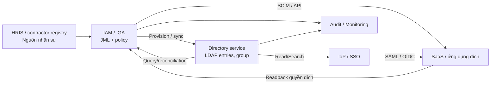

# Directory query trong IAM: Truy vấn danh tính, nhóm và trạng thái vòng đời

Một hệ thống IAM cần trả lời những câu hỏi tưởng như đơn giản: “Nhân viên này có account trong directory chưa?”, “Họ thuộc những nhóm nào?”, “Người vừa chuyển phòng ban còn nằm trong nhóm cũ không?” hoặc “Tài khoản của người đã nghỉ việc đã bị vô hiệu hóa thực sự chưa?”. Nếu không thể truy vấn trạng thái thực tế từ directory, tổ chức rất dễ nhầm **đã gửi yêu cầu thay đổi** với **thay đổi đã có hiệu lực**.

**Directory query** là hoạt động tìm kiếm hoặc đọc các đối tượng và thuộc tính trong **directory service** theo một phạm vi, điều kiện và quyền truy cập xác định. Trong Identity and Access Management (IAM), directory query hỗ trợ tìm account, liên kết danh tính, phân tích nhóm/quyền, kiểm tra provisioning, vận hành **Joiner–Mover–Leaver (JML)** và tạo bằng chứng cho reconciliation.

Bài học thuộc chương **Directory service** của mô-đun **Identity Lifecycle**. Nội dung tập trung vào **LDAP search**, các tham số truy vấn, lọc và ánh xạ kết quả, bảo mật và hiệu năng truy vấn. Phần thực hành kết nối directory với **IdP, SSO, SCIM, RBAC/ABAC, service account, kiểm toán** và mục tiêu giảm **quyền truy cập tồn dư (residual access)**.

> **Nguyên tắc chính:** Một kết quả truy vấn directory chỉ là **quan sát tại một nguồn, vào một thời điểm, với một bộ quyền đọc cụ thể**. Nó không tự chứng minh toàn bộ quyền truy cập ở mọi ứng dụng đã đúng.

## 1. Directory query là gì?

**Directory service** là dịch vụ tổ chức các đối tượng như người dùng, nhóm, máy tính hoặc tài khoản kỹ thuật theo một mô hình danh tính có cấu trúc, cho phép hệ thống tìm kiếm và sử dụng thuộc tính của các đối tượng này.

Một số triển khai directory dùng **LDAP (Lightweight Directory Access Protocol)** làm giao thức truy vấn và quản lý dữ liệu thư mục. Ví dụ các hệ thống có hỗ trợ LDAP gồm những triển khai directory dựa trên OpenLDAP và Active Directory Domain Services (AD DS). Cấu trúc schema, thuộc tính có sẵn và chính sách hoạt động có thể khác nhau.

**Directory query** thường là thao tác **đọc**, bao gồm:

- Tìm một account từ ID ổn định hoặc thuộc tính đã xác minh.
- Tra cứu thông tin profile và trạng thái account.
- Kiểm tra nhóm người dùng là thành viên.
- Liệt kê thành viên của một nhóm.
- Tìm account không có owner hoặc không có bản ghi nguồn.
- Đọc dữ liệu cần đối chiếu với IdP, HRIS hoặc ứng dụng đích.
- Kiểm tra kết quả provisioning/deprovisioning sau một sự kiện JML.
- Phát hiện sai lệch dữ liệu giữa các nguồn.

Directory query **khác** với thao tác tạo/sửa/xóa đối tượng trong directory. Ví dụ lệnh **LDAP Search** dùng để đọc; các thao tác LDAP Add/Modify/Delete là thay đổi trạng thái và cần phân quyền/kiểm soát khác.

### 1.1. Tại sao directory được tổ chức theo đối tượng và thuộc tính?

Một entry đại diện cho một đối tượng, ví dụ người dùng:

```ldif
dn: uid=lan01,ou=people,dc=example,dc=invalid
objectClass: top
objectClass: person
objectClass: organizationalPerson
objectClass: inetOrgPerson
uid: lan01
cn: Lan Nguyen
sn: Nguyen
mail: lan01@example.invalid
employeeNumber: E1045
```

Đây là **dữ liệu LDIF minh họa**, không phải bản ghi thật. Các entry LDAP thường có:

- **DN (Distinguished Name):** định danh vị trí của entry trong cây directory.
- **objectClass:** nhóm lớp schema mà entry tuân thủ.
- **Attributes:** cặp tên thuộc tính và một hoặc nhiều giá trị, như `uid`, `cn`, `mail`.
- **Schema rules:** điều kiện áp dụng cho các loại entry và thuộc tính.

Không phải mọi LDAP directory đều dùng cùng các thuộc tính như ví dụ. Chẳng hạn `employeeNumber` chỉ có khi schema/dữ liệu nguồn hỗ trợ.

### 1.2. Directory là nguồn nào trong IAM?

Directory có thể là:

1. **Nguồn xác thực/đối tượng:** hệ thống lưu account mà IdP dùng để xác thực.
2. **Kho tập trung các thuộc tính:** chứa nhóm, thuộc tính và quan hệ giữa account.
3. **Nguồn đích của provisioning:** nhận cập nhật từ hệ thống nhân sự/IAM.
4. **Nguồn thực tế để reconciliation:** được đọc lại sau thao tác thay đổi.
5. **Nguồn tham khảo:** chứa dữ liệu đồng bộ, nhưng chưa chắc là authority cho mọi thuộc tính.

**Không mặc định directory là nguồn có thẩm quyền cho tất cả dữ liệu.** Ví dụ HRIS có thể là authority của tình trạng nhân sự; directory là nơi IdP nhận bản sao để sử dụng. Ứng dụng SaaS có thể có role nội bộ không được biểu diễn trong directory.

## 2. Directory query nằm ở đâu trong kiến trúc IAM?

Một kiến trúc điển hình:



**LDAP**, **SSO** và **SCIM** phục vụ các chức năng khác nhau:

| Cơ chế | Chức năng chính | Ví dụ |
|---|---|---|
| **LDAP Search** | Đọc entry và thuộc tính từ directory. | Tra cứu user và membership nhóm. |
| **LDAP Bind** | Thiết lập ngữ cảnh xác thực cho kết nối LDAP theo cơ chế server hỗ trợ. | Ứng dụng xác thực tài khoản đọc directory. |
| **SAML/OIDC** | Trao đổi kết quả xác thực liên kết giữa IdP và ứng dụng. | Người dùng đăng nhập một SaaS. |
| **SCIM** | Quản lý các đối tượng User/Group giữa hệ thống hỗ trợ. | Đồng bộ account hoặc nhóm đến SaaS. |
| **RBAC/ABAC** | Xác định quyết định cho phép/từ chối truy cập. | Chỉ nhóm Finance xem báo cáo Finance theo phạm vi. |
| **Reconciliation** | So trạng thái mong muốn và thực tế. | Phát hiện Leaver vẫn có account active. |

Một ứng dụng có thể dùng LDAP query để tìm người dùng rồi tiếp tục phát hành phiên SSO; nhưng **kết quả Search không tự xác thực người dùng**. Việc một DN tồn tại không có nghĩa người gọi đã chứng minh quyền sở hữu account đó.

## 3. Cấu trúc cây directory: DN, RDN, base DN

Trong LDAP, entry được nhận biết bởi **Distinguished Name (DN)**. DN mô tả một vị trí trong **Directory Information Tree (DIT)**.

Ví dụ:

```text
dc=example,dc=invalid
├── ou=people
│   ├── uid=lan01
│   └── uid=minh02
├── ou=groups
│   ├── cn=finance-readers
│   └── cn=support-operators
└── ou=service-accounts
    └── uid=iam-reader
```

Một DN đầy đủ có thể là:

```text
uid=lan01,ou=people,dc=example,dc=invalid
```

Các thành phần cần nhớ:

- **RDN (Relative Distinguished Name):** phần tên tương đối của entry so với entry cha, ví dụ `uid=lan01`.
- **DN:** toàn bộ đường định danh trong DIT.
- **Base DN:** entry gốc của vùng tìm kiếm, ví dụ `ou=people,dc=example,dc=invalid`.
- **Search scope:** xác định có tìm chính base entry, con trực tiếp hay toàn bộ nhánh hay không.

**DN có thể thay đổi khi entry bị di chuyển trong cây hoặc đổi tên.** Không nên xem DN là định danh bất biến duy nhất của một người nếu sản phẩm có ID ổn định riêng. Trong nhiều thiết kế, IAM dùng mã nhân viên hoặc định danh nội bộ và lưu mapping tới account ID của directory.

### 3.1. DN khác email và uid

| Thuộc tính/khái niệm | Ví dụ | Lưu ý |
|---|---|---|
| DN | `uid=lan01,ou=people,dc=example,dc=invalid` | Định danh vị trí entry, có thể đổi khi move/rename. |
| `uid` | `lan01` | Thuộc tính phụ thuộc schema và quy tắc cấp phát. |
| `mail` | `lan01@example.invalid` | Có thể đổi, trùng hoặc tái sử dụng theo chính sách. |
| Mã nhân sự | `E1045` | Chỉ đáng tin khi nguồn xác nhận và quy tắc ổn định rõ. |
| ID hệ thống | Ví dụ entryUUID/objectGUID nếu triển khai hỗ trợ. | Cần biết phạm vi ổn định và vòng đời của từng loại ID. |

Trong AD DS, các thuộc tính như `objectGUID` là **đặc thù sản phẩm**; trong nhiều directory LDAP khác có thể dùng `entryUUID`. Không tự suy luận hai hệ thống có cùng schema.

## 4. Các tham số cơ bản của LDAP Search

Một request LDAP Search thường gồm:

1. **Base object:** DN bắt đầu.
2. **Scope:** phạm vi tìm kiếm.
3. **Filter:** điều kiện khớp entry.
4. **Attributes:** tập thuộc tính cần trả về.
5. **Size/time limits:** giới hạn tài nguyên kết quả.
6. **Deref aliases:** hành vi xử lý alias, nếu hệ thống hỗ trợ.
7. **Controls:** mở rộng như phân trang hoặc sắp xếp, tùy LDAP server.

### 4.1. Ba phạm vi thường gặp

| Scope | Ý nghĩa | Ví dụ tìm từ `ou=people,...` |
|---|---|---|
| `base` | Chỉ chính entry được chỉ định làm base. | Đọc thuộc tính entry `ou=people`. |
| `one` | Những entry con trực tiếp của base. | Tìm `uid=lan01` nhưng không đi vào nhánh con sâu hơn. |
| `sub` | Toàn bộ cây con, gồm base và hậu duệ. | Tìm user ở nhiều OU con. |

Một số server/control hỗ trợ biến thể mở rộng khác, nhưng **base, one, sub** là những phạm vi cốt lõi để hiểu LDAP Search.

### 4.2. Ví dụ truy vấn bằng ldapsearch

Ví dụ dưới đây dùng cú pháp công cụ `ldapsearch` thường gặp trên hệ thống có OpenLDAP client. Tên miền và dữ liệu đều là giả lập:

```bash
ldapsearch -LLL \
  -H ldaps://directory.example.invalid:636 \
  -D "uid=iam-reader,ou=service-accounts,dc=example,dc=invalid" \
  -W \
  -b "ou=people,dc=example,dc=invalid" \
  -s sub \
  "(&(objectClass=inetOrgPerson)(uid=lan01))" \
  dn uid cn mail employeeNumber
```

Giải thích:

- `-H`: địa chỉ server; `ldaps://` chỉ kết nối LDAP được bảo vệ bằng TLS ngay từ đầu theo cấu hình hỗ trợ.
- `-D`: DN của tài khoản thực hiện bind.
- `-W`: yêu cầu nhập mật khẩu một cách tương tác thay vì ghi bí mật vào command line.
- `-b`: base DN.
- `-s sub`: phạm vi subtree.
- Chuỗi `(&(objectClass=inetOrgPerson)(uid=lan01))`: điều kiện tìm kiếm.
- Danh sách cuối: **projection** các thuộc tính cần đọc.

Công cụ khác có thể có tham số khác. Không chạy ví dụ với user/host thật khi chưa được cấp quyền đọc, và không dùng tài khoản quản trị toàn directory nếu một tài khoản chỉ-đọc là đủ.

### 4.3. Search result chứa gì?

Một truy vấn có thể trả:

- **SearchResultEntry:** entry phù hợp cùng các thuộc tính được phép xem.
- **SearchResultReference:** thông tin tham chiếu/referral trong những thiết kế có phân vùng hoặc chuyển hướng.
- **SearchResultDone:** kết quả cuối của search operation, gồm mã trạng thái.

Ví dụ kết quả hư cấu:

```ldif
dn: uid=lan01,ou=people,dc=example,dc=invalid
uid: lan01
cn: Lan Nguyen
mail: lan01@example.invalid
employeeNumber: E1045
```

Kết quả **không trả một thuộc tính** có thể vì: attribute không tồn tại, bị giới hạn bởi ACL, thuộc tính không được yêu cầu, hoặc server có hành vi schema riêng. Không mặc định “không thấy trường” nghĩa là giá trị bằng false.

## 5. Cú pháp LDAP filter

LDAP Search Filter là **biểu thức điều kiện**, không phải mệnh đề SQL. Khi dùng chuỗi lọc, cần tuân thủ cú pháp và quy tắc escape của LDAP.

### 5.1. Các dạng filter cơ bản

| Dạng | Ví dụ | Ý nghĩa |
|---|---|---|
| Equality | `(uid=lan01)` | Giá trị thuộc tính khớp theo matching rule. |
| Presence | `(mail=*)` | Có thuộc tính `mail`. |
| Substring | `(cn=Lan*)` | Giá trị bắt đầu bằng chuỗi phù hợp. |
| Greater or equal | `(modifyTimestamp>=20261101000000Z)` | So sánh theo matching rule nếu được hỗ trợ; không bảo đảm tương đương truy vấn delta. |
| Less or equal | `(employeeNumber<=E2000)` | Chỉ có nghĩa theo matching rule/syntax của thuộc tính; không mặc định là so sánh số. |
| AND | `(&(objectClass=inetOrgPerson)(uid=lan01))` | Tất cả điều kiện đúng. |
| OR | `(|(uid=lan01)(uid=minh02))` | Ít nhất một điều kiện đúng. |
| NOT | `(!(mail=*))` | Không có thuộc tính `mail` theo ngữ nghĩa filter. |
| Extensible matching | Tùy matching rule và server. | Có thể hỗ trợ kiểm tra đặc thù như quan hệ nhóm lồng nhau. |

Không phải mọi thuộc tính đều hỗ trợ mọi phép so sánh. **Schema, matching rules, indexing và ACL** quyết định filter nào có ý nghĩa và có thể chạy hiệu quả.

### 5.2. Kết hợp điều kiện

Ví dụ chỉ tìm user thuộc nhánh nhân viên và có mã nhân sự:

```text
(&(objectClass=inetOrgPerson)(employeeNumber=*))
```

Ví dụ tìm hai user bằng OR:

```text
(&(objectClass=inetOrgPerson)(|(uid=lan01)(uid=minh02)))
```

Ví dụ tìm entry có mail nhưng không có số điện thoại:

```text
(&(objectClass=inetOrgPerson)(mail=*)(!(telephoneNumber=*)))
```

**Không gắn nhãn “nhân viên active” chỉ vì entry có `employeeNumber` hoặc `mail`.** Trạng thái lifecycle cần định nghĩa bằng nguồn thuộc tính có thẩm quyền, schema và policy của tổ chức.

### 5.3. Chú ý giá trị trống và thuộc tính đa trị

Một thuộc tính có thể có **nhiều giá trị**, ví dụ `member` của group hoặc nhiều địa chỉ `mail` trong một schema cụ thể. Vì thế:

- Không mặc định chỉ có một member hoặc một mail.
- Nếu filter equality khớp một giá trị, nó không chứng minh entry không còn giá trị khác.
- Không gộp các giá trị đa trị thành một chuỗi rồi so bằng text tùy ý.
- Khi cần tính effective group membership, phải hiểu cách hệ thống biểu diễn quan hệ và nested group.

## 6. Chống LDAP injection và xử lý giá trị đầu vào

**LDAP injection** xảy ra khi ứng dụng nối dữ liệu không tin cậy trực tiếp vào filter hoặc DN khiến ý nghĩa truy vấn bị thay đổi.

### 6.1. Ví dụ lỗi

Giả sử một cổng nội bộ nhận `username` từ request, rồi tạo filter theo kiểu:

```text
filter = "(&(objectClass=inetOrgPerson)(uid=" + username + "))"
```

Nếu `username` chứa ký tự điều khiển cú pháp filter, biểu thức có thể không còn mang ý nghĩa “uid bằng username chính xác”. Hệ thống có thể truy vấn sai người, trả quá nhiều bản ghi hoặc tạo điểm yếu bảo mật.

### 6.2. Cách tiếp cận an toàn

- Dùng **LDAP filter builder/encoder** được duy trì và kiểm thử.
- Escape **giá trị** theo quy tắc LDAP filter; không tự nối chuỗi đã chứa cú pháp từ người dùng.
- Nếu ứng dụng cho chọn tên thuộc tính, chỉ cho phép từ **allowlist cố định**; escape giá trị không tự làm tên thuộc tính an toàn.
- Xác minh ID và namespace theo schema, hạn chế chiều dài và kiểu dữ liệu đầu vào.
- Giới hạn kết quả và thuộc tính trả về theo nhu cầu.
- Không dùng account directory có quyền đọc toàn bộ tổ chức cho một endpoint công khai.
- Không chuyển phản hồi LDAP lỗi thô hoặc DN nhạy cảm ra cho người dùng cuối.

### 6.3. Escape theo LDAP filter khác với DN

Theo cú pháp biểu diễn LDAP Search Filter, các ký tự đặc biệt trong **giá trị filter** cần escape, ví dụ:

| Ký tự literal | Biểu diễn escape trong filter |
|---|---|
| `*` | `\2a` |
| `(` | `\28` |
| `)` | `\29` |
| Backslash | `\5c` |
| NUL | `\00` |

Ví dụ muốn tìm giá trị `team*blue` **có dấu sao literal**, filter là:

```text
(cn=team\2ablue)
```

Nếu viết `(cn=team*blue)`, dấu sao có thể được hiểu là **substring wildcard**, không phải ký tự sao nằm trong tên.

**Lưu ý:** Quy tắc escape **DN** khác quy tắc escape **filter**. Khi xây dựng DN, phải dùng encoder cho DN theo cú pháp tương ứng; không lấy hàm escape filter dùng thay thế. Đặc biệt, việc escape được thực hiện ở đúng lớp ngữ cảnh và đúng encoding, không phải tự xóa mọi ký tự đặc biệt.

### 6.4. Truy vấn dùng ID đã kiểm chứng

Một endpoint tra cứu account nội bộ nên:

1. Nhận định danh ứng dụng đã được kiểm tra định dạng và thẩm quyền của người yêu cầu.
2. Ánh xạ định danh ứng dụng đến một **subject/account ID ổn định** trong registry.
3. Chọn base DN và attribute từ **cấu hình đáng tin**, không từ request tùy ý.
4. Escape giá trị lọc theo thư viện LDAP.
5. Tìm tối đa tập kết quả cần thiết và xử lý 0/1/nhiều kết quả.
6. Chỉ trả những thuộc tính caller được phép thấy.
7. Ghi audit tối thiểu, tránh lộ dữ liệu nhạy cảm trong log.

Không coi kết quả đầu tiên là “đúng người” nếu filter trả nhiều entry. Đây là lỗi thường dẫn tới **account confusion** và cấp quyền nhầm.

## 7. Bind, TLS và phân quyền đọc directory

Một query hợp lệ về cú pháp vẫn có thể trở thành rủi ro nếu kết nối và account truy vấn không được kiểm soát.

### 7.1. Bind không phải search

**LDAP Bind** thiết lập ngữ cảnh xác thực cho kết nối theo cơ chế server hỗ trợ. Sau khi bind, client thực hiện search trong **phạm vi ACL mà danh tính đã bind được phép**.

Các trường hợp thường gặp:

- **Anonymous bind:** có thể được server cho phép nhưng nên hạn chế theo mức dữ liệu công khai, không giả định là phù hợp cho IAM.
- **Simple bind:** gửi danh tính và mật khẩu qua giao thức; cần kênh bảo mật phù hợp để tránh lộ credential.
- **SASL bind:** dùng cơ chế xác thực do server/client hỗ trợ, có thể bao gồm Kerberos trong môi trường tương ứng.

**Search không chứng minh mật khẩu của user đúng.** Một client đã bind bằng service account có thể search entry người dùng mà không hề xác thực người dùng đó.

### 7.2. Bảo vệ kết nối

Với dữ liệu danh tính tổ chức:

- Dùng kết nối LDAP có **TLS được xác minh đúng certificate, hostname và trust chain**.
- Phân biệt **LDAPS** với **StartTLS**; cả hai có thể tạo kênh bảo vệ khi cấu hình đúng.
- Không gửi simple bind password trên kênh không được bảo vệ.
- Không tắt kiểm tra certificate khi xử lý lỗi kết nối.
- Quản lý phiên bản TLS và thuật toán theo chính sách hiện hành.
- Bảo vệ secret của service account trong secrets manager hoặc cơ chế tương ứng.
- Giới hạn outbound network từ client IAM/IdP tới những directory endpoint cần thiết.

Ví dụ kết nối StartTLS qua client hỗ trợ:

```bash
ldapsearch -LLL \
  -H ldap://directory.example.invalid:389 \
  -ZZ \
  -D "uid=iam-reader,ou=service-accounts,dc=example,dc=invalid" \
  -W \
  -b "ou=people,dc=example,dc=invalid" \
  -s base \
  "(objectClass=*)" dn
```

Trong OpenLDAP client, `-ZZ` thường yêu cầu StartTLS thành công thay vì chấp nhận tiếp tục kết nối không được nâng cấp. Ví dụ vẫn cần cấu hình CA/certificate và tên host đúng. Không đưa password vào tham số dòng lệnh hoặc lịch sử terminal.

### 7.3. Least privilege cho account truy vấn

Account IAM đọc directory nên:

1. Chỉ được **read/search** các nhánh và thuộc tính cần cho chức năng.
2. Không có quyền tự sửa nhóm/quyền nếu nhiệm vụ chỉ đọc.
3. Không được đọc password material hoặc dữ liệu nhạy cảm ngoài nhu cầu.
4. Có owner, mục đích, hạn review và vòng đời credential.
5. Được phân tách giữa môi trường thử nghiệm và production.
6. Có giám sát số query, lỗi bind và truy vấn bất thường.
7. Được thu hồi hoặc bàn giao khi workload ngừng hoặc owner thay đổi.

Tài khoản đọc directory **là một machine/service identity**, không nên dùng password cá nhân của nhân viên kỹ thuật cho connector lâu dài.

## 8. Directory query để tìm đúng người và account

### 8.1. Tra cứu theo ID ổn định

Ví dụ nếu directory có thuộc tính `employeeNumber` được kiểm soát:

```bash
ldapsearch -LLL \
  -H ldaps://directory.example.invalid:636 \
  -D "uid=iam-reader,ou=service-accounts,dc=example,dc=invalid" -W \
  -b "ou=people,dc=example,dc=invalid" -s sub \
  "(&(objectClass=inetOrgPerson)(employeeNumber=E1045))" \
  dn uid employeeNumber mail
```

Kỳ vọng theo dữ liệu mẫu: **một** user liên kết với subject của IAM. Nếu kết quả bằng 0, cần phân biệt account chưa được tạo, ánh xạ sai hoặc query thiếu quyền. Nếu kết quả nhiều hơn 1, cần **tạo finding trùng/mapping mơ hồ** thay vì chọn một account tùy ý.

### 8.2. Tra cứu bằng email có những giới hạn nào?

Email thuận tiện cho hỗ trợ, nhưng có thể thay đổi hoặc dùng lại:

```text
(mail=lan01@example.invalid)
```

Kết quả khớp chỉ cho biết directory có entry mang email đó theo ACL/schema hiện tại. Nó **không chứng minh** người đang tương tác là chủ account, và không bảo đảm email bất biến. Trong federation, nên ràng buộc account bằng **issuer + subject identifier ổn định + tenant** theo mô hình SAML/OIDC được triển khai.

### 8.3. Xác minh trạng thái account

Trạng thái “active” không có một thuộc tính LDAP chung áp dụng được cho mọi directory.

- Một tổ chức có thể có thuộc tính riêng như `employmentStatus` hoặc `accountLifecycleState`; chỉ dùng khi schema và authority đã được định nghĩa.
- Trong AD DS, trạng thái vô hiệu hóa account có thể liên quan bit trong `userAccountControl`; cách kiểm phải theo ngữ nghĩa và giao diện hỗ trợ của AD, không coi đó là LDAP chuẩn chung.
- `lockoutTime`, `accountExpires` hay các trường khác của AD có ý nghĩa cụ thể, không nên gộp thành một cờ “active” đơn giản.
- User bị disable trong directory chưa chắc đã mất **phiên SSO, API token hoặc account cục bộ** ở ứng dụng đích.

Vì vậy một báo cáo IAM nên phân biệt:

```text
authoritativeEmploymentState
directoryAccountState
idpAuthenticationState
applicationAccountState
applicationEffectiveAccess
sessionAndCredentialState
```

Các trạng thái trên có thể khác nhau trong quá trình đồng bộ; reconciliation phải biết **mốc hiệu lực và khoảng độ trễ chấp nhận được**.

## 9. Directory query đối với nhóm và quyền RBAC

### 9.1. Nhóm được biểu diễn thế nào?

Một directory LDAP có thể có group dạng `groupOfNames` với thuộc tính `member` chứa DN của các thành viên:

```ldif
dn: cn=finance-readers,ou=groups,dc=example,dc=invalid
objectClass: top
objectClass: groupOfNames
cn: finance-readers
member: uid=lan01,ou=people,dc=example,dc=invalid
member: uid=minh02,ou=people,dc=example,dc=invalid
```

Ví dụ phản ánh một kiểu schema; một hệ thống khác có thể dùng `groupOfUniqueNames`, `uniqueMember`, `memberUid`, AD group hoặc mô hình riêng. Không mặc định mọi nhóm đều có `member` hay mỗi user đều có thuộc tính ngược `memberOf`.

### 9.2. Liệt kê nhóm chứa một user

Với schema `groupOfNames`:

```bash
ldapsearch -LLL \
  -H ldaps://directory.example.invalid:636 \
  -D "uid=iam-reader,ou=service-accounts,dc=example,dc=invalid" -W \
  -b "ou=groups,dc=example,dc=invalid" -s sub \
  "(&(objectClass=groupOfNames)(member=uid=lan01,ou=people,dc=example,dc=invalid))" \
  dn cn member
```

Truy vấn trên cho biết nhóm nào chứa **DN đó trực tiếp** theo cách biểu diễn đã giả định. Nó không tự mở rộng nhóm lồng nhau hoặc phát hiện tất cả role ở SaaS.

### 9.3. Nhóm lồng nhau và effective membership

Giả sử:

```text
lan01
  └── group: finance-analysts
        └── member of group: finance-report-readers
              └── application role: reports.read
```

Nếu chỉ tìm nhóm có `member=DN của lan01`, có thể thấy `finance-analysts` nhưng **không thấy** nhóm `finance-report-readers` ở cấp trên.

Các phương án kiểm tra nested group gồm:

1. Duyệt quan hệ nhóm đệ quy trong ứng dụng, có chống vòng lặp và giới hạn độ sâu.
2. Dùng cơ chế matching rule hoặc API hiệu lực do directory cung cấp nếu được hỗ trợ.
3. Đọc quyền hiệu lực từ IdP/ứng dụng đích, nếu đó mới là hệ thống thực thi.
4. Đối soát group mapping và role trực tiếp ngoài directory.

Trong AD DS có **matching rule đặc thù** để truy vấn quan hệ DN lồng nhau, ví dụ OID `1.2.840.113556.1.4.1941` trong ngữ cảnh phù hợp. **Đây không phải tính năng LDAP phổ quát**; chỉ dùng khi schema, loại attribute và phiên bản server hỗ trợ.

### 9.4. Directory group khác application permission

| Đối tượng | Ví dụ | Ai quyết định quyền cuối cùng? |
|---|---|---|
| Directory group | `finance-readers` | Directory giữ quan hệ nhóm. |
| IdP claim | `groups=["finance-readers"]` | IdP phát thuộc tính trong giới hạn cấu hình. |
| SaaS role | `report-viewer` | Ứng dụng ánh xạ claim/group theo policy. |
| Resource scope | `department=FINANCE` | Authorization engine/ABAC của resource. |
| Direct grant | `invoices.export` | Ứng dụng có thể lưu riêng, không có trong LDAP. |

**RBAC** có thể dựa trên nhóm, còn **ABAC** dựa trên thuộc tính và ngữ cảnh. Vì thế directory query thường là **đầu vào** cho authorization, không đồng nghĩa với phép kiểm hiệu lực ở mọi ứng dụng.

## 10. Truy vấn thay đổi thuộc tính trong Mover lifecycle

### 10.1. Ví dụ chuyển phòng ban

Nhân viên Mai chuyển từ Customer Support sang Finance. Nguồn HRIS xác nhận:

```json
{
  "eventId": "hr-mover-017",
  "subjectId": "person-1045",
  "oldDepartment": "SUPPORT",
  "newDepartment": "FINANCE",
  "effectiveAt": "2026-12-01T09:00:00+07:00",
  "sourceVersion": 41
}
```

Đây là dữ liệu minh họa. Từ sự kiện này, IAM có thể:

1. Cập nhật thuộc tính department trên directory theo schema thực tế.
2. Gỡ nhóm Support không còn hợp lệ.
3. Gán nhóm Finance sau khi chính sách/phê duyệt phù hợp.
4. Đồng bộ tới IdP và các ứng dụng qua connector hoặc SCIM.
5. **Query/readback** directory để xác minh giá trị và membership.
6. Query/readback ứng dụng để kiểm tra **quyền hiệu lực**, bao gồm role trực tiếp và session theo khả năng.

### 10.2. Ba câu hỏi query quan trọng sau Mover

**Câu hỏi A — Thuộc tính mới đã được cập nhật?**

Nếu tổ chức có thuộc tính tùy biến `departmentCode`, có thể tìm entry đúng ID rồi đọc thuộc tính này. Không nên tự tin dùng `departmentCode` nếu schema chưa có hoặc caller không có quyền đọc.

**Câu hỏi B — Nhóm cũ đã bị gỡ?**

Truy vấn group Support theo DN của account, hoặc kiểm membership ở hệ thống thực thi. Kết quả “không tìm thấy member” cần được diễn giải theo ACL, giới hạn query và mô hình nhóm.

**Câu hỏi C — Quyền còn hiệu lực không?**

Thử một hành động được chính sách cho phép trong môi trường kiểm soát, hoặc đọc quyền tại ứng dụng. Một claim SSO hay group LDAP cũ có thể được cache; cần kiểm tra hành động thực tế khi dữ liệu nhạy cảm liên quan.

### 10.3. Ma trận trước và sau Mover

| Quan sát | Trước Mover | Sau Mover mục tiêu | Cách xác minh |
|---|---|---|---|
| Trạng thái nhân sự | ACTIVE | ACTIVE | HRIS, nguồn có thẩm quyền. |
| Department | SUPPORT | FINANCE | Directory query + source comparison. |
| Support group | Có | Không, nếu không còn lý do hợp lệ. | Group membership readback. |
| Finance group | Không | Có theo policy. | Group membership + approval. |
| Support application role | Có | Không | Application readback/authorization. |
| Finance report role | Không | Có đúng scope | Application readback/authorization. |
| Phiên SSO chứa claim cũ | Có thể có | Được làm mới/chặn theo policy. | Session/token/authorization test. |

**Không chỉ query trường department rồi kết luận Mover hoàn tất.** Quyền cũ có thể vẫn tồn tại qua nhóm lồng nhau, direct grant, API token hoặc local account.

## 11. Directory query trong Joiner và Leaver

### 11.1. Joiner — xác minh account được tạo đúng

Khi HRIS/identity source xác nhận người mới gia nhập:

- Query theo ID ổn định để xem account đã được tạo chưa.
- Kiểm tra đúng container/OU, objectClass, account ID và thuộc tính cần thiết.
- Phát hiện account trùng hoặc account bị tái sử dụng sai.
- Kiểm tra nhóm/role ban đầu theo **least privilege**.
- Xác minh ngày bắt đầu; account chưa đến hiệu lực không được dùng để mở truy cập trái policy.
- Kiểm tra IdP/SSO và ứng dụng đích nếu quyền được cấp qua các luồng riêng.

Một query trả một entry chưa đủ chứng minh onboarding hoàn tất: account có thể thiếu quyền công việc, thiếu MFA enrollment hoặc chưa được đồng bộ SCIM tới ứng dụng.

### 11.2. Leaver — phát hiện quyền truy cập tồn dư

Giả sử nguồn HRIS đánh dấu nhân viên đã nghỉ việc. IAM cần xác minh:

1. Account directory có trạng thái phù hợp policy chưa?
2. Người đó còn membership nhóm đặc quyền không?
3. Account quản trị riêng có bị vô hiệu hóa hoặc gỡ quyền chưa?
4. IdP còn cấp phiên/token mới cho người đó không?
5. Ứng dụng SaaS có role, token hoặc local login riêng không?
6. Service account/workload mà họ từng quản lý đã được bàn giao owner chưa?
7. Có bằng chứng readback và những target chưa thể kiểm chứng không?

Directory query trả về **account disabled** là tín hiệu quan trọng nhưng **không chứng minh mọi phiên SP hay OAuth access token đã hết hiệu lực**.

### 11.3. Truy vấn Leaver trong mô hình account lifecycle

Ví dụ một hệ thống có thuộc tính tùy biến `iamLifecycleState`. Sau khi định nghĩa schema và ACL, có thể đọc trạng thái:

```text
(&(objectClass=inetOrgPerson)(iamLifecycleState=TERMINATED))
```

Filter này chỉ có ý nghĩa nếu **thuộc tính đó thật sự tồn tại và được nguồn có thẩm quyền duy trì**. Nó không phải thuộc tính bắt buộc của LDAP.

**Đặc biệt:** không tạo một filter kiểu `(!(active=true))` và coi tất cả kết quả là Leaver nếu schema không định nghĩa rõ `active`; thuộc tính không tồn tại và trạng thái false không nhất thiết tương đương.

## 12. Truy vấn account máy và service account

Directory có thể chứa **service account, computer account hoặc principal kỹ thuật**. Không phải tất cả đều thuộc cùng một schema hoặc nằm trong cùng OU.

### 12.1. Service identity cần dữ liệu gì?

| Trường quản trị | Ý nghĩa |
|---|---|
| ID ổn định của service account | Định danh principal theo directory/target. |
| Owner team | Nhóm chịu trách nhiệm hiện hành. |
| Workload / purpose | Ứng dụng hoặc tích hợp sử dụng account. |
| Environment | Development, staging hay production. |
| Entitlements | Role, nhóm và phạm vi hệ thống. |
| Credential lifecycle | Kiểu credential, ngày review/rotation nếu quan sát được. |
| Source status | Workload còn hoạt động hay đã decommission. |
| Last review / exception | Bằng chứng quyền còn hợp lệ và ngoại lệ. |

Không phải directory nào cũng có các thuộc tính trên. Nhiều trường có thể nằm trong **service catalog, vault hoặc cloud IAM**; báo cáo nên **join theo key đáng tin**, không tự nhét dữ liệu giả vào LDAP.

### 12.2. Truy vấn tìm account thiếu owner

Nếu tổ chức đã định nghĩa `serviceOwner` trong schema, một filter nghiên cứu có thể là:

```text
(&(objectClass=organizationalRole)(!(serviceOwner=*)))
```

Đây chỉ là **ví dụ giả định schema**: `organizationalRole` không mặc nhiên có thuộc tính `serviceOwner`, và các service account thực tế có thể không thuộc lớp đó. Phải dùng đúng objectClass và trường của triển khai.

Kết quả thiếu owner là **finding cần xác minh**, không phải lệnh xóa tự động. Một service account có thể đang phục vụ pipeline production; cần xác định workload hợp lệ trước khi deprovision.

### 12.3. Người quản lý service account nghỉ việc

Khi một kỹ sư Leaver:

- Thu hồi quyền **cá nhân** của kỹ sư trên directory, vault, CI/CD và cloud.
- Query service account/nhóm theo bản đồ ownership để phát hiện quan hệ liên quan.
- Chuyển owner theo service catalog.
- Đánh giá rotation credential mà kỹ sư từng có thể truy cập.
- Giữ workload hợp lệ hoạt động bằng principal được quản lý.
- Chỉ xóa service account khi workload đã kết thúc và có quyết định hợp lệ.

**Vòng đời danh tính con người và vòng đời workload có liên hệ, nhưng không đồng nhất.**

## 13. Phân trang, giới hạn và truy vấn directory lớn

Một tổ chức có thể có hàng trăm nghìn entry. Query toàn directory mà không có giới hạn có thể gây quá tải, bị cắt kết quả hoặc làm sai báo cáo reconciliation.

### 13.1. Giới hạn phía server và client

Những giới hạn cần biết:

- **Size limit:** số entry mà server cho trả trong một search.
- **Time limit:** thời gian xử lý tối đa của query.
- **Administrative limits:** giới hạn nội bộ của server, gồm số bản ghi/kết nối/chi phí.
- **Network timeout:** có thể khiến client không nhận đủ kết quả.
- **ACL:** caller có thể chỉ được xem một phần cây hoặc thuộc tính.
- **Referral:** search có thể có tham chiếu tới vùng dữ liệu khác.
- **Paging:** có thể phân chia kết quả thành nhiều trang với control phù hợp.

**Kết quả “nhận được 1000 bản ghi” không chứng minh directory chỉ có 1000 account.** Có thể server áp giới hạn hoặc client chỉ đọc trang đầu.

### 13.2. Simple Paged Results Control

LDAP có cơ chế **Simple Paged Results**, thường dùng để đọc kết quả lớn theo các trang khi server hỗ trợ. Ví dụ với một client có tùy chọn tương ứng:

```bash
ldapsearch -LLL \
  -H ldaps://directory.example.invalid:636 \
  -D "uid=iam-reader,ou=service-accounts,dc=example,dc=invalid" -W \
  -E pr=500/noprompt \
  -b "ou=people,dc=example,dc=invalid" -s sub \
  "(objectClass=inetOrgPerson)" dn uid
```

`-E pr=500/noprompt` minh họa yêu cầu trang 500 entry theo cú pháp một phiên bản `ldapsearch` hỗ trợ control này. **Tham số và khả năng server cần được xác minh theo công cụ/phiên bản thực tế.**

Điểm cần lưu ý:

1. Trang có thể đi cùng **cookie/continuation state** do server cấp; client phải dùng đúng trạng thái này cho các trang kế tiếp.
2. Không giả định thứ tự kết quả có tính ổn định nếu không có cơ chế hỗ trợ.
3. Một đối tượng bị sửa/xóa/thêm trong khi quét có thể gây **sai lệch giữa các trang** nếu server không cung cấp snapshot nhất quán.
4. Nếu query bị ngắt, cần cơ chế retry/checkpoint phù hợp; không tự đánh dấu lần quét là “đầy đủ”.
5. Cần kiểm tra kết quả cuối và lỗi limit, không chỉ nối các trang rồi đếm.

### 13.3. Dùng projection để giảm tải

Nếu cần đối soát UID, DN và ID, không nên yêu cầu mọi thuộc tính:

```text
Attributes: dn, uid, employeeNumber
```

Tránh đọc ảnh đại diện, thuộc tính nhạy cảm hoặc nhóm dữ liệu lớn khi mục tiêu không cần. **Data minimization** giảm tải server, băng thông, rủi ro lộ PII và kích thước log.

### 13.4. Chọn base DN và filter có chọn lọc

Query từ cả forest hoặc suffix lớn chỉ để tìm một account có thể tốn kém hơn query dưới OU phù hợp. Tuy nhiên OU cũng có thể **thay đổi khi Mover**; đừng hardcode một OU cũ rồi kết luận account biến mất.

Để lựa chọn:

- Chọn base đủ bao phủ đối tượng cần tìm nhưng không rộng không cần thiết.
- Dùng thuộc tính có chỉ mục khi sản phẩm cho phép và phù hợp policy.
- Hạn chế wildcard đầu chuỗi và filter quá phức tạp ở luồng vận hành thời gian thực.
- Dùng limit, phân trang, cache và backoff hợp lý.
- Quan sát **thời gian truy vấn và tải server**, đặc biệt khi nhiều ứng dụng cùng đọc directory.

## 14. Truy vấn thay đổi theo thời gian và delta synchronization

Một hệ thống reconciliation có thể cần tìm **đối tượng thay đổi từ lần chạy trước**, thay vì đọc toàn bộ directory mỗi lần.

### 14.1. Tại sao không thể chỉ dựa vào modifyTimestamp?

Một số directory có thuộc tính vận hành như `modifyTimestamp`. Dù hữu ích, dùng nó làm “event stream chính xác” có thể sai vì:

- Có triển khai không cho phép đọc theo ACL hoặc không hỗ trợ filter như mong đợi.
- Mốc thời gian, độ phân giải, đồng hồ và replication có thể khác nhau.
- Đối tượng **đã bị xóa** có thể không còn xuất hiện trong truy vấn thông thường.
- Một lần đọc bị gián đoạn có thể bỏ sót bản ghi khi chỉ lưu timestamp cuối cùng.
- Thay đổi membership hoặc quyền có thể được biểu diễn ở entry khác với user.
- Phân trang trong lúc có thay đổi có thể không tạo snapshot nhất quán.

**Dùng timestamp nếu phù hợp phải đi kèm chiến lược reconciliation và phát hiện xóa**, không thay thế hoàn toàn quét đối soát.

### 14.2. Cơ chế đồng bộ thay đổi

Các lựa chọn tùy hệ thống gồm:

- LDAP synchronization mechanisms/controls do server hỗ trợ.
- **LDAP Content Synchronization** ở những triển khai hỗ trợ profile liên quan, không phải mặc định mọi LDAP server.
- **DirSync** trong bối cảnh Active Directory với khả năng, quyền và giới hạn riêng.
- Cơ chế notification/change tracking hoặc API riêng của sản phẩm.
- Full scan định kỳ để phát hiện drift mà incremental feed bỏ sót.

**Không mặc định LDAP có một chuẩn delta query giống nhau trên mọi sản phẩm.** Trước khi lựa chọn phải xác minh khả năng server, quyền cần thiết, xử lý deletion/tombstone, cookie/checkpoint, replication và độ trễ.

### 14.3. Mô hình đồng bộ đáng tin

```text
initialFullRead()
saveVerifiedSnapshotAndCheckpoint()

while serviceActive:
    changes = readIncrementalChanges(checkpoint)
    validateCompletenessAndOrdering(changes)
    applyChangesIdempotently(changes)
    persistCheckpointOnlyAfterSuccessfulProcessing()
    periodicallyRunFullReconciliation()
```

Đây là **pseudocode khái niệm**. Không dùng chỉ số thứ tự hoặc cookie lấy từ một server như một giá trị toàn cục nếu cơ chế đó được ràng buộc với partition/server. Với lỗi đồng bộ, cần **đọc bù hoặc full resync** thay vì lặng lẽ đánh dấu dữ liệu đã hiện hành.

## 15. Replication, referral và độ nhất quán

### 15.1. Hai directory replica có thể trả kết quả khác nhau

Nhiều directory có replication. Một update tại một node có thể chưa xuất hiện ngay ở replica khác. Ví dụ:

- 09:00: IAM cập nhật group của Mai.
- 09:01: IdP đọc từ replica A có dữ liệu mới.
- 09:01: ứng dụng cũ đọc replica B còn group cũ.
- 09:03: hai replica hội tụ theo cơ chế replication.

Nếu báo cáo so hai nguồn ở các thời điểm khác nhau, có thể báo drift tạm thời. Nhưng điều đó **không biện minh cho quyền Leaver rủi ro cao tồn tại vô thời hạn**.

### 15.2. Cần công bố freshness

Mỗi lần query phục vụ reconciliation nên có:

```json
{
  "queryRunId": "dir-read-20261201-004",
  "targetDirectory": "corp-directory",
  "replica": "directory-read-02",
  "baseDn": "ou=people,dc=example,dc=invalid",
  "scope": "sub",
  "observedAt": "2026-12-01T09:02:00+07:00",
  "collectionComplete": true,
  "resultCount": 1
}
```

Ví dụ chỉ minh họa metadata, không lưu secret hoặc toàn bộ filter chứa PII khi không cần.

### 15.3. Referral và dữ liệu ngoài phạm vi

Khi server trả referral hoặc reference, client không nên tự động:

- Gửi credential tới host không được phê duyệt.
- Mở kết nối không có TLS xác minh.
- Theo mọi URL được trả về mà không giới hạn miền/đích.
- Coi dữ liệu từ directory khác là authority không qua cấu hình.

Cần chính sách rõ **được theo referral hay không**, trust của endpoint, cách xác thực và khi nào kết quả được coi là hoàn tất.

## 16. Directory query, cache và SSO authorization

### 16.1. Directory thay đổi không đồng nghĩa token/claim đổi ngay

Một IdP có thể query directory lúc người dùng đăng nhập rồi phát SAML assertion hoặc OIDC ID Token chứa thuộc tính. Nếu directory thay đổi sau đó:

- Assertion hoặc ID Token đã phát hành **không tự thay đổi nội dung**.
- Ứng dụng có thể cache group/role trong session.
- Access token đã cấp có thể còn hiệu lực theo TTL và cơ chế xác minh.
- API có thể không truy vấn lại directory trên từng request.
- Group được gỡ ở directory chưa chắc gỡ role gán trực tiếp trong SaaS.

Do đó, **directory query tại 09:00 trả “đã gỡ nhóm” không chứng minh phiên 08:45 đã mất quyền**.

### 16.2. Các mức xác minh nên tách

| Mức | Bằng chứng | Chưa chứng minh |
|---|---|---|
| **Directory state** | DN/attribute/group đã cập nhật khi LDAP readback. | App role và phiên đã thay đổi. |
| **IdP state** | Account/claims cho lần xác thực mới phản ánh trạng thái. | Token đã cấp trước hết hiệu lực. |
| **Application state** | Account/role nội bộ phù hợp policy. | Mọi token API ngoài ứng dụng đã bị chặn. |
| **Effective access** | Resource từ chối thao tác cấm bằng điều kiện test hợp lệ. | Tất cả đường quyền chưa quan sát đều đã sạch. |
| **Reconciliation closure** | Các target trong phạm vi đã readback/ghi ngoại lệ. | Những target ngoài phạm vi hoặc chưa hỗ trợ không tồn tại. |

Khi thiết kế SSO, cần quy định **thời gian sống claim, refresh/re-evaluation và revocation** để hạn chế quyền tồn dư sau JML.

## 17. Reconciliation: từ directory query đến finding có hành động

### 17.1. So sánh desired và actual state

**Desired state (D)** được tính từ nguồn có thẩm quyền, chính sách RBAC/ABAC và phê duyệt hợp lệ. **Actual state (A)** là trạng thái được quan sát từ directory, IdP và ứng dụng đích.

Về khái niệm:

```text
Missing entitlements = D - A
Unexpected entitlements = A - D
Matched entitlements = D ∩ A
```

Không thể áp phép trừ danh sách tên group một cách máy móc nếu effective access có nhóm lồng nhau, direct role, policy ABAC và scope khác nhau. Cần **chuẩn hóa cùng ngữ nghĩa quyền** và ghi rõ những phần chưa có dữ liệu.

### 17.2. Kết quả đối soát ba trạng thái

| Outcome | Ý nghĩa | Ví dụ |
|---|---|---|
| **MATCH** | Có bằng chứng đủ để kết luận target phù hợp desired state trong phạm vi kiểm tra. | Group Finance đúng membership theo policy. |
| **MISMATCH** | Có bằng chứng hợp lệ cho thấy trạng thái khác mục tiêu. | Leaver vẫn giữ nhóm Admin. |
| **UNKNOWN** | Không có bằng chứng đủ, ví dụ ACL từ chối hoặc query không hoàn tất. | Client thiếu quyền đọc nhóm nhạy cảm. |

**UNKNOWN không phải MATCH.** Nếu tài khoản query chỉ thấy một phần OU, không thể dùng việc “không tìm thấy” để xác nhận account đã bị xóa.

### 17.3. Bảng finding mẫu

| Subject | Directory observation | Desired | Finding | Hành động |
|---|---|---|---|---|
| Lan, Leaver | User bị disable, nhưng group admin còn member. | Không còn quyền admin. | `RESIDUAL_PRIVILEGE` | Gỡ đường quyền, kiểm API/phiên và readback. |
| Mai, Mover | Department mới, nhóm Support còn. | Quyền Support hết hiệu lực. | `MOVER_GROUP_DRIFT` | Gỡ group/đối soát app role. |
| Huy, Joiner | Không thấy account trong phạm vi đã xác nhận đầy đủ. | Account cần có theo ngày hiệu lực. | `MISSING_ACCOUNT` | Kiểm connector và provisioning. |
| Bot báo cáo | Account tồn tại, owner không xác định. | Có owner/workload hợp lệ. | `UNOWNED_SERVICE_ACCOUNT` | Xác minh owner trước khi xử lý. |
| Account ở OU hạn chế | Không đọc được ACL. | Chưa kết luận. | `QUERY_COVERAGE_GAP` | Điều chỉnh nguồn đọc và quyền hợp lệ. |

Các finding là **ví dụ thiết kế**, không phải mã tiêu chuẩn IAM chung.

### 17.4. Lưu bằng chứng query

Một audit record có thể chứa:

```json
{
  "eventType": "DIRECTORY_RECONCILIATION",
  "runId": "iam-rec-20261201-01",
  "subjectId": "person-1045",
  "targetDirectory": "corp-directory",
  "targetAccountId": "entry-uuid-illustrative",
  "attributeChecked": "groupMembership",
  "expected": "NO_SUPPORT_ROLE",
  "observed": "SUPPORT_GROUP_PRESENT",
  "observationTimestamp": "2026-12-01T09:06:00+07:00",
  "result": "MISMATCH",
  "ownerTeam": "iam-operations"
}
```

Không ghi bind password, token hoặc toàn bộ dữ liệu nhạy cảm vào nhật ký. Nếu báo cáo cần tham chiếu tới filter/truy vấn thật, kiểm soát truy cập và giảm tối đa PII trong log.

## 18. API tra cứu directory trong ứng dụng Java: những nguyên tắc cần giữ

Ứng dụng Java có thể truy vấn LDAP bằng thư viện hỗ trợ, ví dụ API JNDI LDAP hoặc thư viện LDAP khác được duy trì. Bài này không buộc chọn thư viện cụ thể; trọng tâm là **hợp đồng an toàn khi truy vấn**.

### 18.1. Thiết kế interface rõ mục đích

Ví dụ pseudocode:

```java
interface DirectoryReader {
    Optional<DirectoryAccount> findByStableId(StableAccountId id);
    List<DirectoryGroup> findDirectGroups(StableAccountId id);
    DirectoryReadResult readAccountState(StableAccountId id);
}
```

Các lưu ý:

- `StableAccountId` và `DirectoryAccount` là **kiểu dữ liệu minh họa**, không phải lớp thư viện có sẵn.
- Truy vấn theo stable ID phù hợp hơn trả về tất cả entry dựa trên chuỗi tìm kiếm tùy ý.
- Dữ liệu account trả về nên được **giới hạn thuộc tính** theo chức năng.
- Hợp đồng nên diễn đạt **NOT_FOUND, MULTIPLE_MATCHES, ACCESS_DENIED, TIMEOUT, PARTIAL_RESULT** chứ không nén mọi lỗi thành `Optional.empty()`.
- Nếu thiếu bằng chứng do lỗi ACL/timeout, hệ thống không được kết luận “đã bị xóa”.

### 18.2. Pseudocode một query an toàn

```text
findAccountByStableId(subjectId):
    requireAuthorizedCaller(subjectId)
    mapping = registry.resolveSubjectToDirectoryId(subjectId)
    requireUnambiguousMapping(mapping)

    baseDn = trustedConfig.peopleBaseDn
    attribute = trustedConfig.stableIdAttribute
    value = ldapFilterEscape(mapping.directoryId)
    filter = buildEqualityFilter(attribute, value)

    result = directory.search(
        baseDn = baseDn,
        scope = SUBTREE,
        filter = filter,
        attributes = allowedProjection,
        sizeLimit = 2,
        timeout = approvedTimeout
    )

    if result.collectionFailedOrPartial:
        return UNKNOWN_WITH_REASON

    if result.entryCount == 0:
        return NOT_FOUND_WITH_EVIDENCE

    if result.entryCount > 1:
        return AMBIGUOUS_MAPPING

    return FOUND(result.entry, observedAt, source)
```

Pseudocode không phải triển khai production. Một bộ thư viện tốt nên nhận **giá trị đã phân tách khỏi cấu trúc** hoặc tự escape đúng chuẩn, và cung cấp xử lý lỗi/timeout/retry cụ thể.

### 18.3. Connection pooling và retries

Với IAM/IdP có lưu lượng lớn:

- Dùng connection pool nếu thư viện và mô hình xác thực phù hợp.
- Không chia sẻ bừa kết nối đã bind với danh tính nhạy cảm giữa các request.
- Đặt timeout kết nối, bind và search riêng.
- Retry có backoff với lỗi tạm thời; tránh retry vô hạn làm quá tải directory.
- Theo dõi lỗi TLS/certificate và không tự rơi về kết nối plaintext.
- Giới hạn truy vấn đồng thời, phân trang và size limit.
- Phân biệt lỗi tạm thời với **không tìm thấy account** hoặc **ACL từ chối**.
- Theo dõi độ trễ, phân vùng replica và tình trạng cache.

## 19. Những sai lầm thường gặp khi directory query

| Sai lầm | Hậu quả | Cách cải thiện |
|---|---|---|
| Ghép filter bằng input chưa escape. | LDAP injection, tìm sai người. | Dùng filter builder và escape giá trị đúng cú pháp. |
| Dùng escape DN cho filter hoặc ngược lại. | Truy vấn sai, lỗi bảo mật. | Dùng encoder riêng theo từng ngữ cảnh. |
| Dùng email/tên làm ID bất biến. | Account confusion khi đổi hoặc tái dùng email. | ID ổn định + issuer/tenant/nguồn mapping. |
| Dùng tài khoản admin để đọc danh sách user. | Credential lộ tạo phạm vi ảnh hưởng lớn. | Service account chỉ-đọc, ACL tối thiểu. |
| Simple bind không có TLS. | Có thể lộ mật khẩu/kết quả truy vấn. | TLS được xác minh, chính sách bắt buộc. |
| Tắt xác minh certificate để hết lỗi kết nối. | Chấp nhận server giả mạo. | Sửa CA/hostname/trust chain. |
| Query tất cả attributes cho mọi user. | Rò rỉ PII, tải lớn. | Projection và data minimization. |
| Dùng filter không có chỉ mục trên cây lớn. | Chậm và quá tải directory. | Scope/filter có chọn lọc, đo query cost. |
| Chỉ đọc trang đầu. | Đếm thiếu account, bỏ sót Leaver. | Pagination + kiểm collection complete. |
| Coi 0 kết quả khi ACL lỗi là account không tồn tại. | Báo deprovision thành công giả. | Tách UNKNOWN và NOT_FOUND. |
| Chỉ xem group trực tiếp. | Bỏ sót nested group và quyền gián tiếp. | Tính effective membership theo khả năng server. |
| Coi group LDAP đồng nghĩa app role đã gỡ. | Quyền tồn dư qua direct grant, token hoặc session. | Readback tại hệ thống thực thi. |
| Dùng modifyTimestamp làm delta feed tuyệt đối. | Bỏ sót delete/replication hoặc scan thất bại. | Change tracking theo server và full reconciliation. |
| Tự theo referral tới host bất kỳ. | Rò credential hoặc dữ liệu ra ngoài trust boundary. | Allowlist và chính sách referral. |
| Xóa service account vì owner nhân sự nghỉ. | Gián đoạn workload hợp lệ. | Bàn giao owner và kiểm tra workload. |
| Chỉ cập nhật directory rồi coi JML hoàn tất. | SaaS, IdP/session và quyền cloud còn sai. | Desired-vs-actual, cross-system readback. |

## 20. Bài tập tình huống

### Tình huống A — Query trả 0 entry

IAM tra cứu account của một nhân viên đã nghỉ và nhận 0 kết quả. Hệ thống đánh dấu “đã xóa account”. Sau đó phát hiện tài khoản truy vấn chỉ có quyền đọc `ou=people`, trong khi account nằm ở `ou=contractors`.

**Câu hỏi:** Kết luận ban đầu sai ở đâu?

**Gợi ý:** phạm vi base DN và ACL không bao phủ đối tượng. Kết quả 0 chỉ có nghĩa **không thấy trong phạm vi đã truy vấn**; cần kiểm coverage, mapping, server status và đối soát trước khi kết luận.

### Tình huống B — Mover còn quyền do nhóm lồng nhau

Một nhân viên bị gỡ khỏi nhóm `support-operators` trực tiếp, nhưng còn thuộc nhóm dự án được lồng trong nhóm cấp quyền Support.

**Câu hỏi:** Vì sao query chỉ theo direct membership chưa đủ?

**Gợi ý:** phải kiểm tra nested group và effective access theo schema/matching rule thực tế; đồng thời đọc quyền ứng dụng để xác minh thao tác không còn được phép.

### Tình huống C — LDAP injection qua bộ lọc tìm kiếm

Một ứng dụng chèn trực tiếp chuỗi `username` từ HTTP request vào LDAP filter. Người dùng gửi dữ liệu có các ký tự cú pháp như dấu ngoặc và dấu sao.

**Câu hỏi:** Phải sửa ở lớp nào?

**Gợi ý:** filter builder/escaping ở lớp truy vấn, allowlist tên thuộc tính và scope, validation đầu vào, giới hạn quyền đọc và audit; không chỉ chặn một vài chuỗi lỗi bằng regex.

### Tình huống D — Bản ghi Mover đến chậm

HRIS thay department lúc 09:00. Replica A đã có dữ liệu mới, replica B chưa nhận replication. Báo cáo đọc B lúc 09:01 và thấy thông tin cũ.

**Câu hỏi:** Báo cáo nên ghi gì? Có nên tự coi sai lệch đã được khắc phục không?

**Gợi ý:** lưu observedAt, replica và freshness; phân biệt convergence window với quyền còn hiệu lực, đọc lại theo chính sách và không bỏ qua SLA thu hồi rủi ro cao.

### Tình huống E — Tài khoản dịch vụ bị đánh dấu orphan

Directory có account `svc-payments-sync` nhưng không có email nhân viên hoặc employeeNumber. Một công cụ định xóa vì “không có HRIS identity”.

**Câu hỏi:** Quyết định đó có an toàn không?

**Gợi ý:** service account có nguồn vòng đời khác; phải xác minh workload, owner, mục đích, quyền và credential trước khi decommission, không áp dụng mô hình human identity cho tất cả principal.

### Tình huống F — Directory đã disable nhưng SaaS vẫn truy cập

Sau Leaver, directory query cho thấy user bị disable. Một SaaS SAML SP vẫn chấp nhận session cũ và API token còn hiệu lực.

**Câu hỏi:** Vì sao query directory không đủ để kết luận offboarding thành công?

**Gợi ý:** directory account state, IdP/SSO session và quyền hiệu lực tại SP/API là các lớp khác nhau; cần revoke/authorization readback theo hệ thống.

### Tình huống G — Báo cáo sai do thiếu phân trang

Một job nightly LDAP query nhận đúng 1000 account và coi đó là toàn bộ directory. Thực tế tổ chức có 75.000 account, nhưng server có size limit.

**Câu hỏi:** Làm thế nào để phát hiện và sửa vấn đề?

**Gợi ý:** kiểm result code và collection completeness, pagination/control, scope, limit và tổng số qua phương pháp được server hỗ trợ; ghi UNKNOWN nếu chưa thu thập đầy đủ.

## 21. Checklist kiểm soát directory query trong IAM

1. Đã xác định **server/partition/tenant**, schema và phạm vi query có thẩm quyền chưa?
2. Có hiểu DN, RDN, base DN và sự khác nhau giữa `base`, `one`, `sub` không?
3. Filter có dùng **thuộc tính đúng schema**, matching rule hợp lệ và giá trị được escape an toàn không?
4. Có dùng encoder **khác nhau cho LDAP filter và DN** không?
5. Các tên thuộc tính/base DN được chọn từ cấu hình/allowlist đáng tin, không do người dùng tự nhập tùy ý?
6. Truy vấn có sử dụng **account reader ít quyền**, không dùng admin credential trừ trường hợp có thẩm quyền đặc biệt?
7. Kết nối có TLS được xác minh, không gửi simple bind password qua plaintext?
8. Có giới hạn số kết quả, thời gian, thuộc tính và số query đồng thời không?
9. Query lớn có pagination/checkpoint và kiểm **collection complete** thay vì chỉ đọc trang đầu?
10. Có phân biệt **NOT_FOUND, ACCESS_DENIED, TIMEOUT, PARTIAL_RESULT và AMBIGUOUS_MATCH** không?
11. Có chọn ID liên kết ổn định, không chỉ email/username dễ đổi hoặc tái sử dụng?
12. Có kiểm định thuộc tính account status theo **schema/nguồn có thẩm quyền** thay vì tự giả định `active`?
13. Có xét group đa trị, nested group và khả năng cấp quyền gián tiếp?
14. Có hiểu rằng group ở directory không tự chứng minh application role/effective access?
15. Có biết cơ chế replication, freshness, time window và referral của server không?
16. Có kiểm delta synchronization hỗ trợ delete/tombstone, retry/checkpoint và full reconciliation?
17. Luồng Joiner có kiểm account tạo đúng, không trùng và có quyền tối thiểu?
18. Luồng Mover có kiểm thuộc tính mới, nhóm/quyền cũ bị gỡ và session/cache?
19. Luồng Leaver có kiểm account disable và **toàn bộ đường truy cập tại IdP/SP/API**?
20. Service account có owner/workload và credential lifecycle riêng, không bị xóa chỉ vì owner con người nghỉ?
21. Có lưu query/evidence metadata đã **giảm dữ liệu nhạy cảm**, không chứa bind password hoặc token?
22. Có chỉ tiêu phát hiện stale attribute, orphan account, residual privilege và coverage gap?
23. Có cơ chế escalation khi directory unavailable hoặc query bị lỗi, không kết luận thành công giả?
24. Có test LDAP injection, nested group, pagination, sai replica và sự kiện JML đến sai thứ tự?
25. Kết quả readback có được dùng để **đóng finding** chỉ khi trạng thái mục tiêu thực sự đạt yêu cầu?

## Kết luận

**Directory query** là năng lực quan trọng để tìm, đọc và đối soát danh tính, account, thuộc tính và quan hệ nhóm trong **Directory Service**. Với LDAP, một truy vấn cần được thiết kế đúng **base DN, scope, filter, projection, giới hạn và cơ chế phân trang**; đồng thời phải bảo vệ **Bind/TLS, quyền đọc tối thiểu, escaping chống injection và dữ liệu cá nhân**.

Trong mô hình **Joiner–Mover–Leaver**, truy vấn directory giúp kiểm tra account được tạo, nhóm/thuộc tính được cập nhật và quyền cũ được gỡ theo chính sách. Nhưng **LDAP Search không thay thế xác thực SSO, SCIM provisioning hay authorization tại ứng dụng**. **IdP/SSO** có thể phát claims hoặc phiên từ dữ liệu directory, **SCIM** đồng bộ account đích, **RBAC/ABAC** quyết định quyền theo role/thuộc tính, và **reconciliation** so sánh desired state với quyền thực tế. Khi mỗi kết quả query được hiểu đúng **nguồn, thời điểm, phạm vi và độ đầy đủ**, IAM mới có bằng chứng đáng tin để xử lý sai lệch và giảm **quyền truy cập tồn dư**.
