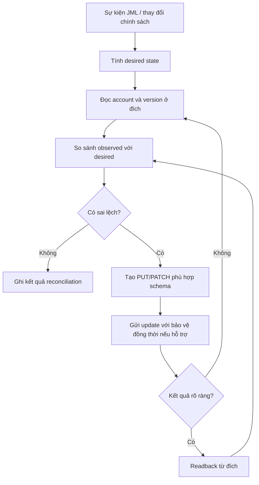

# Update operation trong SCIM provisioning

**Update operation** là thao tác cập nhật tài nguyên đã tồn tại trên hệ thống đích thông qua **System for Cross-domain Identity Management (SCIM)**. Trong SCIM 2.0, client có thể dùng **HTTP PUT** để gửi biểu diễn tài nguyên cập nhật hoặc **HTTP PATCH** để thay đổi có chọn lọc các thuộc tính. Đối tượng điển hình là `User` và `Group`, nhưng SCIM cũng cho phép mở rộng schema và loại tài nguyên theo khả năng triển khai.

Trong quản lý vòng đời danh tính **Identity and Access Management (IAM)**, update operation giúp đưa hệ thống đích về **trạng thái mong muốn** sau sự kiện **Joiner–Mover–Leaver (JML)**: sửa tên/bộ phận, thay đổi nhóm, cập nhật thông tin quản lý hoặc đặt `active=false` để vô hiệu hóa tài khoản khi Leaver. Tuy vậy, **SCIM update không phải thao tác đăng nhập SSO**, không mặc nhiên thu hồi mọi phiên/token và không tự bảo đảm quyền **RBAC/ABAC** ở ứng dụng đã thực sự đúng.

## 1. Vai trò của update trong SCIM

SCIM định nghĩa giao thức quản lý vòng đời tài nguyên qua HTTP và mô hình dữ liệu có schema. Trong một tích hợp điển hình, **SCIM client** là thành phần IAM/IdP/connector gửi yêu cầu; **SCIM service provider** là ứng dụng đích tiếp nhận, kiểm tra và cập nhật tài nguyên.

| Hoạt động | HTTP và URI minh họa | Mục tiêu |
| --- | --- | --- |
| Tạo người dùng | `POST /scim/v2/Users` | Provision một account mới |
| Đọc một người dùng | `GET /scim/v2/Users/{id}` | Quan sát trạng thái thực tế |
| Cập nhật toàn phần | `PUT /scim/v2/Users/{id}` | Thay đổi tài nguyên theo biểu diễn được gửi |
| Cập nhật một phần | `PATCH /scim/v2/Users/{id}` | Thêm, thay thế hoặc xóa thuộc tính được chỉ định |
| Xóa tài nguyên | `DELETE /scim/v2/Users/{id}` | Xóa theo hợp đồng của service provider |
| Cập nhật nhóm | `PATCH /scim/v2/Groups/{id}` | Thêm hoặc gỡ thành viên nhóm |

Các URI trên là ví dụ; base path thực tế phụ thuộc nhà cung cấp. Khi thiết kế cần phân biệt **SCIM resource ID** do service provider quản lý với **`externalId`** do client cấp để hỗ trợ liên kết. **Không dùng email làm khóa duy nhất** vì email có thể đổi hoặc được tái sử dụng.

## 2. PUT và PATCH: khác nhau ở mức độ thay đổi

| Tiêu chí | PUT | PATCH |
| --- | --- | --- |
| Ý định | Thay thế/cập nhật trạng thái tài nguyên qua một biểu diễn đầy đủ theo hợp đồng | Áp dụng các thay đổi được mô tả rõ |
| Body | Resource object theo schema SCIM | PatchOp với danh sách thao tác |
| Nguy cơ | Bỏ sót thuộc tính trong body có thể làm mất dữ liệu được phép ghi | Chọn sai `path` có thể sửa nhầm thuộc tính/phần tử |
| Phù hợp | Đồng bộ tập thuộc tính client quản lý khi hiểu rõ schema và quy tắc replace | Điều chỉnh `active`, `department`, nhóm hoặc phần tử đa trị cụ thể |
| Tính nhất quán | Nên phối hợp version/ETag khi được hỗ trợ | Tương tự; cần xử lý xung đột và đọc lại |
| Hỗ trợ | Phụ thuộc cấu hình resource type và provider | Phụ thuộc `patch.supported` và cách triển khai |

Với **PUT theo SCIM**, không nên áp dụng nguyên xi trực giác rằng mọi trường thiếu đều bị xóa. Hành vi của các thuộc tính còn chịu ràng buộc **mutability**, thuộc tính `readOnly`, giá trị mặc định, đặc tính provider và quy tắc giao thức. Trước khi thay tài nguyên, phải hiểu schema và hợp đồng tích hợp; không gửi PUT thiếu dữ liệu của ứng dụng nếu có nguy cơ ghi đè thuộc tính mà client không thực sự sở hữu.

**PATCH** thường phù hợp với cập nhật lifecycle có phạm vi hẹp. Dù vậy, các nhà cung cấp có thể chỉ hỗ trợ tập con của biểu thức `path` hoặc thao tác trên nhóm; cần đọc tài liệu và kiểm chứng kết quả.

## 3. Cấu trúc SCIM PATCH

Theo SCIM 2.0 (RFC 7644), một yêu cầu PATCH sử dụng media type `application/scim+json`, schema `PatchOp`, và trường `Operations` gồm một hoặc nhiều thao tác.

```http
PATCH /scim/v2/Users/2819c223-7f76-453a-919d-413861904646 HTTP/1.1
Authorization: Bearer <provisioning-access-token>
Content-Type: application/scim+json
Accept: application/scim+json

{
  "schemas": [
    "urn:ietf:params:scim:api:messages:2.0:PatchOp"
  ],
  "Operations": [
    {
      "op": "replace",
      "path": "active",
      "value": false
    }
  ]
}
```

**Chỉ là yêu cầu minh họa**, không dùng token thật trong ví dụ. Tài khoản trong body được cập nhật thông qua **resource ID trên URL**; `active=false` có ý nghĩa vô hiệu hóa theo trạng thái SCIM User khi được provider hỗ trợ và thực thi đúng. Nó **không bảo đảm tức thời** mọi session SSO, access token hoặc credential độc lập đều bị thu hồi.

Các thuộc tính của mỗi operation:

- `op`: loại thao tác, một trong `add`, `replace`, `remove`.
- `path`: đường dẫn thuộc tính hoặc bộ lọc phần tử đa trị; có thể được bỏ qua trong những trường hợp `add`/`replace` tác động trên tập thuộc tính của resource.
- `value`: giá trị dùng khi thêm hoặc thay thế; `remove` thường không cần `value`.

Tên operation không phân biệt hoa/thường theo quy tắc SCIM. Khi thao tác có nhiều operation, service provider phải áp dụng theo thứ tự và xử lý **nguyên tử** đối với yêu cầu PATCH: nếu một thao tác thất bại, không được để lại cập nhật một phần như thể toàn bộ yêu cầu thành công.

## 4. Ba thao tác: add, replace, remove

### 4.1. `add`: bổ sung thuộc tính hoặc giá trị

Ví dụ thêm một thành viên vào nhóm:

```json
{
  "schemas": ["urn:ietf:params:scim:api:messages:2.0:PatchOp"],
  "Operations": [
    {
      "op": "add",
      "path": "members",
      "value": [
        {"value": "user-782", "display": "Lan Nguyen"}
      ]
    }
  ]
}
```

Khi cập nhật **Group**, trường `members[].value` tham chiếu ID thành viên theo cách provider quản lý. Không nên tự giả định SCIM sẽ cập nhật ngay mọi role trong ứng dụng; một nhóm có thể chỉ là dữ liệu đầu vào để ứng dụng tính quyền.

Đối với thuộc tính đa trị, `add` phải tuân theo quy tắc SCIM về thêm phần tử và tránh trùng lặp theo cách provider kiểm soát. Client cần thử lặp yêu cầu trong môi trường kiểm thử để bảo đảm connector không tạo kết quả ngoài dự kiến khi retry.

### 4.2. `replace`: thay thế giá trị

Ví dụ sau **Mover**, IAM cập nhật department trong enterprise extension:

```json
{
  "schemas": ["urn:ietf:params:scim:api:messages:2.0:PatchOp"],
  "Operations": [
    {
      "op": "replace",
      "path": "urn:ietf:params:scim:schemas:extension:enterprise:2.0:User:department",
      "value": "Analytics"
    }
  ]
}
```

Đường dẫn extension phải dùng đúng URN và thuộc tính trong schema hỗ trợ. Nếu provider không khai báo enterprise extension hoặc không cho ghi `department`, không được suy rằng yêu cầu sẽ thành công. Với **attribute mutability**, thuộc tính `readOnly` không thể sửa tùy ý, còn thuộc tính `immutable` có ràng buộc riêng.

### 4.3. `remove`: gỡ giá trị hoặc phần tử

Ví dụ gỡ chính xác một user khỏi nhóm, dùng bộ lọc SCIM trong `path`:

```json
{
  "schemas": ["urn:ietf:params:scim:api:messages:2.0:PatchOp"],
  "Operations": [
    {
      "op": "remove",
      "path": "members[value eq \"user-782\"]"
    }
  ]
}
```

Ở một số hệ thống, khả năng xử lý **filtered path** còn hạn chế. Phải kiểm tra provider có hỗ trợ biểu thức này không và xác minh **user đã rời nhóm** sau thao tác. Không dùng `remove` trên cả `members` nếu mục tiêu chỉ là gỡ một thành viên: có thể làm mất quyền của tất cả thành viên trong nhóm.

## 5. Tình huống cập nhật nhiều thuộc tính

Một yêu cầu PATCH có thể gồm nhiều operation thực hiện tuần tự, ví dụ đổi bộ phận và trạng thái quản lý:

```json
{
  "schemas": ["urn:ietf:params:scim:api:messages:2.0:PatchOp"],
  "Operations": [
    {
      "op": "replace",
      "path": "urn:ietf:params:scim:schemas:extension:enterprise:2.0:User:department",
      "value": "Customer Success"
    },
    {
      "op": "replace",
      "path": "title",
      "value": "Support Specialist"
    }
  ]
}
```

**Không đồng nhất thao tác cập nhật thuộc tính với việc cấp hoặc gỡ role.** Ứng dụng có thể dùng nhóm SCIM, mapping role riêng hoặc **ABAC** đánh giá department. Vì vậy, sau PATCH cần kiểm chứng **trạng thái quyền hiệu lực**, không chỉ đọc lại trường `department`.

Nếu một operation trong yêu cầu không hợp lệ, service provider phải báo lỗi theo giao thức và không ghi thành công một phần các operation còn lại. Tuy vậy, nhiều yêu cầu HTTP PATCH độc lập trong một workflow **không tạo thành một giao dịch phân tán**; nếu cần tính nhất quán liên ứng dụng, IAM phải thiết kế bù trừ, retry và reconciliation.

## 6. Đọc capability và schema trước khi cập nhật

SCIM cung cấp các tài nguyên khám phá khả năng, bao gồm **ServiceProviderConfig**, **ResourceTypes** và **Schemas**.

| Cấu hình | Mục đích |
| --- | --- |
| `/ServiceProviderConfig` | Kiểm tra khả năng hỗ trợ PATCH, bulk, filter, etag và cấu hình liên quan |
| `/ResourceTypes` | Xác định loại tài nguyên `User`, `Group` và schema extension |
| `/Schemas` | Hiểu thuộc tính, kiểu dữ liệu, `mutability`, `returned`, `required` và các ràng buộc |
| Tài liệu provider | Xác định những giới hạn triển khai ngoài mô tả cơ bản |

Ví dụ một capability response có thể cho biết `patch.supported=true`, nhưng **không chứng minh** nhà cung cấp hỗ trợ mọi filtered path hoặc mọi extension. Client phải thử với tài nguyên kiểm thử và quản lý khác biệt phiên bản.

Đặc biệt, **`id`** là định danh do service provider cấp và không được sửa qua update; **`externalId`** là định danh do client cấp nhưng cần quản trị ánh xạ và tránh trùng. Các thuộc tính metadata như `meta.version` hoặc `meta.lastModified` do provider duy trì, không phải nơi client tự ghi lại để làm đẹp báo cáo.

## 7. Version, ETag và tránh ghi đè thay đổi đồng thời

Khi nhiều hệ thống cùng cập nhật một tài nguyên, có thể xảy ra **lost update**: client A đọc trạng thái cũ, client B thay đổi trước, client A ghi sau và vô tình xóa kết quả của B.

Một provider hỗ trợ versioning có thể cung cấp **ETag** qua header và/hoặc `meta.version`. Client có thể dùng điều kiện `If-Match` để cập nhật chỉ khi phiên bản còn khớp:

```http
PATCH /scim/v2/Users/user-782 HTTP/1.1
If-Match: W/"v17"
Content-Type: application/scim+json

{
  "schemas": ["urn:ietf:params:scim:api:messages:2.0:PatchOp"],
  "Operations": [
    {"op": "replace", "path": "title", "value": "Senior Analyst"}
  ]
}
```

ETag và `W/"v17"` chỉ minh họa. Hệ thống đích quyết định có hỗ trợ ETag/conditional update hay không, cùng định dạng giá trị và mã lỗi xung đột. Khi nhận **412 Precondition Failed**, client nên đọc lại tài nguyên, tính lại desired state và giải quyết xung đột thay vì lặp vô hạn cùng một yêu cầu cũ.

**PATCH không mặc nhiên loại bỏ mọi race condition.** Các update song song vẫn cần phối hợp quyền sở hữu thuộc tính, phiên bản và reconciliation.

## 8. Xử lý phản hồi, retry và lỗi

Một update thành công có thể trả **200 OK** cùng resource body hoặc **204 No Content**, tùy thao tác và quy tắc/triển khai giao thức. Client cần xử lý theo hợp đồng thay vì giả định luôn có body JSON.

| Mã/trạng thái | Ý nghĩa thường gặp | Cách xử lý |
| --- | --- | --- |
| `200` / `204` | Yêu cầu đã được chấp nhận/xử lý thành công | Readback theo yêu cầu kiểm chứng IAM |
| `400` | Dữ liệu hoặc biểu thức PATCH không hợp lệ | Kiểm tra path, schema, mutability và response SCIM error |
| `401` / `403` | Chưa xác thực hoặc thiếu quyền gọi SCIM API | Kiểm tra credential, scope, phân quyền connector |
| `404` | Resource ID không tồn tại hoặc không tìm được | Đối soát mapping, tránh tạo nhầm account |
| `409` | Xung đột theo quy tắc uniqueness/trạng thái | Xem mã lỗi chi tiết và xử lý dữ liệu |
| `412` | Điều kiện phiên bản không khớp | Đọc lại, tính lại thay đổi |
| `429` | Rate limit (nếu provider áp dụng) | Backoff theo hướng dẫn, không tạo bão retry |
| `5xx` / timeout | Lỗi hệ thống hoặc chưa rõ yêu cầu đã áp dụng chưa | Kiểm tra trạng thái trước khi retry |

Timeout có thể xảy ra **sau khi provider đã thực hiện cập nhật nhưng trước khi client nhận phản hồi**. Do đó retry phải được thiết kế an toàn theo tính idempotent của thao tác và trạng thái quan sát. Đặc biệt, một PATCH `add` trên thuộc tính đa trị nên được đối soát trước khi gửi lại.

Một quy trình đáng tin:



Luồng này cần giới hạn vòng lặp, phân loại lỗi không thể retry và cảnh báo khi quá thời hạn. Mỗi lần lặp phải có correlation ID và dấu vết giải thích **vì sao** tài nguyên được cập nhật.

## 9. Update operation trong Joiner–Mover–Leaver

### Joiner: hoàn thiện thông tin sau provisioning

Account đã được tạo có thể cần bổ sung `title`, `department`, `manager` hoặc nhóm sau khi dữ liệu HR/chính sách hoàn tất. Update operation cho phép đồng bộ các thuộc tính ấy mà không phải xóa rồi tạo lại user.

Lưu ý: **tạo tài khoản trước ngày bắt đầu không đồng nghĩa được phép đăng nhập trước ngày hiệu lực**. IAM phải phối hợp trạng thái `active` và quyền ứng dụng theo chính sách Joiner.

### Mover: sửa nhóm, chức danh và quyền

Ví dụ Hà chuyển từ Finance sang Analytics. IAM tính lại desired state: bỏ vai trò `invoice-approver`, thêm `analytics-reader`, thay `department`. Một PATCH vào User có thể cập nhật department, trong khi các PATCH khác trên Group cập nhật membership.

Nếu ứng dụng ERP còn quyền `invoice-approver` **gán trực tiếp tại giao diện nội bộ**, cập nhật SCIM Group chưa đủ. Phải đọc entitlement thực tế ở ERP và gỡ theo cơ chế do ứng dụng hỗ trợ.

**Mover không nên chỉ cộng quyền mới.** Cần ưu tiên phát hiện quyền cũ tồn dư và xác minh quyền mới đúng phạm vi dự án/dữ liệu theo RBAC/ABAC.

### Leaver: đặt trạng thái không hoạt động

Khi nhân viên nghỉ việc, một SCIM client có thể gửi PATCH `replace active=false` hoặc cập nhật tương ứng theo hợp đồng. Mục tiêu là ngăn tài khoản đích tiếp tục được dùng sau thời điểm chấm dứt.

Tuy nhiên cần phân biệt:

- **Account SCIM `active=false`**: trạng thái tài khoản theo mô hình SCIM; ý nghĩa enforcement thực tế phụ thuộc provider.
- **IdP disable**: thường ngăn đăng nhập mới qua IdP.
- **Ứng dụng session**: có thể tồn tại độc lập với trạng thái IdP hoặc SCIM.
- **Refresh/access token**: có chính sách thu hồi và hạn hiệu lực riêng.
- **Role, ACL, API key**: có thể cần deprovision hoặc revoke bằng API riêng.

**Không báo Leaver hoàn tất chỉ vì SCIM trả 200/204.** Phải đọc lại tài khoản tại đích và khi phù hợp kiểm tra người đã nghỉ không thể thực hiện hành động trái chính sách.

## 10. IdP, SSO và cập nhật SCIM không phải một thao tác

| Thành phần | Công việc | Không bảo đảm điều gì |
| --- | --- | --- |
| **IdP** | Xác thực, MFA, trạng thái đăng nhập | Không thay đổi mọi role cục bộ ở ứng dụng |
| **SSO/OIDC/SAML** | Cung cấp kết quả xác thực cho RP/SP | Không tạo/thu hồi tài khoản đích trong mọi trường hợp |
| **SCIM UPDATE** | Đồng bộ trạng thái user/group và thuộc tính | Không tự thu hồi mọi session/token |
| **RBAC/ABAC** | Quy định quyền thao tác và phạm vi dữ liệu | Không thay thế việc xác minh danh tính |
| **IAM/IGA** | Tính desired state, phê duyệt, đối soát và xử lý JML | Không có bằng chứng hoàn tất nếu chưa readback |

Ví dụ IdP gửi SCIM PATCH gỡ nhóm `finance`, nhưng CRM đã tạo cookie phiên với claim nhóm cũ. Nếu CRM sử dụng thông tin cache mà không kiểm tra thay đổi quyền, user vẫn có thể xem dữ liệu cũ trong một khoảng thời gian. Giải pháp phải phối hợp **update, kiểm tra quyền tại thời điểm truy cập và quản lý phiên**.

## 11. Quyền sở hữu thuộc tính và nguồn chân lý

Một cập nhật đúng cú pháp vẫn có thể sai nghiệp vụ. Ví dụ:
- HRIS có thẩm quyền với `department`, `manager` và tình trạng lao động.
- IAM/IGA tính role theo chính sách và những phê duyệt có thời hạn.
- Ứng dụng đích quản lý một số thuộc tính riêng như preference, cấu hình cục bộ hoặc quyền do data owner cấp.
- Workload catalog quản lý owner của service account, không phải HRIS cho mọi tài khoản phi con người.

Nếu SCIM client ghi đè thuộc tính do ứng dụng tự quản lý, người dùng có thể mất cấu hình hoặc quyền nghiệp vụ. Cần **attribute ownership matrix**: nguồn nào được sửa trường nào, tần suất đồng bộ, điều kiện ngoại lệ, và cách xử lý khi hai nguồn mâu thuẫn.

Không dùng `replace` trên một thuộc tính nhiều giá trị nếu ý định chỉ cập nhật một phần tử mà không hiểu tác động tới các giá trị còn lại.

## 12. Service account và workload identity

Một số ứng dụng cho phép quản lý account kỹ thuật qua SCIM, nhưng không nên mặc định mọi workload dùng schema User hoặc tuân theo logic HR. Những account này cần **owner, môi trường, ứng dụng sử dụng, quyền API, credential lifecycle và ngày hết hạn** riêng.

Khi chủ sở hữu nhân sự của workload chuyển vai trò hoặc nghỉ việc, IAM có thể cập nhật owner, nhóm quản trị hoặc entitlement của account kỹ thuật. **Không xóa ngay service account đang vận hành** chỉ vì người tạo account đã Leaver. Cần xác minh phụ thuộc, chuyển ownership, xoay bí mật có rủi ro và thu hồi quyền cá nhân liên quan.

SCIM PATCH không thay thế rotation của secret, private key hay token. Những thao tác credential phải dùng cơ chế chuyên biệt của nền tảng và lưu dấu vết kiểm toán phù hợp.

## 13. Bảo mật API SCIM update

SCIM API có thể thay đổi quyền truy cập trên diện rộng nên cần được xem là **API quản trị nhạy cảm**.

Các kiểm soát quan trọng:

1. Dùng **HTTPS/TLS** và xác thực client phù hợp, thường bằng token có scope và thời hạn giới hạn.
2. Phân quyền **least privilege** cho connector: không cho sửa mọi tài nguyên nếu chỉ được quản lý một tập account.
3. Kiểm tra **tenant isolation** và quyền sửa đúng resource, tránh client tenant A cập nhật user tenant B.
4. Không chấp nhận đường dẫn/attribute vượt schema hoặc bỏ qua ràng buộc mutability.
5. Áp dụng rate limiting, retry có backoff, theo dõi lỗi và dấu hiệu cập nhật hàng loạt bất thường.
6. Bảo vệ credential provisioning trong vault/secret manager; không đưa access token vào log/ticket.
7. Kiểm toán ai/connector nào cập nhật, resource nào, trước–sau, lý do JML và kết quả readback.
8. Với xóa hoặc gỡ quyền trên diện rộng, yêu cầu chính sách phê duyệt và khả năng phục hồi tương xứng.

**API SCIM không nên tin `userName` hoặc `externalId` từ client để bỏ qua kiểm tra quyền truy cập**. Provider phải xác định tài nguyên theo ID/path và kiểm tra scope quản trị của caller.

## 14. Checklist triển khai và kiểm thử

| Kiểm tra | Kết quả mong muốn |
| --- | --- |
| PATCH hỗ trợ theo ServiceProviderConfig | Client biết capability thực tế |
| PUT/PATCH tôn trọng schema và mutability | Không sửa `readOnly`/`id` |
| PATCH `replace active=false` | Account đích được vô hiệu hóa theo chính sách |
| PATCH đổi department | Thuộc tính đúng và phản ánh vào policy phù hợp |
| PATCH thêm/gỡ membership | Không ảnh hưởng thành viên khác |
| Nhiều operation, một operation lỗi | Không để lại cập nhật một phần |
| ETag/If-Match khi hỗ trợ | Không ghi đè thay đổi đồng thời |
| Timeout/retry | Không tạo quyền hoặc giá trị trùng ngoài dự kiến |
| Tenant và credential không hợp lệ | Bị từ chối, không rò dữ liệu |
| Leaver với phiên đã tồn tại | Không còn hành động trái quyền sau kiểm soát bổ sung |
| Đối soát sau Mover | Quyền cũ mất, quyền mới đúng phạm vi |

Một test quan trọng là gửi `remove members[value eq "..."]` cho **một** thành viên và xác minh các thành viên khác **không bị xóa**. Một test khác là thay đổi group trong SCIM rồi kiểm tra entitlement thật tại ứng dụng, bởi cập nhật thuộc tính nhóm có thể thành công nhưng mapping quyền ứng dụng vẫn lỗi.

## 15. Câu hỏi tự kiểm tra

**Tình huống A:** Cần đổi `department` của một người, còn các thuộc tính khác do ứng dụng tự quản lý. Nên cân nhắc PUT hay PATCH? **PATCH** thường phù hợp hơn vì giới hạn trường bị thay đổi, nhưng vẫn phải kiểm tra schema và provider hỗ trợ.

**Tình huống B:** Muốn gỡ một user khỏi Group, nhưng gửi `remove path=members`. Rủi ro là gì? **Có thể xóa toàn bộ membership**. Nên dùng đường dẫn lọc đúng phần tử khi được hỗ trợ và readback.

**Tình huống C:** PATCH `active=false` thành công, nhưng access token cũ vẫn gọi API được. Leaver hoàn tất chưa? **Chưa.** SCIM update không tự giải quyết token và phiên.

**Tình huống D:** Client nhận 412 sau khi dùng `If-Match`. Có nên retry ngay bằng cùng ETag? **Không.** Cần đọc lại resource và giải quyết xung đột/version.

**Tình huống E:** Client timeout khi thêm thành viên nhóm. Có nên gửi `add` lặp vô hạn? **Không.** Trước tiên kiểm tra trạng thái và áp dụng retry có giới hạn phù hợp.

## Ghi nhớ

**Update operation trong SCIM** cho phép IAM đồng bộ account và group đã tồn tại qua **PUT** hoặc **PATCH**; PATCH cung cấp ba thao tác **add, replace, remove** trên thuộc tính theo schema. Cập nhật an toàn đòi hỏi hiểu **mutability, resource ID, filtered path, ETag/version, retry, atomicity và readback**. Trong **Joiner–Mover–Leaver**, SCIM phối hợp **IdP/SSO, RBAC/ABAC, quản lý service identity và audit**, nhưng không tự thu hồi mọi phiên/token hoặc chứng minh quyền đích đã đúng nếu chưa đối soát.
