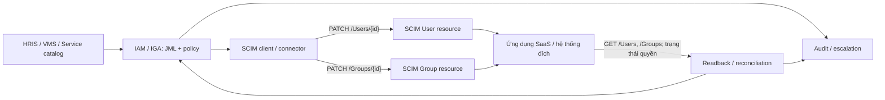
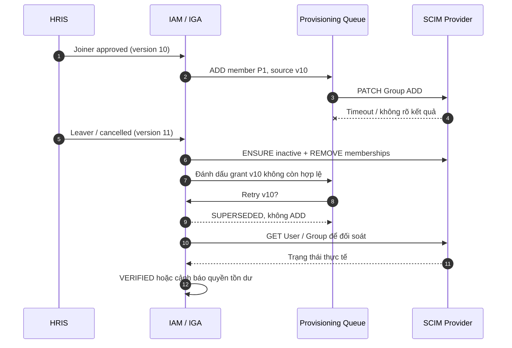

# Patch operation trong SCIM provisioning

## 1. Patch operation là gì?

**SCIM PATCH** là thao tác cập nhật **một phần tài nguyên** trong giao thức **System for Cross-domain Identity Management (SCIM) 2.0**. Thay vì gửi lại toàn bộ bản ghi người dùng hoặc nhóm, hệ thống quản lý danh tính có thể mô tả rõ **thuộc tính cần thêm, xóa hay thay thế**, rồi yêu cầu dịch vụ đích áp dụng thay đổi.

Trong IAM, hai tài nguyên SCIM thường gặp là:

- **`User`:** tài khoản, họ tên, email, trạng thái `active` và các thuộc tính người dùng theo schema.
- **`Group`:** nhóm và danh sách thành viên `members`, thường được ánh xạ tới quyền trong ứng dụng.

Ví dụ: một nhân viên rời tổ chức. IAM cần vô hiệu hóa tài khoản tại SaaS. Thay vì thay cả hồ sơ, client gửi một PATCH để đặt `active=false`. Khi người dùng chuyển dự án, client có thể PATCH một `Group` để gỡ đúng membership cũ, không xóa cả nhóm và không ảnh hưởng những thành viên khác.

**Căn cứ chuẩn:** SCIM 2.0 xác định mô hình tài nguyên trong **RFC 7643** và giao thức thao tác, trong đó có PATCH, trong **RFC 7644**. Khả năng hỗ trợ, ràng buộc schema và hành vi thực tế vẫn cần kiểm tra với từng SCIM service provider.

### 1.1. PATCH phục vụ việc gì trong JML?

| Giai đoạn | Sự kiện | Ví dụ dùng PATCH |
|---|---|---|
| **Joiner** | Nhân viên bắt đầu làm việc | Bổ sung thuộc tính, kích hoạt tài khoản, thêm user vào nhóm được duyệt |
| **Mover** | Đổi phòng ban, vai trò, dự án | Thay thuộc tính, gỡ nhóm cũ, thêm nhóm mới |
| **Leaver** | Nghỉ việc hoặc kết thúc hợp đồng | Đặt `active=false`, gỡ thành viên khỏi nhóm, thu hồi các entitlement do SCIM quản lý |
| **Reconciliation** | Trạng thái đích lệch chính sách | Sửa phần dữ liệu sai khác rồi đọc lại trạng thái |
| **Service account lifecycle** | Đổi owner hoặc kết thúc workload | Chỉnh các thuộc tính/nhóm được provider hỗ trợ, phối hợp vòng đời secret riêng |

**PATCH là công cụ thực thi một thay đổi dữ liệu, không phải chính sách quyết định ai được cấp quyền.** Chính sách IAM/IGA phải xác định **vì sao** thay đổi được phép trước khi connector gửi request.

## 2. SCIM client, service provider và tài nguyên

Một kiến trúc SCIM có thể bao gồm:

- **Nguồn nghiệp vụ:** HRIS/HCM, hệ thống hợp đồng, sponsor hoặc service catalog.
- **IAM/IGA:** giải quyết danh tính, áp dụng RBAC/ABAC, kiểm tra SoD, điều phối yêu cầu.
- **SCIM client / connector:** chuyển trạng thái mong muốn thành yêu cầu theo giao thức SCIM.
- **SCIM service provider:** dịch vụ đích cung cấp `/Users`, `/Groups` và các chức năng SCIM được hỗ trợ.
- **Ứng dụng:** sử dụng tài khoản/nhóm/role để cho phép hoặc từ chối truy cập thực tế.
- **Reconciliation:** đọc lại kết quả, phát hiện lỗi và quyền truy cập tồn dư.



Các ID trong URI là **ID tài nguyên tại provider**, không mặc nhiên là mã nhân sự hoặc email. Connector cần ánh xạ **identity ID từ IAM** đến **target user ID** và **target group ID** trong đúng tenant.

### 2.1. PATCH không thay thế SSO

- **SCIM PATCH**: cập nhật tài khoản và nhóm, tùy mức provider hỗ trợ.
- **IdP**: xác thực, MFA và chính sách phiên.
- **SSO/OIDC/SAML**: chuyển kết quả xác thực giữa IdP và ứng dụng.
- **RBAC/ABAC**: kiểm tra quyền dựa trên role, thuộc tính và ngữ cảnh.
- **Ứng dụng đích**: thực thi entitlement và quyền dữ liệu.

Một tài khoản được thêm vào nhóm bằng SCIM **không tự động có phiên đăng nhập**. Ngược lại, một người có phiên SSO hợp lệ không mặc nhiên được vào mọi nhóm ứng dụng.

## 3. PATCH khác POST, PUT và DELETE như thế nào?

| HTTP method | Tác dụng thường gặp trong SCIM | Ví dụ | Lưu ý |
|---|---|---|---|
| **POST** | Tạo tài nguyên mới trong collection | `POST /Users` | Timeout có thể đã tạo user; retry phải chống trùng |
| **GET** | Tra cứu tài nguyên hoặc danh sách | `GET /Groups/{id}` | Phục vụ readback và reconciliation |
| **PUT** | Thay thế/cập nhật tài nguyên theo hợp đồng SCIM | `PUT /Users/{id}` | Cần hiểu quy tắc giữ thuộc tính readOnly và dữ liệu không gửi |
| **PATCH** | Cập nhật một phần bằng các operation có chỉ định | `PATCH /Users/{id}` | Đặc biệt hữu ích cho thuộc tính và membership |
| **DELETE** | Xóa tài nguyên theo API provider | `DELETE /Users/{id}` | Không giống disable; phải xét lưu giữ dữ liệu |

**Remove membership qua PATCH không phải DELETE group.** Nếu một nhân viên Leaver, thường phải gỡ **người đó** khỏi nhóm, không gửi `DELETE /Groups/{id}` khiến tất cả thành viên khác bị ảnh hưởng.

### 3.1. Vì sao PATCH tiện cho provisioning?

Giả sử nhóm `finance-readers` có 800 thành viên. Để thêm một người, thay vì đọc toàn bộ nhóm rồi gửi lại cả danh sách qua PUT, client có thể gửi operation **add** đúng member. Cách này giảm dữ liệu phải truyền và giảm một số rủi ro ghi đè danh sách do thao tác đồng thời.

Tuy nhiên, **PATCH không tự động tránh mọi race condition**. Cần kiểm tra hỗ trợ version/ETag, ràng buộc thao tác theo tài khoản và đối soát sau thay đổi.

## 4. Cấu trúc một yêu cầu SCIM PATCH

Một request thường nhắm trực tiếp tới một tài nguyên đã biết:

```http
PATCH /scim/v2/Users/target-user-1042 HTTP/1.1
Host: scim.example.org
Authorization: Bearer <redacted-access-token>
Content-Type: application/scim+json
Accept: application/scim+json

{
  "schemas": [
    "urn:ietf:params:scim:api:messages:2.0:PatchOp"
  ],
  "Operations": [
    {
      "op": "replace",
      "path": "active",
      "value": false
    }
  ]
}
```

Trong đó:

| Trường | Ý nghĩa |
|---|---|
| `PATCH /Users/{id}` | Chỉ định tài nguyên User của provider cần cập nhật |
| `Authorization` | Chứng minh quyền gọi SCIM API theo cơ chế được cấu hình |
| `Content-Type: application/scim+json` | Media type của nội dung SCIM |
| `schemas` | Xác định thông điệp PATCH bằng URN `...:PatchOp` |
| `Operations` | Danh sách các operation phải xử lý theo thứ tự |
| `op` | Loại thao tác: `add`, `remove` hoặc `replace` |
| `path` | Đường dẫn chọn thuộc tính/giá trị; tính bắt buộc tùy operation |
| `value` | Giá trị mới hoặc tập thuộc tính cần thêm/thay, theo schema |

Ví dụ sử dụng token và hostname **giả**; không bao giờ đưa token thật vào tài liệu hoặc log.

### 4.1. Các yêu cầu nền tảng

- Gửi qua **HTTPS/TLS** với xác minh máy chủ và certificate hợp lệ.
- Dùng **ID đích đã được đối soát**, không ghép URI từ tên/email tự khai báo.
- Áp dụng quyền connector tối thiểu để chỉ sửa user/group được quản lý.
- Kiểm tra **khả năng PATCH** và schema của provider trước khi sử dụng.
- Phân biệt thao tác đã **được server nhận** với quyền đã **có hiệu lực** ở ứng dụng.

## 5. Ba operation cốt lõi: add, remove, replace

| Operation | Mục đích | Tình huống |
|---|---|---|
| **`add`** | Thêm thuộc tính hoặc giá trị vào tài nguyên theo schema | Thêm một thành viên nhóm, bổ sung email hoặc thuộc tính còn thiếu |
| **`remove`** | Gỡ thuộc tính hoặc giá trị được đường dẫn chỉ định | Gỡ user khỏi nhóm dự án khi Mover/Leaver |
| **`replace`** | Thay giá trị của thuộc tính/đường dẫn mục tiêu | Đặt `active=false` hoặc thay `department`, `name.familyName` |

Một PATCH có thể chứa **nhiều operation**. Thứ tự xử lý quan trọng, nhất là khi operation sau phụ thuộc kết quả operation trước.

### 5.1. Điều kiện mà schema đặt ra

Không phải thuộc tính nào cũng có thể tùy ý sửa:

- Thuộc tính **readOnly** không thể được thay đổi như trường mutable thông thường.
- Thuộc tính **immutable** có thể bị giới hạn thay đổi sau khi đã đặt.
- Thuộc tính **required** phải đáp ứng ràng buộc schema.
- Thuộc tính **single-valued** khác thuộc tính **multi-valued**.
- Giá trị phải đúng **kiểu dữ liệu và định dạng**.
- Extension thuộc tính có thể yêu cầu **schema URI** và quyền quản trị cụ thể.

Provider phải kiểm tra ràng buộc của mình. Client không nên giả định `PATCH` luôn có thể sửa mọi trường mà `GET` trả về.

## 6. Operation add: thêm thuộc tính hoặc giá trị

**`add`** được dùng để thêm giá trị theo mục tiêu được chỉ định. Trên thuộc tính nhiều giá trị, trường hợp điển hình là thêm phần tử vào collection.

### 6.1. Thêm một người vào Group

```http
PATCH /scim/v2/Groups/group-project-p1 HTTP/1.1
Host: scim.example.org
Authorization: Bearer <redacted-access-token>
Content-Type: application/scim+json

{
  "schemas": ["urn:ietf:params:scim:api:messages:2.0:PatchOp"],
  "Operations": [
    {
      "op": "add",
      "path": "members",
      "value": [
        {
          "value": "target-user-1042"
        }
      ]
    }
  ]
}
```

Ý nghĩa: thêm `target-user-1042` vào tập `members` của `group-project-p1`. Server cần bảo đảm đối tượng đích, ràng buộc kiểu và quyền của connector hợp lệ.

**Không xóa hoặc ghi đè danh sách thành viên hiện có** khi mục tiêu chỉ là thêm một người. Phải kiểm tra provider triển khai `members` và `add` đúng như hợp đồng đã công bố.

### 6.2. Add khi không chỉ rõ path

Một PATCH có thể biểu diễn nhiều thuộc tính trong `value` khi không cung cấp `path`, phù hợp quy tắc operation:

```json
{
  "schemas": ["urn:ietf:params:scim:api:messages:2.0:PatchOp"],
  "Operations": [
    {
      "op": "add",
      "value": {
        "nickName": "linh",
        "preferredLanguage": "vi-VN"
      }
    }
  ]
}
```

Ví dụ này chỉ mang tính minh họa. **Việc thuộc tính đã tồn tại và cách hợp nhất giá trị** phụ thuộc ngữ nghĩa `add`, loại thuộc tính và kiểm tra của provider; không tự dùng `add` để ghi đè những trường không được phép.

### 6.3. Trùng member hoặc giá trị

Khi retry một yêu cầu `add` sau timeout, có thể member **đã được thêm ở lần trước**. Client nên đọc lại group và so sánh **member ID** thay vì gửi thêm vô hạn. Các provider có thể chuẩn hóa hoặc xử lý trùng giá trị theo schema, nên kết quả an toàn nhất là **đối soát trạng thái cuối**.

## 7. Operation remove: gỡ chính xác giá trị

**`remove`** thường được dùng để gỡ một thuộc tính hoặc các phần tử được chọn bởi `path`. Đây là thao tác quan trọng trong **Mover và Leaver** vì nó hỗ trợ thu hồi membership.

### 7.1. Gỡ đúng một thành viên của Group

```http
PATCH /scim/v2/Groups/group-project-p1 HTTP/1.1
Host: scim.example.org
Authorization: Bearer <redacted-access-token>
Content-Type: application/scim+json

{
  "schemas": ["urn:ietf:params:scim:api:messages:2.0:PatchOp"],
  "Operations": [
    {
      "op": "remove",
      "path": "members[value eq \"target-user-1042\"]"
    }
  ]
}
```

Biểu thức `members[value eq "target-user-1042"]` chỉ định phần tử `members` có `value` khớp user ID đó.

**Không dùng `"path": "members"` khi mục tiêu chỉ là gỡ một người**: cách đó nhắm tới **toàn bộ thuộc tính membership**, có thể làm mất thành viên khác nếu server cho phép. Càng không gửi DELETE tới Group dùng chung.

### 7.2. Gỡ thuộc tính không còn cần

Ví dụ một thuộc tính tùy chọn:

```json
{
  "schemas": ["urn:ietf:params:scim:api:messages:2.0:PatchOp"],
  "Operations": [
    {
      "op": "remove",
      "path": "nickName"
    }
  ]
}
```

Trước khi thực hiện, client phải kiểm tra `nickName` thuộc schema được hỗ trợ và được phép xóa. Với trường bắt buộc, readOnly hoặc đường dẫn không phù hợp, server có thể trả lỗi.

### 7.3. Nếu phần tử đã không còn tồn tại?

Trong quy trình retry/reconciliation, việc **không thấy membership** có thể là **desired state đã đạt**. Nhưng `404` hoặc lỗi path không tự động chứng minh điều đó: có thể sai Group ID, tenant, user ID hoặc filter. Client phải phân biệt:

- Tài nguyên đích còn tồn tại và đúng đối tượng.
- Membership đích đã thực sự vắng mặt.
- SCIM provider có hỗ trợ bộ lọc `valuePath` tương ứng không.
- Một rule hoặc connector khác có thể **thêm lại** membership không.

Mục tiêu nghiệp vụ là **quyền được thu hồi**, không phải nhất thiết thu được một mã HTTP cụ thể.

## 8. Operation replace: thay thế giá trị

**`replace`** dùng để thiết lập giá trị mới cho đường dẫn được chỉ định. Trong JML, trường hợp phổ biến là thay trạng thái tài khoản hoặc thuộc tính nhân sự đã được phép đồng bộ.

### 8.1. Vô hiệu hóa tài khoản khi Leaver

```http
PATCH /scim/v2/Users/target-user-1042 HTTP/1.1
Host: scim.example.org
Authorization: Bearer <redacted-access-token>
Content-Type: application/scim+json

{
  "schemas": ["urn:ietf:params:scim:api:messages:2.0:PatchOp"],
  "Operations": [
    {
      "op": "replace",
      "path": "active",
      "value": false
    }
  ]
}
```

`active` là thuộc tính boolean của SCIM User. Trong nhiều tích hợp, đặt `active=false` biểu thị tài khoản không còn hoạt động. Tuy nhiên **ngữ nghĩa thực thi cụ thể phụ thuộc provider**: ứng dụng có thể còn phiên hoạt động, token độc lập hoặc role local.

**Không khẳng định Leaver đã hoàn tất chỉ từ PATCH `active=false` thành công**.

### 8.2. Thay một thuộc tính con

Đổi họ của user, nếu trường được quản lý và sửa:

```json
{
  "schemas": ["urn:ietf:params:scim:api:messages:2.0:PatchOp"],
  "Operations": [
    {
      "op": "replace",
      "path": "name.familyName",
      "value": "Nguyễn"
    }
  ]
}
```

Đường dẫn `name.familyName` chọn thuộc tính con của một **complex attribute**. Khi cập nhật danh tính, cần dùng nguồn có thẩm quyền cho trường đó, không cho dữ liệu tự khai báo vô cớ ghi đè hồ sơ nhân sự.

### 8.3. Thay giá trị trong phần tử nhiều giá trị

Ví dụ sửa email loại `work`:

```json
{
  "schemas": ["urn:ietf:params:scim:api:messages:2.0:PatchOp"],
  "Operations": [
    {
      "op": "replace",
      "path": "emails[type eq \"work\"].value",
      "value": "linh@new.example.org"
    }
  ]
}
```

Đây là dạng **valuePath** kết hợp **sub-attribute**. Chỉ dùng nếu schema/provider hỗ trợ kiểu biểu thức và tồn tại phần tử phù hợp. Thay email chưa chắc phải đổi ID tài khoản: nên liên kết danh tính bằng ID ổn định thay vì email.

### 8.4. Replace khi không có path

Một operation có thể truyền object chứa nhiều cặp thuộc tính–giá trị khi bỏ `path`:

```json
{
  "schemas": ["urn:ietf:params:scim:api:messages:2.0:PatchOp"],
  "Operations": [
    {
      "op": "replace",
      "value": {
        "active": false,
        "preferredLanguage": "vi-VN"
      }
    }
  ]
}
```

Không nên nhầm cách này với **PUT toàn bộ tài nguyên**. Đó vẫn là thao tác PATCH theo những trường được cung cấp, chịu ràng buộc schema và hành vi chuẩn. Với thay đổi nhạy cảm, **path tường minh** thường dễ kiểm tra tác động hơn.

## 9. Cú pháp path và valuePath

`path` cho biết **vùng dữ liệu cần tác động**. SCIM PATCH định nghĩa ngữ pháp đường dẫn riêng, không giống **JSONPath** và cũng không phải URL filesystem.

### 9.1. Các dạng thường gặp

| Dạng path | Ví dụ | Ý nghĩa |
|---|---|---|
| Attribute | `active` | Thuộc tính top-level |
| Complex sub-attribute | `name.familyName` | Trường con của thuộc tính phức hợp |
| Multi-valued attribute | `members` | Danh sách thành viên |
| Value filter | `members[value eq "target-user-1042"]` | Chọn member theo `value` |
| Value filter + sub-attribute | `emails[type eq "work"].value` | Chọn email work rồi cập nhật `value` |
| Extension-qualified path | `urn:...:extension:...:User:department` | Thuộc tính mở rộng có namespace đúng schema |

Những đường dẫn dùng `urn:...` ở đây là **khái niệm**, không phải chuỗi schema hoàn chỉnh. Khi thao tác extension thật, phải sử dụng **URI schema đã được provider công bố**.

### 9.2. Filter trong dấu ngoặc vuông

`members[value eq "target-user-1042"]` sử dụng phép so sánh `eq` trên sub-attribute `value`.

Cần phân biệt **SCIM PATCH path filter** với query parameter `filter` dùng tìm kiếm `GET /Users?filter=...`. Hai nơi dùng cú pháp liên quan nhưng **khác bối cảnh và mục tiêu**.

Không lấy một filter tùy ý do người dùng gửi rồi ghép trực tiếp vào path. Ứng dụng phải xác minh định danh, escape chuỗi theo quy tắc SCIM và JSON, cùng giới hạn những thuộc tính được phép chọn.

### 9.3. Hai lớp escaping

Trong request JSON, dấu ngoặc kép bên trong chuỗi path phải escape thành `\"`. Khi tạo path từ user ID có ký tự đặc biệt, còn phải dùng **escaping phù hợp với biểu thức SCIM filter** để tránh thay đổi ý nghĩa bộ lọc.

Do đó, nên dùng **SCIM SDK hoặc thư viện tạo filter/path** đã được kiểm tra, thay vì nối chuỗi từ thông tin người dùng tùy ý.

## 10. Một PATCH chứa nhiều operation: thứ tự và tính nguyên tử

Một thông điệp `Operations` có thể chứa **nhiều thao tác theo thứ tự xuất hiện**. Theo quy tắc SCIM PATCH, provider phải áp dụng các operation trong một PATCH theo **thứ tự đã đưa ra** và bảo đảm **tính nguyên tử của request**: nếu một operation lỗi, kết quả PATCH đó không được để lại một phần thay đổi như thể toàn bộ thành công.

Ví dụ cập nhật trạng thái và tên hiển thị trong cùng tài nguyên:

```json
{
  "schemas": ["urn:ietf:params:scim:api:messages:2.0:PatchOp"],
  "Operations": [
    {
      "op": "replace",
      "path": "active",
      "value": false
    },
    {
      "op": "replace",
      "path": "nickName",
      "value": "linh-archived"
    }
  ]
}
```

### 10.1. Giới hạn của tính nguyên tử

**Tính nguyên tử chỉ áp dụng trong phạm vi một yêu cầu PATCH tới một tài nguyên theo giao thức.** Nó **không** tạo giao dịch phân tán giữa:

- `PATCH /Users/{id}` và `PATCH /Groups/{id}`.
- SCIM provider A và SCIM provider B.
- Directory, IdP, SSO session và ứng dụng SaaS.
- API cập nhật nhóm và API thu hồi token riêng.

Ví dụ một Leaver có thể được disable tài khoản thành công nhưng gỡ group ở ứng dụng khác thất bại. Workflow phải ghi **partial success theo hệ thống**, retry và đối soát, không tự rollback bằng cách kích hoạt lại tài khoản đã khóa.

### 10.2. Đừng nhồi mọi việc vào một PATCH

Mỗi tài nguyên có ID/đường dẫn riêng. Không thể tạo một request PATCH duy nhất đến một User rồi kỳ vọng nó sửa đồng thời mọi Group và session/token ở các hệ thống khác nhau.

Hãy dùng một **bộ điều phối JML có trạng thái**, tạo nhiều thao tác có phụ thuộc rõ và kiểm tra từng kết quả.

## 11. Cách server phản hồi và xác minh kết quả

Một provider có thể trả **resource representation** khi thành công hoặc trả trạng thái thành công không có body, tùy hợp đồng giao thức và khả năng hỗ trợ.

Các tình huống thường cần phân biệt:

- `200 OK` với tài nguyên sau cập nhật.
- `204 No Content` nếu provider hỗ trợ phản hồi không body theo đặc tả và hành vi cấu hình.
- Một thao tác được chấp nhận nhưng việc **phân quyền trong ứng dụng** còn có độ trễ xử lý hoặc đồng bộ.
- Lỗi validation, authorization, version conflict hoặc giới hạn tốc độ.

**Không lấy HTTP `2xx` làm bằng chứng tuyệt đối rằng quyền đã đổi trong mọi phiên và mọi ứng dụng.** Cần kiểm tra trạng thái mục tiêu đúng cách.

### 11.1. Phân biệt ba cấp độ hoàn tất

| Trạng thái trong IAM | Điều đã biết | Điều chưa được chứng minh |
|---|---|---|
| `SENT` | Connector đã gửi yêu cầu | Provider đã áp dụng thay đổi |
| `APPLIED` | Provider xác nhận thao tác phù hợp hợp đồng | Quyền hiệu lực ở toàn ứng dụng/phiên đã cập nhật |
| `VERIFIED` | Đã đọc/kiểm tra lại trạng thái trong phạm vi kiểm soát | Những hệ thống ngoài phạm vi hoặc token không quan sát được cũng đã an toàn |

Hệ thống nên ghi rõ phạm vi kiểm chứng `VERIFIED`: ví dụ **SCIM group membership verified**, không đánh đồng với **all sessions revoked**.

## 12. Xử lý lỗi SCIM PATCH

Server có thể trả mã HTTP và **SCIM Error** với schema tương ứng, chẳng hạn URN `urn:ietf:params:scim:api:messages:2.0:Error`. Các trường lỗi có thể gồm `status`, `detail` và `scimType` theo tình huống.

Ví dụ minh họa:

```http
HTTP/1.1 400 Bad Request
Content-Type: application/scim+json

{
  "schemas": ["urn:ietf:params:scim:api:messages:2.0:Error"],
  "status": "400",
  "scimType": "invalidPath",
  "detail": "The requested PATCH path is not supported."
}
```

Đây là một **thông điệp ví dụ**, không phải đảm bảo provider sẽ trả `scimType` đúng như vậy trong mọi trường hợp.

### 12.1. Bảng xử lý lỗi

| HTTP hoặc dấu hiệu | Nguyên nhân có thể | Hướng xử lý |
|---|---|---|
| `400` / `invalidPath` | Path/filter sai hoặc provider không hỗ trợ | Kiểm tra cú pháp, schema và khả năng provider |
| `400` / `invalidValue` | Giá trị không hợp lệ với schema | Sửa dữ liệu nguồn hoặc mapping; không retry nguyên payload |
| `401` | Credential hết hạn hoặc xác thực API thất bại | Làm mới token an toàn; không lặp vô hạn |
| `403` | Connector không đủ quyền sửa tài nguyên | Điều tra authorization/scope, không bỏ kiểm soát |
| `404` | User/Group ID sai, tài nguyên đã xóa hoặc chưa xuất hiện | Đối soát target ID và trạng thái trước khi quyết định |
| `409` | Xung đột ràng buộc, uniqueness hoặc trạng thái | Truy vấn đích, xác minh chính xác chủ thể |
| `412` | Điều kiện phiên bản/`If-Match` không còn khớp | Đọc lại phiên bản và tính lại thay đổi |
| `429` | Vượt rate limit | Tôn trọng `Retry-After` nếu hợp lệ, dùng backoff+jitter |
| `500/502/503/504` | Lỗi đích tạm thời | Retry có giới hạn, kiểm tra kết quả chưa biết |
| Timeout / mất kết nối | Không rõ request đã áp dụng hay chưa | **Readback trước retry** nếu thao tác có tác dụng phụ |
| `2xx` nhưng quyền chưa đổi | App xử lý bất đồng bộ hoặc có role riêng | Reconcile quyền thực tế, không đánh dấu hoàn tất toàn phần |

Không nên retry mù một request `add` khi server đã thêm member nhưng phản hồi bị mất; cũng không bỏ qua một lỗi `403` bằng cách cấp cho connector quyền quản trị toàn tenant.

## 13. Concurrency control và ETag/If-Match

Hai worker IAM hoặc một quản trị viên ứng dụng có thể cùng sửa một tài nguyên. Nếu không kiểm soát cạnh tranh, thao tác dựa trên dữ liệu cũ có thể ghi đè cập nhật mới.

SCIM có thể cung cấp **version của resource** và hỗ trợ **ETag/If-Match** theo năng lực provider.

### 13.1. Ví dụ ý tưởng

1. Client đọc `GET /Groups/group-project-p1`.
2. Provider trả phiên bản trong `meta.version` hoặc ETag theo hợp đồng.
3. Client tính PATCH gỡ đúng một thành viên dựa trên trạng thái vừa đọc.
4. Client gửi `If-Match` với phiên bản mà provider cho phép sử dụng.
5. Nếu tài nguyên đã thay đổi và điều kiện không còn hợp lệ, provider có thể trả `412 Precondition Failed`.
6. Client **đọc lại** và tính lại diff, không lặp nguyên request không kiểm tra.

Ví dụ header **giả định**:

```http
PATCH /scim/v2/Groups/group-project-p1 HTTP/1.1
Host: scim.example.org
Authorization: Bearer <redacted-access-token>
Content-Type: application/scim+json
If-Match: "version-18"

{
  "schemas": ["urn:ietf:params:scim:api:messages:2.0:PatchOp"],
  "Operations": [
    {
      "op": "remove",
      "path": "members[value eq \"target-user-1042\"]"
    }
  ]
}
```

Giá trị ETag trong ví dụ chỉ minh họa; phải **dùng chính xác giá trị và cơ chế conditional request mà provider công bố**, có thể khác định dạng trong ví dụ.

### 13.2. Không chỉ dựa vào If-Match

Không phải mọi provider đều hỗ trợ versioning hoặc kiểm tra đồng thời như nhau. Cần kết hợp:

- Hàng đợi hoặc khóa theo `identity_id` / `target_account_id` nếu phù hợp.
- `source_version` của HRIS/IGA để ngăn tác vụ cũ chạy sau tác vụ mới.
- API version/ETag khi có.
- **Readback và reconciliation** sau thao tác.
- Cảnh báo khi cùng một membership bị add/remove liên tục do hai nguồn quản lý.

## 14. Idempotency và retry khi PATCH bị timeout

Trong hệ thống phân tán, một request có thể **đã áp dụng thành công nhưng client không nhận được phản hồi**. Điều này đặc biệt quan trọng với membership và sự kiện Leaver.

### 14.1. Desired-state thay vì “gửi lại cho đến khi 200”

Giả sử IAM muốn bảo đảm user không còn thuộc `project-p1-readers`:

1. Gửi PATCH `remove`.
2. Kết nối timeout.
3. Đọc lại `Group` và membership tại provider khi có thể.
4. Nếu user **đã không còn** trong nhóm, ghi trạng thái mục tiêu đạt.
5. Nếu vẫn còn, xác định lỗi tạm thời, version và chính sách trước khi retry.
6. Nếu group không truy cập được hoặc kết quả mơ hồ, giữ trạng thái `UNKNOWN/RETRY_PENDING` và cảnh báo theo rủi ro.

Đây là cách diễn đạt **ensure absent** hoặc **ensure present**, giúp retry an toàn hơn việc phát lại event một cách mù quáng.

### 14.2. Các thuộc tính có mức retry khác nhau

- `replace active=false` thường có **đích trạng thái rõ ràng**, dễ đối soát.
- `remove members[value eq "..."]` có thể idempotent ở mức **trạng thái mong muốn**, nhưng response khi phần tử đã vắng mặt có thể khác nhau tùy provider.
- `add members` cần tránh thành viên trùng, mapping sai và quyền được gán từ nhiều nguồn.
- `replace` một giá trị dựa trên nguồn cũ có thể trở nên **sai** nếu HRIS/IGA đã cập nhật phiên bản mới.
- Tạo credential/secret qua API khác không được coi là an toàn để retry chỉ vì quy trình SCIM có các thao tác cập nhật idempotent.

### 14.3. Backoff và ngân sách retry

Khi gặp `429` hoặc lỗi server tạm thời, retry nên sử dụng:

- Exponential backoff có **jitter**.
- Tôn trọng `Retry-After` nếu server cung cấp và giá trị phù hợp.
- Giới hạn lần thử/tổng thời gian.
- Cảnh báo khi quá deadline, nhất là với thu hồi Leaver.
- **Dead-letter/exception queue** có owner và khả năng xử lý lại sau khi khắc phục.
- Kiểm tra **desired state hiện hành** mỗi lần chuẩn bị phát lại.

## 15. Khả năng SCIM của provider: kiểm tra trước khi triển khai

SCIM có phần chuẩn và phần tính năng do từng provider công bố/hỗ trợ. Không được viết connector dựa trên giả định **mọi ứng dụng hỗ trợ PATCH đầy đủ**.

### 15.1. Các mục cần xác minh

| Hạng mục | Câu hỏi triển khai |
|---|---|
| **SCIM version** | Provider hỗ trợ SCIM 2.0 hay biến thể/vendor API? |
| **Patch support** | Endpoint có hỗ trợ PATCH không, và hỗ trợ `add/remove/replace` tới thuộc tính nào? |
| **Group support** | Có hỗ trợ `/Groups`, `members` và lọc theo member ID không? |
| **Schema discovery** | Có `/Schemas` và `/ResourceTypes`, extension nào được hỗ trợ? |
| **ServiceProviderConfig** | Provider công bố những chức năng như PATCH, filter, bulk, ETag ở mức nào? |
| **Versioning** | Có ETag và conditional update không? |
| **Readback** | Có thể `GET` lại User/Group và quan sát role thực tế không? |
| **Rate limit** | Có `429`, `Retry-After`, quota riêng theo tenant không? |
| **Asynchronous behavior** | Khi nào thay đổi thực sự tới ứng dụng và session? |
| **Permissions** | Token connector có được sửa nhóm, tài khoản và tenant mục tiêu không? |
| **Error behavior** | Lỗi path, conflict, noTarget và validation được trả theo hợp đồng nào? |

`ServiceProviderConfig` là nguồn thông tin discovery hữu ích nếu provider triển khai; cần kiểm tra **bằng chứng từ API hoặc tài liệu của đích**, không chỉ suy từ tên sản phẩm.

### 15.2. Nếu provider không hỗ trợ PATH phức tạp

Một số ứng dụng có thể hỗ trợ thay `active` nhưng không hỗ trợ valuePath như `members[value eq "..."]`. Khi đó:

- Không tự biến thao tác **remove one member** thành **replace toàn bộ group** nếu chưa đánh giá race và tính đúng.
- Sử dụng endpoint/chức năng mà provider chính thức hỗ trợ.
- Nếu cần đọc toàn bộ nhóm và cập nhật có điều kiện, phải có kiểm soát version/đồng thời thích hợp.
- Nếu không thể tự động an toàn, chuyển workflow có owner, SLA và xác minh sau khi xử lý.

## 16. PATCH cho Joiner: cấp quyền đúng thời điểm

Ví dụ nhân viên mới **An** có `worker_id=W-1042` và được phê duyệt tham gia dự án P1 từ ngày 01/12.

### 16.1. Các bước trước khi PATCH

1. HRIS xác nhận quan hệ và **ngày hiệu lực**.
2. Identity proofing liên kết đúng người với danh tính IAM.
3. IAM/IGA tính role và entitlement nền từ **RBAC/ABAC**.
4. Chủ sở hữu tài nguyên phê duyệt quyền bổ sung nếu cần.
5. SCIM connector tìm đúng **target user ID** và **group ID**.
6. Chỉ khi điều kiện có hiệu lực được đáp ứng mới gửi lệnh cấp group tương ứng.

### 16.2. Cấp group bằng add

Connector thực thi:

```json
{
  "schemas": ["urn:ietf:params:scim:api:messages:2.0:PatchOp"],
  "Operations": [
    {
      "op": "add",
      "path": "members",
      "value": [
        { "value": "target-user-1042" }
      ]
    }
  ]
}
```

Đích là `PATCH /Groups/group-project-p1`. Sau đó connector phải **đọc lại** membership và, nếu có khả năng, entitlement thực tế ở app P1.

### 16.3. Pre-provisioning không tự cấp quyền

Tài khoản có thể được tạo trước ngày bắt đầu, nhưng **cấp nhóm nghiệp vụ sớm** có thể cho người chưa có hiệu lực truy cập tài liệu. IAM cần tách **account exists** với **access enabled**, theo chính sách và ngày hiệu lực.

## 17. PATCH cho Mover: thêm quyền mới, thu hồi quyền cũ

Giả sử người dùng chuyển từ dự án P1 sang P2, và hai dự án dùng các Group khác nhau.

**Desired state** sau chuyển:

- Không còn trong `group-project-p1` nếu không có assignment hợp lệ khác.
- Thuộc `group-project-p2` nếu có phê duyệt và đã đến ngày hiệu lực.
- Giữ các quyền nền vẫn còn căn cứ.
- Không có xung đột SoD với các quyền tài chính/quản trị.

### 17.1. Hai PATCH trên hai tài nguyên

Đầu tiên, gỡ khỏi P1:

```json
{
  "schemas": ["urn:ietf:params:scim:api:messages:2.0:PatchOp"],
  "Operations": [
    {
      "op": "remove",
      "path": "members[value eq \"target-user-1042\"]"
    }
  ]
}
```

Gửi tới `PATCH /Groups/group-project-p1`.

Sau khi đã xử lý yêu cầu cấp quyền P2 theo policy:

```json
{
  "schemas": ["urn:ietf:params:scim:api:messages:2.0:PatchOp"],
  "Operations": [
    {
      "op": "add",
      "path": "members",
      "value": [{ "value": "target-user-1042" }]
    }
  ]
}
```

Gửi tới `PATCH /Groups/group-project-p2`.

**Đây là hai request riêng**, nên không có giao dịch nguyên tử chung. Phải theo dõi kết quả của từng nhóm, xử lý thứ tự theo SoD và xác minh quyền hiệu lực.

### 17.2. Quyền chồng lấn có thời hạn

Nếu nghiệp vụ cho phép giữ quyền P1 thêm hai ngày để bàn giao, cần có **ngoại lệ được phê duyệt, owner và thời hạn**. IAM không nên tự bỏ lệnh gỡ P1 vô hạn chỉ vì đã thêm được P2.

## 18. PATCH cho Leaver: disable và gỡ membership

Leaver là bối cảnh nhạy cảm vì quyền không còn hợp lệ phải được thu hồi theo SLA và rủi ro.

### 18.1. Một quy trình offboarding

1. Nhận sự kiện Leaver có thẩm quyền từ HRIS/VMS/sponsor.
2. Xác minh identity ID, nguồn, thời điểm hiệu lực và các quan hệ còn hoạt động.
3. **Disable IdP** hoặc chặn đăng nhập theo chính sách.
4. PATCH tài khoản SaaS `active=false` nếu provider hỗ trợ.
5. PATCH các nhóm để **gỡ membership** khi cần, không xóa nhóm dùng chung.
6. Thu hồi role gán trực tiếp, local account, PAT/API key và credential độc lập theo phạm vi.
7. Xử lý session và refresh/access token theo cơ chế hệ thống hỗ trợ.
8. Đọc lại trạng thái User/Group và entitlement ở từng đích.
9. Ghi `VERIFIED` hoặc ngoại lệ chưa xử lý theo từng ứng dụng.

### 18.2. Vấn đề token còn hiệu lực

**SCIM PATCH không phải giao thức thu hồi token.** Đặt `active=false` hoặc gỡ Group không tự sửa nội dung JWT đã phát hành, không tự hủy mọi session cookie của app hoặc OAuth refresh token.

Đối với quyền nhạy cảm, cần phối hợp IdP, SSO, token revocation, session termination, API gateway hoặc điểm kiểm tra quyền phù hợp. Không tuyên bố **“Leaver hoàn tất”** chỉ từ một PATCH thành công.

### 18.3. Khi có nhiều quan hệ

Nếu một người chấm dứt assignment P1 nhưng vẫn còn hợp đồng P2, không tự gửi `active=false` cho **tài khoản chung** khi tài khoản đó vẫn được phép tồn tại. Tính lại tập quyền theo **toàn bộ quan hệ hợp lệ** trước khi chọn action.

## 19. Chống stale event: không cấp lại quyền sau Leaver

Một lỗi phổ biến trong hệ thống có retry:

1. Joiner gửi PATCH `add member` cho P1 nhưng connector timeout.
2. HRIS phát sự kiện Leaver hoặc hủy gia nhập.
3. IAM disable tài khoản và gỡ quyền.
4. Worker cũ retry `add member` của Joiner.
5. User bị **cấp lại membership** sau khi quan hệ đã kết thúc.

Cách phòng ngừa:

- Gắn mỗi tác vụ với `identity_id`, `source_event_id`, `source_version` và `effective_at`.
- Đọc **trạng thái có thẩm quyền hiện hành** trước khi retry.
- Tính lại **desired groups** từ assignment còn hợp lệ.
- Đánh dấu job cũ `SUPERSEDED` nếu không còn nhu cầu.
- Không tin thứ tự queue là đủ khi các API đích xử lý bất đồng bộ.
- Sau Leaver, đối soát lần cuối để phát hiện membership được thêm lại.



## 20. Thuộc tính nhiều giá trị và nhóm lồng nhau

SCIM Group có trường `members` nhưng ứng dụng có thể còn các cách cấp quyền khác nhau.

### 20.1. Direct membership

`members` thường thể hiện thành viên trực tiếp của Group SCIM. PATCH xóa đúng `members[value eq "..."]` chỉ tác động một quan hệ cụ thể.

### 20.2. Nested/dynamic group

Tùy nền tảng, quyền có thể đến từ:

- Nhóm lồng nhau, trong đó Group là thành viên của Group khác.
- Nhóm động tính từ thuộc tính account.
- Mapping group từ IdP sang role SaaS.
- Role gán trực tiếp tại ứng dụng ngoài Group SCIM.
- Chính sách ABAC dựa trên department, project và tenant.
- Token/session chứa claim đã phát hành trước khi thay đổi.

Vì vậy **một PATCH gỡ membership không chắc gỡ được mọi đường cấp quyền**. Khi thiết kế Leaver hoặc Mover, reconciliation cần đối chiếu quyền hiệu lực theo khả năng của đích.

### 20.3. Cẩn thận với ownership của Group

Một group có thể do **SCIM client A** quản lý, còn ứng dụng giữ các thành viên hoặc role nội bộ từ nguồn khác. Không nên tự PATCH gỡ những membership không thuộc phạm vi quản trị nếu chính sách nguồn chưa xác nhận. Trường hợp tranh chấp ownership phải được xử lý qua governance.

## 21. Account linking, externalId và tránh nhầm người

SCIM User thường có `id` do provider quản lý và có thể có `externalId` do client dùng để liên kết đối tượng. Đây là các khái niệm khác nhau:

| Trường / ID | Ai cấp hoặc quản lý? | Mục đích |
|---|---|---|
| `worker_id` | HRIS/HCM | Định danh nghiệp vụ trong nguồn nhân sự |
| `identity_id` | IAM/IGA | Liên kết chủ thể và các account |
| `id` của SCIM User | Service provider | Định danh tài nguyên User tại đích |
| `externalId` | SCIM client theo hợp đồng mapping | Hỗ trợ đối chiếu tài nguyên từ bên quản lý |
| `userName` | Theo policy và schema provider | Tên tài khoản, có thể thay đổi hoặc tái sử dụng |
| Email | Nguồn hồ sơ phù hợp | Thuộc tính liên lạc, không phải ID bất biến |

**Không mặc định `externalId` được mọi provider bảo đảm duy nhất theo mọi tenant**, và không ghép user chỉ vì email trùng. Cần ràng buộc:

- Đúng tenant/environment.
- Đúng User ID/Group ID.
- Quan hệ account–identity có nguồn và lịch sử rõ ràng.
- Quy trình xử lý rehire, đổi email, chuyển pháp nhân và các account trùng.

Nếu không xác định chắc tài khoản đích, **không gửi PATCH có tác dụng thay quyền**.

## 22. Bảo mật khi vận hành SCIM PATCH

SCIM connector thường có quyền tạo, cập nhật hoặc disable nhiều user. Nếu bị chiếm, nó có thể gây cấp thừa quyền hoặc gián đoạn hàng loạt.

### 22.1. Bảo vệ kết nối và credential

- Bắt buộc HTTPS/TLS đúng cấu hình, xác minh certificate và hostname.
- Dùng OAuth bearer token, mTLS hoặc cơ chế đã được provider hỗ trợ và doanh nghiệp phê duyệt.
- Lưu secret tại secret manager; không đưa token vào source code, ticket, queue hoặc log.
- Giới hạn token theo **scope, tenant, quyền và tuổi thọ** thích hợp.
- Rà soát quyền connector định kỳ; không cấp role admin toàn bộ hệ thống khi chỉ cần sửa một tập user/group.

### 22.2. Chống thao tác nhầm đích

Trước mỗi PATCH cần kiểm tra:

1. **Nguồn nghiệp vụ có thẩm quyền** và thời điểm hiệu lực.
2. **Identity mapping** và target resource ID.
3. **Tenant** và URL đã được cho phép.
4. **Loại thao tác** có nằm trong danh mục được tự thực thi không.
5. **Phê duyệt** cấp quyền nhạy cảm và kiểm tra SoD.
6. **Version** của nguồn, policy và resource nếu có.
7. **Giới hạn thay đổi hàng loạt**, tránh một rule sai disable hàng nghìn tài khoản.

Không cho client tự cung cấp raw SCIM path tùy ý để thay một Group khác hoặc thuộc tính nhạy cảm. Cần bảo vệ chống **broken object-level authorization** tại lớp API.

### 22.3. Data minimization và audit

Chỉ đọc và thay những thuộc tính cần thiết. Không lưu token bearer, mật khẩu, secret hay hồ sơ HR nhạy cảm trong request log. Khi cần debug, dùng `operation_id`, ID được phép, code lỗi, policy version và kết quả đã redaction.

## 23. Sửa lệch tự động bằng PATCH và reconciliation

Trong **Account reconciliation**, IAM so sánh:

- **Desired state:** quyền/tài khoản được phép theo HRIS/IGA và các ngoại lệ còn hiệu lực.
- **Observed state:** giá trị User/Group/role thực tế tại SCIM provider và ứng dụng.
- **Drift:** khác biệt có ý nghĩa cần đánh giá.

Ví dụ:

```text
Desired:
  User active = false
  Membership project-p1-readers = absent

Observed:
  User active = true
  Membership project-p1-readers = present

Plan:
  PATCH /Users/{id} replace active -> false
  PATCH /Groups/{id} remove members[value eq "..."]
  GET /Users/{id}, GET /Groups/{id}
  Verify target state; review remaining tokens/roles separately
```

### 23.1. Không tự sửa mọi khác biệt

Một thuộc tính địa chỉ có thể khác do ứng dụng sở hữu bản địa; một role có thể là ngoại lệ đã duyệt; một account không có HR record có thể là service account. Vì vậy auto-remediation chỉ nên áp dụng khi:

- Source, ownership và account mapping chắc chắn.
- Có đủ phê duyệt.
- Policy cho phép action.
- Không làm thay đổi quyền của người khác.
- Có readback và khả năng xử lý lỗi.

### 23.2. Kiểm soát dao động

Nếu SCIM client A gỡ người dùng khỏi group trong khi connector B liên tục thêm lại, hệ thống sẽ **dao động**. Cần điều tra ownership, rule nhóm động, nguồn dữ liệu và thứ tự đồng bộ; không retry remove vô hạn.

## 24. Ví dụ xuyên suốt: nhân viên chuyển phòng rồi nghỉ việc

Giả sử **Linh** có `worker_id=W-1042` trong HRIS, `identity_id=I-1042` trong IAM và `id=target-user-1042` trong SaaS báo cáo.

### Giai đoạn A — Joiner

Ngày bắt đầu 01/12, Linh được duyệt sử dụng báo cáo của dự án P1. IAM:

1. Xác minh identity proofing và quan hệ hợp lệ.
2. Liên kết account SaaS đúng ID.
3. Kiểm tra RBAC/ABAC và phê duyệt role đọc P1.
4. Gửi PATCH `add` Linh vào `group-project-p1`.
5. Đọc lại group; ghi kết quả đã xác minh.

### Giai đoạn B — Mover

Linh chuyển sang dự án P2. HRIS cập nhật assignment và ngày hiệu lực. IAM tính rằng quyền P1 hết căn cứ, quyền P2 đã được phê duyệt.

- PATCH `remove` đúng Linh khỏi Group P1.
- PATCH `add` Linh vào Group P2.
- Kiểm tra SoD, giới hạn quyền chồng lấn theo thời hạn được duyệt nếu có.
- Đọc lại membership tại cả hai group; kiểm tra quyền local ứng dụng.

### Giai đoạn C — Leaver

Linh nghỉ việc. HRIS xác nhận thời điểm hiệu lực. IAM:

- Disable đăng nhập IdP theo chính sách.
- PATCH `active=false` tại SaaS.
- Gỡ membership Group P2 và các group còn gắn với quan hệ đã kết thúc.
- Xử lý phiên, token và credential độc lập bằng cơ chế riêng.
- Đối soát quyền hiệu lực ở các hệ thống.

Nếu PATCH Group P2 timeout, IAM **không mặc định đã thất bại**; nó kiểm tra lại Group. Nếu membership còn tồn tại, tạo retry có kiểm soát và cảnh báo. Nếu đã vắng mặt, có thể coi trạng thái mục tiêu ở Group P2 đã đạt.

### 24.1. Kết quả audit minh họa

```json
{
  "operation_id": "scim-leaver-I-1042-group-P2",
  "identity_id": "I-1042",
  "source_event_id": "hr-leaver-2026-0154",
  "source_version": 54,
  "target_system": "reports-saas",
  "target_tenant": "tenant-company",
  "resource_type": "Group",
  "resource_id": "group-project-p2",
  "operation": "REMOVE_MEMBER",
  "member_id": "target-user-1042",
  "state": "VERIFIED",
  "observed_member": false,
  "verified_at": "2026-12-15T09:45:00Z"
}
```

Bản ghi chỉ xác minh **Group membership**; audit của session/token và các hệ thống khác phải được theo dõi riêng.

## 25. Bảng kiểm soát triển khai cho ứng dụng đích

Trước khi bật SCIM PATCH tự động trong production, đội IAM có thể lập checklist:

| Hạng mục | Cần xác nhận |
|---|---|
| **API capability** | Provider hỗ trợ PATCH, Users, Groups, valuePath nào? |
| **Identity mapping** | Có target user/group ID và tenant đúng, không dựa email đơn lẻ? |
| **Schema** | Thuộc tính mutable, required, multi-valued và extension đã rõ? |
| **Permission** | Connector có quyền tối thiểu phù hợp? |
| **Data ownership** | Ai là source of truth cho từng thuộc tính/membership? |
| **JML events** | Có `effective_at`, source version và quy trình hủy sự kiện? |
| **Approvals** | Quyền đặc quyền/SoD cần duyệt trước khi add? |
| **Concurrency** | Có version/If-Match, xử lý `412` và race? |
| **Retry** | Có readback khi timeout, backoff, budget và escalation? |
| **Observability** | Có đọc lại User/Group và quyền hiệu lực ứng dụng? |
| **Session/token** | Có kênh thu hồi độc lập cho Leaver? |
| **Partial failures** | Mỗi đích có trạng thái VERIFIED/PENDING/FAILED riêng? |
| **Change safety** | Có dry-run, hạn mức batch và kill switch? |
| **Audit/privacy** | Log không chứa bearer token hoặc PII không cần thiết? |

## 26. Các tình huống kiểm thử quan trọng

| Tình huống | Kết quả mong đợi |
|---|---|
| `replace active=false` với User hợp lệ | Account chuyển sang trạng thái đích; readback đạt |
| `add members` vào Group đúng tenant | Chỉ thêm user được duyệt; không làm mất thành viên cũ |
| `remove members[value eq "..."]` | Chỉ gỡ đúng member; các thành viên khác giữ nguyên |
| Replace `name.familyName` | Thuộc tính được thay theo schema, những trường khác không bị sửa trái ý |
| Replace `emails[type eq "work"].value` | Đúng phần tử work được xử lý khi provider hỗ trợ |
| `remove "members"` ngoài ý định | Bị kiểm tra kế hoạch chặn do tác động cả nhóm |
| Thiếu `schemas` hoặc PatchOp URN không hợp lệ | Provider trả lỗi validation phù hợp |
| `op` không nằm trong add/remove/replace | Request bị từ chối |
| Path không hỗ trợ hoặc sai cú pháp | Không thay đổi tài nguyên ngoài dự kiến |
| Ghi vào thuộc tính readOnly/immutable sai policy | Thao tác bị từ chối theo schema |
| Nhiều operation, một operation lỗi | Request không để lại cập nhật nửa chừng theo tính nguyên tử SCIM |
| `If-Match` phiên bản cũ | Không ghi đè; client đọc lại và tính diff |
| SCIM Group không hỗ trợ PATCH/valuePath | Connector chuyển phương án hỗ trợ hoặc xử lý ngoại lệ |
| Timeout sau `add` nhưng user đã là member | Readback phát hiện và không tạo tác dụng phụ trùng |
| Timeout sau `remove` nhưng user đã vắng mặt | Readback xác nhận desired state đạt |
| `429` có `Retry-After` | Retry có giới hạn theo rate limit |
| `403` do connector thiếu quyền | Không retry vô hạn hoặc tăng đặc quyền tùy tiện |
| Sự kiện Joiner cũ retry sau Leaver | Không cấp lại group, job bị superseded |
| Mover có hai assignment hợp lệ | Chỉ gỡ những quyền không còn bất kỳ căn cứ nào |
| App còn role direct sau gỡ group | Không đánh dấu thu hồi mọi entitlement hoàn tất |
| `active=false` nhưng app session còn | Tiếp tục xử lý phiên/token theo policy và khả năng đích |
| `externalId` trùng hoặc email đổi | Không tự ghép nhầm user |
| Service account thiếu HR record | Kiểm tra service catalog/CMDB, không tự disable |
| Hai connector cùng quản lý group | Phát hiện dao động, ownership conflict |
| Log SCIM PATCH chứa bearer token | Redact và kiểm tra quyền truy cập log |
| Ứng dụng xử lý cập nhật bất đồng bộ | Chờ/truy vấn readback, không tuyên bố VERIFIED quá sớm |

## 27. Những hiểu lầm phổ biến

| Hiểu lầm | Cách hiểu đúng |
|---|---|
| “PATCH là sửa bất kỳ trường nào trong User” | Chỉ các trường/path được schema và provider cho phép |
| “PATCH giống PUT nhưng payload nhỏ hơn” | PATCH mang danh sách operation và ngữ nghĩa cập nhật từng phần |
| “`remove members` chỉ xóa một người” | Path `members` nhắm thuộc tính membership; phải dùng valuePath để chọn đúng người |
| “Có PATCH là mọi app đều hỗ trợ Group membership” | Phải kiểm tra capabilities riêng của provider |
| “Một PATCH nhiều operation đảm bảo mọi hệ thống cùng cập nhật” | Tính nguyên tử chỉ trong một request tới một tài nguyên |
| “Nhận HTTP 200 là token bị thu hồi” | SCIM không tự quản lý mọi session/token |
| “Add group là tự cấp quyền hợp lệ” | Phải có role mapping, approval, RBAC/ABAC và SoD |
| “Gỡ group ở SCIM là hết mọi quyền” | Còn role direct, nested/dynamic group hoặc session cũ |
| “Retry PATCH luôn an toàn” | Event có thể cũ, kết quả timeout chưa rõ, provider có hành vi riêng |
| “Email hoặc userName là khóa bất biến” | Phải dùng target ID và liên kết danh tính đáng tin |
| “`externalId` được mọi SaaS bảo đảm unique toàn cục” | Không mặc nhiên; phải xác định phạm vi/hợp đồng mapping |
| “Leaver chỉ cần `active=false`” | Còn IdP, SSO, phiên, token, credential và quyền ngoài SCIM |
| “PATCH sửa lỗi nguồn HRIS” | PATCH sửa trạng thái đích; nguồn có thẩm quyền phải được xử lý riêng |

## 28. Nguyên tắc cần ghi nhớ

**SCIM PATCH là cơ chế cập nhật một phần User/Group bằng các operation `add`, `remove` và `replace`**, đặc biệt hữu ích khi cần điều chỉnh thuộc tính và membership trong hệ thống IAM.

Để dùng đúng:

1. **Hiểu đúng mô hình:** PATCH sửa tài nguyên SCIM, không thay thế quyết định authorization, identity proofing, MFA hay SSO.
2. **Dùng đúng cú pháp:** `schemas` PatchOp, danh sách `Operations`, `op`, `path` và `value` theo schema.
3. **Chọn mục tiêu hẹp nhất:** khi gỡ một thành viên, dùng bộ lọc chọn member thay vì gỡ toàn bộ thuộc tính Group.
4. **Phân biệt add/remove/replace:** cập nhật giá trị theo ngữ nghĩa từng operation, không coi chúng hoán đổi được.
5. **Tôn trọng phạm vi nguyên tử:** nhiều operation trong một PATCH được áp dụng theo thứ tự và tính nguyên tử; các request và ứng dụng khác không cùng giao dịch.
6. **Kiểm tra provider:** hỗ trợ Users/Groups, PATCH, valuePath, ETag và đặc điểm schema có thể khác nhau.
7. **Bảo vệ concurrency và retry:** source version, If-Match khi hỗ trợ, idempotency và readback sau timeout.
8. **Áp dụng đúng JML:** Joiner cấp quyền đã duyệt; Mover vừa cấp vừa thu hồi; Leaver disable/gỡ quyền và kiểm tra token/phiên riêng.
9. **Không cấp lại quyền lỗi thời:** mọi retry phải xét desired state mới nhất, nhất là khi Leaver đã có hiệu lực.
10. **Giữ bảo mật connector:** TLS, quyền tối thiểu, tenant/account mapping, chống injection và log đã redaction.
11. **Xác minh quyền hiệu lực:** `GET` lại User/Group và đối soát role/local entitlement/session của ứng dụng.
12. **Ghi bằng chứng đầy đủ:** tách SENT/APPLIED/VERIFIED, theo dõi lỗi, exception và quyền truy cập tồn dư.

**Kết luận:** giá trị của SCIM PATCH nằm ở việc **thay đổi chính xác phần tài khoản hoặc nhóm cần thay đổi**, nhưng an toàn IAM chỉ đạt được khi thao tác đó xuất phát từ nguồn và chính sách hợp lệ, được bảo vệ trước lỗi đồng thời/retry, và **được xác minh ở trạng thái quyền thực tế** sau mỗi sự kiện Joiner–Mover–Leaver.
