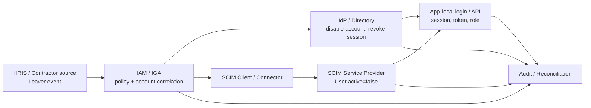
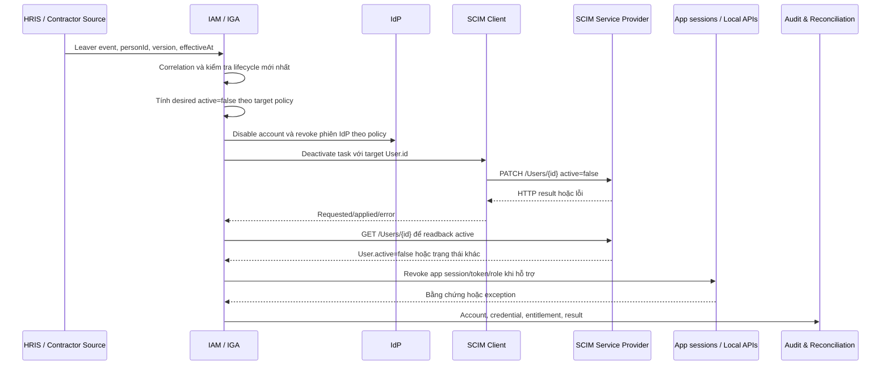
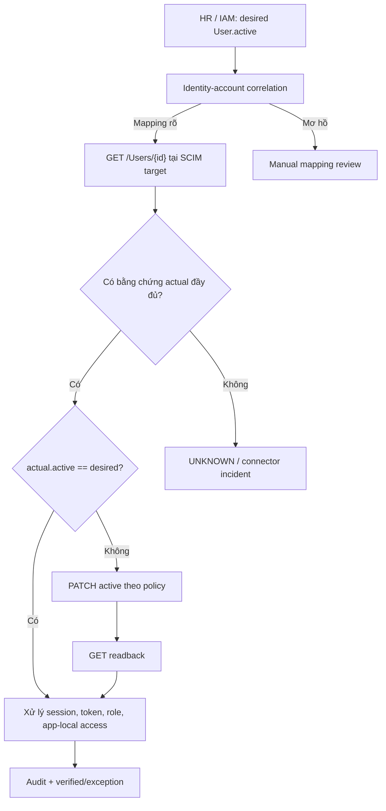

# Deactivate operation trong SCIM provisioning và vòng đời danh tính IAM

## Mục tiêu học tập

Sau bài này, người học có thể:

1. Giải thích **deactivate** trong SCIM provisioning và phân biệt việc vô hiệu account với **disable tại IdP**, thu hồi quyền, xóa resource, thu hồi token và chấm dứt session.
2. Hiểu chính xác rằng **SCIM 2.0 không định nghĩa một HTTP method tên `DEACTIVATE`**; hệ thống thường biểu diễn hành động này bằng cập nhật thuộc tính **`User.active=false`** qua `PATCH` hoặc `PUT` nếu service provider hỗ trợ.
3. Xây dựng yêu cầu SCIM hợp lệ, dùng đúng `User.id` tại đích, phân biệt `id`, `externalId`, `userName` và xác minh kết quả bằng **readback**.
4. Thiết kế workflow theo nguồn có thẩm quyền và thời điểm hiệu lực của mô hình **Joiner–Mover–Leaver (JML)**, ngăn sự kiện cũ vô tình kích hoạt lại account đã bị vô hiệu.
5. Xử lý lỗi connector, request lặp, cập nhật đồng thời, API bất đồng bộ, response không chắc chắn và giới hạn năng lực của SCIM server.
6. Phối hợp với IdP, SSO, OAuth/OIDC, SAML, RBAC/ABAC, PAM và hệ thống ứng dụng để giảm **residual access** sau Leaver.
7. Ghi audit, phân loại ngoại lệ, đo latency và đối soát trạng thái thực tế mà không tuyên bố hoàn tất khi mới gửi API request.

## 1. Deactivate trong SCIM provisioning là gì?

**SCIM (System for Cross-domain Identity Management)** là giao thức quản trị identity/resource giữa các domain hoặc nền tảng. Một mô hình phổ biến gồm **provisioning client** tại IdP/IAM/IGA và **SCIM service provider** ở ứng dụng SaaS hoặc hệ thống đích.

Trong quá trình **deprovisioning**, IAM có thể muốn account của một người **không còn được hoạt động tại ứng dụng**, nhưng vẫn giữ bản ghi cần thiết cho kiểm toán, chuyển giao tài sản số hoặc retention. Nhiều hệ thống hỗ trợ hành vi này bằng cách cập nhật **`User.active` thành `false`**.

**Điểm cốt lõi:** trong SCIM 2.0, `deactivate` là **ý định nghiệp vụ**, không phải một verb/method riêng của HTTP hay một SCIM operation được chuẩn hóa tên `Deactivate`. Có thể thực hiện cập nhật qua `PATCH` hoặc `PUT` đối với resource `User`, với điều kiện endpoint và thuộc tính được service provider hỗ trợ.

Ví dụ tình huống: HRIS xác nhận hợp đồng của Bình kết thúc lúc 18:00. IAM xác định `identityId`, tìm đúng SCIM User account của Bình trong ứng dụng CRM, yêu cầu `active=false`, đọc lại trạng thái và tiếp tục kiểm tra phiên CRM, token, role và quyền đăng nhập local. **Chỉ thành công về mặt cập nhật SCIM không bảo đảm mọi đường truy cập CRM đã chấm dứt.**

### 1.1. Vì sao không xóa ngay User?

Vô hiệu account có thể phù hợp khi tổ chức cần:

- Ngăn người đã nghỉ hoặc hết hạn hợp đồng tiếp tục truy cập.
- Giữ dấu vết ai từng sở hữu tài liệu, tạo yêu cầu hoặc phê duyệt giao dịch.
- Bảo toàn dữ liệu và audit theo retention/legal hold.
- Chuyển ownership tài nguyên sang người/nhóm có thẩm quyền.
- Đối soát quyền còn sót lại trước khi thực hiện các bước cleanup khác.
- Hỗ trợ vòng đời tái tuyển dụng theo chính sách, **không tự khôi phục quyền cũ**.

Một service provider có thể hỗ trợ deactivate, delete hoặc cả hai, với semantics cụ thể khác nhau. Không được suy đoán rằng `active=false` đồng nghĩa tài khoản đã bị xóa, dữ liệu đã được ẩn hoặc mọi phiên đã bị thu hồi.

### 1.2. Các thao tác dễ nhầm

| Khái niệm | Mục tiêu | Điều cần phân biệt |
|---|---|---|
| **Deactivate SCIM User** | Yêu cầu resource User không còn active ở đích | Thường là cập nhật `active=false`, semantics tùy sản phẩm |
| **Disable IdP account** | Chặn xác thực thông qua IdP | Không tự khóa local account của mọi SaaS |
| **Revoke app entitlement** | Gỡ group, role hoặc permission | Một User có thể còn active nhưng không có quyền ứng dụng |
| **Remove Group membership** | Loại User khỏi SCIM/IdP group | Không tự thu hồi direct role, token hoặc local session |
| **Delete SCIM User** | Xóa User resource bằng `DELETE` khi hỗ trợ | Có thể ảnh hưởng dữ liệu/ownership/retention |
| **Revoke token/session** | Chặn credential/phiên đã cấp | Cần cơ chế riêng của IdP, app hoặc API issuer |
| **Suspend theo chính sách** | Khóa tạm vì nghỉ phép hoặc sự cố | Có thể khác Leaver về hiệu lực và điều kiện kích hoạt lại |
| **Transfer ownership** | Chuyển dữ liệu/tài nguyên nghiệp vụ | Không được chuyển giao nguyên password/secret/token cũ |

**Deactivate không phải một từ đồng nghĩa với hoàn tất toàn bộ Leaver.** Nó là một thao tác quan trọng trên một account/resource tại một hệ thống đích.

## 2. Mô hình SCIM 2.0 liên quan đến deactivation

SCIM 2.0 được mô tả bởi hai tài liệu cơ bản:

- **RFC 7643 — SCIM Core Schema:** định nghĩa các resource như `User` và `Group`, cùng thuộc tính của chúng.
- **RFC 7644 — SCIM Protocol:** định nghĩa cách dùng HTTP để truy vấn, tạo, cập nhật, xóa resource, cũng như lọc, phân trang và các yêu cầu giao thức liên quan.

Một resource `User` có thể có các thuộc tính như `id`, `userName`, `name`, `emails`, `externalId`, `active` và metadata tùy việc hỗ trợ của service provider.

### 2.1. Ý nghĩa của `active`

`active` là thuộc tính Boolean biểu thị trạng thái quản trị của User. Trong thực tế, `active=false` thường được dùng để chỉ account đã bị vô hiệu hoặc không còn được phép truy cập. Tuy nhiên, **SCIM không bắt buộc mọi sản phẩm phải triển khai giống nhau cách biến trạng thái này thành chặn login, giới hạn session, thu hồi entitlement hay giữ dữ liệu**.

Cần xác minh với service provider:

1. Có hỗ trợ thuộc tính `active` và cho phép ghi không?
2. Khi đặt `false`, ứng dụng chặn phương thức xác thực nào: SSO, local login, API token?
3. Có hiệu lực ngay hay qua job bất đồng bộ?
4. Account disabled có giữ Group membership và role không?
5. Có giữ dữ liệu và ownership không?
6. Có API hoặc log để đọc lại status và xác minh quyền thực tế không?
7. Khi `active=true` trở lại, những credential/role cũ có thể hoạt động lại không?

Nếu hệ thống không hỗ trợ `active` hoặc không thực thi hành vi mong muốn, phải sử dụng connector/API/biện pháp thay thế được phê duyệt, không giả vờ rằng SCIM deactivate đã thành công.

### 2.2. Nhận diện đúng resource đích

| Thuộc tính | Vai trò | Lưu ý |
|---|---|---|
| `identityId` nội bộ | Định danh xuyên các hệ thống IAM | Không phải thuộc tính bắt buộc hoặc ID đường dẫn của SCIM server |
| `personId`/`contractorId` | Khóa nguồn HR/hợp đồng | Không tự dùng làm `User.id` |
| `User.id` | Định danh resource do SCIM service provider cấp | Dùng trong `/Users/{id}` tại chính đích đó |
| `externalId` | Định danh do provisioning client cung cấp để correlation | Phải biết nguồn, tenant và cách client gán |
| `userName` | Tên đăng nhập/định danh của resource User | Có thể đổi hoặc không đủ duy nhất giữa các tenant |
| `meta.version` | Metadata phiên bản resource nếu được đích hỗ trợ | Có thể dùng cùng `ETag/If-Match` khi hỗ trợ |
| `targetTenantId` | Phạm vi directory/ứng dụng | Không được bỏ qua khi mapping nhiều tenant |
| `accountPurpose` | Mục đích account như standard, admin | Một identity có thể có nhiều account |

**Không dùng email để tự suy ra ID resource đích.** Email có thể đổi, được tái sử dụng hoặc trùng giữa hệ thống. Một yêu cầu deactivate nhắm nhầm `User.id` có thể khóa tài khoản của người khác.

### 2.3. Ví dụ User resource

```json
{
  "schemas": [
    "urn:ietf:params:scim:schemas:core:2.0:User"
  ],
  "id": "scim-user-8021",
  "externalId": "IDN-2401",
  "userName": "binh@example.org",
  "name": {
    "givenName": "Binh",
    "familyName": "Tran"
  },
  "active": true,
  "meta": {
    "resourceType": "User",
    "version": "W/\"v12\""
  }
}
```

Dữ liệu trên là **minh họa**, không phải object thật hoặc contract bắt buộc của nhà cung cấp. `externalId` chỉ đáng tin cho correlation nếu provisioning client đã quản lý mapping đó nhất quán. `meta.version` là giá trị giả định và không phải mọi server đều hỗ trợ version.

## 3. Cách deactivate bằng SCIM PATCH

**PATCH** phù hợp khi muốn thay đổi một số thuộc tính của resource mà không cần gửi lại toàn bộ User. SCIM PATCH có media type `application/scim+json` và schema dành cho thông điệp PatchOp.

### 3.1. Yêu cầu cập nhật `active=false`

```http
PATCH /scim/v2/Users/scim-user-8021 HTTP/1.1
Host: provision.example.org
Authorization: Bearer <redacted>
Content-Type: application/scim+json
Accept: application/scim+json

{
  "schemas": [
    "urn:ietf:params:scim:api:messages:2.0:PatchOp"
  ],
  "Operations": [
    {
      "op": "replace",
      "path": "active",
      "value": false
    }
  ]
}
```

Ý nghĩa:

- `PATCH /Users/{id}` nhắm tới đúng User resource.
- `schemas` khai báo loại thông điệp SCIM PatchOp, **không phải schema User**.
- `Operations` chứa phép `replace` cho đường dẫn thuộc tính `active`.
- `false` phải là **Boolean JSON**, không phải chuỗi `"false"`.
- Credential trong `Authorization` phải được bảo vệ và giới hạn quyền; ví dụ dùng `<redacted>` để không đưa secret vào tài liệu.

Không có body `{"operation":"DEACTIVATE"}` được SCIM 2.0 định nghĩa sẵn cho mục đích này. Các API của nhà cung cấp có thể có extension riêng nhưng cần phân biệt với chuẩn chung.

### 3.2. Phản hồi API và readback

Nếu PATCH được hỗ trợ và xử lý thành công, service provider có thể trả resource đã cập nhật hoặc phản hồi thành công không có body theo giao thức/triển khai tương ứng. **Không được mặc định response 2xx là bằng chứng mọi quyền truy cập đã bị thu hồi**.

Ví dụ đọc lại:

```http
GET /scim/v2/Users/scim-user-8021 HTTP/1.1
Host: provision.example.org
Authorization: Bearer <redacted>
Accept: application/scim+json
```

Kết quả minh họa:

```json
{
  "schemas": [
    "urn:ietf:params:scim:schemas:core:2.0:User"
  ],
  "id": "scim-user-8021",
  "externalId": "IDN-2401",
  "userName": "binh@example.org",
  "active": false,
  "meta": {
    "resourceType": "User",
    "version": "W/\"v13\""
  }
}
```

**Đọc lại `active=false`** giúp xác nhận trạng thái resource. Để xác nhận **không còn truy cập thực tế**, vẫn cần kiểm tra app-local account/session/token hoặc quyền API theo kiến trúc ứng dụng.

### 3.3. Dùng `If-Match` khi cần kiểm soát cập nhật đồng thời

Nếu service provider hỗ trợ entity tag (ETag), connector có thể sử dụng cơ chế điều kiện để giảm nguy cơ ghi đè trạng thái từ một snapshot cũ:

```http
PATCH /scim/v2/Users/scim-user-8021 HTTP/1.1
Host: provision.example.org
Authorization: Bearer <redacted>
Content-Type: application/scim+json
If-Match: W/"v12"

{
  "schemas": [
    "urn:ietf:params:scim:api:messages:2.0:PatchOp"
  ],
  "Operations": [
    {
      "op": "replace",
      "path": "active",
      "value": false
    }
  ]
}
```

`If-Match` chỉ có tác dụng khi server hỗ trợ và thực thi kiểm tra phiên bản đúng. Nếu phiên bản không khớp, ứng dụng có thể từ chối request bằng **HTTP 412 Precondition Failed**. Khi đó nên đọc lại resource, kiểm tra nguồn lifecycle mới nhất rồi quyết định retry theo policy.

**Không tự bỏ `If-Match` để ép ghi thành công** khi có xung đột thực sự. Trước khi retry phải phân biệt thay đổi hợp lệ của hệ thống khác với sự kiện cũ đang cố ghi đè trạng thái mới.

## 4. Có thể deactivate bằng PUT không?

SCIM Protocol cũng hỗ trợ **PUT** để cập nhật resource. Tuy nhiên, **PUT có ngữ nghĩa thay thế resource** và cần cẩn trọng với các attribute chưa được đưa vào payload, schema bắt buộc, thuộc tính chỉ đọc, extension và ngữ nghĩa của service provider.

Ví dụ cấu trúc minh họa (không được gửi ngay vào production):

```http
PUT /scim/v2/Users/scim-user-8021 HTTP/1.1
Host: provision.example.org
Authorization: Bearer <redacted>
Content-Type: application/scim+json
If-Match: W/"v12"

{
  "schemas": [
    "urn:ietf:params:scim:schemas:core:2.0:User"
  ],
  "id": "scim-user-8021",
  "userName": "binh@example.org",
  "active": false,
  "name": {
    "givenName": "Binh",
    "familyName": "Tran"
  }
}
```

**Cảnh báo:** payload trên chỉ để minh họa định dạng. Trong triển khai thật, không tự gửi một resource rút gọn bằng PUT nếu chưa hiểu các thuộc tính khác (email, phone, extension, role, enterprise schema) sẽ được giữ, thay hoặc xóa thế nào. Cần lấy resource hiện tại, giữ các trường phải bảo toàn và tuân thủ schema/mutability của đích.

| Tiêu chí | PATCH | PUT |
|---|---|---|
| Phạm vi thay đổi | Chỉ đường dẫn/thuộc tính được chỉ định | Thay thế/cập nhật resource theo semantics của PUT |
| Với deactivate | Thường rõ ràng: thay `active` | Cần giữ các thuộc tính khác đúng yêu cầu |
| Nguy cơ ghi đè trường không liên quan | Thấp hơn nếu implementation đúng | Cao hơn nếu gửi resource thiếu dữ liệu |
| Hỗ trợ | Phải kiểm tra SCIM service provider | Phải kiểm tra SCIM service provider |
| Concurrency | Có thể kết hợp `If-Match` nếu hỗ trợ | Có thể kết hợp `If-Match` nếu hỗ trợ |
| Readback | Luôn quan trọng | Luôn quan trọng |

**Ưu tiên PATCH để sửa một thuộc tính nếu service provider hỗ trợ đúng.** Không chuyển từ PATCH lỗi sang PUT mù chỉ nhằm đạt phản hồi 2xx.

## 5. Deactivate, Delete và Remove Membership khác nhau

### 5.1. `active=false` không phải DELETE

```http
DELETE /scim/v2/Users/scim-user-8021 HTTP/1.1
Host: provision.example.org
Authorization: Bearer <redacted>
```

Đây là ví dụ **DELETE User resource**, không phải phương thức deactivate. Nếu ứng dụng xử lý DELETE bằng xóa cứng, xóa mềm hoặc quy tắc sản phẩm riêng, tác động lên dữ liệu và lịch sử có thể lớn hơn nhiều.

Một chính sách Leaver có thể quy định:

1. Disable account để chặn truy cập đúng mốc.
2. Thu hồi session, credential và quyền độc lập.
3. Bàn giao dữ liệu/tài nguyên nghiệp vụ hợp lệ.
4. Thực hiện retention/legal hold.
5. Xóa/ẩn danh resource sau thời hạn hoặc sự kiện được phê duyệt, nếu cần.

Không dùng DELETE thay cho deactivate khi chưa được owner dữ liệu, ứng dụng và chính sách retention cho phép.

### 5.2. Group membership có thể còn sau deactivate

Một `User.active=false` có thể vẫn là member của các Group tại ứng dụng. Điều đó có thể hợp lệ nếu app giữ membership để audit, **nhưng rủi ro xuất hiện khi account được re-enable**.

Ví dụ:

```text
User: scim-user-8021
active: false

Group memberships còn được lưu:
  - finance-readers
  - expense-approvers
  - legacy-report-exporters
```

Nếu rehire workflow đổi lại `active=true` mà không đánh giá nhóm, những role nhạy cảm có thể hoạt động trở lại. Do đó IAM phải có chính sách riêng về **gỡ group/role/entitlement khi Leaver và recertification trước khi khôi phục**.

### 5.3. Phân biệt direct và inherited access

Một account có thể nhận quyền từ:

- SCIM `Group.members`;
- group đồng bộ từ IdP/directory;
- role được gán trực tiếp tại ứng dụng;
- ACL cho tài nguyên hoặc dự án cụ thể;
- nhóm lồng nhau nếu app hỗ trợ;
- personal API token hoặc service credential;
- local/admin account riêng với ID khác.

Không được xem danh sách `Group.members` là danh mục đầy đủ của mọi quyền. **Deprovisioning cần kiểm tra effective access** tại từng lớp liên quan.

## 6. Deactivate trong kiến trúc IdP, SSO và SCIM

IdP thường chịu trách nhiệm xác thực; SCIM client đồng bộ trạng thái account đến ứng dụng; SP/RP hoặc ứng dụng đích quyết định thực thi quyền.



### 6.1. Disable IdP account không tự deactivate mọi app User

Một tổ chức có thể vô hiệu account ở IdP, nhưng ứng dụng SaaS vẫn giữ `User.active=true` vì:

- Connector SCIM chưa chạy hoặc thất bại.
- Chỉ dùng SAML/OIDC SSO mà không có SCIM.
- App có local login độc lập.
- Mapping `identityId → User.id` bị sai.
- Một tenant chưa được tích hợp.
- App không dùng trạng thái IdP để chặn session đã tạo.

Vì thế, một Leaver workflow thường phải **disable IdP và deactivation ở ứng dụng đích**, cùng những đường truy cập ngoài hai hệ thống đó.

### 6.2. Deactivate SCIM User không tự vô hiệu mọi token/session

Một ứng dụng có thể vẫn chấp nhận:

- Cookie phiên ứng dụng tạo trước khi `active` đổi.
- Access token tự xác minh bằng chữ ký đến khi `exp`.
- Refresh token nếu issuer chưa revoke.
- Personal access token độc lập với User.active.
- Tài khoản local hoặc account đặc quyền riêng.
- Credential hoặc API key được lưu ở dịch vụ khác.

Nếu ứng dụng kiểm tra `active` trực tiếp trong mỗi request thì tác động có thể nhanh hơn. Nếu chỉ kiểm tra khi login, session cũ có thể tiếp tục cho truy cập. **Hành vi phải kiểm chứng dựa trên ứng dụng thực tế**, không suy từ SCIM response.

### 6.3. SSO không phải SCIM

| Thành phần | Nhiệm vụ | Không tự bảo đảm |
|---|---|---|
| **IdP** | Xác thực và quản lý credential/session tại IdP | Account SaaS đã deactivate |
| **SAML/OIDC SSO** | Truyền kết quả xác thực tới SP/RP | Xóa app-local session, gỡ entitlement |
| **SCIM** | Tạo/cập nhật User và Group ở đích | Authentication, MFA recovery, token revocation |
| **RBAC/ABAC** | Quyết định quyền thực tế theo role/attribute/context | Provisioning/disable User đã thành công |
| **PAM** | Quản trị quyền/session đặc biệt | Account thường bao phủ mọi account admin |
| **App-local API** | Quản lý token, role, session và dữ liệu riêng | Tự đồng bộ về IAM nếu không tích hợp |

### 6.4. Revoke theo rủi ro, không chờ timeout tự nhiên khi cần gấp

Nếu policy yêu cầu thu hồi nhanh, không thể chỉ gửi `active=false` rồi đợi mọi token hết hạn. Có thể cần ứng dụng hỗ trợ session revocation, token introspection, denylist, logout liên thông hoặc kiểm tra lifecycle/authorization gần thời điểm request.

Không phải mọi ứng dụng hỗ trợ những cơ chế này. Với hệ thống không thể revoke tức thì, cần **ngoại lệ, giới hạn cửa sổ tồn dư, monitoring và biện pháp thay thế** được owner phê duyệt.

## 7. Sự kiện JML làm nguồn kích hoạt deactivation

### 7.1. Joiner

Trong Joiner, IAM có thể pre-provision User với `active=false` để chuẩn bị dữ liệu trước ngày người mới có quyền sử dụng. Đến mốc bắt đầu, account chỉ được kích hoạt nếu nguồn nhân sự, identity proofing và approval hợp lệ.

**Không tự biến account pre-provisioned thành active chỉ vì User đã tồn tại.**

### 7.2. Mover

Khi người dùng chuyển vai trò, không phải lúc nào cũng deactivate toàn bộ account. Thường cần tính lại role/group/entitlement:

- Gỡ quyền ứng dụng không còn phù hợp.
- Có thể deactivate một **account chuyên biệt** không còn nhu cầu.
- Giữ account cơ sở của người vẫn đang active.
- Không xóa dữ liệu hoặc credential chung nếu gây gián đoạn workflow khác.
- Đối soát quyền cũ trong app-local role và session.

Ví dụ Lan chuyển từ Sales sang Finance: account CRM có thể bị deactivate nếu không còn dùng; account HR Portal vẫn active. Vì vậy quyết định phải ở mức **identity × target account × mục đích**, không chỉ “người đổi phòng ban → active=false mọi nơi”.

### 7.3. Leaver

Leaver là sự kiện trọng tâm cho deactivation. HRIS hoặc nguồn quản lý nhà thầu gửi event có thời điểm hiệu lực; IAM phải:

1. Kiểm tra nguồn có thẩm quyền, identity correlation và version.
2. Xác định toàn bộ account cần xử lý, kể cả app-local và privileged account.
3. Tính desired state cho từng ứng dụng.
4. Disable IdP và dùng SCIM/connector để deactivate User ở đích.
5. Thu hồi Group/role, token/session/credential theo policy.
6. Readback từ các hệ thống đích, quản lý ngoại lệ.
7. Bàn giao dữ liệu và retention theo quy trình riêng.

**Không phụ thuộc vào việc người nghỉ đã trả thiết bị vật lý** mới deactivate account nếu mốc cắt quyền đã có hiệu lực.

### 7.4. Nhà thầu và guest

Nhà thầu có thể hết hợp đồng nhưng chưa có hồ sơ trong HRIS nhân viên. Nguồn có thẩm quyền có thể là contractor management system hoặc sponsor. Quy trình phải kiểm tra expiry và scope thật, không giữ account active chỉ vì bản ghi HR trống.

Guest được mời qua B2B hoặc identity federation có thể cần quy trình revoke riêng; không tự coi `active=false` tại một User resource là đã vô hiệu tài khoản ở IdP của đối tác.

### 7.5. Rehire

Khi một người quay lại tổ chức, cần xác minh:

- Có phải cùng identity theo policy và bằng chứng không?
- Account cũ đang disabled hay đã xóa?
- Có session/token/credential cũ còn tồn tại không?
- Role và Group còn lưu có phù hợp vị trí mới không?
- Identity proofing/MFA và ngày hiệu lực đã đáp ứng chưa?

**Không tự gửi `active=true` dựa vào email hoặc event Joiner cũ mà chưa xét policy hiện tại.** Rehire là một workflow cấp quyền mới, không phải undo mù thao tác deactivate.

## 8. Ví dụ event và desired state của Leaver

Ví dụ nguồn HRIS:

```json
{
  "sourceSystem": "HRIS",
  "eventId": "HR-LEAVER-9421",
  "eventType": "LEAVER",
  "personId": "HR-4102",
  "sourceVersion": 72,
  "effectiveAt": "2026-12-15T17:00:00+07:00",
  "employmentStatus": "TERMINATED"
}
```

Đây là **event nghiệp vụ minh họa**, không phải schema chuẩn SCIM. HR gửi thông tin quan hệ nhân sự; IAM tính account mục tiêu theo policy.

Bản ghi điều phối:

```json
{
  "identityId": "IDN-2401",
  "sourcePersonId": "HR-4102",
  "targetSystem": "CRM_SAAS",
  "targetTenant": "corp-vn",
  "targetScimUserId": "scim-user-8021",
  "desiredActive": false,
  "effectiveAt": "2026-12-15T17:00:00+07:00",
  "sourceEventId": "HR-LEAVER-9421",
  "sourceVersion": 72,
  "policyVersion": "jml-scim-deactivate-v4",
  "executionState": "READY_TO_APPLY"
}
```

`targetScimUserId` phải đến từ mapping đã được xác minh hoặc discovery/correlation đáng tin. Một trường trạng thái nội bộ `READY_TO_APPLY` **không phải SCIM field**.

### 8.1. Không đồng nhất thời điểm event và thời điểm hiệu lực

Một Leaver event có thể được gửi ngày 01/12 nhưng có hiệu lực ngày 15/12. IAM có thể chuẩn bị account inventory và kiểm tra connector trước; việc deactivate account tương tác phải theo **mốc được chính sách phê duyệt**.

Trường hợp chấm dứt khẩn cấp có thể yêu cầu thu hồi ngay. Nếu ngày kết thúc thay đổi, workflow phải nhận version mới nhất thay vì áp lệnh cũ không còn đúng.

### 8.2. Trạng thái account có thể độc lập với sự tồn tại resource

Một User `active=false` vẫn có thể được truy vấn trong SCIM và vẫn giữ `id`, `userName`, metadata, dữ liệu cần retention. Vì vậy:

```text
Resource exists: true
SCIM User.active: false
IdP account state: disabled
Application access: cần kiểm chứng riêng
Session/token revocation: cần kiểm chứng riêng
Business data retention: chính sách riêng
```

Một hệ thống kiểm kê chỉ tìm User active có thể **không thấy User disabled và báo nhầm "missing account"**. Khi reconcile, cần hiểu bộ lọc và dữ liệu thực.

## 9. Thiết kế workflow deactivate end-to-end



Trình tự thật có thể chạy song song để đáp ứng thời hạn thu hồi; sơ đồ chỉ là luồng logic.

### 9.1. Các bước triển khai

1. **Nhận event có thẩm quyền:** xác thực nguồn, xử lý event ID, version, effective timestamp và loại nhân sự.
2. **Correlation:** xác nhận HR person/source ID → identity ID → target User.id trong đúng tenant.
3. **Đọc actual state:** kiểm tra User tồn tại, trạng thái active, metadata phiên bản và khả năng API.
4. **Tính desired state:** xác nhận account còn cần active hay phải disabled; tránh dùng trạng thái cũ.
5. **Thực thi có kiểm soát:** PATCH `active=false` (hoặc phương thức được hỗ trợ đúng).
6. **Đọc lại:** dùng GET/API đích, có kiểm tra snapshot freshness và eventual consistency.
7. **Xử lý các đường truy cập khác:** session, refresh/access token, local auth, group, privileged account, credential.
8. **Đối soát:** actual access phải tương ứng desired access trong phạm vi kiểm chứng.
9. **Audit:** lưu kết quả, lỗi, correlation ID, owner, deadline và ngoại lệ.

### 9.2. Trạng thái workflow nên tách lớp

| Trạng thái nội bộ minh họa | Diễn giải |
|---|---|
| `WAITING_EFFECTIVE_TIME` | Chưa đến mốc hiệu lực |
| `READY_TO_DEACTIVATE` | Đã xác minh policy và mapping |
| `DEACTIVATE_REQUESTED` | Đã gửi yêu cầu đến connector/server |
| `PATCH_APPLIED` | Đích báo đã xử lý cập nhật |
| `SCIM_STATE_VERIFIED` | Readback xác nhận `active=false` |
| `ACCESS_REVOKE_PENDING` | App session, token hoặc entitlement chưa xong |
| `ACCESS_REVOKED_VERIFIED` | Đã xác nhận những kênh truy cập trong phạm vi |
| `RETRYABLE_ERROR` | Timeout/429/5xx hoặc lỗi tạm có thể retry |
| `CORRELATION_REVIEW` | Không rõ account đích đúng người |
| `POLICY_REVIEW` | Nguồn JML, thời điểm hoặc ngoại lệ mâu thuẫn |
| `EXCEPTION_OPEN` | Chưa xử lý đủ, có owner và biện pháp giảm rủi ro |
| `DEPROVISIONED_VERIFIED` | Hoàn tất các yêu cầu deprovision theo policy |

Không nên dùng một Boolean `deactivated=true` để che khuất các phần chưa xác minh. **SCIM_STATE_VERIFIED** và **DEPROVISIONED_VERIFIED** là hai tiêu chí khác nhau.

## 10. Idempotency và xử lý event trùng

SCIM client có thể gặp các tình huống sau:

- HR phát lại một Leaver event.
- Message queue gửi duplicate khi consumer retry.
- Connector gửi PATCH nhưng timeout trước khi đọc phản hồi.
- Worker thứ hai cùng lúc xử lý cùng User.
- App đã bị admin vô hiệu thủ công trước khi IAM chạy.

Cập nhật `active=false` nhiều lần thường hướng tới **cùng desired state**, nhưng không nên giả định mọi hiệu ứng phụ hoặc audit của server đều hoàn toàn idempotent. Giải pháp đáng tin là **đọc actual state, so sánh với desired state và chỉ thực thi thay đổi còn cần thiết**, cùng correlation/job ID.

### 10.1. Khóa điều phối

Một khóa logic có thể gồm:

```text
identityId
targetSystemId
targetTenantId
accountPurpose
targetScimUserId
sourceLifecycleVersion
desiredStateVersion
```

Không nhất thiết đưa tất cả khóa này vào URL SCIM; chúng giúp IAM quản lý công việc, chống duplicate và replay.

### 10.2. Pseudocode xử lý

```text
function deactivateTargetAccount(event, target):
    verifyTrustedEventSource(event)

    identity = correlateByStableSourceId(event.personId)
    if identity is missing or ambiguous:
        openCorrelationReview()
        return

    lifecycle = loadLatestAuthoritativeLifecycle(identity)
    if event.sourceVersion < lifecycle.version:
        auditStaleEvent(event)
        return

    desired = evaluateAccountPolicy(identity, target, lifecycle)
    if desired.active != false:
        return NO_DEACTIVATION_REQUIRED

    if not desired.effectiveNow:
        scheduleForAuthorizedEffectiveTime()
        return

    account = resolveVerifiedScimUserId(identity, target)
    if account is ambiguous:
        openCorrelationReview()
        return

    actual = readTargetUser(account.id)
    if actual is UNKNOWN:
        openConnectorException()
        return

    if actual.active == false:
        verifyAccessRevocationAndAudit()
        return

    updateActiveFalseWithConditionalWriteIfSupported(account)
    readBackScimUserAndAppAccess(account)
    recordAuditAndExceptions()
```

Đây là **pseudocode**, không phải implementation sản phẩm. Hệ thống thật cần transaction, concurrency control, phân quyền API, retry backoff, version guard và xử lý trường hợp resource không tồn tại.

### 10.3. Khi PATCH timeout nhưng đã được xử lý

Giả sử request gửi lúc 17:00 và connection timeout sau 10 giây. Không thể kết luận phía server đã xử lý hay chưa.

Hướng xử lý:

1. Đọc lại User bằng target ID đáng tin.
2. Nếu `active=false`, xác minh kết quả và tiếp tục revoke quyền/token.
3. Nếu `active=true` và policy còn hiệu lực, retry theo giới hạn.
4. Nếu không đọc được, để trạng thái `UNKNOWN/RETRYABLE_ERROR`, không khẳng định thành công.
5. Không tạo account mới để “sửa” một thao tác deactivate thất bại.
6. Không bỏ qua event version nếu có cập nhật lifecycle mới hơn.

## 11. Lỗi HTTP/SCIM và cách xử lý

| Phản hồi | Ý nghĩa thường gặp | Hành động phù hợp |
|---|---|---|
| **200** với User đã cập nhật | Server trả resource sau thao tác | Kiểm tra nội dung; readback nếu cần xác nhận state |
| **204** không body | Server xử lý request mà không trả resource | GET lại User để xác nhận |
| **400** | Request/attribute/patch path không hợp lệ | Kiểm tra schema, body, type Boolean, năng lực server |
| **401** | Connector chưa xác thực hợp lệ | Kiểm tra credential/token connector, không suy account đã bị vô hiệu |
| **403** | Connector thiếu quyền hoặc bị từ chối | Escalate quyền/ủy quyền API đúng |
| **404** | ID resource không tìm thấy trong phạm vi đích | Kiểm tra ID, tenant, soft delete, inventory; không tự coi là deactivated |
| **409** | Xung đột dữ liệu hoặc uniqueness tùy ngữ cảnh | Đọc lỗi SCIM, kiểm tra mapping/concurrency |
| **412** | `If-Match`/precondition không còn đúng | Đọc version mới, kiểm tra lifecycle và retry an toàn |
| **429** | Rate limited | Backoff theo chính sách và `Retry-After` khi có |
| **5xx / timeout** | Lỗi server/kết nối, kết quả chưa chắc | Retry có giới hạn, readback, theo dõi exception |

Một số lỗi SCIM có thể mang schema `Error`, `status`, `detail`, `scimType`. Cần bảo vệ nội dung lỗi: không đưa token hoặc dữ liệu cá nhân nhạy cảm vào log/ticket.

### 11.1. Ví dụ SCIM Error

```json
{
  "schemas": [
    "urn:ietf:params:scim:api:messages:2.0:Error"
  ],
  "status": "400",
  "scimType": "invalidPath",
  "detail": "Unsupported attribute path for PATCH"
}
```

Đây là ví dụ lỗi minh họa, không phải phản hồi bắt buộc từ mọi server. Nếu `active` không thể PATCH, không nên thử sửa `userName` hoặc xóa resource để “đạt deactivation” mà chưa đánh giá chính sách.

### 11.2. 404 không luôn là hoàn tất

Nếu User không tồn tại trong đích, có thể là:

- User đã bị xóa theo policy từ trước.
- Connector đang truy vấn sai tenant hoặc endpoint.
- Mapping target User.id bị sai hoặc stale.
- App vừa di chuyển account sang tenant khác.
- Resource đang tạm không quan sát được do lỗi hệ thống.
- User vốn chưa từng được provision.

Cần so sánh với **desired existence** và lịch sử provisioning. Đối với Leaver, account không tồn tại có thể phù hợp, nhưng chỉ khi có bằng chứng đúng scope và các đường truy cập khác đã được kiểm chứng.

## 12. Concurrency, version và race condition

### 12.1. Sự kiện Joiner cũ đến sau Leaver

```text
09:00  Joiner event (version 11) đề nghị active=true.
11:00  Leaver event (version 12) xác nhận active=false.
11:01  SCIM PATCH active=false đã được xác minh.
11:02  Worker cũ retry Joiner version 11.
```

Nếu không kiểm tra version/lifecycle mới nhất, worker cũ có thể gửi `active=true` và **kích hoạt lại quyền trái chính sách**.

Cách phòng ngừa:

- So sánh source version hoặc cơ chế thứ tự sự kiện đáng tin.
- Tính lại desired state từ nguồn mới nhất trước mỗi write.
- Ngăn event cũ thay thế quyết định mới.
- Dùng khóa/transaction và idempotency phù hợp.
- Kiểm tra callback async không được ghi đè trạng thái cuối mới hơn.
- Đối soát các account Leaver vẫn còn active.

### 12.2. Mover đổi quyền trong lúc Leaver đang xử lý

Một người có thể có thay đổi phòng ban ngay trước khi hợp đồng kết thúc. Deactivate account vẫn cần ưu tiên theo trạng thái Leaver có hiệu lực, không thể bị ghi đè bởi job Mover đang bổ sung group.

**Lifecycle guard nên là điều kiện xuyên suốt mọi provisioning workflow**: trước create, activate, add group và re-enable đều phải xác minh identity còn đủ điều kiện.

### 12.3. Cập nhật chồng lấn từ admin thủ công

Nếu admin vừa thay email, group hoặc account state ở app, một PUT gửi payload cũ có thể vô tình ghi đè thay đổi. PATCH `active=false` giúp giảm bề mặt ảnh hưởng, nhưng vẫn cần:

- Dùng ETag/If-Match nếu hỗ trợ.
- Readback sau ghi.
- Audit actor và lý do thay đổi.
- Quy định ai là source of truth của `active`.
- Phát hiện drift và sửa quyền ngoài luồng theo policy.

## 13. Quyền bảo mật của SCIM connector

Connector thường có khả năng thay đổi nhiều account trong ứng dụng. Nếu credential bị lộ hoặc policy sai, ảnh hưởng có thể rất lớn.

### 13.1. Các kiểm soát tối thiểu

- Xác thực client với server bằng phương thức được nhà cung cấp hỗ trợ và phê duyệt.
- Bảo vệ đường truyền bằng TLS và kiểm tra endpoint.
- Cấp quyền API tối thiểu đủ đọc/cập nhật resource cần quản lý.
- Quản lý credential/token connector trong secret manager; không hard-code hoặc log.
- Phân tách môi trường production/test và tenant để tránh xử lý nhầm.
- Ghi correlation ID giữa event HR → IAM job → request SCIM → trạng thái ứng dụng.
- Có rate limit, retry backoff, kill switch và kiểm soát bulk operations.
- Cảnh báo nếu số lượng deactivation tăng đột biến hoặc tác động tới account đặc quyền.

### 13.2. Chống khóa nhầm trên diện rộng

Một lỗi mapping hoặc dữ liệu nguồn có thể khiến IAM gửi hàng loạt `active=false` cho người vẫn đang làm việc.

Cần có guardrails theo risk:

1. Xác thực danh sách nguồn HR và mốc hiệu lực.
2. Kiểm tra số lượng account bị ảnh hưởng trước batch lớn.
3. Phát hiện spike bất thường so với lịch sử.
4. Có quy trình phê duyệt thay đổi policy diện rộng.
5. Giới hạn tốc độ/batch và khả năng dừng.
6. Ghi lại desired/actual state để phân tích và khắc phục.
7. Không tự đảo trạng thái hàng loạt sau lỗi mà chưa xác nhận chính xác ai còn đủ điều kiện.

### 13.3. IdP admin và service account

SCIM deactivation của **human User** không đồng nghĩa phải disable tất cả **service principal/workload identity** mà người đó từng tạo. Dịch vụ có thể còn chạy và có owner đội nhóm khác.

Khi người quản lý workload nghỉ việc:

- Thu hồi quyền quản trị cá nhân.
- Chuyển service ownership cho đội còn chịu trách nhiệm.
- Rotate secret/certificate theo mức rủi ro.
- Kiểm tra dependency trước khi vô hiệu service principal.
- Ưu tiên managed identity hoặc federation thay cho secret lâu dài khi khả thi.

Không gửi `active=false` mù lên User resource của service account nếu sản phẩm mô hình hóa non-human identity khác biệt và không có chính sách tương ứng.

## 14. Deactivate và RBAC/ABAC

Một hệ thống an toàn nên xét trạng thái account tại điểm authorization chứ không chỉ group trong token.

```text
ALLOW(principal, action, resource) WHEN
    principal.identityLifecycle == ACTIVE
    AND principal.targetAccountState == ENABLED
    AND principal.authentication.isValid
    AND principal.hasAuthorizedRole(action, resource)
    AND request.context.meetsPolicy
```

Đây là pseudocode. Một User vẫn còn role `FinanceApprover` trong app nhưng `active=false` phải bị từ chối theo cách ứng dụng thực thi policy. Nếu app không tham chiếu trạng thái active cho các API token cũ, cần cơ chế thu hồi riêng.

### 14.1. Kết hợp ABAC và quyền có thời hạn

Ngoài group/role, ứng dụng có thể xét:

- `employmentStatus` đã được IAM/HR xác minh.
- Thời điểm hiệu lực hợp đồng.
- Tenant/pháp nhân.
- Resource owner và phạm vi dự án.
- Thiết bị và MFA assurance.
- Loại hành động nhạy cảm.
- Session/token validity.

**Không lấy thuộc tính lifecycle do client tự gửi** làm căn cứ cấp quyền. Claims và dữ liệu policy cần đến từ nguồn được tin cậy, có kiểm soát độ tươi và cơ chế revoke.

### 14.2. Least privilege, SoD và privileged access

Leaver deactivation nên kích hoạt rà soát:

- Privileged account riêng trong IdP/PAM.
- Group có quyền admin hoặc approval.
- JIT/JEA session đã cấp.
- Role trực tiếp không quản lý qua SCIM.
- Khóa VPN/SSH/API và quyền thiết bị.
- Shared credential mà người nghỉ từng có thể biết.

Không dùng cùng một SCIM User record làm bằng chứng cho mọi account đặc quyền nếu các hệ thống thực tế quản lý principal riêng.

## 15. Reconciliation: desired state và actual state

Một trạng thái an toàn cần được xác minh bằng **đọc từ hệ thống đích** và, khi khả thi, kiểm tra quyền/phiên thực sự.

### 15.1. Ma trận quyết định

| Desired state | Actual SCIM state | Ý nghĩa | Xử lý |
|---|---|---|---|
| `active=false` | `active=false` | Resource đã về trạng thái mong muốn | Kiểm tra session/token/role liên quan |
| `active=false` | `active=true` | Deactivation chưa có hiệu lực ở SCIM | Patch/retry hoặc escalation |
| `active=false` | Không tìm thấy User, inventory đáng tin | Có thể đã bị xóa hoặc chưa provision | Xác minh mapping, account khác và quyền tồn dư |
| `active=false` | Không đọc được do 401/403/5xx | UNKNOWN | Khắc phục connector, không báo verified |
| `active=false` | Mapping mơ hồ nhiều account | Rủi ro disable nhầm | Manual review, xử lý đường truy cập chắc chắn xác định |
| `active=true` | `active=false` | Account có thể bị khóa sai hoặc chưa tới hiệu lực | Kiểm tra policy, approval trước khi re-enable |
| Leaver đã hiệu lực | App-local token vẫn dùng được | Residual access | Revoke, runtime deny hoặc exception có SLA |
| `active=false` | `active=false` nhưng Group vẫn chứa User | Tùy retention/policy | Đánh giá group revoke và rủi ro rehire |

### 15.2. Các lớp xác minh

1. **SCIM_REQUEST_ACCEPTED:** request hợp lệ được server nhận.
2. **SCIM_STATE_VERIFIED:** resource ở server phản ánh `active=false`.
3. **APP_ACCESS_REVOKED_VERIFIED:** các đường truy cập ở ứng dụng nằm trong phạm vi đã được kiểm chứng/thu hồi.
4. **JML_DEPROVISION_VERIFIED:** các account, nhóm, credential, data handover và ngoại lệ được xử lý theo chính sách tổ chức.

Không dùng trạng thái cấp 1 để thay thế cấp 4. Với hệ thống không hỗ trợ kiểm chứng app-local session, cần ghi rõ **giới hạn bằng chứng** và biện pháp giảm rủi ro.

### 15.3. Reconciliation loop



Đối soát cần phân biệt **snapshot stale**, eventual consistency và truy vấn nhầm tenant. Một GET trả User cũ ngay sau PATCH có thể do sync delay, nhưng phải có thời hạn và retry policy; không chờ vô hạn.

## 16. Audit và khả năng truy vết

Một bản ghi audit minh họa:

```json
{
  "eventType": "SCIM_USER_DEACTIVATION",
  "identityId": "IDN-2401",
  "sourceEventId": "HR-LEAVER-9421",
  "sourceVersion": 72,
  "targetSystem": "CRM_SAAS",
  "targetTenant": "corp-vn",
  "targetUserId": "scim-user-8021",
  "desiredActive": false,
  "previousObservedActive": true,
  "requestMethod": "PATCH",
  "policyVersion": "jml-scim-deactivate-v4",
  "requestState": "APPLIED",
  "readbackState": "SCIM_STATE_VERIFIED",
  "sessionReviewState": "OPEN",
  "entitlementReviewState": "PENDING",
  "correlationId": "IAM-JOB-6012"
}
```

Đây là **schema nội bộ minh họa**, không phải cấu trúc chuẩn audit của SCIM. Trong hệ thống thật nên lưu timestamps, actor/service principal, target response metadata, retry count, evidence reference và owner exception.

**Không ghi Bearer token, cookie phiên, password, private key, refresh/access token hoặc dữ liệu HR ngoài mục đích tối thiểu vào log.**

### 16.1. Những câu hỏi audit phải trả lời được

- Ai hoặc hệ thống nào quyết định account phải inactive?
- Event nguồn nào, phiên bản nào và thời gian hiệu lực?
- Account User.id nào, ở tenant/hệ thống nào được thay đổi?
- Client sử dụng quyền gì, job/correlation ID nào?
- API trả lỗi hay thành công, có retry không?
- GET readback tại đích trả giá trị gì?
- Có session/token/role hoặc app-local login chưa thu hồi không?
- Ai duyệt ngoại lệ và hạn xử lý?
- Có sự kiện cũ nào cố re-enable User không?
- Nếu rehire xảy ra, ai phê duyệt kích hoạt và quyền mới?

Audit phải tách **lệnh được gửi**, **trạng thái resource** và **quyền truy cập thực tế**.

## 17. Chỉ số vận hành deactivation

| Chỉ số | Ý nghĩa |
|---|---|
| **SCIM deactivation request count** | Lượng yêu cầu vô hiệu theo target và khoảng thời gian |
| **SCIM readback success rate** | Tỷ lệ request có readback `active=false` đúng |
| **Deactivation latency** | Từ mốc policy hiệu lực tới khi SCIM state được xác minh |
| **Leaver end-to-end revocation latency** | Từ mốc Leaver tới khi quyền truy cập ở đích được xử lý |
| **Stale active account count** | Account Leaver còn `active=true` |
| **Connector error rate** | Tỷ lệ 401/403/404/412/429/5xx theo nguyên nhân |
| **Retry and timeout rate** | Trạng thái không chắc chắn cần đọc lại/retry |
| **Correlation ambiguity rate** | User mapping mơ hồ, nguy cơ disable nhầm |
| **Unexpected reactivation count** | Account bị re-enable trái policy sau deactivation |
| **Local session residual count** | Phiên/token còn hiệu lực ngoài desired state |
| **Deprovision exception age** | Thời gian các sai lệch còn mở |
| **App capability coverage** | Phần ứng dụng hỗ trợ SCIM active và kiểm chứng quyền thực tế |

KPI cần xác định **mẫu số, mốc thời gian, phạm vi app, cửa sổ đồng bộ, trạng thái verified và giới hạn telemetry**. Một hệ thống có 100% PATCH 2xx nhưng token còn hoạt động sau Leaver không được coi là đã kiểm soát hết residual access.

### 17.1. Cảnh báo ưu tiên

- HR đã Leaver nhưng SCIM User còn active quá SLA.
- `active=false` đã xác minh nhưng ứng dụng vẫn chấp nhận session/token đáng lẽ bị chặn.
- Một account Leaver chuyển từ `active=false` về `true` không có event được ủy quyền.
- Connector có lỗi 401/403 hàng loạt dẫn đến bỏ sót deactivation.
- Nhiều user bị deactivate bất thường do thay đổi policy/mapping.
- Một target tenant không được xử lý trong batch Leaver.
- HTTP 412 xuất hiện lặp lại vì các workflow ghi đè nhau.
- API trả thành công nhưng readback không hội tụ quá thời hạn cho phép.

Mọi cảnh báo cần được gắn severity, owner, case ID và runbook; không tự tạo vòng lặp PATCH vô hạn khi nguyên nhân là policy sai.

## 18. Tình huống thực hành: SCIM trả thành công nhưng Leaver vẫn truy cập CRM

**Bối cảnh:** Nhân viên Lan nghỉ việc lúc 17:00. HRIS phát Leaver event hợp lệ. IAM disable account IdP, rồi SCIM client gửi PATCH `active=false` đến CRM và nhận HTTP 204. Lúc 17:02, GET SCIM User trả `active=false`.

Tuy nhiên, kiểm tra Security phát hiện:

- Lan vẫn mở CRM qua một app-local session lập trước 17:00.
- Một personal access token của CRM vẫn gọi API thành công.
- Group `crm-exporters` vẫn giữ Lan làm member để lưu lịch sử.
- Một job đồng bộ Joiner cũ có thể gửi `active=true` theo event version thấp hơn.
- Một account admin riêng của Lan trong CRM chưa có trong mapping IAM.

### 18.1. Câu hỏi

1. HTTP 204 chứng minh điều gì và chưa chứng minh điều gì?
2. GET trả `active=false` có đủ để đóng toàn bộ Leaver không?
3. Cần xử lý app-local session và personal access token như thế nào?
4. Có nên DELETE User để bảo đảm không còn quyền không?
5. Group membership còn lưu có thể gây rủi ro gì khi rehire?
6. Làm sao ngăn job Joiner cũ tự re-enable account?
7. Account admin riêng cần được tìm và xử lý ra sao?
8. Audit cần ghi những trạng thái nào để tránh báo cáo sai?

### 18.2. Hướng giải

**Bước 1 — Tách hai mức thành công.** HTTP 204 cho thấy request PATCH được server xử lý thành công theo giao thức. GET `active=false` cho biết SCIM resource phản ánh desired administrative status. Cả hai **chưa chứng minh CRM đã chặn mọi session/token**.

**Bước 2 — Xử lý truy cập còn tồn tại.** App owner cần revoke app-local session và personal access token bằng API/quy trình của CRM. Nếu không thể revoke ngay, phải dùng biện pháp giảm rủi ro, theo dõi và ghi ngoại lệ có SLA.

**Bước 3 — Không dùng DELETE mù.** Việc xóa User có thể ảnh hưởng dữ liệu, audit và ownership. Chỉ DELETE khi chính sách retention/đích cho phép; không dùng như mẹo thay cho session revocation.

**Bước 4 — Đánh giá Group còn lưu.** Giữ group vì audit không nhất thiết sai nếu app không cho truy cập, nhưng việc re-enable có thể hồi sinh role cũ. Cần gỡ/review group theo policy và tính lại quyền nếu có rehire.

**Bước 5 — Guard theo version.** Trước khi gửi bất kỳ PATCH `active=true`, workflow phải kiểm tra source event mới nhất và lifecycle hiện tại. Bỏ qua Joiner version cũ hoặc yêu cầu tái đánh giá.

**Bước 6 — Bổ sung account inventory.** Tìm account admin riêng dựa trên mapping có bằng chứng và xử lý theo PAM/app owner. Không kết luận một `User.id` là toàn bộ principal của Lan.

**Bước 7 — Kiểm toán trung thực.** Báo `SCIM_STATE_VERIFIED` nhưng `ACCESS_REVOKE_PENDING` cho đến khi session/token/admin account đã được xác minh thu hồi. Các ngoại lệ còn mở phải có owner và thời hạn.

### 18.3. Câu hỏi đúng/sai

1. “SCIM 2.0 có HTTP method chuẩn tên DEACTIVATE.”
2. “Cập nhật `User.active=false` qua PATCH là cách phổ biến để biểu diễn deactivation.”
3. “`false` trong JSON nên gửi dưới dạng chuỗi `"false"`.”
4. “`/Users/{id}` sử dụng ID resource ở SCIM server đích, không tự dùng email.”
5. “PUT có thể gây ghi đè thuộc tính khác nếu không kiểm soát toàn bộ resource.”
6. “HTTP 2xx luôn chứng minh mọi app session và API key đã hết hiệu lực.”
7. “`active=false` có thể giữ User resource và dữ liệu theo chính sách.”
8. “SCIM Group membership còn lưu có thể tạo rủi ro khi re-enable.”
9. “Gỡ một Group là đủ cho mọi Leaver có account đặc quyền riêng.”
10. “Event Joiner cũ cần được kiểm tra version để không re-enable sau Leaver.”
11. “HTTP 401/403 chứng minh account ở đích không tồn tại.”
12. “Sau timeout PATCH, readback giúp phân biệt request đã thực thi hay chưa.”
13. “Rehire nên khôi phục nguyên mọi role và token cũ.”
14. “Deactivation ở IdP và SCIM User có thể là hai thao tác cần kiểm chứng riêng.”
15. “Khi app không hỗ trợ session revoke, cần báo giới hạn và quản lý residual access.”
16. “If-Match/ETag có thể hỗ trợ kiểm soát cập nhật đồng thời khi server hỗ trợ.”

**Đáp án:** 1 Sai; 2 Đúng; 3 Sai; 4 Đúng; 5 Đúng; 6 Sai; 7 Đúng; 8 Đúng; 9 Sai; 10 Đúng; 11 Sai; 12 Đúng; 13 Sai; 14 Đúng; 15 Đúng; 16 Đúng.

## 19. Những nguyên tắc cần ghi nhớ

1. **Deactivate là ý định nghiệp vụ**; SCIM 2.0 thường thực hiện bằng cập nhật `User.active=false`, không có HTTP method riêng tên `DEACTIVATE`.
2. **PATCH cập nhật riêng thuộc tính** thường thuận lợi cho deactivate; PUT cần kiểm soát đầy đủ tài nguyên và tác dụng lên các trường khác.
3. **ID chính xác là điều kiện tiên quyết:** `User.id` thuộc SCIM target, `externalId` là client-defined, email không phải mapping đáng tin tuyệt đối.
4. **Deactivation, DELETE, gỡ Group, revoke token và disable IdP là các việc khác nhau** với bằng chứng hoàn tất riêng.
5. **SCIM active=false có semantics triển khai phụ thuộc ứng dụng.** Phải kiểm tra login local, session, token và quyền thực tế sau cập nhật.
6. **Joiner/Mover/Leaver quyết định desired state và mốc hiệu lực**; account pre-provisioned có thể inactive, Mover không nhất thiết deactivate mọi account, Leaver cần xử lý nhanh theo policy.
7. **Chống stale event và race condition** bằng version guard, idempotency, conditional update khi hỗ trợ và readback.
8. **Gỡ quyền tồn dư và xử lý account đặc quyền/service credential** không được bỏ qua vì một SCIM User đã disabled.
9. **Audit ghi rõ request, applied, SCIM state verified và access verified**; không tuyên bố deprovision hoàn tất khi còn exception.
10. **Rehire cần tính quyền lại**, không tự bật account và phục hồi role/group/credential từ snapshot cũ.

Deactivation qua SCIM giúp quản lý vòng đời tài khoản nhất quán giữa **IAM/IGA, IdP và các ứng dụng đích**, nhưng chỉ thực sự bảo vệ tổ chức khi được phối hợp với thu hồi phiên, token, RBAC/ABAC, kiểm toán và kiểm chứng quyền còn hiệu lực. Nhờ đó mô hình **Joiner–Mover–Leaver** có thể giảm account mồ côi và **quyền truy cập tồn dư** mà vẫn bảo toàn dữ liệu cần thiết.
