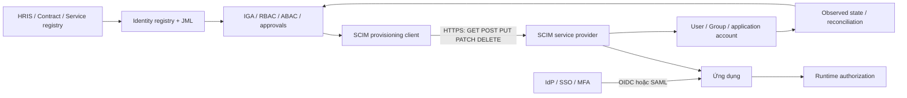

# Kiểm thử SCIM provisioning trong quản lý vòng đời danh tính IAM

## 1. Kiểm thử SCIM là gì và tại sao cần thiết?

**Kiểm thử SCIM** là quá trình xác minh một tích hợp **System for Cross-domain Identity Management (SCIM)** có trao đổi và áp dụng đúng các thao tác quản lý tài khoản, thuộc tính và nhóm giữa **provisioning client** với **SCIM service provider** hay không. Kiểm thử không chỉ kiểm tra API có trả HTTP thành công, mà phải chứng minh **danh tính đúng người, quyền đúng phạm vi, trạng thái đúng thời điểm và sai lệch được phát hiện**.

Ví dụ, một nhân viên từ Sales chuyển sang Finance. Bộ IAM/IGA tính quyền cần thêm và cần thu hồi, rồi gửi SCIM PATCH đến ứng dụng SaaS. API trả `200 OK`, nhưng do mapping nhóm sai, người dùng vẫn có nhóm `sales-export`. **Bài kiểm thử chỉ dựa vào HTTP 200 sẽ báo thành công giả**; bài kiểm thử SCIM đủ chiều sâu phải đọc lại tài nguyên, kiểm tra nhóm và đối chiếu với **desired state** của IAM.

Trong module **SECURITY_IDENTITY_ACCESS_MANAGEMENT_IDENTITY_LIFECYCLE**, SCIM là một mắt xích của quản lý vòng đời **Joiner–Mover–Leaver (JML)**: chuẩn bị danh tính đã được xác minh, tạo/cập nhật account, quản lý quyền theo RBAC/ABAC, khóa hoặc thu hồi account khi hết quan hệ, kiểm toán và giảm quyền truy cập tồn dư. SCIM thường phối hợp với **IdP, SSO, OAuth/OIDC, hệ thống HRIS, IGA**, ứng dụng đích và cả **service/workload identities**; nhưng SCIM **không phải giao thức xác thực đăng nhập** và không tự quyết định quyền nghiệp vụ.

**Kết quả học tập:** sau bài này, người đọc có thể lập ma trận kiểm thử SCIM v2, xác định khả năng của service provider, viết test cho User/Group CRUD và PATCH, filter/pagination, đồng bộ JML, xử lý lỗi, retry/idempotency, ETag và an ninh; đồng thời biết **bằng chứng nào đủ để coi provisioning hoặc deprovisioning đã hoàn tất**.

> Đối tượng được kiểm thử là **hành vi và trạng thái thực tế** của một tích hợp SCIM đã được cấu hình, không phải giả định rằng mọi service provider đều hỗ trợ toàn bộ tùy chọn của tiêu chuẩn.

## 2. Ranh giới kiến trúc và hợp đồng SCIM v2

Các đặc tả liên quan gồm **RFC 7643 (SCIM Core Schema)**, **RFC 7644 (SCIM Protocol)** và **RFC 7642 (định nghĩa, yêu cầu và khái niệm)**. SCIM v2 thường triển khai qua HTTPS với tài nguyên **User**, **Group** và những schema mở rộng do service provider hỗ trợ.



| Thành phần | Trách nhiệm | Nội dung cần kiểm thử |
| --- | --- | --- |
| **Nguồn có thẩm quyền** | HRIS quyết định employment status, hợp đồng quyết định guest, registry quyết định owner workload | Event đúng identity, version, ngày hiệu lực, không đến sai người |
| **IAM/IGA** | Liên kết danh tính, tính entitlement, áp chính sách và phê duyệt | Desired state, RBAC/ABAC, SoD, không tự mở đặc quyền |
| **SCIM client** | Dịch quyết định thành lời gọi đến provider | URL, HTTP method, payload, mapping, auth, retry và readback |
| **SCIM provider** | Quản lý tài nguyên User/Group theo schema và tính năng công bố | ID, attributes, tính duy nhất, cập nhật, lọc, phiên bản, lỗi |
| **IdP/SSO** | Xác thực và cấp phiên/token đăng nhập | Không đánh đồng SSO thành công với account đã provision |
| **Ứng dụng/API** | Thực thi quyền ở tài nguyên cụ thể | Kiểm chứng quyền cũ đã hết; xử lý session/token còn tồn tại |
| **Reconciliation** | So desired state với observed state | Trạng thái cuối, quyền dư, tài khoản mồ côi, ngoại lệ |

**Một SCIM User không nhất thiết tương đương một người lao động duy nhất.** Có thể có nhiều account đích cho một danh tính chuẩn. Trong SCIM, `id` của User là mã tài nguyên do **service provider** cấp; `externalId` là mã tương quan do **client** quản lý trong ngữ cảnh tích hợp và không phải khóa duy nhất toàn cầu được mọi triển khai bảo đảm.

## 3. Các cấp độ kiểm thử cần có

Nên kết hợp nhiều lớp kiểm thử, vì một bộ test chỉ gọi SCIM endpoint không thể xác minh toàn bộ lifecycle.

| Cấp độ | Phạm vi | Ví dụ |
| --- | --- | --- |
| **Unit** | Hàm mapping và quyết định cục bộ trong client | Chuyển `employeeNumber` sang `externalId`, tính diff membership |
| **Contract/conformance** | Hành vi HTTP, SCIM schema và giao thức mà provider công bố hỗ trợ | POST User, PATCH Group, lỗi `scimType`, response `ListResponse` |
| **Integration** | Connector thật với môi trường kiểm thử của provider | Tạo user, tra `id`, thêm nhóm, đọc lại |
| **End-to-end JML** | Nguồn HR/IGA → SCIM → account/nhóm → ứng dụng | Joiner cấp quyền; Mover gỡ quyền cũ; Leaver chặn truy cập |
| **Security/negative** | Xác thực connector, phân quyền, dữ liệu sai, tenant isolation | Token hết hạn, sửa User tenant khác, filter injection |
| **Reliability** | Timeout, retry, event đến muộn, replication và API rate limit | POST bị timeout sau khi đích đã tạo User |
| **Performance/operations** | Số lượng lớn, phân trang, giới hạn tài nguyên, backlog | Đồng bộ hàng nghìn account theo quota và latency |
| **Reconciliation/audit** | Phát hiện sai lệch giữa nguồn quyết định và provider | Quyền trực tiếp ở SaaS còn dù nhóm SCIM đã gỡ |

**Contract test** kiểm tra sự phù hợp của một SCIM implementation trong phạm vi tính năng đã hỗ trợ; **end-to-end test** kiểm tra kết quả nghiệp vụ và an ninh. Kết quả “đúng chuẩn schema” không tự chứng minh entitlement tại ứng dụng thực tế đã cập nhật.

## 4. W1 kiểm thử: đọc khả năng của service provider trước khi viết assertion

Không phải mọi server đều triển khai giống nhau. Trước khi lập bộ test, cần xác định **base URL**, phiên bản, endpoint, yêu cầu xác thực, schema mở rộng và các tính năng mà provider công bố.

Những endpoint khám phá phổ biến:

```http
GET /scim/v2/ServiceProviderConfig HTTP/1.1
Accept: application/scim+json

GET /scim/v2/Schemas HTTP/1.1
Accept: application/scim+json

GET /scim/v2/ResourceTypes HTTP/1.1
Accept: application/scim+json
```

Ví dụ **trích đoạn minh họa** của `ServiceProviderConfig` (không phải phản hồi đầy đủ):

```json
{
  "schemas": ["urn:ietf:params:scim:schemas:core:2.0:ServiceProviderConfig"],
  "patch": {"supported": true},
  "bulk": {"supported": false, "maxOperations": 0, "maxPayloadSize": 0},
  "filter": {"supported": true, "maxResults": 200},
  "sort": {"supported": false},
  "etag": {"supported": true},
  "changePassword": {"supported": false},
  "authenticationSchemes": [
    {"type": "oauthbearertoken", "name": "OAuth Bearer Token",
     "description": "Bearer access token", "primary": true}
  ]
}
```

Đây chỉ là ví dụ **subset** cho bài học: endpoint thực có thể công bố thêm `documentationUri` và trường khác theo schema. **Không copy cấu hình minh họa làm kết quả thực tế.** Với mỗi provider, ghi lại thông tin đã đọc và xác định điều kiện test:

- Nếu `patch.supported=false`, **không gắn nhãn provider sai chuẩn chỉ vì không hỗ trợ PATCH**; kiểm thử đường PUT hoặc cách connector hỗ trợ được công bố.
- Nếu `filter.supported=false`, không mặc định Search với filter hoạt động; có thể phải dùng mapping account khác.
- Nếu `sort.supported=false`, không yêu cầu kết quả sắp xếp.
- Nếu `etag.supported=true`, bổ sung test `If-Match` và xung đột phiên bản.
- Với `bulk`, chỉ kiểm thử `/Bulk` khi hỗ trợ; giới hạn kích thước/thao tác phải được áp.
- Đọc `ResourceTypes` và `Schemas` để xác định resource type, `schemaExtensions`, attribute required/optional, `mutability`, `returned`, `uniqueness` và khả năng filtering.
- Định nghĩa riêng những sai lệch hoặc hạn chế **đã được vendor tài liệu hóa**; ghi nhận đó là giới hạn tích hợp, không âm thầm cho qua lỗi dữ liệu.

**Discovery cũng cần xác thực** nếu triển khai yêu cầu; không giả định ba endpoint luôn truy cập công khai.

## 5. Thiết kế dữ liệu thử nghiệm và môi trường an toàn

Một bộ kiểm thử SCIM nên dùng **tenant sandbox hoặc vùng staging được ủy quyền**, tài khoản và nhóm có tiền tố riêng, không dựa vào danh tính hoặc dữ liệu nhân viên thật. Bất kỳ thao tác `DELETE`, `active=false` hoặc gỡ group nào cũng phải chạy trên **fixtures kiểm thử có thể sở hữu và dọn dẹp an toàn**.

Ví dụ dữ liệu thiết kế:

| Thuộc tính | Giá trị giả định | Mục đích |
| --- | --- | --- |
| IAM `identityId` | `test-identity-501` | Khóa chuẩn cho đối soát JML |
| SCIM `externalId` | `it-jml-501` | Correlation do SCIM client kiểm soát |
| SCIM `userName` | `it.scim.501@example.test` | Username riêng trong sandbox |
| Provider `id` | Do server trả sau POST | Dùng GET/PATCH/DELETE chính xác |
| Group cơ bản | `it-employees-basic` | Quyền có thể giữ khi Mover |
| Group cũ | `it-sales-readers` | Kiểm thử revoke |
| Group mới | `it-finance-readers` | Kiểm thử grant |
| Source version | `101`, `102`, `103` | Chặn sự kiện lặp/đến sai thứ tự |
| Effective time | Thời điểm giả định trong test clock | Kiểm thử trước/sau ngày hiệu lực |

Cần một **test manifest** lưu `requestId`, các provider `id` đã tạo, `externalId`, group IDs và kết quả dọn dẹp. **Không xóa tài nguyên được tìm thấy chỉ bằng tên gần giống fixture**: phải chứng minh tài nguyên thuộc chính test run và đúng tenant.

### Seed data và tính lặp

Mỗi lần chạy có thể sinh namespace duy nhất, chẳng hạn `it-scim-20261123-<runId>`, để tránh cạnh tranh giữa worker/CI. Đừng đưa dữ liệu bí mật vào `userName`, `displayName` hay giá trị log. Với test race hoặc event ordering, dùng các sự kiện có version và điều khiển đồng hồ để kết quả có thể tái lập.

Một bộ thử nghiệm nên phân loại môi trường:

- **Mock provider:** dùng kiểm tra mapping/validation nhanh, nhưng không đại diện đầy đủ provider thật.
- **Provider sandbox:** kiểm tra schema, connector, API và hành vi thực tế.
- **UAT có dữ liệu tổng hợp:** kiểm tra JML và quyền ứng dụng với chính sách gần sản xuất.
- **Production monitoring:** kiểm tra không phá hoại, đối soát/telemetry theo quyền được cấp; không tùy tiện chạy negative test xóa account thật.

## 6. Kiểm tra hợp đồng HTTP, schema và error response

SCIM v2 thường dùng `Content-Type: application/scim+json` cho tài nguyên hoặc thông điệp JSON; client gửi `Accept: application/scim+json` khi cần. Cần kiểm tra đúng **HTTP method, path, status, headers, JSON `schemas`, thuộc tính và resource identifiers**.

| Lệnh | Kết quả thường kỳ vọng theo giao thức | Kiểm thử cần bổ sung |
| --- | --- | --- |
| `POST /Users` | Tạo User, thường `201 Created` và resource/định danh đích | `id`, `Location`/`meta.location` nếu áp dụng, correlation |
| `GET /Users/{id}` | `200 OK` với User hợp lệ | Đúng target ID, không rò thuộc tính không được đọc |
| `GET /Users?filter=...` | `200 OK` với `ListResponse` khi filter hỗ trợ | `totalResults`, `Resources`, phân trang |
| `PUT /Users/{id}` | Thay representation theo điều kiện của schema/provider | Bảo toàn trường readOnly/immutable theo quy tắc, không mất dữ liệu ngoài ý muốn |
| `PATCH /Users/{id}` | Cập nhật một phần khi `patch.supported=true` | `Operations`, `op`, `path`, `value`, trạng thái cuối |
| `POST /Groups` | Tạo Group với schema Group | ID Group và membership đúng |
| `PATCH /Groups/{id}` | Thay membership khi được hỗ trợ | Gán/tháo đúng user, không làm sai group khác |
| `DELETE /Users/{id}` | Xóa User nếu API và policy cho phép, thường `204 No Content` | Xác minh account không còn truy cập; dữ liệu/retention xử lý riêng |

**Đừng hardcode “mọi update phải trả HTTP 200”**. Một thao tác thành công có thể có phản hồi resource hoặc không có body theo giao thức và khả năng provider; kiểm tra chi tiết RFC/profile/tài liệu vendor cho từng operation. **Không suy trạng thái cuối chỉ từ status code** nếu có đồng bộ bất đồng bộ hoặc nguồn quyền khác.

### SCIM Error schema

Khi request không hợp lệ, response SCIM có thể chứa schema lỗi:

```json
{
  "schemas": ["urn:ietf:params:scim:api:messages:2.0:Error"],
  "scimType": "uniqueness",
  "detail": "userName conflicts with an existing account",
  "status": "409"
}
```

Kiểm thử phải xác nhận **HTTP status khớp tình huống, dạng lỗi phù hợp và không lộ bí mật nội bộ**. Giá trị `detail` trên đây là ví dụ, không phải câu chữ cố định bắt buộc. Những `scimType` khác có thể gồm `invalidSyntax`, `invalidFilter`, `mutability`, `invalidValue` hoặc `tooMany` theo điều kiện quy định.

## 7. Test Create User: thêm đúng người, đúng dữ liệu

**Ca kiểm thử U-01:** tạo một User không có sẵn trong sandbox.

```http
POST /scim/v2/Users HTTP/1.1
Content-Type: application/scim+json
Accept: application/scim+json
Authorization: Bearer <TEST_TOKEN>

{
  "schemas": ["urn:ietf:params:scim:schemas:core:2.0:User"],
  "externalId": "it-jml-501",
  "userName": "it.scim.501@example.test",
  "name": {"givenName": "Mai", "familyName": "Tran"},
  "displayName": "Mai Tran",
  "emails": [{"value": "it.scim.501@example.test", "type": "work", "primary": true}],
  "active": true
}
```

Đây là **request minh họa**; chỉ dùng token dành cho môi trường thử nghiệm, không lưu token thật vào tài liệu. Nếu ghi lại kết quả, phải redaction authorization header và dữ liệu cá nhân.

**Những assertion cần có:**

1. Provider trả kết quả tạo User theo contract đã công bố; payload phản hồi có `schemas` phù hợp.
2. Provider tạo **`id` thuộc phạm vi service provider**; client lưu mapping `identityId → providerId`.
3. `externalId` và những attribute do client được phép gán được lưu/biểu diễn theo schema và quy tắc chuẩn hóa đã thống nhất.
4. GET bằng `id` vừa nhận trả về **đúng một User** trong tenant được phép.
5. Các thuộc tính do server sở hữu như `meta`, `id` không bị client tự đặt sai hoặc ghi đè.
6. User có trạng thái mong muốn: `active=true` chỉ khi sự kiện Joiner đã **đến ngày được phép hoạt động** và chính sách cho phép.
7. Tài khoản xuất hiện trong hệ thống ứng dụng đích sau đồng bộ với giới hạn độ trễ đã thỏa thuận; nếu chỉ kiểm tra SCIM server, ghi rõ **chưa xác minh runtime access**.

**Test âm tính** đi kèm: thiếu `userName` bắt buộc theo schema, `schemas` sai, `userName` trùng, thuộc tính `readOnly` bị ghi không đúng, dữ liệu vượt giới hạn của provider. Không dựa vào hành vi “tự sửa” không được tài liệu hóa.

## 8. Test Read, Search, Filter và pagination

SCIM ListResponse có cấu trúc khác một User đơn lẻ. Ví dụ minh họa khi Search trả một kết quả:

```json
{
  "schemas": ["urn:ietf:params:scim:api:messages:2.0:ListResponse"],
  "totalResults": 1,
  "startIndex": 1,
  "itemsPerPage": 1,
  "Resources": [
    {
      "schemas": ["urn:ietf:params:scim:schemas:core:2.0:User"],
      "id": "sp-user-501",
      "externalId": "it-jml-501",
      "userName": "it.scim.501@example.test",
      "active": true
    }
  ]
}
```

**Test R-01 — GET by id:** dùng chính `id` từ POST, so sánh khóa và dữ liệu đáng tin. Test ID không tồn tại phải cho lỗi phù hợp, không trả nhầm User đầu tiên.

**Test R-02 — Filter:** khi `filter.supported=true`, thử:

```text
userName eq "it.scim.501@example.test"
externalId eq "it-jml-501"
userName sw "it.scim."
emails[type eq "work" and value co "@example.test"]
```

Filter cần được **URL-encode đúng** trong HTTP request. Khả năng filter theo từng attribute phụ thuộc schema `filtering` và provider; không mặc định mọi biểu thức đều được hỗ trợ đầy đủ. Nếu provider không hỗ trợ toán tử hoặc attribute, kiểm tra lỗi được tài liệu hóa thay vì lặng lẽ nhận toàn bộ danh sách.

**Test R-03 — Pagination:** khi hỗ trợ truy vấn danh sách, kiểm tra `startIndex`, `count`, `totalResults`, `itemsPerPage`; `startIndex` SCIM sử dụng cách đánh số bắt đầu từ **1**. Tạo nhiều User tổng hợp, thu đủ các trang, loại trừ bỏ sót/trùng theo provider `id`. Nếu dữ liệu thay đổi khi đang phân trang, cần nhận diện tính không ổn định của snapshot, không giả định có transaction nhất quán trên tất cả trang.

**Test R-04 — Sorting/attribute selection:** chỉ yêu cầu `sortBy`/`sortOrder` khi `sort.supported=true`; kiểm thử `attributes`/`excludedAttributes` theo schema và cơ chế `returned`. Không kỳ vọng provider trả mật khẩu hay dữ liệu `never` trong response.

## 9. Test Update: PUT và PATCH khác nhau

**PUT** và **PATCH** cùng thay đổi tài nguyên nhưng có ý nghĩa khác nhau. PUT thường thay biểu diễn resource theo quy tắc cập nhật của SCIM; PATCH thực hiện **một tập operation có chủ đích**. Khi viết test, không được xem PUT giống việc chỉ sửa các trường đã liệt kê trong payload mà không quan tâm trường khác.

| Điều cần thử | PUT | PATCH |
| --- | --- | --- |
| Quy tắc cập nhật | Xác định representation thay thế theo schema/provider | `Operations` với `add`, `replace`, `remove` |
| Attribute không gửi | Cần kiểm tra hành vi theo SCIM mutability và quy tắc của provider | Thông thường không ảnh hưởng attribute ngoài operation |
| Đối tượng kiểm thử | Tính toàn vẹn resource, field readOnly/immutable, các attribute đa giá trị | Path, subattribute, value filter, atomicity và lỗi |
| An toàn khi retry | Xem state hiện tại, revision và mapping | Áp thao tác lặp có kiểm soát, tránh grant/revoke sai epoch |
| Kiểm tra cuối | GET/readback representation | GET/readback các field bị tác động lẫn field không liên quan |

### Ca U-02 — PATCH thay thuộc tính và trạng thái

```http
PATCH /scim/v2/Users/sp-user-501 HTTP/1.1
Content-Type: application/scim+json
Authorization: Bearer <TEST_TOKEN>

{
  "schemas": ["urn:ietf:params:scim:api:messages:2.0:PatchOp"],
  "Operations": [
    {"op": "replace", "path": "displayName", "value": "Mai Tran (Finance)"},
    {"op": "replace", "path": "active", "value": true}
  ]
}
```

**Assertions:** khi provider hỗ trợ PATCH và path trên, GET lại User phải phản ánh `displayName` mới, `active` đúng; các thuộc tính không nằm trong operation như `externalId` và `userName` phải giữ theo quy tắc schema. Nếu một operation vi phạm mutability, test phải đánh giá toàn bộ request **không bị áp dụng một phần** theo ngữ nghĩa atomicity của SCIM PATCH.

### Ca U-03 — PUT với payload đầy đủ, không mất thuộc tính

Để kiểm tra PUT, tạo User có nhiều attribute trước, gửi representation hợp lệ theo schema và xác minh **đúng các field được thay, giữ hoặc xóa theo quy tắc của SCIM và vendor**. Không nên “đoán” yêu cầu rằng server phải giữ mọi field bị bỏ qua; không nên gửi thiếu required field rồi khẳng định lỗi là do backend khi client không đáp ứng contract.

## 10. Test Group và membership: lỗi quyền rất dễ ẩn

Group là nơi nhiều hệ thống ánh xạ entitlement. **Kiểm thử SCIM Group phải xác minh membership thực tế**, không chỉ việc tạo một record nhóm tên đúng.

### Ca G-01 — Tạo Group

```http
POST /scim/v2/Groups HTTP/1.1
Content-Type: application/scim+json
Authorization: Bearer <TEST_TOKEN>

{
  "schemas": ["urn:ietf:params:scim:schemas:core:2.0:Group"],
  "displayName": "it-finance-readers",
  "members": [{"value": "sp-user-501"}]
}
```

`value` là **ID SCIM User tại service provider**, không phải `identityId` của IAM hay email. Nếu provider quy định chỉ tạo Group qua console hoặc không hỗ trợ Group API, bộ test cần phản ánh đúng **contract và giới hạn tích hợp**, không gửi G-01 vô điều kiện.

### Ca G-02 — Thêm member bằng PATCH

```http
PATCH /scim/v2/Groups/sp-group-finance HTTP/1.1
Content-Type: application/scim+json
Authorization: Bearer <TEST_TOKEN>

{
  "schemas": ["urn:ietf:params:scim:api:messages:2.0:PatchOp"],
  "Operations": [
    {
      "op": "add",
      "path": "members",
      "value": [{"value": "sp-user-502"}]
    }
  ]
}
```

**Kết quả kiểm tra:** group có thêm `sp-user-502` đúng một membership theo chính sách, không tạo membership trùng và không gỡ `sp-user-501`. Cách provider biểu diễn `display`, `$ref`, thứ tự member có thể khác; so sánh **tập ID thành viên** thay vì thứ tự JSON.

### Ca G-03 — Gỡ member bằng PATCH

```http
PATCH /scim/v2/Groups/sp-group-finance HTTP/1.1
Content-Type: application/scim+json
Authorization: Bearer <TEST_TOKEN>

{
  "schemas": ["urn:ietf:params:scim:api:messages:2.0:PatchOp"],
  "Operations": [
    {"op": "remove", "path": "members[value eq \"sp-user-501\"]"}
  ]
}
```

**Kết quả kiểm tra:** chỉ `sp-user-501` bị gỡ, các thành viên còn lại vẫn đúng. Đây là SCIM PATCH **valuePath** theo kiểu filter. Nếu provider không hỗ trợ cách biểu diễn cụ thể, xác minh cách update Group được công bố và đánh dấu test theo capability.

### Các trường hợp cần thêm

- Member không tồn tại hoặc user thuộc tenant khác.
- Group không tồn tại hoặc không cho thay member.
- Thêm cùng user hai lần qua hai request; không tạo hai grant hiệu lực.
- User rời Group A vào Group B; **quyền từ Group A thực sự không còn ở ứng dụng**.
- User có nhiều đường cấp một quyền: gỡ member ở Group A **không đủ** nếu quyền cũng được cấp trực tiếp hoặc qua Group C.
- Nhóm lồng nhau và `memberOf`: **không giả định** mọi provider hỗ trợ hoặc suy giống nhau.
- Đổi displayName không tự đổi quyền nếu ứng dụng map theo Group ID; kiểm tra contract mapping chính xác.

## 11. Test Leaver: active=false, DELETE và deprovisioning

Đây là nhóm test có tác động bảo mật cao vì liên quan **quyền truy cập tồn dư**. Cần phân biệt **disable account** với **DELETE resource**.

### Ca L-01 — Vô hiệu hóa User theo trạng thái

```http
PATCH /scim/v2/Users/sp-user-501 HTTP/1.1
Content-Type: application/scim+json
Authorization: Bearer <TEST_TOKEN>

{
  "schemas": ["urn:ietf:params:scim:api:messages:2.0:PatchOp"],
  "Operations": [
    {"op": "replace", "path": "active", "value": false}
  ]
}
```

Assertions:

1. Provider nhận thay đổi nếu hỗ trợ và cho phép ghi `active`.
2. GET/readback hoặc cơ chế đối soát đáng tin xác nhận User không còn ở trạng thái hoạt động theo contract.
3. Tài khoản **không thể khởi tạo đăng nhập mới** trong ứng dụng nếu trạng thái `active=false` được tích hợp đúng vào kiểm soát đăng nhập.
4. Những nhóm/quyền cũ cần thu hồi phải được giải quyết theo lifecycle, không suy từ `active=false`.
5. **Phiên SSO, access token, refresh token, PAT, API key** đã cấp cần được kiểm tra hoặc thu hồi theo khả năng sản phẩm; SCIM không tự đảm bảo tất cả biến mất.
6. Quy trình lưu giữ/bàn giao dữ liệu vẫn hoạt động theo chính sách; disable không đồng nghĩa xóa dữ liệu.

### Ca L-02 — DELETE resource

Chỉ chạy `DELETE /Users/{id}` với user **được tạo riêng cho test** và khi môi trường/đích cho phép xóa. Xác minh response theo contract, truy vấn lại trạng thái, quan sát tác động tài khoản/quyền và đảm bảo không còn user trùng từ nguồn provisioning khác.

**Không dùng DELETE như một cách thay thế chung cho Leaver.** Nhiều doanh nghiệp cần disable trước và giữ dữ liệu phục vụ retention; xóa quá sớm có thể làm mất tài liệu, audit hoặc đường bàn giao.

### Ca L-03 — Chống tái kích hoạt do sự kiện cũ

Sau khi xử lý Leaver `version=103`, giả lập nhận lại Joiner/Mover `version=101`. **Đây là test bộ điều phối IAM/connector**, không phải tính năng SCIM server tự hiểu version HRIS. Client phải từ chối áp event cũ hoặc kiểm tra trạng thái nguồn hiện hành, không gọi `active=true` để bật lại account.

## 12. Kiểm thử JML từ quyết định đến ứng dụng

Một bài test E2E không dừng ở SCIM API mà đi theo **business event → desired state → provisioning → observed state → quyền thực thi**.

| Tình huống | Event và quyết định | SCIM action điển hình | Tiêu chí hoàn tất |
| --- | --- | --- | --- |
| **Joiner** | HRIS xác nhận ngày bắt đầu, IGA duyệt vai trò cơ bản | Create User, cập nhật thuộc tính, Add Group | Account đúng người và quyền tối thiểu có hiệu lực đúng ngày |
| **Pre-hire** | Event đến trước ngày đi làm | Chuẩn bị User ở trạng thái hạn chế hoặc lập lịch | Không thể truy cập trước `effectiveAt` khi policy không cho |
| **Mover** | Đổi phòng ban hoặc dự án, tính lại RBAC/ABAC | PATCH attributes; Remove Group cũ, Add Group mới | Không giữ quyền cũ; SoD không bị vi phạm trong chuyển đổi |
| **Leaver** | HRIS/hợp đồng xác nhận kết thúc | PATCH `active=false`, gỡ Group, xử lý account | Đăng nhập/quyền không hợp lệ bị chặn; dữ liệu được xử lý đúng |
| **Rehire** | Người quay lại với quan hệ mới | Link/Reactivate hoặc tạo mới theo policy | Không phục hồi quyền hoặc credential cũ không được duyệt |
| **Guest hết hợp đồng** | Contract/sponsor bên tiếp nhận hết hiệu lực | Disable guest, revoke membership | Home IdP còn hoạt động cũng không truy cập được tài nguyên bên tiếp nhận |
| **Service identity Mover** | Workload đổi owner/môi trường | Cập nhật resource nếu provider có biểu diễn phù hợp; API khác khi cần | Owner, scope, credential và quyền thực tế phản ánh quyết định mới |

**`effectiveAt` của JML không phải attribute bắt buộc trong core SCIM User.** Đây thường là dữ liệu do IAM/orchestrator quản lý; test cần chứng minh bộ điều phối không gửi hoặc kích hoạt hành động trước thời điểm cho phép, thay vì kỳ vọng mọi SCIM provider tự hiểu lịch HR.

### Kiểm tra phân tách nhiệm vụ (SoD)

Nếu Mover đưa người từ người lập hóa đơn sang người phê duyệt, test phải bảo đảm không có thời điểm người đó đồng thời giữ các quyền xung đột **ngoài ngoại lệ được chấp thuận**. Tùy policy, bộ điều phối có thể phải gỡ Group A **trước khi** gán Group B. Đây là test **policy/orchestration + SCIM observed state**, không chỉ là test PATCH độc lập.

## 13. Correlation, trùng account và idempotency

**Idempotency** là yêu cầu vận hành cực kỳ quan trọng khi mạng không ổn định hoặc nguồn JML gửi lại event. Nếu client gửi POST Create User, provider đã tạo tài khoản nhưng response bị mất, gửi POST mới mù quáng có thể tạo account thứ hai hoặc gây conflict.

### Test I-01 — POST timeout sau khi server đã tạo

1. Cho môi trường test mô phỏng kết nối mất sau khi provider hoàn tất POST.
2. Client đánh dấu trạng thái **unknown**, không lập tức tạo username khác.
3. Client tìm account theo `provider id` đã biết hoặc khóa tương quan `externalId`/`userName` theo contract đã được xác minh.
4. Nếu thấy một resource khớp **duy nhất**, client ghi nhận kết quả tạo trước đó; nếu mơ hồ, chuyển review.
5. Retry phải đảm bảo cuối cùng **chỉ một account** gắn với danh tính chuẩn.

**SCIM không định nghĩa một header idempotency-key chung bắt buộc cho mọi provider.** Nếu provider hỗ trợ cơ chế riêng, kiểm thử đúng tính năng đó; nếu không, idempotency được thực hiện ở client thông qua state ledger, mapping ổn định, kiểm tra uniqueness và readback.

### Test I-02 — Event lặp

Gửi hai lần một event Mover có cùng `eventId`. Client không được tạo thêm group grant hoặc xóa/khôi phục quyền ngoài kế hoạch. Lưu `eventId`, policy version, account mapping và các operation đã được xác nhận.

### Test I-03 — Rehire và lifecycle generation

Leaver phiên bản `105` làm account bị vô hiệu; sau đó Rehire `generation=2` được phê duyệt. Một retry của Leaver cũ không được disable account trong giai đoạn rehire mới. Bài test phải kiểm tra **nguồn có thẩm quyền, version/generation và trạng thái mới nhất** trước khi thực thi SCIM operation.

### Khóa đối chiếu không dùng email đơn lẻ

Email hoặc tên đăng nhập có thể đổi hay được tái sử dụng. Test correlation nên có các ca đổi tên, đổi email, nhiều tenant, cùng email nhưng hai chủ thể khác nhau và hai account lịch sử liên quan một người. Hệ thống phải dùng `identityId` chuẩn và provider resource ID đã xác minh; không tự nối hai user chỉ vì tên giống nhau.

## 14. Kiểm thử đồng thời, ETag và cập nhật có điều kiện

Nếu service provider công bố `etag.supported=true`, có thể sử dụng **entity tag** của resource và HTTP conditional requests như `If-Match` để hạn chế lost update.

Ví dụ luồng test:

```http
GET /scim/v2/Users/sp-user-501 HTTP/1.1
Accept: application/scim+json

HTTP/1.1 200 OK
ETag: W/"rev-7"

PATCH /scim/v2/Users/sp-user-501 HTTP/1.1
If-Match: W/"rev-7"
Content-Type: application/scim+json
Authorization: Bearer <TEST_TOKEN>

{
  "schemas": ["urn:ietf:params:scim:api:messages:2.0:PatchOp"],
  "Operations": [
    {"op": "replace", "path": "displayName", "value": "Updated by test"}
  ]
}
```

Đoạn này là **minh họa trình tự hai HTTP message**; giá trị ETag do provider cung cấp và không thể tự đoán. Sau GET, nếu một client khác đã sửa tài nguyên, request dùng **ETag cũ** thường phải bị từ chối với `412 Precondition Failed` khi precondition được hỗ trợ đúng.

Bộ test nên gồm:

- `If-Match` đúng version → thay đổi được áp dụng, readback đúng.
- `If-Match` cũ → lỗi phù hợp, không ghi đè bản mới.
- Hai client đồng thời sửa cùng User hoặc Group → không mất membership/quyền mới.
- Provider không hỗ trợ ETag → dùng chiến lược retry/readback và serialize ở client thay vì kỳ vọng điều kiện không được công bố.

**ETag không thay thế version của HRIS/JML.** ETag thể hiện phiên bản của resource **tại provider**, còn `sourceVersion` thể hiện thứ tự quyết định nghiệp vụ; phải kiểm tra cả hai lớp để chống event đến muộn.

## 15. Kiểm thử lỗi dữ liệu, schema và thuộc tính

Negative test cần chứng minh provider và client **từ chối hoặc xử lý an toàn** các payload sai thay vì âm thầm tạo quyền/định danh sai.

| Nhóm test | Dữ liệu đầu vào | Assertion |
| --- | --- | --- |
| Thiếu trường required | User thiếu `userName` khi required | Lỗi phù hợp, không có account hợp lệ được tạo |
| Sai kiểu | `active` gửi chuỗi `"true"` thay vì boolean | Schema/validation lỗi, không tự cho phép |
| Sai schema URN | `schemas` không nhận diện hoặc thiếu schema bắt buộc | Lỗi phù hợp, không áp thay đổi ngoài contract |
| Sai mutability | Sửa `id` hoặc attribute `readOnly` | Không được thay đổi định danh do server sở hữu |
| Sai uniqueness | Hai User cùng `userName` trong phạm vi uniqueness của server | Không tạo hai tài khoản không phân biệt được |
| Sai path PATCH | Path không có hoặc không được phép | Lỗi SCIM thích hợp; tránh cập nhật một phần |
| PATCH nhiều bước có một bước lỗi | Step 1 sửa hợp lệ, step 2 vi phạm schema | **Atomicity:** không để step 1 trở thành trạng thái cuối |
| Giá trị mảng sai | Member thiếu ID hoặc sai kiểu | Không gán nhầm quyền |
| Định danh không tồn tại | GET/PATCH ID lạ | `404` hoặc lỗi tương ứng theo ngữ cảnh |
| Giá trị quá dài | `displayName`, `userName` vượt giới hạn | Lỗi có kiểm soát, không crash/ghi nửa dữ liệu |
| Attribute extension | Trường vendor extension không có trong schema đã đăng ký | Xử lý theo schema/provider, không tùy tiện tin dữ liệu |

**Khi provider cố ý chuẩn hóa input theo schema**, test phải kiểm tra kết quả đã chuẩn hóa là **an toàn và có thể giải thích**, thay vì mặc định mọi biến đổi đều là lỗi. Không nên dùng assertion mơ hồ như “trả 400 là được” cho mọi ca; nên xác minh cả **resource không bị thay đổi trái phép**.

### Đặc tính đa trị

Các attribute như `emails`, `phoneNumbers`, `members` có thể đa giá trị. Bộ test cần kiểm tra `primary`, `type`, thay/xóa một phần tử, điều kiện duy nhất khi schema áp đặt và tính toàn vẹn những phần tử khác. Không so sánh mảng theo thứ tự nếu schema/contract không hứa bảo toàn thứ tự.

## 16. Kiểm thử filter, escaping, Unicode và chống injection

SCIM filter có cú pháp riêng, khác SQL và LDAP filter. Ví dụ:

```text
userName eq "it.scim.501@example.test"
userName sw "it.scim."
emails[type eq "work" and value co "@example.test"]
active eq true
not (active eq false)
```

Khi nhận username do hệ thống khác cung cấp, **không ghép chuỗi filter từ dữ liệu chưa được escape/encode**. Client phải escape giá trị chuỗi SCIM đúng cú pháp và URL-encode query; không dùng hàm escape **LDAP filter** để tạo **SCIM filter** vì hai ngôn ngữ khác nhau.

Các ca cần kiểm thử:

1. Giá trị chứa dấu ngoặc kép, dấu gạch chéo ngược, dấu `&`, `+`, `%`, ký tự Unicode có dấu và khoảng trắng.
2. Input filter cố tình sai cú pháp → lỗi có kiểm soát, không trả toàn bộ Users nếu filter bị bỏ qua.
3. Filter truy vấn tài khoản tenant khác → không rò tài nguyên vượt phạm vi token/tenant.
4. Filter phức tạp/deep hoặc kết quả lớn → giới hạn size/time/rate phù hợp, không gây cạn tài nguyên.
5. So khớp và phân biệt hoa/thường theo **schema matching rule/caseExact**, không tự giả định giống so sánh Java thông thường.
6. Dữ liệu Unicode có dạng chuẩn hóa khác nhau → không gộp nhầm danh tính; cách normalize phải được tài liệu hóa.
7. Khi lọc không hỗ trợ, connector có đường thay thế được duyệt; không tải toàn bộ danh bạ vượt quyền rồi lọc tại client.

**Test bảo mật không nên dùng dữ liệu hoặc tài khoản production.** Có thể fuzz filter và payload ở sandbox với giới hạn yêu cầu để tránh gây DoS hoặc làm rò PII.

## 17. Kiểm thử xác thực và phân quyền của SCIM connector

Một SCIM endpoint thường có đặc quyền lớn: có thể tạo/khóa account và thay nhóm. Vì vậy **bảo vệ credential của provisioning client là một hạng mục an ninh trọng yếu**.

### Những ca cần có

| Ca | Mục tiêu | Kết quả kỳ vọng |
| --- | --- | --- |
| Không token | Kiểm tra endpoint có yêu cầu authentication khi chính sách bắt buộc | Từ chối truy cập, không lộ tài nguyên |
| Token sai/hết hạn | Kiểm tra validation | Không cho read/write ngoài quyền |
| Token read-only thử PATCH | Kiểm tra authorization | Từ chối thay đổi, state không đổi |
| Token tenant A sửa User tenant B | Kiểm tra tenant isolation | Từ chối và không lộ thông tin nhạy cảm |
| Token được cấp cho ứng dụng khác | Kiểm tra audience/scope khi công nghệ hỗ trợ | Không chấp nhận sai ngữ cảnh |
| Connector chỉ được sửa Group thường thử Group admin | Kiểm tra least privilege | Không cho tự nâng quyền |
| Mạng không bảo vệ | Kiểm tra chính sách TLS/transport | Không gửi credential trên kết nối không an toàn |
| Thu hồi credential connector | Kiểm tra phản ứng khi secret/token bị thu hồi | Yêu cầu mới bị từ chối theo contract |
| Audit thao tác đặc quyền | Có thể truy vết ai thay group/active | Có trace an toàn, không lộ bearer token |

**RFC SCIM không buộc mọi service provider phải dùng cùng một cách OAuth.** Cơ chế xác thực/ủy quyền của SCIM API được triển khai theo chính sách và khả năng vendor; test phải xác định token issuance, scope và thời hạn theo contract thực. Nếu dùng OAuth bearer token, phải bảo vệ secret, audience, mTLS khi áp dụng và giới hạn quyền theo môi trường.

### Chống cross-tenant và cấp quyền ngoài luồng

Một token có quyền gọi SCIM **không được mặc nhiên được sửa mọi tenant hoặc mọi nhóm đặc quyền**. Kiểm thử tối thiểu gồm quyền của connector trên User/Group được phân vùng, hành vi query list và quy tắc không để externalId hoặc query filter làm thay đổi phạm vi tenant.

Với các nhóm `admins` hoặc quyền đặc biệt, IGA/owner phải có quyết định đã được phê duyệt trước khi client gửi membership. SCIM chỉ là kênh thực thi: **authorization của connector** và **governance của quyền người dùng** là hai lớp khác nhau.

## 18. Kiểm thử an toàn thông tin, log và bảo vệ PII

SCIM trao đổi thông tin danh tính; nhiều payload chứa dữ liệu cá nhân. Test nên chứng minh:

- Client không log `Authorization` header, access token, client secret, mật khẩu, private key hoặc raw reset token.
- Error response không trả stack trace, credential của backend, query nội bộ hoặc dữ liệu người dùng ngoài phạm vi.
- Bộ log có `requestId`, target ID tham chiếu an toàn, thời gian, operation, kết quả và `sourceEventId`, đủ truy vết mà không sao chép toàn bộ payload.
- Kênh kết nối dùng **TLS với kiểm tra chứng chỉ và hostname**; không tắt verify để “test cho qua”.
- Connector không tự gửi trường không cần thiết; dữ liệu được giảm theo **data minimization**, schema và chính sách riêng tư.
- PII trong fixture được tổng hợp giả, có quy trình hủy và giới hạn retention.
- Truy vấn `GET /Users`/filter chỉ trả những thuộc tính mà client có quyền đọc.
- Trường password hoặc dữ liệu có quy tắc `returned=never` không bị lộ trong response khi áp dụng.
- Token của môi trường test không được vô tình dùng trên production; cấu hình endpoint được allowlist và tách secrets.

**SCIM không yêu cầu lưu hoặc phát tán password của người dùng tới mọi SaaS.** Khi ứng dụng dùng SSO qua IdP/OIDC/SAML, nên tránh tạo một đường quản lý mật khẩu local mới nếu không cần thiết. Việc đăng nhập, MFA và session phải được test ở lớp IdP/ứng dụng tương ứng.

## 19. Kiểm thử độ bền: timeout, retry, rate limit và partial success

Tích hợp provisioning thường là hệ thống phân tán: HRIS event, IAM policy, queue, SCIM client, provider và ứng dụng cùng tham gia. Một response thành công không đồng nghĩa toàn bộ workflow thành công **tức thì**; một timeout cũng không chứng minh yêu cầu chưa được áp dụng.

| Sự cố giả lập | Cách client nên phản ứng | Assertion |
| --- | --- | --- |
| Mất mạng trước khi gửi | Retry theo policy khi nguồn vẫn hợp lệ | Không đổi target ngoài dự kiến |
| Mất response sau POST đã tạo | Readback/correlation trước retry | Không tạo trùng account |
| `429 Too Many Requests` | Throttle/backoff, tôn trọng `Retry-After` nếu có | Không flood provider, backlog được theo dõi |
| `503 Service Unavailable` | Retry có giới hạn và jitter khi phù hợp | Không bỏ event; có alert nếu quá hạn |
| `401/403` | Điều tra credential/quyền, không retry vô hạn như lỗi mạng | Không tự thay token hay mở quyền |
| `409 Conflict` khi Create | Kiểm tra uniqueness/correlation | Không tự chọn username khác rồi gán nhầm identity |
| `412 Precondition Failed` | Refresh ETag/observed state và tính lại kế hoạch | Không ghi đè thay đổi đồng thời |
| Provider áp PATCH nhưng readback trễ | Poll với timeout/SLA hợp lệ | Không kết luận ngay “chưa áp” hoặc “đã xong” sai |
| Một đích thành công, đích khác lỗi | Workflow `PARTIAL`, retry đúng đích | Không tuyên bố JML hoàn tất |
| Mover đến sau Leaver | Kiểm tra source version/current state | Không tái cấp quyền đã bị thu hồi |

### Backoff và giới hạn tài nguyên

Retry nên có **giới hạn số lần/thời gian, exponential backoff có jitter, dead-letter hoặc escalation**, và tách các lỗi không nên retry (`400` do schema sai, `403` do thiếu quyền) khỏi lỗi có thể tạm thời. Nếu `Retry-After` có mặt và có ý nghĩa, client phải tôn trọng theo chính sách.

**Không rollback quyền một cách mù quáng.** Nếu quyền cũ bị thu hồi để bảo đảm SoD rồi grant mới lỗi, rollback lập tức có thể phục hồi một đặc quyền không còn được phép. Quy trình khắc phục phải so lại desired state hiện hành.

## 20. Test harness và cơ chế assertion tự động

Một bộ kiểm thử tự động có thể dùng Postman/Newman, framework HTTP test, Java integration tests hoặc công cụ riêng. Dù dùng công cụ nào, **logic quan trọng là stateful test + readback + cleanup**.

### Mẫu bộ chạy test bằng giả mã

```text
runScimConformanceAndJmlTests(sandbox):
    assert sandbox.endpointIsExplicitlyAllowed()
    capabilities = scim.getServiceProviderConfig()
    resourceTypes = scim.getResourceTypes()
    schemas = scim.getSchemas()

    fixture = createUniqueSyntheticJmlIdentity()
    testLedger.record(fixture)

    try:
        user = scim.createUser(fixture.user)
        assert user.id is not empty
        testLedger.recordProviderUserId(user.id)

        observed = scim.getUser(user.id)
        assert correlatesToSameIdentity(observed, fixture)

        if capabilities.filter.supported:
            search = scim.searchUsersByEscapedFilter(fixture.externalId)
            assert exactlyOneAuthorizedMatch(search, user.id)

        if capabilities.patch.supported:
            scim.patchUser(user.id, fixture.safeAttributeChange)
            assert waitUntilObserved(user.id, fixture.expectedAttributes)

        group = createFixtureGroupIfSupported()
        if group exists and capabilities.patch.supported:
            scim.addGroupMember(group.id, user.id)
            assert waitUntilMembershipPresent(group.id, user.id)
            scim.removeGroupMember(group.id, user.id)
            assert waitUntilMembershipAbsent(group.id, user.id)

        simulateTrustedMoverEvent(fixture, version=2)
        assert desiredAccessEqualsObservedAccess(fixture)

        simulateTrustedLeaverEvent(fixture, version=3)
        assert targetAccountDisabledIfSupported(user.id)
        assertNoUnauthorizedRuntimeAccessIfE2EIsConfigured(fixture)

    finally:
        cleanupOnlyResourcesCreatedByThisTestRun(testLedger)
        reportUncleanedResourcesForManualReview()
```

Giả mã có các hàm minh họa, **không phải SDK SCIM cụ thể**. Trong triển khai thực, một số provider không cho tạo Group qua API hoặc không cho xóa User; test harness phải đọc capability và hợp đồng trước, dùng **skip có lý do** thay vì silently pass.

### Assertion helper nên kiểm tra gì?

- **Schema assertion:** kiểm tra `schemas`, kiểu dữ liệu, resource ID, required/returned/mutability.
- **Identity assertion:** mapping `identityId ↔ externalId ↔ provider id`, đúng tenant.
- **State assertion:** User/Group readback theo điều kiện, không so sánh JSON thuần bằng thứ tự field.
- **Policy assertion:** quyền mới/cũ theo RBAC/ABAC, ngày hiệu lực, SoD, ngoại lệ.
- **Security assertion:** credential connector, tenant boundary, authorization, không rò secret.
- **Operational assertion:** retry/partial/audit và giới hạn thời gian đạt desired state.
- **Cleanup assertion:** các đối tượng được test tạo đã xóa/disable theo chính sách sandbox, không còn paid seat hoặc quyền ngoài ý muốn.

Một “pass” đáng tin cần lưu **input tổng hợp, request ID, thời điểm, expected state, observed state và kết quả kiểm tra**, chứ không chỉ chữ “HTTP 2xx”.

## 21. Ma trận ca kiểm thử SCIM tối thiểu

Dưới đây là một **bộ ca chuẩn khởi đầu**. Tên ID và kết quả chỉ để tổ chức test; mỗi nhóm phải được điều chỉnh theo capability thực tế của provider.

| ID | Nhóm | Ca kiểm thử | Tiêu chí đạt |
| --- | --- | --- | --- |
| D-01 | Discovery | Đọc `ServiceProviderConfig` | Cấu hình có schema và khả năng được công bố rõ |
| D-02 | Discovery | Đọc `Schemas`/`ResourceTypes` | Biết chính xác User/Group và extension hỗ trợ |
| U-01 | User | POST User hợp lệ | Đúng provider ID, mapping, trạng thái |
| U-02 | User | GET User theo provider ID | Đúng User, không rò field |
| U-03 | User | POST thiếu required field | Không tạo account không hợp lệ |
| U-04 | User | POST trùng `userName` | Không có account trùng trái uniqueness |
| U-05 | User | PATCH thay thuộc tính | Chỉ những trường hợp lệ thay đổi |
| U-06 | User | PUT representation hợp lệ | Trạng thái cuối đúng schema/contract |
| U-07 | User | PATCH nhiều operation có một lỗi | Không bị áp dụng một phần |
| R-01 | Search | Filter đúng User | Trả đúng chủ thể và tenant |
| R-02 | Search | Filter sai cú pháp | Lỗi phù hợp, không bỏ qua filter |
| R-03 | Search | Pagination nhiều trang | Không bỏ sót/trùng trong điều kiện test |
| R-04 | Search | Attribute selection | Đúng quyền đọc, không trả dữ liệu `never` |
| G-01 | Group | Create Group/membership | Group và members đúng ID đích |
| G-02 | Group | Add member | Member mới có, member cũ còn |
| G-03 | Group | Remove member | Chỉ quyền được yêu cầu bị gỡ |
| G-04 | Group | Member không tồn tại/cross-tenant | Không cấp quyền nhầm |
| E-01 | Concurrency | `If-Match` đúng | Update hợp lệ khi ETag hỗ trợ |
| E-02 | Concurrency | `If-Match` cũ | Từ chối lost update |
| I-01 | Idempotency | Timeout sau POST thành công | Cuối cùng một account, không trùng |
| I-02 | Idempotency | Event JML lặp | Không tạo grant/revoke sai |
| I-03 | Ordering | Mover cũ sau Leaver | Không bật lại tài khoản/quyền |
| S-01 | Security | Token read-only thử PATCH | Từ chối, state không đổi |
| S-02 | Security | Token tenant A truy cập tenant B | Không rò hoặc sửa dữ liệu tenant khác |
| S-03 | Security | Token hết hạn/không có token | Không truy cập trái phép |
| L-01 | Lifecycle | Leaver đặt `active=false` | Account đích bị khóa theo contract |
| L-02 | Lifecycle | Leaver còn session/token | Phát hiện và xử lý theo policy ngoài SCIM |
| L-03 | Lifecycle | Mover gỡ quyền cũ | Không còn entitlement dư ở ứng dụng |
| O-01 | Reliability | `429` và `Retry-After` | Backoff, không flood hoặc mất event |
| O-02 | Reliability | Một connector thất bại | Báo `PARTIAL` và retry đúng đích |
| A-01 | Audit | Liên kết HR event đến target state | Có bằng chứng không lộ bí mật |

**Đánh dấu `PASS`, `FAIL`, `SKIPPED_UNSUPPORTED` hoặc `BLOCKED_ENVIRONMENT` rõ ràng.** Không chuyển `SKIPPED` thành `PASS` vì provider không có feature; nếu feature đó là **yêu cầu bắt buộc của sản phẩm**, thiếu capability là một khoảng trống thiết kế cần giải quyết.

## 22. Đọc kết quả, chẩn đoán lỗi và đối soát

Khi test thất bại, đừng kết luận ngay “SCIM bị lỗi”. Cần phân biệt các tầng:

| Triệu chứng | Nguyên nhân có thể | Cách điều tra |
| --- | --- | --- |
| `401` khi POST | Token sai/hết hạn hoặc thiếu xác thực | Xác minh token issuance, issuer/audience nếu áp dụng, thời gian và endpoint |
| `403` khi sửa Group | Connector không có quyền thay group | Kiểm tra least privilege và policy, không tự cấp admin bừa |
| `400` kèm SCIM error | Payload sai schema/path/filter | Đối chiếu `schemas`, `scimType`, version và vendor contract |
| `409` khi tạo User | Username trùng hoặc uniqueness | Correlate lại, không tự tạo ID khác |
| `412` khi PATCH | Resource version cũ | GET lại ETag, tính diff và thử cập nhật an toàn |
| `429` khi load test | Rate limit | Giảm concurrency, tôn trọng retry policy |
| PATCH group success nhưng entitlement không đổi | Mapping group→role khác hoặc đồng bộ chậm | Readback Group, IdP/app, quyền trực tiếp và runtime |
| `active=false` nhưng vẫn đăng nhập | Provider không gắn active vào login hoặc session cũ | Kiểm tra behavior ứng dụng và đường revoke riêng |
| Filter không trả User mới tạo | Eventual consistency hoặc matching rule | Chờ theo SLA, GET bằng ID, kiểm tra schema và replica |
| User bị tạo trùng khi retry | Không có idempotency/correlation bền vững | Thêm ledger, readback, uniqueness và xử lý timeout |
| Leaver bị bật lại sau sync | Event cũ, nguồn điều khiển sai hoặc mapping loop | Kiểm tra source version, desired state và thứ tự orchestration |
| Group có member lạ | Grant ngoài luồng hoặc test fixture nhiễm | Xác minh nguồn gán, owner và cleanup |

### Đối soát desired vs observed

Một kết quả kiểm thử JML có ít nhất ba lớp bằng chứng:

1. **Decision evidence:** nguồn sự kiện, phiên bản, ngày hiệu lực, policy/approval của IGA.
2. **SCIM execution evidence:** request ID, target ID, operation, response, retry và trạng thái workflow.
3. **Runtime observed evidence:** account/group thật tại provider, entitlement ứng dụng, khả năng truy cập hiện tại và phiên/token khi liên quan.

Ví dụ Mover đã gỡ người khỏi `sales-exporters` bằng SCIM nhưng ứng dụng vẫn cho xuất dữ liệu do một grant trực tiếp. **SCIM test của group có thể PASS**, còn **JML E2E test phải FAIL** hoặc `PARTIAL`. Việc tách hai kết luận giúp tìm đúng nơi sai và không che giấu rủi ro quyền tồn dư.

### Chỉ số cần theo dõi

- Tỷ lệ **conformance pass** theo feature/provider.
- Tỷ lệ **JML E2E verified** theo Joiner, Mover, Leaver.
- **Provisioning/deprovisioning latency** từ mốc hiệu lực đến observed state đúng.
- Số **orphaned/duplicate accounts** và group membership ngoài catalog.
- **Retry/partial backlog**, lỗi xác thực, lỗi schema và rate limit theo connector.
- Thời gian khắc phục **Leaver still active** hoặc quyền đặc quyền tồn dư.
- Tỷ lệ User/Group **không liên kết đúng identity owner**.
- Tỷ lệ test **skipped do thiếu capability** so với yêu cầu tích hợp cần có.

## 23. Tình huống end-to-end: kiểm thử chuyển vai trò và nghỉ việc

Giả sử doanh nghiệp triển khai HRIS → IAM/IGA → SCIM client → SaaS báo cáo. Người dùng thử nghiệm `it.scim.501@example.test` được liên kết với `identityId=test-identity-501`.

**Giai đoạn A — Preflight.** Test đọc `ServiceProviderConfig`, xác nhận provider hỗ trợ User, Group, PATCH và filter theo các khả năng thực. Test chuẩn bị namespace, token sandbox chỉ đủ quyền, group Sales/Finance và manifest theo dõi ID.

**Giai đoạn B — Joiner.** Event `version=101` cho biết người dùng bắt đầu làm việc đúng thời điểm đã định. Client POST User, lưu ID thực do server trả; tạo/gán nhóm cơ bản và `sales-readers`. Test kiểm tra User/Group bằng GET, sau đó gọi ứng dụng bằng phiên thử nghiệm được phép: người dùng chỉ có quyền đọc Sales, không có quyền Finance hay admin.

**Giai đoạn C — Mover.** Event `version=102` đổi sang Finance. IGA tính `toGrant=finance-readers`, `toRevoke=sales-readers`; SoD yêu cầu gỡ quyền cũ trước nếu có xung đột. Client thực thi PATCH, đọc lại Group; test kiểm tra API ứng dụng không còn cho truy cập dữ liệu Sales không hợp lệ. Khi giả lập timeout sau bước grant, bộ điều phối phải dùng readback và không thêm member trùng.

**Giai đoạn D — Leaver.** Event `version=103` yêu cầu chặn truy cập. Client đặt `active=false`, thực thi những revoke cần thiết, kiểm tra provider đã áp và ứng dụng không cho tạo login mới. Test còn xác minh session/token cũ theo khả năng kiểm soát, không chỉ tin cờ SCIM.

**Giai đoạn E — Sự kiện cũ và phục hồi.** Sau Leaver, test gửi lại event `version=102`. Connector không được mở lại User hoặc group Finance vì nguồn hiện hành là Leaver. Khi mô phỏng Rehire có phê duyệt với generation mới, hệ thống phải tương quan danh tính và cấp lại **chỉ quyền hiện tại**, không khôi phục mọi grant lịch sử.

**Giai đoạn F — Kết thúc.** Test đối soát manifest, làm sạch các fixture đã xác minh sở hữu, lưu kết quả đã redaction. Nếu một Group không dọn được hoặc quyền ở ứng dụng vẫn tồn tại, báo cáo `PARTIAL` với owner và hạn xử lý, **không tuyên bố toàn bộ E2E PASS**.

Tình huống minh họa rằng **kiểm thử SCIM thành công là cần thiết nhưng chưa đủ cho an toàn IAM**. Đích cuối là trạng thái truy cập ứng dụng phù hợp với nguồn có thẩm quyền và chính sách JML.

## 24. Những lỗi thiết kế test thường gặp

**Lỗi 1 — Chỉ assertion HTTP 2xx.** Không xác nhận resource ID, dữ liệu, group và quyền runtime; dễ che giấu trạng thái sai.

**Lỗi 2 — Giả định mọi SCIM server đều hỗ trợ PATCH/Bulk/filter/sort giống nhau.** Phải đọc capability và định nghĩa bộ test bắt buộc/được phép bỏ qua.

**Lỗi 3 — So User/Group bằng JSON nguyên văn.** Thứ tự thuộc tính và member không phải luôn có ý nghĩa; cần so schema, khóa ổn định và tập giá trị.

**Lỗi 4 — Dùng email làm correlation duy nhất.** Khi đổi email hoặc rehire, có thể gán nhầm quyền người khác.

**Lỗi 5 — Gọi POST lại ngay sau timeout.** Provider có thể đã tạo resource; cần readback trước khi retry để tránh trùng account.

**Lỗi 6 — Gỡ Group rồi tuyên bố đã revoke toàn bộ.** Grant trực tiếp, nhóm lồng nhau hoặc token/phiên ứng dụng vẫn có thể tạo quyền tồn dư.

**Lỗi 7 — Đo `active=false` bằng kiểm tra cột User mà không thử login.** Cờ có thể chưa chặn session hoặc account local; cần E2E access test khi khả thi.

**Lỗi 8 — Bỏ qua event ordering.** Một Mover cũ có thể tái mở account sau Leaver; client phải quản lý version/generation.

**Lỗi 9 — Dùng token admin quá rộng trong CI.** Test có nguy cơ sửa production hoặc tenant khác; phải tách sandbox và least privilege.

**Lỗi 10 — Quên cleanup.** Fixture trở thành orphan user, paid license hoặc group quyền thật; cần manifest và dọn dẹp có kiểm chứng.

**Lỗi 11 — Giấu test `SKIPPED` thành `PASS`.** Thiếu capability có thể là rủi ro thiết kế nếu sản phẩm cần tính năng đó.

**Lỗi 12 — Không bảo vệ log.** Payload chứa thông tin cá nhân, token connector hoặc header nhạy cảm có thể bị phát tán qua hệ thống test report.

## 25. Checklist kiểm thử SCIM trước khi triển khai chính thức

1. **Phạm vi:** đã xác định User/Group, hệ thống nguồn, provider, tenant, tính năng bắt buộc và giới hạn triển khai chưa?
2. **Discovery:** đã đọc `ServiceProviderConfig`, `Schemas`, `ResourceTypes` và lưu capability thực tế chưa?
3. **Hợp đồng:** request/response, `schemas`, status, error, ID/metadata, mutability và uniqueness được kiểm chứng chưa?
4. **User CRUD:** tạo/đọc/cập nhật/disable/xóa fixture có xác minh provider ID, correlation và state chưa?
5. **Group:** create/add/remove member, quyền trực tiếp và nhóm lồng nhau (nếu hỗ trợ) đã được kiểm tra chưa?
6. **Filter/List:** escaping, invalidFilter, pagination, sorting và attribute selection đã test theo capability chưa?
7. **ETag:** nếu hỗ trợ, có test `If-Match` cũ/đúng để ngăn lost update chưa?
8. **Atomic PATCH:** một operation lỗi có làm cả request thất bại mà không có trạng thái nửa vời không?
9. **JML:** Joiner đúng người/đúng thời điểm, Mover không quyền tích lũy, Leaver chặn account và quyền tồn dư chưa?
10. **Rehire:** có ngăn event cũ đè quyết định lifecycle mới, không tự khôi phục quyền lịch sử chưa?
11. **Idempotency:** timeout sau POST, duplicate event, retry PATCH và concurrent updates có an toàn không?
12. **Security:** token scope, TLS, tenant isolation, quyền connector và nhóm đặc quyền được hạn chế chưa?
13. **Dữ liệu:** fixture tổng hợp, log redaction, retention và không xuất secret/PII đã được xác minh chưa?
14. **SSO:** phân biệt provisioning với IdP/OIDC/SAML; có kiểm tra session/token riêng khi Leaver không?
15. **Workload:** danh tính dịch vụ có owner, phạm vi, credential và cơ chế deprovision phù hợp provider thực tế không?
16. **Reliability:** các lỗi `400/401/403/409/412/429/5xx`, timeout, backoff, retry và partial được xử lý phân loại chưa?
17. **Reconciliation:** so sánh quyết định IAM, observed SCIM và quyền thực tế ứng dụng có bằng chứng chưa?
18. **Cleanup:** chỉ xóa fixtures thuộc test run; còn tài khoản/nhóm/license nào chưa dọn và ai chịu trách nhiệm không?
19. **Báo cáo:** có phân loại `PASS/FAIL/SKIPPED_UNSUPPORTED/BLOCKED_ENVIRONMENT`, lưu rõ phạm vi và khoảng trống chưa?
20. **Kiểm toán:** có thể truy từ HR/contract event, policy version, SCIM request tới User/Group và runtime access mà không lộ bí mật không?

**Kiểm thử SCIM đúng cách là kiểm thử cả giao thức lẫn kết quả vòng đời danh tính.** SCIM v2 cung cấp cơ chế tạo, tìm kiếm, cập nhật và xóa User/Group; nhưng tổ chức vẫn phải xác định nguồn sự thật, quyết định quyền theo IGA/RBAC/ABAC, bảo vệ IdP/SSO, xử lý credential và phiên, kiểm toán và đối soát. Khi bộ test bao phủ schema, CRUD/PATCH, correlation, security, retry, JML và observed state, tổ chức có thể tin rằng provisioning không chỉ “gọi API thành công”, mà còn **cấp đúng quyền và thu hồi đúng quyền vào đúng thời điểm**.
