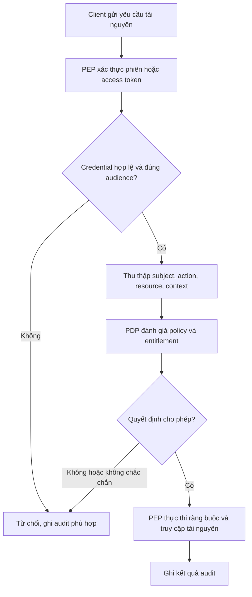
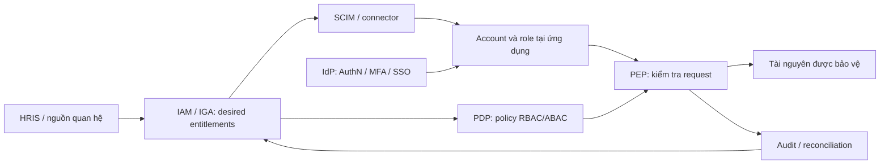

# Authorization là gì trong quản lý vòng đời danh tính IAM?

**Authorization** (*phân quyền/ủy quyền truy cập*) là quá trình xác định **một chủ thể có được phép thực hiện một hành động cụ thể trên một tài nguyên cụ thể trong ngữ cảnh hiện tại hay không**. Đây là bước bảo vệ tài nguyên sau khi hệ thống có đủ căn cứ về chủ thể và yêu cầu. Trong **Identity and Access Management (IAM)**, authorization phải gắn với vòng đời danh tính **Joiner–Mover–Leaver (JML)**: cấp quyền khi bắt đầu công việc, thay đổi quyền khi đổi vai trò và thu hồi quyền khi kết thúc quan hệ.

Ví dụ, Lan đã đăng nhập thành công bằng SSO và MFA. Lan được đọc ticket thuộc nhóm hỗ trợ của mình nhưng **không được xuất dữ liệu khách hàng toàn công ty**. Hệ thống xác thực Lan là ai; còn chính sách authorization quyết định từng thao tác được phép. Việc đăng nhập thành công **không tự tạo quyền**.

## 1. Phân biệt Authentication, Authorization và Accounting

| Hoạt động | Câu hỏi | Ví dụ |
| --- | --- | --- |
| **Identity proofing** | Người đăng ký có thật sự là chủ thể được khai báo không? | Xác minh nhân viên mới theo hồ sơ HR |
| **Authentication (AuthN)** | Ai đang kiểm soát phương thức đăng nhập? | IdP kiểm tra passkey/MFA |
| **Authorization (AuthZ)** | Chủ thể này được làm gì, trên tài nguyên nào, khi nào? | Cho phép đọc ticket thuộc dự án A |
| **Accounting/Auditing** | Ai đã yêu cầu, quyết định và thực hiện điều gì? | Lưu quyết định deny và yêu cầu API |
| **Provisioning** | Cấp tài khoản, nhóm, entitlement nào ở hệ thống đích? | SCIM tạo account và gán nhóm |
| **Deprovisioning** | Thu hồi account/quyền khi không còn căn cứ? | Gỡ role tài chính sau Mover |

**Authorization không đồng nghĩa OAuth** dù OAuth 2.0 thường được gọi là giao thức ủy quyền. OAuth giúp một client nhận quyền truy cập tài nguyên trong phạm vi được cấp; **resource server vẫn cần đánh giá scope, chủ thể, hành động, tài nguyên và chính sách cục bộ**. **OIDC ID token** dùng cho thông tin xác thực của client/RP, không phải giấy phép gọi mọi API.

## 2. Các thành phần của một quyết định phân quyền

Một quyết định authorization tối thiểu cần mô tả:

- **Subject:** nhân viên, đối tác, workload, service account hoặc tác nhân khác.
- **Action:** `read`, `create`, `update`, `approve`, `delete`, `export`...
- **Resource:** ticket, hóa đơn, hồ sơ nhân viên, API, bảng dữ liệu hoặc đối tượng nghiệp vụ.
- **Context:** tenant, dự án, thời điểm, trạng thái account, mức bảo đảm MFA, môi trường thiết bị, vị trí và rủi ro phù hợp.
- **Policy:** quy tắc định nghĩa khi nào yêu cầu được phép hoặc bị từ chối.
- **Decision:** `Permit`, `Deny` hoặc trạng thái khác theo hệ thống chính sách; ứng dụng phải xác định cách xử lý an toàn.
- **Enforcement:** điểm thực thi có khả năng chặn request, không chỉ hiện/ẩn nút ở giao diện.

Ví dụ biểu diễn một yêu cầu:

```json
{
  "subject": {
    "identityId": "EMP-2084",
    "lifecycleStatus": "active",
    "roles": ["support-reader"],
    "tenantId": "company-a"
  },
  "action": "read",
  "resource": {
    "type": "ticket",
    "id": "T-782",
    "tenantId": "company-a",
    "assignedTeam": "support-north"
  },
  "context": {
    "requestedAt": "2026-11-23T03:00:00Z"
  }
}
```

Đây là dữ liệu minh họa, không phải chuẩn JSON bắt buộc. Ứng dụng không được mặc nhiên tin các trường `roles`, `identityId` hay `tenantId` do client tự gửi; chúng phải được lấy hoặc xác minh từ nguồn tin cậy.

## 3. Luồng xử lý authorization trong hệ thống



Một kiến trúc thường dùng khái niệm:

| Thành phần | Vai trò |
| --- | --- |
| **PEP — Policy Enforcement Point** | Chặn yêu cầu và thực thi quyết định, ví dụ API gateway/endpoint/backend |
| **PDP — Policy Decision Point** | Đánh giá quy tắc, trả quyết định |
| **PIP — Policy Information Point** | Cung cấp thuộc tính đáng tin như role, trạng thái JML, owner tài nguyên |
| **PAP — Policy Administration Point** | Quản lý và xuất bản chính sách có phê duyệt |

Không phải hệ thống nào cũng triển khai bốn thành phần thành bốn dịch vụ riêng. Ứng dụng nhỏ có thể chứa chúng trong cùng một backend, nhưng vẫn cần **tách trách nhiệm logic** để kiểm tra, kiểm toán và cập nhật chính sách.

**Fail closed:** khi không thể xác minh quyền hoặc dịch vụ chính sách gặp lỗi, hành động nhạy cảm nên bị từ chối hoặc chuyển sang cơ chế dự phòng đã thiết kế, không tự cho phép toàn bộ. Đồng thời phải theo dõi lỗi để không làm gián đoạn người dùng hợp lệ kéo dài mà không có phương án vận hành.

## 4. Những mô hình authorization phổ biến

| Mô hình | Căn cứ quyết định | Ưu điểm | Giới hạn |
| --- | --- | --- | --- |
| **RBAC** | Role được gán cho subject | Dễ quản trị quyền theo vị trí/công việc | Role explosion, quyền quá rộng |
| **ABAC** | Thuộc tính subject, tài nguyên, hành động và môi trường | Biểu đạt phạm vi linh hoạt | Cần dữ liệu thuộc tính tin cậy, mới |
| **ReBAC** | Quan hệ giữa các thực thể | Phù hợp chia sẻ theo owner, nhóm, dự án | Quan hệ sâu và chính sách có thể phức tạp |
| **ACL** | Danh sách subject/group và quyền trên tài nguyên | Phù hợp file/tài nguyên cụ thể | Khó quản trị ở quy mô lớn |
| **DAC** | Chủ sở hữu tài nguyên có thể cấp quyền theo mô hình | Linh hoạt cho cộng tác | Rủi ro chia sẻ vượt chính sách tổ chức |
| **MAC** | Nhãn/phân loại và chính sách tập trung | Phù hợp môi trường kiểm soát chặt | Ít linh hoạt hơn cho nhu cầu tùy biến |

Trong IAM doanh nghiệp, **RBAC và ABAC thường được phối hợp**. RBAC có thể quyết định Lan là nhân viên hỗ trợ; ABAC giới hạn Lan chỉ xem ticket của cùng tenant và đội được giao. Một entitlement có thể được thể hiện ở IdP group, Active Directory security group hoặc role cục bộ của ứng dụng; **tên nhóm không phải bằng chứng quyền hiệu lực ở mọi hệ thống**.

## 5. Ví dụ chính sách RBAC kết hợp ABAC

```text
PERMIT read_ticket IF
    subject.lifecycle_status == "active"
    AND "support-reader" IN subject.effective_roles
    AND subject.tenant_id == resource.tenant_id
    AND resource.assigned_team IN subject.authorized_teams
ELSE DENY
```

Đây là **giả mã**, không phải cú pháp của SCIM, OIDC hay một policy engine cụ thể. Khi triển khai thực tế, việc so sánh phải chạy **phía server** với giá trị subject/resource có căn cứ; không tin tham số `tenant_id` do người dùng tùy sửa.

Ví dụ, nếu Lan thay `ticketId=T-782` bằng `ticketId=T-783` trên URL, API vẫn phải kiểm tra Lan có quyền trên **T-783**. Kiểm tra `role=support-reader` trước rồi cho phép đọc mọi ID là lỗi **Broken Object Level Authorization (BOLA/IDOR)**.

**Nguyên tắc:** kiểm tra đúng hành động và đúng đối tượng ở **mỗi điểm truy cập**, không chỉ ở màn hình trước khi mở tính năng.

## 6. Role, entitlement, permission và scope

Các thuật ngữ dễ bị dùng lẫn nhau:

- **Permission:** khả năng thực hiện một hành động trên loại tài nguyên hoặc đối tượng, ví dụ `invoice.approve`.
- **Role:** tập permission được quản trị như một đơn vị, ví dụ `finance-approver`.
- **Entitlement:** quyền lợi/quyền được cấp ở một hệ thống cụ thể, có thể là group, role, ACL hoặc license.
- **Scope (OAuth):** phạm vi được cấp cho một access token/client theo hợp đồng với authorization server và resource server.
- **Claim:** dữ liệu được phát hành trong token/assertion, chỉ có giá trị trong phạm vi tin cậy và tính mới phù hợp.
- **Policy:** quy tắc đánh giá, có thể còn phụ thuộc dữ liệu tài nguyên và ngữ cảnh.

**Scope không tự bảo đảm authorization đối tượng.** Access token có scope `orders:read` chỉ biểu đạt quyền đọc đơn hàng trong phạm vi giao thức cấp; API vẫn phải kiểm tra đơn hàng nào thuộc tenant hoặc chủ thể được phép.

Tương tự, **ID token OIDC không nên được dùng làm bearer credential cho API**. Với API, phải kiểm tra đúng loại access token, issuer, audience, thời hạn và ràng buộc phù hợp.

## 7. Vòng đời Joiner: cấp quyền có căn cứ

Khi nhân viên mới vào tổ chức, thông tin HRIS và quy trình **identity proofing** xác định danh tính, bộ phận, ngày hiệu lực và quan hệ lao động. IAM/IGA tính **desired entitlements** theo chính sách, sau đó provisioning tới AD, IdP hoặc ứng dụng đích.

Quy trình minh họa:

1. Xác minh sự kiện Joiner từ nguồn có thẩm quyền và identity ID ổn định.
2. Xác định role cơ bản cho vị trí và điều kiện ABAC như tenant, chi nhánh, dự án.
3. Gắn owner/data owner cho quyền nhạy cảm, thực hiện phê duyệt theo chính sách.
4. Tạo account và cập nhật group/entitlement qua **SCIM**, connector hoặc API ứng dụng.
5. Kích hoạt đúng thời điểm có hiệu lực; tài khoản được tạo sớm không nhất thiết được đăng nhập sớm.
6. Đọc lại trạng thái ở ứng dụng đích, kiểm thử quyền được phép và hành động bị cấm.
7. Ghi dấu vết phê duyệt, phiên bản chính sách, thời điểm cấp và kết quả.

**Least privilege** nghĩa là chỉ cấp mức quyền cần thiết cho mục đích công việc, không mặc định quyền `admin` cho mọi Joiner để “tránh phát sinh yêu cầu hỗ trợ”.

## 8. Vòng đời Mover: cộng quyền mới và gỡ quyền cũ

Khi nhân viên chuyển vị trí, IAM cần tính lại trạng thái quyền từ đầu theo role, điều kiện ABAC và các ngoại lệ còn hiệu lực. Chỉ cập nhật `department` hoặc cộng nhóm mới có thể khiến người dùng **tích lũy đặc quyền**.

| Trước Mover | Sau Mover mong muốn | Sai lệch cần loại bỏ |
| --- | --- | --- |
| `finance-reader` | `analytics-reader` | Nhóm Finance còn được gán |
| `invoice-approver` | Không còn phê duyệt hóa đơn | Role cục bộ ERP còn tồn tại |
| Phạm vi dự án A | Chỉ dự án B | ACL của dự án A chưa được gỡ |
| MFA thông thường | Step-up cho quyền mới nhạy cảm | Ứng dụng không kiểm tra assurance |

Ví dụ Hà chuyển từ Finance sang Analytics. IdP bỏ nhóm Finance, nhưng ERP lưu role phê duyệt hóa đơn trực tiếp cho account của Hà. **SSO vẫn xác thực đúng Hà**; lỗi nằm ở authorization/provisioning đích. Cần deprovision entitlement tại ERP và kiểm chứng thao tác `approve_invoice` bị từ chối.

Trong giai đoạn bàn giao có thể tồn tại **ngoại lệ quyền tạm thời đã phê duyệt**. Ngoại lệ cần owner, lý do, phạm vi và hạn hiệu lực; không để quyền cũ tồn tại vô thời hạn.

## 9. Vòng đời Leaver: thu hồi quyền truy cập thực tế

Khi quan hệ lao động hoặc hợp đồng kết thúc, authorization phải phản ánh trạng thái **không còn đủ điều kiện**. Tuy nhiên, việc disable tại IdP/AD không luôn thu hồi toàn bộ quyền ở ứng dụng.

| Lớp | Hành động sau Leaver | Cần xác minh |
| --- | --- | --- |
| IdP/SSO | Ngăn đăng nhập mới, xử lý phiên IdP | Không phát thêm xác thực hợp lệ |
| App account | Disable/deprovision qua SCIM/connector/API | Account không còn cho phép truy cập |
| Group/role/ACL | Gỡ quyền trực tiếp và kế thừa không còn căn cứ | Entitlement thực tế phù hợp |
| Session/cookie | Revoke hoặc buộc kiểm tra trạng thái theo chính sách | Phiên cũ không thực thi quyền trái phép |
| Refresh/access token | Thu hồi khi hỗ trợ, kiểm soát TTL và enforcement | API không chấp nhận quyền đã mất hiệu lực |
| API key/service credential | Thu hồi hoặc xoay bí mật có liên quan | Không còn đường truy cập độc lập |

**Một JWT tự chứa có thể vẫn được API chấp nhận đến khi hết hạn** nếu API không có cơ chế kiểm tra revoke/trạng thái mới. Vì vậy, “Leaver hoàn tất” cần được đánh giá bằng **khả năng truy cập thực tế** và kết quả readback, không chỉ bằng trạng thái workflow.

## 10. IdP, SSO, SCIM và authorization phối hợp thế nào?



Sơ đồ là mô hình khái niệm: trong thực tế, PDP có thể nằm ngay trong ứng dụng, IdP có thể đọc thuộc tính từ AD và ứng dụng có thể dùng nhiều nguồn entitlement.

**OIDC/SAML xác thực không thay thế SCIM provisioning; SCIM provisioning không tự thực thi authorization; RBAC/ABAC không thay thế AuthN.** Ba lớp cần khớp nhau theo đúng trạng thái JML để tránh quyền dư.

## 11. Kiểm soát tenant, resource ownership và dữ liệu nhạy cảm

Authorization phải kiểm tra **ranh giới dữ liệu** chứ không chỉ chức năng. Một partner có role `order-reader` không được đọc mọi đơn hàng của các partner khác.

Ví dụ:

```text
PERMIT read_order IF
    subject.partner_id == resource.partner_id
    AND resource.contract_id IN subject.active_contracts
    AND "order-reader" IN subject.roles
    AND subject.status == "active"
ELSE DENY
```

Khi triển khai, tenant/resource ownership phải được lấy từ dữ liệu server, không phụ thuộc client đưa giá trị đúng. Với truy vấn danh sách, phải lọc dữ liệu ngay trong truy vấn hoặc tầng dữ liệu có thực thi chính sách; **không truy xuất mọi bản ghi rồi chỉ ẩn trên UI**.

Ngoài quyền truy cập đối tượng, cần kiểm soát **field-level authorization**: người dùng có thể xem thông tin đơn hàng nhưng không được thấy số giấy tờ cá nhân hoặc trường nhạy cảm. Với tác vụ cập nhật, tránh **mass assignment** khiến client sửa những trường chỉ admin được phép thay đổi.

## 12. Tài khoản dịch vụ và workload identity

Authorization không chỉ dành cho người dùng. **Service account/workload identity** có thể gọi API theo lịch, xử lý hàng đợi hoặc trao đổi dữ liệu hệ thống.

Chính sách phải xác định:

- Workload nào được xác thực, từ môi trường nào và được quản trị bởi owner nào.
- API/resource nào được gọi, với audience, scope và quyền tối thiểu ra sao.
- Credential ngắn hạn, chứng thư hoặc workload identity federation được quản lý thế nào.
- Có cần giới hạn tenant, namespace, dự án hoặc môi trường sản xuất không.
- Cách xoay/thu hồi credential, thay owner và deprovision khi workload kết thúc.

Không dùng access token cá nhân dài hạn của nhân viên để chạy job sản xuất. Khi người tạo job nghỉ việc, cần thu hồi **quyền quản trị của cá nhân**, chuyển owner workload và đánh giá credential; không tự xóa workload đang vận hành mà chưa biết phụ thuộc.

## 13. SoD, JIT và quyền đặc quyền

**Segregation of Duties (SoD)** tránh một chủ thể có đồng thời các quyền xung đột, ví dụ vừa tạo vừa tự duyệt khoản thanh toán. **Just-in-Time (JIT) access** có thể cho phép cấp đặc quyền tạm thời theo yêu cầu đã được phê duyệt.

| Kiểm soát | Áp dụng | Rủi ro giảm được |
| --- | --- | --- |
| **Least privilege** | Bộ quyền tối thiểu theo nhiệm vụ | Quyền rộng không cần thiết |
| **SoD** | Tách quyền tạo, duyệt, kiểm tra giao dịch | Gian lận hoặc tự phê duyệt |
| **JIT privileged access** | Quyền admin có hạn, theo lý do và owner | Đặc quyền tồn tại lâu dài |
| **Periodic access review** | Owner xác nhận entitlement còn cần thiết | Quyền lỗi thời sau Mover |
| **Step-up authentication** | Yêu cầu assurance cao cho thao tác nhạy cảm | Rủi ro dùng phiên yếu để làm việc nhạy cảm |
| **Deny by default** | Khi không có quyết định hợp lệ | Truy cập ngầm được phép |

**Step-up MFA không tự cấp quyền**: người dùng vừa xác thực mạnh hơn vẫn phải có entitlement và policy permit cho tài nguyên cụ thể.

## 14. Những lỗi authorization thường gặp

| Lỗi | Ví dụ | Cách phòng tránh |
| --- | --- | --- |
| **BOLA/IDOR** | Đổi `documentId` trên URL để xem tài liệu người khác | Kiểm quyền theo từng object |
| **Broken Function Level Authorization** | Người dùng thường gọi endpoint `/admin/export` | Kiểm quyền ở backend theo action |
| **Cross-tenant access** | Token tenant A truy cập dữ liệu tenant B | Kiểm tenant ở dữ liệu và API |
| **Stale entitlement** | Mover mất role nhưng phiên cũ giữ claim | Kiểm tra trạng thái quyền mới, TTL và revoke |
| **Privilege escalation** | User tự gửi `role=admin` khi cập nhật hồ sơ | Không tin thuộc tính do client tự chỉnh |
| **Group nesting blind spot** | Bỏ sót quyền kế thừa qua nhóm | Đối soát quyền hiệu lực và ACL |
| **Fail-open** | PDP lỗi thì ứng dụng cho qua | Chính sách từ chối mặc định và fallback được phê duyệt |
| **Overly broad OAuth scope** | Service token có scope rộng hơn nhu cầu | Scope và audience tối thiểu |
| **Orphan account** | Không còn owner nhưng role vẫn active | Reconciliation và deprovision JML |

Kiểm tra giao diện không đủ: ẩn nút “Xóa” chỉ là trải nghiệm, **backend phải từ chối request xóa nếu chủ thể không đủ quyền**. Ngoài ra, policy cần được kiểm tra với dữ liệu thực tế; role đúng nhưng bộ lọc tài nguyên sai vẫn gây rò dữ liệu.

## 15. Thiết kế policy và kiểm thử có hệ thống

Một quy trình quản trị authorization nên gồm:

1. **Định nghĩa tài nguyên và hành động:** lập danh mục API, loại đối tượng, field nhạy cảm.
2. **Xác định nguồn chân lý:** HR/JML cho trạng thái quan hệ, IAM cho entitlement, chủ dữ liệu cho quyền dự án.
3. **Viết chính sách có owner:** nêu điều kiện permit/deny, ngoại lệ, ngày hiệu lực và phiên bản.
4. **Chọn điểm thực thi:** backend, API gateway, database policy hoặc service mesh phù hợp; tránh chỉ dựa trên UI.
5. **Kiểm thử cả permit và deny:** đối tượng cùng/khác tenant, người đủ/thiếu quyền, resource chuyển owner.
6. **Kiểm tra thay đổi vòng đời:** Joiner chưa đến ngày, Mover đổi role, Leaver còn phiên cũ.
7. **Triển khai và quan sát:** theo dõi quyết định, lỗi PDP/PIP, thay đổi policy và sự cố truy cập.
8. **Đối soát định kỳ:** so desired entitlement với observed entitlement tại ứng dụng đích.

Ví dụ ma trận kiểm thử:

| Subject | Action | Resource | Kỳ vọng |
| --- | --- | --- | --- |
| Support active | Read | Ticket cùng team/tenant | Permit |
| Support active | Read | Ticket tenant khác | Deny |
| Support active | Export all | Toàn bộ dữ liệu khách hàng | Deny |
| Finance đã Mover | Approve | Hóa đơn cũ | Deny |
| Leaver còn cookie cũ | Read | Bất kỳ ticket công ty | Deny |
| Service account read-only | Delete | Báo cáo sản xuất | Deny |

Không mặc định các ca **Permit** đều thành công nếu thiếu điều kiện phụ khác; ma trận này minh họa một chính sách giả định để người học thấy cách kiểm thử theo **subject–action–resource–context**.

## 16. Audit, reconciliation và đo chất lượng

Các log quan trọng gồm **subject/account ID**, loại hành động, tài nguyên (theo quy định dữ liệu), policy version, quyết định permit/deny, thời điểm, hệ thống/tenant, correlation ID và nguồn thay đổi quyền. Với dữ liệu nhạy cảm cần tránh log tràn nội dung hồ sơ. **Không ghi access token, refresh token, cookie hay private key** vào log thông thường.

Các chỉ số nên theo dõi:

- **Excess entitlement count:** quyền tại đích vượt quyền mong muốn.
- **Mover residual access:** quyền vai trò cũ chưa được thu hồi.
- **Leaver time to deny:** thời gian từ sự kiện chấm dứt đến khi truy cập thực tế bị từ chối.
- **Policy coverage:** tỷ lệ API/resource có kiểm tra authorization ở backend.
- **Cross-tenant negative tests:** kết quả thử truy cập giữa tenant.
- **SoD violation count:** quyền xung đột chưa được khắc phục.
- **Orphan/ownerless entitlement:** quyền thiếu identity hoặc owner đáng tin.
- **Access review completion:** quyền được owner xác nhận hoặc thu hồi đúng hạn.

**Tỷ lệ 99% account khớp** vẫn có thể che một quyền quản trị tồn dư rất nguy hiểm. Cần phân lớp theo rủi ro và khả năng ảnh hưởng dữ liệu.

## 17. Tình huống tự kiểm tra

**Tình huống A:** Lan đăng nhập thành công qua IdP bằng passkey nhưng không có role `finance-approver`. Có được duyệt hóa đơn không? **Không.** Authentication không tạo permission.

**Tình huống B:** API kiểm tra scope `orders:read` nhưng không kiểm tra tenant của từng đơn hàng. Có đủ an toàn không? **Không.** Cần authorization cấp đối tượng và tenant.

**Tình huống C:** Hà đã Mover, IdP gỡ nhóm Finance nhưng ERP còn role quản trị gán trực tiếp. Quy trình đã hoàn tất chưa? **Chưa.** Phải deprovision quyền tại ERP và readback.

**Tình huống D:** Nhân viên Leaver không đăng nhập SSO mới được nhưng cookie CRM cũ vẫn xem ticket. Chỉ disable IdP đã đủ chưa? **Chưa.** Cần chặn phiên và quyền ở CRM.

**Tình huống E:** PDP gặp lỗi, ứng dụng quyết định mặc định `Permit` để người dùng không bị gián đoạn. Có phù hợp không? **Không với hành động nhạy cảm.** Cần fail closed hoặc phương án dự phòng đã được kiểm soát.

**Tình huống F:** Workload có quyền đọc báo cáo nhưng token được dùng để xóa dữ liệu. Có nên cho phép vì workload đã xác thực? **Không.** API phải kiểm tra đúng scope, action và resource.

## Ghi nhớ

**Authorization** quyết định **ai được làm gì, trên tài nguyên nào và trong ngữ cảnh nào**. Nó khác authentication và phải được thực thi tại backend hoặc điểm bảo vệ tài nguyên, theo **least privilege**, **deny by default** và mô hình như **RBAC/ABAC**. Trong **IAM Joiner–Mover–Leaver**, **IdP/SSO** cung cấp chứng cứ xác thực, **SCIM/connector** đồng bộ account và entitlement, còn **authorization, đối soát và audit** xác minh quyền thực sự được cấp, cập nhật và thu hồi. Đó là cách hạn chế quyền truy cập tồn dư của con người, đối tác và service account.
