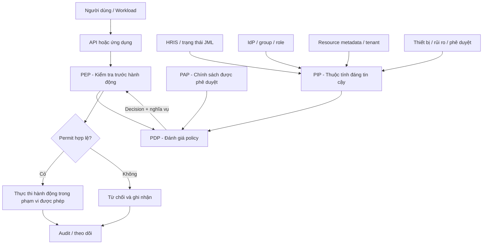
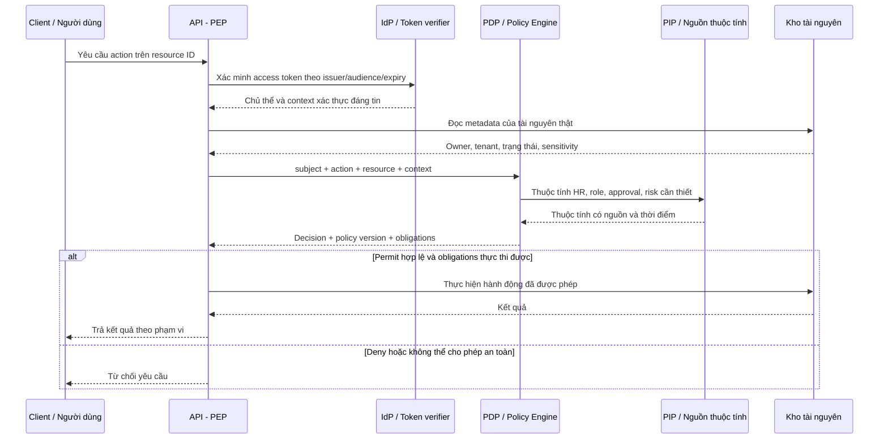

# Policy decision trong Authorization: Ra quyết định cho phép hay từ chối truy cập

**Policy decision** là kết quả đánh giá **một yêu cầu truy cập cụ thể** theo các chính sách ủy quyền (*authorization policies*). Hệ thống cần trả lời: **chủ thể nào** đang yêu cầu **hành động gì**, trên **tài nguyên nào**, trong **ngữ cảnh nào**, và có đủ căn cứ để **cho phép (Permit)** hay phải **từ chối (Deny)**? Đây là bước cốt lõi của **Authorization**: xác định một yêu cầu đã được xác thực có thực sự được phép thực hiện hay không.

Trong module `SECURITY_IDENTITY_ACCESS_MANAGEMENT_IDENTITY_LIFECYCLE`, policy decision liên kết dữ liệu danh tính có thẩm quyền, IdP, SSO, SCIM, RBAC/ABAC, tài khoản dịch vụ, kiểm toán và vòng đời **Joiner–Mover–Leaver (JML)**. Quyền của một người có thể thay đổi từ lúc được tuyển dụng, chuyển bộ phận đến khi nghỉ việc; vì vậy một quyết định truy cập an toàn không được chỉ dựa trên việc người đó **đã từng đăng nhập thành công** hoặc **đã từng có một role**.

Sau bài học, bạn có thể phân biệt authentication với authorization; mô tả các thành phần **PDP, PEP, PIP, PAP**; thiết kế đầu vào quyết định theo subject–action–resource–environment; hiểu các kết quả Permit, Deny, NotApplicable và Indeterminate; xử lý xung đột chính sách, dữ liệu lỗi thời và lỗi nguồn thuộc tính; kiểm thử quyết định trong Joiner–Mover–Leaver và xây dựng bằng chứng kiểm toán.

## 1. Policy decision không phải authentication

**Authentication** xác minh danh tính người hoặc ứng dụng đang yêu cầu. **Authorization** quyết định họ được phép thực hiện hành động nào. Hai việc liên quan nhưng không thay thế nhau.

| Câu hỏi | Cơ chế liên quan | Ví dụ |
| --- | --- | --- |
| **Ai đang yêu cầu?** | IdP/SSO, MFA, OIDC và xác thực workload | Tài khoản `iam-user-1042` đăng nhập qua IdP |
| **Chủ thể đang muốn làm gì?** | Yêu cầu API/ứng dụng: action, resource | `approve` giao dịch `payment-782` |
| **Chủ thể có được phép không?** | Policy decision theo RBAC/ABAC, SoD, trạng thái JML | Chỉ người phê duyệt được duyệt giao dịch thuộc đơn vị được giao |
| **Kết quả được thực thi ở đâu?** | Policy Enforcement Point, API hoặc dịch vụ tài nguyên | API từ chối trả kết quả nếu decision không phải Permit hợp lệ |
| **Có bằng chứng không?** | Audit, trace, policy version, dữ liệu đã dùng | Lưu mã quyết định, phiên bản chính sách và kết quả |

Ví dụ, nhân viên An đăng nhập bằng passkey hoặc mật khẩu + MFA. Điều đó chứng minh phiên xác thực đáp ứng chính sách tại IdP, **không chứng minh An được phê duyệt mọi khoản thanh toán**. Ứng dụng tài chính phải tiếp tục xét role phê duyệt, phạm vi đơn vị, hạn mức giao dịch và phân tách nhiệm vụ (*Separation of Duties* — **SoD**).

**Token OAuth có chữ ký hợp lệ** cũng chưa phải quyết định cho mọi tài nguyên: API cần xác minh token dành cho mình, scope/role có ý nghĩa phù hợp và chính sách trên **hành động cùng đối tượng cụ thể**. ID token của OIDC chủ yếu phục vụ xác thực tại Relying Party, không được sử dụng như access token API.

## 2. Một policy decision cần những dữ liệu gì?

Một mô hình khái niệm thường dùng là **subject–action–resource–environment**:

| Nhóm đầu vào | Ý nghĩa | Ví dụ minh họa |
| --- | --- | --- |
| **Subject** | Danh tính và các thuộc tính đáng tin cậy của chủ thể | `identityId`, trạng thái nhân sự, role, đơn vị, mức xác thực |
| **Action** | Thao tác cụ thể đang được yêu cầu | `document.read`, `payment.approve`, `user.disable` |
| **Resource** | Đối tượng được tác động và thuộc tính của nó | Document ID, tenant, chủ sở hữu, độ nhạy cảm, trạng thái tài nguyên |
| **Environment** | Ngữ cảnh được chính sách sử dụng | Thời điểm, thiết bị, tín hiệu rủi ro, mạng, phiên truy cập |
| **Policy context** | Phiên bản, quyền ngoại lệ/phê duyệt và cấu hình chính sách | `policyVersion`, thời hạn quyền tạm, ràng buộc SoD |

Khi thiết kế policy decision, nên bắt đầu từ **một yêu cầu đủ cụ thể** thay vì câu hỏi mơ hồ “người này có quyền admin không?”. Cùng một người có thể được đọc tài liệu thuộc phòng ban A nhưng bị từ chối đọc tài liệu của B; được sửa một bản nháp nhưng không được tự phê duyệt tài liệu mình tạo.

Ví dụ một request đánh giá chính sách:

```json
{
  "subject": {
    "identityId": "iam-user-1042",
    "employmentStatus": "ACTIVE",
    "roles": ["finance-approver"],
    "allowedOrgIds": ["org-17"],
    "authenticationLevel": "strong"
  },
  "action": "payment.approve",
  "resource": {
    "type": "payment",
    "id": "payment-782",
    "orgId": "org-17",
    "amount": 25000000,
    "createdBy": "iam-user-2099"
  },
  "environment": {
    "deviceManaged": true,
    "requestTime": "2026-12-01T02:10:00Z"
  }
}
```

Các giá trị trên **chỉ minh họa cấu trúc dữ liệu**, không phải hợp đồng API của sản phẩm cụ thể. Trong ứng dụng thật, `employmentStatus`, `roles`, `deviceManaged` và `createdBy` cần được lấy hoặc kiểm tra từ **nguồn tin cậy**, không để client HTTP tự gửi rồi được tin vô điều kiện. `requestTime` cũng phải đến từ đồng hồ có thẩm quyền của hệ thống đánh giá, không lấy thời gian do người yêu cầu tự khai báo để vượt hạn quyền.

## 3. Kiến trúc PAP – PIP – PDP – PEP

Một kiến trúc authorization thường dùng bốn vai trò:

- **Policy Administration Point (PAP):** nơi chính sách được soạn, phê duyệt, quản lý phiên bản và công bố.
- **Policy Information Point (PIP):** nơi cung cấp thuộc tính cần để ra quyết định, ví dụ HRIS, directory, IdP, resource database, trạng thái thiết bị và phê duyệt.
- **Policy Decision Point (PDP):** thành phần **đánh giá chính sách** và trả về decision cho một yêu cầu.
- **Policy Enforcement Point (PEP):** thành phần **thực thi** kết quả bằng cách cho phép hoặc chặn thao tác tại API, ứng dụng hoặc gateway thích hợp.



**PDP ra quyết định; PEP phải thực thi.** Nếu PDP trả Deny nhưng API vẫn thực hiện cập nhật dữ liệu, policy về thực chất không có hiệu lực. Nếu hệ thống chỉ ẩn nút “Duyệt” ở giao diện nhưng endpoint `POST /payments/{id}/approve` không kiểm tra quyền, người dùng vẫn có thể gọi API trực tiếp.

Các vai trò không nhất thiết được triển khai thành bốn sản phẩm tách biệt. Một ứng dụng nhỏ có thể có PDP trong cùng tiến trình với API và PEP ở tầng service; một tổ chức lớn có thể dùng dịch vụ PDP chung. Ranh giới **trách nhiệm** mới là điều quan trọng: chính sách có nguồn quản trị, thuộc tính có nguồn đáng tin, quyết định có kiểm chứng và thao tác được chặn đúng nơi.

### PDP tập trung và PDP nhúng

| Phương án | Ưu điểm | Vấn đề phải giải quyết |
| --- | --- | --- |
| **PDP tập trung** | Dễ quản trị/kiểm toán chính sách trên nhiều ứng dụng | Độ trễ mạng, độ sẵn sàng, cache, phân vùng và cách xử lý khi dịch vụ quyết định lỗi |
| **PDP nhúng trong service** | Quyết định gần tài nguyên, giảm round-trip | Phân phối policy, nhất quán phiên bản và quan sát quyết định giữa các service |
| **Hybrid** | Guardrail trung tâm kết hợp chính sách cục bộ theo tài nguyên | Định nghĩa rõ ưu tiên deny, trách nhiệm thực thi và thứ tự đánh giá |

**Không có kiến trúc duy nhất cho mọi hệ thống.** Với quyền trên bản ghi dữ liệu, PEP đặt trong service hiểu tài nguyên thường cần thiết ngay cả khi gateway đã xác minh access token.

## 4. Kết quả đánh giá: Permit, Deny, NotApplicable, Indeterminate

Ở một số mô hình policy engine, chẳng hạn mô hình khái niệm của XACML, decision có thể gồm:

| Kết quả | Ý nghĩa | PEP nên xử lý khi cần bảo vệ tài nguyên |
| --- | --- | --- |
| **Permit** | Các policy liên quan cho phép yêu cầu, với điều kiện/obligation áp dụng | Chỉ cho thực thi nếu decision hợp lệ và những điều kiện thực thi đã được đáp ứng |
| **Deny** | Chính sách xác định yêu cầu không được phép | Từ chối |
| **NotApplicable** | Không có policy được đánh giá là áp dụng cho yêu cầu | Mặc định từ chối khi không tồn tại cơ chế cho phép khác đã được thiết kế rõ |
| **Indeterminate** | Không thể quyết định đúng vì lỗi, thiếu thuộc tính, sai kiểu hoặc kết quả bất định | Không tự chuyển thành Permit; từ chối hoặc dùng quy trình ngoại lệ được duyệt |

**Không phải mọi sản phẩm trả chính xác bốn giá trị này.** Một policy engine đơn giản có thể chỉ trả boolean và lỗi; một engine khác có nhiều biến thể Indeterminate. Mục đích phân biệt là tránh **coi thiếu dữ liệu hoặc không có rule phù hợp là được phép**.

Ví dụ:

- Subject không có `finance-approver` → **Deny** nếu rule yêu cầu role đó.
- Subject hợp lệ yêu cầu một action mà bộ policy này không quản lý → **NotApplicable**; PEP cần có chính sách mặc định phù hợp.
- Không đọc được thuộc tính `employmentStatus` từ nguồn bắt buộc → **Indeterminate**, không giả định `ACTIVE`.
- Subject có role, thuộc đúng tổ chức, giao dịch trong hạn mức và không vi phạm SoD → có thể **Permit** nếu không còn điều kiện chặn khác.

### Nguyên tắc deny by default

Với tài nguyên cần bảo vệ, thiết kế nên áp **default deny**: không cấp quyền chỉ vì thiếu rule, thiếu thuộc tính hoặc PDP gặp lỗi. Tuy nhiên phải tách biệt **quyết định bảo mật** với **quy trình phục hồi vận hành**. Nếu PDP không sẵn sàng, có thể cần lối xử lý khẩn cấp (*break-glass*) được phê duyệt, xác thực mạnh, giới hạn phạm vi/thời gian và kiểm toán; **không nên tự động cho tất cả request qua** để giảm lỗi dịch vụ.

## 5. Chính sách RBAC, ABAC và các điều kiện bổ sung

### 5.1. RBAC: từ role đến quyền

**Role-Based Access Control (RBAC)** dựa trên các vai trò như `sales-agent`, `finance-approver` hoặc `support-reader`. Quyết định có thể bắt đầu từ việc chủ thể có role phù hợp với action hay không.

```text
PERMIT payment.approve nếu:
    subject có role "finance-approver"

DENY nếu:
    subject không có role phù hợp
```

Quy tắc này **chưa đủ an toàn để đưa vào production**: nó chưa kiểm tra trạng thái tài khoản, giới hạn tổ chức, xung đột nhiệm vụ, hạn mức hoặc ngữ cảnh. Đặc biệt, việc một nhóm IdP có tên `finance-approver` không bảo đảm chính sách ứng dụng đã ánh xạ đúng nó thành một quyền phê duyệt.

### 5.2. ABAC: bổ sung thuộc tính và tài nguyên

**Attribute-Based Access Control (ABAC)** đánh giá thuộc tính của chủ thể, tài nguyên, hành động và môi trường. Ví dụ:

```text
PERMIT payment.approve khi đồng thời:
    subject.employmentStatus == ACTIVE
    AND subject.hasRole("finance-approver")
    AND resource.orgId thuộc subject.allowedOrgIds
    AND resource.createdBy != subject.identityId
    AND resource.amount <= subject.approvalLimit
    AND subject.authenticationLevel đáp ứng chính sách
    AND environment.deviceTrusted == true
    AND không có deny/SoD có hiệu lực
```

Đây là **giả mã chính sách**, không phải cú pháp chuẩn của OPA, XACML, Cedar hoặc một IdP cụ thể. Trong triển khai thật, `approvalLimit`, `deviceTrusted` và những điều kiện khác cần ngữ nghĩa xác định; khi thuộc tính vắng mặt hoặc không đáng tin, policy phải có hành vi rõ ràng thay vì chọn giá trị “thuận tiện nhất”.

### 5.3. RBAC và ABAC bổ sung cho nhau

RBAC giúp quản lý gói quyền theo công việc. ABAC giới hạn phạm vi dựa vào thuộc tính có thể thay đổi mà không cần tạo hàng nghìn role:

- Role `sales-agent` cho phép dùng chức năng xem khách hàng.
- Thuộc tính `allowedRegions` giới hạn khách hàng thuộc những khu vực được giao.
- Tài nguyên có `tenantId` buộc phải khớp tenant được phép.
- Policy về trạng thái Leaver chặn quyền bất kể role được cache cũ.

**Không thay kiểm soát authorization bằng kiểm tra giao diện.** API phải xác minh role và phạm vi của **đối tượng thực tế được truy cập**, kể cả khi client thay một ID trong URL để thử đọc tài nguyên người khác.

## 6. Policy combining: khi nhiều quy tắc cùng áp dụng

Một hệ thống thường có nhiều policy đồng thời: chính sách nghiệp vụ cho phép, chính sách tenant giới hạn, chính sách SoD từ chối, và guardrail đặc quyền yêu cầu MFA mạnh. Cần định nghĩa **cách kết hợp** rõ ràng.

| Cách kết hợp thường gặp | Ngữ nghĩa khái niệm | Lưu ý |
| --- | --- | --- |
| **Deny-overrides** | Nếu một policy hợp lệ trả Deny, Deny được ưu tiên trong điều kiện combining đã định | Phù hợp guardrail nghiêm ngặt, nhưng phải xử lý Indeterminate theo quy tắc engine |
| **Permit-overrides** | Nếu một policy cho phép theo thuật toán, Permit có thể chiếm ưu tiên | Nguy hiểm nếu dùng ở nơi cần deny bảo mật có hiệu lực tuyệt đối |
| **First-applicable** | Áp kết quả của policy đầu tiên phù hợp theo thứ tự | Thứ tự thay đổi có thể đổi kết quả; cần review/test |
| **Only-one-applicable** | Chỉ chấp nhận khi một policy duy nhất áp dụng theo quy tắc engine | Hữu ích để phát hiện policy chồng lấp, cần xử lý trường hợp nhiều policy |
| **All-of / kiểm tra nhiều lớp** | Mọi guardrail bắt buộc phải đạt, sau đó mới xét quyền nghiệp vụ | Rõ ràng cho trạng thái danh tính, tenant, SoD và rủi ro |

Tên và chi tiết combining tùy engine. **Không được mặc định “có ít nhất một Permit thì cho qua”**, vì điều đó có thể vô hiệu hóa policy Deny về Leaver, tenant isolation hoặc phân tách nhiệm vụ.

### Ví dụ xung đột policy

Một nhân viên có role `finance-approver` nên rule nghiệp vụ trả Permit. Nhưng giao dịch do chính nhân viên đó tạo, nên policy SoD trả Deny.

| Policy | Kết quả riêng | Lý do |
| --- | --- | --- |
| Role `finance-approver` | Permit | Có vai trò phê duyệt |
| Cùng người tạo và duyệt | Deny | Vi phạm SoD |
| Account còn hiệu lực | Permit | HR/IAM ghi nhận đang hoạt động |
| Tenant phù hợp | Permit | Đúng tổ chức/tài nguyên |
| **Decision tổng** | **Deny** | Chính sách SoD là guardrail bắt buộc |

Để bảo đảm kết quả này, cần thiết kế **policy combining và thứ tự ưu tiên** tương ứng; không chỉ viết các rule độc lập rồi hy vọng engine tự hiểu.

### Obligation và advice

Một số engine có thể trả kèm:

- **Obligation:** hành động bắt buộc PEP phải thực hiện để áp Permit/Deny đúng, ví dụ che trường nhạy cảm hoặc ghi audit đặc biệt.
- **Advice:** thông tin hướng dẫn, ví dụ lý do thân thiện để hiển thị hoặc đề nghị step-up.

Nếu một Permit yêu cầu obligation mà PEP **không thể thực thi**, không nên cho phép truy cập như thể nghĩa vụ đã hoàn thành. Cần định nghĩa rõ obligation nào bắt buộc, kiểm tra hỗ trợ của PEP và cách xử lý khi thất bại.

## 7. Quy trình đánh giá một yêu cầu tại API



Trong sản phẩm thực, IdP không nhất thiết được gọi trực tuyến mỗi request: API có thể xác minh JWT cục bộ hoặc introspect token theo năng lực hạ tầng. Điểm quan trọng là **PEP không lấy role, tenant hay `createdBy` từ thông tin client tự khai báo nếu chưa được chứng thực**.

### Giả mã một PEP kết hợp PDP

```text
handleApprovePayment(httpRequest):
    principal = authenticateAndValidateAccessToken(httpRequest)
    if principal is invalid:
        return AUTHENTICATION_FAILURE

    payment = loadPaymentById(httpRequest.path.paymentId)
    if payment does not exist:
        return RESOURCE_NOT_FOUND

    decisionRequest = {
        subject: trustedIdentityAndSession(principal),
        action: "payment.approve",
        resource: trustedPaymentMetadata(payment),
        environment: trustedRequestContext()
    }

    decision = policyEngine.evaluate(decisionRequest)
    if decision.effect != PERMIT:
        auditDecisionWithoutSecrets(decision, decisionRequest)
        return ACCESS_DENIED

    if not enforceRequiredObligations(decision.obligations):
        return ACCESS_DENIED

    atomically:
        recheckSecurityCriticalResourceState(payment)
        applyApprovalIfStillPermitted(payment, principal)

    auditDecisionWithoutSecrets(decision, decisionRequest)
    return APPROVAL_SUCCESS
```

Giả mã nhằm **giải thích trách nhiệm**, không phải mã production. Một hệ thống thanh toán thực cần bảo vệ **thay đổi trạng thái đồng thời**: giao dịch có thể được chuyển tổ chức, thay người tạo, nâng hạn mức hoặc đã được duyệt ngay sau khi PDP đánh giá. Kiểm tra và cập nhật các điều kiện trọng yếu cần được gắn với cơ chế giao dịch/khóa/version phù hợp, tránh lỗi **time-of-check to time-of-use (TOCTOU)**.

### Quyền tại resource server không chỉ là kiểm tra nút giao diện

Ví dụ `GET /documents/42` phải xét **document 42** có thuộc phạm vi của chủ thể hay không. Nếu chỉ kiểm tra rằng user có scope `documents.read` rồi trả mọi document ID được truyền vào, hệ thống có thể gặp lỗi kiểm soát truy cập ở cấp đối tượng (*Broken Object Level Authorization*, BOLA/IDOR).

Để giảm rủi ro, PEP/API cần thực thi chính sách trên **đúng resource ID, tenant, owner và action**, không chỉ trên route hoặc tên chức năng.

## 8. Nguồn thuộc tính, độ tin cậy và giới hạn thời gian

Một policy decision chỉ đáng tin khi **dữ liệu đầu vào đáng tin**. Ví dụ rule `subject.employmentStatus == ACTIVE` là vô nghĩa nếu caller có thể tự gán `ACTIVE` trong JSON request.

| Thuộc tính | Nguồn có thể có thẩm quyền | Nguy cơ khi dùng sai |
| --- | --- | --- |
| Quan hệ lao động, ngày bắt đầu/kết thúc | HRIS hoặc hệ thống quản lý nhà thầu đã duyệt | Leaver bị coi còn hoạt động hoặc Joiner được cấp quá sớm |
| `identityId` / quan hệ account | IAM/IdP đã đối chiếu với định danh ổn định | Ghép sai người, nhất là khi đổi email hoặc username |
| Role, entitlement, SoD | IAM governance và chính sách đã phê duyệt | Quyền cấp trực tiếp chưa được rà soát hoặc role cũ còn tồn dư |
| Tenant, owner, trạng thái tài nguyên | Database/service quản lý tài nguyên | Client tự đổi tenant trong request để đọc dữ liệu người khác |
| Thiết bị quản lý/compliant | Hệ thống endpoint hoặc nguồn tín hiệu tin cậy | Tin vào header `deviceCompliant: true` tự khai báo |
| Mức xác thực | Context IdP/session đã được kiểm chứng | Chỉ kiểm tra user có MFA đăng ký, không kiểm tra mức xác thực cho phiên hiện tại |
| Thời gian, thời hạn ngoại lệ | Đồng hồ hệ thống và approval store có thẩm quyền | Cấp quyền tạm vô hạn vì dùng timestamp do client truyền |

### Không chỉ đọc dữ liệu — phải biết dữ liệu còn mới không

HR xác nhận một nhân viên chuyển bộ phận lúc 09:00. Group IdP cập nhật lúc 09:01 nhưng access token phát lúc 08:55 vẫn chứa role cũ. Nếu API chỉ tin token đến 10:00, người đó có thể tiếp tục thao tác bằng quyền không còn hợp lệ.

Một chính sách phải cân nhắc **độ nhạy cảm của action và độ mới của thuộc tính**:

- Quyền đọc dữ liệu ít nhạy cảm có thể chấp nhận cache ngắn theo chính sách.
- Quyền quản trị hoặc duyệt giao dịch có thể yêu cầu kiểm tra trạng thái/entitlement mới hơn, session step-up hoặc thời hạn token ngắn.
- Khi Leaver khẩn cấp, cần cách chặn truy cập ở PEP/API theo cơ chế phù hợp, không chỉ chờ một access token cũ tự hết hạn.

**Không có TTL duy nhất phù hợp mọi tài nguyên.** Hệ thống nên định nghĩa giới hạn dữ liệu lỗi thời theo rủi ro và thực hiện đối soát sau mỗi sự kiện JML có tác động lớn.

## 9. Policy decision trong Joiner–Mover–Leaver

### 9.1. Joiner — đủ danh tính chưa có nghĩa đủ quyền

HR tạo hồ sơ nhân viên mới, IAM provision user tại IdP và tạo account tại ứng dụng qua SCIM. Trước ngày bắt đầu công việc, user có thể đã hoàn tất enrollment MFA, nhưng **quyền truy cập dữ liệu** vẫn phải tuân theo `effectiveAt` và chính sách.

Ví dụ:

| Trạng thái Joiner | Subject và policy context | Decision với `crm.customer.read` |
| --- | --- | --- |
| Account đã được chuẩn bị, ngày bắt đầu ở tương lai | Chưa đến thời điểm hiệu lực | Deny |
| Đến ngày bắt đầu, chưa có role bán hàng được phê duyệt | Thiếu căn cứ quyền | Deny |
| Đang hoạt động, có `sales-agent`, đúng phạm vi vùng | Thuộc tính, role và resource hợp lệ | Có thể Permit |
| Đang hoạt động nhưng CRM chưa có account do lỗi SCIM | PDP có thể trả Permit theo chính sách, PEP/ứng dụng vẫn không thể thực thi | Không tuyên bố truy cập thành công; cần xử lý provisioning |

**Provisioning và policy decision khác nhau:** provisioning tạo/cập nhật tài khoản hoặc entitlement; decision đánh giá một yêu cầu cụ thể tại thời điểm truy cập. Hệ thống tốt cần **cả hai** và kiểm tra đầu cuối.

### 9.2. Mover — gỡ quyền cũ, không chỉ cấp role mới

Khi nhân viên từ `sales-agent` chuyển sang `audit-reader`, IAM tính lại entitlement và áp các thay đổi nhóm qua IdP/SCIM/API. Nhưng nếu PDP vẫn nhận role bán hàng cũ từ cache hoặc access token, quyền sai có thể tiếp tục có hiệu lực.

Hướng xử lý:

1. Xác minh sự kiện Mover, role mới và `effectiveAt` từ nguồn có thẩm quyền.
2. Cập nhật policy/assignment theo vai trò mới, xử lý quyền thừa, quyền cấp trực tiếp và ngoại lệ tạm.
3. Kiểm tra xung đột SoD: quyền mới và quyền cũ không được đồng thời mở hành động trái chính sách.
4. Điều chỉnh group/entitlement ở IdP và ứng dụng, đồng thời đặt giới hạn cache/phiên phù hợp.
5. Đối soát **quyền hiệu lực**, không chỉ trạng thái group trung tâm.

**Ví dụ:** người từng tạo giao dịch được chuyển sang role phê duyệt. Rule theo role mới có thể Permit, nhưng nếu người đó **đang phê duyệt giao dịch mình từng tạo**, policy SoD vẫn phải Deny. Việc xóa role tạo giao dịch từ hôm nay không làm mất lịch sử `createdBy` của các giao dịch cũ.

### 9.3. Leaver — trạng thái vô hiệu hóa phải thắng quyền đã cấp trước đó

Khi một người nghỉ việc, mong đợi là **không tiếp tục truy cập những tài nguyên dựa trên quan hệ làm việc đã kết thúc**. Policy decision cần xét trạng thái hiện tại và các hạn chế đã có hiệu lực, bất kể role được gán trong quá khứ.

Các kiểm soát bổ sung:

- **Chặn xác thực mới** tại IdP/directory theo `effectiveAt` hoặc chỉ thị khẩn hợp lệ.
- **Deprovisioning** user, group, role, quyền trực tiếp tại SaaS hoặc hệ thống nội bộ qua SCIM/API và quy trình của chủ ứng dụng.
- **Thu hồi/giới hạn session và token** theo khả năng; không coi SSO logout hay IdP disabled là bằng chứng mọi bearer token cũ đã mất hiệu lực.
- **Deny ở điểm thực thi** với các tài nguyên cần kiểm tra trạng thái Leaver hiện hành, trong phạm vi công nghệ hỗ trợ.
- **Đối soát và kiểm toán** những đường truy cập còn tồn dư, có cảnh báo theo rủi ro.

Một policy engine có thể trả Deny nếu `employmentStatus=TERMINATED`, nhưng **nếu ứng dụng không gọi PDP hoặc không làm mới thông tin trong một phiên cũ**, user vẫn có thể thực hiện thao tác. Do đó **policy được định nghĩa đúng chưa đủ; phải có PEP thực thi đúng**.

### 9.4. Nhiều quan hệ hợp lệ và Rehire

Một người có thể có vai trò nhà thầu, đối tác hoặc tài khoản đặc biệt bên cạnh quan hệ lao động thông thường. Chấm dứt một quan hệ phải làm mất quyền có nguồn gốc từ quan hệ đó, nhưng việc xử lý các quyền độc lập còn hợp lệ phải theo chính sách và kiểm tra kỹ. Không dùng `employmentStatus` đơn giản để suy tất cả tài khoản đều vô hiệu hóa trong mọi trường hợp; cũng không cho phép một tư cách còn hoạt động “giữ hộ” quyền đã hết căn cứ.

Khi **rehire**, hệ thống xác minh lại định danh và quan hệ mới, tính role từ chính sách hiện hành, đăng ký phương thức xác thực theo yêu cầu và **không tự khôi phục đặc quyền, phiên hoặc ngoại lệ cũ** chỉ vì username trùng.

## 10. Quyết định đối với workload, service account và OAuth client

**Không phải mọi subject đều là con người.** Service principal, workload identity hoặc OAuth client có thể yêu cầu API mà không có phiên người dùng tương tác.

Ví dụ một dịch vụ `report-sync` sử dụng **OAuth Client Credentials** để gọi API báo cáo. Trong trường hợp này:

- Subject là **workload identity/client principal**, không phải một nhân viên.
- API cần kiểm tra access token đúng issuer, audience và quyền ứng dụng được cấp.
- PDP phải giới hạn action, môi trường và tài nguyên (ví dụ chỉ ghi báo cáo của `org-17`).
- Owner và phạm vi quyền cần được quản trị; khi ứng dụng ngừng dùng phải thu hồi grants/credential.
- Khi người quản trị workload nghỉ việc, cần chuyển owner và đánh giá secret/credential họ từng biết, không tự coi tài khoản dịch vụ là Leaver của chính người đó.

| Yêu cầu | Loại subject | Quyết định cần dựa trên |
| --- | --- | --- |
| An đọc báo cáo công việc | User qua OIDC/SSO | Role của An, trạng thái JML, phạm vi tài nguyên và auth context |
| Job `report-sync` ghi báo cáo tổng hợp | Workload qua client credentials | App-only grant, owner, môi trường, API resource và chính sách |
| An yêu cầu backend thực hiện thao tác đặc quyền | User gọi một backend có token app-only | Backend phải kiểm tra quyền của An, không mượn quyền rộng của app để bỏ qua giới hạn người dùng |

Tình huống cuối có thể tạo lỗi **confused deputy**: API backend có quyền mạnh theo client credentials nhưng không kiểm tra yêu cầu của người dùng đầu vào. Policy decision cần bảo vệ cả **user intent/authorization** lẫn **quyền kỹ thuật của workload** theo kiến trúc được thiết kế.

## 11. Cache policy decision, tính nhất quán và lỗi PDP

Policy decision có thể tốn thời gian đọc thuộc tính và tính toán, nên nhiều hệ thống sử dụng **cache**. Cache chỉ an toàn khi biết quyết định còn hợp lệ trong bao lâu và bị ràng buộc với **những dữ liệu nào**.

### Đối tượng cache và khóa cache

Một decision không nên được cache chỉ theo `userId` vì cùng người có nhiều hành động và tài nguyên. Khóa cache phải phản ánh chính sách, có thể bao gồm:

```text
(subjectId, tenantId, action, resourceId,
 resourceVersion, authnContext, policyVersion,
 relevantAttributeVersions, applicableEnvironment)
```

Đây là ví dụ khái niệm, **không phải công thức bắt buộc**. Nếu policy phụ thuộc thời gian, trạng thái thiết bị hoặc rủi ro biến động, có thể không an toàn để cache theo TTL dài ngay cả khi các trường trên không đổi. Quyết định Permit ở 09:00 có thể không còn hợp lệ lúc 09:01 khi nhân viên bị Leaver hoặc role đặc quyền bị thu hồi.

### Cập nhật chính sách và trạng thái

Khi thay đổi role, group, SoD hoặc chính sách tenant:

1. Phát hành policy với **version** được kiểm soát và kiểm thử.
2. Phân phối đến các PDP hoặc point thực thi có liên quan.
3. Invalidate/làm mới cache decision và nguồn thuộc tính theo thiết kế.
4. Xác minh các đường truy cập nhạy cảm không còn dùng quyết định cũ.
5. Ghi nhận phiên bản policy thực sự đã xử lý request để điều tra khi xảy ra sai lệch.

**Cache có giá trị tăng hiệu năng nhưng tạo độ trễ thu hồi quyền.** Với Leaver khẩn cấp hoặc quyền quản trị, TTL/khả năng invalidation cần được thiết kế theo yêu cầu chặn truy cập và biện pháp bù trừ.

### Khi PDP hoặc PIP không hoạt động

| Tình huống | Rủi ro | Hành vi an toàn cần thiết kế |
| --- | --- | --- |
| PDP timeout | Không biết Permit hay Deny | Không tự cho phép; từ chối hoặc áp phương án khẩn có kiểm soát |
| HRIS/PIP trả dữ liệu lỗi thời | Leaver/Mover chưa phản ánh | Ràng buộc freshness và quy tắc xử lý độ trễ theo rủi ro |
| Cache Permit cũ vẫn còn | Quyền đã bị thu hồi nhưng vẫn dùng được | Invalidate, rút TTL, kiểm tra trạng thái hiệu lực ở API khi cần |
| Policy cấu hình thiếu rule | NotApplicable ngoài dự kiến | Default deny, cảnh báo và sửa catalog/policy |
| Policy không đọc được metadata tenant | Có thể truy cập sai tenant nếu bỏ qua điều kiện | Indeterminate/Deny, không tự chọn tenant mặc định thuận tiện |
| PEP không thực thi obligation | Phát dữ liệu chưa che hoặc bỏ audit bắt buộc | Không trả dữ liệu như thể obligation đã được thực thi |

Với hệ thống rất quan trọng về độ sẵn sàng, cần xác định **tài nguyên nào có chế độ hoạt động suy giảm** và giới hạn kiểm soát tương ứng. Không biến “cần uptime” thành quy tắc mặc định **fail open cho mọi action**.

## 12. Kiểm toán policy decision và bảo vệ dữ liệu

Một quyết định có thể đúng ở thời điểm hiện tại nhưng khó giải thích về sau nếu không biết policy version, thuộc tính và điểm thực thi đã dùng. Nhật ký kiểm toán nên giúp trả lời: **ai yêu cầu, với action/resource gì, policy nào đã áp, quyết định gì và PEP đã làm gì**.

Ví dụ bản ghi audit **không chứa token hoặc dữ liệu nhạy cảm thực**:

```yaml
decisionId: authz-dec-2026-00128
identityId: iam-user-1042
actorType: human
action: payment.approve
resourceType: payment
resourceRef: payment-782
tenantRef: org-17
policyVersion: finance-policy-v12
decision: DENY
reasonCodes:
  - SOD_SELF_APPROVAL
evaluatedAt: "2026-12-01T02:10:00Z"
enforcement: BLOCKED
pepService: finance-api
correlationId: request-a4c7
```

Đây là **schema minh họa**. Trong môi trường thật, tránh ghi **access token, ID token, refresh token, mật khẩu, credential của workload**, toàn bộ hồ sơ HR hoặc giá trị tài chính nhạy cảm khi không cần thiết. Nếu phải lưu thuộc tính để tái hiện quyết định, cân nhắc tham chiếu/version, phân loại dữ liệu, mã hóa, giới hạn truy cập và thời hạn lưu.

### Decision trace không đồng nghĩa nhật ký dữ liệu thô

Một **reason code** như `TENANT_MISMATCH`, `ROLE_NOT_PRESENT` hoặc `SOD_CONFLICT` giúp điều tra mà không cần phơi toàn bộ chính sách và dữ liệu cá nhân cho người dùng cuối. Phản hồi công khai có thể chỉ nói “Không đủ quyền”; thông tin chi tiết dành cho đội vận hành được phân quyền xem log.

Khi điều tra, nên liên kết audit của PDP với **PEP enforcement log**. Một bản ghi `decision=DENY` không chứng minh request đã bị chặn nếu PEP có lỗi hoặc đường truy cập bỏ qua kiểm tra.

### Chỉ số có ích

| Chỉ số | Ý nghĩa |
| --- | --- |
| Tỷ lệ Permit/Deny theo action và ứng dụng | Theo dõi thay đổi hành vi, phát hiện từ chối tăng bất thường |
| Tỷ lệ Indeterminate/NotApplicable | Phát hiện thiếu policy, lỗi schema hoặc thiếu thuộc tính |
| Độ trễ PDP p95/p99 | Ảnh hưởng quyết định đến hiệu năng API |
| Tỷ lệ PDP/PIP không sẵn sàng | Đo khả năng vận hành và hiệu quả phương án suy giảm |
| Thời gian quyền Mover/Leaver hết hiệu lực tại PEP | Đo độ trễ thực tế khi thu hồi quyền |
| Số policy conflict/SoD violation bị ngăn | Đánh giá kiểm soát rủi ro nghiệp vụ |
| Số ứng dụng hoặc API thiếu PEP | Đánh giá độ phủ thực thi, tránh chính sách chỉ tồn tại trên giấy |
| Số quyết định dùng policy/attribute cache quá hạn | Phát hiện rủi ro dữ liệu lỗi thời |
| Số ngoại lệ break-glass và số ngoại lệ quá hạn | Kiểm soát quyền khẩn cấp không trở thành quyền vĩnh viễn |

Đừng đánh giá an toàn chỉ qua **tỷ lệ Deny cao**. Một hệ thống chặn nhầm toàn bộ Joiner có thể có nhiều Deny nhưng vận hành tệ; ngược lại, ít Deny khi policy chưa được gọi sẽ tạo cảm giác an toàn giả. Cần xét **độ phủ PEP, tính đúng của policy, chất lượng dữ liệu và hiệu quả thu hồi quyền**.

## 13. Tình huống tổng hợp: Một quyết định thay đổi theo JML

Giả sử nhân viên `iam-user-1042` tên An làm việc tại phòng tài chính. Tài nguyên là giao dịch `payment-782` thuộc `org-17`. Chức năng cần kiểm soát là `payment.approve`.

| Giai đoạn | Dữ liệu có thẩm quyền | Yêu cầu | Decision mong đợi |
| --- | --- | --- | --- |
| **Joiner trước ngày bắt đầu** | Account đã tạo, `effectiveAt` ở tương lai | Approve giao dịch | Deny vì chưa đủ điều kiện |
| **Joiner đã bắt đầu** | `ACTIVE`, có role duyệt, đúng org, MFA phù hợp | Approve giao dịch do người khác tạo, trong hạn mức | Permit nếu mọi guardrail đạt |
| **Trong lúc làm việc** | Vẫn có role duyệt | Approve giao dịch do chính An tạo | Deny do SoD |
| **Mover sang kiểm toán** | Role `finance-approver` kết thúc; role `audit-reader` có hiệu lực | Approve giao dịch cũ | Deny, dù token/nhóm cũ có thể chưa kịp cập nhật |
| **Leaver lúc 17:00** | Quan hệ lao động hết hiệu lực | Đọc hoặc duyệt tài nguyên công việc sau 17:00 | Deny theo quy tắc Leaver và deprovisioning liên quan |
| **Rehire với vai trò mới** | HR xác minh quan hệ mới và role kiểm toán | Approve giao dịch | Deny vì không được tự khôi phục role duyệt cũ |

Hai điểm quan trọng:

**Thứ nhất**, một policy engine có thể quyết định đúng trên **thuộc tính đã cập nhật**, nhưng ứng dụng vẫn có thể bị lỗi nếu sử dụng quyền cache cũ hoặc không gọi PEP tại endpoint phê duyệt.

**Thứ hai**, một yêu cầu nhận Permit lúc 16:59 không có nghĩa được phép hoàn tất ở 17:01 sau khi Leaver có hiệu lực. Với thao tác kéo dài hoặc có rủi ro cao, cần cân nhắc **kiểm tra lại các điều kiện trọng yếu trước thời điểm commit** và thiết kế transaction phù hợp.

### Tình huống thiếu dữ liệu HR

Nếu thuộc tính `employmentStatus` không đọc được do lỗi HR connector, PDP **không được suy ra `ACTIVE`** để tiện cho yêu cầu. Hệ thống cần phân loại Indeterminate hoặc Deny theo ngữ nghĩa engine, áp default deny ở PEP khi không có quyết định hợp lệ, đồng thời mở cảnh báo để sửa nguồn. Riêng yêu cầu khẩn được phê duyệt có thể có đường xử lý có kiểm soát, nhưng phải bị giới hạn rõ chứ không trở thành ngoại lệ vô thời hạn.

## 14. Kiểm thử policy decision trước khi triển khai

Các bài kiểm thử phải xác minh **logic PDP lẫn khả năng PEP thực thi**, không chỉ một hàm boolean:

| Ca kiểm thử | Dữ liệu hoặc thay đổi | Kết quả cần đạt |
| --- | --- | --- |
| Role hợp lệ, đúng tenant và resource | Subject đủ điều kiện, action được phép | Permit và PEP thực thi đúng phạm vi |
| Sai tenant | Resource thuộc tổ chức không được giao | Deny, dù role chung hợp lệ |
| Thiếu role | Subject không có entitlement cần thiết | Deny |
| SoD conflict | Một người tạo và duyệt cùng giao dịch | Deny thắng Permit thông thường theo policy combining đã thiết kế |
| Account chưa đến ngày hiệu lực | Joiner ở trạng thái pre-provisioned | Deny với tài nguyên chưa được kích hoạt |
| Mover mất role cũ | Token hoặc cache còn claim cũ | Không được tiếp tục Permit trái trạng thái hiện hành |
| Leaver khẩn cấp | HR/security xác nhận chấm dứt | Chặn truy cập theo SLA và xác minh ở PEP |
| Thiếu thuộc tính bắt buộc | PIP timeout hoặc response không đủ dữ liệu | Indeterminate/Deny theo thiết kế; PEP không fail open |
| Không có rule áp dụng | Action mới không nằm trong policy catalog | NotApplicable dẫn đến default deny hoặc cơ chế đã duyệt |
| Obligation không khả thi | PDP Permit nhưng PEP không thể che dữ liệu bắt buộc | Không trả dữ liệu chưa được bảo vệ |
| Truy cập trực tiếp API | Client bỏ qua nút giao diện | PEP vẫn kiểm tra và từ chối đúng quyền |
| Chuyển resource sau khi kiểm tra | Tenant/owner/state thay đổi trong giao dịch | Recheck/transaction ngăn TOCTOU |
| Workload token app-only | Client chỉ có quyền báo cáo | Không được sử dụng token để duyệt giao dịch của người dùng |
| Khác phiên bản policy | PDP A và PDP B dùng version khác nhau | Phát hiện sai lệch, triển khai đồng bộ và kiểm chứng |

### Kiểm thử thay đổi policy trong production

Trước khi đổi rule hoặc role mapping trên diện rộng, có thể:

1. Dùng **bộ test chính sách** với trường hợp Permit, Deny, NotApplicable, Indeterminate và SoD.
2. Chạy **mô phỏng/shadow evaluation** trên dữ liệu được bảo vệ để xem policy mới có thay đổi nhiều quyết định ngoài dự kiến không; không để kết quả shadow tự cấp quyền.
3. Phê duyệt thay đổi bởi owner có thẩm quyền và đưa vào hệ thống quản lý phiên bản.
4. Triển khai từng bước khi thích hợp, theo dõi lỗi, cache và rủi ro tenant/role.
5. Kiểm tra kết quả thực thi tại các API, không chỉ số lượng decision của PDP.
6. Có kế hoạch rollback/bù trừ khi policy sai, đồng thời giữ guardrail bắt buộc.

Không nên **tắt các rule Deny toàn cục chỉ vì một ứng dụng mới gặp lỗi**. Cần xác định rule sai, nguồn dữ liệu thiếu hoặc cách tích hợp PEP chưa đúng rồi sửa ở ranh giới thích hợp.

## 15. Checklist thiết kế Policy decision trong IAM

1. Đã xác định rõ **subject, action, resource, environment** và phạm vi tenant cho từng yêu cầu chưa?
2. Phân biệt authentication/SSO, OAuth token validation và authorization thực tế tại API chưa?
3. Có **PAP** quản trị chính sách, **PIP** cung cấp thuộc tính đáng tin, **PDP** đánh giá và **PEP** thực thi không?
4. Khi không có Permit hợp lệ, hệ thống có **default deny** và xử lý rõ NotApplicable/Indeterminate chưa?
5. Các điều kiện SoD, tenant isolation, account status và guardrail đặc quyền có thắng những Permit thông thường khi cần không?
6. Thuộc tính HR, role, owner, device và mức xác thực có nguồn có thẩm quyền, thời điểm và phiên bản phù hợp không?
7. API có kiểm tra **tài nguyên cụ thể**, tránh IDOR/BOLA và không dựa vào kiểm tra UI không?
8. Decision cache/token claims có TTL/invalidation theo mức rủi ro của Mover/Leaver không?
9. Có xử lý lỗi PDP/PIP, khả năng suy giảm, retry, ngoại lệ break-glass có hạn và audit không?
10. Với service account và OAuth client, có phân biệt application-only permission với delegated user permission không?
11. Có ghi **decision ID, policy version, reason code, enforcement result** mà không lộ token hay dữ liệu cá nhân không?
12. Có kiểm thử cả logic policy, kết quả thực thi tại PEP và đối soát quyền hiệu lực sau JML không?

## 16. Câu hỏi tự kiểm tra

**Câu 1.** Người dùng đăng nhập SSO và vượt MFA. Vì sao API vẫn có thể trả Deny?

**Trả lời:** Xác thực chứng minh người dùng là ai; authorization còn phải xét action, tài nguyên, role, ABAC, trạng thái JML và các guardrail. MFA hợp lệ không có nghĩa quyền trên mọi tài nguyên đều hợp lệ.

**Câu 2.** PDP trả Deny nhưng API vẫn thực hiện lệnh. Thành phần nào không hoàn thành trách nhiệm?

**Trả lời:** **PEP** hoặc đường thực thi đã bỏ qua PEP. PDP chỉ ra quyết định; nếu điểm thực thi không chặn thao tác thì policy không bảo vệ được tài nguyên.

**Câu 3.** Nếu policy engine không đọc được trạng thái nhân sự, có thể mặc định Permit để hệ thống không gián đoạn không?

**Trả lời:** Không nên. Đây là trường hợp thiếu dữ liệu hoặc Indeterminate; với tài nguyên cần bảo vệ phải fail closed/default deny hoặc sử dụng ngoại lệ khẩn đã được kiểm soát, không tự biến lỗi thành quyền truy cập.

**Câu 4.** Một người có role phê duyệt nhưng đang duyệt giao dịch do chính họ tạo. Role hợp lệ có đủ để Permit không?

**Trả lời:** Không. Policy SoD có thể yêu cầu Deny; combining phải được thiết kế để guardrail này không bị rule Permit theo role vô hiệu hóa.

**Câu 5.** Vì sao cache decision Permit quá lâu có thể nguy hiểm trong Mover hoặc Leaver?

**Trả lời:** Role và trạng thái danh tính có thể đã mất hiệu lực, trong khi cache vẫn áp quyết định cũ. Cần TTL, invalidation và kiểm tra thuộc tính mới theo mức rủi ro.

**Câu 6.** Client Credentials Grant được cấp cho workload có chứng minh một nhân viên được quyền phê duyệt thanh toán không?

**Trả lời:** Không. Token application-only biểu diễn quyền của workload. Backend không được dùng quyền mạnh của ứng dụng để bỏ qua phân quyền đối với người dùng đã khởi tạo yêu cầu.

**Câu 7.** Policy engine trả Permit nhưng yêu cầu che trường lương ở obligation; PEP không hỗ trợ che dữ liệu. Có nên trả nguyên bản dữ liệu không?

**Trả lời:** Không. Nếu nghĩa vụ là bắt buộc, PEP không thể thực thi thì **không được trả dữ liệu như thể toàn bộ điều kiện Permit đã được đáp ứng**.

## Kết luận

**Policy decision là trung tâm của Authorization**: đánh giá quyền trên một yêu cầu cụ thể dựa vào danh tính, hành động, tài nguyên, ngữ cảnh và chính sách có thẩm quyền. Kiến trúc **PAP–PIP–PDP–PEP** giúp phân tách quản trị rule, cung cấp thuộc tính, ra quyết định và thực thi. Một mô hình an toàn phải phân biệt Permit, Deny, NotApplicable và Indeterminate; thiết kế policy combining, guardrail, default deny và xử lý obligation rõ ràng; bảo vệ dữ liệu khỏi đầu vào giả mạo, cache lỗi thời và bypass tại API. Khi chính sách gắn với IdP/SSO, SCIM, RBAC/ABAC, workload identity và **Joiner–Mover–Leaver**, quyền mới được cấp đúng lúc, quyền cũ bị chặn khi đổi vai trò và truy cập tồn dư được phát hiện sau khi nghỉ việc. **Quyết định đúng chỉ có giá trị bảo mật khi PEP thực thi đúng và kết quả được xác minh, kiểm toán được.**
