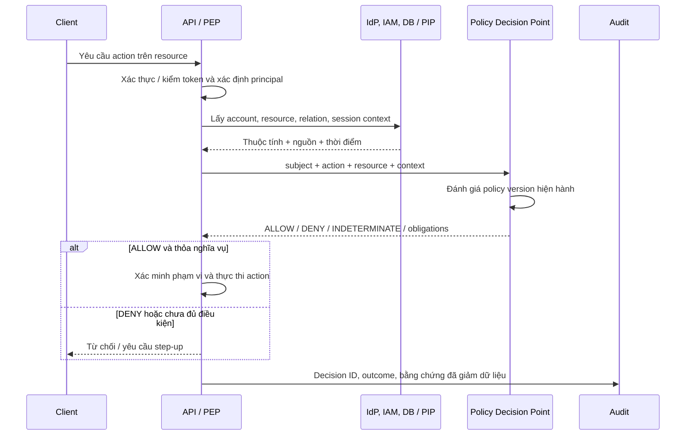

# Context trong Authorization: Quyết định quyền dựa trên ngữ cảnh và vòng đời danh tính

Một nhân viên đăng nhập thành công qua Single Sign-On (SSO) và có vai trò `report-reader`. Hệ thống báo cáo vẫn phải trả lời: người đó được đọc **báo cáo của phòng ban nào**, trên **môi trường nào**, vào **thời điểm nào**, bằng **phiên xác thực nào**, và liệu quyền đó có còn hợp lệ sau khi người này chuyển công tác hay nghỉ việc?

Nếu ứng dụng chỉ kiểm tra “đã đăng nhập” hoặc chỉ nhìn tên role, nó có thể cho phép người dùng truy cập dữ liệu của phòng ban cũ. Nếu ứng dụng tin một header `X-Department` do trình duyệt tự gửi, kẻ tấn công có thể giả mạo phòng ban để mở rộng quyền. Những tình huống này cho thấy **authorization (phân quyền)** cần một bộ **context (ngữ cảnh)** được xây dựng, xác minh và cập nhật đúng.

Trong **Identity and Access Management (IAM)**, **authorization context** là tập thông tin có liên quan và đủ tin cậy để hệ thống đánh giá **ai (subject)** muốn **làm gì (action)** trên **tài nguyên nào (resource)** trong **điều kiện nào (environment/session/relationship)**, dưới **chính sách nào (policy)**. Context giúp chuyển từ quyết định quyền cứng, chỉ dựa trên role, sang quyết định phù hợp với trạng thái công việc và điều kiện tại thời điểm yêu cầu.

Bài học thuộc chương **Authorization** của mô-đun **Identity Lifecycle**, gắn trực tiếp với **Joiner–Mover–Leaver (JML)**: từ xác minh, tạo account và cấp quyền ban đầu, tới thay đổi vai trò, rà soát và thu hồi quyền. Nội dung liên hệ **IdP, SSO, SCIM, RBAC/ABAC, tài khoản dịch vụ, kiểm toán** và cách giảm **quyền truy cập tồn dư (residual access)**.

> **Nguyên tắc cốt lõi:** Context không phải dữ liệu tùy ý do người gọi khai báo. Mỗi thuộc tính ảnh hưởng đến quyền phải có **nguồn tin cậy, phạm vi, độ mới và cách xác minh** phù hợp với rủi ro của hành động.

## 1. Context trong Authorization là gì?

Một quyết định authorization có thể biểu diễn ở mức khái niệm:

```text
Decision = Evaluate(
    subject,
    action,
    resource,
    environment,
    session,
    relationships,
    policy
)
```

Ví dụ:

- **Subject:** nhân viên `person-1045`, đang ACTIVE, phòng ban Finance.
- **Action:** `invoice.approve`.
- **Resource:** hóa đơn `invoice-0071` thuộc đơn vị Finance, trị giá lớn.
- **Environment:** thời điểm hiện tại, môi trường production.
- **Session:** người dùng đã MFA, nhưng lần xác thực đủ mạnh đã quá thời hạn policy cho phép.
- **Relationship:** người dùng không phải người đã tạo hóa đơn.
- **Policy:** chỉ approver Finance được duyệt hóa đơn phù hợp hạn mức, không tự duyệt chứng từ mình tạo và phải đáp ứng step-up.

Hệ thống có thể **DENY** hoặc yêu cầu **STEP_UP** dù người dùng đã có role `finance-approver`. Quyết định đúng phụ thuộc ngữ cảnh đang có hiệu lực, không chỉ việc một group tồn tại trong directory.

### 1.1. Phân biệt authentication, authorization và context

| Khái niệm | Câu hỏi trả lời | Ví dụ |
|---|---|---|
| **Identity proofing** | Danh tính đã được xác minh và liên kết với chủ thể phù hợp chưa? | HR hoặc quy trình định danh xác minh nhân viên mới. |
| **Authentication** | Bên đang truy cập có chứng minh quyền kiểm soát authenticator của identity không? | Đăng nhập qua IdP với mật khẩu/passkey và MFA. |
| **Authorization** | Subject đã xác thực hoặc workload được phép làm hành động này trên resource không? | Có được xuất dữ liệu Finance hay không? |
| **Authorization context** | Những sự kiện/thuộc tính nào ảnh hưởng đến quyết định ngay lúc này? | Department, owner, tenant, assurance, thời hạn, trạng thái JML. |
| **Provisioning** | Account/role/thuộc tính có được tạo, sửa, thu hồi trên hệ thống đích? | SCIM cập nhật User hoặc Group. |
| **Audit** | Vì sao hệ thống cho phép/từ chối và có thể kiểm chứng không? | Decision log ghi policy version, nguồn thuộc tính và kết quả. |

**Authentication thành công không đồng nghĩa authorization thành công.** Tương tự, việc SCIM cập nhật một thuộc tính thành công chưa chứng minh resource server đang sử dụng thuộc tính mới nhất.

### 1.2. Context khác role như thế nào?

Role thể hiện một nhóm trách nhiệm hoặc quyền theo **Role-Based Access Control (RBAC)**. Context cung cấp các dữ kiện bổ sung để giới hạn hoặc quyết định hiệu lực của role:

```text
User có role: project-editor
Request: PATCH /projects/P-101

Điều kiện cần xét:
  - P-101 thuộc tenant của user?
  - User còn thuộc dự án P-101?
  - Account còn ACTIVE?
  - Resource có đang ở trạng thái LOCKED?
  - Phiên đã đáp ứng yêu cầu xác thực cho thay đổi này?
```

Có role hợp lệ nhưng không thỏa một điều kiện bắt buộc vẫn có thể phải bị từ chối. Context khiến “có role” không bị nhầm thành “được làm mọi thứ trong mọi hoàn cảnh”.

## 2. Sáu nhóm dữ liệu ngữ cảnh cần phân biệt

### 2.1. Subject context — ai đang thực hiện?

**Subject** là thực thể yêu cầu truy cập: người dùng, dịch vụ, workload hoặc principal được ủy quyền.

Dữ liệu có thể gồm:

- Định danh ổn định `subjectId`, loại subject (human/service).
- Trạng thái vòng đời `ACTIVE`, `SUSPENDED`, `TERMINATED`.
- Phòng ban, vị trí công việc, đơn vị, người quản lý hoặc sponsor.
- Role, group, entitlement hoặc quyền được phê duyệt.
- Tenant, tổ chức, phạm vi trách nhiệm.
- Điều kiện hợp đồng, thời điểm hết hạn hoặc quyền đang có hiệu lực.
- Mối liên hệ với một workload hoặc ứng dụng.
- Các thuộc tính bảo đảm danh tính đã được xác minh theo chính sách.

Không phải hệ thống nào cũng cần tất cả thuộc tính này. **Thu thập tối thiểu** dữ liệu thực sự cần cho policy giúp hạn chế rò rỉ thông tin nhân sự.

### 2.2. Action context — định làm gì?

**Action** cần được biểu diễn đủ cụ thể, ví dụ:

| Action | Mức ảnh hưởng tương đối | Vì sao cần ngữ cảnh? |
|---|---|---|
| `document.read` | Có thể thấp hoặc cao tùy dữ liệu. | Tenant, owner, classification. |
| `report.export` | Có thể cao vì xuất hàng loạt. | Scope, hạn mức, DLP, thời gian. |
| `invoice.approve` | Nhạy cảm nghiệp vụ. | Hạn mức, người tạo, SoD. |
| `user.role.grant` | Đặc quyền IAM. | Role đích, resource scope, phê duyệt. |
| `secret.read` | Nhạy cảm cao. | Workload, mục đích, assurance, policy. |
| `production.deploy` | Ảnh hưởng hệ thống. | Môi trường, trạng thái thay đổi, JIT. |

Không nên gom mọi hành động vào một cờ `isAuthenticated`. API thực hiện hành động phải xác định **operation** một cách đáng tin từ route, phương thức và tài nguyên được xử lý.

### 2.3. Resource context — tài nguyên nào?

Resource có thể chứa:

- ID, loại tài nguyên và đường dẫn/cấp phân cấp.
- **Tenant** hoặc tổ chức sở hữu.
- **Owner** hoặc nhóm phụ trách.
- Phân loại dữ liệu, môi trường `production`/`test`.
- Department/project/region gắn với resource.
- Trạng thái nghiệp vụ: draft, approved, archived, locked.
- Thuộc tính nhạy cảm: mức tiền, tác động, quy định lưu giữ.
- Quan hệ cha–con hoặc phạm vi được ủy quyền.

Điểm quan trọng: **resource attributes phải đọc từ hệ thống quản lý resource hoặc nguồn được phê duyệt**, không tin `ownerId` hay `tenantId` do client tùy ý gửi.

### 2.4. Environment context — điều kiện bên ngoài

Context môi trường có thể gồm:

- Thời gian hiện tại và khoảng thời gian quyền có hiệu lực.
- Địa chỉ mạng hoặc vùng mạng đã được xác định qua hạ tầng tin cậy.
- Môi trường ứng dụng: staging/production.
- Mức rủi ro phiên hoặc yêu cầu theo hệ thống phát hiện.
- Trạng thái thay đổi hệ thống, maintenance window, incident mode.
- Kênh truy cập: browser, CLI, API, workload.
- Trạng thái bảo vệ thiết bị được lấy từ nguồn quản trị thiết bị.

**IP, vị trí hoặc thiết bị không phải bằng chứng danh tính độc lập đủ mạnh.** Một IP có thể thuộc NAT/VPN/shared network; một header phía client có thể bị giả mạo. Dùng context môi trường cần đánh giá nguồn gốc và các giới hạn này.

### 2.5. Session context — xác thực được thực hiện thế nào?

Session context có thể chứa:

- ID phiên hoặc tham chiếu an toàn đến phiên.
- Thời điểm xác thực gần nhất, thời gian sống phiên.
- Phương thức và mức bảo đảm xác thực do IdP cam kết.
- MFA/step-up đã được hoàn thành trong phạm vi policy nào.
- Trạng thái session bị revoke, session version hoặc risk marker.
- Issuer/client/audience/tenant đã xác minh.

**MFA đã hoàn thành tại một thời điểm** không đồng nghĩa phiên mãi đủ điều kiện duyệt giao dịch nhạy cảm. Policy có thể cần authentication freshness hoặc step-up cho từng nhóm action.

### 2.6. Relationship và governance context

Các quan hệ và quy tắc quản trị không phải lúc nào cũng biểu diễn tốt bằng một role:

- User là thành viên dự án chứa resource hay không?
- User có phải người tạo chứng từ không?
- Người duyệt có độc lập với người đề nghị không (**Separation of Duties — SoD**)?
- Quyền được ủy quyền bởi ai, trong thời gian nào?
- Có phê duyệt còn hạn, ticket hoặc thay đổi được phép không?
- Subject là service account nào và workload/owner hợp lệ không?
- Có ngoại lệ rủi ro được chấp thuận và chưa hết hạn không?

Tập dữ liệu này cho phép hệ thống kiểm soát các quy tắc phức tạp hơn “role A được hành động B”.

## 3. Kiến trúc dùng context để ra quyết định

Trong các kiến trúc quản lý chính sách, có thể phân tách:

- **Policy Enforcement Point (PEP):** nơi chặn hoặc thực thi kết quả; thường nằm ở API/controller/gateway/resource.
- **Policy Decision Point (PDP):** nơi đánh giá chính sách và trả quyết định.
- **Policy Information Point (PIP):** nguồn cung cấp thuộc tính, quan hệ, trạng thái hoặc sự kiện phục vụ quyết định.
- **Policy Administration Point (PAP):** nơi quản lý, phê duyệt, phiên bản hóa và phát hành policy.

Đây là các **vai trò logic**. Một sản phẩm có thể gộp hoặc phân tán chúng giữa nhiều thành phần.

### 3.1. Luồng quyết định



**PDP không tự bảo vệ tài nguyên nếu PEP bỏ qua quyết định.** Ví dụ kiểm tra quyền ở giao diện web nhưng API backend không kiểm thì người dùng vẫn có thể gọi API trực tiếp.

### 3.2. PEP cần thực thi tại điểm nào?

| Điểm thực thi | Có thể bảo vệ | Giới hạn |
|---|---|---|
| UI/frontend | Ẩn nút, điều hướng hợp lý. | Không phải security boundary; client có thể bỏ qua. |
| API gateway | Kiểm token, tenant, scope sơ bộ, rate limit. | Thường thiếu dữ liệu chi tiết của từng resource. |
| Backend controller/service | Action/resource/subject của nghiệp vụ. | Cần tích hợp chính sách và kiểm soát đầy đủ. |
| Data access layer | Lọc bản ghi theo tenant/owner/ABAC. | Không thay thế kiểm hành động nghiệp vụ. |
| Database row-level security | Cô lập dữ liệu theo policy thích hợp. | Phụ thuộc cách app truyền identity/context đáng tin. |
| Secrets manager/cloud IAM | Quyền trực tiếp trên tài nguyên nền tảng. | Có policy và principal riêng, cần reconciliation. |

Bảo vệ nhiều lớp có thể hữu ích, nhưng **mỗi lớp phải hiểu trách nhiệm**; không thể dựa vào việc frontend giấu nút “Delete” để bảo đảm backend không cho xóa.

## 4. Một authorization context hợp lệ nên có cấu trúc nào?

Một request context mẫu:

```json
{
  "decisionId": "authz-dec-7021",
  "subject": {
    "id": "person-1045",
    "type": "HUMAN",
    "lifecycleState": "ACTIVE",
    "department": "FINANCE",
    "roles": ["finance-approver"],
    "tenantId": "tenant-a"
  },
  "action": "invoice.approve",
  "resource": {
    "id": "invoice-0071",
    "type": "INVOICE",
    "tenantId": "tenant-a",
    "department": "FINANCE",
    "createdBy": "person-1099",
    "amount": 72000000,
    "currency": "VND",
    "state": "PENDING_APPROVAL"
  },
  "session": {
    "issuer": "https://login.example.invalid",
    "authenticatedAt": "2026-11-23T09:40:00+07:00",
    "assuranceLevel": "MFA_APPROVED_BY_POLICY",
    "revoked": false
  },
  "environment": {
    "requestTime": "2026-11-23T09:48:00+07:00",
    "deployment": "production"
  },
  "policy": {
    "name": "finance-invoice-approval",
    "version": "v7"
  }
}
```

Tất cả tên và giá trị là **dữ liệu minh họa**. Số tiền, hạn mức và assurance label không phải thông số bắt buộc; policy thật phải có định nghĩa, đơn vị và nguồn rõ ràng.

### 4.1. Context phải kèm provenance và freshness

Trong ứng dụng thực, các thuộc tính không nên xuất hiện như một “túi JSON” không rõ xuất xứ. Với từng trường quan trọng cần biết:

| Thuộc tính | Nguồn hợp lý | Cần kiểm chứng |
|---|---|---|
| `subject.id` | Principal từ token/session **đã xác minh**, mapping IAM. | Issuer, subject ID, tenant, liên kết account. |
| `subject.lifecycleState` | IAM/HRIS hoặc directory có nguồn chuẩn. | Mốc hiệu lực và độ mới. |
| `subject.roles` | IAM/IGA, IdP hoặc target role registry theo kiến trúc. | Nguồn cấp, quyền trực tiếp, cache và revocation. |
| `resource.tenantId` | Database/resource catalog server-side. | Không tin query/body từ client. |
| `resource.createdBy` | Dữ liệu nghiệp vụ có kiểm soát. | Bất biến hoặc audit của thao tác thay đổi. |
| `session.assuranceLevel` | IdP/OP và security session manager. | Giá trị đã ký/được xác minh, ngữ nghĩa theo hợp đồng. |
| `environment.requestTime` | Đồng hồ server/hạ tầng tin cậy. | Đồng bộ thời gian, timezone phù hợp. |
| `riskScore` nếu có | Dịch vụ risk engine được phê duyệt. | Độ mới, độ tin cậy và cách xử lý thiếu dữ liệu. |

Khi dữ liệu quan trọng **thiếu, không xác minh được hoặc quá cũ**, PDP không nên tự suy ra giá trị giúp cho phép hành động nhạy cảm.

### 4.2. Context bên ngoài và context đã chuẩn hóa

Nên phân biệt:

1. **Raw input:** route, token, header, body, network metadata.
2. **Verified input:** principal và claim đã xác minh, giá trị từ server/gateway tin cậy.
3. **Canonical authorization context:** đối tượng chuẩn hóa mà policy dùng.
4. **Decision evidence:** những dữ kiện và policy version được lưu để kiểm toán.

Ví dụ client gửi `department=FINANCE` trong HTTP body. Đây là **dữ liệu yêu cầu**, không phải bằng chứng subject thuộc Finance. Backend phải lấy department từ nguồn đã phê duyệt hoặc principal claims đáp ứng chính sách kiểm độ mới.

## 5. Quyết định authorization không chỉ là một Boolean

Một policy engine có thể có các kết quả logic:

- **ALLOW/PERMIT:** yêu cầu được cho phép trong phạm vi điều kiện đã đánh giá.
- **DENY:** một điều kiện cấm hoặc thiếu quyền đã được xác định.
- **NOT_APPLICABLE:** policy đang xét không áp dụng cho request này.
- **INDETERMINATE:** không đủ dữ kiện hoặc gặp lỗi không thể đưa ra quyết định tin cậy.

Nhãn và mô hình chính xác tùy công cụ. **PEP phải có quy tắc xử lý mặc định rõ ràng**, thường không được cấp quyền khi không có policy cho phép hoặc khi không thể xác minh dữ kiện bắt buộc.

### 5.1. Nghĩa vụ và lời khuyên kèm quyết định

Ngoài ALLOW/DENY, policy có thể yêu cầu những **obligation** trước khi thực hiện action:

- Bắt buộc **step-up authentication**.
- Yêu cầu phê duyệt độc lập.
- Giới hạn dữ liệu trả về hoặc áp dụng masking.
- Giới hạn số bản ghi có thể export.
- Ghi audit ở mức cao hơn.
- Yêu cầu quyền JIT còn hiệu lực.
- Yêu cầu một điều kiện resource được kiểm tra lại trước khi ghi.

Ví dụ:

```text
decision = CONDITIONAL_ALLOW
obligations = [
  "REQUIRE_RECENT_MFA",
  "RECORD_APPROVAL_AUDIT"
]

PEP chỉ thực thi action sau khi tất cả
nghĩa vụ bắt buộc được thỏa và xác minh.
```

Đây là mô hình minh họa, không phải mọi policy engine đều có trạng thái `CONDITIONAL_ALLOW`. Nếu sản phẩm không hỗ trợ obligations như một kết quả độc lập, ứng dụng có thể biểu diễn bằng trạng thái cần step-up rồi đánh giá lại.

### 5.2. Ví dụ hai lần đánh giá

| Trường hợp | Subject có role phù hợp? | Session đáp ứng policy? | Quan hệ resource phù hợp? | Kết quả |
|---|---|---|---|---|
| A | Có | Có | Có | ALLOW nếu các điều kiện khác đều đạt. |
| B | Có | Không, cần MFA mới hơn | Có | Yêu cầu STEP_UP hoặc DENY. |
| C | Có | Có | Không, khác tenant | DENY. |
| D | Không | Có | Có | DENY. |
| E | Có | Không rõ phiên có bị revoke? | Có | Không cấp quyền nhạy cảm khi thiếu bằng chứng bắt buộc. |

## 6. RBAC: role là một phần của context

Trong **Role-Based Access Control (RBAC)**, role thường gắn với một tập permission:

```text
role project-reader:
  projects.read

role project-maintainer:
  projects.read
  projects.update

role project-admin:
  projects.read
  projects.update
  projects.manage-members
```

Một cách kiểm đơn giản:

```text
ALLOW khi:
    subject.roles chứa role được cấp permission action
    AND account đủ điều kiện sử dụng
    AND resource thuộc scope được phép
```

Điều kiện “account đủ điều kiện” và “scope được phép” có thể được mô hình hóa ở nhiều lớp. Nếu chỉ kiểm `project-admin` mà không kiểm tenant hoặc project, một role cấp cho project A có thể bị dùng với project B.

### 6.1. Scope của role có ý nghĩa thế nào?

Một assignment nên có:

```yaml
subjectId: person-1045
role: project-admin
resourceScope: project-P101
tenantId: tenant-a
approvedBy: person-0090
validFrom: "2026-11-01T09:00:00+07:00"
validUntil: "2026-12-01T17:00:00+07:00"
```

Ví dụ trên là **dữ liệu IAM minh họa**. Quyền hợp lệ trong một scope không tự mở rộng sang resource khác. Chính sách và bộ kiểm phải xử lý cả trường hợp scope hết hạn hoặc account bị thu hồi trước `validUntil`.

### 6.2. Vai trò hiệu lực có thể đến từ nhiều nguồn

- Role gán trực tiếp tại ứng dụng.
- Nhóm IdP/directory, gồm nhóm lồng nhau.
- Role cấp theo tổ chức hoặc dự án.
- Role eligible/active qua PAM/PIM.
- Quyền ủy quyền có thời hạn.
- Policy cloud IAM hoặc database riêng.

Khi subject Mover, gỡ một nhóm trong directory **không chứng minh** mọi role hiệu lực đã được gỡ. Context cần tính hoặc tham chiếu đúng **effective entitlements**, đồng thời có cơ chế readback/reconciliation tại các target.

## 7. ABAC: context là nền tảng của chính sách

**Attribute-Based Access Control (ABAC)** đánh giá thuộc tính của subject, resource, action và environment. Context khiến một permission trở thành quyết định có điều kiện thay vì cấp rộng cho một vai trò.

Ví dụ chính sách:

```text
ALLOW document.read nếu:
  subject.lifecycleState == ACTIVE
  AND subject.tenantId == resource.tenantId
  AND subject.department == resource.department
  AND resource.classification không vượt clearance được cấp
  AND request nằm trong phạm vi policy hiện hành
```

Đây là **pseudocode**, không phải cú pháp của một công cụ ABAC cụ thể. Trong triển khai phải xác định rõ quan hệ giữa clearance/classification và cách diễn giải điều kiện thiếu dữ liệu.

### 7.1. Một ví dụ ma trận ABAC

| Subject | Resource | Context | Quyết định mong đợi |
|---|---|---|---|
| Nhân viên Finance, ACTIVE | Báo cáo Finance cùng tenant | Session hợp lệ | ALLOW nếu đủ permission. |
| Nhân viên Finance, ACTIVE | Báo cáo HR cùng tenant | Khác department, không có ngoại lệ | DENY. |
| Nhân viên Finance, TERMINATED | Báo cáo Finance | Vẫn giữ session cũ | DENY theo policy Leaver. |
| Contractor còn hạn | Báo cáo được sponsor phê duyệt | Đúng project và tenant | ALLOW trong scope hợp lệ. |
| Contractor hết hạn | Cùng báo cáo | Contract expiry đã có hiệu lực | DENY. |
| Administrator có role cao | Dữ liệu thuộc tenant khác | Không có quyền liên tenant | DENY. |

**Role cao không tự phủ quyết ranh giới tenant hay điều kiện lifecycle**. Ngoại lệ nếu được phép phải có policy và thẩm quyền rõ, không phải bỏ qua kiểm tra.

### 7.2. ABAC và độ mới thuộc tính

Một nhân viên chuyển phòng ban lúc 09:00, IdP đã cập nhật `department=FINANCE`. Nhưng phiên ứng dụng từ 08:50 vẫn lưu `department=SUPPORT`.

Nếu resource chỉ dựa vào thuộc tính cached trong session, user có thể tiếp tục thấy dữ liệu Support. Vì thế:

- Xác định thuộc tính nào là **security-sensitive**.
- Đặt thời gian sử dụng tối đa/TTL hoặc invalidation khi thuộc tính thay đổi.
- Đánh giá lại quyền sau các sự kiện Mover/Leaver.
- Đọc trạng thái từ authority hoặc phiên bản cache đủ mới với action nhạy cảm.
- Thử cả tình huống ALLOW và DENY bằng quyền thực tế.

## 8. Quan hệ và phân quyền dựa trên mối quan hệ

Không phải mọi quyền đều phụ thuộc vào department/role. Một số policy là **relationship-based**, thường được nhắc dưới tên ReBAC khi kiến trúc biểu diễn quyền bằng quan hệ giữa subject và resource.

Ví dụ:

```text
User -> member of -> Project
Project -> owns -> Document

Có thể đọc Document nếu:
  User là thành viên hợp lệ của Project
  AND Document thuộc Project
  AND User có permission documents.read
```

Quan hệ cũng cần **nguồn, phạm vi và vòng đời**:

- Ai có quyền thêm user vào project?
- Membership kết thúc khi nào?
- Project chuyển owner hoặc tenant thì quyền cũ ra sao?
- Một tài liệu được chia sẻ qua link có tạo quyền mới không?
- Có nhóm lồng nhau hoặc quan hệ được ủy quyền không?

### 8.1. SoD là một dạng context quan hệ nghiệp vụ

Trong duyệt thanh toán:

```text
DENY invoice.approve khi:
  subject.id == invoice.createdBy
```

Đây là quy tắc **không tự phê duyệt chứng từ do mình tạo**. Nếu hệ thống chỉ kiểm vai trò `approver`, nó có thể bỏ qua một xung đột Separation of Duties (SoD) quan trọng.

Policy cần biết account thực sự tạo chứng từ và xử lý trường hợp dữ liệu này không còn tin cậy hoặc bị sửa. Với giao dịch nhạy cảm, nên ghi bằng chứng người đề nghị/phê duyệt, không chỉ quyết định Boolean.

## 9. Context môi trường: thời gian, mạng, thiết bị và rủi ro

### 9.1. Thời gian hiệu lực

Một quyền tạm thời có thể chỉ hợp lệ:

```text
validFrom <= requestTime < validUntil
```

Cần lưu ý:

- Dùng thời gian server tin cậy, không dùng đồng hồ máy khách để quyết định.
- Chuẩn hóa timezone và cách so sánh thời điểm tuyệt đối.
- Định nghĩa biên thời gian rõ ràng, tránh một phút chênh lệch.
- Xử lý trường hợp quyền bị thu hồi **trước khi tới ngày hết hạn**.
- Đối với JIT, bảo đảm phiên/quyền active không vượt khoảng hiệu lực chính sách.

### 9.2. Mạng và IP

Một rule ví dụ: chỉ cho phép thao tác quản trị từ mạng đã được phê duyệt. Nhưng:

- IP có thể là IP gateway/NAT/VPN, không đại diện duy nhất cho người dùng.
- `X-Forwarded-For` chỉ đáng tin nếu được xử lý bởi **reverse proxy/gateway được tin cậy**, loại bỏ header client tự giả.
- Chính sách “nằm trong office IP” không thay thế MFA và xác thực account.
- Network location là **tín hiệu context**, không phải chứng cứ danh tính tuyệt đối.

### 9.3. Device posture

Ứng dụng có thể cần biết thiết bị đã được quản trị, mã hóa hoặc đáp ứng baseline an ninh. Dữ kiện này cần đến từ **dịch vụ quản trị thiết bị/attestation được phê duyệt**; không tin một cờ Boolean do JavaScript hoặc người dùng gửi lên.

Với quyết định nhạy cảm, cần quy định thời hạn hợp lệ của đánh giá thiết bị và cách xử lý khi dịch vụ posture không sẵn sàng.

### 9.4. Risk-based access

Một risk engine có thể đánh giá session/action từ sự kiện đã xác minh như thiết bị mới, đăng nhập bất thường hoặc thay đổi bảo mật gần đây.

Ví dụ:

- Rủi ro thấp + hành động đọc thông thường → đánh giá theo policy cơ bản.
- Rủi ro cao + quyền xuất dữ liệu → yêu cầu step-up hoặc từ chối theo policy.
- Mất khả năng đánh giá risk → xử lý theo quy tắc đã công bố; không mặc nhiên coi `risk=LOW`.

**Risk score không phải nguồn sự thật duy nhất.** Policy cần hiểu sai số, độ mới và điều kiện không có dữ liệu; tránh kết luận người dùng “gian lận” chỉ vì một tín hiệu bất thường.

## 10. Session context và liên kết với IdP/SSO

**Identity Provider (IdP)** xác thực người dùng; **SAML Service Provider** hoặc **OIDC Relying Party** xác minh kết quả đăng nhập và tạo phiên ứng dụng. Context có thể nhận một số claim từ IdP, nhưng phải được xác minh theo giao thức.

### 10.1. Nhận dữ liệu nào từ SAML/OIDC?

| Dữ liệu | SAML | OIDC | Kiểm soát |
|---|---|---|---|
| Chủ thể | NameID/subject identifier đã thỏa thuận. | `sub` đi cùng `iss`. | Liên kết đúng account và tenant. |
| Nguồn phát hành | Issuer của IdP. | `iss`. | Khớp cấu hình trust. |
| Đích ứng dụng | Audience/Recipient. | `aud` cho RP; access token có audience API riêng. | Không nhận token cho ứng dụng khác. |
| Hiệu lực | Conditions, time và request correlation. | exp/nbf khi có, state/nonce theo flow. | Không nhận thông điệp hết hạn/phát lại. |
| Thuộc tính | AttributeStatement nếu được phát. | Claims được phát hành theo scope/profile. | Chỉ dùng claims từ nguồn được ủy quyền. |
| Bảo đảm xác thực | AuthnContext theo cấu hình. | `acr`, `amr`, `auth_time` nếu có. | Hiểu đúng ngữ nghĩa và độ mới. |

**Không lấy một email, group hoặc department chưa xác minh từ HTTP header thay cho claim từ IdP**. Cũng không được dùng một ID Token của OIDC để gọi API như một access token hợp lệ.

### 10.2. Tạo session và tái đánh giá quyền

Giả sử SP lưu `roles=["support-reader"]` trong session cookie/server session lúc 08:00. Nhân viên Mover lúc 09:00:

- **IdP/Directory** có thể đã cập nhật group.
- **Session SP** có thể vẫn giữ bản sao thuộc tính cũ.
- **Resource Server** có thể tiếp tục tin role đã cache cho đến khi hết phiên.
- **SCIM** có thể đã gỡ role tại ứng dụng, nhưng một API phụ vẫn có token dài hạn.

Do đó chính sách phải xác định **khi nào tái đánh giá context**: mỗi request nhạy cảm, khi session refresh, khi có event revocation hoặc theo TTL phù hợp.

### 10.3. Không nhầm SSO logout với thu hồi tất cả quyền

IdP session, SP session và API access token có vòng đời khác nhau. Logout ở IdP hoặc khóa đăng nhập mới không chắc làm:

- Phiên SP đã mở hết hiệu lực ngay.
- Access token tự chứa bị resource server từ chối tức thì.
- API key/SSH key/local password bị vô hiệu hóa.
- Role trực tiếp trong target biến mất.

**Authorization context tại resource** cần xét trạng thái cập nhật và cơ chế revocation thực tế khi policy yêu cầu chặn kịp thời.

## 11. SCIM, directory và nguồn thuộc tính trong context

**System for Cross-domain Identity Management (SCIM)** hỗ trợ quản lý những đối tượng như User/Group giữa hệ thống tích hợp. **Directory** có thể lưu nhóm, account và thuộc tính; cả hai thường là **nguồn cấp dữ liệu** cho context nhưng không tự ra quyết định authorization cho mọi ứng dụng.

### 11.1. Ba lớp trạng thái thường bị nhầm

```text
HRIS:
  employmentStatus = TERMINATED

IdP / Directory:
  userAccount = DISABLED

Ứng dụng SaaS:
  role = admin
  session = ACTIVE
```

Đây là một trạng thái **không nhất quán** có thể xảy ra khi các hệ thống cập nhật không đồng thời. Một policy chỉ nhìn Directory User disabled nhưng API SaaS không kiểm tình trạng đó có thể vẫn cho thao tác sai.

### 11.2. SCIM update và authorization readback

Ví dụ:

1. IAM nhận Mover.
2. IAM thay desired entitlements theo vai trò mới.
3. Connector/SCIM sửa Group hoặc thuộc tính `department`.
4. Target phản hồi thành công.
5. Ứng dụng **đọc lại** group, role trực tiếp và quyền hiệu lực.
6. Authorization test hoặc policy evaluation xác minh thao tác cũ bị DENY khi cần.

**SCIM không đồng nghĩa một lần “reset” mọi session**. Báo cáo nên tách `provisioningApplied` và `effectiveAccessVerified`.

### 11.3. Attribute source-of-truth

Nên lập bảng quản trị:

| Attribute | Authority | Consumer | Quy tắc cập nhật |
|---|---|---|---|
| Employment state | HRIS/contractor registry. | IAM, IdP, API policy. | Theo sự kiện có version và thời điểm hiệu lực. |
| Department | HRIS hoặc hệ thống nhân sự được phê duyệt. | IdP, ABAC policy. | Cập nhật khi Mover. |
| App role | IAM/IGA hoặc ứng dụng có owner theo policy. | PDP/PEP. | Theo approval và lifecycle. |
| Resource owner | Resource system. | Resource authorization. | Theo transaction/change ownership. |
| Device posture | Thiết bị/quản lý endpoint đáng tin. | Risk/conditional access. | Có TTL và nguồn xác thực. |
| Service ownership | Service catalog/workload platform. | Machine identity policy. | Theo chu kỳ workload. |

Nếu người dùng tự sửa một thuộc tính profile không được kiểm soát, **không nên dùng thuộc tính đó** để mở quyền nhạy cảm.

## 12. Context trong vòng đời Joiner–Mover–Leaver

### 12.1. Joiner — chuẩn bị context trước khi cấp quyền

Một người mới được tuyển không nên có quyền chỉ vì bản ghi HRIS đã tồn tại.

Quy trình có thể gồm:

1. Nguồn có thẩm quyền xác nhận identity và thời điểm bắt đầu.
2. IAM/IGA tạo account và trạng thái lifecycle phù hợp.
3. IdP đăng ký phương thức xác thực và kiểm soát đăng nhập.
4. SCIM/connector cấp account hoặc role tối thiểu đúng ứng dụng.
5. PDP nhận context **ACTIVE và đúng scope** từ nguồn hiện hành.
6. PEP kiểm cả account và policy trước khi cho thao tác.
7. Audit ghi ai cấp role, policy version và nguồn dữ kiện.

**Trước thời điểm được phép bắt đầu**, một assertion từ IdP hợp lệ chưa đủ để SP cấp quyền ứng dụng nếu chính sách yêu cầu chưa active.

### 12.2. Mover — quyền mới, quyền cũ và context cũ

Khi đổi phòng ban/role:

- **Subject context** thay đổi: department, manager, eligible roles.
- **Relationship context** thay đổi: thành viên dự án, cấp phê duyệt.
- **Resource context** có thể giữ nguyên nhưng quan hệ đến subject đổi.
- **Session context** có thể chứa claims/roles cũ.
- **Desired state** thay đổi: quyền cũ cần thu hồi, quyền mới cần approval.
- **Actual state** cần được đọc lại tại các target.

Vấn đề lớn nhất không chỉ là **cấp quyền mới**, mà là **thu hồi quyền cũ** trên mọi đường cấp.

### 12.3. Leaver — không cho context cũ kéo dài quyền

Khi Leaver có hiệu lực:

1. IAM xác định identity/account liên kết và mốc hiệu lực.
2. Chặn xác thực mới hoặc cấp credential/token mới theo khả năng.
3. Thu hồi entitlements, vai trò admin/PAM và các tài khoản đích liên quan.
4. Làm mới hoặc vô hiệu hóa context/session cũ ở SP/API theo chính sách.
5. Xử lý token, API key, SSH key hoặc credential cá nhân có liên quan.
6. Kiểm tra effective access tại ứng dụng/resource, không chỉ trạng thái IdP.
7. Theo dõi ngoại lệ chưa thể xác minh, giữ bằng chứng audit.

**Một access token chứa `employmentStatus=ACTIVE` được phát hành trước Leaver là dữ kiện lịch sử, không phải nguồn authority bất biến để cho truy cập mãi.**

### 12.4. Ma trận thay đổi lifecycle

| JML event | Context trước | Context mong muốn sau | Kiểm tra bắt buộc |
|---|---|---|---|
| Joiner có hiệu lực | Account chưa đủ điều kiện. | ACTIVE, role tối thiểu đã duyệt. | Chỉ thao tác trong scope được ALLOW. |
| Mover Support → Finance | Department Support, role Support. | Department Finance, gỡ role cũ và cấp role mới hợp lệ. | Hành động Support bị DENY, Finance được ALLOW nếu đủ điều kiện. |
| Leaver | ACTIVE, session đang sử dụng. | Không còn quyền cá nhân ngoài chính sách. | Login mới bị chặn và resource từ chối quyền cũ. |
| Contractor hết hạn | Sponsor và grant còn hiệu lực. | Hết quyền theo hợp đồng. | Không kéo dài vì group/token cũ. |
| Tái tuyển dụng | Identity cũ không hoạt động. | Enrollment có thẩm quyền, quyền mới được tính lại. | Không tự khôi phục mọi entitlement lịch sử. |
| Workload decommission | Service principal active. | Không còn principal/quyền không cần thiết. | Credential cũ bị chặn, owner được xác minh. |

## 13. Tình huống thực tế: Mover với quyền đọc dữ liệu nhạy cảm

Giả sử nhân viên Mai thuộc nhóm Support, có quyền `customer.case.read`. Ngày 01/12/2026, Mai chuyển sang Finance, được cấp `invoice.report.read`. Cả hai ứng dụng dùng SSO chung.

### 13.1. Trạng thái trước Mover

```yaml
subjectId: person-mai
lifecycleState: ACTIVE
department: SUPPORT
roles:
  - support-reader
ssoSession:
  issuedAt: "2026-12-01T08:30:00+07:00"
  departmentClaim: SUPPORT
resource:
  tenantId: tenant-a
  application: customer-support
```

### 13.2. Sự kiện và desired state sau Mover

```json
{
  "eventId": "mover-2026-033",
  "subjectId": "person-mai",
  "effectiveAt": "2026-12-01T09:00:00+07:00",
  "sourceVersion": 83,
  "newDepartment": "FINANCE",
  "desiredRoles": ["finance-report-reader"],
  "removeRoles": ["support-reader"]
}
```

Dữ liệu là ví dụ, không phải schema bắt buộc.

### 13.3. Điều gì có thể sai?

| Thành phần | Đã thay đổi? | Nguy cơ nếu bỏ sót |
|---|---|---|
| HRIS | Department thành FINANCE. | Đây mới là nguồn nghiệp vụ, chưa phải quyết định ứng dụng. |
| IdP group | Gỡ Support và cấp Finance. | Direct role ở SaaS có thể vẫn còn. |
| SCIM | Đã gửi Group update. | Target có thể chưa áp dụng hoặc bị lỗi. |
| Session SP | Vẫn giữ Support claim từ 08:30. | ABAC có thể cho đọc case cũ. |
| Customer Support API | Vẫn cho `customer.case.read`. | **Quyền tồn dư** sau Mover. |
| Finance API | Cho `invoice.report.read`. | Cấp mới thành công không chứng minh gỡ quyền cũ. |

### 13.4. Thiết kế kiểm chứng

1. Xác định mốc policy có hiệu lực và quyền mục tiêu.
2. Readback HRIS/IdP/SCIM/ứng dụng.
3. Thử bằng phiên cũ có kiểm soát: action Support **phải DENY** sau giới hạn thu hồi.
4. Thử bằng phiên phù hợp: action Finance **ALLOW** khi role đã được duyệt.
5. Kiểm direct grant, nested group và token còn tồn tại.
6. Ghi decision ID, context version, target, thời gian quan sát.
7. Nếu target không thể từ chối kịp thời, mở ngoại lệ có owner và kiểm soát bù trừ phù hợp.

**Lời giải chính:** context phải phản ánh **quyền hiện hành tại thời điểm thực thi**, hoặc có cơ chế làm vô hiệu context cũ khi policy yêu cầu.

## 14. Stale context, cache và độ mới của dữ liệu

Context hiếm khi được đọc trực tiếp từ nguồn chuẩn ở **mọi request**. Để giảm độ trễ, hệ thống có thể dùng token claims, local cache, distributed cache hoặc session data.

### 14.1. Các loại độ trễ khác nhau

- **Source update latency:** thời gian từ sự kiện JML đến khi authority cập nhật.
- **Provisioning latency:** thời gian IAM/SCIM chuyển thay đổi đến target.
- **Cache propagation latency:** thời gian dữ liệu mới đến PDP/PEP hoặc session.
- **Session/token lifetime:** thời gian dữ kiện cũ có thể tiếp tục được chấp nhận.
- **Authorization verification latency:** thời gian để readback chứng minh trạng thái mới.

Một quyết định có thể dùng dữ liệu **đúng tại thời điểm phát hành token** nhưng **sai tại thời điểm gọi API**. Cần phân biệt hai mốc.

### 14.2. Quy tắc TTL theo độ nhạy

Không phải mọi thuộc tính cần TTL giống nhau:

| Loại dữ liệu | Rủi ro stale | Gợi ý thiết kế |
|---|---|---|
| Tên hiển thị | Thường thấp. | Cache có thể dài hơn theo yêu cầu hiển thị. |
| Department dùng quyết định dữ liệu nhạy cảm | Cao sau Mover. | TTL ngắn/invalidation theo event và kiểm nguồn. |
| Trạng thái Leaver | Rất cao khi cần chặn ngay. | Event-driven revocation, policy kiểm trạng thái hiện hành. |
| Role production-admin/JIT | Rất cao. | TTL hẹp, kiểm hiệu lực và revocation tại resource. |
| Tenant/resource ownership | Cao khi thay đổi chủ sở hữu. | Đọc cùng transaction hoặc dữ liệu phiên bản hóa đáng tin. |
| Device posture | Tùy hành động. | Chứng cứ có TTL theo mức assurance yêu cầu. |

Đây là **hướng nguyên tắc**, không phải giá trị TTL tiêu chuẩn. Thời gian chấp nhận được cần dựa trên mức rủi ro và khả năng kỹ thuật của tổ chức.

### 14.3. Cache key phải chứa đủ phạm vi

Một cache authorization nguy hiểm:

```text
cacheKey = subjectId + action
```

Nó thiếu **tenant, resource, scope và những thuộc tính thay đổi**. Một kết quả ALLOW cho project A có thể bị dùng sai với project B.

Một chiến lược có thể xét:

```text
cacheKey = hash(
  subjectId, tenantId, action, resourceId,
  policyVersion, entitlementVersion, relevantContextVersion
)
```

Không nhất thiết phải đưa mọi trường vào key nếu ứng dụng có cơ chế invalidation khác đã chứng minh đúng. Nhưng **không được cache quyết định vượt phạm vi dữ kiện đã xét**.

### 14.4. Token đã phát hành không tự bị sửa

SAML assertion, OIDC ID Token và OAuth access token có thể chứa claims ở một thời điểm xác định. Khi HRIS/IdP đổi trạng thái, token đã cấp không tự cập nhật.

Nếu resource server chỉ xác minh chữ ký và hạn token, nó có thể tiếp tục chấp nhận token cũ trong thời hạn hiệu lực. Giải pháp tùy kiến trúc:

- Token ngắn hạn với thời hạn được chọn theo rủi ro.
- Introspection hoặc kiểm trạng thái phiên khi phù hợp.
- Denylist/revocation marker hoặc account security version.
- Quyết định authorization dựa trên nguồn trạng thái hiện hành ở tài nguyên.
- Chặn quyền/role trực tiếp tại target.
- Cảnh báo/ngoại lệ khi chưa thể chặn token tức thì.

**Không tuyên bố “đã thu hồi ngay mọi quyền” chỉ vì IdP đã khóa account** nếu API vẫn có token và đường cấp quyền riêng.

## 15. TOCTOU: Context đổi giữa lúc kiểm quyền và thực thi

**Time-of-check to time-of-use (TOCTOU)** là sai lệch giữa lúc kiểm tra điều kiện và lúc sử dụng kết quả.

Ví dụ:

1. 10:00: API đọc `invoice.state=PENDING`.
2. 10:00: policy cho phép approver duyệt hóa đơn.
3. Cùng thời điểm, một tiến trình khác thay owner/tenant hoặc trạng thái hóa đơn.
4. API thực hiện approve dựa trên kết quả cũ.

Nếu các thuộc tính resource quyết định bảo mật/SoD, chỉ kiểm ở đầu request mà không bảo vệ trong lúc commit có thể sai.

### 15.1. Những biện pháp thường dùng

- Đọc resource và kiểm điều kiện **trong cùng transaction** khi khả thi.
- Dùng optimistic locking/version checks hoặc conditional update.
- Kiểm tra lại ownership/state ngay trước thao tác ghi quan trọng.
- Ràng buộc decision với **resource version**, action và scope.
- Hạn chế thời gian giữa quyết định PDP và hành động.
- Không chia sẻ quyết định giữa những request có context khác nhau.

Ví dụ SQL khái niệm:

```sql
UPDATE invoices
SET state = 'APPROVED'
WHERE id = :invoiceId
  AND tenant_id = :trustedTenantId
  AND state = 'PENDING_APPROVAL'
  AND version = :expectedVersion;
```

Đây là **minh họa kiểm soát đồng thời**, không phải lời khuyên đưa toàn bộ policy IAM vào SQL. Ứng dụng vẫn phải đánh giá authorization và bảo đảm transaction xử lý đúng số dòng được cập nhật, quy tắc SoD và audit.

## 16. Context trong multi-tenant authorization

Một SaaS phục vụ nhiều tổ chức cần xác định tenant trong cả **principal** và **resource**. Một role `admin` trong tenant A không đương nhiên cho quyền với tenant B.

### 16.1. Quy tắc tối thiểu

```text
ALLOW only if:
  subject.tenantId == resource.tenantId
  AND requestedAction nằm trong permissions của subject
  AND account/lifecycle/session đáp ứng policy
```

Nếu có quyền quản trị liên tenant, cần một policy **riêng, có scope và approval cụ thể**, không phải bỏ điều kiện tenant toàn cục.

### 16.2. Những lỗi thường gặp

- Đọc `tenantId` từ query parameter rồi tin mà không đối chiếu.
- Liên kết hai IdP khác nhau chỉ qua cùng một email.
- Cache ALLOW không chứa tenant/resource.
- Query database chỉ theo resource ID mà thiếu ràng buộc tenant.
- Tin token có chữ ký hợp lệ của một issuer nhưng không kiểm audience/client.
- Cho session tenant A đổi sang tenant B mà không re-evaluate authorization.
- Khai báo role global trong ứng dụng dù nghiệp vụ chỉ có role per-project.

Với B2B Federation, key liên kết account nên xét **issuer + subject identifier ổn định + tenant**. Chữ ký của token không thay thế authorization vào đúng tenant.

## 17. Context cho quyền quản trị, JIT và SoD

**Administrator** thường có quyền cấp quyền, thay chính sách hoặc sửa hạ tầng. Một context thiếu hoặc stale trong nhóm này có thể tạo rủi ro lớn.

### 17.1. Privileged context cần gì?

| Thuộc tính | Ý nghĩa |
|---|---|
| Admin principal ID | Tài khoản quản trị được liên kết với identity đã xác minh. |
| Privileged role + scope | Đặc quyền trên project/tenant/resource nào. |
| Eligible vs active | Có thể nâng quyền hay đã kích hoạt quyền. |
| JIT validUntil | Thời hạn nâng quyền thực tế. |
| Approval reference | Quyết định hợp lệ và người duyệt. |
| Session assurance | MFA/step-up và độ mới xác thực phù hợp. |
| Device/network condition | Điều kiện truy cập bổ sung theo risk policy. |
| Incident/break-glass mode | Trường hợp khẩn cấp có quy trình và audit riêng. |
| Lifecycle state | Người còn nhiệm vụ và đủ tư cách quản trị không. |

**Eligible role không đồng nghĩa quyền hiện đang active**, nhưng vẫn là đường có thể kích hoạt đặc quyền. Khi Mover/Leaver, cần thu hồi cả **eligible lẫn active** theo chính sách, rồi kiểm tra session đã phát hành.

### 17.2. Ví dụ JIT deployment

```text
ALLOW production.deploy nếu:
  account ACTIVE
  AND role platform-operator còn hợp lệ
  AND privilegedActivation.active == true
  AND privilegedActivation.scope chứa production-project-P
  AND requestTime < privilegedActivation.expiresAt
  AND session đáp ứng step-up
  AND changeTicket được phê duyệt và còn hiệu lực
```

Policy không chỉ kiểm nhóm `platform-operator`. Nếu JIT đã hết hạn hoặc ticket không áp dụng cho project, PEP cần từ chối.

### 17.3. Break-glass là ngoại lệ được quản trị

Tài khoản khẩn cấp có thể cần quyền vượt luồng thông thường để phục hồi hệ thống, nhưng:

- Phải có **quy trình kích hoạt hợp lệ**.
- Giới hạn người được dùng, credential, mục đích và thời gian.
- Ghi audit/giám sát ở mức cao.
- Rà soát sau khi sử dụng.
- Không để tài khoản hoặc credential biết bởi Leaver tiếp tục là đường truy cập tồn dư.

Không nên dùng một cờ `isEmergency=true` do client tự gửi để vượt mọi policy.

## 18. Context cho service account và machine identity

Không phải mọi subject đều là người dùng qua browser. **Service account, workload identity, bot, CI/CD principal** có context riêng:

- Service/workload ID và issuer/nguồn chứng thực.
- Runtime environment, namespace, cluster, project.
- Owner team và ứng dụng sử dụng.
- Purpose và resource scope.
- Credential type, audience, token TTL, trust relationship.
- Workload lifecycle state.
- Các quyền API/service-to-service được phê duyệt.

### 18.1. Mô hình minh họa

```json
{
  "subject": {
    "id": "svc-invoice-sync",
    "type": "WORKLOAD",
    "ownerTeam": "finance-platform",
    "workload": "invoice-sync",
    "environment": "production",
    "lifecycleState": "ACTIVE"
  },
  "action": "invoice.import",
  "resource": {
    "service": "finance-api",
    "tenantId": "tenant-a"
  },
  "credential": {
    "issuer": "trusted-workload-issuer",
    "audience": "finance-api",
    "shortLived": true
  }
}
```

Dữ liệu trên chỉ mang tính khái niệm. Thuộc tính `shortLived=true` **không đủ** để xác minh token; resource server phải kiểm issuer, audience, chữ ký/chứng thực, expiry và quyền.

### 18.2. Tránh nhầm vòng đời người với vòng đời dịch vụ

Một kỹ sư tạo service account rồi nghỉ việc. Khi đó:

1. Thu hồi quyền **cá nhân** của kỹ sư với workload, secrets manager và cloud.
2. Xác định workload còn hợp lệ và owner team mới.
3. Đánh giá secret từng được người đó có thể đọc/sao chép; rotation khi phù hợp.
4. Không tự xóa service account còn phục vụ hệ thống production.
5. Nếu workload ngừng, thu hồi quyền/credential của service principal và deprovision riêng.
6. Reconciliation kiểm tra owner, purpose, credential và quyền hiệu lực.

Không gán `employmentStatus` của nhân viên làm trạng thái duy nhất quyết định một machine identity còn hoạt động hay không.

### 18.3. Delegation và on-behalf-of

Trong một số luồng, service gọi API **thay mặt người dùng**. Context phải phân biệt:

- **Acting principal:** workload/client thực hiện request.
- **End-user subject:** người dùng được đại diện.
- **Delegated scope:** hành động được phép theo grant.
- **Target resource:** API và tenant.
- **Session/token provenance:** issuer, audience, thời hạn và cơ chế ủy quyền.

Không nên cho workload biến một access token chỉ có quyền đọc thành quyền quản trị chỉ vì workload của chính nó có role cao. Cần chính sách rõ giữa **quyền ứng dụng** và **quyền được ủy quyền của người dùng**.

## 19. Triển khai kiểm tra context trong ứng dụng Java

Trong ứng dụng Java, có thể đặt **authorization enforcement** ở controller/service hoặc một lớp chuyên trách. Ví dụ dưới đây là cấu trúc minh họa, không phụ thuộc một thư viện Spring Security, OPA hoặc Zanzibar cụ thể.

### 19.1. Mô hình kiểu dữ liệu

```java
record AuthorizationRequest(
    String subjectId,
    String tenantId,
    String action,
    String resourceId,
    String sessionId
) {}

enum Decision {
    ALLOW,
    DENY,
    INDETERMINATE
}

interface AuthorizationService {
    Decision evaluate(AuthorizationRequest request);
}
```

Các chuỗi ID ở đây chỉ là ví dụ tối giản để đọc hiểu. Trong code production nên dùng **kiểu dữ liệu rõ ràng, validation, error semantics, tenant boundary và policy engine thực tế**.

### 19.2. PEP không lấy context nhạy cảm từ body

Ví dụ pseudocode:

```text
handleApproveInvoice(httpRequest, invoiceId):
    principal = authenticateAndVerify(httpRequest)

    resource = invoiceRepository.getById(invoiceId)
    if resource is missing:
        return safeNotFoundResponse()

    subject = identityService.getCurrentSubject(principal.subjectId)
    session = sessionService.getVerifiedContext(principal.sessionId)

    context = authorizationContextBuilder.build(
        subject = subject,
        action = "invoice.approve",
        resource = resource,
        session = session,
        now = trustedClock.now()
    )

    decision = policyEngine.evaluate(context)

    if decision requires stepUp:
        return requestReauthentication()

    if decision != ALLOW:
        auditDeniedDecisionWithoutSecrets(context, decision)
        return forbiddenResponse()

    inTransaction:
        assertResourceVersionAndPolicyPreconditions(resource)
        invoiceRepository.approve(invoiceId, principal.subjectId)

    auditSuccessfulDecisionAndWrite()
    return successResponse()
```

Đây là **pseudocode**, không dùng trực tiếp làm API production. Hệ thống thực cần xử lý lỗi, giới hạn dữ liệu log, các race condition, status code phù hợp với chống lộ dữ liệu và tính nhất quán của authorization/transaction.

### 19.3. Điều không nên làm

```java
// Ví dụ sai: tin role và tenant do client tự đưa vào.
boolean canApprove(String roleFromHttpHeader, String tenantFromQuery) {
    return "admin".equals(roleFromHttpHeader);
}
```

Vấn đề:

- Client có thể giả `roleFromHttpHeader`.
- Không kiểm resource tenant.
- Không kiểm JML, session, expiry, SoD.
- Không có audit/policy version.
- Bỏ qua owner/amount của hóa đơn.

Việc dùng một annotation bảo vệ endpoint có thể là một phần PEP, nhưng **quyết định quyền theo resource** vẫn cần dữ kiện nghiệp vụ đáng tin.

## 20. Reconciliation và bằng chứng authorization

Một quyết định ALLOW tại 09:00 có thể đúng lúc đó, nhưng khi người dùng Mover lúc 09:30, tổ chức cần phát hiện đường quyền cũ còn hiệu lực.

**Reconciliation** so sánh:

- **Desired access:** quyền mục tiêu theo HRIS, chính sách và phê duyệt.
- **Actual access:** role, group, direct grant, session/credential và quyền hiệu lực tại target.
- **Decision behavior:** resource server đang ALLOW/DENY như policy mong đợi không.

### 20.1. Bằng chứng tối thiểu của quyết định

Một audit record có thể gồm:

```json
{
  "decisionId": "authz-dec-7021",
  "subjectId": "person-1045",
  "action": "invoice.approve",
  "resourceRef": "invoice-0071",
  "tenantId": "tenant-a",
  "policyId": "finance-invoice-approval",
  "policyVersion": "v7",
  "contextVersion": "jml-source-version-83",
  "evaluatedAt": "2026-11-23T09:48:00+07:00",
  "outcome": "DENY",
  "reasonCode": "MFA_TOO_OLD",
  "sourceStatus": "VERIFIED"
}
```

Trường dữ liệu là **minh họa**; không ghi token thô, session cookie, mật khẩu, secret, số tài liệu nhạy cảm hoặc toàn bộ profile nhân sự khi không cần. Đối với thông tin nhạy cảm, dùng ID tham chiếu và kiểm soát quyền xem log.

### 20.2. Chỉ số vận hành liên quan context

| Chỉ số | Ý nghĩa |
|---|---|
| **Authorization denial by policy reason** | Phân biệt thiếu quyền, sai tenant, session chưa đủ, stale context. |
| **Policy evaluation latency** | Thời gian quyết định, kể cả lấy thuộc tính ở PIP. |
| **Context freshness violations** | Số quyết định dùng dữ liệu quá hạn theo policy. |
| **Missing attribute / indeterminate rate** | Bao nhiêu request thiếu thông tin bắt buộc. |
| **Post-Mover residual access** | Quyền cũ còn được chấp nhận sau thời điểm phải gỡ. |
| **Post-Leaver access-block latency** | Thời gian từ Leaver có hiệu lực tới khi resource từ chối đường quyền cũ. |
| **Privileged activation outside scope** | Yêu cầu JIT/PAM sai resource hoặc thời hạn. |
| **Tenant isolation violations** | Yêu cầu chéo tenant được cho phép sai. |
| **Decision-cache invalidation lag** | Độ trễ từ thay đổi quyền đến khi cache không còn cho phép sai. |
| **Unknown authorization coverage** | Hệ thống/đường truy cập chưa có bằng chứng kiểm chứng. |

Một tỷ lệ DENY tăng có thể do policy vừa thay, hành vi người dùng đổi hoặc hoạt động bất thường. **Không suy ra ngay có tấn công** từ chỉ số; cần xem ngữ cảnh và bằng chứng bổ sung.

## 21. Kiểm thử authorization context

Để kiểm thử tốt, cần xác định **mỗi biến context** và đầu ra chính sách mong đợi. Không chỉ dùng một người có role admin và một người không có role.

### 21.1. Ma trận test

| ID | Biến thể context | Kết quả mong đợi |
|---|---|---|
| `CTX-01` | Subject ACTIVE, đúng role, đúng tenant/resource, session hợp lệ. | ALLOW nếu policy đầy đủ. |
| `CTX-02` | Subject đã TERMINATED nhưng token cũ còn hạn. | DENY theo policy Leaver. |
| `CTX-03` | Subject Mover, role cũ vẫn cache. | Quyền cũ bị DENY sau mốc bắt buộc. |
| `CTX-04` | Subject Finance truy cập resource HR ngoài scope. | DENY. |
| `CTX-05` | Client tự sửa `tenantId` trong URL/header. | Không mở quyền chéo tenant. |
| `CTX-06` | Thuộc tính department không có provenance hoặc quá cũ. | Không tự ALLOW tài nguyên nhạy cảm. |
| `CTX-07` | Có role approver nhưng là người tạo invoice. | DENY theo SoD. |
| `CTX-08` | Có role nhưng chưa đủ step-up cho action nhạy cảm. | STEP_UP/DENY theo policy. |
| `CTX-09` | JIT eligible nhưng chưa active. | Không có quyền active. |
| `CTX-10` | JIT active nhưng đã hết hạn. | DENY. |
| `CTX-11` | Service principal đúng workload nhưng sai audience API. | DENY. |
| `CTX-12` | Risk/PIP không sẵn sàng, thiếu dữ kiện bắt buộc. | Không cấp quyền nhạy cảm; log INDETERMINATE. |
| `CTX-13` | Resource đổi tenant/owner sau khi check. | Transaction/version check từ chối thao tác sai. |
| `CTX-14` | Cache ALLOW của resource A được thử với B. | Không tái sử dụng quyết định ngoài scope. |
| `CTX-15` | SCIM cập nhật group nhưng direct grant cũ còn. | Phát hiện mismatch; quyền bị chặn theo policy. |
| `CTX-16` | User tái tuyển dụng, token sự kiện cũ đến sau. | Không khôi phục grant từ vòng đời cũ. |
| `CTX-17` | Directory query chỉ trả một phần dữ liệu do ACL. | UNKNOWN/INDETERMINATE, không kết luận quyền đã sạch. |
| `CTX-18` | Phiên API được phát trước Leaver tiếp tục dùng. | Chặn theo cơ chế/giới hạn thời gian đã phê duyệt. |

### 21.2. Cách test tránh kết luận giả

Một test chỉ kiểm `roles` trong JSON chứa đủ group chưa phải test effective access. Với hành động rủi ro cao, nên:

1. Tạo dữ liệu fixture và principal test có thẩm quyền.
2. Đảm bảo nguồn context, policy version và thời điểm được xác định.
3. Thực hiện yêu cầu thật trong sandbox qua cùng đường PEP/Resource Server.
4. Kiểm **ALLOW hoặc DENY đúng như dự kiến**.
5. Đọc lại trạng thái role/resource/session nếu cần.
6. Ghi log kết quả đã xóa bí mật.
7. Cleanup account, role, session và service credential test.

**Negative test PASS khi request sai bị từ chối**, không phải khi API luôn trả 200.

## 22. Các lỗi thiết kế thường gặp

| Sai lầm | Hậu quả | Cách cải thiện |
|---|---|---|
| Coi đăng nhập thành công là đủ quyền. | User đọc/sửa tài nguyên ngoài phạm vi. | Authorization tại API/resource. |
| Tin `department`, `tenantId` hoặc `role` do client tự gửi. | Attribute spoofing/cross-tenant access. | Lấy thuộc tính từ nguồn xác minh. |
| Kiểm role nhưng bỏ qua resource owner/scope. | Role tenant A dùng sai tenant B. | Context đầy đủ và resource-level policy. |
| Chỉ kiểm quyền ở frontend. | API có thể bị gọi trực tiếp. | PEP ở backend/resource. |
| Dùng email làm identity key duy nhất. | Ghép nhầm khi email đổi/tái sử dụng. | Issuer + stable subject ID + tenant. |
| Cache ALLOW chỉ theo subject và action. | Tái sử dụng quyền trên resource khác. | Key/invalidation theo scope và policy version. |
| Token cũ được coi là trạng thái mới nhất. | Quyền tồn dư sau Mover/Leaver. | Freshness, revocation và readback. |
| Không phân biệt thiếu dữ liệu và false. | Fail open hoặc denial khó điều tra. | INDETERMINATE/UNKNOWN rõ ràng. |
| Không xét role trực tiếp ngoài IdP. | Gỡ group nhưng quyền vẫn còn. | Inventory effective entitlements ở target. |
| Chỉ dựa vào IP để tin cậy. | Bypass qua proxy/header giả/NAT. | Nguồn mạng tin cậy, nhiều tín hiệu. |
| Giả định MFA claim luôn đủ mọi hành động. | Không thực hiện step-up khi cần. | Assurance policy và auth freshness. |
| Không xét SoD và quan hệ nghiệp vụ. | Tự phê duyệt hoặc xung đột nhiệm vụ. | Relationship context và audit. |
| Không kiểm resource state trước commit. | TOCTOU, ghi trên tài nguyên đã đổi. | Transaction/version/conditional write. |
| Xem SCIM success là quyền API đã bị chặn. | Session/credential cũ còn hoạt động. | Readback effective access. |
| Coi service identity như nhân viên HRIS. | Xóa nhầm workload hoặc thiếu owner. | Lifecycle và policy riêng cho machine identity. |
| Ghi đầy đủ token, profile, secrets vào decision log. | Lộ dữ liệu nhạy cảm. | Minimal audit, ID tham chiếu và phân quyền. |
| Dùng emergency flag client để vượt policy. | Lạm dụng break-glass. | Cơ chế phê duyệt/giám sát đáng tin. |
| Không xác định policy version và thời điểm. | Không giải thích được kết quả cũ. | Versioned policy, context provenance và audit. |

## 23. Bài tập tình huống

### Tình huống A — Vai trò hợp lệ, tenant sai

Một quản trị viên có role `project-admin` trong tenant A. Khi gọi API cập nhật dự án thuộc tenant B, backend chỉ nhìn role và cho phép thao tác.

**Câu hỏi:** Context thiếu gì, và PEP cần kiểm tra ở đâu?

**Gợi ý:** kiểm issuer/account mapping, tenant của principal và tenant thực của resource do server đọc; đánh giá role theo scope chứ không dùng role toàn cục mặc định.

### Tình huống B — Mover nhưng session lưu group cũ

Mai chuyển từ Support sang Finance. Directory đã gỡ nhóm Support; phiên SaaS còn claim Support từ trước thời điểm Mover và API vẫn ALLOW `customer.case.read`.

**Câu hỏi:** Làm sao bảo đảm context phản ánh quyền mới?

**Gợi ý:** thiết kế invalidation, TTL, re-evaluation theo event, thu hồi role tại target và kiểm hành động thực tế bị DENY; không chỉ kiểm Directory.

### Tình huống C — Header do client gửi

API dùng `X-Department: FINANCE` để cho xem báo cáo Finance. Header được đọc trực tiếp từ HTTP request công khai.

**Câu hỏi:** Vì sao đây không phải context đáng tin?

**Gợi ý:** client có thể sửa header; department phải được xác thực từ IAM/session claims đã kiểm chứng hoặc nguồn authority phù hợp, đồng thời so với resource.

### Tình huống D — Thiếu dữ kiện từ policy engine

Dịch vụ quản lý tài nguyên không trả thông tin owner do lỗi mạng. PDP không biết user có thuộc project không nhưng policy mặc định cho phép khi không đọc được owner.

**Câu hỏi:** Cơ chế sai là gì?

**Gợi ý:** fail-open khi thiếu dữ kiện bắt buộc; đánh dấu INDETERMINATE và không cấp quyền nhạy cảm, có retry/alert và xử lý lỗi phù hợp.

### Tình huống E — Service account không có HRIS identity

Một workload production dùng service principal để đọc thông tin hóa đơn. Bộ kiểm ABAC yêu cầu mọi subject có `employmentStatus=ACTIVE`; service principal không có thuộc tính đó nên bị lỗi.

**Câu hỏi:** Có nên gán giả `employmentStatus=ACTIVE` cho bot?

**Gợi ý:** không. Phân loại subject type và sử dụng context dành cho workload: owner, trạng thái triển khai, purpose, issuer/audience, trust, resource scope và credential lifecycle.

### Tình huống F — Quyền JIT hết hạn nhưng API vẫn hoạt động

Kỹ sư kích hoạt role `production-admin` trong 30 phút. Sau 30 phút, hệ thống quản lý đặc quyền đánh dấu expired nhưng API vẫn chấp nhận session cũ.

**Câu hỏi:** Cần kiểm lớp context và quyết định nào?

**Gợi ý:** active privilege, grant expiry, session/token TTL, resource authorization và revocation; kiểm quyền tại target bằng hành động phải DENY.

### Tình huống G — Resource thay đổi sau khi PDP ALLOW

Một người có quyền phê duyệt hóa đơn khi hóa đơn còn thuộc Finance. Ngay trước lúc ghi, hóa đơn được chuyển sang bộ phận khác nhưng API vẫn thực hiện approve.

**Câu hỏi:** Đâu là TOCTOU? Khắc phục thế nào?

**Gợi ý:** kiểm resource version/tenant/owner trong cùng transaction hoặc conditional update, tái đánh giá điều kiện ảnh hưởng security trước commit.

## 24. Checklist thiết kế authorization context

1. Đã phân biệt **authentication, authorization, provisioning và audit**?
2. PEP có thực thi tại **API/resource** thay vì chỉ frontend?
3. Context có xác định **subject, action, resource, environment, session và relationship**?
4. **Subject ID** có ổn định, được liên kết với issuer/tenant và không chỉ dựa vào email?
5. Thuộc tính ảnh hưởng quyền có **nguồn có thẩm quyền**, timestamp và chính sách freshness?
6. Có chống việc client tự khai role, tenant, department hoặc emergency status?
7. Có dùng **resource ID/owner/tenant từ server-side source** đáng tin?
8. Role có phạm vi **resource/tenant/project**, không chỉ tên role?
9. ABAC có xử lý thuộc tính thiếu, không tin cậy hoặc quá cũ?
10. Quan hệ owner/project/approver và **SoD** có được kiểm tra khi nghiệp vụ yêu cầu?
11. Có tách **ALLOW, DENY, INDETERMINATE/UNKNOWN** và quy tắc mặc định phù hợp?
12. Nghĩa vụ **MFA/step-up, phê duyệt, JIT** có được PEP kiểm trước khi thực hiện action?
13. Context từ IdP/SSO có được xác minh chữ ký, issuer, audience và account mapping theo giao thức?
14. Có biết sự khác biệt giữa **ID Token, API Access Token và session**?
15. SCIM/Directory updates có được **readback** tại target, không coi “gửi thành công” là đủ?
16. **Joiner** có chỉ được quyền khi đã đến thời điểm hiệu lực và được phê duyệt?
17. **Mover** có gỡ quyền cũ, xử lý direct grant, cached claims và nested groups?
18. **Leaver** có chặn đường truy cập cũ theo policy, không chỉ khóa IdP?
19. Tài khoản admin có kiểm **PAM eligible/active, JIT expiry và step-up**?
20. Machine/service identity có context và vòng đời riêng, owner/workload hợp lệ?
21. Cache decision có đủ **tenant/resource/policy/context version** hoặc invalidation tương đương?
22. Có giới hạn thời gian sử dụng stale context theo **mức rủi ro**?
23. Có kiểm **TOCTOU** giữa lúc đánh giá quyền và commit thay đổi nhạy cảm?
24. Có test cả **ALLOW lẫn DENY** theo từng biến context?
25. Audit có decision ID, policy version, dữ liệu nguồn/độ mới và reason code **mà không lưu secret**?
26. Reconciliation có phát hiện **quyền tồn dư và coverage gap**, với owner và readback?
27. Có quy trình xử lý lỗi PDP/PIP không làm fail open ở hành động nhạy cảm?
28. Khi thay policy, có version, test regression, rollback và đánh giá ảnh hưởng JML?
29. Những ngoại lệ khẩn cấp/break-glass có owner, phạm vi, hạn và giám sát?
30. Có thể giải thích **vì sao một yêu cầu được ALLOW/DENY** dựa trên context mà hệ thống thực sự đã xác minh?

## Kết luận

**Context trong Authorization** là bộ dữ kiện có nguồn gốc và thời điểm rõ ràng để quyết định **ai được làm gì trên tài nguyên nào, trong điều kiện nào**. Context bao gồm **subject, action, resource, environment, session và quan hệ nghiệp vụ**, được thu thập qua các nguồn tin cậy rồi đánh giá bằng policy RBAC/ABAC hoặc mô hình quan hệ thích hợp. PEP cần thực thi kết quả tại điểm bảo vệ tài nguyên và không biến dữ liệu do client tự gửi thành quyền.

Trong **Identity Lifecycle**, giá trị quan trọng nhất của context là phản ánh đúng **Joiner–Mover–Leaver**: quyền chỉ bắt đầu khi chủ thể đủ điều kiện, được tính lại khi vai trò thay đổi và không còn hiệu lực khi quan hệ kết thúc. **IdP/SSO** xác thực danh tính và cung cấp claims; **SCIM/Directory** hỗ trợ quản lý account/thuộc tính; **PAM/JIT** kiểm soát đặc quyền; còn **readback, audit và reconciliation** giúp chứng minh trạng thái thực tế. Khi tổ chức quản trị tốt **nguồn, freshness, scope, revocation và cache** của context, hệ thống có thể thực hiện phân quyền chính xác hơn và giảm **quyền truy cập tồn dư**.
