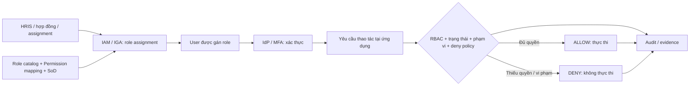
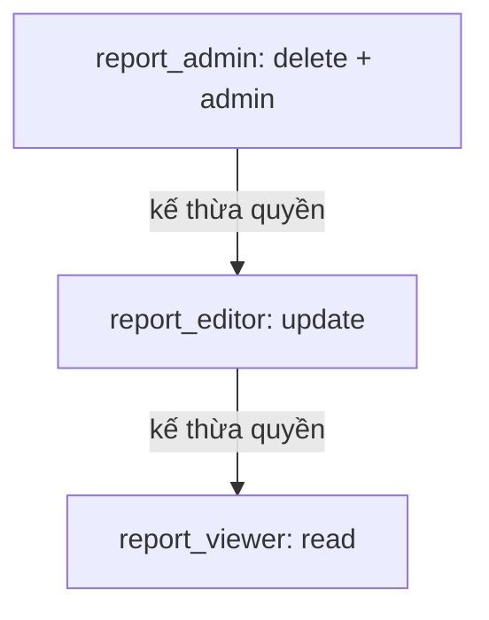
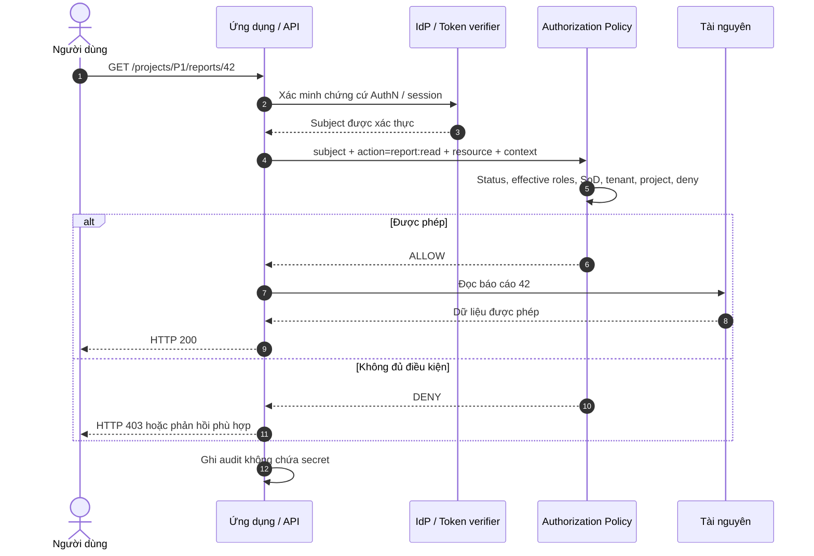

# RBAC là gì trong quản lý vòng đời danh tính IAM?

## 1. RBAC là gì?

**Role-Based Access Control (RBAC) — kiểm soát truy cập dựa trên vai trò** là mô hình phân quyền trong đó **quyền thực hiện hành động trên tài nguyên được gắn với vai trò**, còn người dùng hoặc danh tính được **gán những vai trò phù hợp**. Khi cần truy cập một tài nguyên, hệ thống xác định người dùng có vai trò được phép thực hiện hành động đó hay không.

Thay vì cấp riêng cho từng nhân viên quyền `report:read`, `invoice:create` hoặc `customer:export`, tổ chức có thể tạo các vai trò nghiệp vụ như `report_viewer`, `invoice_creator` hay `finance_analyst` rồi gắn những quyền cần thiết cho vai trò tương ứng. Người dùng được gán vai trò sau khi **quan hệ công việc, phạm vi nhiệm vụ và phê duyệt** đã hợp lệ.

Ví dụ, một nhân viên là `project_report_viewer` có thể **đọc** báo cáo của dự án được phân công nhưng không được **xóa** báo cáo hoặc **phê duyệt** khoản thanh toán. Nếu chuyển sang công việc khác, IAM gỡ vai trò không còn cần và chỉ cấp vai trò mới được phép.

**Điểm cốt lõi:** RBAC quyết định quyền dựa trên **vai trò**, không đơn thuần dựa vào việc người dùng đã đăng nhập thành công.

### 1.1. RBAC giải quyết vấn đề nào?

Giả sử công ty có 1.000 nhân viên và 40 quyền thao tác. Nếu quản trị viên cấp quyền trực tiếp theo từng người, sẽ khó biết:

- Ai có quyền xem, sửa, xóa hoặc phê duyệt dữ liệu?
- Người cùng nhiệm vụ có được cấp quyền nhất quán không?
- Khi một người đổi phòng ban, quyền cũ được gỡ thế nào?
- Có người vừa **lập** vừa **duyệt** một khoản thanh toán không?
- Khi nhân viên nghỉ việc, còn quyền truy cập tồn dư ở ứng dụng nào?

RBAC gom quyền thành những **vai trò có ý nghĩa**, tạo cơ chế cấp/thu hồi nhất quán và hỗ trợ kiểm toán, miễn là **vai trò được thiết kế đúng** và những thay đổi ngoài RBAC cũng được kiểm soát.

### 1.2. RBAC trong Identity Lifecycle

Trong mô hình **Joiner–Mover–Leaver (JML)**:

- **Joiner:** xác minh danh tính, xác nhận ngày bắt đầu, gán các vai trò tối thiểu được phê duyệt.
- **Mover:** tính lại vai trò theo công việc mới, **thu hồi vai trò cũ** và kiểm tra xung đột.
- **Leaver:** ngăn đăng nhập, thu hồi vai trò, nhóm, entitlement và những đường truy cập còn tồn tại.
- **Reconciliation:** so sánh vai trò/quyền đáng lẽ có với quyền thực tế của từng tài khoản và ứng dụng.

RBAC là một phần của hệ thống **Identity and Access Management (IAM)** rộng hơn, cùng với IdP, SSO, SCIM, MFA, quản trị tài khoản dịch vụ và kiểm toán.

## 2. Các thành phần của mô hình RBAC

RBAC thường được giải thích bằng **người dùng (user), vai trò (role), quyền (permission), phiên kích hoạt vai trò (session)** và những mối quan hệ giữa chúng.

| Thành phần | Ý nghĩa | Ví dụ |
|---|---|---|
| **User / subject** | Danh tính hoặc chủ thể được xét quyền | `identity-1042`, tài khoản nhân viên Linh |
| **Role** | Tập trách nhiệm hoặc chức năng được tổ chức công nhận | `finance_reader` |
| **Permission** | Khả năng thực hiện **operation** trên **object/resource** | `report:read` trên báo cáo |
| **Resource / object** | Thứ được bảo vệ | Báo cáo, hóa đơn, dự án, API |
| **Operation / action** | Hành động được yêu cầu | `read`, `create`, `approve`, `delete` |
| **User–Role Assignment (UA)** | Quan hệ danh tính được gán vai trò | Linh → `finance_reader` |
| **Permission–Role Assignment (PA)** | Quan hệ vai trò có những quyền nào | `finance_reader` → `report:read` |
| **Role hierarchy (RH)** | Quan hệ kế thừa giữa các vai trò nếu có | Vai trò cao hơn thừa hưởng một số quyền cấp dưới |
| **Role constraints** | Điều kiện hạn chế việc gán/kích hoạt vai trò | Không đồng thời có vai trò lập và duyệt cùng phạm vi |
| **RBAC session** | Tập vai trò được kích hoạt trong một ngữ cảnh theo mô hình | Kích hoạt `analyst` nhưng chưa kích hoạt `approver` |

**Chú ý:** `session` trong mô hình RBAC là **ngữ cảnh kích hoạt vai trò để quyết định quyền**. Nó không nhất thiết trùng với cookie phiên trình duyệt, phiên IdP hay một JWT. Khi triển khai, các hệ thống có thể ánh xạ hai loại khái niệm này theo nhiều cách.

### 2.1. Quyền không chỉ là tên màn hình

Quyền nên mô tả **hành động thật trên tài nguyên thật**, ví dụ:

- `report:read` — đọc báo cáo.
- `report:export` — xuất dữ liệu.
- `invoice:create` — tạo hóa đơn.
- `invoice:approve` — duyệt hóa đơn.
- `user:disable` — vô hiệu hóa tài khoản.
- `role:assign` — gán vai trò cho người khác.

Một nút `Export` bị ẩn trên giao diện **không phải cơ chế authorization**. API/backend vẫn phải kiểm tra người gửi request có `report:export` trên đúng phạm vi dữ liệu hay không.

## 3. Cách RBAC hoạt động: từ danh tính đến quyền

Cơ chế cơ bản:

1. IAM xác định người dùng và những **role assignment** có căn cứ.
2. Quản trị quyền định nghĩa **permission set** cho từng vai trò.
3. Người dùng đăng nhập hoặc gọi API.
4. Hệ thống xác thực người dùng (AuthN) bằng cơ chế như IdP/MFA.
5. Khi có yêu cầu truy cập, **bộ kiểm tra quyền** đánh giá vai trò được phép dùng trong ngữ cảnh hiện tại.
6. Chỉ cho phép thao tác nếu quyền cần thiết tồn tại **và các ràng buộc khác đều đạt**.



**Quy tắc mặc định nên là deny:** nếu không chứng minh được vai trò, quyền, trạng thái tài khoản hoặc phạm vi phù hợp, hệ thống phải từ chối thay vì tự suy đoán cho phép.

### 3.1. Ví dụ ba người dùng

| Người dùng | Vai trò được gán | Những quyền minh họa |
|---|---|---|
| Linh | `report_viewer` | `report:read` |
| An | `report_editor` | `report:read`, `report:update` |
| Minh | `report_admin` | `report:read`, `report:update`, `report:delete` |

Nếu Linh gọi API `DELETE /reports/42`, backend phải từ chối vì `report_viewer` không có `report:delete`. Nếu An chuyển vai trò và role `report_editor` bị thu hồi, token hoặc cache chứa vai trò cũ **không được trở thành lối bỏ qua chính sách thu hồi**.

## 4. Biểu diễn RBAC bằng tập hợp và quan hệ

Một mô hình RBAC cơ bản có thể được diễn đạt bằng:

- `U` — tập người dùng hoặc chủ thể.
- `R` — tập vai trò.
- `P` — tập permission.
- `UA ⊆ U × R` — quan hệ gán người dùng vào vai trò.
- `PA ⊆ P × R` — quan hệ gắn permission với vai trò.

Dùng ký hiệu `AssignedRoles(u)` để lấy vai trò được gán cho `u`, và `Permissions(r)` để lấy quyền của `r`. Khi chưa xét hierarchy và constraint, quyền ứng viên của người dùng là hợp quyền của các vai trò được gán:

```text
AssignedRoles(u) = { r | (u, r) ∈ UA }

Permissions(r) = { p | (p, r) ∈ PA }

CandidatePermissions(u) =
    UNION(Permissions(r) for r in AssignedRoles(u))
```

Đây là **mô hình minh họa**, không phải công thức đủ để cho phép truy cập trong mọi hệ thống. Quyết định thực tế còn có **trạng thái tài khoản, phạm vi dự án/tenant, role hierarchy, role activation, chính sách deny và SoD**.

### 4.1. Ví dụ tập hợp

```text
Permissions(report_viewer) = {
    report:read
}

Permissions(report_editor) = {
    report:read,
    report:update
}

AssignedRoles(Linh) = { report_viewer }
AssignedRoles(An)   = { report_editor }

Can(Linh, report:update) = false
Can(An, report:update)   = true
```

Muốn bảo vệ báo cáo thuộc **dự án P1** mà không cho xem dự án P2, chỉ một permission toàn cục `report:read` thường **chưa đủ**. Cần role theo phạm vi (`project-p1-report-viewer`) hoặc kết hợp ABAC để kiểm tra `project_id`.

## 5. RBAC0, RBAC1, RBAC2 và RBAC3

Các biến thể RBAC thường được mô tả theo họ mô hình **NIST RBAC**:

| Mô hình | Nội dung chính | Câu hỏi điển hình |
|---|---|---|
| **RBAC0 — Core RBAC** | Người dùng, vai trò, quyền, gán quyền và phiên kích hoạt | Ai được gán role nào và role cho quyền gì? |
| **RBAC1 — Hierarchical RBAC** | Bổ sung **phân cấp vai trò** | Role quản lý có kế thừa quyền role nhân viên không? |
| **RBAC2 — Constrained RBAC** | Bổ sung **ràng buộc** như Separation of Duties | Có được gán đồng thời hai vai trò xung đột? |
| **RBAC3 — Consolidated RBAC** | Kết hợp phân cấp và ràng buộc | Tổ chức quản lý cả kế thừa lẫn SoD thế nào? |

### 5.1. Core RBAC không đồng nghĩa cấp role là luôn active

Trong mô hình chính thức, một người dùng có thể **được gán nhiều role** nhưng chỉ **kích hoạt một tập con** trong một phiên hoặc ngữ cảnh theo policy.

Ví dụ An được gán `analyst` và `temporary_approver` nhưng một giao dịch cụ thể chỉ cho phép kích hoạt một vai trò. Điều này hỗ trợ **Dynamic Separation of Duties** khi nền tảng thực thi được.

Nhiều ứng dụng hiện đại **không triển khai role activation như mô hình chuẩn**; chúng chỉ kiểm tra tập role được gán. Khi đó không nên tuyên bố ứng dụng hỗ trợ DSD chỉ vì có bảng user–role.

## 6. Phân cấp vai trò (Role Hierarchy)

**Role hierarchy** cho phép một vai trò kế thừa quyền của vai trò khác theo quy tắc được thiết kế. Thông thường, một **senior role** có thể thừa hưởng permission của **junior role**.

Ví dụ minh họa:



Nếu `report_editor` kế thừa `report_viewer`, quyền của editor có thể bao gồm cả `report:read` và `report:update`. Tuy nhiên:

- **Phân cấp quyền không bắt buộc trùng cấp bậc nhân sự.**
- “Trưởng phòng” không tự động phải có mọi quyền chi tiết của nhân viên.
- Thừa kế sai có thể tạo **đặc quyền vượt nhu cầu**.
- Một ứng dụng có thể không hỗ trợ hierarchy; phải cấu hình mapping đúng theo sản phẩm.

### 6.1. Khi nào hierarchy hữu ích?

Khi nhiều vai trò chia sẻ một bộ quyền ổn định, kế thừa giúp giảm lặp cấu hình. Tuy nhiên với các vai trò nhạy cảm, đặc biệt **người đề nghị/duyệt**, kế thừa có thể gây xung đột SoD. Cần review role graph, không tạo chuỗi kế thừa chỉ vì cấu trúc tổ chức.

### 6.2. Không nhầm hierarchy với nested group

**Nested group** là nhóm lồng nhau trong directory/IdP, còn **role hierarchy** là quan hệ kế thừa quyền trong mô hình RBAC. Chúng có thể được ánh xạ với nhau, nhưng không tự đồng nhất. Một SaaS có thể chỉ đồng bộ nhóm phẳng qua SCIM mà không hiểu nhóm lồng nhau hoặc phân cấp role.

## 7. RBAC và nhóm (group): liên quan nhưng khác nhau

Trong nhiều doanh nghiệp, vai trò được hiện thực thông qua **security group**, nhưng **group không phải lúc nào cũng là role**.

| Khái niệm | Ví dụ | Phạm vi ý nghĩa |
|---|---|---|
| **Business role** | `finance_analyst` | Chức năng/trách nhiệm nghiệp vụ |
| **Application role** | `billing_read_only` | Role trong một ứng dụng |
| **Security group** | `grp-finance-readers` | Tập member trong IdP/directory |
| **Permission / entitlement** | `report:export` | Quyền thao tác cụ thể |
| **Assignment** | `identity-1042` được gán `finance_analyst` | Quan hệ giữa danh tính và vai trò |
| **Mapping** | `finance_analyst` → `grp-finance-readers` | Quy tắc chuyển vai trò nghiệp vụ thành cấu hình kỹ thuật |

Một group có thể chỉ phục vụ email hoặc cộng tác, không mang permission. Một role ứng dụng có thể được cấp **trực tiếp** và không xuất hiện trong group IdP. IAM phải hiểu mapping cụ thể từng đích.

### 7.1. Quy trình ánh xạ đúng

```text
HRIS xác nhận: department=FIN, assignment=reporting
        |
        v
IGA xác định: business_role=finance_analyst
        |
        v
Policy + approval + SoD: được phép
        |
        v
Technical mapping:
    - IdP group = grp-finance-readers
    - SaaS B role = report_viewer
    - Scope = tenant-company / finance-reporting
        |
        v
SCIM/API provisioning + readback
```

**Không tự cấp role dựa duy nhất trên chuỗi tên phòng ban** nếu chính sách yêu cầu phê duyệt hoặc kiểm tra thêm.

## 8. RBAC, ABAC, ACL, DAC và các mô hình khác

RBAC có thế mạnh khi quyền gắn chặt với **chức năng và trách nhiệm ổn định**. Những mô hình khác trả lời các câu hỏi khác nhau.

| Cơ chế | Căn cứ quyết định | Ví dụ |
|---|---|---|
| **RBAC** | Vai trò được gán và permission của vai trò | `report_viewer` có quyền đọc báo cáo |
| **ABAC** | Thuộc tính chủ thể, tài nguyên, hành động và ngữ cảnh | Chỉ đọc báo cáo cùng `project_id` và tài khoản active |
| **ACL** | Danh sách quyền gắn trên tài nguyên hoặc đối tượng | Tài liệu số 42 cho user/group X quyền read |
| **DAC** | Chủ sở hữu có thể quyết định cấp quyền theo chính sách hệ thống | Người sở hữu file chia sẻ cho đồng nghiệp |
| **MAC** | Nhãn phân loại và chính sách bắt buộc | Chỉ chủ thể đủ mức clearance truy cập tài liệu phân loại |
| **ReBAC** | Quan hệ giữa chủ thể và tài nguyên | Chỉ thành viên được chỉ định của dự án xem tài liệu của dự án |

Các hệ thống hiện đại thường **kết hợp RBAC và ABAC**, thay vì chọn một và bỏ hết mô hình khác.

### 8.1. Ví dụ kết hợp RBAC + ABAC

```text
allow(user, "read", report) when
    user.account_status == "ACTIVE"
    and "report_viewer" in user.effective_roles
    and user.tenant_id == report.tenant_id
    and user.project_id == report.project_id
    and report.classification != "restricted"
```

Trong ví dụ, RBAC kiểm tra **loại thao tác** theo role, ABAC giới hạn **phạm vi tài nguyên và trạng thái**. Một role có quyền `report:read` không có nghĩa đọc được báo cáo của mọi tenant.

### 8.2. Khi nào RBAC đơn thuần chưa đủ?

- Quyền tùy thuộc chủ sở hữu của từng tài liệu.
- Chính sách phụ thuộc địa điểm, thiết bị, thời gian hoặc mức rủi ro.
- Người dùng chỉ được thao tác với những bản ghi được phân công.
- Một role có phạm vi tenant/project khác nhau.
- Quy trình cần kiểm tra “người phê duyệt không phải người tạo giao dịch”.

RBAC có thể là **lớp coarse-grained**, còn ABAC/ReBAC và kiểm tra nghiệp vụ thực thi điều kiện chi tiết.

## 9. Role engineering: thiết kế vai trò có ý nghĩa

**Role engineering** là quá trình khảo sát nghiệp vụ và quyền thực tế để xây dựng danh mục vai trò hợp lý, có owner, phạm vi và quy tắc cấp/thu hồi.

Hai phương pháp bổ sung cho nhau:

- **Top-down:** bắt đầu từ chức năng, quy trình công việc, trách nhiệm và policy; xác định quyền tối thiểu cần có.
- **Bottom-up:** phân tích tập entitlement thực tế của người dùng để phát hiện nhóm quyền tương đồng và sai lệch.

Không nên chỉ lấy **quyền hiện tại** làm mẫu vì dữ liệu đó có thể chứa quyền tích lũy qua nhiều năm.

### 9.1. Quy trình thiết kế

1. Liệt kê **tài nguyên và thao tác** cần bảo vệ.
2. Phỏng vấn owner nghiệp vụ và chủ sở hữu dữ liệu.
3. Phân biệt **business role**, **technical role** và permission thực tế.
4. Xây role theo nhu cầu công việc, không theo từng người.
5. Định nghĩa phạm vi `tenant/project/environment`.
6. Kiểm tra **least privilege**, SoD, rủi ro đặc quyền và điều kiện phê duyệt.
7. Gắn owner, mô tả, phiên bản và quy tắc gia hạn/thu hồi.
8. Thử với một tập tài khoản đại diện; quan sát quyền thực tế ở API.
9. Review định kỳ và chỉnh role theo thay đổi nghiệp vụ.

### 9.2. Ví dụ role catalog

| Role | Mục đích | Quyền | Owner | Điều kiện cấp |
|---|---|---|---|---|
| `employee_basic` | Truy cập công cụ nền | `portal:read` | IT Operations | Nhân sự active |
| `project_report_viewer` | Xem báo cáo dự án | `report:read` | Project Owner | Có assignment dự án |
| `report_exporter` | Xuất dữ liệu | `report:export` | Data Owner | Phê duyệt đặc biệt, có hạn |
| `invoice_creator` | Tạo hóa đơn | `invoice:create` | Finance Ops | Vai trò kế toán |
| `invoice_approver` | Duyệt hóa đơn | `invoice:approve` | Finance Controller | Ủy quyền duyệt và SoD |
| `production_admin` | Quản trị hệ thống sản xuất | `production:admin` | Security + Platform | PAM/JIT, MFA mạnh, audit |

Đây là **danh mục minh họa**, không phải tập role chuẩn áp dụng cho mọi doanh nghiệp.

## 10. Granularity: role quá rộng hay quá nhỏ?

**Độ hạt (granularity)** quyết định vai trò chứa bao nhiêu permission và áp dụng cho phạm vi nào.

| Cách thiết kế | Ưu điểm | Vấn đề |
|---|---|---|
| Một role `all_employee_access` chứa mọi quyền | Dễ tạo ban đầu | Overprivilege, khó kiểm toán và SoD |
| Một role cho từng người | Có thể khớp từng yêu cầu | **Role explosion**, khó quản trị hơn direct grants |
| Một role cho từng project–permission–tenant | Phạm vi chính xác | Số lượng role tăng rất nhanh |
| Role nghiệp vụ + scope/ABAC | Cân bằng tái sử dụng và độ chính xác | Cần policy engine, dữ liệu thuộc tính tin cậy |
| Baseline role + time-bound exception | Phù hợp nghiệp vụ chung và trường hợp đặc biệt | Phải theo dõi hạn, owner và thu hồi ngoại lệ |

### 10.1. Role explosion

Nếu mỗi tổ hợp phòng ban, dự án, môi trường và mức quyền thành một role, danh mục role có thể tăng theo tích số các chiều. Ví dụ 20 dự án × 5 hành động × 3 môi trường đã có đến **300 tổ hợp** ngay cả trước khi tính tenant và ngoại lệ.

Không nên giải quyết bằng cách tạo role `admin-all`. Cần **tách role chức năng, scope tài nguyên và điều kiện bổ sung** theo kiến trúc.

### 10.2. Role tối thiểu và ngoại lệ có hạn

Cấp quyền theo **least privilege**: người dùng chỉ có quyền cần để hoàn thành nhiệm vụ. Nếu cần quyền tạm thời, dùng yêu cầu được duyệt với:

- Mục đích và đối tượng cần quyền.
- Owner/phê duyệt.
- Thời gian bắt đầu và kết thúc.
- Giới hạn tài nguyên.
- Kiểm tra SoD và rủi ro.
- Cơ chế tự thu hồi và đối soát sau hết hạn.

## 11. Separation of Duties (SoD) trong RBAC

**Separation of Duties (phân tách nhiệm vụ)** giúp tránh một người có khả năng tự hoàn thành các bước nhạy cảm cần sự kiểm soát độc lập.

Ví dụ tổ chức không muốn một người vừa **tạo** vừa **phê duyệt** khoản thanh toán trong phạm vi được quy định.

### 11.1. Static Separation of Duties (SSD)

**SSD** hạn chế **gán đồng thời** các role xung đột cho cùng một chủ thể, theo phạm vi policy.

Ví dụ:

```text
forbidden_role_pair = {
    invoice_creator,
    invoice_approver
}

if user is assigned BOTH in same protected scope:
    deny_assignment_or_require_policy_resolution()
```

Điều này phù hợp khi tổ chức muốn ngăn xung đột ngay **tại thời điểm gán role**, dù người dùng chưa thực hiện giao dịch nào.

### 11.2. Dynamic Separation of Duties (DSD)

**DSD** có thể cho phép một người **được gán** nhiều role nhưng không cho **kích hoạt đồng thời** những role xung đột trong cùng session/ngữ cảnh được quản trị.

Ví dụ nhân viên hỗ trợ được phép đóng vai trò `operator` hoặc `reviewer` trong các phiên khác nhau, nhưng không đồng thời kích hoạt cả hai khi policy cấm.

**DSD chỉ khả thi nếu hệ thống thực sự quản lý role activation.** Nếu ứng dụng luôn dùng hợp của tất cả role gán, không thể chỉ ghi quy định DSD trên giấy.

### 11.3. Transaction-level SoD cần thêm ngữ cảnh

Ngay cả khi người dùng không kích hoạt hai role cùng lúc, quy trình vẫn có thể cần điều kiện:

> Người phê duyệt hóa đơn **không được là người đã tạo chính hóa đơn đó**.

Đây là ràng buộc **theo đối tượng/giao dịch và lịch sử hành động**. RBAC thuần chỉ biết role chưa chắc thực thi đủ; cần kiểm tra thuộc tính như `invoice.created_by != current_user.id` và audit nghiệp vụ.

### 11.4. Những constraint khác

- **Cardinality:** tối đa N người có role `security_super_admin`.
- **Prerequisite role:** phải có role nền hoặc hoàn tất đào tạo trước khi được xét cấp role khác.
- **Time constraints:** role chỉ có hiệu lực trong khoảng thời gian cho phép.
- **Scope constraints:** vai trò chỉ hợp lệ ở một tenant, ứng dụng, project hay môi trường.
- **Approval constraints:** cần người phê duyệt độc lập cho quyền nhạy cảm.

Không phải mọi constraint đều được một sản phẩm RBAC hỗ trợ trực tiếp; có thể cần IGA, workflow và policy engine.

## 12. Quy trình quyết định truy cập ở backend

Một hệ thống an toàn phải kiểm tra quyền **tại điểm thực thi** (backend/API), không chỉ tại menu giao diện.



Tùy kiến trúc, IdP không cần được gọi trực tiếp cho mỗi request: ứng dụng có thể xác minh token tại chỗ hoặc session tại server. Điều quan trọng là **bằng chứng AuthN hợp lệ** và **quyết định AuthZ đúng trạng thái hiện hành theo chính sách**.

### 12.1. Phân biệt 401 và 403

- **401 Unauthorized** thường liên quan việc request **chưa có thông tin xác thực hợp lệ** theo hợp đồng HTTP.
- **403 Forbidden** thường dùng khi hệ thống hiểu yêu cầu nhưng **không cho phép truy cập**.

API có thể cố ý trả `404` để giảm rò rỉ sự tồn tại tài nguyên theo policy; không được biến sự khác nhau của HTTP status thành cách vượt quyền.

## 13. RBAC trong Joiner lifecycle

Ở giai đoạn **Joiner**, mục tiêu là cấp đúng những vai trò **đủ dùng để bắt đầu công việc**, không cấp theo sự tiện tay của quản trị viên.

### 13.1. Luồng đề xuất

1. **HRIS/HCM** hoặc nguồn hợp đồng xác nhận người mới, mã danh tính và ngày hiệu lực.
2. **Identity proofing** xác minh đúng con người/đối tác trước khi liên kết tài khoản.
3. IAM tạo hoặc liên kết danh tính và tài khoản IdP theo ID ổn định.
4. IGA xác định **business role** từ chức năng/assignment được duyệt.
5. Chính sách kiểm tra **least privilege, SoD, scope và phê duyệt**.
6. Chuyển business role thành nhóm/technical role trong directory, IdP hoặc SaaS.
7. SCIM/API provision user, group và entitlement theo khả năng đích.
8. Người dùng đăng ký MFA/SSO theo chính sách, nhưng **MFA không tự cấp role**.
9. Chỉ kích hoạt quyền khi **quan hệ nghiệp vụ và thời điểm hiệu lực** hợp lệ.
10. Readback tại ứng dụng để xác minh quyền đã được cấp **đúng**, không quá rộng.

### 13.2. Pre-provisioning và quyền thực tế

Để chuẩn bị thiết bị, doanh nghiệp có thể tạo tài khoản **trước ngày bắt đầu**, nhưng không đồng nghĩa phải kích hoạt các role nghiệp vụ ngay. Cần tách **account exists**, **can authenticate** và **entitlement active**.

### 13.3. Ví dụ Joiner

Nhân viên mới Linh có assignment dự án P1. IGA tính `project_report_viewer` và scope `P1`. Sau phê duyệt, connector gán đúng role vào ứng dụng. Khi Linh đăng nhập SSO, backend kiểm tra role **và** scope trước khi cho xem báo cáo P1. Nếu Linh gọi API dự án P2, request phải bị từ chối.

## 14. RBAC trong Mover lifecycle

**Mover** là thay đổi vai trò, phòng ban, dự án, tổ chức hoặc quyền trách nhiệm. Đây là giai đoạn dễ gây **tích lũy quyền (privilege creep)** nếu hệ thống chỉ thêm role mới.

### 14.1. Tính quyền mong muốn rồi so sánh

Giả sử An chuyển từ bộ phận Sales sang Finance:

```text
AssignedRoles trước:
    employee_basic
    sales_report_reader
    sales_exporter

DesiredRoles sau:
    employee_basic
    finance_report_reader

RolesToRevoke:
    sales_report_reader
    sales_exporter

RolesToGrant:
    finance_report_reader
```

Quyền Finance mới có thể cần phê duyệt và kiểm tra SoD; không tự cấp dựa duy nhất vào tên phòng ban.

### 14.2. Các bước an toàn

1. Nhận sự kiện Mover cùng `effective_at`, `source_version` và assignment thay đổi.
2. Xác định những quan hệ/assignment **vẫn còn hiệu lực**, kể cả hợp đồng song song.
3. Tính **desired roles** và phạm vi quyền mới.
4. Xác định role cũ **không còn căn cứ**, kể cả role gán trực tiếp và ngoại lệ quá hạn.
5. Kiểm tra SoD, phê duyệt và rủi ro với role mới.
6. Thực hiện revoke/grant theo thứ tự hạn chế rủi ro; kiểm soát thời gian chồng lấn.
7. Cập nhật nhóm IdP/directory và role SaaS qua SCIM/API.
8. Kiểm tra session, access token hoặc cache role cũ.
9. Đối soát quyền hiệu lực tại mọi đích quan trọng.

### 14.3. Quyền bàn giao có thời hạn

Một người có thể cần xem hệ thống Sales trong vài ngày để bàn giao. Điều này cần **ngoại lệ có thời hạn, owner, phạm vi và approval**. Không để các role cũ tồn tại vô thời hạn dưới lý do “phòng trường hợp còn cần”.

## 15. RBAC trong Leaver lifecycle

**Leaver** là thời điểm nhân viên, nhà thầu hoặc quan hệ truy cập không còn hợp lệ. Thu hồi role là **cần thiết**, nhưng tự nó không đủ.

### 15.1. Quy trình

1. Nhận sự kiện nghỉ việc từ HRIS/VMS/sponsor được xác minh.
2. Xác định đúng danh tính và các tài khoản ở IdP, SaaS, hệ thống on-prem.
3. **Chặn đăng nhập** hoặc disable tài khoản theo thời điểm hiệu lực và mức rủi ro.
4. Thu hồi những **role assignment** không còn căn cứ.
5. Gỡ các **group membership** có ánh xạ tới role, tránh xóa nhóm dùng chung.
6. Thu hồi permission/grant **trực tiếp** ngoài RBAC nếu có.
7. Disable/deprovision tài khoản đích qua SCIM/API hoặc quy trình thủ công có owner.
8. Thu hồi phiên và credential có thể tiếp tục cho phép truy cập: refresh token, PAT, SSH key, session app, đặc quyền PAM.
9. Readback **quyền thực tế** tại ứng dụng, không chỉ tin phản hồi connector.
10. Ghi bằng chứng per-target; lỗi còn tồn tại phải có cảnh báo và chủ sở hữu xử lý.

### 15.2. Tại sao xóa role chưa chắc đã khóa truy cập?

- Một ứng dụng có thể dùng **phiên đã được cấp trước khi revoke**.
- Token JWT có thể còn claim `roles` cũ đến khi hết hạn.
- Tài khoản SaaS có role gán trực tiếp, không được quản lý từ IdP.
- Một khóa API hoặc credential máy vẫn có hiệu lực.
- Người dùng còn một đường quyền qua nested group hoặc external tenant.

**Không tuyên bố offboarding đã hoàn tất chỉ vì bản ghi UA của IAM rỗng.** Cần xác minh mọi đường truy cập quan trọng theo phạm vi kiểm soát.

### 15.3. Một người có nhiều quan hệ hợp lệ

Nếu nhân viên chấm dứt assignment P1 nhưng vẫn có hợp đồng P2, không tự disable **danh tính chung** nếu chính sách cho phép P2 tiếp tục. Cần tính quyền theo tất cả nguồn quan hệ hiện hành và chỉ thu hồi những role không còn căn cứ.

## 16. RBAC, IdP, MFA và SSO

**Authentication** chứng minh người dùng đang kiểm soát một authenticator; **authorization** quyết định có được thực hiện hành động hay không.

| Thành phần | Trách nhiệm | Điều không tự chứng minh |
|---|---|---|
| **IdP** | Xác thực, MFA, quản lý danh tính và phiên SSO | Mọi role trong SaaS đã cập nhật |
| **MFA** | Tăng mức bảo đảm khi xác thực | Người dùng được phép xem dữ liệu nhạy cảm |
| **SAML/OIDC SSO** | Truyền kết quả đăng nhập đến ứng dụng tin cậy | Có mọi permission ứng dụng |
| **Directory groups** | Danh sách membership và nguồn kỹ thuật cấp role | Ứng dụng thực tế đã thu hồi role |
| **RBAC** | Ánh xạ vai trò tới permission và kiểm tra quyền | Mật khẩu hay token còn hợp lệ |
| **ABAC** | Giới hạn quyền theo scope, thuộc tính/ngữ cảnh | Chủ thể đã hoàn thành identity proofing |
| **IGA** | Quản trị phê duyệt, SoD, review và JML | Từng token cũ đã mất hiệu lực |

### 16.1. Role claim trong token

IdP có thể phát hành OIDC/SAML claim chứa nhóm hoặc role. Ứng dụng nhận cần kiểm tra **issuer, audience, chữ ký, hạn dùng và mapping đáng tin**, không tin một claim `role=admin` do client tự khai báo.

**Claim được phát hành là snapshot theo thời điểm**, không tự sửa nội dung khi Mover/Leaver đổi role. Với tài nguyên nhạy cảm cần cân nhắc token lifetime phù hợp, introspection, revocation hoặc authorization check tại thời điểm request theo kiến trúc.

### 16.2. Step-up MFA không thay role approval

Một người có MFA phishing-resistant vẫn có thể **không được phê duyệt** vai trò `invoice_approver`. MFA chỉ là một điều kiện xác thực bổ sung; không thay thế role assignment, approval hay SoD.

## 17. RBAC và SCIM provisioning

**SCIM (System for Cross-domain Identity Management)** thường được dùng để quản lý user và group giữa IAM/IdP với ứng dụng. Trong thực tế, ứng dụng có thể ánh xạ **SCIM group → application role**, nhưng **SCIM không quy định một mô hình RBAC hoàn chỉnh dùng chung cho mọi sản phẩm**.

### 17.1. Từ role assignment đến membership

Một chuỗi điển hình:

```text
IGA:
  user I-1042 has role project_report_viewer
  scope project P1

Technical mapping:
  target SaaS = reports-saas
  group = project-p1-readers
  target user ID = target-user-1042

SCIM:
  PATCH /Groups/group-project-p1
  add member target-user-1042

Target application:
  group maps to permission report:read for P1
```

### 17.2. Ví dụ SCIM PATCH gỡ role qua group

Nếu Leaver/Mover khiến quyền P1 hết căn cứ:

```http
PATCH /scim/v2/Groups/group-project-p1 HTTP/1.1
Host: scim.example.org
Authorization: Bearer <redacted-token>
Content-Type: application/scim+json

{
  "schemas": ["urn:ietf:params:scim:api:messages:2.0:PatchOp"],
  "Operations": [
    {
      "op": "remove",
      "path": "members[value eq \"target-user-1042\"]"
    }
  ]
}
```

Đây là ví dụ minh họa. Provider phải hỗ trợ `Groups`, PATCH và bộ lọc membership tương ứng. Cần **đọc lại group và role ứng dụng**, không mặc định HTTP thành công nghĩa là mọi phiên/token đã mất quyền.

### 17.3. Khi SCIM không quản lý hết role

Một số ứng dụng có:

- Role được gán thủ công trong bảng quyền local.
- Entitlement động từ chính sách ABAC.
- Nhóm động hoặc nested group do provider tự tính.
- Privileged role chỉ quản lý qua API riêng.
- Credential độc lập với account user.

Những quyền này cần API/connector/quy trình riêng để đối soát và thu hồi.

## 18. Kiến trúc RBAC ở cấp ứng dụng: PEP, PDP và dữ liệu chính sách

Một hệ thống có thể tách việc **ra quyết định** và **thực thi** thành:

- **Policy Administration Point (PAP):** nơi định nghĩa role, permission, rule, version và phê duyệt thay đổi.
- **Policy Decision Point (PDP):** đánh giá request có được phép không.
- **Policy Enforcement Point (PEP):** chặn hoặc cho request đi tiếp tại API/service.
- **Policy Information Point (PIP):** cung cấp role, thuộc tính danh tính và tài nguyên phục vụ quyết định.

Tên thành phần có thể khác nhau theo kiến trúc; không bắt buộc triển khai thành bốn dịch vụ độc lập.

### 18.1. Quyết định an toàn ở backend

Bất kỳ request nào tới `/reports/{id}` đều cần:

1. Xác định subject đã xác thực.
2. Đọc hoặc kiểm tra **effective role** trong phạm vi đáng tin.
3. Xác định **action** mà endpoint thực sự thực hiện.
4. Nạp **resource** và tenant/project/owner liên quan.
5. Áp dụng deny, role permission, scope và constraint.
6. Chỉ truy xuất/ghi dữ liệu sau khi **ALLOW**; ghi audit theo chính sách.

**Không dựa vào role của người dùng trong request body hoặc header tự khai báo**; đó không phải nguồn tin cậy.

## 19. Mã giả kiểm tra quyền RBAC + phạm vi

Ví dụ một API bảo vệ thao tác xuất báo cáo:

```text
function can_export_report(authenticated_subject, report_id):
    if authenticated_subject is null:
        return DENY

    identity = identity_store.find(authenticated_subject.identity_id)
    if identity is null or identity.status != ACTIVE:
        return DENY

    report = report_store.get(report_id)
    if report is null:
        return DENY

    if identity.tenant_id != report.tenant_id:
        return DENY

    effective_roles = role_service.get_current_roles(
        identity.id,
        report.tenant_id,
        report.project_id
    )

    if not permission_catalog.has_permission(
        effective_roles,
        "report:export"
    ):
        return DENY

    if violates_sod_or_deny_rules(identity, report, "report:export"):
        return DENY

    if not satisfies_resource_policy(identity, report):
        return DENY

    return ALLOW
```

Đây là **mã giả**, không phải thư viện authorization hoàn chỉnh. Trong triển khai thực tế cần kiểm soát **nguồn dữ liệu có thẩm quyền, snapshot phiên, quyền cục bộ, xử lý đồng thời, ranh giới tenant, độ mới của role và audit**.

### 19.1. Tránh IDOR/BOLA

Nếu API chỉ kiểm tra người dùng có `report:read` nhưng không kiểm tra report thuộc **tenant/dự án được phép**, kẻ tấn công có thể đổi ID trong URL để đọc báo cáo người khác. Đây là lỗi **Broken Object Level Authorization (BOLA)**.

RBAC chỉ kiểm tra loại quyền **không đủ** khi quyền có phạm vi đối tượng. Luôn xác minh sở hữu, tenant, dự án hoặc quan hệ tài nguyên tại điểm thực thi.

## 20. Quản lý role theo vòng đời riêng

**Role cũng có vòng đời**, không chỉ người dùng có vòng đời.

1. **Đề xuất:** nghiệp vụ xác định nhu cầu một role mới.
2. **Thiết kế:** khai báo mục đích, permission, scope, owner và SoD.
3. **Phê duyệt:** Security/Data Owner/IGA đánh giá mức đặc quyền.
4. **Triển khai:** tạo role và mapping tới group/application.
5. **Gán quyền:** người dùng được yêu cầu/cấp theo quy trình.
6. **Vận hành:** theo dõi drift, quyền trực tiếp và ngoại lệ.
7. **Rà soát:** kiểm tra người vẫn cần role và role vẫn cần permission.
8. **Thay đổi:** version, thử ảnh hưởng, migrate assignment hợp lệ.
9. **Ngừng sử dụng:** thu hồi gán, bỏ mapping, dọn role khi không còn tài nguyên phụ thuộc.

### 20.1. Role owner và permission owner

**Role owner** chịu trách nhiệm ý nghĩa và phạm vi của role. **Resource/data owner** quyết định hành động nào được phép trên tài nguyên của họ; hai vai trò quản trị này có thể thuộc các bộ phận khác nhau.

Nếu owner role nghỉ việc, cần **bàn giao ownership**, không mặc nhiên xóa một role đang phục vụ nhiều người.

### 20.2. Phân tích tác động khi thay role

Thay `report_viewer` để bổ sung `report:export` có thể **nâng quyền của hàng trăm người cùng lúc**. Đây là thay đổi **PA (permission-role assignment)**, không phải chỉ thay UA của một người. Cần xem danh sách người chịu ảnh hưởng, mức phân loại dữ liệu, phê duyệt và kế hoạch rollback phù hợp.

## 21. Quản lý quyền đặc quyền với RBAC, PAM và JIT

Các role như `production_admin`, `database_owner` hoặc `identity_super_admin` có tác động lớn. Nên dùng RBAC như một lớp phân định **ai đủ điều kiện yêu cầu quyền**, kết hợp thêm kiểm soát.

- **Privileged Access Management (PAM):** điều phối và giám sát phiên/credential đặc quyền.
- **Just-in-Time (JIT) access:** cấp hoặc kích hoạt quyền trong một khoảng ngắn khi có nhu cầu được duyệt.
- **Step-up authentication:** yêu cầu xác thực mạnh hơn ở thao tác quản trị.
- **Approval và SoD:** người có quyền cấp role đặc quyền không nên tự duyệt cho chính mình khi policy cấm.
- **Session recording/audit:** ghi bằng chứng phù hợp chính sách và quyền riêng tư.
- **Automated expiry:** thu hồi role/entitlement đúng hạn và đối soát.

### 21.1. Break-glass

Tài khoản khẩn cấp (`break-glass`) có thể cần quyền đặc biệt để khôi phục hệ thống khi IdP hoặc quy trình bình thường lỗi. Phải được **quản trị độc lập theo policy**, bảo vệ credential, kiểm tra sử dụng, audit, phát cảnh báo và khôi phục sau sự cố.

Không tự xóa hoặc áp chính sách Leaver của một nhân viên lên tài khoản break-glass dùng chung **chỉ vì owner hiện tại nghỉ việc**; trước hết phải chuyển owner và xem nguồn quản trị khẩn cấp.

## 22. RBAC cho nhà thầu, khách và nhiều quan hệ công việc

RBAC không chỉ áp dụng nhân viên chính thức.

| Chủ thể | Nguồn hợp lệ | Điểm cần kiểm tra |
|---|---|---|
| Nhân viên | HRIS/HCM | Role theo nhiệm vụ, ngày hiệu lực và thay đổi phòng ban |
| Nhà thầu | VMS, hợp đồng hoặc sponsor | Hạn hợp đồng, phạm vi dự án, người bảo trợ |
| Guest từ đối tác | Sponsor và federation agreement | Tenant ứng dụng, local role, thời hạn và thu hồi |
| Nhân viên có nhiều assignment | Nhiều quan hệ được nguồn tin cậy ghi nhận | Tránh gỡ quyền còn căn cứ hoặc giữ quyền đã hết hạn |
| Tài khoản quản trị riêng | Danh tính và quy trình privileged | Không đồng nhất role admin với tài khoản làm việc thường |
| Bot/workload | Service catalog hoặc CMDB | Owner, purpose, environment, credential và dependency |

### 22.1. Hợp đồng kết thúc khác Leaver toàn bộ

Một nhà thầu có hai dự án P1 và P2. Khi P1 kết thúc, IAM cần gỡ role P1, nhưng **không nhất thiết disable mọi tài khoản** nếu P2 còn hợp lệ theo policy.

Công thức desired access phải xét **mọi quan hệ còn hiệu lực**, phủ các deny và constraint. Không lấy một sự kiện kết thúc dự án rồi coi như toàn bộ danh tính đã nghỉ việc.

## 23. RBAC cho tài khoản dịch vụ và workload identity

Tài khoản dịch vụ, CI/CD runner và workload identity cũng cần **quyền tối thiểu**, nhưng không nhất thiết gắn với một vai trò phòng ban của con người.

### 23.1. Mô hình phù hợp

Ví dụ dịch vụ `svc-report-sync` cần:

- Đọc dữ liệu nguồn đã được ủy quyền.
- Ghi vào vùng dữ liệu báo cáo riêng.
- Không được cấp `identity:admin`, `invoice:approve` hoặc `production:*`.

Một role kỹ thuật có thể là:

```text
role: report_sync_service
permissions:
  - source_report:read
  - report_sink:write
scope:
  environment: production
  tenant: tenant-company
owner: data-platform-team
```

Nguồn có thẩm quyền thường là **service catalog/CMDB hoặc nền tảng triển khai**, không phải HRIS. Cần quản lý owner, rotation credential, hạn sử dụng, access review và decommission.

### 23.2. Khi owner nghỉ việc

Không tự disable workload còn hoạt động chỉ vì **người sở hữu kỹ thuật** nghỉ việc. Thay vào đó:

1. Xác định tài khoản/workload do người đó quản lý.
2. Chuyển owner có phê duyệt.
3. Thu hồi quyền quản trị của cá nhân Leaver.
4. Đánh giá cần rotate secret hoặc khóa không.
5. Review role của workload theo least privilege.
6. Chỉ thu hồi workload nếu có sự kiện dừng dịch vụ có thẩm quyền.

Con người quản trị workload nên dùng MFA/PAM phù hợp; còn máy–máy thường dùng **workload identity, mTLS, token ngắn hạn hoặc credential được quản lý**, không chia sẻ TOTP cá nhân.

## 24. Access review và recertification của role

**Access review** là quá trình chủ sở hữu hoặc người duyệt đánh giá **ai còn cần vai trò nào và vì sao**. Đây là lớp bảo vệ trước việc quyền tích lũy qua thời gian.

### 24.1. Dữ liệu cần trình khi review

- Identity/account và **trạng thái quan hệ**.
- Role được gán, scope và quyền hiệu lực do role đó tạo.
- Nguồn cấp role: policy tự động, ticket, phê duyệt hay admin trực tiếp.
- Lần sử dụng gần nhất nếu dữ liệu này được phép thu thập và có ý nghĩa.
- Hạn sử dụng hoặc ngoại lệ còn hiệu lực.
- Xung đột SoD, permission đặc quyền và quyền chồng lấn.
- Role được hiện thực tại những ứng dụng/nhóm nào.
- Thời điểm review, người duyệt và quyết định.

**Không chỉ hỏi “có giữ role không?” mà không cho reviewer biết role đó cấp những permission nào.**

### 24.2. Recertification không thay thu hồi Leaver

Nếu HRIS xác nhận Leaver đã có hiệu lực, IAM không nên chờ kỳ access review quý sau mới thu hồi role. Review định kỳ là biện pháp bổ sung nhằm phát hiện **sai lệch hoặc quyền chưa được xử lý**, không thay thế sự kiện JML.

## 25. Reconciliation: kiểm tra quyền thực tế với quyền được phép

Hệ thống IAM cần phân biệt:

- **Desired roles/permissions:** những vai trò và quyền được cho phép theo nguồn hiện hành, policy và ngoại lệ.
- **Assigned roles:** những role IAM đã ghi là gán cho identity.
- **Provisioned roles:** những role/group đã được gửi tới ứng dụng đích.
- **Observed effective access:** những quyền mà ứng dụng thực sự đang cho phép, có thể bao gồm direct grant, nested group và session/token.

### 25.1. Ví dụ chênh lệch

```text
DesiredRoles(identity-1042) = {
  employee_basic,
  finance_report_viewer
}

AssignedRolesInIGA = {
  employee_basic,
  finance_report_viewer
}

ObservedAtTarget = {
  employee_basic,
  finance_report_viewer,
  sales_exporter
}

UnexpectedRole = {
  sales_exporter
}
```

Một quyền `sales_exporter` còn ở SaaS dù IGA không còn gán là **role drift**. IAM phải xác định nguồn quyền, phê duyệt còn hạn hay không và thu hồi qua kênh đúng.

### 25.2. Không tự xóa mọi khác biệt

Một role đặc biệt có thể được **phê duyệt hợp lệ nhưng nằm ở nguồn khác**; một account không có HR record có thể là service account. Trước auto-fix cần:

- Mapping đúng identity–account–tenant.
- Nguồn có thẩm quyền đầy đủ.
- Quyền sở hữu entitlement rõ.
- Chứng cứ phê duyệt và hạn sử dụng.
- Kiểm tra tác động tới hệ thống dùng chung.
- Readback và kế hoạch xử lý lỗi.

Với Leaver hoặc role đặc quyền rõ ràng trái policy, cần ưu tiên giảm rủi ro, nhưng **không bỏ qua xác minh đúng chủ thể**.

## 26. Race condition, stale event và quyền tồn dư

Một vấn đề nguy hiểm là **lệnh cấp role cũ thực thi sau sự kiện thu hồi mới**.

### 26.1. Ví dụ Joiner đến sau Leaver

1. Joiner version 10 đề nghị gán `project_report_viewer`.
2. Connector gán role bị timeout và đưa vào retry.
3. HRIS phát Leaver version 11.
4. IAM thu hồi quyền và disable tài khoản.
5. Worker retry sự kiện version 10, vô tình **gán lại role**.

Giải pháp:

- Lưu `source_event_id`, `identity_id`, `source_version` và `effective_at`.
- Trước mọi retry grant, tải **trạng thái có thẩm quyền mới nhất**.
- Nếu policy đã đổi, đánh dấu tác vụ cũ `SUPERSEDED`.
- Tính **desired roles** rồi thực hiện diff tối thiểu.
- Đối soát sau khi luồng xử lý ổn định; kiểm tra target account/session.

### 26.2. Token và cache role cũ

Role có thể được nhúng vào JWT hoặc session ở thời điểm đăng nhập. Khi Mover/Leaver thu hồi role:

- JWT đã phát hành **không tự sửa nội dung**.
- Session ứng dụng có thể cache permissions.
- Một SaaS có thể chưa đồng bộ SCIM.
- API key hoặc PAT có thể độc lập với token SSO.

Cần cơ chế **short token lifetime, introspection/revocation, kiểm tra quyền server-side, invalidation cache và đối soát** theo khả năng hệ thống và mức rủi ro. Không xem “gỡ nhóm ở IdP” là bằng chứng mọi đường truy cập đã chấm dứt.

## 27. Kiểm toán, logging và chỉ số RBAC

RBAC thường tác động trực tiếp đến quyền truy cập dữ liệu, nên mọi **thay đổi role và quyết định quyền nhạy cảm** phải có dấu vết phù hợp.

### 27.1. Trường audit gợi ý

| Trường | Mục đích |
|---|---|
| `event_id` / `operation_id` | Liên kết thao tác cấp/thu hồi |
| `identity_id` / `target_account_id` | Đúng chủ thể và tài khoản đích |
| `role_id` / `permission_id` | Vai trò/quyền được tác động |
| `scope` / `tenant_id` / `project_id` | Ranh giới tài nguyên |
| `assignment_source` | HR policy, yêu cầu đã duyệt, nhóm hoặc admin |
| `source_version` / `policy_version` | Căn cứ tính quyền |
| `requested_by` / `approved_by` | Người yêu cầu và người duyệt |
| `effective_at` / `expires_at` | Thời điểm quyền có và hết hiệu lực |
| `target_system` / `operation_result` | Nơi provision và trạng thái thực thi |
| `verified_at` / `observed_state` | Bằng chứng quyền đã cập nhật |
| `exception_id` / `owner` | Theo dõi trường hợp chưa hoàn tất |

Không lưu **bearer token, session cookie, mật khẩu, secret** hoặc toàn bộ hồ sơ HR nhạy cảm trong audit log. Với quyết định API, nên lưu mã policy, subject ID, action, resource reference và kết quả theo mức cần thiết; không ghi dữ liệu nghiệp vụ vượt mục đích.

### 27.2. KPI quan trọng

- **Excess-role count:** số role không còn căn cứ.
- **Mover role-revocation latency:** thời gian từ thay đổi công việc đến khi role cũ được xác minh thu hồi.
- **Leaver residual entitlement age:** thời gian quyền còn hiệu lực sau chấm dứt quan hệ.
- **Role assignment approval coverage:** tỷ lệ gán role cần duyệt có chứng cứ.
- **SoD conflict rate:** số/tỷ lệ xung đột đã được phát hiện/chặn.
- **Privileged-role exposure:** số danh tính có đặc quyền và thời lượng sử dụng.
- **Role catalog health:** role trùng chức năng, thiếu owner, lâu không review.
- **Direct-grant drift:** quyền gán trực tiếp ngoài RBAC catalog.
- **Reconciliation verified rate:** tỷ lệ quyền ở đích được đối soát thành công.
- **Break-glass usage:** số lần kích hoạt khẩn cấp và chứng cứ review.

Không tối ưu bằng cách “giảm số role càng ít càng tốt” nếu phải đánh đổi thành một role có quyền quá rộng.

## 28. Ví dụ xuyên suốt: kế toán chuyển vai trò rồi nghỉ việc

Giả sử công ty dùng:

- **HRIS** làm nguồn trạng thái nhân sự.
- **IGA** quản lý role catalog, phê duyệt và SoD.
- **IdP** để đăng nhập SSO có MFA.
- **SCIM** để đồng bộ nhóm/tài khoản vào SaaS kế toán.
- **API kế toán** thực thi quyền tại backend.

Nhân viên **Mai** có `worker_id=W-1042` và `identity_id=I-1042`.

### 28.1. Joiner

Mai bắt đầu làm nhân viên lập hóa đơn. HRIS xác nhận quan hệ và ngày hiệu lực; Mai hoàn thành identity proofing và đăng ký MFA.

IGA gán `invoice_creator`, gồm permission `invoice:create` và `invoice:read` trong tenant được giao. SCIM/API provision tài khoản, nhóm và role cần thiết. Mai **không** có `invoice:approve`.

### 28.2. Một yêu cầu duyệt hóa đơn

Mai cố gọi `POST /invoices/123/approve`. IdP xác thực được Mai, nhưng backend kiểm tra RBAC và thấy thiếu `invoice:approve`; API từ chối. **Đăng nhập thành công không cho phép vượt quyền.**

### 28.3. Mover sang chức năng kiểm soát

Mai chuyển sang vai trò người phê duyệt. HRIS gửi sự kiện có hiệu lực; IGA kiểm tra approval và SoD.

- Gỡ `invoice_creator` theo policy và phạm vi.
- Cấp `invoice_approver` sau khi được duyệt.
- Kiểm tra không có role cũ hoặc direct grant làm mất hiệu lực SoD.
- Đọc lại role tại SaaS, kiểm tra phiên/token nếu quyền đổi nhạy cảm.

### 28.4. Leaver

Mai nghỉ việc. IAM disable IdP, thu hồi role ở SaaS, chấm dứt phiên/token theo khả năng hệ thống và đối soát quyền. Một role `invoice_creator` do quản trị viên app từng cấp tay vẫn còn: reconciliation phát hiện **direct grant** và yêu cầu thu hồi riêng. Leaver **chưa được coi hoàn tất toàn bộ** cho tới khi những đường quyền quan trọng được xác minh hoặc được quản lý như ngoại lệ rõ ràng.

### 28.5. Ví dụ audit sau đối soát

```json
{
  "event_id": "role-revoke-2026-0156",
  "identity_id": "I-1042",
  "target_system": "accounting-saas",
  "target_account_id": "saas-user-1042",
  "role_id": "invoice_approver",
  "action": "REVOKE_ROLE",
  "source": "HRIS_LEAVER",
  "source_version": 54,
  "policy_version": "RBAC-ACCOUNTING-V4",
  "scope": {
    "tenant_id": "tenant-company"
  },
  "result": "VERIFIED",
  "verified_at": "2026-11-23T09:15:00Z"
}
```

`VERIFIED` ở đây chỉ mô tả phạm vi role trong ứng dụng kế toán đã được kiểm tra; **không chứng minh mọi session/token của các hệ thống khác đã bị thu hồi**.

## 29. Các tình huống kiểm thử RBAC cần có

| Tình huống | Kết quả mong đợi |
|---|---|
| Người dùng không có role cần thiết | Backend từ chối, dù giao diện có hiện nút |
| Người có `report_viewer` yêu cầu `report:read` đúng dự án | Cho phép nếu mọi điều kiện còn hợp lệ |
| Người có role read yêu cầu export hoặc delete | Từ chối |
| Role cho phép đọc P1 nhưng request tới P2 | Từ chối theo scope/ABAC |
| Token có role của tenant A được dùng tại tenant B | Từ chối |
| Client tự gửi header `role=admin` | Không tin header để nâng quyền |
| Tài khoản IdP đã disable nhưng app còn role | Không cho truy cập mới theo kiểm soát phù hợp; theo dõi session cũ |
| Gán `invoice_creator` và `invoice_approver` vi phạm SSD | Không chấp nhận assignment xung đột |
| Hai role xung đột được gán nhưng không được activate cùng lúc theo DSD | Enforce activation constraint nếu hệ thống hỗ trợ |
| Người tạo hóa đơn tự duyệt hóa đơn đó | Từ chối theo policy theo giao dịch |
| Role hierarchy thay đổi | Tính lại effective permissions, không kế thừa sai |
| Role được bổ sung permission nhạy cảm | Có impact review và phê duyệt trước triển khai |
| Joiner chưa đến ngày hiệu lực | Không kích hoạt quyền nghiệp vụ quá sớm |
| Joiner retry tạo account/role sau timeout | Không nhân đôi grant hay ghép nhầm account |
| Mover Sales → Finance | Gỡ quyền Sales không còn cần, cấp Finance được duyệt |
| Mover có hai assignment hợp lệ | Không thu hồi role còn căn cứ |
| Leaver có hiệu lực | Thu hồi quyền, chặn đăng nhập, xử lý session/token và xác minh |
| Tác vụ cấp role cũ chạy sau Leaver | Bị `SUPERSEDED`, không cấp lại |
| User thuộc nested group khác vẫn cấp quyền | Đối soát quyền hiệu lực, không dừng ở một membership |
| SaaS có role direct ngoài SCIM | Phát hiện drift và xử lý |
| Privileged role hết hạn JIT | Thu hồi role và kiểm tra phiên đặc quyền |
| Break-glass được sử dụng | Chỉ dùng theo policy, có cảnh báo/audit và review |
| Service account không có hồ sơ HR | Kiểm tra CMDB/service catalog, không tự xóa |
| Không đọc được quyền thực tế của một ứng dụng | Đánh dấu `UNVERIFIED` và mở ngoại lệ |
| Logout IdP nhưng app session còn sống | Không tuyên bố toàn bộ truy cập đã mất hiệu lực |
| Reviewer thu hồi role nhưng connector lỗi | Có retry/escalation; không đánh dấu VERIFIED sai |
| Bảng user–role thay đổi đồng thời với request nhạy cảm | Quyết định dùng trạng thái/chính sách phù hợp và chống stale cache |

## 30. Những sai lầm phổ biến

| Sai lầm | Hậu quả | Cách phòng tránh |
|---|---|---|
| Cấp permission trực tiếp cho từng người tràn lan | Khó kiểm toán, role chỉ còn hình thức | Role catalog và quy trình ngoại lệ có thời hạn |
| Tạo role `super-user` cho mọi người | Overprivilege | Least privilege, chia role và scope phù hợp |
| Role phản ánh sơ đồ tổ chức mà không xét nhiệm vụ | Cấp quyền thừa hoặc thiếu | Role engineering từ quy trình công việc |
| Tạo role riêng cho từng người/dự án/tenant không kiểm soát | Role explosion | Role chức năng + scope/ABAC |
| Chỉ thêm role khi Mover mà không gỡ role cũ | Privilege creep | Desired-state reconciliation và revoke |
| Coi nhóm IdP là mọi quyền ứng dụng | Bỏ sót role local/direct grant | Đối soát từng đích và mapping |
| Cho phép API chỉ dựa trên vai trò do frontend gửi | Leo thang đặc quyền | Kiểm tra phía server với nguồn tin cậy |
| Kiểm tra role mà bỏ scope tenant/object | BOLA/IDOR và rò dữ liệu | RBAC + ABAC/resource constraints |
| Gắn role duyệt và tạo giao dịch mà không có SoD | Gian lận hoặc thao tác không kiểm soát | SSD/DSD và transaction constraints |
| Role hierarchy tùy tiện kế thừa admin | Nâng quyền ngoài chủ đích | Review inheritance và effective permissions |
| Token chứa role cũ vẫn được tin không giới hạn | Quyền tồn dư sau Mover/Leaver | Token/session controls và check quyền hiện hành |
| Có MFA thì mặc nhiên cho quyền nhạy cảm | Nhầm authentication với authorization | Phê duyệt role và policy riêng |
| Delete group khi một user nghỉ việc | Ảnh hưởng những thành viên còn hợp lệ | Chỉ gỡ membership của chủ thể |
| Tự xóa bot vì owner nghỉ việc | Gián đoạn workload | Chuyển owner và quản lý vòng đời máy |
| Đo “PATCH/SCIM 200” là quyền đã thu hồi | Bỏ sót quyền local, token và sync trễ | Readback, audit và trạng thái VERIFIED |
| Không version role/policy | Khó xác định vì sao quyền được cấp | Versioning, owner, approval và lịch sử |
| Retry role grant cũ sau Leaver | Tái cấp quyền trái phép | Source version, stale job detection |

## 31. Nguyên tắc cần ghi nhớ

**RBAC phân quyền bằng cách gán người dùng vào vai trò và gắn quyền vào vai trò**, thay vì kiểm soát mọi quyền thủ công cho từng người. Mô hình này phát huy hiệu quả khi role phù hợp trách nhiệm và được quản trị xuyên suốt vòng đời danh tính.

Những nguyên tắc quan trọng:

1. **Tách AuthN và AuthZ:** đăng nhập IdP/SSO thành công không tự cho mọi quyền.
2. **Hiểu rõ user–role–permission:** gán vai trò và gắn quyền là hai quan hệ khác nhau; cập nhật PA có thể ảnh hưởng mọi người mang role.
3. **Dùng least privilege và default deny:** chỉ cho phép những thao tác có căn cứ hợp lệ.
4. **Thiết kế role từ nghiệp vụ:** xác định owner, mục đích, scope, permission và review; tránh role explosion.
5. **Áp dụng hierarchy và constraints có chủ đích:** đặc biệt SSD, DSD, SoD theo giao dịch và đặc quyền.
6. **Kết hợp ABAC/resource scope khi cần:** role có quyền đọc không có nghĩa đọc mọi đối tượng/tenant.
7. **Gắn role assignment với JML:** Joiner cấp quyền đúng lúc; Mover vừa cấp vừa thu hồi; Leaver khóa và gỡ toàn bộ quyền không còn căn cứ.
8. **Phối hợp IdP, SSO, SCIM và ứng dụng:** group chỉ là cách hiện thực role; quyền thực tế có thể nằm ở SaaS hoặc credential riêng.
9. **Quản lý quyền đặc quyền và workload độc lập:** PAM/JIT, MFA mạnh, owner, rotation và biện pháp khẩn cấp.
10. **Đối soát quyền hiệu lực:** kiểm tra direct grants, nested groups, token/session cũ và đồng bộ lỗi.
11. **Chống cấp quyền theo dữ liệu cũ:** mỗi retry phải xét trạng thái HR/policy hiện hành để không cấp lại sau Leaver.
12. **Lưu kiểm toán và định kỳ recertification:** mọi gán/thu hồi quan trọng cần căn cứ, thời hạn và kết quả đã xác minh.

**Kết luận:** RBAC không chỉ là “chia người dùng thành nhóm” mà là **mô hình quản trị quyền theo trách nhiệm với ranh giới kiểm soát rõ ràng**. Khi được kết hợp với **Identity Lifecycle, IdP, MFA, SSO, SCIM, RBAC/ABAC, SoD, access review và reconciliation**, RBAC giúp cấp quyền đúng người, đúng công việc, đúng thời điểm, đồng thời giảm **quyền truy cập tồn dư** khi người dùng chuyển vai trò hoặc rời tổ chức.
