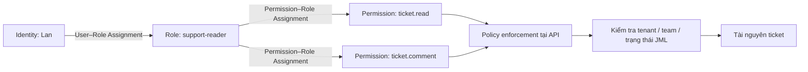
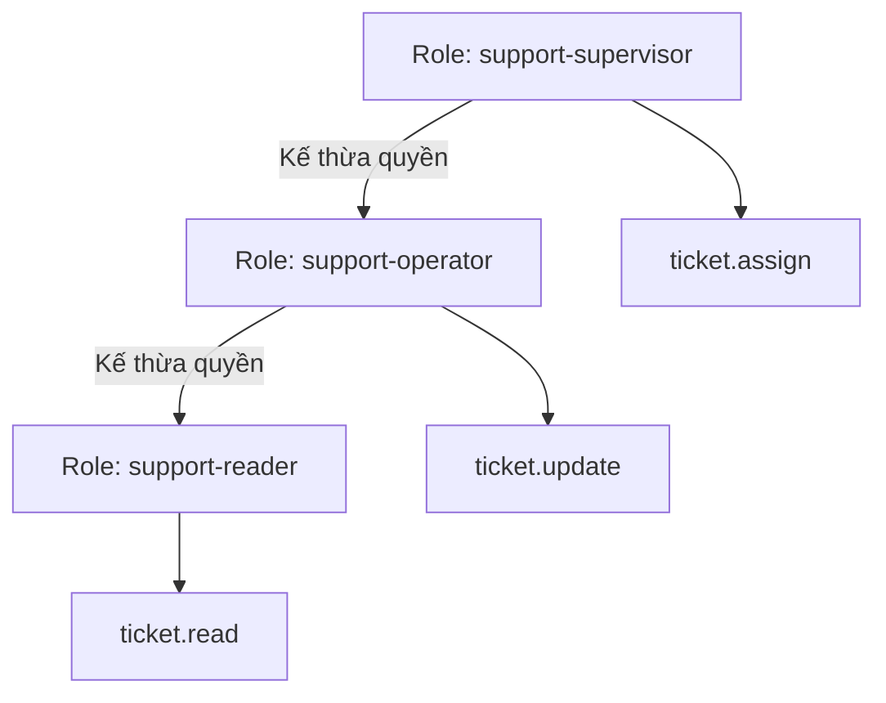
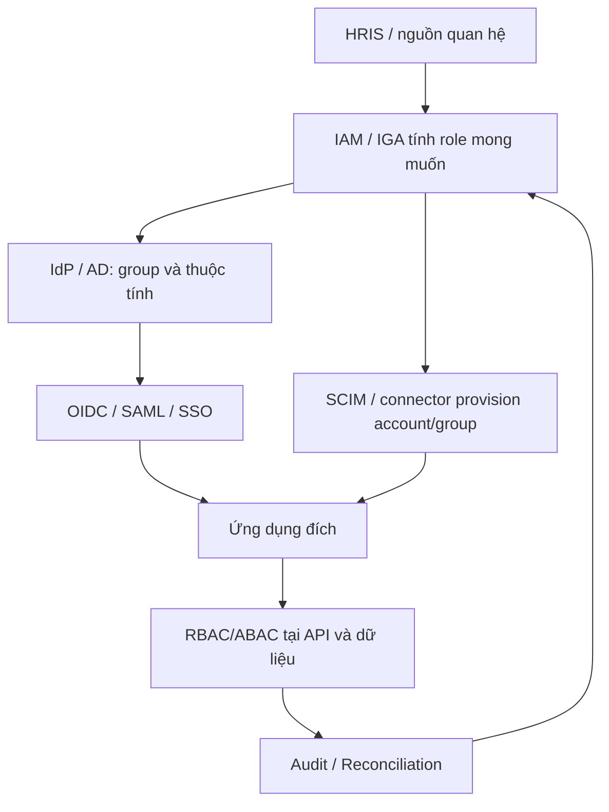

# Role trong RBAC và quản lý vòng đời danh tính IAM

**Role (vai trò)** trong **Role-Based Access Control (RBAC)** là một đơn vị quản lý quyền, đại diện cho **tập permission mà người giữ vai trò được phép thực hiện** theo công việc, chức năng hoặc trách nhiệm. Thay vì cấp từng quyền riêng lẻ cho mọi nhân viên, hệ thống gán **role cho chủ thể**, đồng thời gắn **permission với role**. Nhờ đó tổ chức có thể quản lý, rà soát và thu hồi quyền nhất quán hơn.

Ví dụ một nhân viên hỗ trợ khách hàng có role `support-reader` được đọc ticket của nhóm; trưởng nhóm có thêm role `support-supervisor` để phân công ticket. Tuy nhiên, **có role không có nghĩa được truy cập mọi đối tượng**: ứng dụng còn cần giới hạn theo **tenant, dự án, tài nguyên và điều kiện ABAC**. Trong **Identity and Access Management (IAM)**, role phải được quản lý xuyên suốt vòng đời **Joiner–Mover–Leaver (JML)** để tránh cấp thiếu quyền, tích lũy đặc quyền hoặc duy trì quyền của người đã nghỉ việc.

## 1. Phân biệt role, permission, entitlement và identity

| Khái niệm | Ý nghĩa | Ví dụ |
| --- | --- | --- |
| **Identity** | Danh tính của chủ thể được quản lý | Nhân viên có mã `EMP-2084` |
| **Account** | Tài khoản ở một hệ thống cụ thể | User `crm-782` trên CRM |
| **Permission** | Quyền thực hiện hành động với loại tài nguyên/tài nguyên | `ticket.read`, `invoice.approve` |
| **Role** | Tập permission phục vụ trách nhiệm cụ thể | `support-reader` |
| **Role assignment** | Liên kết identity/account với role | Lan được gán `support-reader` |
| **Entitlement** | Quyền lợi/quyền hiệu lực hoặc được gán tại hệ thống đích | Nhóm ứng dụng, role cục bộ, ACL |
| **Group** | Tập subject/account; có thể được ánh xạ thành role | Nhóm IdP `CRM-Support` |
| **Policy** | Điều kiện quyết định khi nào được phép truy cập | Chỉ đọc ticket cùng tenant |

**Role không hoàn toàn đồng nghĩa group.** Một group có thể gom người dùng để quản trị, phân phối cấu hình hoặc phục vụ quyền ở nhiều ứng dụng; một role biểu diễn tập permission theo mô hình RBAC. Một hệ thống có thể ánh xạ group IdP sang role ứng dụng, nhưng không nên mặc định mọi group đều là role hay mọi role đều được lưu dưới dạng group.

**Role không tự xác thực người dùng.** IdP và SSO giải quyết đăng nhập; RBAC sử dụng danh tính đã được xác minh cùng trạng thái và thông tin phân quyền để quyết định hành động nào được phép.

## 2. Mô hình RBAC cốt lõi

Các quan hệ thường dùng trong RBAC:

- **Users/Subjects (U):** những chủ thể được gán role.
- **Roles (R):** các vai trò nghiệp vụ hoặc kỹ thuật.
- **Permissions (P):** các cặp hành động/tài nguyên hoặc quyền được định nghĩa.
- **User–Role Assignment (UA):** quan hệ người dùng được gán vai trò.
- **Permission–Role Assignment (PA):** quan hệ quyền được gán vào vai trò.
- **Session:** ngữ cảnh trong đó người dùng có thể kích hoạt một tập role được phép.



Trong RBAC cơ bản, quyền được định nghĩa độc lập với từng người, giúp tránh cấp thủ công nhiều permission giống nhau. Tuy nhiên, **quyền được gán trong cơ sở dữ liệu không đồng nghĩa quyền thực tế đã có hiệu lực ở mọi ứng dụng**; còn phụ thuộc đồng bộ, phiên, cấu hình và điểm thực thi.

## 3. Một role tốt cần có những thuộc tính nào?

Một role có thể được mô tả bằng hợp đồng quản trị:

| Thuộc tính | Mục đích | Ví dụ minh họa |
| --- | --- | --- |
| `roleId` | Khóa ổn định, tránh nhầm khi đổi tên | `crm.support.reader.v1` |
| `displayName` | Tên dễ hiểu với người phê duyệt | Support Reader |
| `description` | Nhu cầu nghiệp vụ mà role đáp ứng | Đọc và bình luận ticket |
| `permissions` | Tập quyền mà role bao hàm | `ticket.read`, `ticket.comment` |
| `owner` | Người chịu trách nhiệm rà soát role | CRM application owner |
| `riskLevel` | Mức độ nhạy cảm và kiểm soát cần có | Standard / Privileged |
| `eligibilityRules` | Đối tượng đủ điều kiện nhận role | Nhân viên Support còn hiệu lực |
| `approvalPolicy` | Ai phê duyệt role | Manager hoặc data owner |
| `validity` | Ngày bắt đầu/hết hạn khi được áp dụng | Quyền dự án 90 ngày |
| `version` | Theo dõi thay đổi permission trong role | `2026.11` |

Đây là mô hình dữ liệu **minh họa**, không phải schema bắt buộc của chuẩn RBAC hoặc SCIM. Thiết kế thực tế cần phù hợp công cụ IGA/IAM, loại entitlement ở hệ thống đích và chính sách tổ chức.

**Owner của role không nhất thiết là manager trực tiếp của mọi người được gán role.** Role owner chịu trách nhiệm bộ quyền/ý nghĩa nghiệp vụ; manager xác nhận nhu cầu của nhân viên; data owner phê duyệt truy cập dữ liệu nhạy cảm; các nhiệm vụ này có thể phân tách.

## 4. Tạo role từ nhu cầu công việc, không chỉ từ sơ đồ phòng ban

Một vai trò nên tương ứng với **nhiệm vụ được phép thực hiện**, thay vì chỉ dựa vào chức danh hoặc phòng ban. Hai người có cùng chức danh vẫn có thể được giao những dự án, vùng dữ liệu và trách nhiệm khác nhau.

Ví dụ:

| Role | Permission tiêu biểu | Không bao gồm |
| --- | --- | --- |
| `ticket-reader` | Đọc ticket hợp lệ | Xóa ticket, xuất dữ liệu toàn hệ thống |
| `ticket-operator` | Đọc, cập nhật, bình luận ticket | Quản lý vai trò người khác |
| `ticket-supervisor` | Phân công và đánh giá ticket | Quản lý billing |
| `invoice-preparer` | Tạo chứng từ chờ phê duyệt | Tự phê duyệt chứng từ |
| `invoice-approver` | Phê duyệt chứng từ được phép | Tự sửa hạn mức phân quyền |
| `security-auditor` | Đọc log và báo cáo phù hợp | Chỉnh sửa/xóa log |

**Least privilege** yêu cầu role chỉ chứa tập quyền tối thiểu cần thiết. Nếu `ticket-reader` vô tình có `user.admin`, mọi người được gán role này sẽ nhận đặc quyền dư.

Khi thay đổi permission của một role đã có nhiều người dùng, cần đánh giá **blast radius**: cập nhật một lần có thể tác động hàng nghìn account hoặc dịch vụ. Quản lý role phải có version, kiểm thử và phê duyệt phù hợp.

## 5. Role nghiệp vụ và role kỹ thuật

Nhiều hệ thống phân biệt hai lớp:

- **Business role:** mô tả trách nhiệm dễ hiểu với người quản lý, chẳng hạn “Nhân viên hỗ trợ tuyến 1”.
- **Technical/application role:** thể hiện entitlement cụ thể như `CRM_TICKET_READ`, nhóm AD hoặc quyền ở ứng dụng.
- **Composite role:** gói nhiều role kỹ thuật hoặc role nghiệp vụ để đơn giản hóa việc cấp quyền, nếu công cụ hỗ trợ.

Ví dụ business role `Support-Agent` có thể ánh xạ tới `CRM_TICKET_READ`, `KB_ARTICLE_VIEW` và `SUPPORT_DASHBOARD`. **Cần quản lý mapping và phụ thuộc:** nếu một permission trong CRM đổi tên, business role có thể không còn cấp được quyền đầy đủ.

**Không nên gộp mọi entitlement vào một role quá lớn.** Một role cho phép cả vận hành, thanh toán, quản trị và xuất dữ liệu sẽ khó xét duyệt, gây rủi ro xung đột nhiệm vụ và đi ngược least privilege.

## 6. Role hierarchy và kế thừa quyền

Một số mô hình RBAC hỗ trợ **role hierarchy**: vai trò cấp cao hơn kế thừa permission của vai trò cấp thấp hơn. Ví dụ `support-supervisor` có thể kế thừa quyền `support-reader` rồi bổ sung `ticket.assign`.



Hướng kế thừa phải được định nghĩa rõ theo công cụ; **không tự suy rằng mọi vai trò có chữ “manager” hoặc “senior” đều kế thừa toàn bộ quyền cấp thấp hơn**. Hierarchy quá sâu hoặc có role dùng lại giữa nhiều bộ phận có thể tạo quyền ngoài ý muốn.

Khi rà soát quyền, cần tính **effective permissions**, gồm role trực tiếp, role kế thừa, nhóm lồng nhau, quyền ứng dụng cục bộ và các điều kiện chính sách áp dụng. Chỉ nhìn danh sách role trực tiếp có thể bỏ sót đặc quyền.

## 7. RBAC không thay thế ABAC hoặc kiểm tra tài nguyên

Một role `order-reader` thường mô tả **được phép đọc loại tài nguyên đơn hàng**, chưa nói rõ **đơn hàng của partner/tenant nào**. Khi phạm vi truy cập phụ thuộc tài nguyên và bối cảnh, kết hợp **Attribute-Based Access Control (ABAC)**.

```text
PERMIT read_order IF
    subject.lifecycle_status == "active"
    AND "order-reader" IN subject.effective_roles
    AND subject.partner_id == resource.partner_id
    AND resource.contract_id IN subject.active_contracts
    AND current_time < subject.access_expiry
ELSE DENY
```

Đây là **giả mã**, không phải cú pháp RBAC chuẩn. Ứng dụng phải lấy `partner_id`, hợp đồng, role và trạng thái tài khoản từ **nguồn đáng tin**, không tin một trường client có thể tự chỉnh.

Ví dụ B có role `order-reader` trên cổng B2B, nhưng API vẫn phải từ chối truy vấn đơn hàng của partner C. Nếu chỉ kiểm role mà bỏ qua owner tài nguyên, hệ thống có thể mắc lỗi **Broken Object Level Authorization (BOLA/IDOR)**.

## 8. Role assignment: ai được nhận role?

Việc gán role có thể xuất phát từ:

1. **Birthright access:** bộ quyền cơ bản dựa trên quan hệ, vị trí hoặc nhóm công việc sau Joiner.
2. **Request-based access:** nhân viên hoặc sponsor yêu cầu, được owner/phê duyệt theo chính sách.
3. **Project/time-bound access:** quyền có ngày hiệu lực và ngày hết hạn.
4. **Privileged/JIT access:** quyền đặc biệt cấp trong thời gian ngắn, có kiểm soát.
5. **Policy-driven assignment:** IAM tính role từ thuộc tính có thẩm quyền, ví dụ department và loại hợp đồng.

Không nên coi mọi claim từ IdP hoặc tự khai của client là căn cứ hợp lệ để cấp role. **Authentication thành công không tự trao role**; IAM/IGA cần tính eligibility, áp dụng approval và đối soát.

Một bản ghi role assignment nên lưu tối thiểu **identity ID, role ID, nguồn cấp, lý do, người phê duyệt, thời điểm bắt đầu/kết thúc, chủ hệ thống và trạng thái**, tương ứng với chính sách riêng tư và kiểm toán.

## 9. Joiner: gán role ban đầu đúng thời điểm

Một luồng Joiner minh họa:

1. HRIS xác nhận danh tính, tình trạng quan hệ và ngày bắt đầu làm việc.
2. IAM tạo identity ổn định, thực hiện identity proofing/enrollment phù hợp.
3. Policy RBAC xác định business role, ánh xạ tới technical entitlement.
4. Owner phê duyệt role nhạy cảm; role cơ bản được cấp theo quy tắc đã duyệt.
5. Connector/SCIM tạo hoặc cập nhật account, group, entitlement ở hệ thống đích.
6. Đảm bảo quyền chỉ hiệu lực **đúng ngày/giờ bắt đầu được phép**.
7. Đọc lại trạng thái đích và kiểm tra thao tác được phép/bị cấm.

Ví dụ Lan vào bộ phận Support. Lan nhận `support-reader` từ ngày hiệu lực, nhưng `customer-export-admin` cần phê duyệt riêng. **Tạo account sớm không có nghĩa được kích hoạt quyền sớm**.

Nếu hệ thống không hỗ trợ gán role trực tiếp, có thể ánh xạ qua group IdP/AD và connector. Tuy nhiên, cần xác minh group đã tới ứng dụng và role thực tế tương ứng, không chỉ tin workflow “success”.

## 10. Mover: không chỉ bổ sung role mới

Mover là tình huống có rủi ro **role accumulation**: người dùng chuyển vị trí, được thêm role mới nhưng role cũ chưa bị gỡ.

| Tình huống | Desired state sau Mover | Điều cần xác minh |
| --- | --- | --- |
| Finance sang Analytics | Có `analytics-reader`, mất `invoice-approver` | Không còn quyền phê duyệt hóa đơn tại ERP |
| Support thường sang Supervisor | Thêm quyền phân công, giữ quyền đọc cần thiết | Không có quyền xuất toàn bộ dữ liệu ngoài policy |
| Chuyển dự án A sang B | Chỉ truy cập tài nguyên B, trừ ngoại lệ bàn giao | ACL và điều kiện ABAC dự án A đã hết hiệu lực |
| Chuyển khỏi vị trí admin | Thu hồi role đặc quyền, credential và phiên liên quan | Không còn đường quản trị qua token cũ |

Quy trình đúng là **tính lại tập role mong muốn**, so với role thực tế và xử lý cả **thêm quyền thiếu** lẫn **gỡ quyền dư**. Khi có giai đoạn bàn giao, quyền tạm thời cần lý do, owner và **thời hạn rõ ràng**; không biến ngoại lệ thành vai trò vĩnh viễn.

Nếu role lưu tại ứng dụng đích hoặc ACL được cấp trực tiếp, gỡ nhóm tại IdP có thể **chưa thu hồi toàn bộ quyền**. Cần đối soát ở chính hệ thống tài nguyên.

## 11. Leaver: thu hồi role và khả năng truy cập thực tế

Khi nhân viên hoặc đối tác chấm dứt quan hệ, IAM phải xóa hoặc vô hiệu hóa những role không còn căn cứ cùng các đường truy cập liên quan.

| Lớp | Hành động | Lý do |
| --- | --- | --- |
| **IdP/SSO** | Disable account và ngăn đăng nhập mới | Ngăn xác thực mới |
| **SCIM/connector** | Deprovision user/group/role theo hỗ trợ | Thu hồi entitlement tại ứng dụng |
| **Role/ACL cục bộ** | Gỡ quyền được cấp trực tiếp | Tránh quyền tồn dư ngoài connector |
| **Session/cookie** | Thu hồi hoặc kiểm tra quyền hiệu lực theo chính sách | Phiên tạo trước Leaver có thể còn hoạt động |
| **Access/refresh token** | Thu hồi khi hỗ trợ, kiểm soát hạn và điều kiện tiếp tục truy cập | JWT tự chứa có thể tồn tại tới hết hạn |
| **Credential kỹ thuật** | Thu hồi quyền cá nhân đối với secret/PAM và chuyển owner workload | Tránh lối vào qua account dịch vụ |

**Role bị gỡ trên IdP không có nghĩa mọi phiên và token ứng dụng hết hiệu lực tức thì.** Ứng dụng cần thực thi authorization với quyền hiện hành hoặc kiểm soát thời gian tồn tại session phù hợp. Leaver hoàn tất khi **quyền không còn hiệu lực tại tài nguyên** và có bằng chứng readback/kiểm tra.

## 12. SoD: các role không được kết hợp

**Segregation of Duties (SoD)** giúp giảm nguy cơ một người đồng thời thực hiện các bước xung đột trong quy trình nghiệp vụ.

Ví dụ:

- `payment-creator`: tạo yêu cầu thanh toán.
- `payment-approver`: phê duyệt yêu cầu thanh toán.
- Theo chính sách SoD, một người không được đồng thời có cả hai role trong phạm vi gây xung đột.

Có thể có hai loại ràng buộc:

- **Static SoD (SSD):** không cho cùng một chủ thể được gán đồng thời các role xung đột.
- **Dynamic SoD (DSD):** hạn chế kích hoạt hoặc sử dụng đồng thời các role trong phiên/hành động theo quy tắc.

Ngoài SoD theo role, ứng dụng có thể cần **kiểm tra ở cấp giao dịch**: ngay cả khi người dùng có các vai trò hợp lệ theo thời điểm, không nên cho phép tự phê duyệt chứng từ do chính mình tạo nếu chính sách không cho phép.

Không gỡ bỏ SoD chỉ vì một yêu cầu khẩn. Nếu cần ngoại lệ, phải có quyền hạn, lý do, thời hạn, kiểm tra độc lập và audit.

## 13. Role explosion và kỹ thuật thiết kế lại

**Role explosion** xảy ra khi số vai trò tăng nhanh vì tổ chức tạo role riêng cho mọi kết hợp department × dự án × chi nhánh × cấp bậc. Điều này khiến phê duyệt, review và audit trở nên khó hiểu.

Ví dụ không nên tạo hàng trăm role như `reader-projectA-north`, `reader-projectB-south`, `reader-projectC-east` nếu khác biệt chỉ là **thuộc tính phạm vi tài nguyên**.

Hướng khắc phục:

1. Giữ role diễn đạt **chức năng**: `report-reader`, `ticket-operator`.
2. Dùng ABAC để giới hạn **dự án/tenant/khu vực** theo dữ liệu đáng tin.
3. Phân nhóm business role và technical entitlement có owner rõ.
4. Loại bỏ role không còn người dùng hoặc trùng tập permission.
5. Kiểm thử hiệu quả kế thừa, SoD và tác động thay đổi.
6. Không biến role thành một kho chứa mọi ngoại lệ cá nhân.

Ngược lại, role quá ít hoặc quá rộng gây **over-privileging**. Thiết kế tốt cân bằng độ hạt, khả năng hiểu của người phê duyệt và độ phức tạp triển khai.

## 14. IdP, SSO, SCIM và role ứng dụng



- **IdP** xác thực và có thể cung cấp group/claim cho ứng dụng.
- **SSO/OIDC/SAML** cho phép liên kết đăng nhập; **ID token không phải access token cho API**.
- **SCIM** tạo/cập nhật user và group nếu provider hỗ trợ; không phải giao thức thực thi role runtime chung cho mọi SaaS.
- **Ứng dụng** ánh xạ group/claim hoặc role cục bộ thành permission thực tế.
- **IAM/IGA** quản lý eligibility, phê duyệt, hạn hiệu lực và review.
- **Authorization** phải chạy tại backend/API, không chỉ ẩn nút giao diện.

Ví dụ user thuộc nhóm `Finance` ở IdP, nhưng ERP có role `invoice-approver` gán thủ công. Nếu người dùng Mover và nhóm IdP bị bỏ, role ERP vẫn có thể tồn tại. **Readback entitlement ở ERP** là bằng chứng quan trọng.

## 15. Role dành cho partner và service account

### Partner identity

Một người dùng B2B được partner IdP xác thực vẫn cần role do **chủ ứng dụng/nhà tài trợ hợp đồng** phê duyệt. Role thường gắn với **partner ID, tenant, dự án và ngày hết hạn**. Không cấp quyền chỉ vì người dùng được IdP đối tác xác thực thành công.

Khi hợp đồng hết hạn, hệ thống cung cấp phải chủ động thu hồi role và phiên, không hoàn toàn phụ thuộc vào việc đối tác khóa account.

### Service/workload identity

Role của service account nên mô tả chức năng máy cần thực hiện, ví dụ `billing-report-reader`, thay vì dùng `admin` tiện lợi. Một workload có thể cần scope API, ranh giới môi trường và owner riêng.

Không gắn vòng đời role workload trực tiếp với ngày làm việc của người tạo job. Khi kỹ sư nghỉ việc, cần chuyển owner, thu hồi quyền cá nhân đối với secret/CI-CD và đánh giá quyền kỹ thuật, thay vì xóa ngay workload chưa được kiểm tra phụ thuộc.

## 16. Access review và account reconciliation

Để bảo đảm role đúng theo JML, tổ chức cần đối soát định kỳ và theo sự kiện:

1. **Desired state:** tập role hợp lệ theo HR, chính sách, phê duyệt và ngoại lệ còn hạn.
2. **Observed state:** role, group, ACL và entitlement thực tế ở IdP/AD/ứng dụng.
3. **Correlation:** liên kết đúng account đích với identity gốc bằng ID ổn định.
4. **Difference:** xác định role thiếu, role dư, role xung đột và tài khoản mồ côi.
5. **Remediation:** provision, deprovision hoặc điều tra ngoại lệ theo độ nhạy cảm.
6. **Verification:** đọc lại tại đích, kiểm tra **positive** và **negative authorization**.
7. **Audit:** lưu nguồn sự kiện, version chính sách, owner, kết quả và thời gian hoàn tất.

**Không tự động xóa tất cả role khác bộ quyền cơ bản** nếu tồn tại quyền tạm thời hợp lệ đã được phê duyệt. Nhưng cũng không để một ngoại lệ không owner, không hạn và không review trở thành đặc quyền tồn dư.

## 17. Rủi ro và chỉ số cần theo dõi

| Rủi ro | Biểu hiện | Biện pháp |
| --- | --- | --- |
| **Role accumulation** | Mover chỉ cộng quyền mới | Recompute desired roles, thu hồi cũ |
| **Role explosion** | Hàng trăm role khác nhau chỉ bởi dự án | Phân tách role chức năng và ABAC |
| **Over-privileged role** | Role cơ bản chứa quyền admin/export | Least privilege và role owner review |
| **SoD violation** | Vừa tạo vừa duyệt thanh toán | SSD/DSD và kiểm tra giao dịch |
| **Stale group/token** | Role đã gỡ nhưng phiên còn claim cũ | Kiểm soát TTL, revoke, policy runtime |
| **Orphan assignment** | Role không còn identity/owner | Reconciliation và cleanup có kiểm soát |
| **Cross-tenant access** | Role hợp lệ nhưng đọc dữ liệu tenant khác | ABAC/tenant enforcement tại backend |
| **Privilege drift** | Permission role bị tăng không phê duyệt | Versioning, change review và audit |

Chỉ số nên theo dõi gồm **tỷ lệ assignment có owner**, **số role đặc quyền**, **số quyền dư sau Mover**, **thời gian thu hồi sau Leaver**, **số vi phạm SoD**, **tỷ lệ role không còn người sử dụng**, **số ngoại lệ quá hạn** và **độ bao phủ reconciliation tại ứng dụng đích**. Một role admin tồn dư có thể rủi ro cao hơn hàng nghìn role cơ bản được đồng bộ chính xác.

## 18. Tình huống tự kiểm tra

**Tình huống A:** Một nhân viên có role `order-reader`. Có được đọc đơn hàng của mọi partner không? **Không mặc nhiên.** Cần kiểm tra tenant, hợp đồng và policy ABAC.

**Tình huống B:** Nhân viên được chuyển từ Finance sang Analytics, đã thêm `analytics-reader` nhưng vẫn có `invoice-approver`. Mover đã hoàn tất chưa? **Chưa.** Phải thu hồi role cũ và kiểm chứng ở ERP.

**Tình huống C:** Gỡ một người khỏi group IdP `Finance` nhưng ứng dụng vẫn có role tương ứng gán trực tiếp. Có thể kết luận role bị thu hồi chưa? **Chưa.** Cần đối soát entitlement thực tế tại ứng dụng.

**Tình huống D:** Một role chứa cả `payment-create` và `payment-approve`. Cần xem xét điều gì? **Xung đột nhiệm vụ SoD** và nguy cơ tự phê duyệt.

**Tình huống E:** Một người đăng nhập bằng MFA mạnh. Có được tự động cấp role quản trị không? **Không.** MFA xác minh/giảm rủi ro đăng nhập, còn role cần được phê duyệt theo policy.

**Tình huống F:** Service account của job có role `system-admin` nhưng chỉ cần đọc báo cáo. Hướng xử lý? **Giảm về role/quyền đọc tối thiểu**, kiểm tra phụ thuộc và giữ owner rõ ràng.

## Ghi nhớ

**Role trong RBAC** là tập quyền được gói theo trách nhiệm và được **gán cho subject**, giúp quản trị thay vì cấp permission tùy ý từng người. Role cần **owner, nội dung permission, điều kiện eligibility, phê duyệt, hạn hiệu lực và kiểm toán**; đồng thời phải kết hợp **ABAC/kiểm tra tài nguyên** để giới hạn tenant và dữ liệu. Trong **IAM Joiner–Mover–Leaver**, phối hợp **IdP/SSO, SCIM/connector, RBAC/ABAC, quản lý service identity và reconciliation** giúp cấp đúng role, gỡ role cũ và chứng minh không còn quyền truy cập tồn dư.
