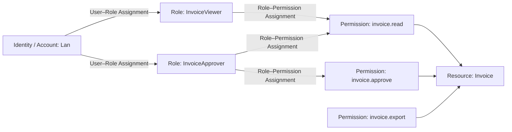
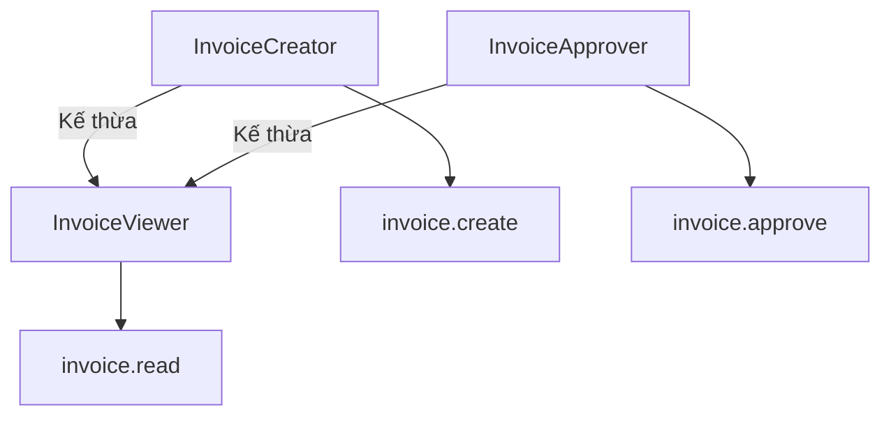
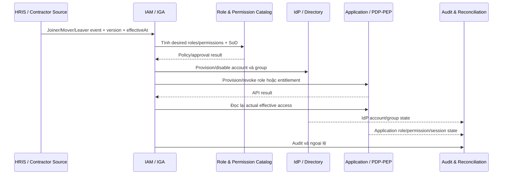
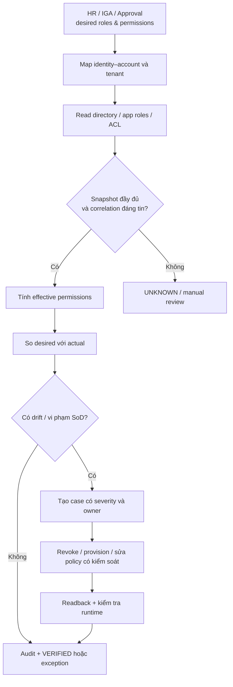

# Permission trong RBAC và quản lý vòng đời danh tính IAM

## Mục tiêu học tập

Sau bài học, người học có thể:

1. Giải thích **permission** trong Role-Based Access Control (RBAC), phân biệt với **identity, account, role, entitlement, group, policy** và quyết định authorization tại thời điểm truy cập.
2. Mô hình hóa permission theo **hành động (action)**, **tài nguyên (resource)**, **phạm vi (scope)** và các điều kiện cần thiết; không đồng nhất permission với tên màn hình hoặc chức danh.
3. Hiểu quan hệ **user–role** và **role–permission**, vai trò của kế thừa role và cách tính **effective permissions** theo chính sách được triển khai.
4. Thiết kế permission catalog có định danh ổn định, owner, mức rủi ro, ngữ nghĩa rõ, version và đường ánh xạ tới API, dữ liệu hoặc thao tác nghiệp vụ.
5. Áp dụng **least privilege**, **separation of duties (SoD)**, mặc định từ chối và kiểm soát đặc quyền để giảm việc cấp quyền vượt mức.
6. Liên kết permission với lifecycle **Joiner–Mover–Leaver**, IdP/SSO, SCIM, directory group, PAM và tài khoản dịch vụ.
7. Phân biệt permission được khai báo trong token với **quyền thực sự được backend cho phép**, xử lý cache stale và thu hồi quyền đúng thời điểm.
8. Xây dựng kiểm toán, đối soát **desired vs. actual permissions**, quản trị ngoại lệ và bài kiểm thử nhằm phát hiện **residual access**.

## 1. Permission trong RBAC là gì?

**Permission** là một quyền cho phép thực hiện **một hoặc một nhóm thao tác được xác định** trên **tài nguyên được xác định** trong hệ thống. Trong RBAC, permission thường được gắn với **role**, còn người dùng hoặc account được gán vào role phù hợp. Hệ thống authorization sử dụng các gán này cùng những điều kiện đang áp dụng để quyết định một yêu cầu có được phép hay không.

Ví dụ trong hệ thống quản lý hóa đơn:

- `invoice.read`: đọc hóa đơn phù hợp phạm vi đã được cho phép.
- `invoice.create`: tạo hóa đơn.
- `invoice.approve`: phê duyệt hóa đơn theo chính sách.
- `invoice.export`: xuất dữ liệu hóa đơn.
- `invoice.refund`: thực hiện thao tác hoàn tiền.

Các chuỗi trên là **định danh minh họa do ứng dụng thiết kế**, không phải tên permission chuẩn chung của RBAC.

Một nhân viên thuộc role `InvoiceViewer` có thể nhận `invoice.read`; một người quản lý được duyệt vào role `InvoiceApprover` có thể nhận thêm `invoice.approve`. Tuy nhiên, việc role chứa `invoice.approve` **chưa tự đủ** để cho phép người quản lý duyệt chính hóa đơn do họ tạo nếu quy trình có SoD hoặc giới hạn phạm vi.

Điểm trọng tâm:

> **Permission mô tả hành động được cho phép; role gom permission theo trách nhiệm; account/identity được gán role; authorization kiểm tra quyền và điều kiện tại thời điểm yêu cầu.**

### 1.1. Không đánh đồng permission với quyền đăng nhập

Một account có thể đăng nhập thành công qua IdP và SSO nhưng vẫn bị từ chối mọi thao tác nhạy cảm nếu không có permission cần thiết. Ngược lại, một permission còn lưu trong database nhưng account đã bị **disabled** do Leaver thì không nên tạo đường truy cập hợp lệ.

Ví dụ:

```text
Authentication:
  Lan đã đăng nhập qua IdP + MFA.

Role assignment:
  Lan → InvoiceViewer

Role-permission assignment:
  InvoiceViewer → invoice.read

Authorization:
  Lan yêu cầu POST /invoices/42/approve
  Required permission: invoice.approve
  Result: DENY
```

Một hệ thống bảo mật đúng phải kiểm tra **xác thực hợp lệ, trạng thái account, permission, scope và các điều kiện có liên quan**; không chỉ kiểm tra rằng người dùng có session.

### 1.2. Thuật ngữ thường gặp

| Thuật ngữ | Ý nghĩa | Ví dụ |
|---|---|---|
| **Identity** | Danh tính được quản trị xuyên hệ thống | `IDN-2048` |
| **Account** | Principal/account cụ thể ở IdP hoặc ứng dụng | `crm-user-781` |
| **Role** | Tập permission liên quan tới chức năng/trách nhiệm | `InvoiceApprover` |
| **Permission** | Quyền thực hiện thao tác trên tài nguyên | `invoice.approve` |
| **Entitlement** | Đơn vị quyền được một hệ thống cấp/quản trị | App role, group, permission grant |
| **Group** | Tập principal hoặc group được tập hợp | `grp-finance-approvers` |
| **Scope** | Phạm vi tài nguyên/hành động mà quyền áp dụng | Đơn vị A, dự án B, hóa đơn của nhóm |
| **Policy** | Quy tắc quyết định/điều kiện cấp hay sử dụng quyền | Chặn khi Leaver, áp SoD |
| **Effective permission** | Quyền thực tế sau khi tính role, hierarchy, deny, scope và điều kiện | Có thể duyệt hóa đơn thuộc đơn vị A |

**Entitlement** là thuật ngữ quản trị tổng quát: một entitlement ở SaaS có thể là role, group, license hoặc quyền riêng. Không phải mọi entitlement đều có cách biểu diễn giống permission của ứng dụng.

## 2. Mô hình RBAC nền tảng

RBAC thiết kế đường cấp quyền qua các quan hệ giữa người dùng, role và permission:



Hai quan hệ thường gặp:

- **UA (User Assignment):** những user/account nào được gán vào role.
- **PA (Permission Assignment):** những permission nào thuộc role.

Có thể ký hiệu ở mức khái niệm:

```text
Users        = {Lan, An, Binh}
Roles        = {InvoiceViewer, InvoiceApprover}
Permissions  = {invoice.read, invoice.create, invoice.approve}

UA = {
  (Lan, InvoiceViewer),
  (An, InvoiceApprover)
}

PA = {
  (InvoiceViewer, invoice.read),
  (InvoiceApprover, invoice.read),
  (InvoiceApprover, invoice.approve)
}

effectivePermissions(Lan) = {invoice.read}
effectivePermissions(An)  = {invoice.read, invoice.approve}
```

Đây là ví dụ **RBAC không có hierarchy, deny hay điều kiện bổ sung**. Kết quả ở ứng dụng thật có thể khác vì scope, account disabled, role không kích hoạt, approval hết hạn, SoD hoặc policy bổ sung.

### 2.1. Role không phải Department

Department là một **thuộc tính nhân sự**; role là một **nhóm trách nhiệm/quyền** được thiết kế để kiểm soát truy cập.

Ví dụ: nhân viên phòng Tài chính có thể gồm người nhập liệu, người kiểm soát, người phê duyệt và người chỉ xem báo cáo. Nếu tất cả được gán một role `FinanceAllAccess` chỉ vì cùng department, tổ chức dễ cấp quyền quá mức.

Nên thiết kế permission theo **năng lực nghiệp vụ thực tế**, rồi gán role phù hợp với công việc, approval và SoD. Thuộc tính Department có thể giúp xác định **ai đủ điều kiện yêu cầu một role**, nhưng không nhất thiết tạo quyền phê duyệt ngay.

### 2.2. Group không phải Permission

Một directory group có thể là phương tiện phân phối role hoặc app assignment:

```text
HR / IAM:
  Lan đủ điều kiện truy cập ứng dụng quản lý hóa đơn

Directory:
  Lan thuộc grp-invoice-viewers

IdP / Provisioning:
  grp-invoice-viewers → app role InvoiceViewer

Ứng dụng:
  InvoiceViewer → invoice.read
```

Nếu group được gỡ tại directory nhưng app-local role hoặc session cũ vẫn còn hiệu lực, quyền truy cập có thể chưa bị thu hồi. Vì vậy cần truy dấu **group → role → permission → quyết định authorization**, không chỉ xem một danh sách group.

## 3. Thiết kế permission theo hành động và tài nguyên

Một permission nên mô tả điều được phép **đủ rõ để người phát triển, người phê duyệt và người kiểm toán hiểu cùng một nghĩa**.

### 3.1. Hành động (action)

Một số nhóm hành động:

| Nhóm | Ví dụ permission | Rủi ro điển hình |
|---|---|---|
| **Read** | `customer.read` | Lộ thông tin cá nhân |
| **Create** | `invoice.create` | Tạo giao dịch giả |
| **Update** | `customer.update` | Sửa dữ liệu sai |
| **Delete** | `invoice.delete` | Mất dữ liệu và bằng chứng |
| **Approve** | `invoice.approve` | Tự duyệt giao dịch |
| **Export** | `customer.export` | Xuất dữ liệu hàng loạt |
| **Manage access** | `iam.role.assign` | Leo thang đặc quyền |
| **Manage credentials** | `iam.credential.rotate` | Kiểm soát quyền của principal khác |
| **Operate infrastructure** | `deployment.release` | Thay đổi production |
| **Audit/read security** | `audit.events.read` | Đọc nhật ký nhạy cảm |

Không nên coi `read` là rủi ro thấp trong mọi hệ thống: quyền đọc hồ sơ bệnh án, khóa bí mật hoặc danh sách khách hàng vẫn có thể rất nhạy cảm. Tương tự, `export` thường cần được tách khỏi `read` vì tác động khác nhau.

### 3.2. Tài nguyên (resource)

Tài nguyên có thể là:

- Loại object: Invoice, Customer, Report, Deployment.
- Một instance cụ thể: Invoice `INV-0042`.
- Một tập object: hóa đơn thuộc chi nhánh A.
- Một API operation: action được map tới endpoint có thực thi.
- Một năng lực quản trị: gán role, xem audit, quản lý policy.
- Một tác vụ batch hoặc một chức năng đặc biệt, ví dụ phê duyệt giao dịch vượt ngưỡng.

Không phải mọi permission cần chứa resource instance ID trong tên. Thực tế thường nên thiết kế **permission cấp hành động** rồi dùng scope/điều kiện để giới hạn object cụ thể; tránh tạo một permission tên `invoice.read.000001` cho từng hóa đơn nếu hệ thống có hàng triệu hóa đơn.

### 3.3. Permission theo capability thay vì tên màn hình

So sánh:

| Thiết kế yếu | Vấn đề | Thiết kế tốt hơn |
|---|---|---|
| `MENU_12` | Không nói rõ quyền làm gì | `invoice.read` |
| `ADMIN` | Gom quyền quá rộng, không rõ hành động | Tách `user.manage`, `role.assign`, `audit.read` |
| `BUTTON_APPROVE` | Chỉ gắn UI, dễ bypass API | `invoice.approve` ở backend |
| `FINANCE_ACCESS` | Không rõ đọc, sửa hay duyệt | `expense.read`, `expense.submit`, `expense.approve` |
| `SUPER_USER_ALL` | Không đáp ứng least privilege | Permission cụ thể + role quản trị có kiểm soát |
| `ANY_RESOURCE_READ` | Có thể làm lộ dữ liệu ngoài scope | `report.read` với giới hạn phạm vi rõ |

Một permission tốt không chỉ dễ đọc mà còn phải **có hợp đồng thực thi**: endpoint/service/data query nào áp dụng, hành động nào được chấp nhận, trường hợp nào phải bị từ chối.

### 3.4. Quy ước định danh

Một catalog có thể dùng quy ước minh họa:

```text
<resource>.<action>

customer.read
customer.update
invoice.read
invoice.create
invoice.approve
invoice.export
iam.role.assign
iam.policy.update
audit.events.read
```

Không có naming convention RBAC bắt buộc cho mọi tổ chức. Điều quan trọng là **tính nhất quán**, không tái sử dụng cùng permission ID cho ý nghĩa mới có tác động khác biệt, và ghi version khi thay đổi.

## 4. Scope và điều kiện: permission chưa phải toàn bộ quyết định

Một câu hỏi dễ bị bỏ qua: **“Được đọc hóa đơn nào?”** Permission `invoice.read` mà không có phạm vi có thể làm ứng dụng cho đọc tất cả hóa đơn, trong khi yêu cầu nghiệp vụ chỉ là đọc của phòng ban mình.

### 4.1. Ba tầng của authorization

1. **Hành động có được cho phép không?** Ví dụ role chứa `invoice.read`.
2. **Tài nguyên có nằm trong phạm vi được phép không?** Ví dụ hóa đơn thuộc chi nhánh mà người dùng quản lý.
3. **Ngữ cảnh hiện tại có đạt các điều kiện khác không?** Ví dụ identity còn active, tài khoản được kích hoạt, MFA đủ mạnh, không có xung đột SoD.

Một policy minh họa:

```text
ALLOW(subject, action, invoice, context) WHEN
    subject.identityLifecycle == ACTIVE
    AND subject.accountState == ENABLED
    AND subject.effectivePermissions CONTAINS "invoice.approve"
    AND subject.allowedBranchIds CONTAINS invoice.branchId
    AND invoice.createdByIdentityId != subject.identityId
    AND invoice.status == SUBMITTED
    AND context.authenticationAssuranceMeetsPolicy
```

Đây là **pseudocode**, không phải cú pháp chuẩn của một policy engine. Trong ví dụ, permission được cấp qua RBAC, còn các điều kiện về chi nhánh, trạng thái invoice và người tạo có tính chất **attribute-based/contextual**.

### 4.2. RBAC và ABAC bổ sung cho nhau

**RBAC** dễ quản trị khi những công việc tương đối ổn định được biểu diễn bằng role. **ABAC** giúp quyết định quyền trên đối tượng cụ thể bằng thuộc tính principal, resource, action và môi trường.

Ví dụ:

- RBAC: `InvoiceApprover` chứa `invoice.approve`.
- ABAC: chỉ được duyệt hóa đơn thuộc `branchId` được phân công, chưa bị khóa và chưa do chính mình tạo.
- Lifecycle guard: account phải active.
- MFA step-up: giao dịch giá trị lớn yêu cầu xác thực gần đây.
- SoD: người tạo không được tự duyệt một giao dịch nhất định.

Không nên cố biểu diễn mọi điều kiện bằng hàng nghìn role như `InvoiceApprover_Branch42_AmountUnder10000_WeekdayOnly`, vì có nguy cơ **role explosion** và khó kiểm toán.

### 4.3. Scope cần rõ điểm cấp và điểm thực thi

Có hai cách phổ biến:

- **Gán permission/role kèm scope**: `InvoiceApprover` tại chi nhánh A.
- **Gán role chung, scope lấy từ nguồn được quản trị**: role `InvoiceApprover` và danh sách chi nhánh do HR/IGA hoặc ứng dụng nghiệp vụ xác nhận.

Không phương án nào tự an toàn nếu scope có thể bị client sửa. Backend phải lấy scope từ nguồn tin cậy và kiểm tra đối tượng được truy cập ở thời điểm quyết định.

## 5. Role–Permission Assignment và effective permissions

### 5.1. Cấp permission cho role

Role nên được quản lý như một tập quyền có ý nghĩa nghiệp vụ. Ví dụ:

| Role | Permission minh họa | Mục đích |
|---|---|---|
| `InvoiceViewer` | `invoice.read` | Xem hóa đơn đúng scope |
| `InvoiceCreator` | `invoice.read`, `invoice.create` | Lập hóa đơn |
| `InvoiceApprover` | `invoice.read`, `invoice.approve` | Duyệt hóa đơn |
| `FinanceExporter` | `invoice.read`, `invoice.export` | Xuất báo cáo |
| `IAMRoleReviewer` | `iam.role.read`, `iam.role.review` | Đánh giá role và thành viên |
| `IAMRoleAdministrator` | `iam.role.read`, `iam.role.assign` | Gán role theo quy trình có kiểm soát |

Một role có thể chứa nhiều permission và cùng một permission có thể thuộc nhiều role. Việc thêm `invoice.export` vào `InvoiceViewer` không chỉ sửa catalog; nó có thể **tăng quyền cho toàn bộ người đang có role đó**. Đây là thay đổi phải đánh giá blast radius.

### 5.2. Effective permissions là hợp của nhiều grant, nhưng không dừng ở đó

Trong mô hình RBAC cơ bản không có deny/constraint, effective permissions của account là hợp tập permission từ các role được gán và đang được phép kích hoạt:

```text
AssignedRoles(Lan) =
  {InvoiceViewer, FinanceExporter}

Permissions(InvoiceViewer) =
  {invoice.read}

Permissions(FinanceExporter) =
  {invoice.read, invoice.export}

CandidatePermissions(Lan) =
  {invoice.read, invoice.export}
```

Từ **CandidatePermissions** đến **ALLOWED** cần thêm kiểm tra account status, session, tenant, scope, SoD và policy của ứng dụng.

Nếu application có **explicit deny** hoặc policy ưu tiên, thứ tự quyết định deny/allow phải được thiết kế rõ; **RBAC cơ bản không định nghĩa một semantics deny chung cho mọi hệ thống**.

### 5.3. Role hierarchy

Một số mô hình RBAC hỗ trợ **role hierarchy**, nơi role cấp cao kế thừa các permission của role cấp thấp theo quan hệ được định nghĩa.

Ví dụ:



**Role hierarchy không nhất thiết đồng nghĩa với đường tổ chức/hệ thống quản lý nhân sự.** Trưởng phòng không tự động có mọi permission của nhân viên trong mọi nghiệp vụ.

Khi triển khai role hierarchy cần kiểm tra:

- Cạnh kế thừa được phép do owner nào duyệt?
- Có vòng lặp hoặc cây kế thừa quá sâu không?
- Một role cấp cao có vô tình kế thừa quyền xuất/xóa nhạy cảm không?
- SoD tính cả permission kế thừa chứ không chỉ role trực tiếp chưa?
- Khi thay role con, ai bị ảnh hưởng thông qua role cấp cao?
- Ứng dụng, IdP và IGA có cùng hiểu hierarchy không?

### 5.4. Vai trò được gán khác vai trò đang kích hoạt

Một số mô hình RBAC phân biệt **assigned roles** và **active roles** trong một session. Người dùng có thể được gán cả role người nhập liệu và role đọc báo cáo nhưng chỉ kích hoạt role cần dùng cho ngữ cảnh cụ thể, nếu nền tảng hỗ trợ.

Khả năng này có thể hỗ trợ least privilege và dynamic SoD. Tuy nhiên không phải mọi SaaS/IdP hỗ trợ session role activation. Trong hệ thống chỉ có group claims tĩnh, cần dùng cơ chế khác để kiểm soát việc sử dụng role nhạy cảm.

## 6. Separation of Duties: Permission xung đột

### 6.1. Static SoD và Dynamic SoD

**Separation of Duties (SoD)** giúp giảm rủi ro một người tự thực hiện toàn bộ các bước của một quy trình nhạy cảm.

- **Static SoD (SSoD):** hạn chế việc **đồng thời được gán** các role/quyền xung đột theo policy.
- **Dynamic SoD (DSoD):** có thể cho phép gán nhiều vai trò nhưng **không cho kích hoạt hoặc sử dụng cùng nhau** trong cùng phiên/giao dịch theo chính sách.

Ví dụ: người **tạo** và người **duyệt** một hóa đơn không được là một chủ thể trong cùng giao dịch, dù trong các giao dịch khác người đó có thể được làm cả hai nếu policy cho phép.

| Xung đột | Nguy cơ | Kiểm soát |
|---|---|---|
| `payment.create` và `payment.approve` | Tự tạo và tự duyệt chi trả | SoD theo role hoặc theo giao dịch |
| `user.create` và `role.assign.admin` | Tạo account rồi tự cấp admin | Dual control, approval, audit |
| `audit.log.manage` và `audit.log.review` | Che giấu dấu vết rồi tự kiểm toán | Phân tách nhiệm vụ vận hành/kiểm toán |
| `source.code.merge` và `production.deploy` | Tự đưa mã chưa review lên production | Review, pipeline approval và JIT |
| `vendor.create` và `vendor.payment.approve` | Tạo nhà cung cấp giả và thanh toán | Segregation + business checks |

SoD có thể được thực hiện ở **role assignment**, **permission evaluation** hoặc **workflow business**. Chỉ cấm hai role tên khác nhau có thể bỏ sót một role thứ ba chứa đủ các permission xung đột.

### 6.2. SoD phải xét quyền hiệu lực

Nếu Lan có `payment.create` từ Role A và `payment.approve` được kế thừa từ Role B, kiểm tra chỉ ở direct role sẽ bỏ sót xung đột.

Một kiểm tra an toàn tính:

1. Role được gán trực tiếp.
2. Role kế thừa và role có thể kích hoạt.
3. Permission thực tế từ role-to-permission mapping.
4. Gán quyền trực tiếp ngoài RBAC nếu ứng dụng cho phép.
5. Scope và điều kiện nghiệp vụ.
6. Ngoại lệ được phê duyệt, giới hạn thời gian và giám sát.

**SoD không chỉ là quy tắc trên màn hình yêu cầu quyền.** Backend phải ngăn hành động xung đột ở nơi phát sinh giao dịch.

### 6.3. Break-glass và ngoại lệ

Một số tình huống vận hành đặc biệt cần quyền vượt mức bình thường. Khi đó nên dùng cơ chế **break-glass/PAM/JIT** có:

- Lý do và căn cứ khẩn cấp.
- Người phê duyệt hoặc dual control theo chính sách.
- Phạm vi hệ thống, permission và thời gian giới hạn.
- MFA mạnh và xác minh người sử dụng.
- Ghi session/audit, cảnh báo và review hậu kiểm.
- Thu hồi tự động khi hết hiệu lực.

Không nên cấp một role `SuperAdmin` vô thời hạn chỉ để xử lý một lần vận hành khẩn cấp.

## 7. Thiết kế permission catalog có thể quản trị

Permission không nên chỉ xuất hiện rải rác dưới dạng chuỗi trong source code. Với hệ thống nhiều ứng dụng, nên có catalog và ownership đủ rõ để quản trị vòng đời.

### 7.1. Metadata đề xuất

| Trường | Ý nghĩa |
|---|---|
| `permissionId` | Định danh ổn định, duy nhất trong phạm vi đã quy định |
| `displayName` | Tên dễ hiểu cho người quản lý nghiệp vụ |
| `description` | Hành động và tài nguyên được phép |
| `applicationId` / `tenantId` | Hệ thống/vùng áp dụng |
| `resourceType` | Loại tài nguyên |
| `action` | Hành động được phép |
| `scopeModel` | Kiểu giới hạn: own, branch, project, global... |
| `riskClass` | Mức độ nhạy cảm |
| `businessOwner` | Đơn vị chịu trách nhiệm về ngữ nghĩa quyền |
| `technicalOwner` | Đơn vị triển khai enforcement |
| `approvalPolicyId` | Chính sách phê duyệt khi gán |
| `sodConflictSet` | Permission/role xung đột |
| `lifecycleState` | Draft, active, deprecated, retired |
| `policyVersion` | Phiên bản định nghĩa đã được duyệt |
| `enforcementPoints` | API/service/batch/UI cần kiểm tra |

Ví dụ JSON catalog **minh họa**, không phải SCIM schema:

```json
{
  "permissionId": "invoice.approve",
  "applicationId": "INVOICE_SERVICE",
  "resourceType": "Invoice",
  "action": "APPROVE",
  "scopeModel": "APPROVED_BRANCHES",
  "riskClass": "HIGH",
  "businessOwner": "FINANCE-CONTROL",
  "technicalOwner": "INVOICE-PLATFORM",
  "approvalPolicyId": "finance-approver-v3",
  "sodConflictSet": ["invoice.create.same_record"],
  "requiresFreshMfa": true,
  "lifecycleState": "ACTIVE",
  "policyVersion": "permission-catalog-v5",
  "enforcementPoints": [
    "POST /api/invoices/{id}/approve"
  ]
}
```

Không copy nguyên schema này vào production khi chưa xác định ID, scope, API contract và policy thực tế.

### 7.2. Quản lý version permission

Thay đổi tên hiển thị `Invoice Approve` thành `Duyệt hóa đơn` có thể chỉ là đổi metadata; nhưng thay đổi `invoice.approve` để **đồng thời cho xuất dữ liệu toàn bộ chi nhánh** là mở rộng quyền đáng kể.

Nguyên tắc:

- **Không đổi ngữ nghĩa permission mà không đánh giá lại người đang sở hữu quyền.**
- Nếu permission mở rộng phạm vi đáng kể, cân nhắc tạo permission mới.
- Ghi changelog và owner phê duyệt.
- Tính tác động tới tất cả role, group, principal và API.
- Tránh xóa permission cũ trước khi migration của ứng dụng và policy hoàn tất.
- Có trạng thái deprecated/retired, lịch chuyển và kiểm tra quyền tồn dư.

### 7.3. Tránh permission explosion

Tạo một permission cho mỗi bản ghi dữ liệu hoặc cho từng nút giao diện có thể làm quyền khó quản trị. Nên tách:

- **Năng lực ổn định**: `invoice.read`.
- **Scope/attribute**: chi nhánh, chủ sở hữu, trạng thái giao dịch.
- **Điều kiện theo request**: thời gian, loại hành động, MFA, risk.
- **Grant thời hạn ngắn**: JIT/PAM hoặc workflow phê duyệt tạm.

RBAC phù hợp để quản lý cấu trúc quyền ổn định; ABAC hoặc các policy theo quan hệ có thể giải quyết giới hạn động theo dữ liệu.

## 8. Cấp permission theo vòng đời Joiner–Mover–Leaver

Permission không được gán bất biến suốt thời gian một người có account. **Nguồn nhân sự, vai trò công việc, approval và trạng thái lifecycle** quyết định lúc nào quyền cần được cấp, sửa hoặc thu hồi.



### 8.1. Joiner: quyền cơ sở và điều kiện kích hoạt

Trong Joiner, HRIS hoặc nguồn nhà thầu gửi thông tin người mới, IAM thực hiện identity correlation, kiểm tra proofing và tính quyền cần có.

Một luồng nên:

1. Xác nhận identity, account và quan hệ nhân sự từ nguồn có thẩm quyền.
2. Kiểm tra ngày bắt đầu, worker type, vị trí, sponsor và proofing cần thiết.
3. Cấp **birthright role/permission** thật sự cần thiết cho nhóm nhân sự đủ điều kiện.
4. Tách quyền bổ sung phải có approval với quyền cơ sở.
5. Kiểm tra SoD và điều kiện MFA/thiết bị trước khi kích hoạt quyền nhạy cảm.
6. Đồng bộ qua IdP group/SCIM/app connector theo khả năng.
7. Đọc lại quyền hiệu lực ở hệ thống đích trước khi đánh dấu verified.

Ví dụ: nhân viên mới có thể được đọc cẩm nang nội bộ, nhưng **không tự được quyền xuất báo cáo tài chính hoặc tạo tài khoản quản trị** chỉ vì làm việc ở tổ chức.

### 8.2. Mover: thu hồi quyền cũ đồng thời với cấp quyền mới

Một Mover chuyển từ Sales sang Finance thường làm thay đổi role và permission. Chỉ thêm role Finance mà giữ role Sales sẽ gây **privilege accumulation**.

Ví dụ:

```text
Trước Mover:
  Role = SalesReader
  Permissions = customer.read, sales.report.read

Sau Mover, theo policy:
  Role = FinanceAnalyst
  Permissions = invoice.read, expense.report.read

Quyền cần thu hồi:
  customer.read, sales.report.read

Quyền cần cấp:
  invoice.read, expense.report.read
```

Thực tế có thể có quyền chung và quyền dự án vẫn hợp lệ. IAM cần tính **quyền mong muốn từ tất cả nguồn hợp lệ**, phân biệt role do HR rule cấp, role do dự án phê duyệt và JIT grant. Một job Mover không nên xóa mù quyền của workflow khác, nhưng quyền không còn owner/phê duyệt phải được rà soát.

Các nguy cơ:

- Group IdP đã đổi nhưng app-local role chưa đổi.
- SAML/OIDC token cũ còn claim Role Sales.
- API cache còn authorization từ trước Mover.
- Một role kế thừa quyền Sales dù membership trực tiếp đã gỡ.
- Người dùng giữ personal API token đã cấp với scope cũ.

### 8.3. Leaver: thu hồi mọi đường thực thi permission

Khi Leaver có hiệu lực, IAM cần:

- Disable account ở IdP và ứng dụng có local login.
- Thu hồi UA (user–role assignment), group, entitlement theo policy.
- Vô hiệu hoặc giới hạn token, refresh token, session, PAT/API key/credential liên quan.
- Rà soát quyền direct grant và privileged account riêng.
- Kiểm tra role hierarchy, nested group và app-local authorization.
- Chặn API thực thi quyền trên account đã terminated.
- Ghi audit và ngoại lệ nếu một hệ thống không hỗ trợ revoke tức thì.
- Bảo toàn dữ liệu/tài nguyên theo retention mà **không giữ đường đăng nhập**.

**Leaver không được phụ thuộc vào việc mọi token tự hết hạn.** Một access token tự xác minh có thể còn hợp lệ đến `exp` nếu resource server không kiểm tra trạng thái tài khoản hoặc revocation. Quy trình phải đánh giá và giảm thiểu cửa sổ quyền tồn dư.

### 8.4. Rehire: tính lại quyền từ đầu

Khi người cũ quay lại, account có thể được tái sử dụng theo policy hoặc tạo mới. Không nên **bật lại toàn bộ role và permission cũ** chỉ vì email hoặc identity ID tương ứng.

Các bước cần kiểm tra:

1. Xác nhận rehire và mốc hiệu lực có thẩm quyền.
2. Xác minh identity correlation, proofing/MFA khi cần.
3. Đối chiếu account retained, group, role và token cũ.
4. Tính desired permissions theo vị trí và approval hiện tại.
5. Loại quyền đặc biệt không còn phù hợp.
6. Đọc lại trạng thái account và effective permissions.

## 9. IdP, SSO, SCIM và directory truyền permission ra sao?

### 9.1. IdP xác thực, ứng dụng thực thi authorization

IdP có thể phát token/assertion chứa thông tin role/group. Tuy nhiên, **IdP không nhất thiết hiểu permission nội bộ của mọi ứng dụng** và không tự quyết định tài nguyên nào được đọc.

| Thành phần | Vai trò chính | Giới hạn cần hiểu |
|---|---|---|
| **HRIS** | Nguồn lifecycle và dữ liệu nhân sự | Không trực tiếp quyết định API permission |
| **IAM/IGA** | Policy, approval, desired roles/entitlements | Cần đọc lại ứng dụng để xác minh thực thi |
| **Directory group** | Gom principal theo nhóm | Group không tự bằng permission |
| **IdP** | Xác thực, MFA, quản lý session và claim | Không tự đảm bảo app-local role đã thu hồi |
| **SAML/OIDC SSO** | Truyền kết quả xác thực và claim | Không phải permission catalog chung |
| **SCIM** | Provision User/Group và một số thuộc tính | Không có semantics authorization thống nhất cho mọi app |
| **Application authorization** | Quyết định ALLOW/DENY cho tài nguyên | Phải kiểm tra account, scope và permission thực tế |
| **PAM** | Quản lý quyền đặc biệt/phiên quản trị | Cần tích hợp lifecycle và audit |

### 9.2. SCIM Group không tự là permission

Một SCIM Group resource có thể được dùng để gán membership ở ứng dụng:

```json
{
  "schemas": [
    "urn:ietf:params:scim:schemas:core:2.0:Group"
  ],
  "id": "scim-group-104",
  "displayName": "invoice-approvers",
  "members": [
    {
      "value": "scim-user-2048",
      "type": "User"
    }
  ]
}
```

Nhóm này có thể được ứng dụng ánh xạ sang role `InvoiceApprover`, rồi role mang permission `invoice.approve`. **SCIM Group không tự chuẩn hóa permission `invoice.approve`**; ánh xạ đó thuộc cấu hình ứng dụng hoặc IAM connector.

Khi gỡ User khỏi SCIM Group, nên kiểm tra Group membership thực tế và role/permission tại ứng dụng. Response 2xx từ connector không đồng nghĩa app đã invalidated token hoặc session.

### 9.3. SAML/OIDC group claims có thể stale

Ví dụ lúc 09:00, token chứa claim `groups=["sales-readers"]`. Lúc 10:00 HR phát Mover; IdP gỡ nhóm Sales. Token cũ có thể vẫn được ứng dụng chấp nhận đến khi hết hạn hoặc phiên local được làm mới.

Biện pháp:

- Thiết lập TTL hợp lý và cơ chế refresh/reevaluation theo rủi ro.
- Kiểm tra quyền trực tiếp tại authorization service đối với tác vụ nhạy cảm.
- Invalidate app session/token khi có sự kiện Mover/Leaver nếu được hỗ trợ.
- Đối soát app-local roles và quyền direct grant.
- Không dùng client-side claim tự gửi chưa xác minh làm cơ sở cho phép.

**JWT hợp lệ về chữ ký không tự chứng minh permission còn hiệu lực ở thời điểm hiện tại.** Token có thể phản ánh một snapshot quyền đã lỗi thời.

## 10. Permission ở backend: chặn thao tác thật, không chỉ ẩn giao diện

### 10.1. Bảo vệ mọi entry point

Ẩn nút “Approve” khỏi UI chỉ là cải thiện trải nghiệm. Một người dùng vẫn có thể gọi trực tiếp endpoint bằng công cụ HTTP, gửi request từ trình duyệt hoặc tận dụng job/API khác.

Phải bảo vệ:

- Controller/route API.
- Service/business operation thực thi hành động.
- Background job và message consumer có hành động thay đổi dữ liệu.
- GraphQL resolver hoặc RPC method.
- Database query theo scope.
- Các endpoint bulk/export/import.
- Tác vụ quản trị, admin API, debug endpoint và webhook.
- Kênh truy cập từ workload hoặc integration.

Một API `GET /invoices` và `GET /invoices/{id}` đều phải kiểm tra scope, không chỉ chặn route danh sách.

### 10.2. Ví dụ Spring Security (minh họa)

Trong ứng dụng Java/Spring Security, permission có thể được biểu diễn bằng **GrantedAuthority**, nếu ứng dụng cấu hình mapping từ role/permission tới authority phù hợp.

```java
// Ví dụ minh họa, phụ thuộc cấu hình Spring Security thực tế.
@RestController
@RequestMapping("/api/invoices")
class InvoiceController {
    private final InvoiceService invoiceService;

    InvoiceController(InvoiceService invoiceService) {
        this.invoiceService = invoiceService;
    }

    @PreAuthorize("hasAuthority('invoice.read')")
    @GetMapping("/{id}")
    InvoiceDto getInvoice(@PathVariable Long id) {
        return invoiceService.readAuthorizedInvoice(id);
    }

    @PreAuthorize("hasAuthority('invoice.approve')")
    @PostMapping("/{id}/approve")
    InvoiceDto approve(@PathVariable Long id) {
        return invoiceService.approveInvoiceWithPolicyChecks(id);
    }
}
```

Ví dụ này **chưa phải một hệ thống authorization hoàn chỉnh**. Cần bảo đảm:

1. Method security được bật và áp dụng đúng, không chỉ thêm annotation.
2. `GrantedAuthority` lấy từ nguồn tin cậy và được ánh xạ đúng.
3. `InvoiceService` kiểm tra **scope/ownership/SoD, status invoice, account lifecycle** và mọi điều kiện khác.
4. Đường gọi nội bộ, scheduled job hoặc tác vụ bypass controller vẫn phải có enforcement thích hợp.
5. Việc kiểm tra authorization và cập nhật dữ liệu được thiết kế chống **time-of-check/time-of-use (TOCTOU)** khi dữ liệu thay đổi đồng thời.

**Không dùng `hasRole('ADMIN')` làm bằng chứng mọi quyền trong catalog đã được kiểm tra.** `hasRole` và `hasAuthority` có convention/mapping khác nhau tùy cấu hình Spring; thiết kế cần nhất quán giữa role và permission authorities.

### 10.3. Kiểm tra scope tại service

Ví dụ một thiết kế khái niệm:

```java
// Pseudocode Java-oriented; các service phụ thuộc cần được triển khai.
@Transactional
public Invoice approveInvoice(long invoiceId, AuthenticatedPrincipal actor) {
    Invoice invoice = repository.findByIdForUpdate(invoiceId)
        .orElseThrow(NotFoundException::new);

    authorization.requireActiveIdentity(actor.identityId());
    authorization.requirePermission(actor, "invoice.approve");
    authorization.requireBranchScope(actor, invoice.getBranchId());
    authorization.requireDifferentCreator(
        actor.identityId(), invoice.getCreatedByIdentityId()
    );
    authorization.requireAssurance(actor, "FINANCE_APPROVAL");
    authorization.requireInvoiceStatus(invoice, "SUBMITTED");

    invoice.approveBy(actor.identityId());
    repository.save(invoice);
    audit.recordInvoiceApproval(actor.identityId(), invoiceId);
    return invoice;
}
```

Đây là pseudocode định hướng thiết kế, không được coi là đoạn mã có thể biên dịch ngay. Tác vụ thực tế phải xử lý transaction isolation, kiểm tra policy thời điểm commit, exception/rollback, chống replay và cách audit chính xác.

Một nguyên tắc quan trọng: **kiểm tra tài nguyên thực tế sau khi tải bản ghi thuộc phạm vi tin cậy**, không chấp nhận `branchId` do client khai báo rồi bỏ qua `branchId` trong database.

### 10.4. Ngăn IDOR/BOLA

**Insecure Direct Object Reference (IDOR)** hoặc **Broken Object Level Authorization (BOLA)** xảy ra khi API cho phép đổi resource ID trong URL và lấy dữ liệu của người khác.

Ví dụ người có `invoice.read` được đọc hóa đơn của chi nhánh A:

```http
GET /api/invoices/42
Authorization: Bearer <redacted>
```

Nếu ID 42 thuộc chi nhánh B, backend phải từ chối hoặc trả kết quả không tiết lộ resource theo policy. **Có permission action không có nghĩa có quyền trên mọi resource instance**.

Một cách kiểm tra là truy vấn dữ liệu đã được giới hạn bằng identity/tenant/scope, hoặc kiểm tra authorization trên resource sau khi tải an toàn. Hãy lựa chọn nhất quán và chống lộ thông tin qua response.

## 11. Mô hình dữ liệu Permission và gán Role

Một hệ thống có thể lưu RBAC trong các bảng riêng:

| Bảng logic | Dữ liệu |
|---|---|
| `identities` | Identity được quản trị theo JML |
| `accounts` | Account theo ứng dụng/tenant và trạng thái |
| `roles` | Role catalog |
| `permissions` | Permission catalog |
| `account_roles` | Gán role cho account, nguồn, hiệu lực, owner |
| `role_permissions` | Permission gán vào role |
| `role_hierarchy` | Quan hệ role kế thừa khi có |
| `grant_approvals` | Approval, expiry và SoD decision |
| `audit_events` | Thay đổi quyền và enforcement evidence |

### 11.1. Ví dụ SQL minh họa

```sql
-- SQL khái niệm; tên bảng/kiểu dữ liệu thay đổi theo sản phẩm.
SELECT DISTINCT p.permission_key
FROM account_roles ar
JOIN role_permissions rp ON rp.role_id = ar.role_id
JOIN permissions p ON p.id = rp.permission_id
WHERE ar.account_id = :account_id
  AND ar.valid_from <= :now
  AND (ar.valid_until IS NULL OR ar.valid_until > :now);
```

Truy vấn trên chỉ lấy quyền từ **gán role trực tiếp**. Nó không tính role hierarchy, trạng thái account, SoD, policy deny, scope hoặc app-specific overrides. Vì vậy không được xem nó là thuật toán effective authorization hoàn chỉnh.

### 11.2. Lưu provenance của grant

Một grant nên có metadata tối thiểu:

```json
{
  "identityId": "IDN-2048",
  "accountId": "INVOICE-U-872",
  "roleId": "InvoiceApprover",
  "sourceType": "APPROVED_REQUEST",
  "sourceEventId": "ACCESS-REQ-4401",
  "approvedBy": "FINANCE-CONTROL",
  "validFrom": "2026-12-01T09:00:00+07:00",
  "validUntil": "2027-01-01T09:00:00+07:00",
  "scope": {
    "branchIds": ["BRANCH-A"]
  },
  "policyVersion": "finance-approver-v3"
}
```

Đây là schema ứng dụng minh họa, **không phải SCIM User hoặc Group chuẩn**. Metadata giúp trả lời: quyền từ đâu đến, ai duyệt, đến khi nào phải thu hồi và workflow nào sở hữu grant.

### 11.3. Cẩn trọng khi có nhiều nguồn gán quyền

Một account có thể có role `InvoiceViewer` vì birthright và cũng được gán cùng role qua dự án.

Khi dự án kết thúc, **gỡ grant của dự án** không nhất thiết làm account mất role nếu vẫn có nguồn hợp lệ khác. Ngược lại, nếu tất cả nguồn đã hết hiệu lực, role phải được thu hồi.

Do đó nên tính **desired assignments theo nguồn**, thay vì ghi đè một Boolean roleAssigned rồi không biết lý do nào cấp quyền.

## 12. Kiểm soát nâng quyền và tài khoản dịch vụ

### 12.1. Permission có khả năng tạo quyền khác

Một số permission đặc biệt nguy hiểm vì có thể **cấp quyền thêm cho chính mình hoặc người khác**:

- `iam.role.assign`
- `iam.policy.update`
- `user.password.reset`
- `mfa.factor.rebind`
- `cloud.iam.admin`
- `secrets.read`
- `token.issue`

Nếu chỉ kiểm tra permission tại một API mà không kiểm tra **đối tượng và phạm vi được phép sửa**, người có `iam.role.assign` có thể gán role `SuperAdmin` vượt thẩm quyền.

Nên kiểm soát:

1. Người thực hiện có permission quản lý role không?
2. Có được quản lý **role mục tiêu cụ thể** đó không?
3. Có được quản lý **account/tenant/đơn vị** của người nhận không?
4. Có vi phạm SoD hoặc self-escalation không?
5. Role mục tiêu có yêu cầu approval/step-up/PAM không?
6. Có ghi audit và revalidation khi cập nhật không?

### 12.2. Least privilege và Just-in-Time

Với quyền cao, mô hình **Just-in-Time (JIT)** hoặc **Privileged Access Management (PAM)** có thể chỉ cấp role trong một cửa sổ ngắn. Ví dụ kỹ sư vận hành nhận `deployment.rollback` trong 30 phút theo approval và MFA mạnh.

Cần bảo đảm:

- `validUntil` thực sự được backend enforcement áp dụng.
- Khi hết hạn, role và session/token liên quan được xem xét thu hồi.
- Request cần thao tác ngoài scope phải được từ chối.
- Audit chỉ rõ ai phê duyệt và mục đích.
- Không để vai trò JIT trở thành role thường trực do cache hay sự kiện lặp.

### 12.3. Service account và workload identity

**Non-human identity (NHI)** như CI/CD runner, microservice hoặc scheduled job cũng có permission, nhưng vòng đời và cách xác thực khác người dùng.

Ví dụ:

```text
Workload: invoice-export-job
Role: InvoiceBatchExporter
Permissions:
  - invoice.read_batch
  - invoice.export_approved_reports

Không có:
  - iam.role.assign
  - employee.password.reset
  - invoice.approve
```

Một workload chỉ cần xuất báo cáo không được cấp permission quản trị IAM để “dễ tích hợp”. Ưu tiên managed identity, federation hoặc secret ngắn hạn và vault theo policy. Khi người quản lý job rời tổ chức, phải **chuyển owner và rà soát secret/role**; không tự xóa job còn phục vụ nghiệp vụ hoặc giữ credential người nghỉ.

### 12.4. Break-glass không làm vô hiệu nguyên tắc kiểm toán

Ngay cả quyền khẩn cấp cũng cần:

- Principal/owner được xác định.
- Quyền và scope cụ thể.
- Điều kiện kích hoạt được phê duyệt.
- Giám sát phiên và audit.
- Expiry và thu hồi.
- Review sau sử dụng.

Một “master permission” vô hạn có thể khiến toàn bộ RBAC kém hiệu quả nếu bị lạm dụng hoặc đánh cắp.

## 13. Permission và session/token có quyền cũ

### 13.1. Token là ảnh chụp tại một thời điểm

Một SAML assertion, OIDC token hoặc access token có thể chứa các claim về group, role hoặc scope tại lúc phát hành. Claim đó có thể **không phản ánh thay đổi IAM mới nhất**.

```text
09:00  Lan đăng nhập, token chứa role InvoiceApprover.
10:00  Mover: IAM gỡ role InvoiceApprover.
10:01  IdP group đã thay đổi.
10:02  API dùng token cũ vẫn thấy claim InvoiceApprover.
10:03  Backend phải dựa vào revoke/reevaluation theo policy,
       không chỉ chấp nhận claim stale vô điều kiện.
```

**Chữ ký token hợp lệ chỉ chứng minh token được issuer tin cậy phát và chưa bị sửa**, không chứng minh account còn active hoặc permission trong token vẫn đúng ở thời điểm hiện tại.

### 13.2. Các chiến lược giảm quyền tồn dư

| Chiến lược | Lợi ích | Giới hạn |
|---|---|---|
| **Token TTL ngắn** | Giới hạn tuổi snapshot quyền | Không chặn tức thì trước `exp` |
| **Server-side session store** | Có thể invalidate session | Phụ thuộc thiết kế và đồng bộ phân tán |
| **Token introspection** | API kiểm tra token còn active | Phụ thuộc issuer và latency |
| **Denylist/revocation registry** | Chặn token cụ thể trước khi hết hạn | Cần phân phối danh sách và cache |
| **Authorization service/PDP** | Quyết định quyền theo policy gần thời điểm request | Cần nguồn dữ liệu tươi và sẵn sàng |
| **Event-driven invalidation** | Phản ứng với Mover/Leaver/risk event | Cần xử lý lỗi message, replay, retry |
| **Step-up + current role check** | Bảo vệ thao tác nhạy cảm | Phải thực thi cả xác thực lẫn authorization |
| **App-local role reconciliation** | Phát hiện quyền chưa được thu hồi | Có thể không xử lý được token runtime nếu app hạn chế |

Không có một cơ chế chung có thể revoke mọi token của mọi ứng dụng ngay lập tức. Hệ thống cần nêu rõ **guarantee, khoảng trễ và ngoại lệ** cho những permission nhạy cảm.

### 13.3. Cache permission và event version

Nếu API cache effective permissions theo account 30 phút, một Leaver có thể vẫn bị nhận nhầm là active trong cache nếu không có lifecycle guard hoặc invalidation.

Nên quản lý:

- Timestamp/version của policy và grant.
- Cache key có tenant/account và phạm vi; không trộn dữ liệu nhiều người.
- Event invalidation khi gán/gỡ role.
- Cơ chế refresh từ authoritative source.
- Quy định fail-closed cho thao tác rủi ro cao khi không xác minh được quyền.
- Đối soát khi cache và database bất đồng.

**Một cache miss không tự biến thành ALLOW**. Khi PDP hoặc directory lỗi, chính sách cần quy định cách từ chối hoặc giới hạn truy cập, nhất là với quyền quản trị.

## 14. Reconciliation: desired permissions so với actual access

**Desired permissions** là quyền IAM/IGA và các owner có thẩm quyền xác định account phải có. **Actual permissions** là quyền quan sát được từ directory, ứng dụng, role, group, ACL hoặc authorization runtime.

### 14.1. Những đối tượng cần đối soát

1. Identity/account trạng thái có còn hợp lệ không?
2. Role assignment nào đến từ birthright, approval, project và PAM?
3. Role–permission mapping có đúng catalog đã được duyệt không?
4. Role hierarchy có tạo quyền kế thừa ngoài ý muốn không?
5. Permission direct grant có được ứng dụng cấp ngoài IAM không?
6. Scope/tenant có đúng không?
7. SoD có bị vi phạm do tổ hợp quyền không?
8. Token/session có giữ role cũ sau Mover/Leaver không?
9. SCIM/directory group và app-local entitlement có đồng bộ đúng không?
10. Grant hết hạn có được thu hồi thực sự không?

### 14.2. Ma trận sai lệch

| Desired state | Actual state | Sai lệch | Hành động |
|---|---|---|---|
| Có `invoice.read` | Không có quyền | **MISSING_PERMISSION** | Kiểm tra eligibility, approval và provisioning |
| Không có `invoice.export` | App còn quyền export | **EXCESS_PERMISSION** | Ưu tiên revoke và đánh giá dữ liệu đã xuất |
| Account Leaver không được truy cập | API vẫn ALLOW | **RESIDUAL_ACCESS** | Chặn/revoke, điều tra token/session |
| Role không còn được gán | Token cũ vẫn chứa role | **STALE_TOKEN_CLAIM** | Invalidate hoặc kiểm tra quyền hiện tại |
| Đã hết hạn JIT grant | App còn permission admin | **EXPIRED_GRANT_ACTIVE** | Thu hồi và review PAM |
| Group đúng | App role sai | **MAPPING_DRIFT** | Kiểm tra group-to-role mapping |
| Quyền chỉ ở chi nhánh A | API cho đọc chi nhánh B | **SCOPE_VIOLATION** | Sửa backend policy, đánh giá sự cố |
| Reviewer không được tự duyệt | Tạo và duyệt cùng record | **SOD_VIOLATION** | Chặn giao dịch, sửa workflow |
| App inventory không đọc đủ | Không rõ quyền | **INVENTORY_UNKNOWN** | Sửa connector/đối soát; không kết luận an toàn |

**Không dùng “không thấy permission trong một màn hình quản trị” làm bằng chứng chắc chắn backend đã từ chối quyền** nếu quyền có thể đến từ role khác, nested group hoặc ACL.

### 14.3. Reconciliation workflow



### 14.4. Idempotency và event đến muộn

Một event Joiner cũ không được thêm lại role sau Leaver. Một retry Mover không được khôi phục quyền của phòng ban trước nếu nguồn đã có version mới.

Pseudocode:

```text
function reconcileIdentityPermissions(identityId, target):
    lifecycle = loadLatestAuthoritativeLifecycle(identityId)

    desired = computeApprovedPermissions(identityId, target, lifecycle)
    actual = readCompleteTargetAssignments(identityId, target)

    if actual.status == UNKNOWN or actual.mappingAmbiguous:
        return OPEN_REVIEW_CASE

    if lifecycle.versionChangedSinceEvaluation:
        return REEVALUATE_FROM_SOURCE

    missing = desired - actual
    excess  = actual - desired

    for grant in missing:
        if lifecycle.isActiveAndGrantIsApproved(grant):
            planIdempotentProvision(grant)

    for grant in excess:
        if grantOwnedByThisPolicy(grant):
            planAuthorizedRevoke(grant)
        else:
            openOwnershipAndRiskReview(grant)

    applyApprovedChangesWithVersionGuards()
    readBackAssignmentsAndEffectiveAccess()
    auditResultOrEscalateExceptions()
```

Pseudocode không biểu diễn mọi trường hợp nesting/SoD/runtime và không tự bảo đảm tính nguyên tử. Trước khi gỡ quyền phải xác minh **grant provenance**, nhất là khi cùng permission có nhiều nguồn hợp lệ.

## 15. Audit và quản trị Permission

### 15.1. Những sự kiện nên có dấu vết

- Tạo, sửa, deprecate hoặc retire permission.
- Thay đổi role–permission mapping.
- Gán/gỡ role cho account.
- Thay đổi scope, expiry và approval.
- Hệ thống cấp quyền JIT/PAM.
- SoD conflict và exception.
- Mover/Leaver dẫn tới revoke.
- Token/session invalidation liên quan quyền.
- Quyết định ALLOW/DENY của thao tác đặc biệt nhạy cảm theo mức logging phù hợp.
- Kết quả readback, drift và remediation.

Ví dụ audit event minh họa:

```json
{
  "eventType": "ROLE_PERMISSION_REVOKED",
  "identityId": "IDN-2048",
  "accountId": "INVOICE-U-872",
  "roleId": "InvoiceApprover",
  "permissionId": "invoice.approve",
  "targetApplication": "INVOICE_SERVICE",
  "sourceEventId": "HR-MOVER-7502",
  "sourceVersion": 42,
  "policyVersion": "permission-catalog-v5",
  "reason": "MOVER_ROLE_CHANGED",
  "requestedBy": "IAM-JML-WORKFLOW",
  "requestState": "APPLIED",
  "readbackState": "VERIFIED",
  "runtimeAccessReview": "PENDING",
  "correlationId": "IAM-RBAC-22018"
}
```

Đây là schema nội bộ **minh họa**, không phải cấu trúc tiêu chuẩn của RBAC, SAML, OIDC hoặc SCIM.

### 15.2. Phân biệt trạng thái kiểm chứng

| Trạng thái | Bằng chứng |
|---|---|
| `REQUESTED` | IAM đã phát yêu cầu cấp/gỡ |
| `APPLIED` | Hệ thống đích báo đã xử lý |
| `ROLE_ASSIGNMENT_VERIFIED` | Đã đọc lại gán role đúng |
| `PERMISSION_MAPPING_VERIFIED` | Đã xác minh role–permission mapping |
| `EFFECTIVE_ACCESS_VERIFIED` | Backend/runtime thực thi quyết định đúng trong phạm vi kiểm tra |
| `SESSION_REVOCATION_PENDING` | Token/session vẫn có thể chứa quyền cũ |
| `EXCEPTION_OPEN` | Chưa khắc phục xong, có owner/SLA |
| `CLOSED_WITH_EVIDENCE` | Mọi yêu cầu kiểm chứng trong scope đã đạt |

API trả HTTP 2xx không tự chứng minh `EFFECTIVE_ACCESS_VERIFIED`, đặc biệt khi phân quyền có cache, token hoặc group đồng bộ chậm.

### 15.3. Bảo vệ dữ liệu audit

Log quyền thường chứa identity, tài nguyên, số liệu giao dịch hoặc thông tin nhạy cảm. Nên:

- Chỉ lưu metadata cần thiết và có mục đích.
- Không ghi password, API token, cookie hoặc private key.
- Bảo vệ log khỏi sửa/xóa ngoài thẩm quyền.
- Tách quyền quản trị hệ thống và quyền xóa log khi cần SoD.
- Dùng correlation ID thay vì lặp toàn bộ dữ liệu cá nhân.
- Quy định retention, truy cập theo role và giám sát thao tác xem log.

## 16. Chỉ số và cảnh báo vận hành

| Chỉ số | Ý nghĩa |
|---|---|
| **Permission inventory coverage** | Bao nhiêu ứng dụng có catalog permission và enforcement mapping |
| **Permission ownership coverage** | Tỷ lệ permission có owner nghiệp vụ/kỹ thuật |
| **Role-permission drift count** | Mapping thực tế lệch định nghĩa đã duyệt |
| **Excess permission count** | Số account có quyền vượt desired state |
| **Missing permission count** | Số account đủ điều kiện nhưng chưa có quyền |
| **Privileged permission exposure** | Số principal/grant có quyền rủi ro cao |
| **SoD violation count** | Xung đột gán quyền hoặc thực thi hành động |
| **Mover permission revocation latency** | Từ thay đổi vai trò tới khi quyền cũ bị thu hồi thực tế |
| **Leaver residual access count** | Account/token/API còn khả năng thao tác sau Leaver |
| **Time-bound grant overrun** | Số permission JIT còn active quá expiry |
| **Authorization denial anomalies** | Lỗi DENY tăng đột biến hoặc thử quyền trái phép |
| **Reconciliation exception age** | Thời gian sai lệch còn mở |
| **Access review completion rate** | Tỷ lệ role/permission được tái chứng nhận đúng hạn |

Chỉ số cần công bố **mẫu số, nguồn quyền, hệ thống, thời điểm snapshot, scope và tiêu chí VERIFIED**. Số lượng permission thấp không tự chứng minh least privilege: một permission `all.admin` có thể nguy hiểm hơn hàng chục permission nhỏ.

### 16.1. Cảnh báo ưu tiên cao

- Role phổ thông vừa nhận permission `iam.role.assign` hoặc `data.export_all`.
- Một nested group bị thêm vào role đặc quyền.
- Leaver vẫn có effective permission gọi API nhạy cảm.
- Tài khoản service đột ngột có quyền quản trị con người.
- Mover đã bị gỡ role nhưng app token còn cho phép thao tác cũ.
- Permission catalog đã deprecate nhưng vẫn có grant trong ứng dụng.
- Tỷ lệ 403/deny tăng mạnh sau deploy do policy mapping sai.
- Admin tự gán role vượt scope hoặc bỏ qua approval/SoD.
- JIT grant không hết hiệu lực theo thời hạn.

Cảnh báo phải có severity, owner, thời hạn xử lý và bằng chứng; không mặc định rằng mọi lần DENY là tấn công, vì có thể do quyền chưa đồng bộ khi Joiner hoặc cấu hình lỗi.

## 17. Kiểm thử Permission trước khi triển khai

### 17.1. Ma trận kiểm thử

| Trường hợp | Kết quả mong muốn |
|---|---|
| Account active có `invoice.read`, đọc hóa đơn đúng scope | ALLOW |
| Account active không có `invoice.approve`, gọi API approve | DENY |
| Có `invoice.read` nhưng cố đọc chi nhánh khác | DENY |
| Có role nhưng chưa qua proofing/activation bắt buộc | DENY |
| Account Leaver vẫn có permission trong database | DENY |
| Mover gỡ role, gọi bằng token cũ | DENY theo cơ chế revoke/reevaluation đã định |
| Người tạo cố duyệt chính hóa đơn của mình | DENY theo SoD |
| Group lồng nhau tạo quyền admin ngoài dự kiến | Phát hiện drift và DENY hoặc revoke theo policy |
| Role được gán nhưng JIT grant đã hết hạn | DENY |
| Backend PDP không khả dụng cho giao dịch nhạy cảm | Fail closed theo policy |
| UI ẩn nút approve nhưng API được gọi trực tiếp | API vẫn DENY |
| User đổi `invoiceId` trong URL sang tài nguyên người khác | DENY theo scope/ownership |
| Service account cố gọi `iam.role.assign` | DENY trừ khi được ủy quyền đặc biệt hợp lệ |
| App nhận SCIM group nhưng không cấp role tương ứng | Ghi provisioning/reconciliation exception |
| Role mapping thay đổi nhưng token/session cũ còn | Có cơ chế kiểm soát quyền stale và audit |

### 17.2. Positive test và negative test

**Positive test** chứng minh người đủ quyền vẫn thực hiện được công việc theo scope. **Negative test** chứng minh người thiếu quyền, sai scope, đã Leaver hoặc có xung đột SoD bị từ chối.

Một hệ thống chỉ kiểm thử “admin làm được” mà không kiểm thử “người thường không làm được” sẽ khó phát hiện lỗi authorization.

### 17.3. Kiểm thử đa tenant

Trong hệ thống multi-tenant, permission phải gắn đúng tenant. Một role `InvoiceViewer` ở tenant A không tự cho phép đọc hóa đơn của tenant B. Kiểm tra:

- Token/claim tenant được issuer tin cậy cấp và xác minh.
- Resource có tenant từ database.
- Scope được tính theo account/tenant hiện hành.
- Cache không trộn role giữa tenant.
- Admin của tenant A không tự gán role admin ở tenant B.

Một lỗi dùng chỉ `roleId` trong cache key mà không gắn tenant có thể dẫn đến **cross-tenant authorization leak**.

## 18. Tình huống thực hành: quyền còn hiệu lực sau khi chuyển vai trò

**Bối cảnh:** Công ty dùng IdP SSO cho ứng dụng quản lý hóa đơn. Quyền ứng dụng lấy từ Group trong directory và app-local role. Nhân viên Bình trước đây là người phê duyệt ở chi nhánh A, nên có role `InvoiceApprover` với permission `invoice.approve`.

Ngày 15/12, Bình được chuyển sang vai trò phân tích dữ liệu. HR phát Mover event và IAM gỡ group `grp-invoice-approvers`. Tuy nhiên:

- Ứng dụng vẫn giữ role `InvoiceApprover` trong bảng local.
- JWT phát lúc 08:00 chứa claim role cũ và chưa hết hạn.
- API phê duyệt chỉ kiểm tra `role=InvoiceApprover`, không kiểm tra chi nhánh.
- Một service account chạy export report có permission `invoice.export` nhưng đang dùng secret do Bình từng quản lý.
- Nhân viên Lan ở cùng phòng có quyền `invoice.create` và `invoice.approve`, có thể tự duyệt hóa đơn của mình.
- Cuối ngày, HR phát Leaver event cho Bình nhưng một phiên app khác vẫn hoạt động.

### 18.1. Câu hỏi phân tích

1. Permission `invoice.approve` khác role `InvoiceApprover` ở điểm nào?
2. Việc gỡ directory group đã chứng minh Bình không còn quyền duyệt chưa?
3. JWT chứa role cũ gây rủi ro gì và cách giảm thiểu?
4. Vì sao API chỉ kiểm tra role mà không kiểm tra chi nhánh là chưa đủ?
5. Lan có cả `invoice.create` và `invoice.approve` thì nên kiểm tra SoD ở đâu?
6. Khi Bình Leaver, có thể chỉ đợi token hết hạn không?
7. Service account xuất báo cáo có nên bị xóa cùng Bình không?
8. Bằng chứng nào cần có trước khi đóng case IAM?

### 18.2. Gợi ý lời giải

**Bước 1 — Phân biệt mô hình.** Permission là hành động được phép trên tài nguyên; role là tập permission; group là cơ chế tập hợp/cấp role. Một đường group-to-role đã thay đổi không tự bảo đảm app-local grant đã mất.

**Bước 2 — Xử lý quyền local.** Đối soát role `InvoiceApprover` trong ứng dụng, thu hồi theo chính sách, kiểm tra mapping IdP/directory/SCIM và quyền hiệu lực tại backend. Không kết luận dựa một log gỡ group.

**Bước 3 — Giảm stale authorization.** JWT cũ có thể còn chứa role tới hạn `exp`. Với quyền phê duyệt nhạy cảm, backend cần cơ chế revoke/reevaluation hoặc kiểm tra trạng thái account, role và policy hiện hành.

**Bước 4 — Áp scope và SoD.** API phải kiểm tra chi nhánh của invoice từ database, quyền của Bình trong chi nhánh, trạng thái invoice và các điều kiện khác. Với Lan, cần áp SoD để không cho tự phê duyệt hóa đơn do chính Lan tạo nếu policy cấm.

**Bước 5 — Hoàn tất Leaver.** Disable IdP và app-local account, xử lý session/token/API key, privileged account và role/group. Dữ liệu có thể cần retention, nhưng không được giữ đường truy cập hợp lệ.

**Bước 6 — Workload riêng.** Service account là non-human identity; cần kiểm tra owner mới, secret rotation và permission tối thiểu, không tự xóa job còn cần thiết chỉ vì người từng quản lý nghỉ.

**Bước 7 — Readback và audit.** Chứng minh account và quyền thực tế ở app đã bị thu hồi, session/token đã xử lý, role mapping đúng, SoD và tenant/scope được thực thi; mọi ngoại lệ còn mở có owner và hạn.

### 18.3. Bài tập đúng/sai

1. “Permission trong RBAC là một quyền thao tác trên tài nguyên, thường được gán qua role.”
2. “Người dùng đăng nhập SSO thành công thì mặc nhiên có mọi permission ứng dụng.”
3. “Role và Department là hai khái niệm luôn tương đương.”
4. “Một permission `invoice.read` có thể vẫn cần kiểm tra ownership hoặc branch scope.”
5. “Ẩn nút trên UI là đủ để backend không cho gọi API.”
6. “Role hierarchy có thể tạo quyền kế thừa, nên phải kiểm tra effective permissions.”
7. “SoD có thể liên quan tới cả role assignment lẫn giao dịch cụ thể.”
8. “SCIM Group.members tự định nghĩa mọi permission ứng dụng.”
9. “JWT có chữ ký hợp lệ có thể vẫn mang role cũ sau Mover.”
10. “Leaver chỉ cần gỡ một directory group là đã deprovision hoàn chỉnh.”
11. “Một permission quản lý role cần kiểm tra cả đối tượng role/account mà admin được phép sửa.”
12. “Direct grant ngoài RBAC có thể khiến kiểm kê chỉ bằng group bị thiếu quyền.”
13. “Service account nên dùng credential và permission phù hợp workload, có owner riêng.”
14. “Những quyền do JIT cấp nên có expiry và được kiểm chứng thu hồi.”
15. “API trả 2xx khi gỡ role chứng minh mọi token và session đã mất quyền lập tức.”
16. “Khi rehire, nên tính lại desired permissions theo vai trò mới thay vì khôi phục snapshot cũ.”
17. “Permission catalog cần owner và giải thích rõ hành động, tài nguyên, scope.”
18. “ABAC có thể bổ sung kiểm tra đối tượng và bối cảnh cho permission được cấp bởi RBAC.”

**Đáp án:** 1 Đúng; 2 Sai; 3 Sai; 4 Đúng; 5 Sai; 6 Đúng; 7 Đúng; 8 Sai; 9 Đúng; 10 Sai; 11 Đúng; 12 Đúng; 13 Đúng; 14 Đúng; 15 Sai; 16 Đúng; 17 Đúng; 18 Đúng.

## 19. Những nguyên tắc cần ghi nhớ

1. **Permission mô tả thao tác được phép trên tài nguyên; role tập hợp permission; identity/account được gán role theo chính sách.**
2. **Group, role, permission và entitlement khác nhau**; đừng giả định một directory group tương đương quyền thật tại ứng dụng.
3. **Authorization phải kiểm tra cả action, resource, scope, lifecycle và ngữ cảnh**, không chỉ kiểm tra rằng token hoặc session hợp lệ.
4. **RBAC và ABAC bổ sung cho nhau**: RBAC quản trị trách nhiệm ổn định, ABAC/policy giới hạn đối tượng và điều kiện động.
5. **Least privilege, SoD, role hierarchy và kiểm soát direct grant** giúp ngăn quyền vượt mức hoặc xung đột nghiệp vụ.
6. **Permission catalog cần định danh ổn định, owner, risk class, approval, version và enforcement mapping** để có thể review/audit.
7. **Joiner cấp đúng quyền cơ sở và quyền được duyệt; Mover gỡ quyền cũ và cấp quyền mới; Leaver chặn account và mọi đường thực thi quyền.**
8. **IdP/SSO và SCIM có vai trò riêng**; claim/group/token có thể stale và app-local role cần được đối soát.
9. **Backend phải thực thi permission trên mỗi entry point quan trọng**, gồm API, service, batch, resource instance và multi-tenant scope.
10. **Tài khoản dịch vụ có quyền và lifecycle riêng**, cần owner, credential management và giới hạn permission.
11. **Readback trạng thái và kiểm tra effective access là bằng chứng**, còn API success chỉ là một bước.
12. **Reconciliation và event version giúp giảm residual access**, tránh event cũ tự thêm role sau Mover/Leaver và xử lý sai lệch có kiểm soát.

Một thiết kế **Permission trong RBAC** tốt không chỉ làm rõ ai có quyền nào, mà còn bảo đảm quyền được dùng đúng **hành động, tài nguyên, phạm vi, thời điểm và ngữ cảnh**. Khi tích hợp với HRIS, IAM/IGA, IdP, SSO, SCIM, RBAC/ABAC và quy trình **Joiner–Mover–Leaver**, tổ chức có thể cấp quyền đúng nhu cầu, thu hồi kịp thời, kiểm toán được và giảm quyền truy cập tồn dư.
