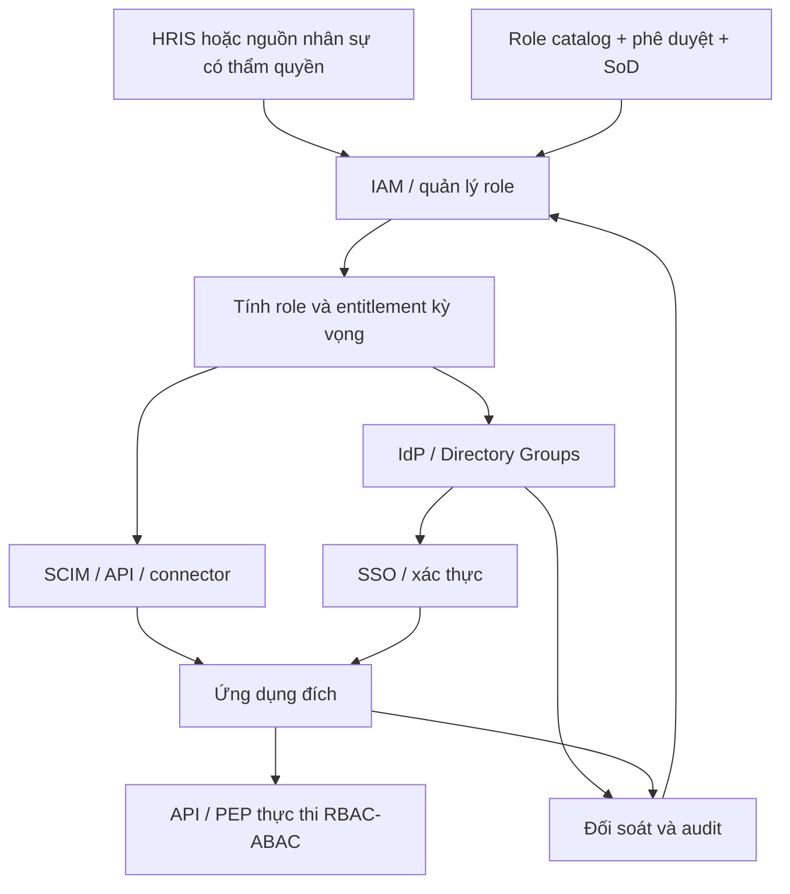

# Static role trong RBAC: Vai trò được định nghĩa sẵn và quản lý theo vòng đời danh tính

**Static role** (vai trò tĩnh) trong **Role-Based Access Control (RBAC)** là vai trò có **tên, mục đích và tập quyền được định nghĩa trước** trong một danh mục được quản trị (*role catalog*). Thay vì gán từng quyền lẻ cho mỗi người, tổ chức gán một hoặc nhiều vai trò hợp lệ cho danh tính, sau đó hệ thống dùng những vai trò này để đánh giá những hành động nào được phép.

Ví dụ, vai trò `inventory-viewer` có thể gồm `inventory.read` và `warehouse.list`, còn `inventory-editor` có thêm `inventory.update`. Nếu nhân viên được gán `inventory-viewer`, họ chỉ có căn cứ sử dụng tập quyền đó, sau khi thỏa các giới hạn bổ sung về trạng thái tài khoản, phạm vi tài nguyên và chính sách bảo mật.

**Điểm cần ghi nhớ:** *static* nói về **định nghĩa trước của role** hoặc, trong một số ngữ cảnh, về **assignment tường minh**; nó **không có nghĩa người dùng phải giữ role vĩnh viễn**. Thành viên có thể được thêm/gỡ tự động theo HR đã xác minh. Ngay cả tập permission của role cũng có thể được sửa thông qua thay đổi được phê duyệt. Cần nêu rõ cách dùng thuật ngữ trong từng hệ thống để không nhầm lẫn.

Bài thuộc chương **RBAC** của module `SECURITY_IDENTITY_ACCESS_MANAGEMENT_IDENTITY_LIFECYCLE`, gắn static role với **Joiner–Mover–Leaver (JML)**, Identity Provider (**IdP**), SSO, SCIM, RBAC/ABAC, tài khoản dịch vụ, đối soát và kiểm toán. Mục tiêu là cấp đúng quyền khi gia nhập, gỡ quyền cũ khi đổi vai trò và giảm **quyền truy cập tồn dư** khi quan hệ làm việc kết thúc.

Sau bài học, bạn có thể phân biệt role và permission, mô hình hóa quan hệ user–role–permission, thiết kế role catalog, kiểm soát kế thừa và phân tách nhiệm vụ, tính tập quyền mong đợi, và giải thích cách static role được quản lý xuyên suốt JML.

## 1. Vì sao cần static role?

Giả sử doanh nghiệp có hàng trăm nhân viên sử dụng ứng dụng đơn hàng. Nếu quản trị viên gán riêng từng quyền `order.read`, `order.create`, `order.approve` và `refund.execute` cho mỗi người, sẽ khó biết ai đang giữ quyền gì, ai duyệt và quyền nào cần thu hồi khi nhân viên đổi công việc.

Static role chuyển việc đó thành **những gói quyền được duyệt và dễ gọi tên**:

| Static role | Nhiệm vụ | Permission minh họa |
| --- | --- | --- |
| `order-viewer` | Xem đơn hàng | `order.read` |
| `order-creator` | Tạo và xem đơn | `order.create`, `order.read` |
| `order-approver` | Phê duyệt đơn hợp lệ | `order.approve`, `order.read` |
| `refund-operator` | Thực hiện hoàn tiền đã được duyệt | `refund.execute`, `refund.read` |
| `audit-reader` | Đọc báo cáo và audit | `audit.read`, `report.read` |

Đây là **quy ước minh họa**, không phải các quyền mặc định của sản phẩm IAM. Từng permission phải được ánh xạ đến đúng ứng dụng, action và tài nguyên trong môi trường thực.

Lợi ích là nhất quán, dễ kiểm toán, kiểm thử và tái sử dụng. Tuy nhiên, nếu `order-creator` bị cấu hình chứa `refund.execute`, mọi người giữ role đó đều có nguy cơ được cấp quyền quá mức. **Role được định nghĩa trước không tự bảo đảm nguyên tắc quyền tối thiểu**; role catalog phải có owner và quy trình rà soát.

## 2. Phân biệt các khái niệm RBAC

| Khái niệm | Ý nghĩa | Ví dụ |
| --- | --- | --- |
| **Identity / subject** | Người hoặc workload yêu cầu truy cập | `iam-user-1042`, `report-sync-prod` |
| **Permission** | Khả năng thực hiện một hành động trên một loại tài nguyên/phạm vi | `invoice.read`, `invoice.approve` |
| **Static role** | Tập permission được định nghĩa trước, có tên và mục đích | `invoice-approver` |
| **User–role assignment (UA)** | Danh tính nào được gán role nào | An → `invoice-approver` |
| **Permission–role assignment (PA)** | Role chứa những permission nào | `invoice-approver` → `invoice.approve` |
| **Group** | Tập hợp thành viên trong directory hoặc IdP | `finance-approvers` |
| **Entitlement** | Quyền được cấp thực tế trong hệ thống đích | Group membership, application role, API grant |
| **Session / activated role** | Những role được kích hoạt theo ngữ cảnh truy cập nếu hệ thống hỗ trợ | Một phiên chỉ dùng vai trò kiểm toán |
| **Policy / constraint** | Quy tắc điều kiện hoặc xung đột khi gán/sử dụng role | SoD, thời hạn, trạng thái HR, MFA |

**Group không đồng nghĩa role**. Nhóm trong IdP có thể được ánh xạ sang một hoặc nhiều application role. Ngược lại, ứng dụng có thể quản lý role trực tiếp mà không dùng group directory. Phải kiểm tra **ánh xạ đã được phê duyệt**, không suy ra quyền chỉ từ tên nhóm.

**Permission không đồng nghĩa role**. Permission nói về một hành động; role biểu diễn nhóm quyền và trách nhiệm công việc. Nếu mỗi người được tạo một role riêng để chứa quyền tùy ý, hệ thống dễ rơi vào *role explosion* và mất lợi ích quản trị.

## 3. Mô hình user–role–permission và quyền sơ bộ

Trong RBAC cơ bản, có hai quan hệ nhiều–nhiều:

- **UA (User Assignment):** từ danh tính tới role.
- **PA (Permission Assignment):** từ role tới permission.

Tập quyền sơ bộ của chủ thể có thể mô tả:

\[
Roles(u)=\{r\mid (u,r)\in UA\}, \qquad
Permissions(u)=\bigcup_{r\in Roles(u)} PA(r).
\]

Ví dụ:

```text
PA(order-viewer)  = {order.read}
PA(order-creator) = {order.read, order.create}
PA(audit-reader)  = {audit.read, report.read}

UA(An) = {order-creator, audit-reader}

Quyền sơ bộ của An:
    {order.read, order.create, audit.read, report.read}
```

**Đây chỉ là tập quyền ở mức RBAC sơ bộ.** Quyết định Permit cuối còn cần xét trạng thái account, tenant, tài nguyên cụ thể, session, SoD, deny, ABAC và thời điểm hiệu lực.

Nếu An bị gỡ `order-creator` nhưng vẫn giữ `audit-reader`, các quyền kiểm toán không được thu hồi. Nếu một permission đến từ **hai role hợp lệ**, chỉ thu hồi permission đó khi **không còn bất kỳ căn cứ hợp lệ nào**, bao gồm role còn lại hoặc ngoại lệ được duyệt.

### Static role có thể được gán tự động

Chính sách có thể quy định: nếu HR xác nhận `employmentStatus=ACTIVE` và `department=sales`, IAM gán `sales-agent` theo quy trình phê duyệt. `sales-agent` vẫn là static role vì **tập quyền được định nghĩa trước**. Cơ chế assignment tự động không khiến nó trở thành một tập quyền ABAC động.

Nên phân biệt:

1. **Role definition:** role có ý nghĩa gì và bao gồm permission nào?
2. **Role eligibility:** danh tính nào đủ điều kiện giữ role?
3. **Role assignment:** role nào thực sự được gán, có hiệu lực khi nào?
4. **Role activation:** role nào được sử dụng trong phiên, nếu hệ thống hỗ trợ?
5. **Authorization decision:** một yêu cầu cụ thể được Permit hay Deny sau toàn bộ kiểm soát?

## 4. Thiết kế static role catalog

Một role catalog có quản trị nên chứa ít nhất:

| Thuộc tính | Mục đích | Ví dụ |
| --- | --- | --- |
| `roleId` | ID ổn định, không dựa vào tên hiển thị | `order-approver` |
| Tên và mô tả | Nhiệm vụ mà role phục vụ | “Phê duyệt đơn đúng hạn mức” |
| Owner | Người hoặc đội chịu trách nhiệm | `order-operations` |
| Entitlement mapping | Quyền ở từng ứng dụng đích | `order.approve` ở OrderHub |
| Điều kiện đủ tư cách | Trạng thái, bộ phận, chức năng, dự án | ACTIVE, đã được giao nhiệm vụ duyệt |
| Rủi ro và phê duyệt | Mức nhạy cảm, ai được duyệt gán role | Owner approval |
| SoD | Tổ hợp role hoặc hành động xung đột | Không tự tạo và duyệt đơn |
| Thời hạn và review | Bắt đầu, kết thúc, chu kỳ kiểm tra | Ngoại lệ 7 ngày, review theo quý |
| Phiên bản | Truy vết thay đổi định nghĩa quyền | `catalogVersion=12` |

Ví dụ cấu hình **minh họa**:

```yaml
roleId: order-approver
displayName: Người phê duyệt đơn
ownerTeam: order-operations
risk: high
eligibility:
  employmentStatus: ACTIVE
  approvedFunction: order-approval
permissions:
  - target: order-api
    actions:
      - order.read
      - order.approve
constraints:
  cannotApproveOwnOrder: true
  scope: assignedOrganization
  requireStepUpAuthentication: true
approval:
  ownerApprovalRequired: true
reviewCadence: quarterly
catalogVersion: 12
```

Đây **không phải schema mặc định của IdP hay policy engine**. Một thuộc tính như `cannotApproveOwnOrder: true` **chỉ có hiệu lực** nếu API/PDP/PEP thực sự kiểm tra người tạo giao dịch trước khi duyệt.

### Quyền tối thiểu và mức hạt role

Role nên phản ánh **nhiệm vụ ổn định**, không phải quyền cao nhất mà một phòng ban từng cần. `order-viewer` không cần xóa đơn; `order-approver` không đương nhiên cần tạo đơn. Role đặc quyền nên được tách khỏi quyền cơ sở và có phê duyệt, MFA/JIT khi phù hợp.

Mặt khác, nếu tạo role mới cho từng chi nhánh, dự án, chức danh và trạng thái, catalog sẽ rất khó bảo trì. Hãy cân bằng **role cho chức năng** với **ABAC hoặc phạm vi tài nguyên** cho điều kiện động, khi ứng dụng thực sự hỗ trợ.

## 5. Role hierarchy và quyền kế thừa

Một số mô hình RBAC hỗ trợ **role hierarchy**: role cấp cao hơn trong một quan hệ thứ bậc được phép kế thừa quyền của role thấp hơn.

```text
          order-viewer
           /       \\
order-creator     order-approver
```

Trong sơ đồ minh họa này, `order-creator` và `order-approver` đều có quyền đọc từ `order-viewer`; chúng **không mặc nhiên kế thừa quyền của nhau**. Quy ước chiều kế thừa phải được định nghĩa rõ trong hệ thống cụ thể.

| Quan hệ | Tác dụng mong đợi | Rủi ro cần kiểm tra |
| --- | --- | --- |
| Creator kế thừa Viewer | Có thể đọc đơn trước khi sửa | Phạm vi dữ liệu không bị mở rộng |
| Approver kế thừa Viewer | Có thể đọc trước khi duyệt | Không tự nhận quyền tạo hoặc xóa |
| Admin kế thừa nhiều role | Giảm lặp permission | Có thể gây đặc quyền rộng hoặc SoD conflict |
| Nhóm lồng nhau tại IdP | Có thể cấp membership gián tiếp | Không nhất thiết có cùng semantics với RBAC hierarchy |

**Nested group và RBAC role hierarchy không phải luôn đồng nghĩa.** Nhóm lồng nhau là cơ chế directory; quyền kế thừa ở ứng dụng phụ thuộc cách ứng dụng đọc và ánh xạ nhóm đó.

Khi đối soát entitlement, phải xét cả quyền đến từ hierarchy, group lồng nhau và cấp trực tiếp, không chỉ những role xuất hiện ngay trong UI.

## 6. Static Separation of Duties và Dynamic Separation of Duties

**Separation of Duties (SoD)** nhằm ngăn một chủ thể tự thực hiện một chuỗi công việc rủi ro, như vừa tạo vừa duyệt khoản chi.

| Ràng buộc | Kiểm soát | Ví dụ |
| --- | --- | --- |
| **Static SoD (SSD)** | Hạn chế **gán đồng thời** các role xung đột | Không gán cả `payment-maker` và `payment-checker` |
| **Dynamic SoD (DSD)** | Hạn chế **kích hoạt đồng thời** các role trong cùng phiên/ngữ cảnh khi hệ thống hỗ trợ | Người dùng được gán hai role nhưng chỉ kích hoạt một |
| **Object-level SoD** | Kiểm tra thao tác trên **giao dịch cụ thể** | Không được duyệt khoản thanh toán do chính mình tạo |

**Static role không đồng nghĩa Static SoD.** Role có thể là static nhưng không có bất kỳ ràng buộc SSD nào. Việc role được gán cố định cũng **không tự bảo đảm** rằng người dùng không có xung đột khi sử dụng.

Giả mã SSD:

```text
assignRole(user, candidateRole):
    proposedRoles = activeAssignedRoles(user) UNION {candidateRole}
    if violatesStaticSoD(proposedRoles):
        DENY assignment
    else:
        requireApprovalsAndAssign(candidateRole)
```

Nếu role hierarchy hoặc group lồng nhau có thể cấp quyền xung đột, SSD phải tính đến **quyền kế thừa**, không chỉ so tên hai role trực tiếp.

### Vì sao DSD chưa đủ để chống tự duyệt xuyên phiên?

Một người có thể tạo giao dịch khi kích hoạt role Maker, đăng xuất, rồi kích hoạt Checker ở phiên sau để duyệt lại chính giao dịch đó. DSD theo phiên không ngăn được hành vi này nếu ứng dụng không kiểm tra `createdBy`. Vì vậy, **SoD dựa trên dữ liệu nghiệp vụ** vẫn cần PEP tại API.

## 7. Static RBAC kết hợp ABAC

**RBAC** trả lời tương đối tốt câu hỏi “người này làm loại công việc nào?”. **ABAC** bổ sung các điều kiện thay đổi theo chủ thể, tài nguyên và môi trường.

| Câu hỏi | Static RBAC | ABAC/điều kiện bổ sung |
| --- | --- | --- |
| Ai được dùng chức năng xem khách hàng? | `sales-agent` cho `customer.read` | Chỉ trong khu vực được giao |
| Ai được duyệt giao dịch? | `payment-approver` cho `payment.approve` | Hạn mức, người tạo, tổ chức |
| Có được truy cập API production? | `prod-operator` | Phiên JIT, thiết bị, MFA mạnh |
| Người đã nghỉ việc còn quyền không? | Role cũ có thể vẫn được lưu | Trạng thái Leaver, account và thời điểm |
| Quyền áp dụng cho tenant nào? | Role nghiệp vụ | `resource.tenantId == subject.tenantId` |

Ví dụ logic kiểm tra ở API:

```text
PERMIT customer.read khi tất cả điều kiện đúng:
    subject.accountEnabled == true
    AND subject.employmentStatus == ACTIVE
    AND subject.hasRole("sales-agent")
    AND resource.type == "customer"
    AND resource.region IN subject.allowedRegions
    AND resource.tenantId == subject.tenantId
    AND không có deny/SoD áp dụng

DENY nếu thiếu căn cứ cần thiết.
```

Đây là **giả mã**. Nếu client có thể tự gửi `allowedRegions` hoặc `tenantId` mà API không kiểm chứng, chính sách vẫn có thể bị vượt. Dữ liệu quyết định phải đến từ **nguồn tin cậy** và gắn với đối tượng tài nguyên thực tế.

**Chỉ kiểm tra role ở giao diện là không đủ.** Người dùng có thể gọi endpoint trực tiếp hoặc sửa resource ID trong URL. PEP/API phải xác minh hành động, tài nguyên và phạm vi để tránh lỗi kiểm soát truy cập cấp đối tượng (BOLA/IDOR).

## 8. Vai trò tĩnh đi qua IdP, SSO và SCIM như thế nào?

Business role trong IAM không nhất thiết giống application role ở SaaS. Cần **mapping có owner và phiên bản**:

| Business role | Đích | Entitlement/role được đồng bộ | Điều kiện bổ sung |
| --- | --- | --- | --- |
| `employee-basic` | Portal | `portal-user` | Quan hệ HR còn hiệu lực |
| `sales-agent` | CRM | `crm-sales-read` | Giới hạn khu vực |
| `order-approver` | OrderHub | `order-approval` | SoD và hạn mức |
| `audit-reader` | Reporting | `report-readonly` | Phạm vi báo cáo |



**IdP/SSO giải quyết xác thực**, không bảo đảm quyền nghiệp vụ đúng. **SCIM** có thể đồng bộ người dùng, nhóm và một số thuộc tính/quyền theo tính năng của hệ thống đích; không phải ứng dụng nào cũng hỗ trợ provision application role đầy đủ bằng SCIM.

Khi một nhóm IdP được ánh xạ thành application role, cần xác minh mapping **ở ứng dụng**. Một ứng dụng vẫn có thể có role cục bộ hoặc entitlement cấp trực tiếp ngoài IAM.

### Role claim và token có thể lỗi thời

Một OIDC/SAML session có thể mang claims chứa role/group tại thời điểm phát token. Sau Mover, token cũ có thể vẫn còn role không hợp lệ. Với API nhạy cảm, cần giới hạn lifetime hoặc kiểm tra quyền mới, làm mới cache/session và xử lý thu hồi theo rủi ro.

**ID token OIDC không phải access token để gọi API.** Resource server phải kiểm tra access token đúng audience, issuer và quyền trên tài nguyên cụ thể.

## 9. Joiner: cấp role đúng người và đúng thời điểm

**Tình huống:** HRIS xác nhận nhân viên mới bắt đầu làm việc ở bộ phận bán hàng lúc 09:00 ngày 01/12. Role catalog đã có `employee-basic` và `sales-agent`.

1. **Xác minh nguồn:** lấy ID người, trạng thái, bộ phận và `effectiveAt` từ HRIS/nguồn đáng tin.
2. **Liên kết danh tính:** gắn HR person ID với `identityId` ổn định và các account. Không chỉ dựa vào tên hoặc email.
3. **Tính eligibility:** role nào hợp công việc và điều kiện hiện hành? Có cần owner phê duyệt không?
4. **Kiểm tra SoD:** không gán vai trò xung đột; role nhạy cảm có thể cần phê duyệt bổ sung.
5. **Provisioning:** cấp group/application role qua IdP, SCIM hoặc API đích.
6. **Đúng thời điểm:** tài khoản có thể được chuẩn bị trước nhưng quyền sử dụng dữ liệu chỉ có hiệu lực khi được phép.
7. **Xác minh:** đọc lại account/entitlement ở đích và kiểm tra không thừa hoặc thiếu quyền.

Đừng gán role admin “cho chắc” khi nhân viên chưa có quyền cần dùng. Nếu quyền thiếu, sửa mapping, dữ liệu nguồn hoặc quy trình phê duyệt thay vì nới rộng role cơ sở cho cả phòng ban.

## 10. Mover: role ổn định nhưng assignment thay đổi

Khi An chuyển từ bán hàng sang kiểm toán, **định nghĩa static role không nhất thiết thay đổi**, nhưng **assignment phải thay đổi theo vai trò mới**.

| Thành phần | Trước Mover | Sau Mover | Hành động |
| --- | --- | --- | --- |
| `employee-basic` | Có | Có | Giữ lại |
| `sales-agent` | Có | Không | Gỡ vai trò và entitlement không còn căn cứ |
| `audit-reader` | Không | Có | Cấp sau khi đáp ứng phê duyệt |
| `portal.read` được nhiều role yêu cầu | Có | Có | Không thu hồi nhầm |
| Quyền CRM cấp trực tiếp | Có thể có | Phải rà soát | Xử lý grant source và ngoại lệ |
| SoD, tenant, hạn mức | Theo công việc cũ | Theo công việc mới | Tính lại và kiểm tra |

### Tính lại desired state thay vì “gỡ hết quyền role cũ”

Giả sử `sales-agent` và `audit-reader` đều yêu cầu `portal.read`. Nếu gỡ role cũ bằng cách xóa mọi entitlement mà role đó từng cấp, `portal.read` có thể bị thu hồi nhầm. Thay vào đó, tính **tập quyền kỳ vọng từ tất cả role/ngoại lệ còn hợp lệ**, rồi so với quyền thực tế.

Khi chuyển từ vai trò tạo thanh toán sang duyệt thanh toán, cần giải quyết SoD và **xác minh đã thu hồi quyền cũ trước khi kích hoạt quyền mới** nếu việc giữ đồng thời bị cấm. Quyền bàn giao tạm phải có owner, phạm vi và ngày hết hạn.

### Privilege creep

**Privilege creep** xảy ra khi người dùng tích lũy quyền qua nhiều lần Mover. Nó có thể đến từ group cũ, quyền cấp trực tiếp, role kế thừa hoặc ngoại lệ hết hạn. Đối soát Mover cần kiểm tra cả **quyền được gán và khả năng truy cập thực tế**, không chỉ danh sách role ở IAM.

## 11. Leaver: thu hồi assignment, không xóa định nghĩa role dùng chung

Khi một người nghỉ việc, role dựa trên quan hệ làm việc đó không còn hợp lệ. Quy trình nên:

1. Nhận sự kiện Leaver có thẩm quyền, xác minh danh tính và `effectiveAt`.
2. Chặn đăng nhập mới tại IdP/directory theo chính sách, xử lý khẩn cấp khi cần.
3. Kết thúc những **role assignment** không còn căn cứ.
4. Gỡ application role, group và quyền trực tiếp ở từng đích qua SCIM/API hoặc quy trình thủ công có kiểm soát.
5. Xem xét session, refresh token, access token và credential khác theo khả năng nền tảng.
6. Đối soát trạng thái đích, xử lý lỗi và ghi bằng chứng kiểm toán.

**Không xóa role catalog `sales-agent` chỉ vì An nghỉ việc**: role còn dùng cho nhiều nhân viên khác. Cái cần kết thúc là **quan hệ cấp role cho An** và các quyền còn hiệu lực liên quan.

### Vì sao IdP disabled chưa đủ?

Sau khi IdP khóa user, một ứng dụng có thể vẫn có session cục bộ hoặc API còn chấp nhận access token tự chứa chưa hết hạn. SSO logout, SCIM deactivate và gỡ group **không thay thế nhau**. Muốn tuyên bố Leaver đã hoàn tất, phải xác minh từng đường truy cập phù hợp với chính sách.

## 12. Tính quyền kỳ vọng và đối soát từng đích

Đối soát nên phân biệt ba lớp:

- **Desired state:** role và entitlement danh tính **được phép có** từ HR, catalog, phê duyệt, thời điểm, SoD.
- **Observed state:** account, group, application role **được ghi nhận tại đích**.
- **Effective access:** hành động chủ thể **thực sự có thể thực hiện**, có xét token/session, deny, ABAC, group kế thừa.

Ví dụ YAML **minh họa** sau một Mover:

```yaml
identityId: iam-user-1042
asOf: "2026-12-01T09:00:00Z"
employmentStatus: ACTIVE
desiredRoles:
  - employee-basic
  - audit-reader
observedRoles:
  - employee-basic
  - audit-reader
  - sales-agent
findings:
  - type: EXCESS_ROLE
    roleId: sales-agent
    target: crm
    grantSource: stale-group
```

An đã có role mới, nhưng role cũ vẫn tồn tại tại đích. Đây là sai lệch phải xác minh và xử lý. Không coi Mover hoàn tất chỉ vì đã cấp xong role mới.

### Giả mã reconciliation

```text
reconcileStaticRoles(identityId, asOf):
    identity = loadTrustedIdentity(identityId, asOf)
    assignments = loadApprovedRoleAssignments(identityId, asOf)

    validRoles = filterByEligibilityAndEffectiveTime(
        assignments, identity, roleCatalog
    )
    enforceSoDConstraints(validRoles)

    desired = expandRoleHierarchyAndMapEntitlements(validRoles)
    desired = applyValidExceptionsAndPolicyRestrictions(desired)

    for each target in relevantSystems(identityId):
        observed = readAllTargetEntitlements(target, identityId)
        if observed.isIncompleteOrStale:
            recordUnknownAndEscalate(target)
            continue

        excess = observed.entitlements - desired[target]
        missing = desired[target] - observed.entitlements
        assessGrantOwnershipAndRisk(excess, missing)
        applyApprovedChangesSafely(target, excess, missing)
        verifyTargetStateAfterChange(target)

    auditAndTrackRemainingFindings()
```

Đây là **giả mã khái niệm**, không phải thuật toán production đầy đủ. Cần xử lý phân trang, quyền từ nhiều nguồn, role hierarchy, retry/idempotency, SoD, phiên/token, thời điểm, và quyền tài nguyên có scope khác nhau. Phép trừ tập hợp chỉ chính xác khi permission đã được chuẩn hóa cùng ngữ nghĩa.

### Sự kiện đến muộn

Nếu Mover cũ đến sau Leaver đã thực thi, hệ thống không được tái cấp role rồi mở lại tài khoản. Cần kiểm tra **version/snapshot mới nhất từ nguồn có thẩm quyền**, không chỉ thứ tự nhận event. Thao tác phải **idempotent**: chạy lại không tạo assignment trùng hoặc đảo ngược quyết định thu hồi.

## 13. Static role cho tài khoản dịch vụ và đặc quyền JIT

RBAC cũng áp dụng với **workload identity, service principal và tài khoản dịch vụ**. Ví dụ:

| Danh tính máy | Role phù hợp | Kiểm soát |
| --- | --- | --- |
| `report-sync-prod` | `report-writer` | Chỉ ghi đúng API và môi trường |
| `backup-job` | `backup-executor` | Chỉ kho dữ liệu được giao |
| `deployment-worker` | `deploy-stage` | Không mặc định có quyền production |
| Tài khoản quản trị khẩn cấp | Role đặc quyền chuyên biệt | Bảo vệ credential, giám sát và phê duyệt |

Mỗi danh tính kỹ thuật cần **owner, mục đích, môi trường, phạm vi, credential và ngày rà soát**. Khi nhân viên sở hữu ứng dụng nghỉ việc, phải chuyển owner và đánh giá những bí mật họ từng biết; không tự xóa workload còn vận hành quan trọng.

**Role có thể tĩnh nhưng quyền không phải tồn tại vĩnh viễn.** Role `prod-deployer` có thể được định nghĩa trước, rồi chỉ gán/kích hoạt qua **Privileged Access Management (PAM)** hoặc **Just-in-Time (JIT)** theo nhiệm vụ, phê duyệt và thời hạn. Khi hết thời gian, entitlement hoặc session đặc quyền phải được thu hồi/kiểm tra.

## 14. Những lỗi static RBAC thường gặp

| Sai lầm | Hậu quả | Cách khắc phục |
| --- | --- | --- |
| Hiểu static role là không bao giờ gỡ | Quyền tồn dư sau Mover/Leaver | Assignment có thời hạn, phản ánh JML |
| Gộp mọi quyền phòng ban vào một role | Cấp thừa | Chia theo nhiệm vụ, duyệt đặc quyền riêng |
| Kế thừa role sai chiều | Vừa tạo vừa duyệt giao dịch | Kiểm thử hierarchy và SoD |
| Chỉ kiểm tra role, không xét resource | Truy cập sai tenant/bản ghi | ABAC/PEP ở API |
| Gỡ group IdP là đủ | App role trực tiếp vẫn còn | Đối soát từng hệ thống |
| Gỡ mọi quyền của role cũ | Thu hồi nhầm quyền role khác vẫn cần | Tính desired từ toàn bộ role |
| Không có SSD/DSD | Người dùng giữ role xung đột | Kiểm soát assignment, activation, object-level |
| Ngoại lệ không hết hạn | Quyền tạm thành vĩnh viễn | Owner, approval, `validUntil` |
| Claim/token được cache lâu | Role cũ vẫn có hiệu lực | TTL/invalidation, kiểm tra quyền hiện hành |
| Không có role owner | Catalog lỗi thời | Version, owner, review định kỳ |
| Tạo role cho mỗi người/chi nhánh nhỏ | Role explosion | Role theo nhiệm vụ + ABAC cho phạm vi |
| Tin connector thành công là quyền đã được áp | Không phát hiện drift | Readback và xác minh effective access |

### Role drift khác policy drift

**Role drift** là role assignment hoặc entitlement thực tế không còn khớp trạng thái được duyệt. **Policy drift** là chính sách tại ứng dụng/API cho phép hành vi khác điều đã thiết kế. Một user có đúng `order-viewer` nhưng API vẫn chấp nhận `order.delete` là lỗi phân quyền, dù danh sách group không lệch.

Bởi vậy, cần kiểm thử **hành động thực tế trên tài nguyên**, không chỉ danh sách tên role.

## 15. Audit, access review và chỉ số vận hành

Một static role có lợi thế cho **access certification**: owner có thể rà soát người giữ role và permission mà role đem lại.

Dấu vết tối thiểu của thay đổi role nên có identity ID ổn định, target account ID, role ID, phiên bản mapping, căn cứ HR hoặc approval, thời điểm hiệu lực/hết hạn, kết quả SoD, trạng thái connector, người xử lý và kết quả xác minh ở đích.

**Không ghi password, access token, refresh token, client secret hoặc dữ liệu HR không cần thiết vào log.** Hạn chế người được xem audit và lưu theo chính sách.

| Chỉ số | Mục đích |
| --- | --- |
| Role không có owner/phê duyệt | Phát hiện assignment không có căn cứ |
| Entitlement thừa sau Mover | Đo privilege creep |
| Leaver còn role hoặc account active | Đo residual access |
| Xung đột SSD/DSD/SoD | Kiểm soát gian lận và đặc quyền |
| Quyền trực tiếp ngoài catalog | Tìm grant không quản lý |
| Role không được rà soát đúng hạn | Phát hiện thiết kế lỗi thời |
| Role ít sử dụng hoặc số lượng tăng bất thường | Kiểm soát role explosion |
| Tỷ lệ provision/revoke đạt SLA | Đo hiệu quả thực thi JML |
| Sai lệch giữa desired/observed/effective | Đánh giá chất lượng đối soát |

Không chỉ đo **số lượng role**: ít role có thể cấp quá rộng, còn quá nhiều role gây chi phí quản trị. Cần kết hợp **least privilege, SoD, độ phủ và thời gian thu hồi thực tế**.

## 16. Tình huống tổng hợp: Một nhân viên đi qua ba giai đoạn

Giả sử An dùng IdP, OrderHub và Reporting. Role được quản lý ở IAM, ánh xạ một phần qua SCIM/API.

| Giai đoạn | Sự kiện | Role mong đợi | Kết quả |
| --- | --- | --- | --- |
| Trước Joiner | HR đã tạo hồ sơ, chưa đến ngày bắt đầu | Không có quyền nghiệp vụ hiệu lực | Không truy cập dữ liệu sớm |
| Joiner | An làm bán hàng | `employee-basic`, `sales-agent` | Đọc/tạo đơn đúng vùng, không admin |
| Mover | An chuyển sang kiểm toán | `employee-basic`, `audit-reader` | Gỡ quyền bán hàng, giữ quyền còn căn cứ |
| Nhu cầu tạm | Đọc báo cáo nhạy cảm 7 ngày | Ngoại lệ hoặc role được duyệt có hạn | Hết hạn thì thu hồi |
| Leaver | Hợp đồng chấm dứt | Không còn role theo hợp đồng | Chặn IdP, đích, quyền và phiên |
| Rehire | Quay lại vai trò khác | Tính lại từ chính sách hiện hành | Không tự khôi phục role cũ |

**Lỗi 1:** An đã Mover, nhưng token còn chứa `sales-agent` nên API vẫn cho tạo đơn. Cần chặn quyền cũ theo cơ chế authorization và session phù hợp.

**Lỗi 2:** `portal.read` do hai role yêu cầu, nhưng connector xóa quyền khi gỡ role bán hàng. Cần tính tập entitlement cuối, không gỡ theo từng role biệt lập.

**Lỗi 3:** Quản trị viên gán `order-creator` và `order-approver` cho một người “để tiện”. Nếu SSD cấm, IAM phải chặn assignment. Nếu policy cho phép dùng hai role theo phiên, vẫn cần kiểm tra không tự duyệt giao dịch xuyên phiên.

**Lỗi 4:** Leaver đã bị gỡ group IdP nhưng còn quyền trực tiếp trong ứng dụng. Cần deprovision và đối soát tại đích, bao gồm phiên và token còn hạn.

## 17. Checklist triển khai

1. Vai trò có được định nghĩa theo **nhiệm vụ ổn định**, thay vì theo từng cá nhân không?
2. Mỗi role có ID ổn định, owner, permission mapping, phiên bản và lịch review không?
3. Đã phân biệt **definition, eligibility, assignment, activation và authorization decision** chưa?
4. Role hierarchy có chiều kế thừa rõ và được kiểm thử không?
5. Có SSD, DSD và SoD trên giao dịch cụ thể khi cần không?
6. Static role có tuân theo **least privilege**, giới hạn phạm vi và ngoại lệ có hạn không?
7. API có kiểm tra tenant, resource và ABAC bên cạnh role không?
8. HR, IAM, IdP và ứng dụng có ánh xạ **identity ID ổn định** không?
9. Joiner có nhận quyền đúng `effectiveAt` và được kiểm chứng ở đích không?
10. Mover có gỡ quyền cũ, giữ quyền còn căn cứ và xử lý cache/token không?
11. Leaver có disable account, thu hồi entitlement và xử lý session/token không?
12. Service account có owner, scope và quy trình luân chuyển credential không?
13. Có audit, kiểm thử và đối soát để phát hiện role drift, SoD và role explosion không?

## 18. Câu hỏi tự kiểm tra

**Câu 1.** Static role có phải luôn được gán thủ công và tồn tại vĩnh viễn với một người dùng?

**Trả lời:** Không. Role thường được **định nghĩa trước**, còn assignment có thể tự động và phải thay đổi theo JML. Tập permission cũng có thể được cập nhật qua quản trị thay đổi.

**Câu 2.** Có role `order-approver` có nghĩa được duyệt bất kỳ đơn hàng nào không?

**Trả lời:** Không. Cần kiểm tra tenant, hạn mức, người tạo, trạng thái đơn và SoD/ABAC tại API.

**Câu 3.** SSD khác DSD ở điểm nào?

**Trả lời:** SSD hạn chế **gán đồng thời** các role xung đột; DSD hạn chế **kích hoạt đồng thời** theo phiên/ngữ cảnh. Để chống tự duyệt xuyên phiên, cần kiểm tra dữ liệu giao dịch.

**Câu 4.** Một entitlement đến từ hai static role. Khi gỡ một role, có nên gỡ ngay entitlement đó?

**Trả lời:** Không nếu role còn lại hoặc ngoại lệ hợp lệ vẫn yêu cầu nó. Phải tính lại tập quyền mong đợi từ mọi căn cứ còn hiệu lực.

**Câu 5.** Vì sao sau Mover, IdP đã gỡ group mà ứng dụng vẫn có thể cho thao tác cũ?

**Trả lời:** Ứng dụng có thể giữ role cấp trực tiếp, session/cache hoặc access token chứa claim cũ. Cần xác minh quyền hiệu lực tại ứng dụng.

**Câu 6.** Người sở hữu service account nghỉ việc. Có nên xóa ngay mọi role và account kỹ thuật của ứng dụng đó?

**Trả lời:** Không mặc định. Cần chặn quyền cá nhân, chuyển owner, đánh giá phụ thuộc, luân chuyển credential và thu hồi quyền workload theo rủi ro và kế hoạch vận hành.

## Kết luận

**Static role** là một cách tổ chức những tập permission được định nghĩa trước trong RBAC, giúp cấp quyền nhất quán, có thể phê duyệt và kiểm toán. **Vai trò có định nghĩa ổn định không có nghĩa assignment tồn tại vĩnh viễn**: Joiner cần được gán đúng quyền, Mover phải gỡ vai trò không còn căn cứ và Leaver cần bị chặn các đường truy cập liên quan. **Role hierarchy**, **SSD/DSD**, các điều kiện **ABAC**, kiểm soát ở **PEP/API**, cùng tích hợp **IdP/SSO/SCIM** giúp hệ thống tránh quyền cấp thừa hoặc sai phạm vi. Đối soát **desired–observed–effective access**, quản lý danh tính dịch vụ và kiểm toán là những phần bổ sung cần thiết để bảo đảm static RBAC tiếp tục đúng trong suốt vòng đời danh tính.
