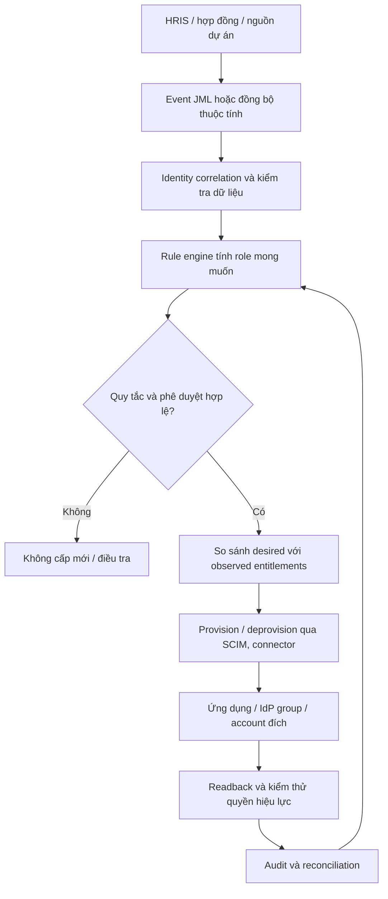

# Dynamic role trong RBAC và vòng đời danh tính IAM

**Dynamic role** (vai trò động) là cách tổ chức **tính toán, gán hoặc kích hoạt vai trò dựa trên điều kiện thay đổi theo thời gian**, thay vì coi mọi liên kết người dùng–vai trò là cố định và được quản trị thủ công. Trong thực tế, tên gọi này có thể chỉ các cơ chế khác nhau: **dynamic role assignment** dựa trên thuộc tính, **role activation** trong một phiên RBAC, hoặc cách tổ chức hạn chế sử dụng vai trò theo **Dynamic Separation of Duties (DSD)**.

Trong **Identity and Access Management (IAM)**, vai trò động hữu ích khi một người **Joiner** được cấp quyền theo vị trí, **Mover** đổi bộ phận hoặc dự án, và **Leaver** phải mất quyền ngay khi quan hệ kết thúc. Tuy nhiên, tính “động” không thay thế phê duyệt, **least privilege**, phân quyền theo đối tượng hay kiểm toán. Cần kết hợp **IdP/SSO, SCIM, RBAC/ABAC, account reconciliation, quản trị service account** và thực thi quyền tại tài nguyên để hạn chế quyền truy cập tồn dư.

## 1. Dynamic role có nghĩa gì?

Trong RBAC cơ bản, một vai trò tập hợp permission, và quản trị viên hoặc quy trình IAM gán role đó cho người dùng. Với dynamic role, **điều kiện xác định vai trò hoặc thời điểm sử dụng quyền có thể được đánh giá lại** khi thông tin chủ thể, môi trường hoặc nhiệm vụ thay đổi.

| Biến thể | Cơ chế | Ví dụ | Điều cần lưu ý |
| --- | --- | --- | --- |
| **Dynamic assignment** | Tự động tính vai trò từ thuộc tính/điều kiện | Nhân viên thuộc Support và đang active được gán `support-reader` | Cần nguồn thuộc tính tin cậy và thu hồi khi điều kiện sai |
| **Session role activation** | Người dùng chỉ kích hoạt một phần vai trò đã được gán trong phiên | Quản trị viên chuyển sang role hỗ trợ khi cần | Không mặc nhiên cấp role chưa được phê duyệt |
| **Just-in-Time (JIT) role** | Quyền đặc biệt được gán/kích hoạt trong khoảng thời gian phê duyệt | Quyền `production-operator` trong 30 phút | Phải có expiry, audit, thu hồi và xử lý phiên |
| **Dynamic SoD (DSD)** | Hạn chế vai trò có thể kích hoạt đồng thời | Không được kích hoạt vai trò tạo và duyệt thanh toán trong cùng ngữ cảnh | Khác với việc tự động cấp role theo thuộc tính |
| **Contextual authorization** | Chính sách đánh giá thuộc tính tại thời điểm truy cập | Role `report-reader` chỉ được xem dự án đang phụ trách | Thường là RBAC kết hợp ABAC, không nhất thiết thay role assignment |

**Dynamic role không phải một đối tượng chuẩn thống nhất trong mọi sản phẩm RBAC.** Cần ghi rõ tổ chức đang nói đến **quy tắc gán**, **điều kiện kích hoạt** hay **điều kiện cho phép thao tác**. Nếu không, nhóm IAM có thể tưởng rằng gỡ role động sẽ lập tức làm mọi access token và phiên ứng dụng mất hiệu lực.

## 2. Role động khác role tĩnh

| Tiêu chí | Role tĩnh | Role động |
| --- | --- | --- |
| Cách gán | Thủ công hoặc theo quy trình cấp quyền riêng | Tính từ quy tắc, sự kiện hoặc điều kiện được cấu hình |
| Thời điểm cập nhật | Khi có yêu cầu thay đổi/phê duyệt | Khi nguồn thuộc tính hoặc điều kiện thay đổi |
| Ưu điểm | Dễ giải thích đối với quyền cá biệt | Giảm xử lý thủ công cho quyền thường xuyên biến động |
| Rủi ro | Quyền cũ dễ bị bỏ quên | Sai dữ liệu/quy tắc có thể cấp hoặc thu hồi quyền hàng loạt |
| Bằng chứng | Ticket gán/gỡ và trạng thái đích | Rule version, nguồn dữ liệu, kết quả evaluation, readback |
| Phù hợp | Quyền đặc biệt, ngoại lệ cần xét riêng | Birthright access, nhóm dự án hoặc quyền có điều kiện rõ ràng |

**Không có yêu cầu mọi role phải động.** Một quyền nhạy cảm như `payment-approver` có thể cần phê duyệt riêng ngay cả khi người dùng có chức danh phù hợp; áp dụng quy tắc tự động không kiểm soát có thể tạo rủi ro cấp sai.

## 3. Thành phần xây dựng quy tắc dynamic role

Một quy tắc thường sử dụng:

- **Identity ổn định:** mã nhân viên, đối tác hoặc workload; tránh dùng tên hiển thị/email làm khóa duy nhất.
- **Thuộc tính chủ thể:** tình trạng quan hệ, department, job family, loại hợp đồng, vị trí.
- **Nguồn có thẩm quyền:** HRIS, hệ thống hợp đồng, quản lý dự án hoặc inventory workload.
- **Điều kiện nghiệp vụ:** ngày hiệu lực, dự án được bảo trợ, role owner, phê duyệt.
- **Permission/role catalog:** ánh xạ từ kết quả quy tắc sang entitlement ở ứng dụng.
- **Thời hạn:** điều kiện hết hạn hoặc sự kiện khiến vai trò bị thu hồi.
- **Điểm thực thi:** SCIM/connector, IdP group, ứng dụng hoặc PDP/PEP tại API.
- **Audit:** rule version, nguồn thuộc tính, thay đổi kết quả và người phê duyệt chính sách.

Ví dụ quy tắc gán role:

```text
ASSIGN "support-reader" IF
    identity.lifecycle_status == "active"
    AND identity.department == "Customer Support"
    AND identity.employment_effective_at <= now
    AND identity.employment_end_at > now
ELSE REMOVE "support-reader"
```

Đây là **giả mã**. Triển khai thực tế cần xử lý trường hợp `employment_end_at` chưa xác định, giờ hiệu lực, timezone, dữ liệu thiếu và xung đột nguồn. Không được đơn giản hóa thành “thiếu dữ liệu thì vẫn cấp quyền”.

**Dynamic assignment là trạng thái mong muốn**, không đồng nghĩa hệ thống đích đã cập nhật. Sau khi tính `ASSIGN` hoặc `REMOVE`, IAM vẫn cần provisioning và readback, đặc biệt với quyền nhạy cảm.

## 4. Luồng từ dữ liệu nguồn đến quyền hiệu lực



Quá trình không chỉ tạo role khi điều kiện chuyển thành đúng. **Khi điều kiện chuyển thành sai, hệ thống phải gỡ quyền**. Đây là điểm khác biệt thiết yếu giữa tự động hóa cấp quyền ban đầu và quản lý vai trò động an toàn.

Ví dụ nhân viên rời nhóm Support, quy tắc `support-reader` không còn đúng. Nếu hệ thống chỉ thực hiện `add` khi khớp mà không có bước `remove`, role động biến thành **cơ chế tích lũy quyền**.

## 5. Dynamic role assignment và ABAC

**RBAC** dùng role để nhóm quyền; **ABAC** đánh giá thuộc tính của subject, tài nguyên, hành động và ngữ cảnh. Hai mô hình có thể phối hợp nhưng không hoàn toàn giống nhau.

**Dynamic RBAC:** IAM tính xem người dùng có nên được gán role `project-reader` theo danh sách dự án đang tham gia. Kết quả có thể được materialize thành group/role ở ứng dụng.

**RBAC kết hợp ABAC:** người dùng giữ role `project-reader`, còn API xác minh `resource.project_id` có thuộc tập dự án được phép ở **thời điểm yêu cầu** hay không.

```text
PERMIT read_project_file IF
    subject.lifecycle_status == "active"
    AND "project-reader" IN subject.effective_roles
    AND resource.project_id IN subject.current_projects
    AND subject.tenant_id == resource.tenant_id
ELSE DENY
```

Cách thứ hai có thể phù hợp khi tập dự án thay đổi nhiều lần mỗi ngày, vì không cần tạo riêng một role cho từng dự án. Nhưng nó yêu cầu **nguồn thuộc tính đủ mới và PEP kiểm tra chính sách ở backend**. Không chỉ ẩn nút trên giao diện hoặc tin các trường `project_id` do client tự khai.

## 6. Dynamic role và Role-Based Access Control chuẩn

Trong các mô hình RBAC, người dùng có thể được **gán nhiều role**, nhưng trong một **session** chỉ kích hoạt một tập con vai trò được phép. Cơ chế này khác với việc thay đổi assignment trong directory.

Ví dụ một nhân viên vừa là `developer` vừa được phép làm `release-operator`. Phiên làm việc thường ngày chỉ kích hoạt `developer`. Khi phát hành phần mềm, người đó trải qua bước xác thực/duyệt phù hợp để dùng `release-operator` trong giới hạn cụ thể.

**Không được dùng session activation để vượt qua ranh giới assignment.** Nếu người dùng chưa được gán hoặc chưa đủ điều kiện role, yêu cầu kích hoạt phải bị từ chối.

Vai trò kích hoạt trong phiên có thể được biểu diễn qua session server-side, quyền tạm thời hoặc token có scope/claim giới hạn. Mỗi cách có chính sách hết hạn và thu hồi riêng; không suy rằng thao tác “deactivate” trong giao diện sẽ tự thu hồi mọi JWT đã phát hành.

## 7. Dynamic Separation of Duties (DSD)

**Dynamic SoD** là ràng buộc nhằm ngăn sử dụng đồng thời các vai trò xung đột trong một ngữ cảnh. Nó không chỉ đơn giản là “role được cấp theo điều kiện”.

Ví dụ một nhân viên có quyền chuẩn bị chứng từ và, theo tổ chức, cũng có vai trò phê duyệt ở một số quy trình. Chính sách DSD có thể cấm kích hoạt cả hai trong cùng phiên. Tuy nhiên, ngăn kích hoạt đồng thời **chưa chắc đủ** để chống tự duyệt một giao dịch qua nhiều phiên khác nhau.

| Loại SoD | Hạn chế | Ví dụ |
| --- | --- | --- |
| **Static SoD (SSD)** | Không được cùng lúc *được gán* các vai trò xung đột | Không đồng thời là `payment-creator` và `payment-approver` |
| **Dynamic SoD (DSD)** | Không được đồng thời *kích hoạt* các vai trò xung đột theo quy tắc | Trong phiên duyệt không được kích hoạt role tạo |
| **Transaction-level SoD** | Không được phê duyệt tài nguyên do chính mình tạo | So sánh `created_by` và `approver_id` tại API |

Với hệ thống tài chính, nên đánh giá cả **xung đột role** và **xung đột theo giao dịch**. Dynamic SoD không thay thế log, phê duyệt và kiểm soát owner.

## 8. Joiner: tự động gán quyền cơ bản

Trong Joiner, tổ chức có thể dùng dynamic role để cấp **birthright access** theo vị trí và quan hệ hợp lệ.

Ví dụ:
1. HR xác nhận người mới, identity ID ổn định và ngày bắt đầu.
2. IAM/IGA xác minh nguồn thuộc tính, tính role phù hợp.
3. Role cơ bản như `employee-portal-reader` được tính tự động.
4. Quyền đặc quyền vẫn phải qua phê duyệt của role owner/data owner.
5. Account và nhóm được tạo qua AD/IdP/SCIM/connector.
6. Hệ thống chỉ kích hoạt quyền vào đúng thời điểm hiệu lực.
7. IAM đọc lại entitlement đích và kiểm thử quyền được phép/bị từ chối.

Nếu account đã được provision để chuẩn bị onboarding, **không đồng nghĩa tài khoản được đăng nhập hoặc có quyền trước ngày làm việc**. Các điều kiện thời gian cần được đánh giá tại điểm có khả năng thực thi.

## 9. Mover: tự động thu hồi role cũ

**Mover** là tình huống role động phát huy giá trị khi người dùng chuyển department, project hoặc loại trách nhiệm. IAM phải tính lại toàn bộ tập role mong muốn, không chỉ cộng thêm nhóm mới.

| Sự kiện Mover | Role mong muốn | Điều cần kiểm tra |
| --- | --- | --- |
| Support sang Finance | Mất `support-reader`; nhận role Finance được duyệt | Quyền Support không còn ở CRM |
| Dự án A sang B | Mất scope A, chỉ có scope B | ACL/ABAC không cho đọc dữ liệu A |
| Nhân viên thường thành quản trị | Có thể cần JIT `admin` sau phê duyệt | Không tự động có admin vĩnh viễn |
| Hết vai trò approver | Thu hồi `invoice-approver` | Không còn khả năng approve bằng session cũ |

Ví dụ Hà chuyển từ Finance sang Analytics. `department` trong HRIS đổi; IAM tính rằng `invoice-approver` không còn hợp lệ. **Gỡ nhóm tại IdP chưa chắc gỡ role ERP gán trực tiếp**. Quy trình phải so desired/observed, cập nhật tại ERP và kiểm tra thao tác phê duyệt bị từ chối.

Nếu cần quyền bàn giao, nên cấp **ngoại lệ tạm thời có owner, lý do và ngày hết hạn**, thay vì làm sai quy tắc động bằng việc giữ role cũ không giới hạn.

## 10. Leaver: trạng thái không còn hợp lệ phải có hiệu lực

Khi quan hệ lao động hoặc hợp đồng kết thúc, điều kiện `lifecycle_status == active` trở thành sai. Rule engine nên tính lại role mong muốn và tạo hành động thu hồi.

Nhưng phải phân biệt:

- **Role assignment tại IAM/IGA:** kết quả logic của quy tắc.
- **Group/role ở IdP hoặc directory:** trạng thái có thể được đồng bộ theo thời gian.
- **Entitlement tại ứng dụng:** có thể tồn tại dưới dạng quyền cục bộ.
- **Session/SSO:** có vòng đời riêng, không tự hết hạn ngay khi role bị gỡ.
- **Access token/refresh token:** có chính sách thu hồi, cache và hạn hiệu lực riêng.
- **API key/service credential:** có thể cho truy cập độc lập với phiên SSO.

**Dynamic role không tự động làm JWT tự chứa bị vô hiệu ngay** nếu API vẫn chấp nhận token đến thời hạn. Leaver cần disable/deprovision account, thu hồi phiên/token theo khả năng và thiết kế API kiểm tra quyền hiện hành khi cần; kết quả phải được kiểm chứng ở tài nguyên đích.

## 11. Dữ liệu cũ, sự kiện trễ và race condition

Tự động hóa vai trò phụ thuộc mạnh vào chất lượng dữ liệu và tính đúng thứ tự sự kiện. Các vấn đề thường gặp:

| Sự cố | Hậu quả | Kiểm soát |
| --- | --- | --- |
| HR gửi sự kiện Mover trễ | Role cũ còn hiệu lực | SLA, cảnh báo, reconciliation |
| Đồng bộ department sai | Cấp nhầm role | Data quality, owner, kiểm tra nguồn |
| Hai workflow cập nhật đồng thời | Quyền mới bị ghi đè | Version/ETag, concurrency control |
| Event được gửi lặp | Role/group bị thêm trùng hoặc lỗi | Xử lý idempotent và readback |
| Event cũ đến sau event mới | Quay lại role đã hết hiệu lực | Version hoặc thời điểm hiệu lực đáng tin |
| Group lồng nhau phức tạp | Quyền hiệu lực khó dự đoán | Tính effective permissions |
| Cache claim/token cũ | Quyền tại API chậm bị thu hồi | TTL, revoke, kiểm tra trạng thái hiện hành |
| Sai timezone hoặc lịch hiệu lực | Cấp trước ngày hoặc thu hồi muộn | Thống nhất thời gian và ngữ nghĩa effective-at |

Không tự coi timestamp nhận event là thời điểm có hiệu lực. Event JML có thể được gửi trước để chuẩn bị account; quyền thực tế chỉ được phép hoạt động khi **effective time** theo chính sách đã đến.

## 12. Quyền sở hữu nguồn thuộc tính

Một quy tắc động chỉ đáng tin nếu biết **ai sở hữu dữ liệu dùng để tính role**.

| Thuộc tính | Nguồn có thể có thẩm quyền | Rủi ro nếu dùng sai |
| --- | --- | --- |
| Trạng thái nhân sự | HRIS hoặc hồ sơ quan hệ | Leaver vẫn còn role |
| Hợp đồng đối tác | Contract/sponsor system | Partner tiếp tục truy cập khi hợp đồng hết hạn |
| Bộ phận, vị trí | HRIS và quy trình Mover | Role không còn phù hợp |
| Dự án đang tham gia | Project management với owner xác nhận | Quyền dự án khác không được thu hồi |
| Mức nhạy cảm tài nguyên | Data catalog/data owner | ABAC cho truy cập quá phạm vi |
| Owner workload | Service registry/CMDB | Account dịch vụ không ai chịu trách nhiệm |

**Không để người dùng tự chỉnh thuộc tính nguồn quyết định role nhạy cảm**, chẳng hạn thay `department` trong hồ sơ cá nhân rồi tự nhận quyền kế toán. Thuộc tính cần bảo vệ tính toàn vẹn, nguồn gốc, phạm vi và lịch sử thay đổi.

## 13. Role động trong IdP, SSO và SCIM

Một số IdP có khả năng tính **dynamic group membership** dựa trên thuộc tính. Ứng dụng có thể dùng membership đó để gán role qua SSO claim, hoặc nhận group qua **SCIM provisioning**.

Các giới hạn quan trọng:

- **IdP** xác thực, áp dụng MFA, phát claim/token và có thể tính nhóm động.
- **SSO/OIDC/SAML** mang thông tin xác thực/claim theo quan hệ trust, không tự bảo đảm mọi entitlement đích đã cập nhật.
- **SCIM** có thể tạo, sửa account hoặc group; không phải phương thức thu hồi mọi session/refresh token.
- **RBAC/ABAC tại ứng dụng** quyết định hành động cụ thể với tài nguyên, có thể cần kiểm tra theo thời điểm.
- **IAM/IGA** quản lý điều kiện đủ quyền, phê duyệt, ngoại lệ, hậu kiểm và JML.

Ví dụ IdP loại Lan khỏi nhóm `support-reader`, nhưng CRM vẫn giữ role tương ứng được gán trực tiếp hoặc phiên cũ chứa claim đã cache. **Không thể kết luận đã thu hồi quyền** nếu chưa kiểm tra tại CRM.

## 14. JIT role và quyền đặc quyền

Dynamic role có thể kết hợp **Just-in-Time Privileged Access**, nhưng cần phân biệt:

- **Eligibility:** người dùng có quyền *yêu cầu* role khi có công việc hợp lệ.
- **Approval:** owner hoặc chính sách xác nhận yêu cầu cụ thể.
- **Activation:** hệ thống cho phép dùng role trong phạm vi và thời hạn xác định.
- **Deactivation/expiry:** quyền không còn có hiệu lực sau khi công việc kết thúc.
- **Audit:** ghi lý do, tài nguyên, người duyệt, thời gian, phiên và thao tác.

Ví dụ một kỹ sư được phép yêu cầu role `production-operator` trong 30 phút để xử lý sự cố. Role đó không nên luôn active. Khi thời hạn kết thúc, cần bảo đảm các API và session liên quan **không tiếp tục chấp nhận quyền** chỉ do cache hoặc token còn sống.

**Step-up MFA** có thể là điều kiện kích hoạt, nhưng không tự sinh quyền quản trị. Người dùng vẫn cần đủ điều kiện và phê duyệt theo chính sách.

## 15. Partner và service account

### Partner identity

Role động của partner nên gắn với **partner ID, sponsor, trạng thái hợp đồng, dự án và hạn truy cập**. Một người đăng nhập thành công bằng IdP đối tác chưa đủ căn cứ nhận quyền trong ứng dụng của doanh nghiệp cung cấp.

Khi partner thay đổi nhân sự hoặc hợp đồng hết hạn, tổ chức sở hữu ứng dụng phải chủ động thu hồi quyền, ngay cả khi thông báo từ IdP đối tác chậm. Quy tắc động chỉ đáng tin nếu có nguồn hợp đồng và owner được quản lý.

### Service/workload identity

Workload không có department HR như nhân viên. Đối với service account, điều kiện role động có thể dựa vào **service ID, môi trường, namespace, workload owner và trạng thái triển khai**. Không dùng token cá nhân của kỹ sư như credential lâu dài cho job.

Khi kỹ sư rời công ty, phải thu hồi quyền quản trị của người ấy và chuyển owner workload; không tự xóa service account đang chạy mà chưa xác minh phụ thuộc. Credential lifecycle, scope và trust policy cần quản trị riêng, không thể chỉ dựa vào role assignment động của human identity.

## 16. Reconciliation: trạng thái mong muốn và trạng thái thực tế

Tính role động chỉ là một nửa quy trình. Bên còn lại là **account reconciliation**:

```text
desired_roles = evaluate_rules(authoritative_identity, effective_time)
observed_roles = read_effective_entitlements(target_account)

missing_roles = desired_roles - observed_roles
excess_roles = observed_roles - desired_roles
```

Đây là mô hình logic. Trong thực tế phải xử lý **role kế thừa, nhóm lồng nhau, quyền trực tiếp, ngoại lệ đã phê duyệt, SoD và thuộc tính ABAC**. Không tự xóa quyền kỹ thuật chưa biết owner hoặc quyền ngoại lệ đang hợp lệ mà không đánh giá; nhưng mọi sai lệch phải được giải thích, quản lý rủi ro và có thời hạn xử lý.

Một quy trình đóng vòng gồm:

1. Nhận sự kiện Joiner/Mover/Leaver hoặc chạy đánh giá định kỳ.
2. Tính desired state từ nguồn có thẩm quyền và rule version.
3. Đọc observed state từ IdP/AD và ứng dụng đích.
4. Phân loại quyền thiếu, quyền dư và ngoại lệ.
5. Thực hiện cấp/gỡ qua SCIM, connector hoặc API quản trị.
6. Đọc lại và kiểm chứng **positive/negative authorization**.
7. Ghi audit và cảnh báo nếu quyền nhạy cảm vẫn tồn dư.

## 17. Kiểm thử quy tắc dynamic role

| Kịch bản | Kỳ vọng |
| --- | --- |
| Joiner chưa đến ngày hiệu lực | Chưa có quyền sử dụng tài nguyên |
| Joiner active và thuộc nhóm hợp lệ | Nhận role cơ bản theo policy |
| Mover chuyển từ Finance sang Analytics | Role Finance mất, Analytics được cấp đúng |
| Role đặc quyền thiếu approval | Không được kích hoạt |
| JIT role hết thời gian | API/ứng dụng từ chối thao tác đặc quyền |
| Leaver account disabled | Không còn đăng nhập mới hoặc sử dụng quyền cũ |
| Event cũ đến muộn | Không ghi đè desired state mới hơn |
| Quy tắc gặp dữ liệu thiếu | Không tự cấp quyền nhạy cảm |
| Nhóm lồng nhau/cấp trực tiếp | Reconciliation nhận ra effective entitlements |
| Partner hết hợp đồng | Mất quyền B2B dù IdP vẫn xác thực người dùng |
| Workload đổi owner | Không cấp lại quyền cá nhân của owner cũ |

Cần kiểm thử cả trường hợp thay đổi **một** thuộc tính và thay đổi **đồng thời nhiều thuộc tính**, sự cố connector và kết quả retry. Một quy tắc chỉ được đánh giá thành công khi quyền thực tế ở ứng dụng đúng với trạng thái mong muốn.

## 18. Audit và chỉ số vận hành

Các sự kiện nên được ghi nhận gồm thay đổi thuộc tính nguồn, phiên bản quy tắc, kết quả tính role, phê duyệt/ngoại lệ, lệnh provision/deprovision, phản hồi của đích, readback và trạng thái phiên/token khi thu hồi.

Chỉ số hữu ích:

- **Dynamic assignment accuracy:** tỷ lệ role tính đúng theo chính sách đã được kiểm chứng.
- **Mover excess entitlement count:** số quyền vai trò cũ tồn dư sau chuyển vị trí.
- **Leaver revocation delay:** thời gian từ sự kiện hết quan hệ đến khi quyền thực tế mất hiệu lực.
- **Rule evaluation failure rate:** số trường hợp không tính được vì dữ liệu hoặc lỗi hệ thống.
- **Exception expiry compliance:** tỷ lệ ngoại lệ tự hết hạn đúng lúc.
- **JIT privilege duration:** thời gian quyền đặc biệt được kích hoạt và sử dụng.
- **Orphan role assignments:** role không còn identity hoặc owner hợp lệ.
- **Reconciliation coverage:** tỷ lệ hệ thống đích được đối soát quyền thực tế.

Không ghi mật khẩu, access token, refresh token, cookie phiên, khóa riêng hoặc dữ liệu nhạy cảm không cần thiết vào audit log. Quy tắc động thay đổi trên diện rộng nên log cần giúp trả lời **ai sửa rule, thay đổi ảnh hưởng tới những ai và quyền nào đã được cấp/thu hồi**.

## 19. Tình huống tự kiểm tra

**Tình huống A:** Role `support-reader` được gán tự động khi department là Support. Nhân viên chuyển Finance, connector chỉ thêm role mới mà không xóa role cũ. Đây có phải dynamic role an toàn không? **Không.** Phải xử lý chiều thu hồi khi điều kiện sai.

**Tình huống B:** Một user được gán role `release-operator` nhưng phiên làm việc thường chưa kích hoạt role này. Có phải role đã bị thu hồi không? **Không.** Assignment và session activation là hai trạng thái khác nhau.

**Tình huống C:** DSD ngăn cùng lúc bật role `payment-creator` và `payment-approver`. Có bảo đảm không thể tự duyệt qua hai phiên không? **Không.** Cần kiểm tra SoD ở cấp giao dịch hoặc thiết kế ràng buộc bổ sung.

**Tình huống D:** IdP đã gỡ nhóm động khi Leaver, nhưng CRM vẫn nhận cookie cũ. Có thể coi thu hồi hoàn tất không? **Không.** Cần kiểm chứng quyền ở CRM và xử lý phiên/token.

**Tình huống E:** Dynamic rule dựa trên trường `department` mà nhân viên có thể tự chỉnh. Rủi ro là gì? **Privilege escalation** do thuộc tính không có thẩm quyền.

**Tình huống F:** Kỹ sư nghỉ việc, workload do họ tạo vẫn cần chạy. Có nên tự động xóa service account? **Không.** Chuyển owner, thu hồi quyền cá nhân và kiểm tra credential/phụ thuộc.

## Ghi nhớ

**Dynamic role** giúp IAM tính toán hoặc kích hoạt vai trò theo dữ liệu và ngữ cảnh thay đổi, nhưng cần phân biệt **dynamic assignment**, **session activation**, **JIT privilege** và **Dynamic SoD**. Thiết kế an toàn phải có **nguồn thuộc tính tin cậy, quy tắc rõ ràng, owner/phê duyệt, thời hạn, xử lý chiều thu hồi, versioning và reconciliation**. Trong **Joiner–Mover–Leaver**, phối hợp **IdP/SSO, SCIM, RBAC/ABAC, quản trị service identity và audit** giúp role động thực sự cấp đúng quyền, thu hồi quyền cũ và ngăn truy cập tồn dư.
