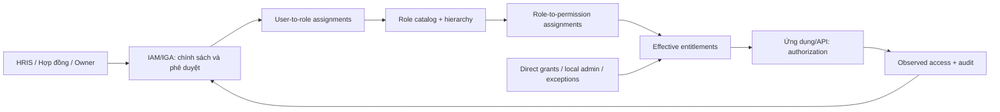
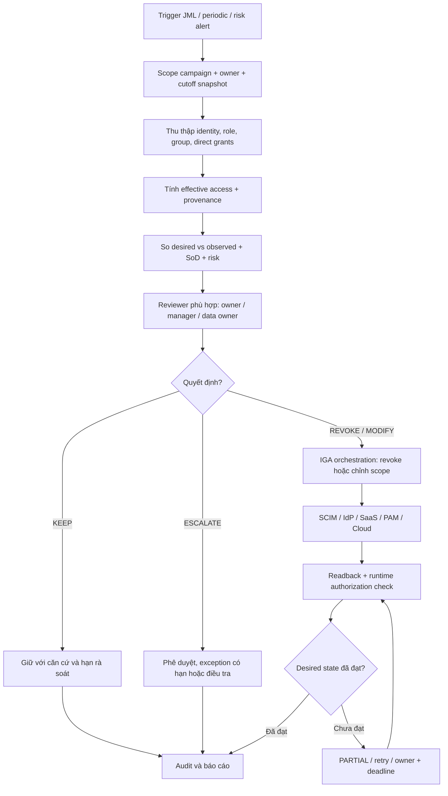
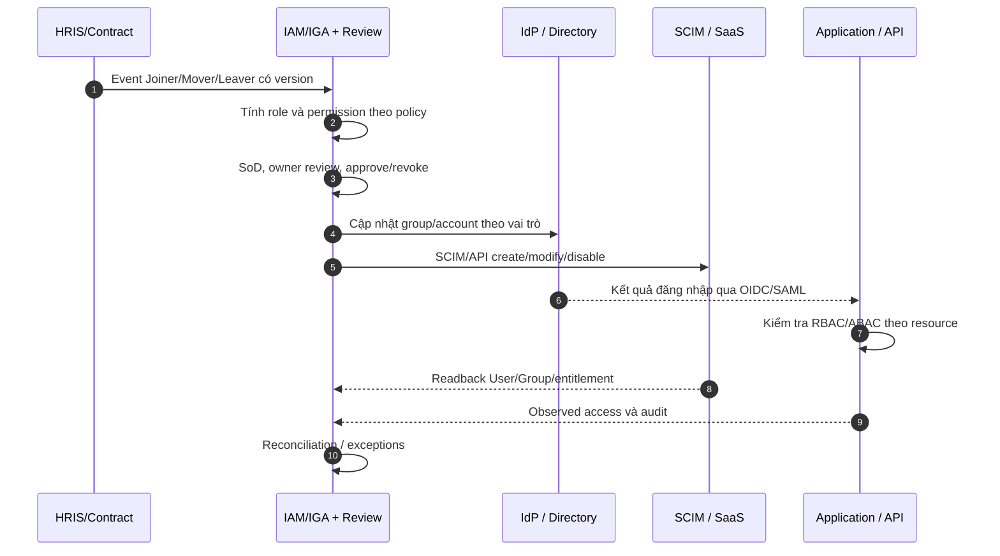

# Rà soát RBAC trong quản lý vòng đời danh tính IAM

## 1. Rà soát RBAC là gì?

**Rà soát RBAC** (*Role-Based Access Control review*) là hoạt động đánh giá có hệ thống xem **vai trò, quan hệ gán vai trò, quyền thuộc vai trò và quyền truy cập có hiệu lực** còn phù hợp với công việc, nguồn có thẩm quyền, chính sách an ninh và thời gian được phép sử dụng hay không. Kết quả rà soát phải tạo ra **quyết định có trách nhiệm, hành động sửa sai và bằng chứng kiểm chứng**, không dừng ở việc một quản lý bấm nút “Approve”.

Ví dụ, một nhân viên trước đây thuộc bộ phận Sales được chuyển sang Finance. Hệ thống IAM đã thêm vai trò `finance-analyst`, nhưng quyền `customer-export` của vai trò Sales vẫn còn vì tài khoản nằm trong nhóm cũ. Rà soát RBAC cần phát hiện **quyền tích lũy (*permission creep*)**, xác định quyền nào không còn căn cứ và theo dõi thu hồi đến khi ứng dụng thực tế không cho phép xuất dữ liệu khách hàng.

Trong module **SECURITY_IDENTITY_ACCESS_MANAGEMENT_IDENTITY_LIFECYCLE**, rà soát RBAC liên kết trực tiếp với **Joiner–Mover–Leaver (JML)**: xác định quyền ban đầu cho người mới, tính lại quyền khi thay đổi vai trò, thu hồi đầy đủ khi nghỉ việc hoặc hết hợp đồng. Kiến trúc liên quan **HRIS/contract registry, Identity Provider (IdP), Single Sign-On (SSO), SCIM, IGA, ABAC, tài khoản dịch vụ, kiểm toán** và mục tiêu giảm quyền truy cập tồn dư.

Sau bài học, người đọc có thể thiết kế một chiến dịch rà soát quyền dựa trên rủi ro, xác định effective access, phân biệt **role review** và **access certification**, phát hiện xung đột **Segregation of Duties (SoD)**, giao quyết định cho đúng owner, thực thi thu hồi qua connector an toàn và đối soát trạng thái cuối.

> **Nguyên tắc cốt lõi:** một vai trò tồn tại trong danh mục hoặc một account có nhóm “đúng tên” chưa phải bằng chứng rằng **quyền thực tế** đang tuân thủ RBAC. Phải kiểm tra cả các đường gán trực tiếp, vai trò kế thừa, quyền cục bộ và phiên/token còn hiệu lực.

## 2. Nhắc lại mô hình RBAC: người dùng, vai trò, quyền và phiên

**RBAC** biểu diễn quyền truy cập qua vai trò thay vì cấp thủ công từng quyền cho từng người dùng. Theo mô hình nền tảng, có ba tập:

- **Users/Subjects (`U`)**: các danh tính hoặc chủ thể được quản lý, bao gồm nhân viên, guest và có thể là danh tính phi con người theo thiết kế.
- **Roles (`R`)**: các nhóm trách nhiệm/quyền nghiệp vụ, ví dụ `invoice-reviewer` hoặc `crm-reader`.
- **Permissions (`P`)**: quyền thực hiện một hành động trên tài nguyên hoặc phạm vi, ví dụ `report:read:finance`.

Hai quan hệ thường gặp:

- **User Assignment (`UA ⊆ U × R`)**: ai được gán vai trò nào.
- **Permission Assignment (`PA ⊆ R × P`)**: mỗi vai trò trao những quyền gì.

**Role hierarchy** có thể cho phép một vai trò kế thừa quyền của vai trò khác. Ngoài ra còn có **constraints**, chẳng hạn xung đột SoD hoặc yêu cầu không cho kích hoạt hai vai trò tại cùng thời điểm.



Mô hình thực tế có thể kết hợp **RBAC với ABAC**. Một vai trò cho phép đọc hóa đơn nhưng **ABAC** giới hạn vào pháp nhân, tenant, trạng thái hợp đồng, mức phân loại dữ liệu hoặc mức xác thực của phiên. Rà soát RBAC vì vậy phải hiểu **đúng phạm vi quyền**, không suy từ một chuỗi tên role duy nhất.

### RBAC không đồng nghĩa group membership

Một **nhóm IdP/directory** có thể dùng để biểu diễn vai trò, nhưng nhóm chỉ là phương tiện kỹ thuật. Nếu group `finance-users` ánh xạ đến nhiều quyền ở SaaS, một thay đổi của group có thể tác động nhiều hệ thống. Ngược lại, ứng dụng có thể gán `super-admin` trực tiếp không đi qua group IAM. Cả hai đường đều cần nằm trong **bản đồ quyền có hiệu lực**.

## 3. Rà soát RBAC khác những hoạt động gần nhau thế nào?

| Hoạt động | Câu hỏi chính | Đầu ra |
| --- | --- | --- |
| **Role design/engineering** | Cần tạo những vai trò nghiệp vụ nào, ranh giới và quyền ra sao? | Role catalog, mapping, owner, chính sách |
| **Role review** | Vai trò hiện có còn đúng nhiệm vụ, quyền trong vai trò có quá rộng hoặc trùng lặp không? | Sửa/gộp/tách/ngừng vai trò, thu hẹp permission |
| **User access review/certification** | Chủ thể cụ thể còn cần role hoặc entitlement đó không? | KEEP/REVOKE/MODIFY/ESCALATE và phê duyệt |
| **SoD analysis** | Hai quyền hoặc vai trò có tạo xung đột kiểm soát không? | Conflict, remediation, ngoại lệ hoặc kiểm soát bù |
| **Provisioning/deprovisioning** | Quyết định cấp/thu hồi được áp ở hệ thống đích thế nào? | Account/role/group được sửa, kết quả thực thi |
| **Reconciliation** | Desired state có trùng với actual/effective state không? | Drift report và xử lý sai lệch |
| **Authentication/SSO** | Chủ thể có chứng minh được quyền kiểm soát credential không? | Phiên xác thực, token/assertion |
| **Runtime authorization** | Request này có được phép trên tài nguyên cụ thể không? | Cho phép hoặc từ chối hành động |

**Access review** có thể là một phần của quy trình **Identity Governance and Administration (IGA)**; **role review** tập trung vào bản thân mô hình quyền. Hai chiều này phải phối hợp: nếu một vai trò chứa quyền quá rộng, việc 100 quản lý xác nhận “nhân viên cần vai trò này” **không sửa được thiết kế role đang sai**.

### Rà soát theo sự kiện và theo chu kỳ

- **Event-driven review:** phát sinh ngay khi Joiner, Mover, Leaver, thay manager, hợp đồng, rủi ro an ninh hoặc cấu trúc role thay đổi.
- **Periodic certification:** rà soát theo kỳ do chính sách nội bộ xác định, ưu tiên quyền rủi ro cao và các nhóm không có tín hiệu JML đầy đủ.
- **Continuous controls monitoring:** so desired/actual access liên tục hoặc thường xuyên để tìm quyền ngoài luồng, tài khoản mồ côi và ngoại lệ quá hạn.

Không có một **chu kỳ rà soát mặc định** phù hợp cho mọi hệ thống. Quyền production, tài chính hoặc dữ liệu nhạy cảm thường cần tần suất và SLA chặt hơn quyền đọc tài liệu công khai; tổ chức quyết định theo rủi ro, quy định và nghĩa vụ kiểm soát hiện hành.

## 4. Phạm vi review: không chỉ ai thuộc role nào

Để rà soát chính xác, phải liệt kê **đối tượng**, **đường cấp quyền**, **nguồn quyết định** và **điểm thực thi**.

| Đối tượng | Ví dụ | Sai lệch dễ bị bỏ sót |
| --- | --- | --- |
| Danh tính người | Nhân viên, nhà thầu, guest, rehire | Chủ thể hết hợp đồng nhưng account còn active |
| Danh tính phi con người | Service account, bot, CI/CD workload | Không có owner hoặc scope vẫn dùng khi ứng dụng ngừng |
| Role nghiệp vụ | `finance-analyst`, `support-agent` | Role quá rộng, không có owner |
| Entitlement ứng dụng | `approve-payment`, `customer-export` | Quyền trực tiếp ngoài role catalog |
| Group/directory | Nhóm LDAP/AD/IdP và nested groups | Kế thừa role không được hiển thị trực tiếp |
| Quyền cloud và PAM | Role production, root/admin, JIT privileged session | Đặc quyền dài hạn hoặc break-glass không được kiểm tra |
| Attribute dùng bởi ABAC | `partnerId`, `department`, `dataScope` | Thuộc tính stale hoặc sai nguồn |
| Local account | Account tạo thủ công, fallback login | Không liên kết với identity registry |
| Phiên/credential | SSO session, PAT, API key, token OAuth | Quyền cũ còn dùng qua token đã phát |
| Ngoại lệ | Quyền bàn giao, quyền sự cố có hạn | Không có hạn, owner hay lần tái duyệt |

**Phải xác định nguồn điều khiển từng đường cấp**: IGA role catalog, IdP group, directory LDAP, SCIM Group, quyền ứng dụng cấp thẳng, entitlement từ IAM cloud hay chính sách ABAC. Nếu không biết nguồn cấp, có thể thu hồi ở một nơi rồi bị cơ chế đồng bộ khác **cấp lại**.

### Hai chiều rà soát

**User → Role → Permission:** người này đang có khả năng làm gì, vì sao, còn cần không?

**Role → Permission → User:** một thay đổi role sẽ ảnh hưởng ai, có mở rộng dữ liệu/đặc quyền cho nhiều người không?

Hai chiều phải cùng được xem xét khi thay role catalog. Một role cũ chỉ có ít người dùng vẫn có thể tạo rủi ro lớn nếu chứa quyền ghi dữ liệu sản xuất.

## 5. Mô hình dữ liệu và nguồn sự thật của review

Rà soát không nên dựa vào danh sách Excel hoặc ảnh chụp group đã cũ mà không biết thời điểm lấy dữ liệu. Mỗi bản ghi quyền cần gắn với **identity ổn định, nguồn, thời gian và loại quan hệ**.

Các thực thể logic hữu ích:

| Thực thể | Các trường quan trọng | Mục đích |
| --- | --- | --- |
| `Identity` | `identityId`, loại chủ thể, source key, `lifecycleStatus` | Không dùng email làm khóa bất biến |
| `Employment/Contract` | Đơn vị, manager, sponsor, job code, effective interval | Căn cứ nghiệp vụ để tính quyền |
| `RoleDefinition` | `roleId`, mô tả, owner, rủi ro, trạng thái, version | Chứng minh role được quản trị |
| `RolePermission` | `roleId`, `permissionId`, scope, hiệu lực | Kiểm tra quyền bên trong role |
| `RoleAssignment` | `identityId`, `roleId`, nguồn gán, người duyệt, hạn | Kiểm tra ai được cấp vai trò |
| `DirectGrant` | account, entitlement, owner, lý do, hạn | Phát hiện quyền ngoài RBAC |
| `RoleHierarchy` | role cha/con, chính sách kế thừa | Tính effective permissions |
| `ReviewDecision` | campaign ID, reviewer, quyết định, căn cứ, due date | Theo dõi certification |
| `Execution/Observation` | target ID, connector action, readback, thời gian | Chứng minh quyền thực tế đã thay đổi |

Trong các hệ thống thực, một tên role hoặc group có thể đổi. **ID ổn định và version** giúp phân biệt một lần rename với một quyền mới; khi di chuyển tenant hoặc hợp nhất identity, cần kiểm tra mapping, không tự suy từ username/email giống nhau.

**Nguồn có thẩm quyền** của `employmentStatus` thường là HRIS; của guest là sponsor/hợp đồng; của role và permission là owner nghiệp vụ/ứng dụng; của account thực tế là ứng dụng đích. **Một hệ thống có dữ liệu không có nghĩa nó có thẩm quyền quyết định mọi thuộc tính**.

## 6. Effective access: tính quyền có hiệu lực mới thấy rủi ro

Người dùng có thể được gán một role cơ bản nhưng vẫn có nhiều quyền ngoài role thông qua **nested groups, direct grants, local administrator, tài khoản thay thế, exception, permission kế thừa hoặc session chứa claim cũ**.

Ví dụ:

```text
identityId: id-1042

Assignments hiện có:
  direct role: finance-report-reader
  directory group: office-employees
  nested group: office-employees -> legacy-ops
  SaaS direct grant: customer-export
  privileged exception: cloud-admin (expiresAt: 2026-11-24)

Quyền có hiệu lực có thể gồm:
  finance-report:read
  intranet:login
  legacy-system:write
  customer:export
  cloud:* (theo phạm vi ngoại lệ)

Desired state sau Mover:
  finance-report:read
  intranet:login
```

Rà soát chỉ nhìn hai assignment đầu có thể bỏ sót `customer-export`, `legacy-system:write` và quyền cloud đặc biệt.

### Phải đọc quyền theo đúng ngữ nghĩa hệ thống đích

Một phép hợp tập đơn giản chỉ là **mô hình tư duy**. Trong thực tế:

- Role hierarchy có thể mở rộng quyền hoặc áp constraints.
- **Deny rule** hoặc điều kiện ABAC có thể hạn chế một grant đã có.
- Quyền gán trực tiếp, chính sách cấp tổ chức, nhóm đồng bộ và quyền theo resource đều có thể cùng tham gia.
- Một session hoặc access token đã phát có thể chứa claim chưa cập nhật; ứng dụng phải đánh giá hiệu lực theo cơ chế của mình.
- Quyền `report:read` cho tenant A **không tương đương** quyền `report:read` cho toàn bộ tenant.

Do đó, nên mô tả một entitlement bằng **(action, resource, scope, effect, điều kiện, nguồn)** thay vì một chuỗi tên permission duy nhất. Nếu ứng dụng có cơ chế `allow`/`deny` hoặc policy engine riêng, **kết quả hiệu lực** cần được kiểm tra theo quy tắc của nó.

### Không đo quyền chỉ từ group membership

Một user bị gỡ khỏi SCIM Group `sales-readers` chưa chắc mất quyền nếu vẫn có direct grant `sales-report:read`. Rà soát phải nối **group → role → permission → application effective access** và đối soát lại sau thu hồi.

## 7. Vai trò, trách nhiệm và phân tách quyền phê duyệt

Rà soát RBAC là hoạt động quản trị, không chỉ là thao tác của đội IT. Các bên phải có quyền quyết định ở **đúng phạm vi**.

| Vai trò tham gia | Trách nhiệm phù hợp |
| --- | --- |
| **Business role owner** | Xác nhận mục đích role, đối tượng phù hợp, tính cần thiết của role |
| **Application owner** | Chứng thực mapping role sang entitlement và tác động khi sửa quyền |
| **Data/resource owner** | Xác định ai được đọc/sửa/phê duyệt dữ liệu cụ thể và phạm vi |
| **Manager / sponsor** | Xác nhận nhu cầu công việc của người dùng/guest trong phạm vi quản lý |
| **IGA/IAM team** | Tạo chiến dịch, dữ liệu review, policy, điều phối gỡ/cấp, đối soát |
| **Security/Compliance** | Định nghĩa rủi ro, SoD, ngoại lệ, giám sát chất lượng và kiểm toán |
| **Connector/Platform owner** | Thực thi thay đổi tại IdP, LDAP, SCIM, SaaS, cloud, PAM |
| **Auditor** | Kiểm tra bằng chứng và tính độc lập theo yêu cầu; không tự duyệt quyền của mình |

**Không giao toàn bộ quyền quyết định cho người có lợi ích xung đột.** Ví dụ người sở hữu quyền `payment-approve` không nên là người duy nhất tự xác nhận quyền đó vẫn hợp lệ nếu chính sách yêu cầu kiểm soát độc lập. Với quyền đặc quyền, cần owner phù hợp và quy trình phê duyệt/đánh giá bổ sung.

### Ai chịu trách nhiệm với quyền phát sinh ở nơi khác?

Nếu IGA chỉ cấp role `finance-reader`, còn application admin gán trực tiếp `tenant-admin`, hệ thống review phải ghi **grant source** và điều phối application owner xử lý. Không thể chuyển trách nhiệm sang HRIS chỉ vì đó là nguồn danh tính.

## 8. Khi nào kích hoạt rà soát RBAC?

Một chương trình review tốt kết hợp các **trigger có thẩm quyền** với đánh giá định kỳ theo rủi ro.

| Trigger | Tại sao cần review? | Độ ưu tiên |
| --- | --- | --- |
| **Joiner** | Role ban đầu phải đúng job/sponsor và ngày hiệu lực | Trước cấp quyền hoặc tại thời điểm bắt đầu |
| **Mover** | Quyền cũ dễ tích lũy, role mới có thể xung đột SoD | Trước/thời điểm chuyển vai trò theo chính sách |
| **Leaver** | Phải thu hồi account, quyền và đường truy cập tồn dư | Theo SLA thu hồi và mức rủi ro |
| **Rehire** | Không được tự phục hồi mọi grant lịch sử | Trước khi kích hoạt lại account |
| **Thay manager/sponsor** | Nhu cầu và người chịu trách nhiệm phê duyệt thay đổi | Kiểm tra lại quyền liên quan |
| **Thay role definition** | Một thay đổi có thể ảnh hưởng hàng trăm người | Impact analysis trước rollout |
| **Thêm ứng dụng/dữ liệu nhạy cảm** | Quyền cũ có thể trở nên rủi ro hơn khi scope mở rộng | Trước cấp quyền/ra mắt |
| **SoD conflict hoặc grant ngoài luồng** | Có dấu hiệu sai chính sách hoặc vi phạm kiểm soát | Xử lý theo mức độ |
| **Quyền đặc quyền/break-glass** | Rủi ro cao ngay cả khi ít người có quyền | Rà soát riêng, theo hạn và sự kiện |
| **Đối tác hết hợp đồng** | Guest có thể còn hoạt động dù IdP nguồn vẫn cho login | Khi nguồn hợp đồng xác nhận |
| **Workload đổi owner/ngừng chạy** | Service account có thể trở thành account mồ côi | Khi service registry thay đổi |
| **Chu kỳ certification** | Bắt quyền cũ, quyền bên ngoài luồng và role không còn phù hợp | Theo kỳ do chính sách quy định |

**Một signal không đăng nhập lâu** có thể là tín hiệu review, nhưng không đủ để tự kết luận cần xóa mọi role: account dự phòng hoặc workflow theo mùa có thể ít login nhưng vẫn có nhiệm vụ được duyệt. Ngược lại, **login thường xuyên** không chứng minh quyền đang được phép.

## 9. Quy trình rà soát RBAC từ dữ liệu đến thu hồi



Một chiến dịch nên có **mốc chụp dữ liệu (*snapshot/cutoff*)** để reviewer biết mình đang xem trạng thái nào. Đồng thời, bộ điều phối không được dùng một quyết định review cũ để ghi đè **sự kiện Leaver hoặc role policy mới hơn** trong lúc campaign đang chạy.

### Bước 1 — Định nghĩa phạm vi và mức rủi ro

Chọn ứng dụng, tenant, role, nhóm chủ thể, thời hạn, owner, reviewer và tiêu chí hoàn tất. Ưu tiên role có quyền ghi/duyệt tài chính, xuất dữ liệu, cloud production, hệ thống chứa thông tin nhạy cảm, quyền người ngoài và account không có owner.

### Bước 2 — Thu thập dữ liệu và nguồn gán

Lấy role catalog từ IGA, account từ registry/IdP, nhóm từ directory/SCIM, direct grant từ từng ứng dụng và quyền đặc biệt từ PAM/cloud. Ghi **timestamp và nguồn**, vì dữ liệu có thể lệch do event đồng bộ và replication.

### Bước 3 — Tính effective state và desired state

Từ vai trò nghiệp vụ, job code, loại quan hệ, hợp đồng và chính sách, xác định quyền **nên có**. Từ dữ liệu ứng dụng/connector, xác định quyền **đang có**, kèm đường gán và scope.

### Bước 4 — Phát hiện sai lệch và xung đột

Tạo danh sách: quyền thiếu, quyền thừa, role không owner, user leaver còn quyền, quyền SoD xung đột, exception quá hạn, direct grant không có quyết định và mapping không rõ. Đánh dấu mức độ rủi ro và người ra quyết định.

### Bước 5 — Reviewer đưa quyết định có căn cứ

Reviewer phải nhìn thấy **mô tả vai trò, quyền có hiệu lực, dữ liệu/tài nguyên tác động, người dùng cần quyền cho nhiệm vụ nào, nguồn gán và thời hạn**. Với quyền nguy hiểm, chỉ đưa tên group kỹ thuật là thiếu thông tin.

### Bước 6 — Thực thi và readback

Quyết định REVOKE/MODIFY tạo workflow tới IdP/SCIM/API/PAM. Khi connector báo thành công, tiếp tục đọc lại quyền ở nguồn đích, kiểm tra **actual effective access** và giải quyết session/token liên quan nếu cần.

### Bước 7 — Kiểm toán và đóng

Lưu quyết định, lý do, reviewer, bằng chứng thực thi, trạng thái cuối và ngoại lệ. **Không đánh dấu hoàn tất** khi các bước revoke bắt buộc còn `PARTIAL` hoặc không thể xác minh.

## 10. Lập danh mục role (*role catalog*) dễ rà soát

Rà soát RBAC chỉ hiệu quả nếu role có mô tả ổn định và thuộc quyền quản trị của một owner.

| Trường | Ví dụ | Lý do |
| --- | --- | --- |
| `roleId` | `FINANCE_REPORT_READER` | Khóa ổn định, không phụ thuộc tên hiển thị |
| `businessPurpose` | Đọc báo cáo tài chính theo pháp nhân | Reviewer hiểu nhu cầu |
| `ownerId` | Business role owner được chỉ định | Có người chịu trách nhiệm |
| `permissionSet` | `report:read` trên `legalEntity=VN` | Xác định quyền thực tế và scope |
| `eligibilityRule` | Nhân viên Finance có job code phù hợp | Hạn chế role ngoài đối tượng |
| `riskTier` | High khi có dữ liệu nhạy cảm | Ưu tiên, tần suất, phê duyệt |
| `sodConstraints` | Không đồng thời với `PAYMENT_RELEASE` | Tránh xung đột |
| `defaultDuration` | Theo quan hệ lao động; ngoại lệ có hạn | Tránh quyền không hết hạn |
| `systemMappings` | IdP group, SaaS role, cloud policy refs | Theo dõi đường thực thi |
| `lifecycleStatus` | Draft/Active/Deprecated/Retired | Ngăn dùng role đã ngừng |
| `version` | `v12` | Impact analysis trước khi sửa role |

### Role explosion và role mining

**Role explosion** xảy ra khi tổ chức tạo quá nhiều role có ý nghĩa gần giống hoặc ghép mọi biến thể phòng ban/dự án/tài nguyên thành một role riêng. Reviewer không thể hiểu và dễ approve theo thói quen. Có thể dùng **role mining** từ dữ liệu quyền hiện tại để đề xuất vai trò, nhưng **không được coi quyền đang có là quyền đúng**: tập dữ liệu có thể chứa cấp quyền sai từ trước.

Một quy trình làm sạch role nên:

1. Phát hiện role không còn user hoặc không có owner.
2. Tìm role chồng lấn nhiều permission nhưng khác tên.
3. Kiểm tra role quá rộng có thể tách thành read/write/approve hoặc scope theo tài nguyên.
4. Xác nhận tác động đến user, permission và SoD trước thay đổi.
5. Chuyển sang role mới bằng kế hoạch migration có readback và rollback an toàn theo policy.
6. Ngừng role cũ và ngăn connector/nhóm khác tự cấp lại.

**Không gộp role chỉ vì tên giống nhau hoặc có 80% quyền giống nhau** khi 20% khác biệt liên quan đến phê duyệt thanh toán hoặc dữ liệu mật.

## 11. Phân tích quyền theo nguyên tắc least privilege

**Least privilege** yêu cầu chủ thể có quyền **tối thiểu cần thiết** để thực hiện nhiệm vụ được phê duyệt, trong phạm vi và thời gian thích hợp. Rà soát role không chỉ hỏi “có cần hệ thống này không” mà còn hỏi “cần những hành động nào, trên dữ liệu nào, đến khi nào”.

Ví dụ:

| Vai trò | Quyền ban đầu | Phát hiện | Hướng cải tiến |
| --- | --- | --- | --- |
| `support-agent` | Đọc mọi ticket, export mọi khách hàng | Export không cần cho hỗ trợ tuyến 1 | Tách `ticket:read:assigned` và quyền export cần phê duyệt |
| `finance-analyst` | Đọc và sửa mọi hóa đơn | Nhu cầu chỉ là báo cáo | Tách `report:read` khỏi `invoice:write` |
| `project-admin` | Quản lý toàn tenant | Chỉ quản trị một workspace | Scope theo `projectId`; hạn role |
| `data-engineer` | Quyền production vĩnh viễn | Chỉ cần sửa khi triển khai | PAM/JIT grant có hạn |
| `external-reviewer` | Có thể đọc tài liệu các đối tác khác | Bị thiếu tenant isolation | Áp ABAC `partnerId` và kiểm tra resource |

**Dữ liệu truy cập gần đây là một tín hiệu, không phải căn cứ duy nhất**. Nếu một quyền không được dùng trong 90 ngày, có thể cần review; nhưng không tự khẳng định người đó “không cần” nếu đây là nhiệm vụ định kỳ hoặc tài khoản phục hồi khẩn cấp. Ngược lại, việc dùng một quyền nhiều lần không tự chứng minh quyền đó đúng chính sách.

### Đánh giá quyền trên từng tài nguyên

Nếu vai trò `reports-reader` cho đọc dữ liệu theo pháp nhân, phải kiểm tra cách ứng dụng thực thi `report.legalEntity` hoặc `tenantId`. Không dùng xác thực SSO hay việc thuộc group làm bằng chứng đủ cho phép đọc toàn bộ tài nguyên. **RBAC xác định một nhóm quyền; ABAC hoặc resource authorization có thể giới hạn hiệu lực theo đối tượng và ngữ cảnh.**

## 12. Rà soát SoD: xung đột tĩnh, động và quyền gián tiếp

**Segregation of Duties (SoD)** nhằm tránh để cùng một chủ thể kiểm soát toàn bộ các bước nhạy cảm của một quy trình. Có thể có:

- **Static SoD (SSD):** không cho cùng một user **được gán** tổ hợp role xung đột, ví dụ vừa tạo vừa duyệt nhà cung cấp.
- **Dynamic SoD (DSD):** những role nhất định có thể tồn tại trong danh sách được gán nhưng **không được kích hoạt hoặc sử dụng đồng thời trong một phiên/ngữ cảnh** theo chính sách và khả năng nền tảng.
- **Transaction/contextual SoD:** kiểm tra tách biệt người lập và người duyệt trên **cùng một giao dịch cụ thể**, cần kiểm tra ở ứng dụng chứ không chỉ role catalog.

Ví dụ:

```text
SoD rule: NO_SAME_PERSON_CREATE_AND_APPROVE_PAYMENT

Conflicting permissions:
  payment:create
  payment:approve

Effective permissions of user id-518:
  via ROLE_ACCOUNTS_PAYABLE -> payment:create
  via nested GROUP_LEGACY_FINANCE -> payment:approve

Finding:
  SOD_CONFLICT (dù danh sách direct roles không có "PAYMENT_APPROVER")
```

Rà soát cần mở rộng nested roles/groups, direct grants, role tạm và quyền quản trị. Nếu một actor có thể **tự thêm role cho chính mình**, đó cũng là đường nâng quyền phải đánh giá, kể cả khi role phân quyền hiện tại trông hợp lệ.

### Ngoại lệ SoD có điều kiện

Có trường hợp cần ngoại lệ trong sự cố hoặc tổ chức nhỏ không đủ người. Quy trình phải ghi **lý do, phạm vi giao dịch, người phê duyệt độc lập, thời hạn, kiểm soát bù và bằng chứng kiểm tra sau sử dụng**. Không tạo một exception không bao giờ hết hạn rồi dùng nó như “chính sách mới”.

Khi chuyển vai trò có xung đột, có thể phải **thu hồi role cũ trước khi cấp role mới**. Không áp một thứ tự “luôn grant trước, revoke sau” cho mọi Mover.

## 13. Rà soát quyền đặc quyền và tài khoản break-glass

Đặc quyền như `tenant-admin`, `production-deploy`, quyền đọc secrets, thay IAM policy, sửa audit log hoặc cấp quyền cho người khác cần được xem riêng vì hậu quả lớn hơn quyền thường.

**Những điểm kiểm tra chính:**

- Người sở hữu account, vai trò nghiệp vụ, mục đích đặc quyền và hệ thống/tài nguyên áp dụng.
- Quyền có tồn tại thường trực hay có thể chuyển thành **just-in-time (JIT) privileged access**?
- Quy trình phê duyệt, MFA chống phishing, thiết bị và mức bảo đảm xác thực phù hợp.
- Quyền cấp role, thay policy hoặc kiểm soát log có tạo xung đột SoD không?
- Session/credential/PAT/API key đặc quyền có TTL, rotation, vault, audit và cơ chế revoke khi Mover/Leaver không?
- Đặc quyền được gán trực tiếp trong cloud/SaaS có được đưa vào IGA review không?

### Break-glass account

**Break-glass** là khả năng truy cập khẩn cấp dùng khi đường quản trị thường bị gián đoạn; không phải account quản trị dùng hằng ngày. Rà soát nên xác minh:

1. Có owner và mục đích rõ; người dùng không tùy ý chia sẻ bí mật.
2. Credential được bảo vệ, quyền và điều kiện sử dụng phù hợp.
3. Có cảnh báo và kiểm toán khi sử dụng, đánh giá sau sự cố.
4. Có quy trình kiểm thử có kiểm soát để bảo đảm tài khoản thực sự hoạt động lúc khẩn cấp.
5. Không gắn vòng đời break-glass cứng vào tài khoản của một nhân viên duy nhất.

**Không xóa tự động mọi break-glass chỉ vì lâu không đăng nhập**. Nhưng tài khoản này vẫn cần owner, tiêu chí tồn tại, kiểm soát đặc quyền và lịch rà soát nghiêm ngặt.

## 14. Joiner: rà soát role trước và sau cấp quyền ban đầu

Với **Joiner**, HRIS hoặc nguồn hợp đồng xác nhận một chủ thể mới được phép gia nhập. Identity proofing/enrollment liên kết đúng người với hồ sơ IAM, còn IGA xác định **vai trò mặc định** theo job code/đơn vị và **quyền bổ sung** theo phê duyệt.

Một kế hoạch hợp lý:

1. Xác nhận danh tính chuẩn và `effectiveAt`; tránh tạo trùng từ email/username đã tồn tại.
2. Xác định danh mục **birthright access** thực sự cần cho nhóm nhân sự.
3. Kiểm tra role eligibility, least privilege và SoD **trước provisioning**.
4. Phê duyệt quyền ngoài mặc định, với owner và thời hạn.
5. Provision qua IdP/LDAP/SCIM/API; không kích hoạt quyền nhạy cảm trước ngày được phép.
6. Đọc lại role và entitlement tại đích, đối chiếu chính sách.
7. Theo dõi nếu account được tạo nhưng nhóm/quyền chưa đạt, không báo Joiner hoàn tất giả.

**Rà soát Joiner không cần một chiến dịch certification thủ công cho mọi quyền cơ bản** nếu hệ thống có chính sách tự động đã được phê duyệt và kiểm soát đủ. Tuy nhiên chính sách cấp role mặc định vẫn phải được rà soát định kỳ để không âm thầm mở rộng phạm vi.

## 15. Mover: trọng tâm của quyền tích lũy

**Mover** là lúc quyền cũ dễ bị giữ lại nhất. Nhân viên đổi phòng ban, vị trí, pháp nhân, dự án hoặc manager; dữ liệu HRIS cập nhật nhưng nhiều ứng dụng vẫn giữ role cũ được gán trực tiếp từ những lần trước.

Ví dụ:

```text
Before Mover:
  ROLE_SALES_AGENT
  ROLE_COMPANY_EMPLOYEE
  DIRECT_GRANT_CUSTOMER_EXPORT

Desired after Mover:
  ROLE_FINANCE_ANALYST
  ROLE_COMPANY_EMPLOYEE

To grant:
  ROLE_FINANCE_ANALYST

To revoke:
  ROLE_SALES_AGENT
  DIRECT_GRANT_CUSTOMER_EXPORT

To keep:
  ROLE_COMPANY_EMPLOYEE
```

Một bài review Mover phải xác minh **cả loại role và đường cấp thực tế**. Nếu quyền export được cấp trực tiếp tại CRM, việc gỡ `ROLE_SALES_AGENT` khỏi IdP group không tự loại direct grant.

### Thời điểm hiệu lực và bàn giao

Có thể có ngoại lệ bàn giao cần giữ quyền cũ trong vài ngày, nhưng phải có **owner, phạm vi, ngày hết hạn, kiểm tra SoD và cơ chế tự động thu hồi**. Nếu quyền cũ và mới tạo xung đột SoD, cần chính sách riêng về thứ tự thu hồi/cấp; không dùng “thời gian bàn giao” để duy trì xung đột vô hạn.

### Session chứa quyền cũ

Khi role thay đổi, các phiên OIDC/SAML hoặc access token đã phát có thể còn claim cũ. Review phải xác định hệ thống nào cần **invalidate session, step-up, thu hồi refresh token, giảm TTL hoặc kiểm tra quyền runtime**. SCIM group update không mặc định làm mọi JWT cũ hết hiệu lực.

## 16. Leaver, guest hết hạn và rehire: rà soát để không còn đường truy cập

Với **Leaver**, mục tiêu an ninh không phải chỉ “gỡ role khỏi danh sách” mà là **ngăn khả năng truy cập không còn được phép** ở các hệ thống liên quan.

| Thành phần | Điều cần rà soát/thu hồi |
| --- | --- |
| IdP/Directory | Account bị disable theo cơ chế hỗ trợ; nhóm và role không còn căn cứ |
| SCIM/SaaS | Local account, SCIM Group, role và direct grants tại ứng dụng |
| SSO/session | Phiên IdP và phiên từng RP/SP; không suy một logout xử lý mọi nơi |
| OAuth/API | Refresh token, PAT, API key và access token còn được chấp nhận |
| Cloud/PAM | Privileged roles, JIT grants, session đặc quyền, credential |
| Guest/B2B | Sponsor, hợp đồng của bên tiếp nhận, local entitlement và hạn |
| Service identity | Owner và workload thực tế, không xóa nhầm dịch vụ đang chạy |
| Dữ liệu | Bàn giao/retention theo chính sách trước khi xóa account nếu cần |

Một **guest** có thể tiếp tục được xác thực bởi IdP của đối tác ngay sau khi hợp đồng với tổ chức tiếp nhận hết hiệu lực. Tổ chức sở hữu tài nguyên vẫn phải **disable guest và thu hồi role nội bộ**, không chờ bên đối tác xóa account home.

**Rehire** không phải thao tác bật lại tất cả role trước đây. IAM phải xác minh liên kết danh tính và kỳ quan hệ mới, tính desired roles từ chính sách hiện tại, kiểm tra credential/recovery và loại quyền cũ không còn được phê duyệt.

### Leaver event đến muộn hoặc bị phát lại

Nếu sau khi xử lý Leaver `sourceVersion=22` lại nhận Mover `sourceVersion=20`, bộ điều phối không được dùng quyết định cũ để cấp lại quyền. Review/connector phải truy trạng thái có thẩm quyền mới nhất và **lifecycle generation** khi có rehire, không tin thứ tự nhận sự kiện.

## 17. RBAC review cho tài khoản dịch vụ và workload

Một service account thường không có manager HRIS và có thể dùng quyền lâu dài trong cloud, database hoặc ứng dụng tích hợp. Rà soát RBAC cho **non-human identity (NHI)** cần dựa vào **service registry, workload owner, mục đích, môi trường và luồng phụ thuộc**.

Ví dụ `svc-invoice-sync` có quyền đọc hàng đợi hóa đơn và ghi báo cáo vào object storage. Nhân viên ban đầu tạo tài khoản nghỉ việc nhưng workload vẫn cần chạy. Review đúng phải:

1. Xác minh dịch vụ còn được sử dụng; xác định owner/backup owner mới.
2. Kiểm kê group, role, scope API, certificate, secret và trust conditions.
3. Kiểm tra có quyền ngoài mục đích, ví dụ quyền `storage:delete-all` không cần cho tác vụ ghi báo cáo.
4. Giảm scope, chuyển sang managed identity hoặc workload federation nếu phù hợp.
5. Có kế hoạch rotation/revoke credential khi owner hoặc môi trường thay đổi.
6. Khi workload bị ngừng, deprovision role/credential và đối soát quyền thực tế.

**Leaver của nhân viên owner không đồng nghĩa Leaver của workload**. Ngược lại, một workload không còn hoạt động nhưng còn cloud admin hoặc API key hợp lệ phải được xử lý như danh tính có rủi ro tồn dư.

### Role theo workload cần ràng buộc ngữ cảnh

Trong các mô hình workload federation, role có thể gắn với **issuer, audience, subject, repo, branch, namespace, service account hoặc environment**. Review cần kiểm tra **điều kiện tin cậy** chứ không chỉ tên `CI_DEPLOY_ROLE`; nếu trust policy cho phép mọi job của một tổ chức nhận role production, phạm vi có thể quá rộng dù tên role nghe hợp lý.

## 18. Rà soát RBAC trong kiến trúc IdP, SSO, SCIM và ABAC

Một tổ chức thường triển khai quyền qua nhiều lớp:



**IdP/Directory** có thể lưu nhóm; **SCIM** có thể đồng bộ Users/Groups; **SSO** trao kết quả xác thực; **RBAC/ABAC tại ứng dụng** quyết định thực thi. Các thành phần này không thay thế nhau.

| Sự kiện review | Thay đổi điều phối | Vì sao cần kiểm tra thêm? |
| --- | --- | --- |
| Gỡ role trong IGA | Tạo quyết định revoke | Chưa chắc connector đã chạy |
| Gỡ nhóm IdP | Directory group membership thay đổi | SaaS có thể chưa đồng bộ hoặc còn direct grant |
| SCIM PATCH Group thành công | Provider báo cập nhật membership | Ứng dụng có thể cache quyền hoặc map group khác |
| SSO đăng nhập thành công | Người dùng đã qua xác thực | Không chứng minh role vẫn được phép |
| Token còn chữ ký hợp lệ | Token chưa hết hạn theo kiểm tra mật mã | Quyền có thể đã bị thu hồi sau khi phát token |
| ABAC từ chối resource | Tài nguyên được chặn tại runtime | Không xóa grant sai trong role catalog nếu chưa sửa chính sách |

### Ví dụ thu hồi member qua SCIM

Một connector có thể dùng SCIM PATCH **nếu service provider hỗ trợ** để bỏ một user khỏi Group:

```http
PATCH /scim/v2/Groups/sp-group-sales HTTP/1.1
Content-Type: application/scim+json
Authorization: Bearer <TEST_OR_CONNECTOR_TOKEN>

{
  "schemas": ["urn:ietf:params:scim:api:messages:2.0:PatchOp"],
  "Operations": [
    {"op": "remove", "path": "members[value eq \"sp-user-518\"]"}
  ]
}
```

Đoạn request là **minh họa**, không có token thực. Phải lấy Group ID/User ID chính xác từ provider và kiểm tra `ServiceProviderConfig`, schema cùng hỗ trợ PATCH/valuePath. Sau thao tác, GET lại Group hoặc nguồn observed state đáng tin, đồng thời kiểm tra quyền ứng dụng; **HTTP 2xx chưa đủ chứng minh quyền đã bị thu hồi thực tế**.

## 19. Chiến dịch access certification: chuẩn bị, quyết định và đóng

Một chiến dịch rà soát quyền theo kỳ có thể sử dụng **certification campaign** với danh sách các **review items**. Để reviewer ra quyết định có ý nghĩa, không nên chỉ xuất bảng `userName, roleName`.

Thông tin mỗi item nên gồm:

- `identityId`, trạng thái JML, manager/sponsor và loại chủ thể.
- Application/tenant/resource, role/permission ID ổn định, scope và nguồn cấp.
- Role owner, risk tier, SoD conflicts, dấu hiệu sử dụng gần đây nếu có.
- Ngày cấp, người phê duyệt, thời hạn và quyết định review trước đó.
- Thông tin quy trình nghiệp vụ và tác động dự kiến nếu thu hồi.
- Quyết định `KEEP`, `REVOKE`, `MODIFY`, `ESCALATE` hoặc `NEEDS_INFO` theo workflow.
- Deadline, người chịu trách nhiệm, bằng chứng execution/readback, exception nếu có.

### Quyết định nên có ý nghĩa cụ thể

| Quyết định | Điều kiện hợp lý | Hành động tiếp theo |
| --- | --- | --- |
| **KEEP** | Nhu cầu có căn cứ, đúng scope, không vi phạm policy | Lưu lý do, thời hạn rà soát, owner |
| **REVOKE** | Không còn nhu cầu hoặc entitlement không được phép | Tạo lệnh thu hồi và readback |
| **MODIFY** | Cần quyền nhưng scope hoặc thời hạn đang quá rộng | Thay role/attribute/permission theo quyết định |
| **ESCALATE** | Xung đột SoD, owner mơ hồ hoặc dữ liệu không đủ | Chuyển tới approver/đội chịu trách nhiệm |
| **EXCEPTION** | Có căn cứ đặc biệt đã duyệt, rủi ro/kiểm soát bù | Ghi hạn và lịch kiểm tra lại |
| **NO_DECISION** | Reviewer chưa phản hồi hoặc quá hạn | Nhắc, escalation; không tự coi là KEEP |

**Không áp dụng “không trả lời = đồng ý giữ quyền” như quy tắc mặc định.** Với quyền cao, chiến dịch quá hạn cần escalation và quyết định xử lý theo chính sách. Tương tự, **tự động thu hồi mọi quyền khi quá hạn** cũng cần xem rủi ro gián đoạn hoạt động, phê duyệt và phân loại tài nguyên; không dùng một cơ chế cứng cho mọi role.

### Kiểm soát chất lượng quyết định

Reviewer có thể bị **rubber stamping** — duyệt hàng trăm quyền mà không xem xét. Hệ thống nên nêu quyền nhạy cảm rõ ràng, yêu cầu lý do cho quyết định giữ quyền ngoại lệ, ưu tiên item rủi ro cao, tránh reviewer tự duyệt quyền của mình và kiểm tra mẫu độc lập theo chính sách.

## 20. Mẫu dữ liệu review có thể kiểm toán

Dưới đây là **dữ liệu nghiệp vụ minh họa**, không phải schema chuẩn của SCIM, OIDC hay một sản phẩm IGA cụ thể.

```json
{
  "campaignId": "rbac-review-2026q4",
  "reviewItemId": "review-item-8041",
  "identityId": "id-518",
  "identityType": "EMPLOYEE",
  "lifecycleStatus": "MOVER",
  "sourceEvent": {"id": "hr-mover-104", "version": 22},
  "targetSystem": "finance-saas",
  "targetAccountId": "sp-user-518",
  "roleId": "INVOICE_APPROVER",
  "roleVersion": "v6",
  "grantSource": "DIRECT",
  "scope": {"legalEntity": "VN", "actions": ["invoice:approve"]},
  "observedAt": "2026-11-23T09:00:00+07:00",
  "riskTier": "HIGH",
  "sodConflictRefs": ["SOD_04"],
  "reviewerRef": "owner-finance-controls",
  "decision": "REVOKE",
  "reasonCode": "NO_LONGER_JOB_RELATED",
  "decisionAt": "2026-11-23T10:15:00+07:00",
  "execution": {
    "state": "PARTIAL",
    "requestId": "revoke-918",
    "verifiedAt": null
  },
  "policyVersion": "access-governance-v9"
}
```

Ví dụ phản ánh **decision đã có nhưng execution còn partial**. Không được coi item hoàn tất vì `decision=REVOKE` khi quyền vẫn còn trong ứng dụng. Trường `verifiedAt` chỉ được điền sau khi có bằng chứng readback hoặc kiểm tra trạng thái tương đương.

**Tối thiểu hóa dữ liệu:** lưu ID tham chiếu, role/permission và chứng cứ cần thiết; không sao chép password, access token, giấy tờ định danh, toàn bộ dữ liệu HR hoặc những attribute cá nhân không cần vào báo cáo certification.

## 21. Giả mã đánh giá và xử lý một review item

Đoạn sau minh họa cách nối **sự kiện, quyền mong muốn, observed state và quyết định reviewer** mà vẫn chống ghi đè thay đổi mới.

```text
reviewAndRemediate(identityId, targetSystem, reviewItem):
    assert reviewItem.isFromAuthorizedCampaign()
    assert reviewerHasAuthorityForScope(reviewItem.reviewer, targetSystem)
    assert reviewerIsIndependentWhenRequired(reviewItem)

    currentIdentity = identityRegistry.loadCurrent(identityId)
    currentPolicy = policyRegistry.loadApprovedVersion()

    if reviewItem.snapshotIsStaleComparedTo(currentIdentity):
        return REFRESH_AND_REVIEW_AGAIN

    desired = policyEngine.computeDesiredEntitlements(
        identity=currentIdentity,
        target=targetSystem,
        policy=currentPolicy
    )

    observed = connector.readAllRelevantGrants(
        identityId, targetSystem, includeDirect=true, includeInherited=true
    )

    effective = entitlementResolver.expandAndEvaluate(observed)
    finding = compareScopeAndProvenance(effective, desired)

    if finding.requiresSoDResolution():
        return ESCALATE_WITH_DEADLINE

    decision = reviewItem.approvedDecision()
    if decision == KEEP:
        require justificationAndValidityWindow(reviewItem)
        audit.recordConfirmedAccess(reviewItem, effective)
        return CERTIFIED

    if decision == REVOKE or decision == MODIFY:
        assert decisionStillCompatibleWithCurrentPolicy(decision, desired)
        plan = buildSafeChangePlan(decision, observed, desired)
        ledger.recordPlanAndIdempotencyKey(plan)
        connector.executeWithLeastPrivilege(plan)

        observedAfter = connector.readBackCurrentState(identityId, targetSystem)
        if applicationEffectiveAccessMatchesExpected(observedAfter, desired):
            ledger.markVerified(reviewItem)
            audit.recordDecisionAndEvidence(reviewItem)
            return VERIFIED

        ledger.markPartialWithOwnerAndDeadline(reviewItem)
        return PARTIAL

    return ESCALATE_OR_NEEDS_INFO
```

Đây là **giả mã khái niệm**, không phải API của một IGA. Trong triển khai thật, việc phát hiện group lồng nhau, policy deny, transaction constraints, quyền ngoài connector và runtime access cần thực hiện bằng cơ chế phù hợp từng ứng dụng.

### Ba lưu ý quan trọng

1. **Không thực thi quyết định từ snapshot cũ** nếu HRIS hoặc policy vừa thay đổi. Có thể phải lấy lại dữ liệu và xin reviewer xác nhận lại.
2. **Không rollback quyền một cách máy móc** nếu thu hồi quyền cũ để giải quyết SoD rồi grant quyền mới thất bại. Cần xử lý theo desired state và mức rủi ro hiện hành.
3. **Không coi `KEEP` là cấp quyền mới**. Nếu review phát hiện một grant không tồn tại nhưng reviewer chọn KEEP, phải có luồng request/approval riêng trước khi provisioning.

## 22. Đối soát sau review: quyết định chưa đủ, phải đo observed state

Rà soát RBAC thường thất bại ở bước cuối: reviewer đã yêu cầu thu hồi nhưng không có ai xác minh quyền đã biến mất.

| Desired state | Observed state | Đánh giá và xử lý |
| --- | --- | --- |
| Nhân viên không còn role Sales | IdP group đã gỡ; SaaS direct grant vẫn còn | `PARTIAL`; xử lý trực tiếp ở SaaS |
| Guest hết hạn | Home IdP vẫn cho đăng nhập; local guest active | Chặn guest theo hợp đồng của bên tiếp nhận |
| Role Finance chỉ đọc | API cho phép sửa hóa đơn | Lỗi authorization/mapping cần sửa tại resource server |
| Quyền đặc quyền hết hạn | PAM session còn active | Revoke session/grant theo sản phẩm và xác minh |
| Service account đã dừng | API key vẫn được chấp nhận | Thu hồi credential và quyền service |
| Role đã retired | Một connector tự gán lại role cũ | Sửa nguồn cấp, policy sync và kiểm tra lần đồng bộ sau |
| Reviewer chọn REVOKE | Ticket “Closed” nhưng chưa có readback | Chưa đủ bằng chứng, mở lại remediation |
| Hệ thống đích tạm offline | Không có observed state đáng tin | `BLOCKED/PARTIAL`, biện pháp bù và escalation |

### Kiểm soát sự kiện lặp và race condition

Một hệ thống phân tán có thể nhận request grant/revoke nhiều lần. Cần `requestId`, version của sự kiện nguồn, thời điểm hiệu lực, ID tài nguyên đích, policy version và **idempotent execution**. Nếu API timeout, đọc lại target state trước khi gửi yêu cầu tạo hoặc sửa; không tạo role mới để tránh conflict. Với request cạnh tranh, dùng serialize/ETag hoặc cơ chế concurrency phù hợp.

**Readback ở một replica** có thể chưa thấy thay đổi vì eventual consistency. Hệ thống cần xác định SLA đối soát, retry có giới hạn và kiểm tra ở **nơi có thẩm quyền quan sát quyền**. Không lấy “thử lại một lần vẫn chưa có dữ liệu” làm bằng chứng role đã được xóa.

## 23. Những lỗi thiết kế và tình huống khó trong rà soát RBAC

| Vấn đề | Tại sao nguy hiểm? | Cách xử lý |
| --- | --- | --- |
| **Role quá rộng** | Một role cấp nhiều permission không liên quan | Role engineering, tách permission và kiểm tra impact |
| **Role không có owner** | Không ai xác nhận mục đích và thay đổi | Giao owner, review hoặc retire role |
| **Reviewer chỉ xem tên nhóm** | Không biết group có quyền gì | Hiển thị permission và scope thực tế |
| **Direct grant ẩn** | Gỡ role nhưng quyền vẫn có | Inventory entitlement tại ứng dụng, so provenance |
| **Nested group không được mở rộng** | Không thấy quyền kế thừa | Role/group graph traversal và kiểm tra cycle |
| **Đổi email hoặc DN** | Correlation sai người, account trùng | ID ổn định và xác minh mapping |
| **Privilege creep sau Mover** | Cộng quyền mới nhưng không trừ quyền cũ | Desired/actual diff và revoke |
| **Group sync cấp lại quyền** | Manual fix bị connector ghi đè | Sửa tại nguồn gán có thẩm quyền |
| **Stale JWT/session** | Quyền cũ còn dùng dù role đã thay | TTL/revocation, re-evaluate authorization |
| **Approval theo thói quen** | Campaign đóng nhưng không giảm rủi ro | Risk-based review, reason codes, kiểm tra độc lập |
| **SoD chỉ kiểm tra role trực tiếp** | Quyền gián tiếp có thể tạo xung đột | Tính effective permission và transaction SoD |
| **Break-glass bị bỏ quên** | Quyền khẩn cấp trở thành quyền lâu dài | Owner, alert, thử nghiệm và audit |
| **Service account không có owner** | Quyền máy tồn dư không ai chịu trách nhiệm | Service registry, reassignment và review riêng |
| **Event cũ sau Leaver** | Tái cấp quyền cho người đã nghỉ | Version/generation và state check |
| **Không đối soát** | Quyết định REVOKE nhưng quyền không đổi | Readback, ticket partial, SLA và owner |

### Một số tình huống cần quyết định có điều kiện

**1. Người dùng cần quyền tạm để bàn giao.** Đặt hạn, scope, owner và kiểm tra SoD; không giữ quyền vô thời hạn hoặc bỏ qua thu hồi theo mốc.

**2. Một role có 0 user nhưng vẫn là quyền phục hồi khẩn cấp.** Không xóa vô điều kiện; xác nhận owner, mục đích dự phòng và kịch bản sử dụng.

**3. Quyền xuất dữ liệu không xuất hiện trong role catalog.** Có thể là grant trực tiếp hoặc chính sách ứng dụng; đánh dấu `UNMANAGED_ENTITLEMENT`, xác minh nguồn và xử lý, không tự cho rằng quyền hợp lệ.

**4. Nhân viên nghỉ việc nhưng account service do người đó tạo vẫn chạy.** Chuyển ownership, giảm quyền và xoay credential nếu cần; không vô hiệu workload sản xuất chỉ vì owner cũ Leaver.

## 24. Kiểm toán, bằng chứng và chỉ số chất lượng rà soát

Một review có thể phải phục vụ đánh giá nội bộ, điều tra hoặc yêu cầu kiểm soát. **Bằng chứng phải chứng minh cả quyết định lẫn việc thực thi**.

### Audit trail nên chứa

- Campaign ID, scope, mốc snapshot, danh mục role và phiên bản chính sách.
- `identityId`, target account ID, role/permission ID, scope, nguồn gán, trạng thái JML.
- Reviewer, thẩm quyền, thời điểm, quyết định, căn cứ nghiệp vụ và lịch sử escalation.
- SoD findings, ngoại lệ, kiểm soát bù, owner và hạn.
- Request ID cấp/thu hồi, connector, trạng thái từng đích và lỗi.
- Readback của quyền effective tại ứng dụng, thời điểm xác minh và kết quả đối soát.
- Quy tắc lưu giữ, phân quyền xem báo cáo và biện pháp che dữ liệu cá nhân.

**Không ghi mật khẩu, bearer token, khóa riêng hoặc thông tin nhạy cảm không cần thiết vào bằng chứng review.** Một bảng báo cáo có danh tính và quyền quản trị có thể là dữ liệu nhạy cảm: phải được bảo vệ và chia sẻ đúng người.

### Chỉ số hữu ích

| Chỉ số | Ý nghĩa |
| --- | --- |
| **Certification completion rate** | Tỷ lệ item đã có quyết định hợp lệ; tách với remediation |
| **Remediation verified rate** | Tỷ lệ REVOKE/MODIFY có readback xác nhận quyền cuối |
| **Excess entitlement count** | Số quyền không có căn cứ trong desired state |
| **Leaver with active access** | Chủ thể đã Leaver nhưng còn đường truy cập không được phép |
| **Mover privilege creep rate** | Tỷ lệ Mover còn quyền cũ hoặc scope dư |
| **SoD conflict backlog** | Số xung đột chưa giải quyết, phân loại rủi ro và tuổi |
| **Ownerless roles/accounts** | Role/account thiếu owner có thẩm quyền |
| **High-risk exception overdue** | Quyền đặc biệt giữ quá hạn rà soát |
| **Review decision age** | Khoảng thời gian từ snapshot/decision đến action, phát hiện quyết định stale |
| **Privileged standing access** | Số quyền cao tồn tại thường trực thay vì theo nhu cầu |
| **Direct-grant visibility** | Tỷ lệ ứng dụng có thể kiểm kê grant nằm ngoài group |
| **Reconciliation drift** | Khác biệt giữa desired và actual/effective access |
| **False-positive/false-negative findings** | Chất lượng policy và nguồn dữ liệu trong phát hiện sai lệch |

**Không coi 100% item đã bấm Approve là chương trình RBAC thành công.** Nếu quyền vượt phạm vi, SoD xung đột và leaver vẫn active, tỷ lệ hoàn thành hành chính cao không chứng minh rủi ro được giảm. Đánh giá cần gắn với **số quyền sai được sửa, thời gian xử lý và bằng chứng cuối**.

## 25. Tình huống thực tế: Mover, SoD và quyền tồn dư ở nhiều ứng dụng

Một doanh nghiệp có HRIS, IAM/IGA, IdP SSO, directory nhóm và hai SaaS: CRM cùng Finance ERP. Nhân viên **Lan** có `identityId=id-518`, ban đầu làm Sales, sau đó chuyển sang Finance.

### Giai đoạn A — Baseline trước chuyển vai trò

HRIS xác nhận Lan là nhân viên đang hoạt động. IGA ghi nhận các vai trò `SALES_AGENT` và `EMPLOYEE_BASIC`. Directory có nhóm `sales-team`. CRM còn một **direct grant** `customer-export` do application admin cấp cho một chiến dịch trước đây. Bộ review thu thập snapshot và nhận diện rằng grant này không nằm trong role catalog, không có hạn và chưa có owner phê duyệt hiện hành.

**Phát hiện:** role catalog hiện tại chỉ mô tả một phần effective access. Quyền xuất dữ liệu cần được đánh giá riêng, không chỉ xem tên nhóm.

### Giai đoạn B — Mover có hiệu lực

HRIS phát Mover sang Finance với `sourceVersion=22`. IGA tính quyền:

```text
Desired after Mover:
  EMPLOYEE_BASIC
  FINANCE_REPORT_READER
  INVOICE_REVIEWER

Must revoke:
  SALES_AGENT
  customer-export (direct grant)

Must not grant without extra control:
  PAYMENT_RELEASE (SoD với INVOICE_REVIEWER theo policy)
```

Role owner Finance xác nhận quyền đọc báo cáo và review hóa đơn, data owner không duyệt quyền giải ngân. SoD kiểm tra cả nhóm kế thừa và quyền trực tiếp. Mọi ngoại lệ bàn giao CRM, nếu có, cần owner và hạn rõ ràng.

### Giai đoạn C — Thực thi qua IdP/SCIM và phát hiện partial

Bộ provisioning gỡ Lan khỏi nhóm Sales ở IdP/directory, cấp Group Finance qua SCIM và thu hồi quyền trực tiếp tại CRM. Connector IdP và SCIM báo thành công. Tuy nhiên, CRM API bị timeout khi gỡ `customer-export`. IAM **không khẳng định quyền đã mất**; hệ thống đọc lại CRM và vẫn thấy direct grant, nên workflow là `PARTIAL`.

Đội ứng dụng xử lý request theo ID tương quan, xác minh grant bị gỡ và bảo đảm không còn đường cấp khác. Nếu CRM còn session cũ có quyền export, ứng dụng cần đánh giá lại authorization hoặc thực hiện biện pháp session/token phù hợp.

### Giai đoạn D — Certification và audit

Business role owner xác nhận role Finance đúng nhu cầu; data owner xác nhận không có quyền giải ngân; application owner xác nhận direct grant CRM đã bị gỡ. Bằng chứng nối sự kiện HRIS, phiên bản role catalog, quyết định reviewer, các request API và trạng thái quyền cuối ở CRM/Finance.

**Kết quả:** một review thành công không chỉ cho thấy Lan thuộc vai trò Finance, mà còn chứng minh **Lan không còn quyền Sales ngoài chính sách**, không có xung đột SoD, các đường cấp đều được kiểm soát và không còn tài khoản/quyền mồ côi.

### Giai đoạn E — Leaver sau đó

Khi Lan rời tổ chức, HRIS gửi Leaver mới hơn. IAM vô hiệu hóa IdP và account đích, thu hồi entitlement, xử lý token/session còn hiệu lực theo khả năng sản phẩm và đối soát. Quyết định certification Mover trước đó **không được dùng để khôi phục quyền** cho một danh tính đã Leaver.

## 26. Checklist triển khai rà soát RBAC

1. **Phạm vi:** ứng dụng, tenant, tài nguyên, loại chủ thể và role rủi ro cao nào nằm trong đợt review?
2. **Nguồn sự thật:** HRIS/contract/service registry nào xác nhận trạng thái, manager, sponsor và thời điểm hiệu lực?
3. **Identity correlation:** có nối `identityId` ổn định với từng account đích, không dùng email làm khóa duy nhất không?
4. **Role catalog:** mọi role có mục đích, owner, permission scope, risk tier, version và trạng thái lifecycle không?
5. **Effective access:** đã mở rộng nested roles/groups, direct grants, local admin, cloud/PAM và ngoại lệ chưa?
6. **ABAC:** thuộc tính giới hạn tenant, pháp nhân, tài nguyên và điều kiện phiên có đúng nguồn và đủ mới không?
7. **SoD:** đã kiểm tra xung đột tĩnh, động và transaction-level, gồm các quyền kế thừa hoặc cấp trực tiếp chưa?
8. **Least privilege:** role có quyền tối thiểu và phạm vi phù hợp; có thể tách role quá rộng hoặc quyền đặc quyền thường trực không?
9. **Reviewer:** người xác nhận có quyền và đủ thông tin, có kiểm soát tự phê duyệt và xung đột lợi ích không?
10. **Campaign:** có snapshot, cutoff, hạn quyết định, `KEEP/REVOKE/MODIFY/ESCALATE` và giải thích được không?
11. **Joiner:** quyền mặc định đúng role, được duyệt, chỉ kích hoạt đúng ngày và không tạo tài khoản trùng không?
12. **Mover:** quyền cũ bị thu hồi, role mới không xung đột, ngoại lệ bàn giao có hạn và session cũ được xử lý không?
13. **Leaver/guest:** có thu hồi account, nhóm, quyền cục bộ, API key/phiên và hợp đồng hết hạn ở cả bên tiếp nhận không?
14. **Service/workload:** account máy có owner, môi trường, scope, trust và kế hoạch chuyển giao/thu hồi riêng không?
15. **IdP/SCIM:** đã kiểm tra mapping Group/User, nguồn gán, khả năng PATCH/API, retry và quyền có hiệu lực tại SaaS không?
16. **Chống stale state:** có event version, policy version, concurrency/idempotency và rehire generation để ngăn cấp lại quyền cũ không?
17. **Reconciliation:** mọi quyết định REVOKE/MODIFY đã có readback và xử lý được trường hợp `PARTIAL` chưa?
18. **Audit:** có chứng cứ nối event, policy, reviewer, SoD, connector action và trạng thái thực tế không lộ secret không?
19. **Đo lường:** có tách completion hành chính với tỷ lệ remediation thực sự, backlog SoD và quyền tồn dư không?
20. **Vòng cải tiến:** kết quả review có được dùng để chỉnh role catalog, quy trình cấp quyền và các cảnh báo liên tục không?

**Rà soát RBAC là cơ chế duy trì tính đúng đắn của quyền trong suốt vòng đời danh tính, không phải thủ tục xác nhận danh sách nhóm định kỳ.** Muốn giảm quyền truy cập tồn dư, tổ chức phải hiểu role và permission có hiệu lực, có owner phê duyệt, kiểm tra SoD/least privilege, thực thi thay đổi qua IdP/SCIM/API/PAM rồi xác nhận tại ứng dụng. Khi kết hợp với Joiner–Mover–Leaver, ABAC, kiểm toán và reconciliation, hoạt động rà soát giúp bảo đảm **đúng chủ thể, đúng quyền, đúng tài nguyên, đúng thời điểm — và thực sự thu hồi khi không còn cần thiết**.
