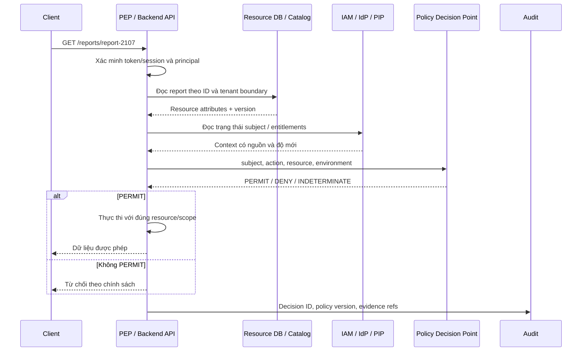

# Resource attribute trong ABAC: Phân quyền theo thuộc tính tài nguyên và vòng đời danh tính

Một nhân viên thuộc phòng Finance đăng nhập thành công qua SSO và có quyền `report.read`. Tuy nhiên, trong hệ thống báo cáo có cả dữ liệu Finance, HR và các báo cáo của những tenant khác nhau. Chỉ kiểm vai trò `report-reader` sẽ không đủ: ứng dụng phải biết **báo cáo cụ thể đang được yêu cầu thuộc đơn vị nào, có độ nhạy ra sao, do ai sở hữu, đang ở trạng thái nào và có điều kiện hạn chế gì**.

Những dữ kiện mô tả tài nguyên đó được gọi là **resource attributes (thuộc tính tài nguyên)**. Trong **Attribute-Based Access Control (ABAC)**, resource attributes là một nhóm đầu vào quyết định quyền, cùng với thuộc tính chủ thể (subject), hành động (action) và ngữ cảnh môi trường (environment). Chúng giúp câu hỏi “người dùng có quyền đọc báo cáo không?” trở thành câu hỏi chính xác hơn: **“chủ thể này được đọc báo cáo này, của tenant này, ở mức phân loại này, trong điều kiện hiện tại không?”**

Bài học thuộc chương **ABAC** của mô-đun **Identity Lifecycle**. Nội dung tập trung vào cách định nghĩa, lấy, xác minh, cập nhật và dùng **resource attribute** để kiểm soát truy cập, kết nối với **Joiner–Mover–Leaver (JML)**, **IdP, SSO, SCIM, RBAC/ABAC, tài khoản dịch vụ, kiểm toán** và mục tiêu giảm **quyền truy cập tồn dư (residual access)**.

> **Nguyên tắc quan trọng:** Resource attribute dùng để mở hoặc chặn quyền phải được lấy từ **nguồn có thẩm quyền đối với tài nguyên**, có độ mới phù hợp và không được tin chỉ vì client đưa nó vào request.

## 1. Resource attribute là gì?

**Resource** là đối tượng mà subject muốn truy cập hoặc thay đổi, ví dụ:

- Một tài liệu, hóa đơn, báo cáo, hồ sơ khách hàng.
- Một repository, dự án, dashboard, bảng dữ liệu.
- Một API endpoint, bản ghi nghiệp vụ hoặc đối tượng lưu trữ.
- Một secret, cloud bucket, virtual machine hoặc workload.
- Một account, nhóm quyền hoặc policy mà quản trị viên định sửa.
- Một dữ liệu được quản lý trong tenant hoặc vùng pháp lý cụ thể.

**Resource attribute** là thuộc tính mô tả resource và có thể ảnh hưởng đến việc **cho phép, từ chối hoặc yêu cầu điều kiện bổ sung** khi thực hiện hành động với resource đó.

Ví dụ một báo cáo:

```json
{
  "resourceId": "report-2107",
  "resourceType": "REPORT",
  "tenantId": "tenant-a",
  "ownerDepartment": "FINANCE",
  "ownerId": "person-1045",
  "classification": "CONFIDENTIAL",
  "region": "VN",
  "state": "PUBLISHED",
  "projectId": "project-fp-42"
}
```

Đây là **schema minh họa**. Không có bộ tên trường bắt buộc áp dụng cho mọi doanh nghiệp; hệ thống cần định nghĩa rõ ý nghĩa, giá trị hợp lệ, nguồn lưu và vòng đời từng trường.

Một chính sách có thể nói:

```text
ALLOW report.read nếu:
  subject.lifecycleState == ACTIVE
  AND subject.tenantId == resource.tenantId
  AND subject.department == resource.ownerDepartment
  AND subject.roles chứa report-reader
  AND subject.clearance đủ cho resource.classification
```

Đây là **pseudocode** để giải thích ý tưởng, không phải cú pháp chính thức của một policy engine. Quyết định dựa trên **cả subject lẫn resource**, thay vì chỉ kiểm role.

### 1.1. Phân biệt bốn nhóm thuộc tính trong ABAC

| Nhóm | Mô tả | Ví dụ |
|---|---|---|
| **Subject attributes** | Thuộc tính của người dùng, service principal hoặc workload. | `department`, `lifecycleState`, `clearance`, `tenantId`. |
| **Resource attributes** | Thuộc tính của đối tượng đích được truy cập. | `ownerDepartment`, `classification`, `tenantId`, `state`. |
| **Action attributes** | Loại thao tác hoặc tính chất của yêu cầu. | `read`, `export`, `approve`, `delete`. |
| **Environment attributes** | Điều kiện liên quan tới yêu cầu hoặc phiên. | Thời điểm, tình trạng thiết bị, mức bảo đảm phiên, môi trường production. |

Một dữ kiện có thể xuất hiện ở nhiều mô hình, nhưng phải phân biệt **đối tượng mà nó mô tả**. Ví dụ `department=FINANCE` của nhân viên là **subject attribute**; `ownerDepartment=FINANCE` của một báo cáo là **resource attribute**. Policy so sánh hai giá trị, nhưng không được hoán đổi nguồn của chúng.

### 1.2. Resource attribute khác resource ID và permission

- **Resource ID:** định danh tài nguyên, ví dụ `invoice-811`; là khóa truy vấn, không tự chứng minh quyền.
- **Resource attribute:** dữ kiện của tài nguyên, ví dụ `tenantId=tenant-a`, `state=PENDING`.
- **Permission:** quyền trừu tượng, ví dụ `invoice.approve`; một role có thể chứa permission này.
- **Policy decision:** kết quả đánh giá permission **trên resource cụ thể**, với thuộc tính và điều kiện hiện hành.

Việc một request chứa đúng `invoiceId` không có nghĩa caller được phép đọc hay duyệt hóa đơn đó. Đây là điểm rất quan trọng để phòng ngừa lỗi **Broken Object Level Authorization (BOLA)/IDOR**.

## 2. Những resource attributes thường gặp

### 2.1. Nhóm định danh và phân vùng

| Attribute | Ví dụ | Vai trò |
|---|---|---|
| `resourceId` | `doc-1001` | Xác định đúng đối tượng đích. |
| `resourceType` | `DOCUMENT`, `INVOICE` | Chọn nhóm policy phù hợp. |
| `tenantId` | `tenant-a` | Cô lập dữ liệu giữa các khách hàng/đơn vị. |
| `organizationId` | `org-27` | Ràng buộc miền tổ chức. |
| `projectId` | `project-42` | Giới hạn quyền theo dự án. |
| `parentResourceId` | `folder-08` | Hỗ trợ kế thừa quan hệ/thuộc tính có kiểm soát. |

**Tenant isolation** thường là một trong những điều kiện nhạy cảm nhất. Một role `admin` tại tenant A không được mặc nhiên cấp quyền truy cập tài nguyên của tenant B.

### 2.2. Nhóm sở hữu và trách nhiệm

| Attribute | Ví dụ | Điều cần làm rõ |
|---|---|---|
| `ownerId` | `person-1045` | Owner là người tạo, chủ nghiệp vụ hay người quản trị? |
| `ownerTeam` | `finance-platform` | Nguồn nào quản lý team và thành viên hiện hành? |
| `ownerDepartment` | `FINANCE` | Có thay đổi khi Mover hoặc chuyển ownership không? |
| `createdBy` | `person-0123` | Có được dùng để kiểm SoD không? |
| `custodianId` | `person-0999` | Custodian quản trị kỹ thuật khác business owner thế nào? |
| `dataSteward` | `data-office` | Ai phê duyệt sửa classification và retention? |

**Người tạo không nhất thiết là chủ sở hữu hiện hành.** Nếu dùng `createdBy` thay cho `ownerId` khi người tạo đã nghỉ việc, hệ thống có thể vô tình chặn công việc hợp lệ hoặc giữ quyền của người không còn nhiệm vụ.

### 2.3. Nhóm độ nhạy và phân loại dữ liệu

| Attribute | Ví dụ | Ảnh hưởng tới policy |
|---|---|---|
| `classification` | `PUBLIC`, `INTERNAL`, `CONFIDENTIAL`, `RESTRICTED` | Giới hạn người được xem và thao tác. |
| `containsPersonalData` | `true` | Có thể kích hoạt quy tắc bảo vệ thông tin cá nhân. |
| `dataCategory` | `FINANCIAL_RECORD` | Áp dụng kiểm soát nghiệp vụ hoặc pháp lý phù hợp. |
| `residencyRegion` | `VN` | Kiểm ràng buộc vị trí xử lý/lưu trữ khi chính sách yêu cầu. |
| `retentionClass` | `BUSINESS_RECORD` | Kiểm thao tác xóa/lưu trữ theo quy định. |
| `legalHold` | `true` | Có thể chặn xóa hoặc sửa dữ liệu thuộc phạm vi bảo toàn. |

Các label trong bảng **không phải tiêu chuẩn phân loại chung**. Tổ chức phải công bố tập giá trị, thứ tự độ nhạy (nếu dùng quan hệ thứ bậc), quyền quản trị và hành vi khi thiếu nhãn.

### 2.4. Nhóm trạng thái và vòng đời tài nguyên

Resource có vòng đời riêng, khác với lifecycle của người dùng:

```text
DRAFT -> IN_REVIEW -> APPROVED -> PUBLISHED -> ARCHIVED
```

Một số điều kiện:

- `invoice.approve` chỉ hợp lệ khi `state=PENDING_APPROVAL`.
- `document.update` bị từ chối khi `state=LOCKED`.
- `report.export` có thể bị hạn chế khi `classification=RESTRICTED`.
- `resource.delete` bị từ chối khi `legalHold=true`.
- `secret.read` chỉ được dùng trong phạm vi workload và môi trường hợp lệ.

Không nên viết một policy “mặc định cho phép nếu state không có” khi resource mới được tạo nhưng chưa được phân loại.

## 3. Resource attributes mang ý nghĩa gì trong RBAC và ABAC?

### 3.1. RBAC chỉ theo role

Một ứng dụng có thể dùng:

```text
role = report-reader
permission = report.read
```

Điều này cho biết loại hành động mà role hỗ trợ, nhưng chưa xác định **đối tượng nào thuộc phạm vi role**.

### 3.2. RBAC có scope theo tài nguyên

Một quyền gán với scope:

```yaml
subjectId: person-1045
role: report-reader
scope:
  tenantId: tenant-a
  projectId: project-42
approvedAt: "2026-11-23T09:00:00+07:00"
```

Một PEP có thể kiểm role, tenant và project của resource. Cách này vẫn có yếu tố RBAC nhưng đã yêu cầu **resource context** rõ ràng.

### 3.3. ABAC so sánh thuộc tính ở nhiều phía

Ví dụ:

```text
PERMIT report.read khi:
  subject.lifecycleState == ACTIVE
  AND subject.roles chứa report-reader
  AND subject.tenantId == resource.tenantId
  AND subject.department == resource.ownerDepartment
  AND subject.clearance >= resource.classification
  AND resource.state == PUBLISHED
```

Ký hiệu `>=` chỉ có ý nghĩa khi clearance/classification được định nghĩa bằng **một quan hệ thứ tự do policy quản lý**; không được so sánh thứ tự từ điển của các nhãn chuỗi tùy ý.

### 3.4. Permission không được trộn với attribute

| Nội dung | Ví dụ | Câu hỏi |
|---|---|---|
| Role/entitlement | `finance-reader` | Subject được phép làm loại hành động gì? |
| Resource attribute | `ownerDepartment=FINANCE` | Tài nguyên thuộc phạm vi nào? |
| Context | `sessionAssurance=MFA` | Yêu cầu hiện tại đáp ứng điều kiện nào? |
| Policy | `role=finance-reader AND department match` | Khi nào một hành động được cho phép? |

Nếu role đã được cấp rộng nhưng resource chưa có tenant/classification đáng tin, policy không nên tự suy ra rằng mọi tài nguyên đều truy cập được.

## 4. Nguồn có thẩm quyền của resource attributes

Một vấn đề trung tâm của ABAC là **attribute được lấy từ đâu và ai được phép sửa**.

### 4.1. Resource attributes nên do hệ thống quản lý tài nguyên phát hành

Ví dụ:

| Thuộc tính | Nguồn thường phù hợp | Ai được phép thay đổi? |
|---|---|---|
| `invoice.tenantId` | Database nghiệp vụ/tenant registry. | Luồng tạo/chuyển tài nguyên được kiểm soát. |
| `invoice.amount` | Hệ thống kế toán. | Luồng sửa chứng từ có phê duyệt. |
| `invoice.createdBy` | Audit khi tạo tài nguyên. | Thường không cho client sửa trực tiếp. |
| `document.classification` | Data catalog/DLP hoặc metadata được steward quản lý. | Data owner/steward theo policy. |
| `document.ownerTeam` | Resource catalog hoặc repository. | Quy trình chuyển ownership được ủy quyền. |
| `resource.state` | State machine nghiệp vụ. | Những hành động chuyển trạng thái được cho phép. |
| `bucket.environment` | Cloud inventory/IaC registry. | Pipeline/governance có thẩm quyền. |
| `secret.ownerWorkload` | Secrets manager và service catalog. | Owner của workload theo quy trình. |

Không phải mọi product có đầy đủ nguồn tương tự. Quan trọng là có **authoritative source per attribute** thay vì coi toàn bộ metadata đều đáng tin ngang nhau.

### 4.2. Client-supplied attribute không mặc nhiên đáng tin

Giả sử API nhận:

```http
PATCH /api/reports/report-2107 HTTP/1.1
Content-Type: application/json

{
  "title": "Báo cáo quý",
  "tenantId": "tenant-b",
  "classification": "PUBLIC",
  "ownerId": "person-other"
}
```

Nếu client chỉ có quyền sửa `title`, server **không được** chép cả `tenantId`, `classification` và `ownerId` vào database. Đây là rủi ro **mass assignment/property-level authorization**: người dùng thay metadata được policy dùng để mở rộng quyền.

Biện pháp:

1. Dùng DTO/schema cho từng loại action, chỉ chứa thuộc tính người dùng được phép sửa.
2. Truy xuất resource hiện hành từ nguồn server-side.
3. Kiểm authorization cho **hành động thay đổi từng thuộc tính nhạy cảm**.
4. Áp dụng validation và rule chuyển trạng thái.
5. Lưu audit giá trị trước/sau ở mức cần thiết.
6. Tái đánh giá quyền khi metadata mới ảnh hưởng ranh giới truy cập.

**Một người được sửa nội dung tài liệu không mặc nhiên được hạ classification hoặc chuyển owner.**

### 4.3. Phân biệt attribute đã xác minh và attribute tự khai

Không phải thuộc tính nào cũng dùng để quyết định quyền:

- `displayTitle`: có thể do người dùng nhập, chủ yếu để hiển thị.
- `tags`: có thể giúp tìm kiếm, nhưng chưa chắc đủ bảo đảm cho ABAC.
- `classification`: nếu ảnh hưởng quyền, cần policy gán nhãn và quản trị nguồn.
- `tenantId`: là ranh giới quan trọng, nên được xác lập và bảo vệ phía server.
- `businessOwner`: cần nguồn/approval khi chuyển.

Nếu tổ chức muốn dùng tag do người dùng tự tạo làm chính sách bảo mật, trước hết phải thiết kế **quyền sửa tag** và cơ chế phân loại đáng tin.

## 5. Kiến trúc đánh giá resource attribute

Trong mô hình policy-based access control, có thể phân chia trách nhiệm:

- **Policy Enforcement Point (PEP):** điểm thực thi quyết định trên API/gateway/service.
- **Policy Decision Point (PDP):** đánh giá policy và trả quyết định.
- **Policy Information Point (PIP):** cung cấp subject/resource/environment attributes.
- **Policy Administration Point (PAP):** quản lý chính sách, phiên bản và phê duyệt.

Các thuật ngữ trên là **vai trò logic**; một ứng dụng đơn khối có thể thực hiện nhiều vai trò trong cùng mã nguồn.

### 5.1. Luồng đánh giá một yêu cầu



**Đọc resource attribute sau khi cho phép mà không kiểm lại** có thể khiến PDP quyết định dựa vào đối tượng khác với đối tượng thực thi. Cần ràng buộc resource được kiểm tra với resource được truy cập.

### 5.2. Không kiểm riêng UI rồi bỏ qua backend

Một giao diện có thể ẩn nút `Delete` với tài nguyên `classification=RESTRICTED`, nhưng người dùng vẫn có thể gọi API trực tiếp.

- UI giúp trải nghiệm nhưng **không phải điểm bảo vệ đủ tin cậy**.
- Backend phải lấy resource attributes và kiểm action tại PEP.
- Với API truy cập nhiều bản ghi, phải áp policy cho từng object hoặc filter an toàn.
- Các service nội bộ cũng cần enforcement phù hợp, không chỉ gateway bên ngoài.

### 5.3. Kết quả đánh giá

| Outcome | Ý nghĩa | PEP nên làm gì? |
|---|---|---|
| **PERMIT/ALLOW** | Policy cho phép trong phạm vi context đã xét. | Thực thi đúng resource/action/scope và các obligation. |
| **DENY** | Có điều kiện cấm hoặc không đủ quyền. | Từ chối, lưu audit tối thiểu. |
| **NOT_APPLICABLE** | Rule cụ thể không áp dụng. | Kết hợp policy theo chiến lược cấu hình. |
| **INDETERMINATE** | Thiếu dữ kiện hoặc lỗi đánh giá. | Không tự cho phép truy cập nhạy cảm; cảnh báo/khắc phục. |

Nhãn kết quả phụ thuộc engine. Điều quan trọng là **không biến lỗi đọc classification/owner/tenant thành một giá trị giúp ALLOW**.

## 6. Thiết kế schema cho resource attributes

Resource attributes cần **ngữ nghĩa ổn định**, không chỉ có một bảng key–value tự do.

### 6.1. Quy định dữ liệu tối thiểu

Mỗi thuộc tính ảnh hưởng quyền nên có:

1. **Tên chuẩn:** ví dụ `resource.tenantId`.
2. **Kiểu dữ liệu:** chuỗi ID, enum, số, timestamp, Boolean, tập hợp.
3. **Phạm vi:** tổ chức, tenant, project, resource hay sub-resource.
4. **Nguồn có thẩm quyền:** database, data catalog, cloud API, resource owner registry.
5. **Người/quy trình được sửa:** phân quyền thay thuộc tính.
6. **Giá trị hợp lệ:** enum, validation và trạng thái không xác định.
7. **Giá trị mặc định:** có được mặc định không, đặc biệt với thuộc tính nhạy cảm.
8. **Tính kế thừa:** có kế thừa từ folder/project/tenant không.
9. **Thời hạn và phiên bản:** thay đổi khi nào, có cần giữ lịch sử không.
10. **Ảnh hưởng policy:** những hành động bị ảnh hưởng khi attribute đổi.

### 6.2. Ví dụ mô hình metadata

```json
{
  "resource": {
    "id": "document-501",
    "type": "DOCUMENT",
    "tenantId": "tenant-a",
    "projectId": "project-42",
    "ownerTeam": "finance-ops",
    "classification": "CONFIDENTIAL",
    "state": "PUBLISHED"
  },
  "metadata": {
    "version": 12,
    "observedAt": "2026-12-01T10:05:00+07:00",
    "sourceSystem": "document-catalog",
    "classificationAuthority": "data-governance",
    "ownerAuthority": "project-registry"
  }
}
```

Đây là cấu trúc tham khảo để giải thích **provenance** (nguồn gốc), **version** và **freshness** (độ mới); không phải schema của sản phẩm cụ thể. Một hệ thống có thể quản lý từng thuộc tính từ nguồn khác nhau thay vì cùng một record.

### 6.3. Immutable, mutable và derived attributes

| Nhóm | Ví dụ | Rủi ro cần kiểm |
|---|---|---|
| **Immutable hoặc gần bất biến** | `resourceId`, lịch sử `createdBy`. | Định nghĩa rõ việc migrate hoặc xóa/tạo lại đối tượng. |
| **Mutable** | `ownerTeam`, `state`, `classification`. | Ai có quyền sửa, khi nào invalidation xảy ra? |
| **Derived** | `effectiveClassification` tính từ folder cha hoặc loại dữ liệu. | Rule kế thừa có đầy đủ không, cache có mới không? |
| **External** | `residencyRegion` từ resource inventory/cloud provider. | Tính tin cậy và thay đổi ngoài ứng dụng. |
| **Computed per request** | `isOwnedByRequester` từ quan hệ principal-resource. | Có được tính từ dữ liệu tin cậy và đúng account không? |

Không nên lưu một cờ `isAccessible=true` vô thời hạn như resource attribute nếu nó thực chất là **kết quả policy phụ thuộc vào subject, action và thời điểm**.

## 7. Resource classification và clearance

Phân loại dữ liệu là một use case phổ biến của resource attributes.

### 7.1. Xây dựng thứ bậc phân loại

Ví dụ nội bộ giả định:

```text
PUBLIC < INTERNAL < CONFIDENTIAL < RESTRICTED
```

Khi tổ chức có một thứ bậc được phê duyệt, policy có thể yêu cầu **clearance của subject đáp ứng classification của resource**. Nhưng đây không phải quy tắc tự động cho mọi dữ liệu: có thể còn **need-to-know, tenant, purpose và điều kiện nghiệp vụ**.

Ví dụ:

```text
PERMIT document.read nếu:
  subject.tenantId == resource.tenantId
  AND subject.clearance dominates resource.classification
  AND subject nằm trong tập người có nhu cầu hợp lệ
  AND account đủ điều kiện theo lifecycle
```

Từ `dominates` đại diện cho quan hệ mà policy định nghĩa, không phải phép so sánh chuỗi thông thường.

### 7.2. Phân loại thay đổi thì quyền phải thay đổi

Một tài liệu từ `INTERNAL` được phân loại lại thành `RESTRICTED`. Nếu ứng dụng vẫn cache ALLOW cũ theo session, người dùng có thể tiếp tục đọc dữ liệu không còn phù hợp.

Cần:

- Ghi version và thời điểm classification change.
- Phát sự kiện invalidation tới bộ đánh giá/cache.
- Tái kiểm quyền cho request nhạy cảm.
- Áp dụng quy tắc xử lý khi classification chưa rõ.
- Kiểm tra link chia sẻ, bản export hoặc quyền ứng dụng liên quan theo khả năng.
- Audit người thực hiện phân loại lại và approval nếu policy yêu cầu.

### 7.3. Phân loại mặc định khi tạo resource

Nếu một tài liệu mới chưa được gắn classification:

- Không tự mặc định là `PUBLIC` chỉ để thuận tiện.
- Có thể đặt trạng thái **UNCLASSIFIED/REVIEW_REQUIRED** và hạn chế thao tác theo policy.
- Có cơ chế xác định classification dựa trên loại dữ liệu, vị trí lưu hoặc data steward.
- Khi phân loại hoàn tất, cập nhật policy context và các bản cache liên quan.

**Missing attribute** khác với giá trị `PUBLIC`. Đây là khác biệt dễ gây fail-open.

## 8. Tenant, owner và scope của tài nguyên

### 8.1. Tenant ID là ranh giới truy cập

Đối với SaaS nhiều khách hàng, policy thường cần điều kiện:

```text
subject.tenantId == resource.tenantId
```

Resource tenant ID cần được lấy từ database/resource registry, không phải từ URL do client tự khai mà không kiểm chứng.

Ví dụ request:

```http
GET /tenants/tenant-a/reports/report-2107 HTTP/1.1
Authorization: Bearer <test-token>
```

Nếu resource `report-2107` thực tế thuộc `tenant-b`, server không được cho truy cập chỉ vì path ghi `tenant-a`. Cần kiểm **resource ID → tenant thực tế** và principal scope.

### 8.2. Owner khác creator

Một hồ sơ do nhân viên An tạo, nhưng sau đó đã chuyển ownership cho nhóm Finance. Khi An nghỉ việc:

- `createdBy=person-an` có thể giữ để kiểm toán.
- `ownerTeam=finance-ops` đại diện trách nhiệm hiện hành.
- Quyền theo `creator` không nên tiếp tục cho An nếu không còn điều kiện hợp lệ.
- Quyền theo `ownerTeam` cần đánh giá thành viên nhóm và role hiệu lực.

Không nên dùng điều kiện “`createdBy == subjectId` → luôn ALLOW” mà bỏ qua Leaver, tenant, classification và trạng thái tài nguyên.

### 8.3. Thay owner là một hành động nhạy cảm

Đổi `ownerId` hoặc `ownerTeam` có thể:

- Cấp quyền truy cập cho nhóm mới.
- Thu hồi quyền của owner cũ.
- Thay người có quyền phê duyệt/xóa tài nguyên.
- Ảnh hưởng retention, workflow, trách nhiệm kiểm toán.

Do đó `resource.transferOwnership` cần policy riêng, phê duyệt và readback phù hợp; không nên cho user tự đặt `ownerId` tùy ý trong payload cập nhật bình thường.

## 9. Thuộc tính tài nguyên kế thừa từ phân cấp

Nhiều hệ thống có cấu trúc:

```text
Tenant A
  └── Project Finance
        └── Folder Payroll (RESTRICTED)
              ├── Document D1
              └── Document D2
```

Nếu D1 không có `classification` riêng, policy có thể quy định **kế thừa phân loại từ folder**.

### 9.1. Các câu hỏi phải định nghĩa rõ

1. Thuộc tính nào được kế thừa? `tenantId`, `classification`, `ownerTeam`?
2. Resource con được phép ghi đè thuộc tính cha không?
3. Khi cha và con khác classification, quy tắc nào thắng?
4. Di chuyển document sang folder khác làm quyền thay đổi thế nào?
5. Khi parent bị xóa hoặc move, resource con còn mapping hợp lệ không?
6. Cache effective attributes được invalidation ra sao?
7. Có được phép kế thừa quyền **mở rộng** hay chỉ kế thừa các hạn chế?

Ví dụ chính sách có thể chọn **classification hiệu lực là mức hạn chế nhất** của resource và các cấp cha, trừ khi có quy trình thay đổi được phê duyệt. Đây là **một lựa chọn thiết kế**, không phải quy tắc ABAC bắt buộc.

### 9.2. Không trộn tính kế thừa metadata với membership

Một folder `RESTRICTED` và nhóm `finance-readers` là hai loại dữ liệu khác nhau:

- Folder classification quyết định yêu cầu bảo vệ.
- Group/role xác định một dạng quyền của subject.
- Quan hệ subject–project xác định phạm vi cần biết.
- Policy kết hợp chúng để ra quyết định.

Một người thuộc nhóm được phép xem nội dung Finance vẫn phải bị từ chối nếu tài liệu thuộc tenant khác hoặc classification vượt điều kiện policy.

## 10. Resource state và điều kiện chuyển trạng thái

Resource attribute có thể là trạng thái nghiệp vụ, không chỉ metadata tĩnh.

### 10.1. Ví dụ phê duyệt hóa đơn

```text
Hóa đơn:
  state = PENDING_APPROVAL
  amount = 72000000
  createdBy = person-1045
  ownerDepartment = FINANCE

PERMIT invoice.approve nếu:
  subject.active
  AND subject có quyền approve phù hợp hạn mức
  AND invoice.state == PENDING_APPROVAL
  AND subject.id != invoice.createdBy
  AND subject.tenantId == invoice.tenantId
```

Điều kiện `subject.id != invoice.createdBy` là một ví dụ **Separation of Duties (SoD)**. Hệ thống không nên chỉ kiểm role mà bỏ qua người đã tạo hóa đơn.

### 10.2. Attribute quyết định action có thể thay đổi sau khi kiểm tra

Ví dụ hai request cùng duyệt một hóa đơn:

1. Request A đọc `state=PENDING_APPROVAL`.
2. Request B cũng đọc `state=PENDING_APPROVAL`.
3. B duyệt và chuyển `state=APPROVED`.
4. A vẫn thực thi do kết quả kiểm quyền cũ.

Đây là một dạng **Time-of-Check to Time-of-Use (TOCTOU)**. Nếu trạng thái resource là điều kiện an toàn, PEP phải gắn việc thực thi với version/state đã đánh giá.

### 10.3. Conditional update minh họa

```sql
UPDATE invoices
SET state = 'APPROVED',
    version = version + 1
WHERE id = :invoiceId
  AND tenant_id = :trustedTenantId
  AND state = 'PENDING_APPROVAL'
  AND version = :expectedVersion;
```

Đây là ví dụ **kiểm soát đồng thời**; chưa thay thế toàn bộ chính sách authorization. Ứng dụng cần kiểm subject, permission, SoD, hạn mức và kết quả số dòng cập nhật, trong ranh giới transaction phù hợp.

Nếu resource owner/classification thay đổi giữa lúc PDP PERMIT và lúc ghi, cần **revalidate điều kiện bảo mật hoặc đồng bộ transaction** để không commit hành động trái policy.

## 11. Resource attributes trong vòng đời Joiner–Mover–Leaver

**Vòng đời danh tính** và **vòng đời tài nguyên** có liên quan nhưng không giống nhau.

### 11.1. Joiner — cấp quyền vào đúng nhóm tài nguyên

Khi nhân viên mới gia nhập:

1. HRIS/nguồn có thẩm quyền xác minh danh tính, đơn vị và ngày hiệu lực.
2. IAM/IGA tạo account và tính role/entitlement cơ sở.
3. IdP/SSO hỗ trợ đăng nhập theo điều kiện cho phép.
4. Policy ABAC so **subject attributes mới** với **resource attributes hiện có**.
5. Nhân viên chỉ được truy cập tài nguyên đúng tenant, department, project và classification.
6. Những tài nguyên chưa được phân loại hoặc thiếu owner cần xử lý theo policy, không tự mở rộng quyền.
7. Audit lưu quyết định và kết quả.

Ví dụ, người mới thuộc Support không được xem bảng lương Finance chỉ vì có role `document-reader` rộng.

### 11.2. Mover — subject đổi nhưng resource có thể không đổi

Một người chuyển Support → Finance:

- `subject.department` thay từ `SUPPORT` sang `FINANCE`.
- Tài liệu Support vẫn có `resource.ownerDepartment=SUPPORT`.
- Tài liệu Finance vẫn có `resource.ownerDepartment=FINANCE`.
- Sau Mover, điều kiện department match cần **từ chối** tài liệu Support nếu không có ngoại lệ hợp lệ.
- Role/grant trực tiếp và session claims cũ phải được xử lý riêng.

**Không cần sửa toàn bộ resource attributes khi một người chuyển bộ phận.** Thường cần cập nhật subject context và entitlement, sau đó đánh giá lại quyền dựa trên resource còn giữ nguyên. Tuy nhiên nếu người đó là **owner của tài nguyên**, có thể phải chuyển ownership hoặc role quản lý.

### 11.3. Leaver — giữ tài nguyên nhưng thu hồi quyền người nghỉ việc

Một nhân viên Leaver có thể là người tạo hoặc owner của nhiều tài liệu:

- **Tài liệu cần giữ** theo retention/hoạt động nghiệp vụ.
- **Account cá nhân cần bị chặn** theo thời điểm hiệu lực.
- **Ownership có thể cần bàn giao** cho manager/team có thẩm quyền.
- `createdBy` có thể được giữ phục vụ audit, không phải quyền vĩnh viễn.
- Các link chia sẻ, role trực tiếp, token và session cũ cần được xem xét.
- Resource policy không nên dựa vào việc account Leaver vẫn xuất hiện làm owner để tự cho người đó truy cập.

Leaver **không đồng nghĩa xóa mọi resource do người nghỉ việc tạo**. Bảo toàn tài sản nghiệp vụ và chặn quyền cá nhân là hai mục tiêu phải phối hợp.

### 11.4. Bảng tác động JML tới resource ABAC

| Sự kiện | Subject/entitlement thay đổi | Resource attributes liên quan | Điều cần xác minh |
|---|---|---|---|
| Joiner | ACTIVE và role tối thiểu. | Tenant, department, classification. | Không truy cập vượt scope. |
| Mover | Department, role, project membership. | Owner team, project ID giữ nguyên hoặc đổi theo nghiệp vụ. | Quyền cũ bị DENY, quyền mới đúng. |
| Leaver | Account không đủ tư cách truy cập. | Owner/creator, tài nguyên cần bàn giao. | Không còn đường truy cập cá nhân; dữ liệu hợp lệ được giữ. |
| Contractor hết hạn | Sponsor/contract grant hết hiệu lực. | Resource/project được tài trợ. | Không còn quyền sau mốc hợp đồng. |
| Tái tuyển dụng | Identity và quyền được xét lại. | Ownership lịch sử có thể tồn tại. | Không tự phục hồi mọi quyền cũ. |
| Workload ngừng hoạt động | Service principal bị deprovision. | Secret/bucket/job gắn workload. | Thu hồi credential/quyền, chuyển owner khi cần. |

## 12. Resource ownership trong Mover và Leaver

### 12.1. Bàn giao tài nguyên là một workflow riêng

Ví dụ một kỹ sư quản trị repository và deployment pipeline nghỉ việc. Hệ thống cần:

1. Xác định repository, project, job và secret mà họ sở hữu hoặc quản lý.
2. Phân biệt **creator**, **current owner**, **administrator** và **custodian**.
3. Bàn giao owner sang team/identity có thẩm quyền.
4. Kiểm tra quyền trực tiếp của người nghỉ việc còn ở resource hay không.
5. Revoke account, credential, session và quyền JIT cá nhân theo chính sách.
6. Readback trạng thái owner/permissions tại repo/cloud/CI-CD.
7. Giữ audit về người tạo và thay đổi ownership.

Một workflow chỉ cập nhật `ownerTeam` ở catalog mà không sửa resource policy thực tế có thể **báo thành công giả**; cần đối soát ở hệ thống thực thi.

### 12.2. Resource có owner là service account

Nếu resource được sở hữu bởi service principal:

- Owner quản trị thường nên là **một team có trách nhiệm**, không chỉ là account máy.
- Machine identity có thể là acting principal tạo tài nguyên, nhưng không tự phản ánh người chịu trách nhiệm.
- Khi kỹ sư tạo service account Leaver, phải chuyển custodian/ownership nếu cần.
- Không xóa service principal còn phục vụ workload hợp lệ.
- Nếu workload decommission, phải xử lý resource còn tồn tại, secret và quyền trên hệ thống đích.

## 13. ABAC, IdP/SSO và SCIM: ai cung cấp thuộc tính nào?

### 13.1. IdP/SSO chủ yếu giúp xác thực subject

IdP có thể phát SAML assertion hoặc OIDC ID Token có những subject claims được phép dùng. Nhưng **resource attributes thường nằm ở ứng dụng đích**, không nằm trong ID Token.

Ví dụ:

```text
OIDC ID Token (đã xác minh):
  subject.id = person-1045
  tenant = tenant-a
  department = FINANCE

Ứng dụng tài liệu:
  resource.id = doc-501
  resource.tenantId = tenant-a
  resource.classification = RESTRICTED
  resource.ownerDepartment = HR

PDP:
  Kiểm subject + action + resource + environment
  -> DENY theo policy
```

**Xác thực OIDC/SAML hợp lệ** không cho phép client tự gán classification hoặc owner cho resource. Nếu frontend gửi `classification=PUBLIC` trong request, backend vẫn phải dùng dữ liệu tin cậy của resource.

### 13.2. SCIM quản lý User/Group, không phải kho mọi resource attributes

**SCIM** thường được dùng để provision và đồng bộ User/Group khi sản phẩm hỗ trợ. Nó **không mặc nhiên cập nhật classification, owner hoặc state của từng tài liệu**.

Ví dụ:

- SCIM gỡ Group Support sau Mover.
- ABAC ở ứng dụng vẫn cần đọc `resource.ownerDepartment` và tính điều kiện theo subject hiện hành.
- Một role trực tiếp tại ứng dụng có thể còn tồn tại ngoài phạm vi SCIM.
- Một session hoặc API token có thể tiếp tục mang claims cũ.

Vì thế **SCIM User/Group synchronization** và **resource attribute governance** là hai tuyến kiểm soát phối hợp nhưng khác nhau.

### 13.3. Directory và source-of-authority

Directory có thể chứa `department`, nhóm và account state của subject. Nhưng resource owner/classification thường nằm ở **resource management system**. Nếu công ty đồng bộ nhãn resource vào directory, cần giải thích:

- Directory là **nguồn chuẩn** hay chỉ là bản sao?
- Update resource metadata được đẩy theo cơ chế nào?
- Policy consumer đọc bản nào?
- Có version và độ trễ như thế nào?
- Ai được phép thay nhãn?

Không nên tự coi một LDAP group hay một SCIM attribute là nguồn đúng cho mọi quyết định phân loại tài liệu.

## 14. Freshness, caching và quyền truy cập tồn dư

### 14.1. Resource attribute có thể thay đổi khi session còn sống

Một tài liệu từ `INTERNAL` được gắn nhãn `RESTRICTED` lúc 10:00. Một người dùng có session từ 09:00 đã được phép xem tài liệu khi classification cũ.

Nếu PDP/PEP cache quyết định ALLOW không có invalidation, người đó có thể tiếp tục xem sau khi nhãn đã thay đổi.

Các nguồn stale context có thể gồm:

- Caching metadata ở API.
- Cache quyết định PDP.
- CDN hoặc lớp proxy giữ dữ liệu.
- Claims trong session/token.
- Bản sao resource catalog chưa đồng bộ.
- Client-side cache hoặc pre-signed URL còn hạn theo cơ chế riêng.

Đổi classification tại database **không tự xóa mọi bản sao đã xuất ra**; cần xem các đường truy cập và khả năng revoke.

### 14.2. Cache key phải phản ánh resource

Ví dụ nguy hiểm:

```text
cacheKey = subjectId + action
```

Một kết quả ALLOW cho tài liệu A có thể bị tái sử dụng khi truy cập tài liệu B.

Cách tiếp cận khái niệm:

```text
cacheKey = hash(
  subjectId,
  tenantId,
  action,
  resourceId,
  resourceAttributeVersion,
  entitlementVersion,
  policyVersion,
  relevantSessionContext
)
```

Không phải mọi hệ thống cần dùng đúng key này; có thể thay bằng **invalidation đáng tin** hoặc không cache quyết định rủi ro cao. Điều không thể bỏ qua là **kết quả ALLOW không được tái sử dụng ngoài phạm vi context đã kiểm**.

### 14.3. Quy tắc TTL theo độ nhạy

| Attribute | Rủi ro nếu stale | Hướng xử lý |
|---|---|---|
| `displayName` | Thường thấp. | TTL dài hơn nếu chỉ hiển thị. |
| `classification` | Có thể cao. | Invalidation khi gắn nhãn lại, TTL phù hợp. |
| `tenantId` | Rất cao khi chuyển resource/tenant. | Kiểm từ nguồn server-side và ràng buộc chặt. |
| `ownerTeam` | Cao khi transfer ownership. | Gắn version/update event. |
| `legalHold` | Cao với hành động xóa. | Đọc/kiểm lại khi thực hiện hành động nhạy cảm. |
| `state` | Cao nếu quyết định chuyển trạng thái. | Conditional update/transaction. |
| `residencyRegion` | Tùy yêu cầu tuân thủ. | Phân biệt giá trị khai báo và vị trí thực tế. |

Không có **TTL số cố định** phù hợp mọi resource; phải dựa trên chính sách, loại hành động, kỹ thuật hệ thống và rủi ro.

### 14.4. Không chỉ kiểm account state

Sau Leaver, directory hoặc IdP có thể đã đánh dấu account disabled, nhưng:

- Role trực tiếp của SaaS vẫn còn.
- Session của SP vẫn còn hiệu lực.
- API token tự chứa chưa bị resource server từ chối.
- Link chia sẻ hoặc credential riêng của ứng dụng vẫn hoạt động.
- Cache ALLOW theo resource vẫn tồn tại.

Resource ABAC nên phối hợp với **lifecycle state hiện hành** và cơ chế revocation tại target; không tự tuyên bố “mọi quyền đã hết” từ một bản ghi directory.

## 15. Đánh giá danh sách tài nguyên: filter trước hay check từng object?

Kiểm quyền một tài liệu đơn lẻ khác với truy vấn danh sách 100.000 tài liệu.

### 15.1. Lỗi lọc UI sau khi đã trả dữ liệu

Một API làm:

```text
1. SELECT * FROM documents
2. Trả tất cả cho browser
3. Browser ẩn các tài liệu không phù hợp quyền
```

Đây **không phải kiểm soát truy cập an toàn**; dữ liệu đã rời server trước khi được ẩn.

### 15.2. Lọc ở backend theo context đáng tin

Ví dụ SQL khái niệm:

```sql
SELECT id, title, classification
FROM documents
WHERE tenant_id = :trustedTenantId
  AND owner_department = :verifiedDepartment
  AND state = 'PUBLISHED';
```

Truy vấn này chỉ minh họa **lọc theo resource attributes**. Policy thật có thể còn xét clearance, project membership, legal hold, role và nhiều điều kiện khác. Không được dùng câu SQL đơn giản thay cho policy đầy đủ khi nó thiếu các điều kiện đó.

### 15.3. Hai chiến lược phổ biến

| Chiến lược | Phù hợp | Cần lưu ý |
|---|---|---|
| **Filter-before-fetch** | Danh sách lớn, predicate có thể đưa xuống database/search engine. | Policy phải chuyển đổi chính xác; kiểm quyền lại cho thao tác nhạy cảm. |
| **Fetch-then-check trên server** | Số lượng nhỏ, điều kiện khó biểu diễn trong query. | Tránh đọc/quét lượng dữ liệu quá lớn; không gửi dữ liệu chưa được lọc cho client. |
| **Kết hợp** | Thực tế nhiều hệ thống. | Dùng filter thô an toàn rồi PDP kiểm từng resource. |

Cần phân biệt **bảo vệ dữ liệu trả về** và **bảo vệ thao tác ghi**. Kể cả API list đã lọc tốt, endpoint `PATCH /documents/{id}` vẫn phải kiểm authorization riêng.

### 15.4. Tổng số bản ghi và pagination có thể làm lộ thông tin

Nếu response trả `totalCount=120000` dù user chỉ được xem 20 bản ghi, thông tin này có thể tiết lộ quy mô tài nguyên ngoài quyền. Tùy yêu cầu bảo mật, cần tính count/filter/pagination theo **tập tài nguyên caller có quyền thấy**, tránh để endpoint tìm kiếm trở thành kênh suy luận.

## 16. Khi resource attribute thiếu hoặc sai

### 16.1. Phân biệt ba trạng thái

| Trạng thái | Ý nghĩa | Cách xử lý |
|---|---|---|
| **KNOWN_VALID** | Có giá trị đã xác minh từ nguồn phù hợp. | Đánh giá policy bình thường. |
| **UNKNOWN/MISSING** | Không có giá trị hoặc không thể đọc. | Theo policy, thường không cho hành động nhạy cảm cần thuộc tính đó. |
| **INVALID/CONFLICTING** | Giá trị không hợp lệ hoặc hai nguồn mâu thuẫn. | Mở quy trình xác minh và xử lý, không tự chọn giá trị giúp ALLOW. |

Ví dụ `classification` thiếu khác với `classification=PUBLIC`; `ownerId` không tồn tại khác với `ownerId=NONE` theo schema đã định nghĩa.

### 16.2. Quy tắc thiếu dữ liệu nên rõ ràng

```text
if resource.classification is UNKNOWN:
    DENY document.export
    record "CLASSIFICATION_UNVERIFIED"
```

Đây là ví dụ về **fail closed** cho thao tác nhạy cảm. Với tác vụ ít rủi ro như xem thông tin công khai đã định danh, tổ chức có thể đặt policy khác; nhưng không nên vô tình chọn default ALLOW chỉ vì code không đọc được thuộc tính.

### 16.3. Conflict giữa các nguồn

Ví dụ:

- Document catalog báo `classification=CONFIDENTIAL`.
- Search index giữ nhãn `INTERNAL`.
- API đọc search index và cho phép export.

Cần quy định rõ authority của classification và cách giải quyết conflict. Cho tới khi hội tụ, một hành động nhạy cảm không nên được quyết định chỉ dựa trên **bản sao cũ hoặc nguồn thiếu tin cậy**.

## 17. Bảo vệ resource attributes khỏi thao túng

Các kiểu sai lệch và tấn công thường gặp:

| Rủi ro | Ví dụ | Kiểm soát |
|---|---|---|
| **Mass assignment** | User đổi `classification` thành PUBLIC trong payload sửa tiêu đề. | DTO allowlist và property-level authorization. |
| **IDOR/BOLA** | User thay `documentId` để xem tài liệu tenant khác. | PEP kiểm resource thật và scope của principal. |
| **Tenant spoofing** | Client gửi `tenantId` giả. | Tenant từ token/session đã xác minh và database. |
| **Metadata tampering** | User tự đổi `ownerId` để thành owner. | Kiểm quyền transfer ownership và audit. |
| **Stale classification** | Cache giữ label trước khi nâng độ nhạy. | Version/TTL/invalidation. |
| **Confused deputy** | Service có quyền rộng dùng thay người không đủ quyền. | Phân biệt acting principal và delegated subject/scope. |
| **TOCTOU** | Resource đổi trạng thái sau PDP PERMIT. | Transaction/version/conditional write. |
| **Cross-tenant mapping** | ID trùng giữa các tenant. | Namespace, tenant-aware lookup và authorization. |
| **Unsafe inheritance** | Tài liệu RESTRICTED bị ghi đè nhãn bởi folder ít hạn chế. | Kế thừa và precedence policy rõ. |
| **Missing attribute fail-open** | Không đọc được classification thì coi PUBLIC. | UNKNOWN và default xử lý an toàn. |
| **Out-of-order events** | Event ownership cũ ghi đè quyết định mới. | Version/event ordering và authoritative revalidation. |
| **Overbroad admin role** | Admin của một project sửa metadata mọi tenant. | Role scope/resource boundary và SoD. |

### 17.1. Tách quyền sử dụng và quyền thay thuộc tính

Một chính sách tốt phân biệt:

- `document.read`: đọc nội dung theo scope.
- `document.update-content`: sửa nội dung.
- `document.change-classification`: thay nhãn bảo mật.
- `document.transfer-ownership`: đổi owner.
- `document.change-retention`: thay điều kiện giữ/xóa.
- `document.delete`: xóa tài liệu nếu đủ điều kiện.

Gộp tất cả vào quyền `document.edit` có thể làm cho người sửa nội dung **tự giảm yêu cầu bảo mật** để mở truy cập trái chính sách.

## 18. Resource attribute cho tài khoản dịch vụ và workload

Không phải mọi resource đều là tài liệu do người dùng sở hữu. Với cloud và service-to-service authorization, resource có thể là:

- Cloud bucket, database, secret, queue, topic.
- API service và endpoint.
- Project/namespace/cluster.
- Artifact, repository hoặc pipeline.
- Key và certificate.
- IAM role hoặc policy được quản lý.

### 18.1. Resource labels trong môi trường cloud

Một bucket có thể có:

```json
{
  "resourceId": "bucket-invoice-prod",
  "resourceType": "OBJECT_STORAGE",
  "tenantId": "tenant-a",
  "environment": "production",
  "ownerTeam": "finance-platform",
  "dataCategory": "FINANCIAL",
  "classification": "CONFIDENTIAL"
}
```

Một policy mẫu có thể yêu cầu workload đọc bucket khi:

```text
subject.type == WORKLOAD
AND subject.workload == invoice-sync
AND subject.environment == production
AND subject.tenantId == resource.tenantId
AND resource.dataCategory == FINANCIAL
AND action == object.read
AND credential.audience == approved-storage-service
```

Ví dụ chỉ minh họa. Với nền tảng cloud thực tế, cần xác minh **những tag/attribute nào policy engine thật sự hỗ trợ**, nơi áp dụng, cách ngăn sửa tag và hành vi khi thiếu tag.

### 18.2. Không tin label do workload tự gửi

Nếu workload có thể tự gắn `environment=development` cho resource production để đi qua policy ít hạn chế, resource label không còn là bằng chứng bảo mật tin cậy.

Cần quản lý quyền:

- Ai có quyền tạo resource?
- Ai có quyền đặt/sửa security-sensitive tags?
- Có thể đổi tag sau khi được cấp quyền không?
- Thay tag có cần approval hoặc qua IaC pipeline?
- Policy được kiểm ở resource thật hay chỉ ở request metadata?
- Có readback sau khi đổi nhãn không?

### 18.3. Owner của workload nghỉ việc

Một kỹ sư tạo một service principal và nhiều resource trước khi Leaver. Khi họ nghỉ:

1. Thu hồi quyền **cá nhân** tại cloud, vault, CI/CD và resource.
2. Kiểm resource còn phục vụ workload hợp lệ nào.
3. Bàn giao owner/team đối với resource còn hoạt động.
4. Đánh giá secret/token mà kỹ sư từng có thể truy cập.
5. Không tự xóa resource hoặc service principal production nếu workload còn cần.
6. Gỡ các grant không còn hợp lệ, ghi audit và đối soát kết quả.

Service identity có vòng đời riêng, không được coi `employeeStatus` của người tạo là trạng thái duy nhất của resource hoặc workload.

## 19. Thực hành chính sách resource attribute trong Java

Một dịch vụ Java có thể tách:

1. Authentication để lấy principal đã xác minh.
2. Resource repository để đọc thuộc tính hiện hành.
3. Context builder chuẩn hóa các dữ kiện.
4. Policy engine để ra quyết định.
5. Enforcement và transaction của nghiệp vụ.
6. Audit log để lưu bằng chứng.

### 19.1. Kiểu dữ liệu minh họa

```java
record ResourceAttributes(
    String resourceId,
    String tenantId,
    String ownerDepartment,
    String classification,
    String state,
    long version
) {}

record SubjectContext(
    String subjectId,
    String tenantId,
    String department,
    String lifecycleState,
    Set<String> roles
) {}

record AuthorizationInput(
    SubjectContext subject,
    String action,
    ResourceAttributes resource
) {}
```

Các `record` là ví dụ Java, chưa có validation, enum, null handling, provenance hoặc logic authorization hoàn chỉnh. Production nên dùng kiểu dữ liệu bảo đảm consistency và tránh so sánh chuỗi tự do cho label nhạy cảm.

### 19.2. Pseudocode kiểm quyền tại backend

```text
readReport(httpRequest, reportId):
    principal = authenticateAndVerify(httpRequest)

    subject = loadCurrentSubjectContext(principal)
    resource = reportRepository.getById(reportId)

    if resource is missing:
        return safeNotFound()

    if resource.tenantId != subject.tenantId:
        return denyWithoutResourceDisclosure()

    context = buildAuthorizationInput(
        subject = subject,
        action = "report.read",
        resource = resource,
        session = verifiedSessionContext(principal),
        policyVersion = currentApprovedVersion()
    )

    decision = policyEngine.evaluate(context)

    if decision != PERMIT:
        auditDeniedDecisionWithoutSensitiveValues(context, decision)
        return deny()

    return reportRepository.readAuthorizedReport(
        reportId, subject.tenantId, resource.version
    )
```

Đây là **pseudocode khái niệm**, không phải hệ thống hoàn chỉnh. Cần xác định error semantics, resource data scope, concurrent changes, tenant enforcement trong truy vấn, masking và các obligation nếu policy trả về.

### 19.3. Ví dụ sai: tin nhãn tài nguyên do client gửi

```java
// Không an toàn: classification và tenant do request tự khai.
boolean canRead(
    String tokenRole,
    String requestedTenant,
    String suppliedClassification
) {
    return "reader".equals(tokenRole)
        && "PUBLIC".equals(suppliedClassification);
}
```

Đoạn mã này không biết **resource thật** thuộc tenant nào, classification nào, subject có đúng scope hay không, và tokenRole đã được xác minh hay chưa.

Cách đúng ở mức thiết kế là lấy **principal đã xác thực** và **resource attributes từ server**, rồi đánh giá policy và bảo vệ ngay tại nơi thực thi.

### 19.4. Ràng buộc authorization với transaction

Đối với action sửa/xóa dữ liệu quan trọng:

- Đọc attribute và version hiện hành.
- Đánh giá quyền trong transaction hoặc gắn kết quả với version.
- Kiểm tra điều kiện khi commit.
- Nếu owner/classification/state đổi trong lúc xử lý, retry/re-evaluate phù hợp.
- Ghi audit decision + write outcome, không nhầm PERMIT với write đã thành công.

## 20. Kiểm thử resource attributes trong ABAC

### 20.1. Ma trận test cốt lõi

| Test ID | Resource/subject condition | Expected |
|---|---|---|
| `RES-01` | Subject ACTIVE, đúng role, cùng tenant, classification phù hợp. | PERMIT trong scope hợp lệ. |
| `RES-02` | Cùng role nhưng resource thuộc tenant khác. | DENY. |
| `RES-03` | Resource có classification cao hơn clearance. | DENY. |
| `RES-04` | Classification thiếu hoặc không xác minh được. | Không tự PERMIT tài nguyên nhạy cảm. |
| `RES-05` | Client cố sửa classification bằng API chỉ cho đổi title. | Từ chối/không áp dụng trường cấm. |
| `RES-06` | Client đổi ownerId để tự thành owner. | DENY nếu không có quyền transfer ownership. |
| `RES-07` | Resource chuyển từ INTERNAL sang RESTRICTED khi còn session. | Quyền bị đánh giá lại, không dùng ALLOW cũ. |
| `RES-08` | Subject Mover không còn department phù hợp resource cũ. | DENY hành động cũ theo policy. |
| `RES-09` | Subject Leaver nhưng token SSO cũ còn hạn. | DENY theo chính sách thu hồi. |
| `RES-10` | Owner team chuyển khi người quản lý Leaver. | Owner mới hợp lệ; owner cũ không còn quyền ngoài policy. |
| `RES-11` | Resource ở trạng thái LOCKED. | Action sửa bị DENY. |
| `RES-12` | Invoice được tạo bởi chính approver. | DENY theo SoD. |
| `RES-13` | Legal hold đang hiệu lực. | Delete bị DENY theo chính sách. |
| `RES-14` | Classification kế thừa từ folder RESTRICTED. | Không hạ mức vì tài liệu thiếu nhãn riêng. |
| `RES-15` | Search/list trả nhiều tài nguyên thuộc tenant khác nhau. | Chỉ trả đối tượng được phép, gồm count/pagination phù hợp. |
| `RES-16` | Attribute PIP không sẵn sàng. | INDETERMINATE hoặc từ chối theo policy, không fail-open. |
| `RES-17` | Resource state/tenant đổi sau lúc PDP PERMIT. | Transaction/version check ngăn thực thi sai. |
| `RES-18` | Service principal đúng workload nhưng resource ngoài scope. | DENY. |
| `RES-19` | Cache PERMIT cho resource A được dùng với B. | Không tái sử dụng kết quả ngoài scope. |
| `RES-20` | Tag cloud bị sửa bởi principal không có quyền quản trị metadata. | Bị từ chối và audit. |

**Test âm tính PASS khi truy cập sai bị từ chối.** Một test chỉ kiểm trường metadata trên giao diện mà không gọi API/resource không đủ chứng minh authorization hiệu lực.

### 20.2. Kiểm thử ranh giới thời gian

Với owner/classification/tenant có thể thay đổi, nên kiểm:

- Trước và sau thời điểm thay đổi thuộc tính.
- Request đang chạy khi thuộc tính chuyển trạng thái.
- Session/token được phát hành trước update.
- Cache tại nhiều instance chưa cùng phiên bản.
- Event đến sai thứ tự hoặc bị gửi lặp lại.
- Resource di chuyển giữa project/folder/tenant.
- Query danh sách khi đang có dữ liệu được phân loại lại.

Đối với dữ liệu nhạy cảm, cần xác định **thời gian tối đa được phép dùng thuộc tính cũ** và kiểm ngưỡng này.

## 21. Reconciliation, audit và quản trị sai lệch resource attribute

### 21.1. Reconciliation không chỉ là so role

IAM thường so **desired entitlements** và **actual entitlements**. Với ABAC, cần thêm dữ liệu resource:

- Resource có đúng tenant, owner, classification và state không?
- Resource metadata có khác data catalog/source-of-truth không?
- Người dùng có role/department hợp lệ theo JML không?
- Access decision thực tế đang PERMIT hay DENY?
- Có cache/claim cũ tạo quyền ngoài chính sách không?
- Resource có owner là Leaver hoặc workload đã bị dừng không?

**Một resource classification sai** có thể gây quyền truy cập quá rộng dù mọi role ở IdP đều đúng.

### 21.2. Các loại finding mẫu

| Finding | Dấu hiệu | Xử lý gợi ý |
|---|---|---|
| `RESOURCE_CLASSIFICATION_MISSING` | Tài nguyên nhạy cảm chưa có nhãn. | Giới hạn quyền cần thiết, bổ sung phân loại có authority. |
| `RESOURCE_OWNER_STALE` | Owner là người đã Leaver hoặc team giải thể. | Bàn giao ownership; không cấp lại quyền cá nhân. |
| `CROSS_TENANT_METADATA_MISMATCH` | Resource thuộc tenant B nhưng index báo tenant A. | Ngăn truy cập sai, sửa nguồn/index và readback. |
| `UNEXPECTED_RESOURCE_ACCESS` | Resource server cho phép ngoài policy. | Ưu tiên theo rủi ro, kiểm PEP/cache. |
| `RESOURCE_ATTRIBUTE_DRIFT` | Metadata target khác nguồn chuẩn. | Đồng bộ có kiểm soát và xác minh. |
| `LEGAL_HOLD_NOT_ENFORCED` | Delete vẫn được phép khi hold còn hiệu lực. | Chặn hành động, điều tra workflow. |
| `METADATA_WRITE_OVERPRIVILEGED` | User thường có thể đổi classification/owner. | Giảm quyền sửa thuộc tính, kiểm audit. |
| `RESOURCE_ATTRIBUTE_UNKNOWN` | Query lỗi hoặc thiếu quyền đọc. | Ghi coverage gap và khắc phục nguồn. |
| `POST_MOVER_STALE_ACCESS` | Subject đã chuyển role nhưng resource cũ vẫn PERMIT. | Thu hồi grant, invalidation, readback. |

Tên finding là **đề xuất mô hình vận hành**, không phải bộ mã chuẩn chung.

### 21.3. Audit một quyết định theo resource attributes

```json
{
  "eventId": "authz-res-00931",
  "subjectId": "person-1045",
  "action": "report.export",
  "resourceRef": "report-2107",
  "tenantId": "tenant-a",
  "resourceAttributeVersion": 12,
  "classification": "CONFIDENTIAL",
  "policyId": "report-export-policy",
  "policyVersion": "v5",
  "decision": "DENY",
  "reasonCode": "CLEARANCE_INSUFFICIENT",
  "evaluatedAt": "2026-12-01T10:05:00+07:00",
  "evidenceRef": "audit/decision-00931"
}
```

Ví dụ không chứa bí mật. Audit thực tế nên giảm dữ liệu nhạy cảm: không ghi toàn bộ nội dung resource, access token, session cookie, private key hoặc metadata nhân sự không cần thiết.

### 21.4. KPI liên quan tài nguyên

| Chỉ số | Câu hỏi |
|---|---|
| **Classification coverage** | Bao nhiêu resource nhạy cảm có nhãn đã xác minh? |
| **Owner coverage** | Bao nhiêu resource có owner/team hợp lệ và còn hoạt động? |
| **Cross-tenant access violations** | Có request được cho phép sai tenant không? |
| **Attribute freshness violations** | Bao nhiêu quyết định dùng metadata quá cũ? |
| **Policy-denied changes to sensitive tags** | Có hành vi thay label/owner trái quyền không? |
| **Post-Mover effective access drift** | Quyền với resource cũ còn tồn tại bao lâu? |
| **Post-Leaver access-block latency** | Sau Leaver bao lâu tài nguyên thực sự từ chối? |
| **Resource orphan backlog** | Bao nhiêu resource mất owner hợp lệ? |
| **Metadata update verification rate** | Bao nhiêu thay đổi thuộc tính đã được readback? |
| **Unknown resource attribute checks** | Phần nào không đủ bằng chứng để kết luận? |

Một tỷ lệ resource có nhãn cao không chứng minh nhãn **đúng**. Cần đo cả chất lượng nguồn, phân quyền sửa nhãn và khả năng thực thi policy.

## 22. Tình huống xuyên suốt: báo cáo Finance sau Mover

### 22.1. Bối cảnh

Nhân viên Linh đang thuộc Support và có role `support-reader`. Ngày 01/12/2026, Linh chuyển sang Finance, được cấp `finance-report-reader`. Ứng dụng báo cáo có hai tài nguyên:

```yaml
resources:
  - id: report-support-01
    tenantId: tenant-a
    ownerDepartment: SUPPORT
    classification: INTERNAL
    state: PUBLISHED
  - id: report-finance-01
    tenantId: tenant-a
    ownerDepartment: FINANCE
    classification: CONFIDENTIAL
    state: PUBLISHED
```

Dữ liệu là ví dụ minh họa. Các thuộc tính resource chưa đổi vì không có việc chuyển ownership báo cáo.

### 22.2. Trước Mover

- Linh có department Support và role Support phù hợp.
- Policy cho phép báo cáo Support trong scope.
- Policy từ chối báo cáo Finance vì department và/hoặc role không phù hợp.

### 22.3. Sau Mover

IAM nhận sự kiện có thẩm quyền và tính lại quyền:

```json
{
  "eventId": "mover-2026-033",
  "subjectId": "person-linh",
  "effectiveAt": "2026-12-01T09:00:00+07:00",
  "newDepartment": "FINANCE",
  "rolesAdded": ["finance-report-reader"],
  "rolesRemoved": ["support-reader"]
}
```

Sau thời điểm hiệu lực:

| Request | Subject context hiện hành | Resource attribute | Expected |
|---|---|---|---|
| Read Support report | Department Finance. | OwnerDepartment Support. | DENY, trừ ngoại lệ hợp lệ. |
| Read Finance report | Department Finance, đúng role. | OwnerDepartment Finance, CONFIDENTIAL. | PERMIT **chỉ nếu** clearance/scope đủ. |
| Export Finance report | Department Finance. | Classification CONFIDENTIAL. | Theo policy export riêng; có thể DENY hoặc step-up. |
| Read report tenant B | Tenant A. | Resource tenant B. | DENY. |

### 22.4. Lỗi có thể xảy ra

- IdP cập nhật department nhưng session cũ còn giữ Support.
- SCIM chưa gỡ role Support tại target.
- Resource catalog chứa ownerDepartment sai.
- Report API chỉ kiểm role mà bỏ department và tenant.
- Classification bị sửa xuống PUBLIC bởi người thiếu thẩm quyền.
- Cache quyết định ALLOW từ trước Mover còn hiệu lực.

Giải pháp là **đọc resource attributes từ nguồn chuẩn, kiểm subject hiện hành, xử lý invalidation và thử effective access**. Việc cấp quyền mới cho Finance không đủ chứng minh quyền Support cũ đã được thu hồi.

## 23. Bài tập tình huống

### Tình huống A — Hạ nhãn để đọc tài liệu

Người dùng có quyền sửa tiêu đề nhưng không có quyền đọc tài liệu RESTRICTED. API nhận payload chứa cả `title` và `classification=PUBLIC`; ứng dụng cập nhật cả hai trường rồi cho phép đọc.

**Câu hỏi:** Sai lầm chính ở đâu?

**Gợi ý:** mass assignment và thiếu property-level authorization. Việc sửa nội dung/tiêu đề khác việc thay nhãn bảo mật; classification phải được quản trị qua action riêng.

### Tình huống B — Cùng role, khác tenant

Hai người đều có role `project-admin`. Người ở tenant A dùng API với `resourceId` của project tenant B và API cho phép.

**Câu hỏi:** Resource attribute nào bị bỏ qua?

**Gợi ý:** resource tenant và role scope. Backend phải đọc tenant thực của resource và so với principal, không tin path do client tự khai.

### Tình huống C — Owner đã nghỉ việc

Một repository production có `ownerId` là nhân viên đã Leaver. Nhóm vận hành muốn xóa repository để “dọn dữ liệu nhân sự”.

**Câu hỏi:** Có an toàn không?

**Gợi ý:** không tự xóa tài nguyên nghiệp vụ vì owner Leaver. Cần chuyển owner/custodian, thu hồi quyền cá nhân, kiểm secret và giữ audit theo chính sách.

### Tình huống D — Cache nhãn cũ

Một document từ INTERNAL thành RESTRICTED. Một ứng dụng đọc qua API vẫn cho mọi người trong tenant thấy tài liệu bằng cache từ trước.

**Câu hỏi:** Cần sửa gì?

**Gợi ý:** quản lý resource attribute version, invalidation/TTL, kiểm quyền tại API và kiểm hiệu lực của cache/đường export.

### Tình huống E — Group đã gỡ nhưng vẫn có quyền

Nhân viên Mover đã bị gỡ group Support ở IdP. Tài liệu Support giữ nguyên ownerDepartment Support nhưng API vẫn cho truy cập vì user còn direct grant.

**Câu hỏi:** Điều này cho thấy giới hạn nào của SCIM và ABAC?

**Gợi ý:** gỡ group không đồng nghĩa mọi entitlement đã hết. Cần policy và reconciliation effective access tại target; ABAC phải xét cả subject và resource hiện hành.

### Tình huống F — Service principal không có HRIS identity

Một workload cần đọc bucket production. Policy yêu cầu subject phải có `employeeStatus=ACTIVE`, nên job thất bại dù workload có owner hợp lệ.

**Câu hỏi:** Có nên tạo hồ sơ nhân viên giả cho service account không?

**Gợi ý:** không. Dùng subject type WORKLOAD, owner team, workload state, issuer/audience và resource attributes theo mô hình service identity.

### Tình huống G — Legal hold xuất hiện giữa lúc xóa

API đánh giá `legalHold=false` và cho phép xóa. Ngay sau đó hệ thống quản trị dữ liệu bật legal hold, nhưng API vẫn xóa resource.

**Câu hỏi:** Lỗi gì và cần bảo vệ ở đâu?

**Gợi ý:** TOCTOU. Cần kiểm điều kiện bảo toàn gần lúc commit và dùng transaction/version/conditional update nếu khả thi, phối hợp quy trình legal hold.

## 24. Checklist thiết kế Resource Attribute trong ABAC

1. Đã phân biệt **subject attributes, resource attributes, action và environment**?
2. Mọi resource có **ID và tenant/scope** xác định rõ theo nguồn tin cậy?
3. Các thuộc tính ảnh hưởng quyền có **schema, kiểu dữ liệu và giá trị hợp lệ**?
4. Đã xác định **source-of-truth per attribute**, không mặc định mọi metadata đều tin cậy?
5. Ai có quyền thay `classification`, `ownerTeam`, `tenantId`, `retentionClass`?
6. API có chặn **mass assignment** và property-level privilege escalation?
7. Tenant/owner/resource state có được đọc từ **server-side source**, không tin body/header tự khai?
8. Role và permission có bị giới hạn bởi **tenant/project/resource scope**?
9. Classification có thứ tự và policy clearance được định nghĩa rõ, không so chuỗi tùy ý?
10. Khi thiếu nhãn, có trạng thái **UNKNOWN** thay vì mặc định PUBLIC?
11. Có cơ chế duyệt, audit và invalidation khi phân loại lại tài nguyên?
12. Những thuộc tính kế thừa từ folder/project có quy tắc precedence rõ?
13. Khi resource di chuyển, có xét ảnh hưởng tới owner, tenant, classification và quyền?
14. Có kiểm **state machine** và không cho action trái trạng thái?
15. Có bảo vệ **TOCTOU** bằng transaction/version/conditional write cho thao tác quan trọng?
16. PEP có chạy tại **API/resource**, không chỉ kiểm giao diện?
17. PDP/PIP có thể truy xuất nguồn và thời điểm của resource attributes được dùng?
18. Khi PIP lỗi hoặc metadata không đủ, policy có xử lý không fail-open ở hành động nhạy cảm?
19. Cache ALLOW có ràng buộc resource, tenant, attribute/policy version hoặc invalidation tương đương?
20. Search/list có lọc trước khi trả dữ liệu và tránh lộ count ngoài quyền?
21. **Joiner** có chỉ vào được resource phù hợp với role, tenant, classification và ngày hiệu lực?
22. **Mover** có làm mất quyền tài nguyên phòng ban cũ, kể cả qua session/direct grant?
23. **Leaver** có bị chặn truy cập nhưng resource vẫn được bàn giao/lưu theo retention?
24. Owner đã Leaver có được chuyển ownership qua quy trình có thẩm quyền?
25. **IdP/SSO** chỉ cung cấp subject claims đã xác minh, không bị nhầm với resource authority?
26. Có biết **SCIM User/Group** không tự quản trị mọi resource attributes và token/session?
27. Service accounts có owner/workload riêng, không bị xóa chỉ vì người tạo nghỉ?
28. Có test IDOR/BOLA, cross-tenant, metadata tampering, stale classification và TOCTOU?
29. Audit có decision ID, resource version, policy version và lý do nhưng **không lộ secrets**?
30. Reconciliation có so resource metadata, actual permission, lifecycle state và ghi **coverage gap**?
31. Những resource thiếu nhãn/owner có owner xử lý, thời hạn và readback?
32. Tiêu chí thành công có bao gồm **truy cập sai bị DENY** chứ không chỉ quyền hợp lệ được ALLOW?

## Kết luận

**Resource attribute** là nhóm dữ kiện mô tả tài nguyên được dùng trong **ABAC** để quyết định ai được thực hiện hành động nào trên đối tượng cụ thể. Những thuộc tính như **tenant, owner, classification, project, trạng thái, vùng dữ liệu và retention** có thể giới hạn quyền chính xác hơn một role chung. Nhưng resource attribute chỉ có giá trị bảo mật khi được quản trị **đúng nguồn, đúng quyền sửa, đúng phạm vi, đúng thời điểm** và được kiểm tại điểm thực thi thực sự.

Trong **Identity Lifecycle**, ABAC cần kết hợp **subject state và entitlement sau Joiner–Mover–Leaver** với **resource context còn hiệu lực**. **IdP/SSO** giúp xác thực và truyền subject claims; **SCIM/connector** giúp đồng bộ User/Group; **RBAC/ABAC** tạo policy theo quyền và thuộc tính; còn **audit/reconciliation** xác minh kết quả ở hệ thống đích. Khi ứng dụng chống được việc giả mạo nhãn, kiểm tenant/owner tại backend, xử lý cache và TOCTOU, rồi bàn giao tài nguyên đúng quy trình Leaver, tổ chức giảm được **quyền truy cập tồn dư** mà không làm mất dữ liệu và tài sản nghiệp vụ hợp lệ.
