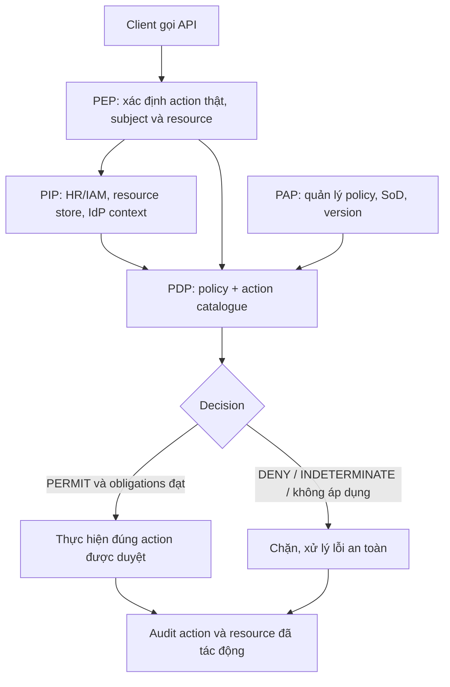

# Action attribute trong ABAC và quản lý vòng đời danh tính IAM

## 1. Action attribute là gì?

Trong **Attribute-Based Access Control (ABAC)**, quyết định cho phép hoặc từ chối truy cập được tạo từ các **thuộc tính của chủ thể, tài nguyên, hành động và môi trường**, kết hợp với những quy tắc chính sách đã được phê duyệt.

**Action attribute (thuộc tính của hành động)** mô tả **điều mà chủ thể đang yêu cầu hệ thống thực hiện**. Thành phần này giúp bộ kiểm tra quyền phân biệt những yêu cầu nhìn bề ngoài giống nhau nhưng mang ý nghĩa hoặc mức rủi ro rất khác.

Ví dụ, đối với một báo cáo tài chính:

- `report:read`: xem nội dung báo cáo.
- `report:export`: xuất dữ liệu ra tệp.
- `report:update`: chỉnh sửa nội dung.
- `report:delete`: xóa báo cáo.
- `report:approve`: phê duyệt báo cáo.

Một người được quyền `report:read` **không tự động** có quyền `report:export` hoặc `report:approve`. ABAC xét **action được yêu cầu** cùng những thông tin khác để đưa ra quyết định.

Trong module quản lý vòng đời danh tính **Identity and Access Management (IAM)**, action attribute còn được sử dụng khi hệ thống thực hiện thao tác nhạy cảm:

- Joiner: `identity:create`, `account:activate`, `role:assign`.
- Mover: `role:revoke`, `role:assign`, `identity:update_department`.
- Leaver: `account:disable`, `session:revoke`, `credential:revoke`.
- Quản trị vận hành: `group:add_member`, `group:remove_member`, `policy:update`.

**Điểm mấu chốt:** action attribute không phải quyền đã có, cũng không phải kết quả thao tác. Nó là **dữ liệu đầu vào được hệ thống diễn giải và bảo vệ** để xác định hành động đang được yêu cầu có được phép thực hiện hay không.

## 2. Vị trí của action attribute trong mô hình ABAC

Một yêu cầu truy cập có thể được mô hình hóa:

```text
Request = {
  subject_attributes,
  resource_attributes,
  action_attributes,
  environment_attributes
}

Decision =
  evaluate(policy, Request)
  -> PERMIT | DENY | INDETERMINATE | NOT_APPLICABLE
```

Bốn nhóm thuộc tính có vai trò khác nhau.

| Nhóm | Câu hỏi | Ví dụ |
|---|---|---|
| **Subject** | Ai đang yêu cầu? | `identity_id`, vai trò, phòng ban, trạng thái nhân sự, tenant |
| **Resource / object** | Đối tượng nào bị tác động? | `report_id`, chủ sở hữu, dự án, trạng thái, độ nhạy |
| **Action** | Muốn làm gì với đối tượng? | `report:read`, `report:export`, `invoice:approve` |
| **Environment** | Trong điều kiện nào? | Thời gian, mức xác thực, thiết bị, nguồn mạng, tín hiệu rủi ro |

Ví dụ nhân viên An yêu cầu xuất báo cáo P1:

```text
Subject:
  id = I-1042
  status = ACTIVE
  roles = [project_report_viewer]
  assigned_project = P1

Resource:
  type = report
  project = P1
  classification = INTERNAL

Action:
  id = report:export
  effect = DATA_EGRESS

Environment:
  authn_assurance = MFA
  device_trusted = true
```

Dù An là `project_report_viewer` và có thể đọc báo cáo, yêu cầu **xuất dữ liệu** vẫn có thể bị từ chối vì role không có quyền `report:export` hoặc chính sách dữ liệu không cho phép đưa nội dung ra ngoài.

### 2.1. Action attribute không đứng một mình

Một action như `delete` không có đầy đủ ý nghĩa nếu không biết **xóa đối tượng gì**. Xóa một nhãn dự án và xóa toàn bộ dự án khác rủi ro, điều kiện phê duyệt và phạm vi ảnh hưởng.

Hệ thống cần xác định **hành động đã chuẩn hóa**, loại tài nguyên, phạm vi và những ràng buộc liên quan; không nên chỉ kiểm tra chuỗi `"delete"` mà không biết domain nghiệp vụ.

## 3. Phân biệt action, action attribute và permission

Ba khái niệm thường bị dùng lẫn lộn.

| Khái niệm | Ý nghĩa | Ví dụ |
|---|---|---|
| **Action** | Thao tác cụ thể đang được yêu cầu | Phê duyệt hóa đơn 123 |
| **Action attribute** | Dữ liệu mô tả thao tác đó để policy đánh giá | `action.id=invoice:approve`, `action.scope=single` |
| **Permission** | Quyền được phép thực hiện một loại thao tác trên phạm vi tài nguyên | `invoice:approve` cho tenant A |
| **Entitlement** | Quyền hoặc gán quyền đang được hệ thống đích quản lý | Role `finance_approver` tại SaaS |
| **Role** | Tập trách nhiệm, thường ánh xạ tới nhiều permission | `finance_approver` |
| **Policy** | Quy tắc quyết định PERMIT/DENY từ các thuộc tính | Chỉ approver không phải người tạo hóa đơn được duyệt |

Một permission có thể có tên gần giống action ID, nhưng **được cấp permission** vẫn chưa đủ khi ABAC áp dụng thêm các điều kiện về người yêu cầu, hóa đơn cụ thể, môi trường và Separation of Duties (SoD).

Ví dụ:

```text
User has permission: invoice:approve

Requested action: invoice:approve
Resource: invoice-123

Additional constraints:
  user.tenant_id == invoice.tenant_id
  invoice.status == PENDING_APPROVAL
  invoice.created_by != user.id
  user.employment_status == ACTIVE
```

Nếu hóa đơn do chính người dùng tạo, quyết định cuối **DENY** dù role đã được cấp quyền `invoice:approve`.

## 4. Các thuộc tính action thường gặp

Tùy hệ thống, một action có thể được mô tả bởi nhiều trường. **Không có bộ trường duy nhất bắt buộc cho mọi hệ thống ABAC**; đây là một thiết kế tham khảo.

| Thuộc tính | Ví dụ | Mục đích |
|---|---|---|
| `action.id` | `report:export` | Định danh hành động nghiệp vụ đã chuẩn hóa |
| `action.domain` | `report` | Phân vùng nhóm hành động |
| `action.operation` | `export` | Động từ hoặc loại thao tác |
| `action.category` | `DATA_EGRESS` | Nhóm kiểm soát rủi ro |
| `action.scope_type` | `SINGLE_RESOURCE` / `BULK` | Phân biệt thao tác đơn lẻ và hàng loạt |
| `action.changes_entitlements` | `true` | Đánh dấu hành động có thể thay đổi quyền truy cập |
| `action.is_privileged` | `true` | Nhận diện thao tác đặc quyền theo phân loại chính sách |
| `action.requires_approval` | `true` | Thông tin chính sách về điều kiện phê duyệt |
| `action.is_reversible` | `false` | Hỗ trợ lập kế hoạch kiểm soát thao tác khó đảo ngược |

**Không phải mọi trường trên đều là dữ kiện do caller quyết định.** Ví dụ `is_privileged`, `requires_approval` và `is_reversible` phải được xác định từ **catalogue/chính sách đáng tin cậy**, không nhận một cờ `false` từ trình duyệt để bỏ qua kiểm soát.

### 4.1. Action ID là trường cốt lõi

Một action ID nên:

- Có **ý nghĩa nghiệp vụ cụ thể**, chẳng hạn `customer:read` hoặc `account:disable`.
- Ổn định để dùng trong policy, audit và test.
- Phân biệt những thao tác có điều kiện quyền khác nhau.
- Không phụ thuộc hoàn toàn vào tên nút bấm hoặc tên hàm trong code.
- Được quản lý phiên bản hoặc có quy tắc tương thích khi đổi ý nghĩa.
- Có người sở hữu chính sách và phạm vi tài nguyên rõ.

### 4.2. Metadata về rủi ro không thay thế kết quả đánh giá

`action.category=PRIVILEGED` có thể làm chính sách yêu cầu MFA mạnh hoặc phê duyệt, nhưng bản thân trường đó **không cho phép thao tác**. Quyết định cuối phải dựa trên **subject, resource, action, environment và các deny rule**.

## 5. Hành động nghiệp vụ không đồng nghĩa HTTP method

Sai lầm phổ biến là ánh xạ:

- `GET = read`
- `POST = create`
- `PUT/PATCH = update`
- `DELETE = delete`

Bảng trên chỉ là gợi ý ở mức giao thức HTTP; nó **không đủ để đưa ra quyết định ABAC**.

| API request | HTTP method | Action nghiệp vụ đúng hơn |
|---|---|---|
| `GET /reports/42` | GET | `report:read` |
| `GET /reports/42/export` | GET | `report:export` |
| `POST /invoices/123/approve` | POST | `invoice:approve` |
| `POST /accounts/1042/disable` | POST | `account:disable` |
| `PATCH /scim/v2/Users/1042` với `active=false` | PATCH | `account:disable` hoặc action tương đương |
| `PATCH /scim/v2/Users/1042` đổi `nickName` | PATCH | `account:update_profile` |
| `PATCH /scim/v2/Groups/G1` thêm member | PATCH | `group:add_member` |
| `PATCH /scim/v2/Groups/G1` gỡ member | PATCH | `group:remove_member` |
| `POST /users/bulk-import` | POST | `identity:bulk_create` |
| `DELETE /reports/42` | DELETE | `report:delete` |

**Hai yêu cầu cùng HTTP PATCH có thể mang hành động bảo mật trái ngược**: thêm người vào nhóm đặc quyền là **cấp quyền**; gỡ người khỏi nhóm là **thu hồi quyền**. Nếu chỉ kiểm tra `method == PATCH`, hệ thống có thể vô tình cho phép người chỉ được cập nhật hồ sơ tự cấp quyền admin.

### 5.1. GET cũng có thể làm lộ dữ liệu

Một endpoint tải file CSV có thể dùng GET nhưng thực chất thực hiện **data export**. Chính sách có thể yêu cầu role riêng, thiết bị tin cậy hoặc kiểm soát chống rò rỉ. Không được phân loại mọi GET vào nhóm `read_low_risk`.

### 5.2. POST không phải lúc nào cũng tạo dữ liệu

Nhiều thao tác như **approve, submit, execute, cancel, transfer, restore** được triển khai qua POST. Action attribute cần mô tả **ý nghĩa và tác động**, không chỉ cách API được gọi.

## 6. Thiết kế action catalogue

**Action catalogue** là danh mục những thao tác nghiệp vụ mà hệ thống hỗ trợ và những metadata cần thiết cho authorization.

Ví dụ:

| Action ID | Ý nghĩa | Mức phân loại | Bảo vệ bổ sung |
|---|---|---|---|
| `report:read` | Đọc một báo cáo | READ | Scope dự án và phân loại dữ liệu |
| `report:export` | Xuất dữ liệu | DATA_EGRESS | Quyền export, giới hạn tenant và môi trường |
| `invoice:create` | Tạo hóa đơn | WRITE | Role và phạm vi tài chính |
| `invoice:approve` | Phê duyệt hóa đơn | APPROVAL | SoD, trạng thái hóa đơn, MFA mới khi cần |
| `identity:update_profile` | Cập nhật trường hồ sơ được phép | IDENTITY_WRITE | Field ownership và audit |
| `role:assign` | Gán role | ENTITLEMENT_GRANT | Approval, SoD, quyền quản trị role |
| `role:revoke` | Thu hồi role | ENTITLEMENT_REVOKE | Đúng người, scope và nguồn có thẩm quyền |
| `account:disable` | Vô hiệu hóa tài khoản | ACCOUNT_CONTROL | Chủ thể/tenant chính xác, sự kiện JML |
| `policy:modify` | Thay chính sách authorization | SECURITY_ADMIN | Phê duyệt độc lập, audit và đánh giá tác động |
| `credential:rotate` | Luân chuyển bí mật | CREDENTIAL_CONTROL | Owner, workload impact, secret lifecycle |

Các phân loại trên chỉ là **mẫu thiết kế**. Một tổ chức có thể yêu cầu approval khác tùy dữ liệu và hệ thống; không dùng bảng như chính sách sản xuất nếu chưa được thẩm định.

### 6.1. Đặt tên nhất quán

Quy ước `resource:verb` giúp dễ đọc, nhưng phải giải quyết các câu hỏi:

- `resource` là loại đối tượng hay một instance cụ thể?
- `verb` chỉ thao tác thực tế hay gồm nhiều tác dụng phụ?
- Action có tác dụng thay quyền, thay trạng thái tài khoản hoặc thay dữ liệu?
- Có yêu cầu scope `tenant/project/environment` không?
- Những thao tác bulk có ID tách biệt không?
- Ai phê duyệt việc thêm hoặc thay đổi ý nghĩa action?

Không nên đặt tên quá chung như `manage_all`, `update_anything` hoặc `admin` rồi dùng cho nhiều thay đổi nhạy cảm không liên quan.

## 7. Nguồn dữ liệu tin cậy cho action attribute

**Hành động được yêu cầu phải do lớp thực thi phía server suy ra từ endpoint và payload đã được xác minh**, không phải tin một chuỗi `action` do client tự khai báo.

Ví dụ client gửi:

```json
{
  "invoiceId": "invoice-123",
  "action": "invoice:read",
  "approve": true
}
```

Nếu backend thực sự duyệt hóa đơn nhưng policy engine nhận `invoice:read` từ client, attacker có thể khai báo action ít rủi ro để được phép. Đây là lỗi **action spoofing**.

### 7.1. Mô hình đúng

1. Router/server xác định endpoint và hành vi được gọi.
2. Bộ xử lý nghiệp vụ xác định **operation thực tế** từ request đã parse.
3. Action ID được lấy từ **action catalogue đáng tin cậy**.
4. Resource và scope được nạp từ nguồn server-side hoặc kiểm tra ánh xạ.
5. PEP gửi context đó đến PDP để đánh giá.
6. Chỉ khi PDP PERMIT và mọi điều kiện thực thi đạt, backend mới thực hiện tác động.

### 7.2. Khi nào payload làm thay đổi action?

Một API có thể nhận cùng HTTP PATCH nhưng có nhiều loại thay đổi. Server phải **parse và phân loại từng thay đổi**, ví dụ:

- `active=false` → `account:disable`.
- `active=true` → `account:activate`.
- Ghi `department` → `identity:update_department`.
- Thêm member vào group → `group:add_member`.
- Gỡ member khỏi group → `group:remove_member`.

Không nên gom tất cả thành `scim:patch` rồi cấp quyền rộng cho connector không cần thiết.

## 8. Chuẩn hóa yêu cầu ABAC

Một request được chuẩn hóa có thể dùng các field có nguồn và ý nghĩa rõ ràng.

```json
{
  "subject": {
    "identityId": "I-1042",
    "status": "ACTIVE",
    "roles": ["finance_approver"],
    "tenantId": "tenant-a"
  },
  "resource": {
    "type": "invoice",
    "id": "invoice-123",
    "tenantId": "tenant-a",
    "createdBy": "I-2201",
    "status": "PENDING_APPROVAL",
    "amount": 75000000
  },
  "action": {
    "id": "invoice:approve",
    "domain": "invoice",
    "operation": "approve",
    "category": "APPROVAL",
    "requiresApproval": true
  },
  "environment": {
    "authenticationAssurance": "PHISHING_RESISTANT_MFA",
    "authAgeSeconds": 120,
    "requestTime": "2026-11-23T09:15:00Z"
  }
}
```

Đây là **schema minh họa cho authorization context**, không phải định dạng chuẩn bắt buộc của XACML hoặc sản phẩm IAM. Các thuộc tính như `roles`, `resource.status`, `action.category`, `authAgeSeconds` phải lấy từ **nguồn đáng tin và có độ mới phù hợp**.

### 8.1. Thiết kế kiểu dữ liệu

Nên dùng kiểu dữ liệu có thể kiểm tra:

- Action ID: mã từ danh mục cho phép.
- Operation/category: enum có schema rõ.
- Bulk count: số nguyên không âm.
- Scope: ID tài nguyên/tenant, không chỉ tên hiển thị.
- Risk metadata: phân loại từ policy/catalogue phía server.
- Time: timestamp có timezone, không so sánh chuỗi mơ hồ.
- Boolean: kiểu boolean thật, không dùng chuỗi `"false"`.

**Đồng nhất kiểu dữ liệu và ngữ nghĩa** giúp tránh tình huống một dịch vụ hiểu `"approve"` khác dịch vụ còn lại.

## 9. PEP, PDP, PIP và PAP xử lý action attribute

Một kiến trúc authorization thường phân chia:

- **PEP (Policy Enforcement Point):** chặn request và chỉ thực thi khi được cho phép.
- **PDP (Policy Decision Point):** đánh giá chính sách, trả quyết định.
- **PIP (Policy Information Point):** cung cấp thuộc tính như user status, resource owner, session assurance.
- **PAP (Policy Administration Point):** quản lý chính sách và action catalogue.



### 9.1. Không bỏ PEP ở các đường khác nhau

Nếu UI đã ẩn nút `Approve` nhưng API không kiểm tra `invoice:approve`, người dùng có thể gọi API trực tiếp. PEP phải tồn tại ở **điểm tác động**:

- HTTP controller / service.
- GraphQL mutation và field resolver nhạy cảm.
- gRPC endpoint.
- Message consumer.
- Batch job và scheduled task.
- Admin console và CLI.

Một hệ thống có nhiều giao diện vẫn cần **cùng semantics hành động**, dù công nghệ PEP khác nhau.

### 9.2. PDP không tự thực hiện action

PDP trả **quyết định và có thể kèm obligations/advice** theo khả năng engine. PEP hoặc thành phần liên quan phải thực thi obligations theo policy, ví dụ ghi audit bổ sung hay yêu cầu xác thực lại. Không được coi `PERMIT` là đủ nếu một obligation bắt buộc chưa được thực hiện.

## 10. Mô hình chính sách: action kết hợp nhiều thuộc tính

Một chính sách ABAC thường dùng action làm điều kiện chính rồi bổ sung các thuộc tính khác.

Ví dụ chính sách minh họa:

```text
PERMIT report:read IF
    subject.status == ACTIVE
    AND subject.tenant_id == resource.tenant_id
    AND subject.project_id == resource.project_id
    AND report_viewer IN subject.effective_roles

PERMIT report:export IF
    subject.status == ACTIVE
    AND subject.tenant_id == resource.tenant_id
    AND subject.project_id == resource.project_id
    AND report_exporter IN subject.effective_roles
    AND resource.classification != RESTRICTED
    AND environment.device_trusted == true

DENY OTHERWISE
```

**`report:export` cần chính sách riêng** dù cùng tài nguyên và người dùng. Mục tiêu không phải phân biệt action chỉ bằng chuỗi, mà là **gắn đúng điều kiện với tác động thực tế**.

### 10.1. Deny rule ưu tiên cho hành động nguy hiểm

Ví dụ:

```text
DENY IF subject.status IN {TERMINATED, SUSPENDED}

DENY IF action.id == invoice:approve
    AND subject.id == resource.created_by

DENY IF action.changes_entitlements == true
    AND subject.tenant_id != resource.tenant_id
```

Cách kết hợp nhiều policy cần có **combining algorithm** rõ ràng (deny-overrides, permit-overrides, first-applicable hoặc cách khác nếu engine hỗ trợ). Không được tự giả định mọi ABAC engine sẽ kết hợp quyết định theo cùng một mặc định.

### 10.2. Missing attribute phải được xử lý an toàn

Nếu thiếu `resource.created_by` trong yêu cầu duyệt hóa đơn, hệ thống không nên mặc nhiên hiểu người tạo khác người duyệt. Thiếu thuộc tính quyết định có thể dẫn tới **INDETERMINATE** hoặc từ chối theo chiến lược fail-closed; cần ghi lỗi thuộc tính và sửa nguồn, không cấp quyền để tránh ảnh hưởng trải nghiệm.

## 11. Action attribute trong chính sách XACML

**XACML (eXtensible Access Control Markup Language)** là một mô hình/ngôn ngữ chính sách ABAC tiêu biểu. XACML phân loại thuộc tính thành các category, trong đó có **subject, resource, action, environment**.

Ví dụ các định danh thường gặp trong XACML:

- Action category: `urn:oasis:names:tc:xacml:3.0:attribute-category:action`.
- Action ID attribute: `urn:oasis:names:tc:xacml:1.0:action:action-id`.

Một yêu cầu XACML có thể mang giá trị action ID như `invoice:approve` để PDP so với policy. Tên action và các thuộc tính tùy chỉnh còn lại phải tuân thủ hợp đồng của hệ thống.

**Lưu ý:** đây là **ví dụ về cấu trúc và định danh**, không có nghĩa mọi engine ABAC đều phải dùng XACML hoặc toàn bộ thuộc tính action là chuẩn XACML định sẵn.

### 11.1. Không nhầm XACML với OAuth scope

Một OAuth access token có thể mang `scope=report.read`. Scope này là tín hiệu ủy quyền thuộc **hợp đồng token/API**, không thay thế quyết định ABAC cho từng resource/action. API vẫn phải kiểm tra action thực tế, audience, tenant, resource owner và các chính sách khác.

## 12. Action và CRUD: một điểm khởi đầu, không phải mô hình đầy đủ

Phân loại CRUD có ích cho thao tác dữ liệu đơn giản:

| CRUD | Action ID minh họa |
|---|---|
| Create | `document:create` |
| Read | `document:read` |
| Update | `document:update` |
| Delete | `document:delete` |

Nhưng nhiều thao tác nghiệp vụ **không thể gom an toàn vào CRUD**:

- `invoice:approve`: phê duyệt có trách nhiệm và SoD.
- `payment:execute`: thực hiện thanh toán.
- `report:export`: đưa dữ liệu ra ngoài.
- `user:impersonate`: tác động bảo mật đặc biệt.
- `policy:publish`: thay cách kiểm tra quyền của nhiều người.
- `role:assign`: cấp thêm khả năng truy cập.
- `token:revoke`: vô hiệu hóa một credential.
- `account:reactivate`: mở lại truy cập sau khóa.

Hai thao tác cùng `UPDATE` có thể đòi policy khác nhau, vì vậy action attribute cần **mang ý nghĩa nghiệp vụ** đủ chi tiết.

## 13. Action attribute và rủi ro thao tác

Một hành động có thể được phân loại theo tác động để lựa chọn lớp bảo vệ:

| Loại tác động | Ví dụ | Kiểm soát điển hình |
|---|---|---|
| **Read thông thường** | Đọc hướng dẫn nội bộ | Quyền đọc + tenant |
| **Read nhạy cảm** | Xem dữ liệu cá nhân | Quyền dữ liệu, phân loại, audit |
| **Data egress** | Export tập dữ liệu khách hàng | Quyền export riêng, hạn mức, thiết bị phù hợp |
| **Modification** | Chỉnh một bản ghi | Role chỉnh sửa, ownership, trạng thái |
| **Business approval** | Duyệt thanh toán | SoD, approval limits, authentication freshness |
| **Entitlement grant** | Cấp role quản trị | Phê duyệt, SoD, PAM/JIT, audit |
| **Entitlement revoke** | Gỡ role | Xác minh đúng subject/target và căn cứ |
| **Security configuration** | Đổi policy ABAC | Quyền đặc quyền, peer review, change control |
| **Destructive/bulk** | Xóa nhiều tài khoản | Dry-run, giới hạn quy mô, phê duyệt bổ sung |

### 13.1. Phân loại rủi ro phải do hệ thống kiểm soát

Không cho client tự gửi `action.risk_level="LOW"` và được PDP tin tưởng. Giá trị rủi ro có thể được **PAP/action catalogue** xác định cùng các thông tin khác như giá trị giao dịch, độ nhạy tài nguyên, số đối tượng trong batch.

### 13.2. Mức xác thực là thuộc tính môi trường hoặc phiên

Nếu `invoice:approve` cần MFA mạnh và xác thực gần đây, policy có thể so sánh:

- Action yêu cầu: `invoice:approve`.
- Điều kiện đăng nhập: `environment.authentication_assurance`.
- Tuổi xác thực: `environment.auth_age_seconds`.

**Không nên biến “đã đăng ký MFA” thành bằng chứng rằng lần xác thực hiện tại đạt mức yêu cầu.** IdP cần cung cấp kết quả xác thực đáng tin và còn hiệu lực.

## 14. Action attribute và Separation of Duties

**Separation of Duties (SoD)** ngăn một người thực hiện trọn một chuỗi hành động nhạy cảm mà không có kiểm soát độc lập.

### 14.1. Ví dụ tạo và duyệt hóa đơn

Giả sử Mai có role `invoice_approver`. Yêu cầu:

```text
subject.id = I-1042
action.id = invoice:approve
resource.id = invoice-123
resource.created_by = I-1042
resource.status = PENDING_APPROVAL
```

Policy:

```text
DENY IF
    action.id == invoice:approve
    AND resource.created_by == subject.id
```

Dù Mai có role duyệt, **không được duyệt chính hóa đơn mình tạo**.

### 14.2. Static và Dynamic SoD

- **Static SoD (SSD):** ngăn một chủ thể được gán đồng thời các role xung đột.
- **Dynamic SoD (DSD):** ngăn kích hoạt đồng thời role xung đột khi nền tảng hỗ trợ.
- **Transaction-level SoD:** so sánh **action đang yêu cầu** với lịch sử/thuộc tính của tài nguyên cụ thể.

Action attribute đặc biệt hữu ích trong transaction-level SoD vì **tạo, sửa, duyệt, giải ngân và hủy** là các hành động riêng, cần đối chiếu người thực hiện ở các bước.

### 14.3. Không chỉ kiểm tra role trong JWT

Một token có role `invoice_approver` không tự chứa lịch sử ai tạo hóa đơn 123. PEP/PDP phải đọc thuộc tính tài nguyên đáng tin để áp dụng SoD, không suy đoán theo role.

## 15. Action attribute khi xử lý trường dữ liệu

Một API `PATCH /users/{id}` có thể thay nhiều field, nhưng **không nên cấp quyền cập nhật mọi field** chỉ vì có permission `user:update`.

Ví dụ:

| Field cần đổi | Action nghiệp vụ | Chủ thể có thể được phép |
|---|---|---|
| Tên hiển thị | `profile:update_display_name` | Người dùng hoặc admin phù hợp |
| Phòng ban | `identity:update_department` | Luồng đồng bộ HR/IAM được ủy quyền |
| Trạng thái active | `account:activate` / `account:disable` | IAM lifecycle hoặc admin được cấp quyền |
| Manager | `identity:update_manager` | Nguồn HR/ủy quyền tương ứng |
| Nhóm admin | `group:add_privileged_member` | Quản trị danh tính đặc quyền, có approval |
| MFA recovery method | `authenticator:update_recovery` | Luồng account recovery đủ tin cậy |

### 15.1. Bảo vệ chống mass assignment

Nếu một endpoint tự động ghi mọi field JSON vào entity mà không kiểm tra quyền **theo từng hành động/thuộc tính**, client có thể gửi:

```json
{
  "displayName": "Linh",
  "active": true,
  "roles": ["super_admin"]
}
```

Hệ thống phải **allowlist những field được phép chỉnh**, xác định action thực tế của từng field nhạy cảm và đánh giá policy tương ứng. Không cho một `profile:update` trở thành quyền `account:activate` hoặc `role:assign`.

## 16. Action attribute trong Joiner lifecycle

**Joiner** gồm nhiều hành động cần phân biệt thay vì một quyền chung `manage_identity`.

| Bước Joiner | Action | Điều kiện điển hình |
|---|---|---|
| Tiếp nhận hồ sơ | `identity:create_record` | Nguồn HRIS/VMS đáng tin |
| Liên kết tài khoản | `account:link` | Identity proofing và mapping chắc chắn |
| Tạo tài khoản ứng dụng | `account:provision` | Có quan hệ và phạm vi được phê duyệt |
| Kích hoạt đăng nhập | `account:activate` | Đến ngày hiệu lực, đủ MFA/policy |
| Gán vai trò nền | `role:assign` | RBAC/ABAC, least privilege, SoD |
| Thêm nhóm | `group:add_member` | Nhóm đúng tenant và entitlement hợp lệ |

### 16.1. Ví dụ Joiner

Linh được tuyển vào dự án P1 với ngày bắt đầu 01/12. Trước ngày đó, IAM có thể được cho phép `account:provision` để chuẩn bị tài khoản nhưng **không được `account:activate` hoặc `group:add_member` vào nhóm có quyền dữ liệu** nếu chính sách chỉ cho phép sau ngày hiệu lực.

Một policy có thể viết:

```text
PERMIT account:provision IF
    source_event == APPROVED_JOINER
    AND target_identity_mapping == VERIFIED

PERMIT account:activate IF
    subject_action_actor == AUTHORIZED_IAM_WORKFLOW
    AND worker.effective_at <= environment.now
    AND worker.relationship_status == ACTIVE
    AND required_security_controls == SATISFIED
```

Các trường ở đây minh họa, không phải API chuẩn. **Action làm rõ sự khác biệt giữa “tạo trước” và “cho phép truy cập”.**

### 16.2. Không coi hệ thống gửi sự kiện luôn được quyền thực hiện mọi action

Một HRIS có thể có thẩm quyền phát **sự kiện tuyển dụng**, nhưng không tự được gọi endpoint cấp `production_admin`. IAM/IGA phải đánh giá quyền của connector và các điều kiện approval riêng cho action cấp role.

## 17. Action attribute trong Mover lifecycle

**Mover** là lúc một người chuyển vai trò, phòng ban, dự án hoặc phạm vi trách nhiệm. Action attribute giúp phân biệt **thay thuộc tính** với **cấp** và **thu hồi** quyền.

Ví dụ một nhân viên chuyển P1 → P2:

1. `identity:update_assignment`: cập nhật assignment hợp lệ.
2. `role:revoke`: thu hồi role P1 không còn căn cứ.
3. `group:remove_member`: gỡ membership P1.
4. `role:assign`: cấp role P2 đã được phê duyệt.
5. `group:add_member`: đồng bộ membership P2.
6. `session:reassess`: đánh giá phiên/claim cũ khi cần.

### 17.1. Chặn privilege creep

Nếu workflow chỉ cho `role:assign` mà không xử lý `role:revoke`, người dùng có thể tích lũy quyền từ nhiều vị trí công việc. IAM nên tính **desired state** rồi lập các action cụ thể để **gỡ quyền cũ không còn căn cứ** và cấp quyền mới đúng thời điểm.

### 17.2. Quyền xung đột và thứ tự thao tác

Nếu người chuyển bộ phận cần gỡ role `invoice_creator` trước khi nhận `invoice_approver`, SoD có thể yêu cầu **đảm bảo revoke trước grant**. Những action này thường được thực thi qua các API khác nhau, nên cần quản lý trạng thái và xác minh từng đích.

### 17.3. Không sửa quyền dựa trên sự kiện cũ

Một yêu cầu `group:add_member` do Mover lần trước tạo ra có thể được retry sau khi nhân viên đã chuyển sang nhóm khác hoặc trở thành Leaver. Trước khi thực thi, kiểm tra phiên bản HR/policy và desired access hiện hành; đánh dấu job cũ `SUPERSEDED` nếu không còn hợp lệ.

## 18. Action attribute trong Leaver lifecycle

**Leaver** yêu cầu thu hồi nhiều đường truy cập, mỗi đường có action và quyền quản trị khác nhau.

| Hành động | Đích | Rủi ro nếu bị bỏ sót |
|---|---|---|
| `account:disable` | IdP hoặc account ứng dụng | Tài khoản còn đăng nhập được |
| `session:revoke` | IdP và ứng dụng hỗ trợ | Phiên cũ tiếp tục được dùng |
| `token:revoke` | Authorization server/ứng dụng | Refresh/API token còn hiệu lực |
| `group:remove_member` | Directory/SCIM Group | Người nghỉ còn membership |
| `role:revoke` | IGA/SaaS | Quyền trực tiếp vẫn tồn tại |
| `credential:revoke` | Vault/PAM/ứng dụng | PAT/SSH key/secret cá nhân còn hoạt động |
| `account:delete` | Hệ thống đích | Hành động hủy dữ liệu, cần policy lưu giữ riêng |

### 18.1. Disable khác delete

`account:disable` thường để **chặn truy cập**; `account:delete` là hành động phá hủy tài nguyên, có thể tác động dữ liệu, pháp lý, audit và các đối tượng liên quan. Không dùng chung action ID `account:remove` cho cả hai nếu chính sách quản trị khác nhau.

### 18.2. Action thu hồi cũng cần authorization

Chỉ vì `role:revoke` hướng đến giảm quyền không có nghĩa **mọi caller đều được tự thu hồi role của bất kỳ ai**. Một kẻ tấn công có thể lạm dụng API thu hồi để gây gián đoạn dịch vụ hoặc vô hiệu hóa tài khoản quản trị.

Hệ thống phải kiểm tra:

- Caller có thẩm quyền thay đúng target không?
- Target account có liên kết chính xác với danh tính được yêu cầu không?
- Có quan hệ khác còn hiệu lực cần giữ quyền không?
- Role/nhóm có thuộc phạm vi quản trị của workflow không?
- Có đang tác động tài khoản máy/break-glass hoặc nhóm dùng chung không?

### 18.3. Trạng thái thực tế vẫn là tiêu chuẩn cuối

Gửi `account:disable` thành công không chứng minh mọi phiên và token ứng dụng mất hiệu lực. IAM cần theo dõi từng action và **readback/reconciliation** cho hệ thống đích.

## 19. IdP, SSO, SCIM và action attribute

Các thành phần IAM có ranh giới chức năng khác nhau:

| Thành phần | Liên hệ với action |
|---|---|
| **IdP** | Xác thực người yêu cầu, cung cấp session/assurance; có API quản trị account |
| **SSO/OIDC/SAML** | Truyền kết quả xác thực đến ứng dụng; không tự quyết mọi action nghiệp vụ |
| **SCIM** | Gửi thao tác tạo, cập nhật, disable user/group; cần phân biệt tác động của PATCH |
| **IGA** | Đánh giá yêu cầu cấp/thu hồi, approval, SoD, JML |
| **RBAC** | Cung cấp permission ứng viên dựa trên role |
| **ABAC** | Kết hợp action với subject/resource/environment để ra quyết định |
| **Ứng dụng đích** | Thực thi action và kiểm tra quyền trên tài nguyên thật |
| **Audit/Reconciliation** | Truy vết action được yêu cầu, đã thực hiện và trạng thái hiệu lực |

### 19.1. OIDC ID token không phải action permission

ID token thường dùng để truyền kết quả xác thực danh tính đến OIDC client. Không dùng một ID token có chữ ký hợp lệ làm lý do bỏ qua authorization cho `invoice:approve` hoặc `role:assign`.

Nếu API dùng OAuth access token, nó cần xác minh **issuer, audience, scope, thời hạn và điều kiện tin cậy**, rồi kiểm tra action thực tế trên resource cụ thể theo policy. Scope tổng quát không tự đảm bảo permission theo đối tượng.

### 19.2. Phân biệt các SCIM PATCH operation

Một request SCIM PATCH có thể chứa nhiều thao tác:

```json
{
  "schemas": ["urn:ietf:params:scim:api:messages:2.0:PatchOp"],
  "Operations": [
    { "op": "replace", "path": "active", "value": false },
    { "op": "replace", "path": "nickName", "value": "archived" }
  ]
}
```

Client đang yêu cầu **hai hành động logic** khác loại (`account:disable` và cập nhật hồ sơ). Gateway/connector phải bảo đảm **mọi field/operation đều được phép**. Không cấp quyền cập nhật hồ sơ rồi để caller vô hiệu hóa hoặc kích hoạt tài khoản.

### 19.3. Group membership mang ngữ nghĩa đặc biệt

`PATCH /Groups/G1` có thể chứa:

- `add` member → `group:add_member`.
- `remove` member → `group:remove_member`.
- `replace` toàn bộ `members` → hành động thay danh sách nhóm có phạm vi rộng hơn.

Nếu group cấp quyền quản trị, chính sách action phải đánh giá **mức nhạy cảm của group** và quyền được cấp/thu hồi, không chỉ nhìn thao tác HTTP.

## 20. Thiết kế PEP với ví dụ Java/Spring

Trong ứng dụng Java, một controller có thể chuyển request sang service, nhưng **authorization phải được kiểm tra trước thao tác có tác dụng phụ** và không chỉ dựa vào quyền hiển thị trên giao diện.

Ví dụ **mã giả Java**, sử dụng tên lớp minh họa:

```java
@PostMapping("/invoices/{invoiceId}/approve")
public ResponseEntity<?> approveInvoice(
        @PathVariable String invoiceId,
        Authentication authentication) {

    Subject subject = trustedSubjectFrom(authentication);
    Invoice invoice = invoiceRepository.findOrThrow(invoiceId);

    Action action = actionCatalog.require("invoice:approve");
    Environment env = trustedEnvironmentFromRequest();

    AuthorizationRequest request = new AuthorizationRequest(
        subject,
        invoice.toPolicyResource(),
        action,
        env
    );

    Decision decision = policyDecisionPoint.evaluate(request);
    if (!decision.isPermit()) {
        throw new AccessDeniedException("Not authorized");
    }

    // Trong triển khai thật: bảo vệ TOCTOU và trạng thái giao dịch
    invoiceService.approveWithRecheck(
        invoiceId,
        subject.identityId(),
        decision.policyVersion()
    );

    return ResponseEntity.noContent().build();
}
```

**Đây không phải mã có thể biên dịch và dùng ngay**. Triển khai thật cần xử lý authentication, repository ownership, race condition, exception mapping và policy recheck. Đặc biệt, nếu hóa đơn bị sửa sau khi PDP đọc nhưng trước khi commit, nghiệp vụ cần **kiểm tra lại trạng thái trong transaction**.

### 20.1. Không cho client chọn action để tránh kiểm tra

Sai:

```text
action = request.body.action
if PDP.permit(action):
    invoiceService.approve(invoiceId)
```

Đúng về nguyên tắc:

```text
action = ActionCatalog.INVOICE_APPROVE
resource = loadInvoiceFromTrustedStore(invoiceId)
if PDP.permit(subject, action, resource, environment):
    approveWithBusinessChecksAndTransaction()
```

### 20.2. Bảo vệ cả đường bất đồng bộ

Nếu controller chỉ kiểm tra `invoice:approve` rồi đẩy job vào queue, worker cần bảo đảm:

- Job phát sinh từ request/luồng được ủy quyền.
- Người yêu cầu và action được ghi rõ, không bị sửa trong queue.
- Chính sách có yêu cầu **đánh giá lại tại thời điểm thực hiện** không.
- Trạng thái tài khoản và resource vẫn đáp ứng điều kiện.
- Không thực hiện khi job đã bị hủy, superseded hoặc hết hạn.

## 21. Action trong GraphQL, gRPC, CLI và batch job

Không phải mọi hệ thống dùng endpoint REST một-một.

| Bề mặt thực thi | Rủi ro | Cách kiểm soát |
|---|---|---|
| **GraphQL query** | Một query đọc nhiều trường nhạy cảm khác nhau | Kiểm tra action/field/resource phù hợp |
| **GraphQL mutation** | Một mutation có thể tạo nhiều tác dụng phụ | Xác định action thật và mọi thay đổi liên quan |
| **gRPC** | Method tên kỹ thuật không diễn đạt hết quyền | Mapping method + payload sang action nghiệp vụ |
| **Admin CLI** | CLI có thể bỏ qua UI permission | PEP tại service/API, không chỉ trên giao diện |
| **Message consumer** | Event giả hoặc stale job gây tác dụng phụ | Xác minh nguồn, chủ thể ủy quyền, action và version |
| **Batch import** | Một request ảnh hưởng nhiều user | Action bulk riêng, giới hạn quy mô, audit từng mục |
| **Automation/workflow** | Kết hợp nhiều action với nguồn và quyền khác nhau | Phân quyền từng bước, tránh quyền connector quá rộng |

### 21.1. Bulk action không phải N lần single action tương đương

Một tài khoản có quyền `user:disable_one` không nên mặc nhiên có quyền `user:disable_bulk` đối với 10.000 người. Bulk action có **blast radius** khác, nên action catalogue có thể định nghĩa quyền riêng, hạn mức, approval hai người, dry-run và kill switch.

### 21.2. Kiểm tra mọi action của một yêu cầu tổng hợp

Nếu một batch có 100 mục, không nên chỉ kiểm tra mục đầu tiên hoặc chỉ xem action chung `BULK_UPDATE`. Cần xác định **tập thao tác và đối tượng thực tế**, áp dụng chính sách phù hợp cho từng phần hoặc từ chối toàn bộ tùy hợp đồng giao dịch.

## 22. Action attribute cho tài khoản dịch vụ và workload identity

**Service account, bot, CI/CD runner và workload identity** cũng yêu cầu hành động như đọc secrets, triển khai hệ thống hoặc cập nhật tài nguyên.

Ví dụ workload `svc-report-sync`:

```text
subject.type = WORKLOAD
subject.id = svc-report-sync
subject.environment = production

action.id = report_sink:write

resource.type = report_bucket
resource.tenant = tenant-a

environment.workload_attestation = VERIFIED
```

Policy có thể cho phép ghi đúng bucket báo cáo nhưng từ chối:

- `identity:manage_users`.
- `secret:read_all`.
- `production:admin`.
- `invoice:approve`.

### 22.1. Không dùng quyền của owner thay quyền của workload

Một người quản trị workload có thể có role admin để cấu hình dịch vụ. Điều đó **không có nghĩa workload được thừa hưởng toàn bộ quyền của người quản trị**. Workload cần danh tính, action permission và scope riêng.

### 22.2. Leaver của owner

Khi nhân viên sở hữu bot nghỉ việc, IAM phải thu hồi **quyền hành động của cá nhân**, bàn giao owner và xem xét credential rotation. Không tự disable bot hợp lệ khi chưa có căn cứ từ service catalog/CMDB và đánh giá phụ thuộc sản xuất.

## 23. Caching, độ mới và kiểm soát cạnh tranh

Để giảm độ trễ, hệ thống có thể cache role, resource attributes hoặc kết quả PDP. Tuy nhiên một quyết định `PERMIT` có thể **trở nên sai** khi danh tính hoặc tài nguyên thay đổi.

### 23.1. Tại sao kết quả cũ nguy hiểm?

1. An được cấp `report:export` khi đang ở dự án P1.
2. Mover chuyển An sang P2.
3. Cache giữ PERMIT cho `report:export` đối với P1.
4. An tiếp tục xuất dữ liệu P1 sau khi quyền đã bị thu hồi.

Một cache an toàn phải gắn với **subject, action, resource, tenant, policy version và các context quan trọng**, có TTL phù hợp, khả năng invalidation và kiểm tra lại khi rủi ro cao.

### 23.2. Với action đặc quyền

Đối với `role:assign`, `policy:modify`, `account:reactivate` hoặc `invoice:approve`:

- Hạn chế cache quyết định hoặc yêu cầu authorization mới theo chính sách.
- Kiểm tra **trạng thái account và resource mới nhất** khi thực thi.
- Dùng transaction/optimistic concurrency để chống **time-of-check/time-of-use (TOCTOU)**.
- Tái kiểm tra chính sách nếu job bị chờ lâu.
- Không sử dụng token/claim quá hạn để giữ quyền đã bị gỡ.

### 23.3. Khi PDP/PIP không khả dụng

Nếu không lấy được thuộc tính cần để đánh giá action, hệ thống nên **fail-closed cho thao tác nhạy cảm** theo chính sách đã phê duyệt; không tự chuyển lỗi thành PERMIT. Cơ chế break-glass cần được thiết kế riêng, có phạm vi, MFA/approval và audit, không phải một nhánh `allow=true` trong exception handler.

## 24. Reconciliation: quyền hành động đã thay đổi thật chưa?

Trong IAM, có sự khác nhau giữa **đã gửi lệnh thu hồi**, **đã đổi role/nhóm** và **ứng dụng thực sự từ chối action**.

Ví dụ HRIS xác nhận Leaver; IAM gửi SCIM PATCH gỡ người dùng khỏi nhóm `finance-approvers`. Nếu token SaaS cũ vẫn chứa role `finance_approver`, ứng dụng có thể vẫn cho `invoice:approve` nếu không kiểm tra trạng thái mới.

### 24.1. Ba cấp bằng chứng

| Trạng thái | Điều có thể khẳng định |
|---|---|
| `REQUESTED` | IAM đã yêu cầu thu hồi quyền |
| `APPLIED` | Đích xác nhận cập nhật account/group/role |
| `VERIFIED` | Đã kiểm tra quyền thực tế theo phạm vi bằng chứng phù hợp |

**Phạm vi VERIFY phải rõ:** kiểm tra membership vắng mặt không tự chứng minh session/token đã bị thu hồi. Với action nhạy cảm, có thể cần kiểm tra API authorization tương ứng theo quy trình kiểm thử an toàn hoặc đọc nguồn entitlement thực tế.

### 24.2. Desired state và observed state

```text
Desired:
  identity I-1042 has no invoice:approve permission

Observed:
  IGA role removed
  SCIM group membership absent
  SaaS local role finance_approver still present

Result:
  DRIFT_DETECTED
  invoice:approve may remain permitted
  open remediation, do not mark full Leaver closure
```

Nếu thiếu khả năng quan sát, cần đánh dấu `UNVERIFIED` và chủ sở hữu ngoại lệ, không đoán kết quả.

## 25. Ghi log và kiểm toán action attribute

Audit cần trả lời: **ai yêu cầu làm gì với đối tượng nào, trong điều kiện nào và hệ thống đã quyết định/thực thi ra sao?**

| Trường | Ý nghĩa |
|---|---|
| `request_id` / `correlation_id` | Liên kết request, PDP và tác vụ thực thi |
| `subject_id` / `initiator_type` | Người hoặc workload đã yêu cầu |
| `action_id` / `action_catalog_version` | Hành động được nhận diện theo catalogue nào |
| `resource_type` / `resource_id` | Đối tượng bị tác động |
| `tenant_id` / `scope` | Ranh giới quản trị |
| `policy_id` / `policy_version` | Căn cứ ra quyết định |
| `decision` / `deny_reason_code` | PERMIT/DENY/INDETERMINATE và lý do ở mức phù hợp |
| `authn_context` | Mức xác thực cần thiết, không chứa secret |
| `source_event_id` / `source_version` | Căn cứ JML nếu có |
| `executed_at` / `execution_result` | Có thực hiện action hay chưa |
| `verified_at` / `observed_state` | Bằng chứng trạng thái thực tế |

Một ví dụ **không chứa token, session cookie hoặc dữ liệu nhạy cảm không cần thiết**:

```json
{
  "correlation_id": "req-2026-0171",
  "subject_id": "I-1042",
  "action_id": "invoice:approve",
  "resource_type": "invoice",
  "resource_id": "invoice-123",
  "tenant_id": "tenant-a",
  "policy_version": "FINANCE-ABAC-V5",
  "decision": "DENY",
  "deny_reason_code": "CREATOR_CANNOT_APPROVE",
  "evaluated_at": "2026-11-23T09:16:00Z",
  "executed": false
}
```

Không log toàn bộ nội dung hóa đơn, dữ liệu cá nhân, mật khẩu hoặc access token chỉ để chứng minh một policy đã kiểm tra `invoice:approve`.

### 25.1. Chỉ số vận hành có ý nghĩa

- **Action authorization denial rate:** tỷ lệ từ chối theo từng action.
- **Privileged action attempts:** số lần thử `role:assign`, `policy:modify` và các thao tác đặc quyền.
- **Cross-tenant denial count:** yêu cầu bị chặn do sai tenant/scope.
- **SoD violations prevented:** thao tác phê duyệt bị chặn vì xung đột.
- **Stale-permission incidents:** hành động còn được phép sau Mover/Leaver không đúng chính sách.
- **PDP latency/error rate:** độ trễ và lỗi đánh giá, nhất là với action nhạy cảm.
- **Missing-attribute decisions:** quyết định thất bại do dữ liệu không đầy đủ.
- **Unauthorized bulk action attempts:** các yêu cầu hàng loạt vượt quyền.
- **Action catalogue coverage:** tỷ lệ endpoint/mutation có mapping hành động được kiểm tra.
- **Revocation verification latency:** thời gian từ sự kiện thu hồi đến khi action tương ứng không còn được phép.

## 26. Ví dụ xuyên suốt: nhân viên kế toán và hệ thống phê duyệt

Giả sử doanh nghiệp có:

- **HRIS** theo dõi nhân viên và assignment.
- **IdP** xác thực qua SSO/MFA.
- **IGA** phê duyệt role và theo dõi JML.
- **Accounting API** xử lý tạo, duyệt và hủy hóa đơn.
- **PDP** kiểm tra ABAC tại thời điểm thao tác.

Nhân viên **Mai** có `identity_id=I-1042`.

### 26.1. Giai đoạn A — Joiner

Mai gia nhập với vai trò `invoice_creator`. IGA gán quyền `invoice:create` nhưng không gán `invoice:approve`.

Mai gọi:

```text
POST /invoices
Derived action.id = invoice:create
Subject.role = invoice_creator
Decision = PERMIT (nếu mọi điều kiện khác đạt)
```

Nếu Mai gọi `POST /invoices/123/approve`, server ánh xạ thành `invoice:approve` và trả DENY. Việc Mai đăng nhập SSO thành công **không làm thay đổi kết quả**.

### 26.2. Giai đoạn B — Mover sang vai trò phê duyệt

HRIS xác nhận Mai chuyển sang vị trí kiểm soát. IGA gỡ `invoice_creator` và cấp `invoice_approver` sau approval/SoD.

Khi Mai yêu cầu duyệt `invoice-123`:

```text
Subject:
  id=I-1042
  status=ACTIVE
  role=invoice_approver

Action:
  id=invoice:approve

Resource:
  id=invoice-123
  created_by=I-2201
  status=PENDING_APPROVAL

Environment:
  authentication_freshness=VALID

Decision:
  PERMIT (nếu tất cả điều kiện policy đều đạt)
```

Nếu Mai chính là người đã tạo hóa đơn, **transaction-level SoD** vẫn DENY.

### 26.3. Giai đoạn C — Leaver

Mai nghỉ việc. HRIS phát sự kiện Leaver. IAM disable tài khoản, thu hồi role và xử lý phiên/token. Accounting API không được tiếp tục cho phép `invoice:approve` chỉ vì token cũ còn claim `finance_approver`.

IAM đối soát và phát hiện một role local còn tồn tại trong SaaS. Trạng thái thu hồi tại hệ thống này vẫn là **chưa xác minh hoàn tất** và phải tiếp tục xử lý.

### 26.4. Điều bài toán cho thấy

Một action attribute tốt giúp phân biệt **tạo – xem – duyệt – thu hồi – vô hiệu hóa**. Tuy nhiên quyền đúng cuối cùng cần **danh tính đúng, trạng thái nhân sự hiện hành, role/thuộc tính có thẩm quyền, chính sách, thực thi ở backend và đối soát**.

## 27. Kiểm thử action attribute trong ABAC

| Tình huống | Kết quả mong đợi |
|---|---|
| Người có `report:read` yêu cầu `report:read` đúng dự án | PERMIT nếu đủ các điều kiện khác |
| Người có `report:read` yêu cầu `report:export` | DENY nếu thiếu quyền export |
| Client gửi `action=read` nhưng endpoint thực hiện approve | Server dùng action thật `invoice:approve`, không tin client |
| POST thực hiện approve | Chính sách kiểm tra `invoice:approve`, không coi POST là create chung |
| PATCH đổi `nickName` | Chỉ kiểm tra action cập nhật field được phép |
| PATCH `active=true` | Kiểm tra action `account:activate` riêng |
| PATCH Group thêm user admin | Yêu cầu quyền `group:add_member` tương ứng và approval |
| PATCH Group gỡ một thành viên | Không cho phép xóa cả Group hoặc member khác |
| PATCH có hai thao tác khác nhau | Mọi thao tác/field nhạy cảm đều được authorize |
| Batch disable 10.000 user | Quyền bulk, giới hạn quy mô và phê duyệt theo policy |
| Khác tenant giữa subject và resource | DENY dù role đúng |
| Trường `resource.created_by` bị thiếu | Không tự PERMIT thao tác duyệt |
| Người tạo hóa đơn thử duyệt chính hóa đơn | DENY theo SoD |
| Token có scope read nhưng gọi export | API từ chối nếu scope/action không phù hợp |
| Resource đổi trạng thái sau khi PDP PERMIT | Kiểm tra trong transaction trước commit |
| PIP không khả dụng với action nhạy cảm | Fail-closed/đưa vào xử lý an toàn |
| Role bị thu hồi sau Mover nhưng cache vẫn giữ PERMIT | Invalidate/recheck theo policy, không cho quyền cũ tồn dư |
| Joiner grant retry sau Leaver | Bỏ qua action cũ, đối soát desired state |
| Service account muốn `identity:manage_users` | DENY nếu workload không có quyền |
| Client gửi `risk_level=LOW` cho admin action | Bỏ cờ không tin cậy, lấy phân loại action catalogue |
| UI ẩn nút Delete nhưng API vẫn có thể gọi | Backend vẫn DENY nếu thiếu permission |
| Audit cho quyết định bị từ chối | Có action ID, resource ID, policy version, không chứa secret |
| Ứng dụng có role direct ngoài IAM | Reconciliation phát hiện quyền hiệu lực bất thường |
| Leaver logout IdP nhưng app session còn sống | Không tự coi mọi action đã bị chặn nếu chưa có bằng chứng |
| Mức MFA chưa đáp ứng action nhạy cảm | Step-up hoặc DENY theo policy |
| Cùng một người có hai assignment hợp lệ | Quyền được tính theo quan hệ còn hiệu lực, không revoke sai |
| Action ID đổi ý nghĩa sau deploy | Versioning và test ngăn mismatch giữa PEP/PDP |

## 28. Những sai lầm thường gặp

| Sai lầm | Rủi ro | Cách tránh |
|---|---|---|
| Dùng HTTP method làm action duy nhất | GET export hoặc POST approve bị kiểm tra sai quyền | Định nghĩa action nghiệp vụ |
| Tin action/risk do client gửi | Action spoofing, bypass policy | Server derivation và catalogue đáng tin |
| Dùng permission `update_all` quá rộng | Có thể sửa status/role ngoài ý định | Field-level, action-specific authorization |
| Chỉ kiểm tra role, bỏ qua action | Người xem có thể duyệt/xuất/xóa | Kiểm tra permission cho hành động thực |
| Không kiểm tra resource/tenant | BOLA/IDOR, truy cập chéo tenant | ABAC với resource scope |
| Bỏ SoD đối với approve | Một người tự tạo rồi tự duyệt | So sánh action với lịch sử tài nguyên |
| Dùng `mfa_enabled` thay bằng chứng xác thực hiện hành | Action đặc quyền không được bảo vệ đủ | Kiểm tra authn context/freshness |
| Coi role trong JWT luôn mới | Quyền còn sau Mover/Leaver | TTL, revocation, PDP/resource recheck |
| Chỉ authorize controller mà không bảo vệ worker | Job cũ/giả có thể thực hiện action | Bảo vệ message consumer và job metadata |
| Một PERMIT áp cho toàn bộ batch khác nhau | Cấp/thu hồi sai trên nhiều đối tượng | Kiểm tra từng operation/scope và batch policy |
| Không version action catalogue | PEP và PDP hiểu action khác nhau | Quản lý schema/version, kiểm thử tương thích |
| Fail-open khi thiếu PIP | Cho action rủi ro cao dù không có chứng cứ | Fail-closed và ngoại lệ kiểm soát |
| Coi `role:revoke` luôn vô hại | Tài khoản quan trọng bị khóa trái phép | Quyền quản trị revoke, đúng target và phạm vi |
| Không kiểm tra TOCTOU | Phê duyệt trạng thái cũ rồi ghi trạng thái mới | Transaction, optimistic locking, recheck |
| Audit chỉ ghi HTTP 200 | Không biết action nào được duyệt và quyền nào còn hiệu lực | Log action/decision/execution/verification |
| SCIM PATCH thành công là mọi token đã mất quyền | Token, session hoặc role local tồn dư | Reconciliation và quản lý phiên/token |

## 29. Nguyên tắc cần ghi nhớ

**Action attribute là dữ liệu mô tả hành động đang được yêu cầu trong một quyết định ABAC.** Nó giúp hệ thống áp chính sách **đúng với tác động thực tế**, thay vì chỉ dựa vào người dùng, role hoặc HTTP method.

Các nguyên tắc cốt lõi:

1. **Định nghĩa action theo nghiệp vụ:** phân biệt read, export, approve, assign, revoke, disable và delete.
2. **Giữ ranh giới rõ ràng:** action là điều đang được yêu cầu; permission là quyền có thể được cấp; decision là kết quả đánh giá policy.
3. **Kết hợp bốn nhóm thuộc tính:** subject, resource, action, environment theo nguồn đáng tin.
4. **Không tin action do client tự khai báo:** suy ra action từ endpoint/operation thực sự; đối chiếu action catalogue phía server.
5. **Không coi HTTP method là đủ:** PATCH/POST/GET có thể mang những tác động và rủi ro rất khác.
6. **Kiểm tra scope và SoD:** một role đủ quyền danh nghĩa vẫn có thể bị deny do tenant, owner, trạng thái hoặc lịch sử giao dịch.
7. **Quản lý action nhạy cảm:** step-up MFA, approval, PAM/JIT, bulk limits và audit tùy rủi ro.
8. **Authorize mọi điểm thực thi:** API, GraphQL, gRPC, CLI, batch và job bất đồng bộ.
9. **Phối hợp đúng JML:** Joiner tạo/cấp đúng lúc; Mover gỡ quyền cũ/cấp quyền mới; Leaver disable/revoke và xác minh.
10. **Liên kết IdP/SSO/SCIM nhưng không nhầm chức năng:** xác thực không thay authorization; provisioning không bảo đảm token/session đã hết hiệu lực.
11. **Chống quyền cũ và TOCTOU:** recheck nguồn, version, policy và resource trước action rủi ro cao.
12. **Đo kết quả thực tế:** log action/decision/execution, readback và reconciliation để phát hiện quyền tồn dư.

**Kết luận:** muốn kiểm soát truy cập đúng, hệ thống phải biết **ai đang làm gì, trên tài nguyên nào, trong điều kiện nào**. Action attribute là phần mô tả **“đang làm gì”** của ABAC. Khi được thiết kế chính xác và gắn với lifecycle IAM, nó hỗ trợ **cấp quyền đúng thao tác, thu hồi quyền kịp thời và hạn chế quyền truy cập tồn dư** khi danh tính hoặc nhiệm vụ thay đổi.
