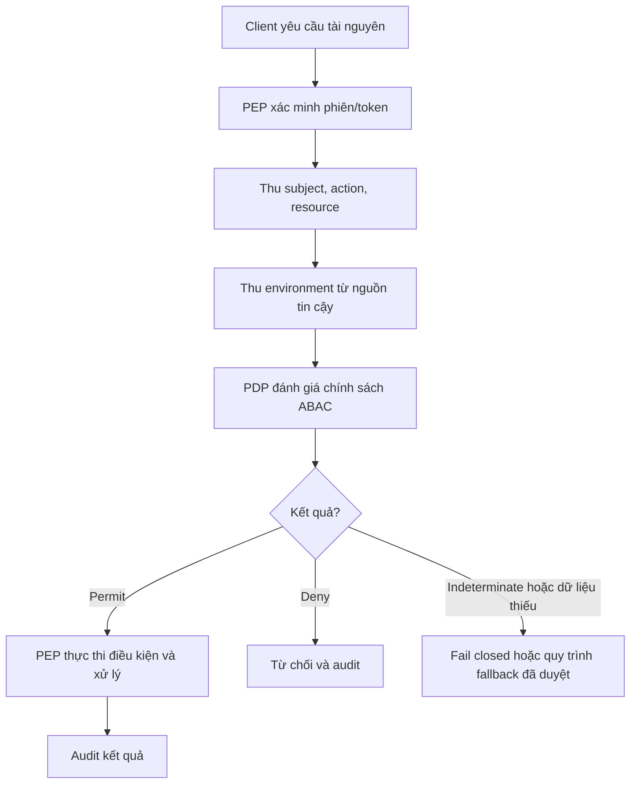

# Environment attribute trong ABAC và quản lý vòng đời danh tính IAM

**Environment attribute** (*thuộc tính môi trường*) là nhóm thuộc tính mô tả **bối cảnh của một yêu cầu truy cập tại thời điểm đánh giá**, chẳng hạn thời gian, trạng thái mạng, mức rủi ro phiên, tình trạng thiết bị hoặc hoàn cảnh vận hành. Trong **Attribute-Based Access Control (ABAC)**, chính sách xét kết hợp thuộc tính của **subject**, **resource**, **action** và **environment** để quyết định cho phép hay từ chối.

Ví dụ, nhân viên có role `report-reader` được phép xem báo cáo thông thường, nhưng việc xuất tập dữ liệu nhạy cảm chỉ được phép nếu thiết bị được quản lý, phiên có mức xác thực phù hợp và yêu cầu không thuộc tình huống rủi ro cao. Environment attribute giúp thể hiện điều kiện này mà không phải tạo hàng chục role tương ứng với mỗi tình huống.

Trong **Identity and Access Management (IAM)** theo **Joiner–Mover–Leaver (JML)**, environment attribute bổ sung quyết định tại thời điểm truy cập, **không thay thế trạng thái vòng đời và quyền được phê duyệt**. Việc một thiết bị đáng tin hoặc truy cập trong giờ làm việc không thể tự cấp lại quyền cho người đã nghỉ việc. Cần phối hợp **IdP/SSO, SCIM, RBAC/ABAC, service identity, kiểm toán và đối soát** để tránh quyền truy cập tồn dư.

## 1. Phân biệt bốn nhóm thuộc tính ABAC

| Nhóm thuộc tính | Mô tả | Ví dụ |
| --- | --- | --- |
| **Subject attribute** | Đặc điểm của chủ thể yêu cầu | `identityId`, department, partner ID, lifecycle status |
| **Resource attribute** | Đặc điểm đối tượng được bảo vệ | Chủ dự án, mức phân loại, tenant, vùng dữ liệu |
| **Action attribute** | Thao tác được yêu cầu | Read, export, update, approve, delete |
| **Environment attribute** | Bối cảnh độc lập với quyền cơ sở tại thời điểm yêu cầu | Thời điểm, tình trạng thiết bị, mức rủi ro phiên, nguồn kết nối |

Một thuộc tính có thể được phân nhóm khác nhau tùy thiết kế. Chẳng hạn `device.compliant` có thể được biểu diễn là thuộc tính môi trường của yêu cầu hoặc thuộc tính của một thực thể thiết bị. **Điều quan trọng là hợp đồng dữ liệu, nguồn tin cậy và cách đánh giá chính sách**, không phải tên trường.

**Environment attribute không đồng nghĩa toàn bộ session context.** Một số dữ liệu như mức bảo đảm xác thực `acr` có nguồn từ IdP, còn trạng thái tenant hoặc nhóm của subject đến từ hệ thống IAM/IGA; cần giữ rõ trách nhiệm và tính mới của từng dữ liệu.

## 2. Các environment attribute thường gặp

| Thuộc tính | Ví dụ giá trị | Tình huống sử dụng | Rủi ro nếu dùng sai |
| --- | --- | --- | --- |
| **Thời gian** | Giờ yêu cầu theo UTC | Hạn chế thao tác trong cửa sổ công việc | Lệch đồng hồ, timezone, lịch ngoại lệ |
| **Network context** | Mạng đã phân loại hoặc kết nối tin cậy | Hạn chế truy cập quản trị từ nguồn được duyệt | IP giả định là danh tính, NAT/VPN dùng chung |
| **Device posture** | Thiết bị managed/compliant | Bảo vệ truy cập dữ liệu nhạy cảm | Trạng thái lỗi thời hoặc do client tự khai |
| **Session assurance** | MFA/step-up đã xác minh, tuổi phiên | Yêu cầu xác thực lại cho thao tác đặc quyền | Tin claim không đúng issuer, phiên quá cũ |
| **Risk signal** | Mức rủi ro đăng nhập/thiết bị | Step-up hoặc từ chối khi bất thường | False positive, dữ liệu không đầy đủ |
| **Location context** | Khu vực được phép theo chính sách | Kiểm soát một số nghiệp vụ có ranh giới địa lý | Geo-IP không chính xác, VPN/proxy |
| **Operational state** | Cửa sổ bảo trì, trạng thái sự cố | Hạn chế thay đổi hệ thống trong thời gian nhạy cảm | Dùng cờ sự cố để bỏ qua kiểm soát |
| **Request channel** | API nội bộ, trình duyệt, ứng dụng di động | Áp dụng yêu cầu khác nhau theo kênh | Header client giả mạo |
| **Data-handling context** | Mức bảo vệ của đường truyền/endpoint | Ngăn truyền dữ liệu nhạy cảm trên kênh yếu | Chỉ dựa vào kiểm tra phía giao diện |

Không phải mọi chính sách đều cần đủ các thuộc tính trên. **Thu thập tối thiểu** những tín hiệu thật sự góp phần giảm rủi ro; thiết kế không nên biến location hoặc phân tích hành vi thành giám sát cá nhân quá mức.

## 3. Ví dụ quyết định ABAC có thuộc tính môi trường

Giả sử nhân viên thuộc role `finance-report-reader` chỉ được **xuất** báo cáo tài chính khi dùng thiết bị đã được xác minh tuân thủ chính sách, có xác thực tăng cường phù hợp và thuộc khung thời gian cho phép.

```text
PERMIT export_report IF
    subject.lifecycle_status == "active"
    AND "finance-report-reader" IN subject.effective_roles
    AND subject.tenant_id == resource.tenant_id
    AND resource.classification == "confidential"
    AND environment.device_compliance == "verified"
    AND environment.session_assurance >= required_assurance
    AND environment.request_time IN approved_export_window
ELSE DENY
```

Đây là **giả mã chính sách**, không phải cú pháp XACML, OPA/Rego hoặc engine cụ thể. Điều kiện `>=` chỉ mang ý nghĩa khi hệ thống định nghĩa thứ tự mức bảo đảm rõ ràng; không được so sánh chuỗi `acr` tùy ý rồi suy ra mức bảo đảm mạnh/yếu.

Một người có thể được **đọc** báo cáo từ nhiều môi trường nhưng chỉ được **export** dưới điều kiện chặt hơn. Đây là lý do **action** phải là đầu vào độc lập: không nên cấp hoặc từ chối toàn bộ role chỉ vì một thao tác nhạy cảm.

## 4. Luồng đánh giá và nguồn dữ liệu



Các thành phần khái niệm:

- **PEP — Policy Enforcement Point:** đặt tại backend/API hoặc điểm kiểm soát tài nguyên để chặn yêu cầu.
- **PDP — Policy Decision Point:** đánh giá policy trên dữ liệu được cung cấp.
- **PIP — Policy Information Point:** cung cấp thuộc tính tin cậy, ví dụ device management, risk engine, IdP, hệ thống lịch vận hành.
- **PAP — Policy Administration Point:** quản lý phiên bản và phê duyệt policy.

PEP không được chỉ hỏi client: “Thiết bị của bạn có compliant không?” rồi tin giá trị trả về. **Nguồn tín hiệu** phải được xác thực, giới hạn thời gian hiệu lực và ràng buộc với đúng chủ thể, thiết bị hoặc phiên.

## 5. Thời gian là một thuộc tính môi trường

Một chính sách có thể giới hạn hành động trong giờ vận hành, thời điểm dự án hoạt động hoặc cửa sổ bảo trì. Để tránh lỗi:

1. Định nghĩa rõ **timezone** và cách chuyển đổi về UTC khi lưu, trao đổi.
2. Chọn nguồn đồng hồ tin cậy tại server/PDP; không dùng giờ thiết bị do client tự gửi.
3. Xác định cách xử lý **ngày nghỉ, lịch trực, đổi giờ mùa hè** nếu tổ chức có vùng áp dụng.
4. Phân biệt **thời điểm đánh giá request** với **ngày hiệu lực JML** và thời hạn entitlement.
5. Quy định hành vi khi tác vụ kéo dài qua ranh giới thời gian được phép.
6. Có quy trình ngoại lệ cho hoạt động khẩn cấp, tránh cấp role vĩnh viễn để xử lý một ca trực.

Ví dụ nhân viên hỗ trợ hệ thống có thể triển khai thay đổi trong cửa sổ bảo trì đã được duyệt. Nếu cửa sổ kết thúc, policy mới cần chặn yêu cầu tiếp theo; không mặc nhiên chấm dứt giao dịch đã chạy nếu không có cơ chế kiểm soát thực thi phù hợp.

**Không dùng “đang trong giờ làm việc” làm bằng chứng danh tính hoặc quyền**. Người đã nghỉ việc không được phép truy cập chỉ vì request đến trong giờ hành chính.

## 6. Network và location: tín hiệu không phải danh tính

IP nguồn, mạng nội bộ, VPN, ASN hoặc khu vực địa lý có thể góp phần xác định rủi ro. Nhưng đây là tín hiệu có giới hạn:

- Nhiều người cùng chia sẻ một IP do NAT, proxy hoặc cổng VPN.
- IP có thể thay đổi, không phải bằng chứng người dùng thuộc tổ chức.
- Geo-IP có thể sai hoặc bị ảnh hưởng bởi proxy/VPN.
- Mạng “nội bộ” vẫn có rủi ro thiết bị đã bị chiếm.
- Một thiết bị lưu động có thể dùng mạng mới nhưng vẫn là người dùng hợp lệ.

**Không cấp quyền nhạy cảm chỉ vì IP nằm trong allowlist** nếu thiếu kiểm tra identity, role và trạng thái JML. Network context thường là **điều kiện bổ sung hoặc tín hiệu rủi ro**, không thay thế authentication hoặc authorization theo tài nguyên.

Ví dụ API quản trị chỉ cho phép request từ mạng quản trị và account có quyền `production-admin` đang được kích hoạt; cả hai điều kiện phải cùng đúng, cùng với mức xác thực cần thiết.

## 7. Device posture và tính tin cậy của trạng thái

**Device posture** có thể bao gồm thiết bị được quản lý, trạng thái tuân thủ chính sách, phiên bản hệ điều hành, mã hóa ổ đĩa, sự hiện diện của bảo vệ endpoint hoặc trạng thái certificate.

Một thiết kế đúng cần trả lời:

- Nguồn nào xác nhận posture: MDM/UEM, EDR hay dịch vụ attestation?
- Kết quả được ràng buộc với **device ID** nào và phiên của người dùng nào?
- Kết quả có **thời hạn** bao lâu? Khi nào bắt buộc làm mới?
- Nếu dịch vụ posture mất kết nối, request được xử lý theo mức rủi ro nào?
- Thiết bị BYOD có hỗ trợ mức độ kiểm tra phù hợp và minh bạch với người dùng không?

**Compliant không đồng nghĩa an toàn tuyệt đối**. Một thiết bị phù hợp tại thời điểm kiểm tra vẫn có thể bị tấn công sau đó; cần kết hợp quyền tối thiểu, xác thực mạnh và giám sát.

Không nên đánh dấu thiết bị “compliant” dựa vào header `X-Device-Compliant: true` do client tự thiết lập. Điểm kiểm soát phải xác thực nguồn ký hoặc kênh bảo đảm được quy định.

## 8. Authentication context và MFA trong ABAC

IdP có thể cung cấp thông tin liên quan đến phiên đăng nhập, chẳng hạn thời điểm xác thực `auth_time`, mức bảo đảm `acr` hoặc phương thức `amr` trong OIDC khi có. ABAC có thể dùng các tín hiệu này để yêu cầu **step-up authentication** cho hành động nhạy cảm.

Ví dụ khi xuất dữ liệu nhạy cảm, ứng dụng có thể yêu cầu người dùng xác thực lại bằng phương thức đáp ứng chính sách. Sau khi hoàn tất, cần đánh giá lại authorization; **step-up không tự cấp quyền export** nếu subject vốn không có role hoặc scope.

Cần lưu ý:

- `amr` phản ánh thông tin do IdP công bố, không phải bằng chứng mọi phương thức đều chống phishing.
- `acr` cần hợp đồng/định nghĩa mức bảo đảm chung, không tự so sánh các chuỗi không rõ nghĩa.
- RP phải xác minh **issuer, audience, chữ ký, thời hạn** và các điều kiện của ID token theo luồng OIDC.
- **ID token dùng để xác thực tại RP**, không được dùng bừa làm bearer token gọi API.
- Một session cũ có thể vẫn đủ để đọc dữ liệu thông thường nhưng **không đủ** để thực hiện hành động nhạy cảm theo policy.

Environment attribute về assurance nên mô tả **mức tin cậy đã được xác minh trong ngữ cảnh hiện tại**, không phải một giá trị tùy ý do client khai.

## 9. Risk context và conditional access

Một số hệ thống dùng tín hiệu bất thường như impossible travel, đăng nhập thất bại hàng loạt, dấu hiệu credential stuffing hoặc thiết bị có rủi ro. Chính sách có thể chọn:

| Rủi ro đánh giá | Phản ứng minh họa | Điều phải tránh |
| --- | --- | --- |
| Thấp | Tiếp tục đánh giá quyền thông thường | Bỏ kiểm tra role chỉ vì rủi ro thấp |
| Trung bình | Yêu cầu xác thực bổ sung hoặc giảm phạm vi thao tác | Coi mọi user hợp lệ là kẻ tấn công |
| Cao | Từ chối hành động nhạy cảm và cảnh báo | Xóa hoặc khóa vĩnh viễn không theo quy trình |
| Không có dữ liệu | Hành vi dự phòng theo policy và mức nhạy cảm | Tự coi dữ liệu thiếu là “rủi ro thấp” |

Risk score thường là tín hiệu thống kê hoặc suy luận, **không chứng minh danh tính hay hành vi ác ý**. Cần đánh giá false positive, phương án hỗ trợ người dùng và nguồn dữ liệu tối thiểu. Với hoạt động nhạy cảm, thiếu kết quả risk evaluation nên được xử lý có kiểm soát thay vì tự động **Permit**.

## 10. JML: environment attribute không thay thế entitlement

| Giai đoạn | Trạng thái vòng đời | Vai trò của environment attribute |
| --- | --- | --- |
| **Joiner** | Identity/account chưa hoặc vừa có hiệu lực | Kiểm tra điều kiện thiết bị, mạng và assurance cho các thao tác đầu tiên |
| **Mover** | Role và phạm vi dữ liệu thay đổi | Điều chỉnh điều kiện truy cập nhạy cảm theo quyền mới, không giữ scope cũ |
| **Leaver** | Quan hệ đã kết thúc, quyền phải thu hồi | Không cho environment “tốt” kích hoạt lại quyền đã mất |
| **Rejoiner** | Quan hệ mới cần xác minh lại | Không tái sử dụng mọi trạng thái và ngoại lệ cũ vô điều kiện |

### Joiner

Nhân viên mới có thể đăng ký MFA hoặc thiết bị quản lý trước ngày bắt đầu. **Đăng ký thiết bị thành công không có nghĩa quyền ứng dụng đã hiệu lực.** Quyết định phải xét cả ngày bắt đầu, trạng thái account và quyền được phê duyệt.

### Mover

Khi Hà chuyển sang vị trí được phép xử lý dữ liệu bảo mật, chính sách có thể yêu cầu thiết bị được quản lý và MFA mạnh hơn. Tuy nhiên, **điều kiện môi trường mới không tự cấp quyền**. IAM vẫn phải provision role mới và deprovision role cũ theo RBAC/ABAC.

### Leaver

Khi Lan nghỉ việc, trạng thái lifecycle không còn active. Dù Lan vẫn dùng máy được quản lý và kết nối từ văn phòng, **quyền phải bị từ chối**. IdP/SSO cần ngăn đăng nhập mới; SCIM/connector thu hồi account/nhóm/role ở đích; ứng dụng xử lý session/token và kiểm chứng hành động thực tế bị chặn.

Đặc biệt, **JWT tự chứa hoặc cookie phiên** có thể tiếp tục được chấp nhận theo kiến trúc nếu không có cơ chế revoke/kiểm tra quyền hiện hành. Environment attribute không tự sửa vấn đề này.

## 11. Thuộc tính môi trường và giới hạn dữ liệu mới

Một quyết định ABAC chỉ chính xác khi thuộc tính đủ **mới, đầy đủ và gắn đúng đối tượng**. Ví dụ:

- Device posture được đánh giá trước đó nhiều giờ có thể không phản ánh hiện tại.
- Quyền truy cập mạng thay đổi khi user chuyển VPN.
- Session assurance hết hiệu lực theo tuổi phiên.
- Risk score có thể bị cập nhật sau khi phát hiện sự kiện mới.
- Lịch bảo trì thay đổi theo phê duyệt mới.

Mỗi thuộc tính nên có **source**, **observedAt**, **validUntil/TTL**, phạm vi subject/device/session và mức tin cậy. Tùy độ nhạy cảm, PDP có thể truy vấn lại hoặc dùng cache ngắn với chính sách rõ.

```json
{
  "contextId": "ctx-2084",
  "deviceId": "managed-device-52",
  "deviceCompliance": "verified",
  "source": "trusted-device-service",
  "observedAt": "2026-11-23T08:00:00Z",
  "validUntil": "2026-11-23T08:05:00Z",
  "sessionAssurance": "company-defined-assurance-level"
}
```

Đây là **schema minh họa**, không phải cấu trúc chuẩn ABAC. Không nên coi mọi dữ liệu có timestamp là đáng tin; cần xác thực **bên phát hành, kênh truyền và ràng buộc tới phiên đúng**.

## 12. Fail closed, Indeterminate và môi trường thiếu tín hiệu

Khi không thể đánh giá một thuộc tính bắt buộc, policy engine có thể trả trạng thái không xác định. **Không nên chuyển tất cả lỗi PIP thành Permit**.

Ví dụ:

- Dịch vụ device posture mất kết nối: ứng dụng có thể cho đọc nội dung công khai nhưng từ chối export dữ liệu nhạy cảm.
- Chưa xác định được `tenant_id`: phải từ chối thao tác với tài nguyên tenant cho đến khi có dữ liệu tin cậy.
- Không nhận được assurance cần thiết: yêu cầu step-up hoặc từ chối thao tác theo policy.
- Giờ hệ thống không đồng bộ đáng tin: chặn hành động dựa trên cửa sổ thời gian khi không thể xác nhận điều kiện.

Cần thiết kế **fallback theo độ nhạy cảm và yêu cầu sẵn sàng** trước khi xảy ra sự cố. Nếu có cơ chế break-glass, phải giới hạn scope, thời gian, người phê duyệt và giám sát; break-glass không phải đường đi “bỏ qua mọi kiểm tra”.

## 13. Environment attribute với partner và tenant

Đối tác B2B có thể được yêu cầu truy cập từ thiết bị hoặc kênh được chấp nhận. Tuy nhiên, **issuer IdP của partner, hợp đồng, sponsor, tenant và quyền dữ liệu** là những điều kiện độc lập.

Ví dụ:

```text
PERMIT read_partner_order IF
    subject.lifecycle_status == "active"
    AND subject.partner_id == resource.partner_id
    AND resource.contract_id IN subject.active_contracts
    AND "partner-order-reader" IN subject.roles
    AND environment.session_risk != "high"
ELSE DENY
```

**Không lấy IP hoặc vị trí thay cho tenant identity.** Nhiều partner có thể dùng cùng hạ tầng mạng; chỉ từ IP không thể kết luận user đại diện cho partner nào. RBAC/ABAC phải dựa vào định danh ổn định và quan hệ partner đã được xác minh.

Khi hợp đồng hết hạn, bên cung cấp dịch vụ phải chủ động thu hồi quyền và phiên theo chính sách, **không phó mặc cho IdP đối tác hoặc risk engine**.

## 14. Service account và workload environment

Workload identity không có giờ làm việc hoặc thiết bị cá nhân như nhân viên. Nhưng ABAC vẫn có thể dùng environment attribute cho request máy–máy:

- **Runtime environment:** production, staging hoặc development đã được xác thực.
- **Workload attestation:** bằng chứng tác vụ chạy trên nền tảng/namespace được tin cậy khi được hỗ trợ.
- **Network zone:** đường kết nối từ phân đoạn dịch vụ phù hợp.
- **Deployment state:** trạng thái workload hoặc phiên bản triển khai được chấp nhận.
- **Request time/change window:** cửa sổ cho phép triển khai hoặc chạy tác vụ nhạy cảm.

Ví dụ workload đọc báo cáo trong môi trường staging không được phép dùng cùng token để xóa dữ liệu production. Cần kiểm tra **issuer, audience, workload ID, scope và role**, rồi mới xét điều kiện môi trường.

**Không dùng token đăng nhập cá nhân của kỹ sư cho job chạy nền lâu dài**. Khi owner workload nghỉ việc, IAM thu hồi quyền quản trị cá nhân, chuyển owner và rà soát credential, chứ không mặc nhiên xóa dịch vụ đang hoạt động.

## 15. Quan hệ với IdP, SSO, SCIM và RBAC

| Thành phần | Cung cấp điều gì | Giới hạn |
| --- | --- | --- |
| **IdP** | Authentication, MFA, thông tin phiên và một số tín hiệu truy cập | Không tự ra quyết định cho mọi tài nguyên ứng dụng |
| **SSO/OIDC/SAML** | Kết quả xác thực liên kết và claim theo hợp đồng trust | Không tự cập nhật mọi entitlement hoặc chấm dứt mọi app session |
| **SCIM/connector** | Đồng bộ user/group, trạng thái account theo hỗ trợ | Không phải nguồn trực tiếp cho mọi environment attribute |
| **RBAC** | Role và permission theo trách nhiệm | Không mô tả đủ điều kiện thiết bị/thời gian/tenant |
| **ABAC** | Quyết định theo subject, resource, action, environment | Cần nguồn thuộc tính và enforcement đáng tin |
| **IGA/JML** | Điều kiện quan hệ, phê duyệt, desired entitlements | Không thay thế đánh giá ngữ cảnh tại runtime |
| **Audit/reconciliation** | Bằng chứng về quyền và quyết định truy cập | Cần đối soát tại ứng dụng đích |

**Không để một claim trong ID token trở thành sự thật vĩnh viễn về trạng thái môi trường.** Một token phát từ vài giờ trước không chắc phản ánh posture hiện tại. Mọi cache cần có TTL, khả năng làm mới và xử lý thay đổi rủi ro theo chính sách.

## 16. Kiểm thử environment attribute

Một bộ kiểm thử nên bao gồm cả quyết định cho phép và từ chối:

| Tình huống | Kỳ vọng |
| --- | --- |
| Người active, có role, thiết bị hợp lệ, đúng tenant | Permit khi các điều kiện khác đều đạt |
| Thiếu role nhưng môi trường tốt | Deny |
| Role hợp lệ nhưng thiết bị không đạt policy export | Deny hoặc yêu cầu remediate theo policy |
| Session assurance không đủ cho thao tác nhạy cảm | Step-up hoặc Deny |
| Thời gian nằm ngoài cửa sổ được duyệt | Deny thao tác bị giới hạn |
| Client tự gửi header “compliant=true” | Không được tin nếu thiếu xác minh nguồn |
| Risk/PIP không phản hồi | Fallback có kiểm soát; không tự Permit quyền nhạy cảm |
| Mover giữ claim role cũ | Không cho hành động ngoài quyền hiện tại |
| Leaver dùng thiết bị quản lý và phiên cũ | Deny truy cập trái chính sách |
| Partner yêu cầu tài nguyên tenant khác | Deny bất kể IP/thiết bị |
| Workload staging gọi API production | Deny theo trust và phạm vi môi trường |

Cần kiểm thử đồng thời và thay đổi giữa phiên, không chỉ snapshot tại thời điểm đăng nhập. Ví dụ thiết bị rơi khỏi trạng thái compliant sau khi đăng nhập; với API nhạy cảm, phải xác định **thời điểm PDP đánh giá lại** để phản ánh chính sách.

## 17. Kiểm toán và chỉ số vận hành

Log có thể ghi **identity ID đã bảo vệ, action, resource class, policy version, quyết định, correlation ID, thời điểm, nguồn tín hiệu và tuổi tín hiệu**. Không cần lưu đầy đủ vị trí chính xác hoặc dữ liệu cá nhân nhạy cảm khi mục tiêu kiểm toán có thể đạt bằng các nhãn mức rủi ro. Không ghi mật khẩu, mã OTP, token/cookie hay khóa riêng vào log.

Các chỉ số hữu ích:

- **Policy evaluation latency:** thời gian đánh giá ABAC, nhất là khi gọi nhiều PIP.
- **Attribute freshness compliance:** tỷ lệ environment attribute còn trong TTL khi ra quyết định.
- **Indeterminate rate:** tần suất không có đủ dữ liệu để đánh giá.
- **False denial impact:** tác động của việc từ chối người dùng hợp lệ.
- **Sensitive-action step-up rate:** tần suất yêu cầu assurance bổ sung.
- **Cross-tenant negative test coverage:** mức kiểm thử truy cập sai tenant.
- **Leaver residual-access rate:** số phiên hoặc quyền vẫn truy cập được sau sự kiện kết thúc.
- **Policy exception expiry:** số ngoại lệ môi trường quá hạn hoặc không có owner.

**Tỷ lệ Permit cao không đồng nghĩa bảo mật tốt**. Mục tiêu là mỗi request có quyết định đúng, có thể giải thích và kiểm chứng. Những trường hợp Deny lặp lại do dữ liệu posture sai phải được điều tra mà không nới lỏng toàn bộ chính sách.

## 18. Tình huống tự kiểm tra

**Tình huống A:** Lan có role đọc báo cáo nhưng dùng thiết bị không được quản lý. Chính sách yêu cầu thiết bị compliant để export. Có được export không? **Không**, nếu điều kiện bắt buộc chưa thỏa; có thể hướng dẫn người dùng dùng thiết bị hợp lệ.

**Tình huống B:** Client gửi `X-Device-Compliant: true` và API tin ngay. Có an toàn không? **Không.** Trạng thái phải đến từ nguồn đáng tin và được ràng buộc với thiết bị/phiên.

**Tình huống C:** Nhân viên nghỉ việc nhưng vẫn đăng nhập bằng mạng công ty trong giờ hành chính. Môi trường có khiến họ đủ điều kiện truy cập không? **Không.** Leaver phải mất quyền bất kể môi trường tốt.

**Tình huống D:** IdP báo MFA đã xảy ra hôm qua nhưng thao tác hôm nay yêu cầu xác thực mới. Có thể dùng claim cũ không? **Không mặc nhiên.** Phải kiểm tra `auth_time`, mức assurance và thời hạn theo policy.

**Tình huống E:** Partner B có IP giống partner C do dùng cùng cổng VPN. Có thể xác định tenant bằng IP không? **Không.** Cần identity/partner binding đáng tin và kiểm soát resource owner.

**Tình huống F:** Dịch vụ PIP lỗi, hệ thống quyết định Permit tất cả yêu cầu xuất dữ liệu để tránh gián đoạn. Có phù hợp không? **Không.** Cần fail closed hoặc fallback đã phê duyệt cho hành động nhạy cảm.

## Ghi nhớ

**Environment attribute trong ABAC** mô tả ngữ cảnh yêu cầu truy cập như **thời gian, mạng, thiết bị, mức bảo đảm phiên và tín hiệu rủi ro**. Chúng chỉ đáng tin khi có **nguồn xác thực, độ mới, phạm vi ràng buộc và chính sách xử lý dữ liệu thiếu**; không thể thay thế identity, role hay entitlement. Trong **IAM Joiner–Mover–Leaver**, cần kết hợp **IdP/SSO, SCIM/connector, RBAC/ABAC, service identity và audit** để đánh giá truy cập đúng bối cảnh, đồng thời thu hồi quyền hiệu quả khi điều kiện hoặc quan hệ thay đổi.
