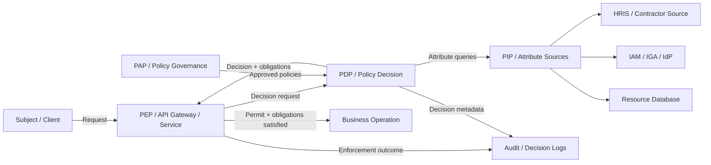
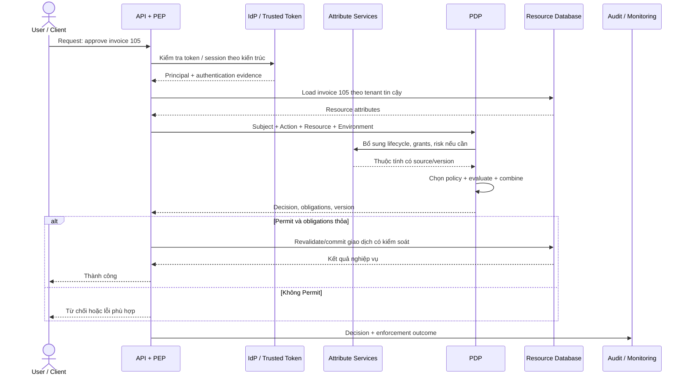

# ABAC decision trong quản lý vòng đời danh tính IAM

## Mục tiêu học tập

Sau khi hoàn thành bài học, người học có thể:

1. Giải thích **ABAC decision** là quyết định ủy quyền truy cập dựa trên những thuộc tính đáng tin cậy của **subject, resource, action và environment**.
2. Phân biệt **authentication**, **authorization decision** và **policy enforcement**; chỉ ra vai trò của **PEP, PDP, PIP và PAP**.
3. Xây dựng yêu cầu quyết định và policy có xét trạng thái **Joiner–Mover–Leaver (JML)**, tenant, mục đích truy cập, quyền, mức xác thực và điều kiện tài nguyên.
4. Diễn giải các kết quả như **Permit, Deny, NotApplicable, Indeterminate** theo ngữ cảnh của một policy engine hỗ trợ chúng; hiểu vì sao chỉ **Permit hợp lệ** mới được thực thi.
5. Xử lý **thuộc tính thiếu, sai nguồn, hết hạn, không nhất quán**, xung đột policy, nghĩa vụ đi kèm decision và hành vi **fail closed**.
6. Kết hợp **RBAC, directory groups, IdP/SSO, SCIM và ABAC** mà không tin mù vào claims trong token hoặc role lưu lâu ngày.
7. Thiết kế enforcement an toàn tại API, service, database và các tác vụ tự động, tránh IDOR/BOLA, TOCTOU, vượt tenant và bỏ qua kiểm tra phía server.
8. Đối soát, kiểm thử và kiểm toán decision để phát hiện **quyền truy cập tồn dư** sau Mover, Leaver hoặc sự cố bảo mật.

## 1. ABAC decision là gì?

**Attribute-Based Access Control (ABAC)** là mô hình kiểm soát truy cập trong đó quyết định cho phép hoặc từ chối một hành động được đánh giá dựa trên **thuộc tính và policy** thay vì chỉ kiểm tra một role cố định.

Một yêu cầu thông thường có bốn nhóm thông tin:

- **Subject:** ai hoặc principal nào đang yêu cầu? Ví dụ identity/account ID, loại người dùng, bộ phận, trạng thái lifecycle, mức xác thực.
- **Action:** định thực hiện thao tác gì? Ví dụ đọc, tạo, duyệt, xuất, sửa quyền.
- **Resource:** đối tượng nào bị tác động? Ví dụ một hóa đơn, một hồ sơ nhân sự, một deployment, một API.
- **Environment:** bối cảnh hiện tại thế nào? Ví dụ thời điểm, kênh truy cập, trạng thái thiết bị, mức rủi ro, môi trường production.

Một **ABAC decision** là kết quả sau khi policy engine đánh giá các thuộc tính đó cùng những quy tắc hiện hành. Decision có thể được biểu diễn đơn giản như **ALLOW/DENY**, hoặc bằng mô hình phong phú hơn như **Permit/Deny/NotApplicable/Indeterminate** tùy engine và chuẩn policy được triển khai.

Ví dụ: nhân viên An có vai trò `InvoiceApprover` và được phép duyệt hóa đơn. Tuy nhiên, hóa đơn số 52 do chính An tạo. Policy SoD quy định người lập hóa đơn không được tự duyệt. Kết quả phải là **Deny** mặc dù account của An đã đăng nhập qua IdP và sở hữu role approver.

### 1.1. Một quyết định có cấu trúc

Có thể biểu diễn ở mức khái niệm:

```text
Decision = Evaluate(
    SubjectAttributes,
    ResourceAttributes,
    ActionAttributes,
    EnvironmentAttributes,
    ApplicablePolicies
)

Nếu tất cả điều kiện cho phép có hiệu lực
và không có ràng buộc chặn tương ứng:
    Decision = Permit
Ngược lại:
    Decision = Deny / NotApplicable / Indeterminate
    tùy ngữ nghĩa engine và bộ chính sách
```

Đây là mô hình tư duy, **không phải một thuật toán chuẩn có thể dùng nguyên trạng**. Cần xác định rõ policy nào áp dụng, cách xử lý thiếu dữ liệu và quy tắc kết hợp nhiều policy.

### 1.2. Authentication không phải authorization

| Câu hỏi | Kiểm soát chính | Ví dụ |
|---|---|---|
| Ai đang yêu cầu? | Identity correlation, authentication | Token do IdP tin cậy phát cho An |
| Phương thức xác thực đủ mạnh? | MFA, passkey, reauthentication | MFA gần đây cho lệnh chuyển tiền |
| Account còn hợp lệ? | Identity lifecycle, account status | An chưa Leaver hoặc bị suspended |
| Có quyền thao tác? | RBAC/permission, ABAC policy | An có `invoice.approve` |
| Được tác động tài nguyên này? | Resource ownership/scope policy | Hóa đơn thuộc chi nhánh An được duyệt |
| Bối cảnh có phù hợp? | Environment/risk policy | Chưa vượt thời hạn, thiết bị đạt posture |
| Yêu cầu có được thực thi? | Policy Enforcement Point (PEP) | Backend chỉ gọi nghiệp vụ sau Permit |

**Token có chữ ký hợp lệ không chứng minh mọi permission vẫn còn đúng.** Token có thể được cấp trước khi người dùng chuyển vai trò, bị vô hiệu account hoặc trước khi thuộc tính tài nguyên thay đổi.

## 2. Kiến trúc ra quyết định: PAP, PIP, PDP, PEP

Trong mô hình ABAC, có thể tách các thành phần logic:

| Thành phần | Tên đầy đủ | Trách nhiệm |
|---|---|---|
| **PAP** | Policy Administration Point | Tạo, duyệt, phiên bản hóa và phân phối policy |
| **PIP** | Policy Information Point | Cung cấp thuộc tính từ những nguồn có thẩm quyền hoặc được tin cậy |
| **PDP** | Policy Decision Point | Đánh giá policy trên request context, trả kết quả |
| **PEP** | Policy Enforcement Point | Chặn/cho phép thao tác thực tế theo decision và xử lý nghĩa vụ bắt buộc |

Có thể có thêm lớp quản trị request context, policy repository, attribute resolver, audit và monitoring. Kiến trúc triển khai có thể dùng library trong service, service authorization tập trung hoặc mô hình kết hợp.



### 2.1. PEP không được tự biến Indeterminate thành Permit

PEP là chốt thực thi cuối cùng trên đường truy cập. Khi không có một **Permit hợp lệ** theo mô hình policy, PEP không được cho phép chỉ vì:

- PDP bị timeout.
- PIP trả lỗi hoặc bỏ sót dữ liệu.
- Không tìm thấy policy.
- Token chưa hết hạn.
- Ứng dụng muốn tránh làm gián đoạn người dùng.
- Frontend đã ẩn hoặc hiện nút thao tác.

Đối với hệ thống nhạy cảm, hành vi an toàn phổ biến là **deny by default/fail closed** khi không thể quyết định tin cậy. Nếu tổ chức có chính sách dự phòng hoặc chế độ chỉ đọc trong sự cố, hành vi đó phải được định nghĩa và kiểm thử riêng, không phải fallback thành “Allow all”.

### 2.2. Decision và enforcement không phải một

PDP có thể trả `Permit` cho tài nguyên theo policy nhưng không trực tiếp thực hiện truy vấn database hay phê duyệt giao dịch. PEP phải:

1. Xác định đúng principal và request action.
2. Lấy resource thực tế, không tin thuộc tính do client tự khai.
3. Gửi context phù hợp đến PDP.
4. Kiểm tra decision và mọi obligation bắt buộc.
5. Thực thi hoặc từ chối tại backend.
6. Ghi bằng chứng kết quả thực thi, không chỉ ghi quyết định lý thuyết.

Nếu có đường gọi trực tiếp bypass PEP, **quyết định của PDP không thể bảo vệ đường đó**.

## 3. Bốn nhóm thuộc tính trong ABAC decision

### 3.1. Subject attributes

Thuộc tính chủ thể có thể gồm:

| Thuộc tính | Nguồn đáng tin minh họa | Mục đích |
|---|---|---|
| `identityId` | Identity registry / IAM | Liên kết một con người hoặc workload ổn định |
| `accountId` | IdP hoặc target application | Xác định account đích đang sử dụng |
| `lifecycleState` | HRIS/contractor source qua IAM | Ngăn truy cập khi Leaver/suspended |
| `department` | HRIS được quản trị | Lọc eligibility hoặc phạm vi quyền |
| `employmentType` | HRIS/contractor system | Phân biệt employee, contractor, guest |
| `approvedRoles` | IGA/role registry | Kiểm tra role/permission đã được duyệt |
| `allowedTenantIds` | IAM/app authorization | Giới hạn môi trường/tenant |
| `authnAssurance` | IdP đã được xác minh | Xác định mức xác thực |
| `authTime` | Sự kiện xác thực đáng tin | Đánh giá freshness khi cần |
| `riskState` | Security/risk engine | Bổ sung kiểm soát hành vi bất thường |

Chỉ nên dùng thuộc tính do nguồn có thẩm quyền xác định hoặc đã có cơ chế xác thực phù hợp. Ví dụ `department=Finance` do client gửi trong JSON body không phải bằng chứng người dùng thuộc Finance.

### 3.2. Resource attributes

Resource có thể mang:

- `resourceId` và `resourceType`.
- `tenantId` hoặc tổ chức sở hữu.
- `ownerIdentityId`.
- `branchId`, `projectId` hoặc phạm vi nghiệp vụ.
- `classification`: public, internal, confidential, restricted.
- `status`: draft, submitted, approved, archived.
- `createdByIdentityId` để đánh giá SoD.
- `dataRetentionState` hoặc legal hold flag khi policy có liên quan.

Nguồn tin cậy thường là **database hoặc service owner của tài nguyên**, không phải các trường do người dùng yêu cầu tự điền.

### 3.3. Action attributes

Action có thể là tên permission như:

```text
employee.profile.read
invoice.create
invoice.approve
invoice.export
payment.execute
role.assign
policy.update
deployment.release
```

Một request HTTP không nên tự suy thành quyền dựa duy nhất vào method. Ví dụ `POST /invoices/{id}/approve` khác `POST /invoices/{id}/comment` về tác động, dù cả hai dùng POST. Hành động phải được map tới năng lực nghiệp vụ và điểm thực thi cụ thể.

### 3.4. Environment attributes

Bối cảnh có thể gồm:

- Timestamp phía server.
- Môi trường production/staging và nguồn request.
- Device posture từ hệ thống quản trị thiết bị đáng tin.
- Mức độ rủi ro của đăng nhập.
- Chính sách vùng địa lý hoặc mạng khi có cơ sở phù hợp.
- Tình trạng sự cố/bảo trì theo nguồn chính thức.
- Authentication freshness của hành động.
- Điều kiện thời gian của một grant tạm hoặc lịch làm việc.

**Địa chỉ IP hoặc vị trí không phải bằng chứng danh tính đủ mạnh.** Chúng là tín hiệu bối cảnh, có thể bị thay đổi hoặc không đáng tin tùy mạng, proxy và cách thu thập.

## 4. Nguồn thuộc tính, độ tin cậy và độ tươi

ABAC decision chỉ đáng tin khi **các thuộc tính được đưa vào đúng nguồn và còn hiệu lực**. Một policy tốt dùng thuộc tính sai có thể cho quyết định nguy hiểm.

### 4.1. Bảng ownership của thuộc tính

| Thuộc tính | Chủ sở hữu | Trách nhiệm khi sai lệch |
|---|---|---|
| Trạng thái lao động | HR / contractor owner | Sửa source và phát lifecycle event hợp lệ |
| Account enabled/disabled | IdP/app owner | Cập nhật và đọc lại tại đích |
| Role/entitlement | IGA và application owner | Phê duyệt, provisioning, access review |
| Tenant/resource owner | Application database owner | Bảo đảm dữ liệu tài nguyên chính xác |
| Device posture | MDM/EDR owner | Đánh giá thiết bị và validity |
| Authn assurance/time | IdP/authentication service | Phát claim đúng và có thể xác minh |
| Chính sách ABAC | Policy owner/PAP | Duyệt, version, test, rollback |
| Session/token state | Issuer/application | Revoke/expiry và bằng chứng runtime |

Nếu employee Leaver đã có hiệu lực nhưng cache chứa `lifecycleState=ACTIVE` từ buổi sáng, PDP có thể quyết định sai nếu không có **freshness rule hoặc invalidation**.

### 4.2. Phân biệt missing, unknown và false

Trong quyết định ABAC, `false` có thể là giá trị hợp lệ, còn `unknown` là **không có đủ bằng chứng**.

Ví dụ:

```text
subject.accountEnabled = false
    → Biết chắc account bị disabled.

subject.accountEnabled = unknown
    → Không lấy được trạng thái account.

subject.accountEnabled = true
    → Có bằng chứng account đang enabled theo nguồn/thời điểm.
```

Không được coi `unknown` là `true` để tránh gián đoạn người dùng. Với policy rủi ro cao, không chứng minh account active phải dẫn đến **không cho phép** hoặc xử lý theo trạng thái Indeterminate đã định nghĩa.

### 4.3. Attribute freshness

Độ tươi có thể được đo từ thời điểm cập nhật và thời điểm quan sát:

```text
attribute.value = ACTIVE
attribute.source = IAM_IDENTITY_REGISTRY
attribute.observedAt = 2026-12-01T08:00:00Z
evaluationAt = 2026-12-01T11:00:00Z

attributeAge = 3 giờ
```

Nếu policy chỉ chấp nhận dữ liệu lifecycle trong một cửa sổ ngắn, PDP phải làm mới từ nguồn phù hợp hoặc từ chối khi không thể xác minh.

Không có một ngưỡng tuổi dữ liệu chung cho mọi thuộc tính. Ví dụ danh sách chi nhánh có thể thay đổi hàng ngày, nhưng account compromise/Leaver đòi xử lý nhanh hơn. **Freshness phải gắn với độ nhạy quyết định** và bảo đảm cập nhật thực tế.

## 5. Xây dựng một ABAC decision request

Giả sử nhân viên An muốn duyệt hóa đơn `INV-105`. Ứng dụng xác thực An bằng IdP, sau đó xây context cho PDP.

Một yêu cầu **minh họa nội bộ**, không phải định dạng chuẩn của mọi PDP:

```json
{
  "requestId": "AUTHZ-REQ-10021",
  "subject": {
    "identityId": "IDN-2048",
    "accountId": "APP-U-742",
    "lifecycleState": "ACTIVE",
    "roles": ["InvoiceApprover"],
    "allowedBranchIds": ["BR-A"],
    "authentication": {
      "assurance": "STRONG_MFA",
      "authTime": "2026-12-01T09:55:00Z"
    }
  },
  "action": {
    "id": "invoice.approve"
  },
  "resource": {
    "id": "INV-105",
    "type": "Invoice",
    "tenantId": "TENANT-VN",
    "branchId": "BR-A",
    "createdByIdentityId": "IDN-3001",
    "status": "SUBMITTED"
  },
  "environment": {
    "serverTime": "2026-12-01T10:00:00Z",
    "requestChannel": "WEB",
    "riskClass": "NORMAL"
  }
}
```

Trong thực tế **client không được tự gửi rồi quyết định giá trị `lifecycleState`, `roles`, `allowedBranchIds` hoặc `resource.branchId`**. Backend/attribute resolver lấy chúng từ token đã xác minh, IGA, nguồn HR hoặc database theo ownership.

### 5.1. Ví dụ câu trả lời của PDP

```json
{
  "requestId": "AUTHZ-REQ-10021",
  "decision": "Permit",
  "policyId": "invoice-approval-v4",
  "policyVersion": "4.2",
  "evaluatedAt": "2026-12-01T10:00:00Z",
  "obligations": [
    {
      "id": "audit.invoice-approval",
      "required": true
    }
  ],
  "reasonCodes": [
    "ACCOUNT_ACTIVE",
    "ROLE_MATCH",
    "BRANCH_MATCH",
    "SEPARATE_CREATOR",
    "AUTHN_FRESH_ENOUGH"
  ]
}
```

Đây chỉ là ví dụ về **hợp đồng PDP–PEP nội bộ**. Một PDP chuẩn hóa theo XACML có cấu trúc response khác; một policy engine nhúng có thể chỉ trả boolean.

PEP chỉ thực thi khi:

- Decision là `Permit` theo policy hợp lệ.
- Các obligation bắt buộc được đáp ứng.
- Principal/resource/action đúng với request được quyết định.
- Không có thay đổi ngữ cảnh gây TOCTOU nghiêm trọng trước khi commit.
- Business precondition và authorization theo resource vẫn đúng.

## 6. Một quy tắc ABAC decision thực tế

Giả sử người dùng muốn `invoice.approve`. Điều kiện nghiệp vụ được phê duyệt:

1. Identity vẫn active; account được enabled.
2. Có role `InvoiceApprover` hoặc permission tương ứng đã duyệt.
3. Invoice thuộc tenant và chi nhánh người dùng được phép quản lý.
4. Invoice có trạng thái `SUBMITTED`.
5. Người duyệt không phải người tạo hóa đơn.
6. Yêu cầu xác thực đáp ứng mức bảo đảm và độ mới.
7. Không có tín hiệu rủi ro hoặc hold bắt buộc từ chối.

```text
permitApproveInvoice(subject, action, resource, environment) =
    subject.lifecycleState == ACTIVE
    AND subject.accountState == ENABLED
    AND subject.permissions CONTAINS invoice.approve
    AND action == invoice.approve
    AND resource.tenantId IN subject.allowedTenantIds
    AND resource.branchId IN subject.allowedBranchIds
    AND resource.status == SUBMITTED
    AND resource.createdByIdentityId != subject.identityId
    AND environment.authnAssurance >= REQUIRED_ASSURANCE
    AND environment.authnAge <= MAX_AUTH_AGE
    AND environment.securityHold == false
```

**Pseudocode không phải ngôn ngữ chính sách chuẩn.** Cần định nghĩa chính xác cách so mức assurance, đọc thời gian và xử lý thuộc tính `unknown`. Một hệ thống không nên cho phép chỉ vì có vài điều kiện `true` nhưng thuộc tính quan trọng chưa xác minh.

### 6.1. Ma trận ví dụ

| Tình huống | Kết quả mong muốn | Lý do |
|---|---|---|
| Account active, role đúng, invoice đúng chi nhánh | Permit nếu mọi điều kiện khác đạt | Đáp ứng policy |
| Account đã Leaver | Deny | Lifecycle không còn hợp lệ |
| Role đúng nhưng invoice khác tenant | Deny | Chặn vượt tenant |
| Role đúng nhưng invoice do chính mình tạo | Deny | SoD |
| Resource đã approved | Deny | Không được duyệt lại theo nghiệp vụ |
| MFA quá cũ | Không Permit; yêu cầu step-up qua luồng được phê duyệt | Authentication freshness |
| Không truy vấn được branchId | Indeterminate hoặc không Permit theo mô hình engine | Thiếu dữ liệu quyết định |
| Không có policy tương ứng | NotApplicable hoặc không Permit theo cách engine đánh giá | Không có căn cứ cấp quyền |
| IdP token còn hạn nhưng account đã disabled | Deny | Account state hiện hành ưu tiên |
| Device posture bị đánh dấu compromised | Deny/hold theo policy | Risk guard |

Không gộp **mã HTTP cuối cùng** với trạng thái PDP; ví dụ PEP có thể chuyển Deny thành 403, yêu cầu xác thực lại thành 401/redirect hoặc trả lỗi dịch vụ phù hợp khi PDP không khả dụng.

## 7. Permit, Deny, NotApplicable và Indeterminate

Một số policy language/engine, điển hình như **XACML**, biểu diễn quyết định thành bốn loại logic:

- **Permit:** policy cho phép theo điều kiện và thuật toán kết hợp áp dụng.
- **Deny:** policy từ chối theo điều kiện và thuật toán kết hợp.
- **NotApplicable:** policy hoặc rule không áp dụng cho request, không phải được phép.
- **Indeterminate:** không thể đánh giá tin cậy do lỗi hoặc thiếu thông tin; một số đặc tả còn phân biệt các biến thể chi tiết của Indeterminate.

**Đây là cách diễn giải của một hệ thống quyết định phong phú, không phải quy định mọi ABAC engine đều phải trả đúng bốn chuỗi này.** Ví dụ một service có thể chuẩn hóa kết quả nội bộ thành `ALLOW`, `DENY` và `ERROR`.

### 7.1. NotApplicable không có nghĩa “mặc định cho phép”

Nếu một policy chỉ quản lý hóa đơn nhưng request là `payroll.export`, policy đó có thể trả `NotApplicable`. Điều này không phải quyền export bảng lương. Một policy khác có thể áp dụng hoặc top-level PEP phải từ chối khi **không có Permit hợp lệ**.

### 7.2. Indeterminate không nên biến thành Permit

Nếu PDP không đọc được trạng thái Leaver của An, nó không biết An có còn đủ điều kiện hay không. Với một thao tác phê duyệt tài chính, kết quả an toàn là **không thực thi** cho đến khi có bằng chứng hoặc cơ chế dự phòng đã được phê duyệt.

Một error do PIP timeout nên được ghi khác **Deny vì vi phạm policy** để vận hành có thể sửa đúng vấn đề, nhưng cả hai đều **không mở quyền**.

### 7.3. Phân biệt business denial và technical failure

| Tình huống | Kết quả PDP khả dĩ | Phản ứng PEP |
|---|---|---|
| Người dùng không có permission | Deny | Từ chối; có thể trả 403 |
| Không đúng tenant | Deny | Từ chối và tránh lộ thông tin cross-tenant |
| Không có policy áp dụng | NotApplicable | Từ chối theo default-deny của hệ thống |
| PIP bị timeout | Indeterminate | Không thực thi, cảnh báo/điều tra |
| Policy cấu hình không hợp lệ | Indeterminate hoặc lỗi triển khai | Dừng triển khai, rollback hoặc fail closed |
| Cho phép nhưng obligation audit bắt buộc thất bại | Permit kèm obligation chưa đáp ứng | PEP không được coi hành động đã hoàn tất |
| Cần MFA mạnh hơn | Không Permit theo policy hiện tại | Bắt đầu step-up đúng luồng; kiểm tra lại sau |

Một mô hình có thể quyết định `Deny` thay vì `Indeterminate` cho thuộc tính thiếu nếu policy viết rõ “thiếu thì từ chối”. Điều quan trọng là **có ngữ nghĩa xác định, ghi lại được và không mở quyền ngoài dự kiến**.

## 8. Kết hợp nhiều policy (policy combining)

Trong hệ thống thực tế, một request có thể chịu nhiều quy tắc:

- Chính sách toàn tổ chức: account phải active.
- Chính sách ứng dụng: cần `invoice.approve`.
- Chính sách tenant: không vượt phạm vi tenant.
- Chính sách resource: người tạo không tự duyệt.
- Chính sách rủi ro: cần MFA mạnh và gần đây.
- Chính sách ngoại lệ: quyền JIT còn hiệu lực.

### 8.1. Vì sao thứ tự và thuật toán kết hợp quan trọng?

Nếu một policy cho Permit vì account có role, nhưng một policy khác Deny vì người dùng Leaver, hệ thống phải có quy tắc rõ ràng để cho **Deny/guard** được áp dụng như mong muốn.

Một số mô hình policy hỗ trợ những thuật toán như:

| Kiểu kết hợp | Ý tưởng | Cẩn trọng |
|---|---|---|
| **Deny-overrides** | Quyết định từ chối có thể ưu tiên theo semantics cụ thể | Phải xét Indeterminate theo đặc tả, không chỉ một phép OR đơn giản |
| **Permit-overrides** | Permit có thể ưu tiên theo semantics cụ thể | Không phù hợp nếu mong mọi lifecycle deny luôn có hiệu lực |
| **First-applicable** | Sử dụng rule/policy áp dụng đầu tiên | Thứ tự quy tắc trở thành yếu tố bảo mật |
| **Only-one-applicable** | Chỉ quyết định khi có đúng một policy áp dụng theo semantics tương ứng | Cần quản lý phạm vi policy để tránh ambiguity |
| **Custom combining** | Logic riêng do tổ chức xây dựng | Phải được review, test, version và chứng minh tính chất an toàn |

Các tên thuật toán trên được dùng trong những engine/chuẩn nhất định; **không được giả định mọi công cụ có cách xử lý lỗi và conflict giống nhau**.

### 8.2. Tách các guard không thể bỏ qua

Một kiến trúc dễ kiểm soát có thể yêu cầu các **mandatory guards** trước khi xét permission nghiệp vụ:

```text
Mandatory guards:
    identity lifecycle phải active
    target account phải enabled
    tenant binding phải hợp lệ
    credential/session phải hợp lệ
    risk hold không được cấm truy cập

Business authorization:
    permission đúng hành động
    resource scope phù hợp
    SoD và trạng thái nghiệp vụ cho phép
    authentication assurance đủ mức

Permit chỉ khi:
    tất cả mandatory guards PASS
    và business authorization PASS
```

Đây là cách tổ chức chính sách minh họa, không phải mọi ABAC engine đều thực hiện guard hai tầng như trên. Nếu thiết kế có exception, exception **không nên tự bỏ qua lifecycle deny của Leaver** trừ khi có workflow kích hoạt lại có thẩm quyền thực sự.

### 8.3. Tránh policy shadowing

Một rule quá rộng kiểu `Permit action == "invoice.*"` có thể che khuất rule chi tiết cho `invoice.approve` trong thuật toán kết hợp sai. Khi thêm policy mới, phải chạy test hồi quy với request cũ và các edge case, đặc biệt những request mà một policy Permit còn policy khác Deny.

## 9. Obligations, advice và cách PEP thi hành

Trong một số framework policy, PDP có thể trả **obligations** (yêu cầu phải thực hiện khi áp dụng decision) và **advice** (thông tin hướng dẫn không bắt buộc theo semantics engine).

Ví dụ:

- Ghi audit bất biến cho thao tác phê duyệt.
- Che dữ liệu nhạy cảm trước khi trả kết quả.
- Bắt buộc yêu cầu step-up thông qua cơ chế được định nghĩa.
- Đính nhãn quyết định để hệ thống giám sát.
- Giới hạn số lượng bản ghi có thể xuất.

**Một decision Permit kèm nghĩa vụ bắt buộc chưa được thực hiện thành công không phải cơ sở để bỏ qua nghĩa vụ đó rồi thực thi.**

### 9.1. Phân biệt nghĩa vụ có thể thi hành với advisory

| Kết quả từ PDP | PEP cần xử lý |
|---|---|
| Permit, không obligation | Kiểm tra precondition và thực thi |
| Permit, obligation “audit before commit” | Ghi audit đúng hợp đồng hoặc không commit |
| Permit, obligation “mask PII fields” | Thực hiện masking an toàn trước response |
| Permit, advice “show notice” | Hiển thị thông báo nếu phù hợp nhưng không thay thế guard |
| Deny và reason code | Từ chối, ghi log phù hợp |
| Indeterminate | Không thực thi, báo lỗi/alert |
| Permit nhưng PEP không hiểu obligation bắt buộc | Không thực thi hoặc xử lý theo quy tắc lỗi đã phê duyệt |

Tính bắt buộc và thứ tự thực hiện phụ thuộc **contract giữa PDP và PEP**. Với thao tác thay đổi dữ liệu, obligation và nghiệp vụ phải được thiết kế xét transaction/atomicity để tránh “đã duyệt tiền nhưng ghi audit thất bại”.

## 10. Luồng ra quyết định từ đầu đến cuối



Các hệ thống có thể triển khai PDP trong cùng service hoặc phân tán qua mạng. Sơ đồ nhấn mạnh rằng **resource phải được tải tin cậy**, decision phải được PEP sử dụng và enforcement outcome phải có bằng chứng.

### 10.1. Rủi ro TOCTOU

**Time-of-check/time-of-use (TOCTOU)** xảy ra khi dữ liệu thay đổi giữa lúc PDP kiểm tra và khi business action được commit.

Ví dụ:

1. PDP thấy invoice `SUBMITTED` và An được phép duyệt.
2. Người khác đã hủy invoice trước khi An commit.
3. Backend vẫn thực hiện approve dựa trên trạng thái cũ.

Biện pháp có thể gồm transaction, optimistic locking, row lock, revalidation hoặc ràng buộc version của resource. Cách cụ thể phụ thuộc database và nghiệp vụ.

Tương tự, nếu HR phát Leaver giữa lúc authorization và commit tác vụ cực nhạy cảm, kiến trúc cần quy định thời điểm kiểm tra trạng thái và cửa sổ chấp nhận hợp lệ.

## 11. ABAC decision trong RBAC, IdP, SSO và SCIM

### 11.1. RBAC là đầu vào, không phải đối thủ của ABAC

RBAC có thể trả lời **người dùng có role nào**, còn ABAC dùng role cùng resource/action/context để ra quyết định cuối.

```text
RBAC:
    An có role InvoiceApprover
    → Có permission invoice.approve

ABAC:
    Account active?
    Invoice thuộc đúng tenant/chi nhánh?
    An có phải người tạo?
    Invoice ở trạng thái Submitted?
    MFA còn đủ mới?
    Có security hold không?

Decision:
    Permit hoặc không Permit theo policy hiện hành
```

Cách kết hợp này giảm nhu cầu tạo hàng nghìn role theo từng chi nhánh/giờ làm việc/độ nhạy tài nguyên. Nhưng phải tránh **role explosion** lẫn **attribute explosion** bằng catalog và ownership.

### 11.2. IdP và SSO không tự đánh giá mọi resource

IdP xác thực, có thể cung cấp token chứa subject, role hoặc group claims. SAML/OIDC truyền kết quả xác thực và thông tin phù hợp. Tuy nhiên:

- IdP thường không có đầy đủ `invoice.branchId`, `invoice.createdBy` hoặc trạng thái giao dịch hiện tại.
- App phải kiểm tra token hợp lệ với issuer/audience/chữ ký và các điều kiện liên quan.
- Các claim có thể phản ánh snapshot tại lúc token được phát.
- Permission trong JWT không nên được coi luôn mới sau Mover/Leaver.
- Việc xác thực MFA thành công **không tự cấp permission**.

### 11.3. SCIM quản trị tài khoản/nhóm, không phải ABAC decision chuẩn chung

SCIM User/Group giúp đồng bộ account, trạng thái `active` và membership khi đích hỗ trợ. SCIM không tự chuẩn hóa mọi permission, attribute resolver hoặc PDP của ứng dụng.

Ví dụ, một thay đổi `SCIM User.active=false` có thể giúp app nhận biết account bị vô hiệu, nhưng **app runtime vẫn phải chặn request hợp lệ theo policy**. Nếu JWT hoặc session cũ chưa bị thu hồi, cần cơ chế riêng để giảm thời gian tồn dư.

### 11.4. Directory groups và nested membership

User có thể nhận permission từ group trực tiếp, nested group và app role. ABAC engine có thể dùng `roles` hoặc `groups` như thuộc tính, nhưng cần biết:

1. Engine nào mở rộng nested group?
2. Nhóm trong claim có bị giới hạn số lượng không?
3. Tên group có đổi không hay dùng ID ổn định?
4. Mapping group-to-permission có được duyệt?
5. Thành viên bị gỡ có được cập nhật vào cache/PDP kịp thời?
6. Có quyền direct grant nào không xuất hiện trong directory không?

**Bỏ một group tại IdP không chứng minh đã mất mọi quyền ở ứng dụng.**

## 12. ABAC decision và vòng đời Joiner–Mover–Leaver

### 12.1. Joiner: đủ điều kiện trước khi Permit

Khi nhân viên mới vào tổ chức, HRIS phát Joiner event. IAM/IGA kiểm tra identity proofing, account correlation, ngày hiệu lực, worker type, role và quyền cơ sở.

ABAC decision cần tránh một account **pre-provisioned nhưng chưa kích hoạt** lại được phép truy cập nhờ token/role bị cấp sớm.

Ví dụ:

```text
subject.lifecycleState = PREJOINER
subject.accountState = DISABLED
subject.roles = [EmployeePortalViewer]
action = employee.portal.read

Decision = Deny
Reason = NOT_ACTIVE_YET
```

Mặc dù role tồn tại, lifecycle guard không cho phép truy cập. Khi HR xác nhận đúng ngày bắt đầu, IAM kích hoạt tài khoản theo chính sách, đồng bộ quyền và ứng dụng mới được đánh giá Permit.

### 12.2. Mover: decision phải phản ánh quyền mới

Khi An chuyển từ Sales sang Finance:

- Role Sales có thể bị thu hồi.
- Role Finance mới được cấp theo approval.
- Resource scope thay đổi sang chi nhánh/pháp nhân mới.
- Các token, app-local role và cache cũ có thể giữ thuộc tính Sales.
- Một số quyền dự án có nguồn riêng có thể vẫn hợp lệ; phải đánh giá theo grant provenance.

```text
09:00  ABAC request: An / sales.report.read / BR-A → Permit.
10:00  HR event: An Mover sang Finance.
10:01  IGA gỡ permission Sales không còn hợp lệ.
10:02  Token cũ vẫn có nhóm Sales nếu chưa bị refresh/revoke.
10:03  PDP/PIP dùng dữ liệu hiện hành để Deny quyền Sales.
10:05  Reconciliation xác minh effective access tại app.
```

Mốc thời gian chỉ minh họa. Một kiến trúc kiểm tra **chỉ token snapshot** có thể chưa từ chối ngay tại 10:03. Cần thiết kế invalidation hoặc kiểm tra quyền mới nhất cho tài nguyên nhạy cảm, và báo giới hạn khi không thể thực hiện.

### 12.3. Leaver: guard phải ưu tiên chặn

Khi Leaver có hiệu lực, identity/account không còn đủ điều kiện truy cập. Decision cần phản ánh trạng thái nguồn, không chờ role cũ bị xóa hết.

```text
IF subject.lifecycleState == TERMINATED
   OR subject.accountState == DISABLED
THEN:
   no Permit for interactive business access
```

Đây là guard **theo chính sách**; có thể có service-side process xử lý retention/audit thay mặt tổ chức, nhưng principal người đã nghỉ không được tự tiếp tục truy cập bằng session cũ.

Ngoài ra, Leaver workflow cần disable IdP/app account, thu hồi SSO/session/token, gỡ entitlement và xử lý credential đặc quyền. **ABAC deny không thay thế deprovisioning** nếu vẫn còn đường ứng dụng bypass PDP.

### 12.4. Rehire

Nếu người đã nghỉ quay lại, không nên dùng event cũ hoặc email trùng để cấp lại quyền. IAM cần xác minh identity correlation, điều kiện Joiner mới, proofing/MFA và desired roles. PDP phải nhận **lifecycle version mới**, tránh dùng cache hoặc grant từ kỳ làm việc cũ.

### 12.5. Nhà thầu và guest

Nhà thầu có thể hết hạn hợp đồng dù account vẫn active tại IdP. Policy cần tham chiếu **contractor source/sponsor** có thẩm quyền, mốc hiệu lực và tenant chính xác. Guest identity từ federation có thể có xác thực hợp lệ tại IdP đối tác nhưng **không tự có quyền** khi sponsor trong tổ chức đã rút quyền.

## 13. Quyết định ABAC trong multi-tenant và quan hệ sở hữu

### 13.1. Chặn truy cập chéo tenant

Trong ứng dụng SaaS nhiều tenant, một người có role `Manager` ở tenant A không mặc nhiên được sửa tài nguyên tenant B.

Policy phải gắn cả:

- Tenant của principal/account hoặc grant.
- Tenant của resource lấy từ database.
- Tenant của request context đã xác minh.
- Role/permission nằm trong tenant nào.
- Quan hệ ủy quyền giữa các tenant nếu có.

```text
ALLOW only if:
    principal.identityLifecycle == ACTIVE
    AND principal.tenantGrants CONTAINS resource.tenantId
    AND principal.permissionGrantsFor(resource.tenantId)
        CONTAINS action
    AND otherResourceConditionsAreSatisfied
```

Không dùng query parameter `tenantId=A` do client cung cấp làm bằng chứng rằng resource thực thuộc A.

### 13.2. IDOR/BOLA là lỗi ABAC enforcement

Một user có permission `project.read` có thể thử thay `projectId` trong URL để đọc dự án người khác. Nếu backend chỉ kiểm tra permission action mà không kiểm tra ownership/scope, lỗi **Broken Object Level Authorization (BOLA)** vẫn xảy ra.

Kiểm soát:

1. Resolve principal từ session/token đáng tin.
2. Tải resource với tenant binding an toàn.
3. Đánh giá quan hệ subject–resource.
4. Từ chối nếu không thuộc scope.
5. Ghi audit phù hợp và không tiết lộ sự tồn tại của resource ngoài thẩm quyền.

### 13.3. Quan hệ người quản lý và dữ liệu

Một policy có thể cho manager xem hồ sơ của nhân viên cấp dưới. Nhưng **quản lý trực tiếp** là quan hệ động từ HR hoặc ứng dụng có owner, không nên tự lấy từ một header `managerId` do client gửi.

Nếu cần truy vấn theo quan hệ phức tạp (cây tổ chức, ownership dự án, người được ủy quyền), mô hình ABAC có thể kết hợp **relationship-based checks**. Cần tránh đoán suy quan hệ dựa chỉ vào cùng Department.

## 14. ABAC decision cho service account và workload identity

Không phải mọi subject đều là con người. CI/CD runner, microservice, batch job và integration client có thể dùng **managed identity, workload federation, mTLS hoặc token ngắn hạn**.

Ví dụ:

```text
subject.type = WORKLOAD
subject.principalId = invoice-export-job
subject.environment = PRODUCTION
subject.ownerTeam = FINANCE_DATA_PLATFORM
action = invoice.export_approved
resource.classification = INTERNAL
environment.runtimeAttested = true

Permit khi:
    workload đang được quản lý hợp lệ
    token/audience đúng dịch vụ
    workload có entitlement phù hợp
    resource thuộc dataset được phép
    environment/risk policy đạt
```

**Không áp giả định “workload có HR employmentStatus ACTIVE”** cho principal máy–máy. Thay vào đó cần lifecycle/ownership riêng cho non-human identity.

### 14.1. Khi người quản lý workload nghỉ việc

Nếu kỹ sư sở hữu job rời tổ chức, không nên tự disable mọi service principal làm ngưng hệ thống. Cần:

- Thu hồi quyền cá nhân của kỹ sư.
- Xác nhận owner team mới.
- Rotate secret/chứng chỉ nếu có rủi ro đã bị tiết lộ.
- Rà soát permission/scope của workload.
- Giữ workload hoạt động hoặc decommission theo quyết định có thẩm quyền.
- Kiểm tra mọi credential còn được phát hành cho principal cũ.

Một policy ABAC có thể yêu cầu `ownerTeam.status=ACTIVE` đối với workload, nhưng nguồn và semantics phải được thiết kế riêng.

### 14.2. Confused deputy và token audience

Một service có thể bị lợi dụng thực hiện hành động thay client không có quyền (**confused deputy**). Khi PEP gọi PDP, cần thể hiện rõ:

- Subject thực là ai: end user, workload hay cả hai trong mô hình delegated access.
- Action nào đang được yêu cầu.
- Resource/tenant nào là đích.
- Token có đúng audience và scope không.
- Service có được thực hiện hành động **on behalf of** chủ thể kia không.

Không được đánh đồng quyền mạnh của service account với quyền của mọi người gửi request qua service đó.

## 15. Mã giả triển khai ABAC decision ở backend

Một ứng dụng Java/Spring có thể dùng authorization library hoặc external PDP, nhưng bắt buộc giữ **PEP tại các điểm thao tác nhạy cảm**. Ví dụ sau là pseudocode Java-oriented, **không phải thư viện hay API Spring Security có thể biên dịch nguyên trạng**.

```java
public Invoice approveInvoice(long invoiceId, AuthenticatedPrincipal principal) {
    // Tải resource theo cơ chế tenant isolation an toàn.
    Invoice invoice = invoiceRepository.findForAuthorization(invoiceId)
        .orElseThrow(ResourceNotFoundException::new);

    DecisionContext ctx = DecisionContext.builder()
        .subject(attributeService.resolveTrustedSubject(principal))
        .action("invoice.approve")
        .resource(invoice.toTrustedAuthorizationAttributes())
        .environment(contextService.currentServerContext())
        .build();

    Decision decision = policyDecisionPoint.evaluate(ctx);

    if (!decision.isPermit()) {
        authorizationAudit.recordDeniedDecision(ctx, decision);
        throw new AccessDeniedException("Not authorized");
    }

    // Nghĩa vụ và trạng thái nghiệp vụ phải được xử lý đúng.
    obligationExecutor.enforceRequired(decision.obligations());

    // Kiểm tra lại các invariant trước commit.
    return invoiceService.approveWithTransactionAndRevalidation(
        invoice, principal, decision
    );
}
```

### 15.1. Những lỗi phổ biến của enforcement

| Lỗi | Vì sao sai | Cách phòng tránh |
|---|---|---|
| Chỉ ẩn nút trên frontend | Client có thể gọi API trực tiếp | Kiểm tra phía server/API |
| Để client gửi `department`/`role` tự do | Thuộc tính không đáng tin | Resolve từ IdP/IAM/HR |
| Kiểm tra một lần lúc login | Quyền có thể đổi trong phiên | Freshness/reevaluation theo risk |
| Áp cùng policy cho mọi tenant | Có thể vượt tenant | Gắn tenant trong resource và grant |
| Không kiểm tra resource instance | IDOR/BOLA | Authorization theo object/scope |
| Xem PDP timeout là Permit | Fail open | Fail closed và xử lý lỗi rõ |
| Không xử lý obligation | Vượt chính sách kiểm toán/masking | Enforce hoặc từ chối |
| Không bảo vệ async worker/batch | Bypass PEP của HTTP | PEP ở service và consumer |
| Cache decision theo user ID duy nhất | Nhầm action/resource/tenant | Cache key đầy đủ và TTL |
| Không kiểm tra lại khi commit | TOCTOU | Transaction, lock/version và revalidation |

### 15.2. Pseudocode chính sách

```text
function evaluateInvoiceApprove(ctx):
    if not attributesAreTrustedAndFresh(ctx):
        return INDETERMINATE("ATTRIBUTE_UNAVAILABLE_OR_STALE")

    if ctx.subject.lifecycleState != ACTIVE:
        return DENY("IDENTITY_NOT_ACTIVE")

    if ctx.subject.accountState != ENABLED:
        return DENY("ACCOUNT_DISABLED")

    if ctx.resource.tenantId not in ctx.subject.allowedTenantIds:
        return DENY("TENANT_SCOPE_MISMATCH")

    if "invoice.approve" not in ctx.subject.effectivePermissions:
        return DENY("MISSING_PERMISSION")

    if ctx.resource.branchId not in ctx.subject.allowedBranchIds:
        return DENY("BRANCH_SCOPE_MISMATCH")

    if ctx.resource.createdByIdentityId == ctx.subject.identityId:
        return DENY("SOD_SELF_APPROVAL")

    if ctx.resource.status != SUBMITTED:
        return DENY("RESOURCE_STATE_INVALID")

    if not assuranceIsSufficient(ctx):
        return DENY("REAUTHENTICATION_REQUIRED")

    return PERMIT(withObligation("AUDIT_APPROVAL"))
```

Hàm trên dùng trình tự kiểm tra để giải thích. Nó chưa biểu diễn đầy đủ policy combining, request signing, distributed transaction, sự kiện version hoặc framework cụ thể. Lỗi thiếu thuộc tính có thể được biểu diễn khác tùy engine nhưng **không được cấp quyền khi thiếu căn cứ bắt buộc**.

## 16. Policy as code: mẫu minh họa và quản trị thay đổi

Policy cần có version, owner và bộ kiểm thử riêng, thay vì là điều kiện ngầm rải rác nhiều service.

Một tài liệu cấu hình **minh họa nội bộ**:

```yaml
policyId: invoice-approval-abac-v4
owner: FINANCE-CONTROL
technicalOwner: AUTHORIZATION-PLATFORM
effect: Permit
target:
  resourceType: Invoice
  action: invoice.approve
subjectRequirements:
  identityLifecycle: ACTIVE
  accountEnabled: true
  effectivePermission: invoice.approve
resourceRequirements:
  tenantWithinSubjectGrant: true
  branchWithinApprovedScope: true
  status: SUBMITTED
  forbidSelfApproval: true
environmentRequirements:
  requiredAssurance: STRONG_MFA
  maxAuthenticationAgeMinutes: 5
  denyWhenSecurityHold: true
attributeTrust:
  lifecycleSource: IAM_IDENTITY_REGISTRY
  roleSource: IGA_OR_APPLICATION_GRANTS
  resourceSource: INVOICE_DATABASE
  timeSource: SERVER
combining:
  mandatoryGuards: all-must-pass
  fallback: Deny
obligations:
  - audit-approval-before-commit
metadata:
  version: "4.2"
  riskClass: HIGH
  reviewRequiredForChange: true
```

**Đây không phải cú pháp XACML, OPA/Rego, Cedar, Spring Security hoặc một sản phẩm cụ thể.** Muốn chạy thật phải chuyển thành policy language/engine phù hợp, xác minh semantics và kiểm thử các trường hợp deny/unknown.

### 16.1. Quy trình đưa policy vào production

1. Định nghĩa mục tiêu nghiệp vụ, đối tượng truy cập và phạm vi.
2. Xác định owner của thuộc tính và nguồn đáng tin.
3. Thiết kế các guard không được bỏ qua.
4. Xác định semantics của Permit/Deny/NotApplicable/Indeterminate.
5. Chọn policy combining và nghĩa vụ thực thi.
6. Viết positive/negative tests, bao gồm Mover/Leaver và multi-tenant.
7. Chạy kiểm thử với dữ liệu không nhạy cảm hoặc môi trường thử nghiệm.
8. Đánh giá tác động lên các role, tenant, account và workload.
9. Review/phê duyệt, version và triển khai có giám sát.
10. Có khả năng rollback an toàn hoặc fail closed khi policy bị lỗi.

### 16.2. Đừng dùng một override rộng để sửa lỗi tạm

Nếu một policy chặn người hợp lệ vì thiếu `branchId`, cách đúng là khắc phục nguồn/attribute resolution và policy tương thích. Không nên thêm rule `Permit if user.isEmployee` để bỏ qua mọi scope chỉ nhằm làm người dùng đăng nhập được.

Mọi ngoại lệ cần giới hạn **principal, resource, action, thời hạn và lý do**, cùng approval có thẩm quyền.

## 17. Caching, latency và tính nhất quán của quyết định

### 17.1. Vì sao cần cache?

PDP có thể phải gọi HR/IAM, directory, resource database và risk engine; điều này tạo độ trễ cho request. Caching policy, attribute hoặc decision có thể giảm tải, nhưng đặt ra nguy cơ **quyền tồn dư**.

Ví dụ nếu `employeeStatus` được cache 6 giờ, một Leaver lúc 17:00 vẫn có thể bị PDP nhìn thành ACTIVE đến hết cache.

### 17.2. Phân loại cache

| Cache | Dữ liệu | Rủi ro |
|---|---|---|
| Policy cache | Bộ rule/version đang active | Policy sửa nhưng node chưa nhận |
| Subject attribute cache | Lifecycle, department, group | Leaver/Mover chưa phản ánh |
| Resource attribute cache | Owner, tenant, status | Quyền theo resource lỗi thời |
| Decision cache | Kết quả Permit/Deny | Reuse cho action/resource/tenant khác |
| Token/session claims | Role/scope tại thời điểm phát | Không phản ánh thu hồi quyền mới |
| Directory/SCIM sync | Membership/role ở đích | Ghi ở nguồn chưa có hiệu lực runtime |

### 17.3. Cache key an toàn

Decision cache không thể chỉ dùng `identityId`. Một khóa logic có thể phụ thuộc:

```text
subjectIdentityId
subjectAccountId
tenantId
actionId
resourceId
resourceVersion
policyVersion
grantVersion
lifecycleVersion
assuranceContext
relevantEnvironmentContext
```

Không nhất thiết lưu tất cả trường này trong mọi key vật lý, nhưng thiết kế phải tránh **cross-resource, cross-tenant, cross-policy reuse**. Với thuộc tính động nhanh, đôi khi tốt nhất **không cache decision Permit** hoặc cache trong thời gian rất ngắn, kết hợp invalidation.

### 17.4. Event invalidation

Khi nhận Mover, Leaver, account compromise hoặc revoke grant:

1. Cập nhật source of truth và version theo workflow.
2. Phân phối sự kiện invalidation tới PDP/app caches.
3. Tính lại desired permissions.
4. Revoke hoặc giới hạn token/session khi cần.
5. Đọc lại effective access ở ứng dụng.
6. Ghi exception nếu thông báo bị mất hoặc hệ thống đích không phản hồi.

Một event tới trễ hoặc được xử lý lặp không được hồi sinh quyết định Permit dựa trên lifecycle cũ.

### 17.5. Khi PDP/PIP không khả dụng

Đối với hành động có rủi ro cao, fail closed thường phù hợp. Với chức năng ít nhạy cảm, tổ chức có thể thiết kế chế độ degrade có giới hạn dựa trên dữ liệu đã được chứng thực còn đủ tươi. Nhưng **không được hiểu fallback là cho phép toàn bộ** hoặc cho rằng cache cũ luôn hợp lệ.

Mức đảm bảo phải được ghi rõ trong policy, kiểm thử sự cố và được owner phê duyệt.

## 18. Nghĩa vụ kiểm toán ABAC decision

### 18.1. Decision log khác access log

Một access log nói **ai gọi endpoint nào và API trả mã gì**. Một decision log nên cho biết **policy nào quyết định, dữ liệu nào được dùng, vì sao không Permit hoặc Permit và PEP đã thực thi thế nào**.

Ví dụ audit record minh họa:

```json
{
  "eventType": "ABAC_DECISION_EVALUATED",
  "requestId": "AUTHZ-REQ-10021",
  "identityId": "IDN-2048",
  "accountId": "APP-U-742",
  "tenantId": "TENANT-VN",
  "action": "invoice.approve",
  "resourceReference": "INV-105",
  "decision": "Deny",
  "reasonCodes": ["SOD_SELF_APPROVAL"],
  "policyId": "invoice-approval-abac-v4",
  "policyVersion": "4.2",
  "attributeSourceVersions": {
    "iamLifecycle": 42,
    "appGrants": 10,
    "invoiceResource": 7
  },
  "pdpResult": "EVALUATED",
  "pepEnforcement": "DENIED",
  "correlationId": "REQ-44821",
  "evaluatedAt": "2026-12-01T10:00:00Z"
}
```

Dữ liệu chỉ minh họa. Log thực nên có event timestamp, duration, error category, service ID, policy version và nguồn thuộc tính nếu hợp lệ theo mục đích kiểm toán.

### 18.2. Không log dữ liệu bí mật hoặc nội dung nhạy cảm quá mức

Không đưa vào log thông thường:

- Access/refresh token, session cookie, password, recovery code.
- Hồ sơ HR chi tiết hoặc ảnh giấy tờ định danh.
- Giá trị nhạy cảm của tài nguyên khi chỉ cần reference ID.
- Thông tin rủi ro hoặc nội dung giao dịch đầy đủ nếu không cần cho audit.

Có thể ghi **reason code** thay vì lưu toàn bộ record hoặc nguyên văn yêu cầu người dùng. Cần bảo vệ log trước sửa/xóa trái phép và giới hạn quyền đọc theo nhiệm vụ.

### 18.3. Đừng lộ quá nhiều thông tin qua response

PEP có thể ghi nội bộ lý do `RESOURCE_TENANT_MISMATCH`, nhưng phản hồi công khai nên hạn chế tiết lộ rằng resource thuộc tenant khác hay người khác.

Ví dụ:
- Người dùng chưa xác thực: 401 hoặc luồng xác thực phù hợp.
- Người dùng đã xác thực nhưng không được quyền: 403 hoặc chính sách che sự tồn tại bằng 404 khi phù hợp.
- PDP lỗi/thuộc tính không khả dụng: báo lỗi dịch vụ theo hợp đồng, không hiển thị nội bộ PIP/token.
- Cần step-up: dẫn đến cơ chế xác thực lại hợp lệ, không tự cấp quyền tạm.

HTTP status phụ thuộc kiến trúc; nó không phải tập kết quả chuẩn duy nhất của PDP.

## 19. Chỉ số và khả năng giám sát

| Chỉ số | Ý nghĩa |
|---|---|
| **Permit/Deny decision rate** | Xu hướng kết quả theo policy/tenant/action |
| **NotApplicable rate** | Có request chưa được bao phủ bởi policy phù hợp không? |
| **Indeterminate/error rate** | PIP/PDP hoặc dữ liệu policy có sự cố không? |
| **Attribute freshness violation rate** | Tỷ lệ thiếu dữ liệu đủ mới |
| **PDP decision latency P50/P95/P99** | Độ trễ đánh giá, quan trọng cho API |
| **PEP enforcement coverage** | Bao nhiêu entry point nhạy cảm có kiểm tra authorization |
| **Cross-tenant denial rate** | Phát hiện request vượt phạm vi tenant |
| **SoD denial count** | Số yêu cầu bị chặn do xung đột nhiệm vụ |
| **Stale Permit incident count** | Trường hợp quyền cũ vẫn được chấp nhận |
| **Mover revocation latency** | Từ thay đổi role đến khi app/runtime từ chối quyền cũ |
| **Leaver residual access count** | Request còn được ALLOW sau mốc Leaver |
| **Policy rollout regression rate** | Lỗi authorization sau phát hành policy |
| **Obligation enforcement failure rate** | Nghĩa vụ bắt buộc thất bại |
| **Emergency override usage** | Mức sử dụng bypass có kiểm soát |
| **Audit evidence completeness** | Decision có đủ policy version, reason và enforcement outcome |

Chỉ số phải ghi rõ **mẫu số, loại action, mức rủi ro, tenant và độ bao phủ**. Một hệ thống có tỷ lệ Deny cao không mặc nhiên an toàn: có thể do policy sai khiến người hợp lệ bị chặn.

### 19.1. Cảnh báo cần ưu tiên

- Account đã Leaver nhưng nhận Permit tại API.
- Một role phổ thông có quyết định Permit cho `iam.role.assign`.
- Policy mới làm Permit tăng đột biến với tài nguyên restricted.
- PIP bị lỗi hoặc stale dẫn tới nhiều Indeterminate trên tác vụ nhạy cảm.
- Decision cache cho phép cross-tenant access.
- Token cũ tiếp tục thực hiện action sau Mover có thời điểm revoke.
- Một obligation audit/masking bị bỏ qua nhưng hành động vẫn hoàn thành.
- Một account workload được dùng để xem dữ liệu HR ngoài scope.
- Emergency override kéo dài quá expiry.
- Policy engine có lỗi phân phối version giữa các node.

Cảnh báo cần owner, severity, hướng xử lý và trạng thái xác minh sau sửa lỗi.

## 20. Kiểm thử ABAC decision

### 20.1. Ma trận kiểm thử cốt lõi

| Trường hợp | Kết quả mong muốn |
|---|---|
| Account active, quyền đúng, resource đúng tenant và scope | Permit nếu mọi điều kiện đạt |
| Account có role nhưng đã Leaver | Không Permit |
| Account suspended | Không Permit theo lifecycle policy |
| Account pre-Joiner trước ngày hiệu lực | Không Permit |
| Mover đã mất quyền Sales, token cũ còn claim Sales | Không Permit theo cơ chế fresh authorization đã thiết kế |
| Resource thuộc tenant khác | Deny |
| Resource do chính người yêu cầu tạo, action approve | Deny nếu SoD cấm |
| Không lấy được lifecycleState | Indeterminate/không Permit |
| Không có policy áp dụng | NotApplicable/không Permit |
| PDP timeout | Fail closed, error và audit |
| Dữ liệu resource stale sau khi status thay đổi | Revalidate, không commit sai |
| Permit kèm obligation bắt buộc nhưng PEP không thực thi được | Không thực thi |
| Token hợp lệ, thiếu permission action | Deny |
| Permission đúng, branch scope sai | Deny |
| MFA chưa đủ mới cho hành động nhạy cảm | Không Permit, yêu cầu step-up hợp lệ |
| Quyền JIT đã hết hạn | Deny |
| Tài khoản dịch vụ có token sai audience | Deny |
| Client sửa JSON body với `department=Finance` | Không làm thay đổi quyết định vì nguồn không tin |
| Direct API call bypass UI | Backend PEP vẫn kiểm tra |
| Cache chỉ theo user trả Permit cho resource khác | Test phải phát hiện và ngăn |
| Role vừa bị revoke trong hệ thống cấp quyền | Runtime phải tuân policy revocation đã định |

### 20.2. Positive test và negative test

**Positive test** bảo đảm người hợp lệ thực hiện đúng hành động trong scope. **Negative test** bảo đảm người không có quyền, khác tenant, sai resource ownership, chưa đủ MFA hoặc đã Leaver bị chặn.

Cả hai cần thiết. Một bộ test chỉ bảo đảm “admin làm được” có thể bỏ qua lỗi BOLA hoặc privilege escalation.

### 20.3. Kiểm thử property-based/decision table

Với policy có nhiều thuộc tính, có thể tạo **decision table**:

```text
AccountActive PermissionMatch TenantMatch SoDAllowed MFAFresh | Expected
true          true            true        true       true     | Permit
false         true            true        true       true     | Deny
true          false           true        true       true     | Deny
true          true            false       true       true     | Deny
true          true            true        false      true     | Deny
true          true            true        true       false    | Deny/StepUp
unknown       true            true        true       true     | No Permit
```

Cần kiểm thử cả **thuộc tính thiếu/null, giá trị bất thường, policy version không đồng nhất, boundary timestamps, concurrency và chuyển trạng thái JML**.

### 20.4. Thử nghiệm an toàn trong production

Khi triển khai policy mới, có thể dùng shadow evaluation để **so quyết định của policy mới với policy đang thực thi** nhưng **không tự áp kết quả shadow**. Cần ghi rõ dữ liệu thực được bảo vệ và không dùng thử nghiệm “Permit all” trên tài nguyên thật để đo độ thuận tiện.

Rollout nên có kế hoạch rollback, monitor tăng Deny/Indeterminate và quy trình cấp quyền khẩn cấp có kiểm soát nếu có sự cố.

## 21. Tình huống thực hành: PDP trả Permit từ thuộc tính cũ

**Bối cảnh:** Doanh nghiệp dùng IdP SSO, IGA quản lý role và một PDP nội bộ kiểm tra policy ABAC cho hệ thống tài chính. Nhân viên Bình từng thuộc Sales, có role `SalesReportReader` và quyền đọc báo cáo chi nhánh A. Lúc 09:00 Bình đăng nhập, token chứa group Sales. PDP cache thuộc tính bộ phận trong 6 giờ.

Đến 11:00 HR phát sự kiện **Mover** sang Finance. IAM gỡ group Sales và cấp role Finance cơ sở, nhưng token cũ vẫn chứa `SalesReportReader`. Ứng dụng gọi PDP với `department=Sales` từ cache, đồng thời chấp nhận `branchId=A` do client gửi trong request. PDP trả `Permit` cho `sales.report.export` mặc dù Bình không còn quyền xuất dữ liệu Sales.

Đến 16:00 Bình nhận **Leaver** có hiệu lực ngay. IdP account bị disable và SCIM User ở ứng dụng được đặt `active=false`. Tuy nhiên một app-local session khác còn active và một API chỉ xác minh chữ ký JWT, không kiểm tra lifecycle.

### 21.1. Câu hỏi phân tích

1. Vì sao group/role trong token cũ không đủ làm bằng chứng permission hiện tại?
2. Cache `department=Sales` trong sáu giờ tạo loại rủi ro gì?
3. Tại sao client gửi `branchId=A` không phải nguồn attribute đáng tin?
4. PDP trả `Permit` khi thiếu trạng thái account hiện hành có phải quyết định an toàn không?
5. Chức năng nào là PIP, PDP, PEP và PAP trong hệ thống trên?
6. Khi nhận Mover, những thành phần nào cần invalidation hoặc re-evaluation?
7. Vì sao IdP disabled và SCIM `active=false` chưa chứng minh đã Leaver hoàn chỉnh?
8. Làm sao xử lý một ứng dụng không hỗ trợ thu hồi JWT tức thì?
9. Nếu PDP timeout trong lúc phê duyệt tài chính, PEP nên làm gì?
10. Bằng chứng nào cần có trước khi tuyên bố quyền truy cập đã bị chặn?

### 21.2. Hướng giải

**Bước 1 — Phân tách xác thực và quyền.** Token được ký đúng chứng minh nguồn phát và tính toàn vẹn trong phạm vi kiểm tra, nhưng nhóm Sales là một snapshot trước Mover. Quyền hiện tại phải được xác minh từ IGA/app policy hoặc qua cơ chế invalidation đủ nhanh.

**Bước 2 — Xử lý thuộc tính stale.** Thuộc tính Department và lifecycle phải có owner, version và freshness rule. Mover phải phát sự kiện thay đổi, làm mới cache/PDP và đối soát app-local role.

**Bước 3 — Bảo vệ resource scope.** Backend phải tải `branchId` thật từ báo cáo/dataset; không tin query parameter mà Bình gửi. Đây là điều kiện để ngăn BOLA/cross-branch access.

**Bước 4 — Kiểm tra account và lifecycle.** PIP nên cung cấp trạng thái account/lifecycle mới nhất hoặc nguồn đã được chứng thực còn tươi. Nếu thiếu bằng chứng quan trọng, kết quả phải là **không Permit**, chứ không bỏ điều kiện.

**Bước 5 — Thực thi tại PEP.** PEP của API phải kiểm tra kết quả quyết định và obligation. Bất kỳ endpoint export hoặc background job nào có khả năng dùng quyền đó cũng phải được bảo vệ.

**Bước 6 — Xử lý Leaver.** Disable IdP và SCIM chỉ là một phần; cần thu hồi app-local session, API token và quyền ngoài luồng. Nếu JWT không revoke tức thì, phải giảm TTL, dùng introspection/denylist/current-state check khi khả thi hoặc ghi giới hạn/biện pháp giảm rủi ro có SLA.

**Bước 7 — Đối soát.** Ghi thời điểm Mover/Leaver, policy version, source attribute version, decision reason, kết quả app runtime. Chỉ báo hoàn tất nếu đã xác minh các đường truy cập trong scope hoặc có exception được quản trị trung thực.

### 21.3. Bài tập đúng/sai

1. “ABAC decision có thể dùng subject, resource, action và environment attributes.”
2. “PEP thường là thành phần chịu trách nhiệm thi hành kết quả cho phép/từ chối.”
3. “PDP trả Permit đồng nghĩa toàn bộ business transaction đã commit đúng.”
4. “PIP có thể lấy thuộc tính từ HR, IAM, IdP hoặc resource database theo quyền sở hữu.”
5. “NotApplicable trong một engine như XACML tự động có nghĩa cho phép truy cập.”
6. “Indeterminate do PIP lỗi nên được xem là Permit để tránh gián đoạn.”
7. “Role từ RBAC có thể là một thuộc tính đầu vào cho ABAC.”
8. “Có permission invoice.read đồng nghĩa được đọc mọi hóa đơn của mọi tenant.”
9. “Một access token chưa hết hạn có thể chứa role đã bị thu hồi sau Mover.”
10. “Chỉ ẩn nút chức năng trong UI là đủ để enforce ABAC.”
11. “Obligation bắt buộc có thể đòi PEP ghi audit hoặc masking trước khi thực thi.”
12. “Một decision cache theo identityId duy nhất có thể tạo cross-resource/cross-tenant leak.”
13. “Leaver phải làm mất hiệu lực các đường truy cập, không chỉ đổi group trong directory.”
14. “Thuộc tính do client tự khai không nên dùng làm căn cứ cấp quyền nhạy cảm.”
15. “SoD có thể cần kiểm tra ai là người tạo resource ngay tại thời điểm approve.”
16. “Một service account cũng có thể là subject của ABAC nhưng cần nguồn lifecycle riêng.”
17. “Kết quả PDP và kết quả enforcement của PEP nên có audit riêng.”
18. “Thiếu thuộc tính resource quan trọng không nên mặc định coi là đúng.”
19. “Policy combining có thể làm thay đổi quyết định cuối khi nhiều policy áp dụng.”
20. “Khi rehire, có thể khôi phục mọi entitlement cũ vì identityId vẫn giống nhau.”

**Đáp án:** 1 Đúng; 2 Đúng; 3 Sai; 4 Đúng; 5 Sai; 6 Sai; 7 Đúng; 8 Sai; 9 Đúng; 10 Sai; 11 Đúng; 12 Đúng; 13 Đúng; 14 Đúng; 15 Đúng; 16 Đúng; 17 Đúng; 18 Đúng; 19 Đúng; 20 Sai.

## 22. Những nguyên tắc cần ghi nhớ

1. **ABAC decision đánh giá quyền theo thuộc tính đáng tin của subject, action, resource và environment**, không chỉ theo role.
2. **PAP quản trị policy, PIP cung cấp thuộc tính, PDP ra quyết định, PEP thực thi**; không thể chỉ có PDP mà bỏ enforcement.
3. **Authentication không đồng nghĩa authorization**, còn token hợp lệ có thể chứa thuộc tính đã cũ.
4. **Permit, Deny, NotApplicable, Indeterminate có semantics tùy engine**; không có Permit đáng tin thì PEP không được tự mở quyền.
5. **Nguồn và độ tươi của thuộc tính là kiểm soát bảo mật**. Missing/unknown không được coi mặc định là true.
6. **Policy combining, mandatory guards và obligations** phải được định nghĩa, review và kiểm thử, tránh override sai.
7. **Scope và thuộc tính tài nguyên phải lấy từ backend đáng tin**, ngăn IDOR/BOLA, truy cập chéo tenant và self-approval.
8. **Joiner chỉ cho phép khi đã đủ điều kiện; Mover tính lại quyền và làm mới cache; Leaver chặn truy cập và thu hồi credential/session**.
9. **IdP/SSO, SCIM, RBAC và directory groups là các lớp liên quan**, nhưng không thay thế quyết định ABAC tại runtime.
10. **Workload identity cần chủ sở hữu và nguồn thuộc tính riêng**, không áp nguyên quy tắc HR của người dùng cho máy–máy.
11. **Caching và eventual consistency phải có version, TTL, invalidation và cách xử lý lỗi** phù hợp mức rủi ro.
12. **Readback, audit và kiểm thử Permit/Deny thực tế** là bằng chứng; chỉ ghi “policy đã triển khai” không chứng minh quyền đã được kiểm soát.

Một hệ thống **ABAC decision** hiệu quả giúp tổ chức cho phép đúng **chủ thể, hành động, tài nguyên, phạm vi, thời điểm và ngữ cảnh**. Khi gắn các quyết định này với nguồn HR/IAM có thẩm quyền, IdP, SSO, SCIM, RBAC/ABAC và vòng đời **Joiner–Mover–Leaver**, doanh nghiệp có thể cấp quyền theo nhu cầu công việc, từ chối truy cập không còn hợp lệ, chống quyền tích lũy và giảm **quyền truy cập tồn dư**.
