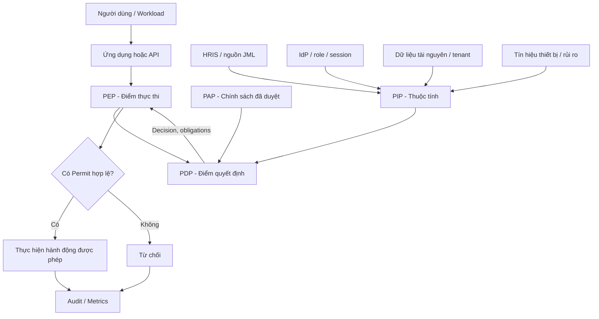
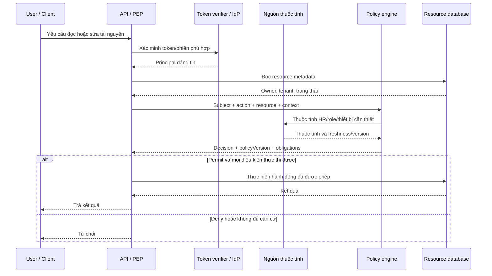
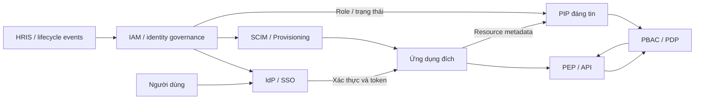

# PBAC là gì? Kiểm soát truy cập dựa trên chính sách trong vòng đời IAM

**PBAC** (*Policy-Based Access Control* — **kiểm soát truy cập dựa trên chính sách**) là cách tổ chức việc **ra quyết định cho phép hoặc từ chối truy cập** bằng những **quy tắc được diễn đạt, quản trị và đánh giá một cách rõ ràng**. Thay vì chỉ hỏi “người dùng có role nào?”, PBAC xem xét yêu cầu cụ thể: **chủ thể nào** muốn làm **hành động gì**, trên **tài nguyên nào**, trong **điều kiện nào**, theo **chính sách có hiệu lực ở thời điểm đó**.

Ví dụ, nhân viên kế toán có role `finance-approver` vẫn **không được tự phê duyệt** khoản thanh toán do chính mình tạo. Trong mô hình PBAC, quy tắc “có role phê duyệt” và quy tắc “không được duyệt giao dịch tự tạo” đều có thể được đánh giá để quyết định cuối cùng là **Deny**. Cũng người đó, với giao dịch khác thuộc đúng đơn vị và hạn mức, có thể nhận **Permit**.

Bài thuộc chương **PBAC** của module `SECURITY_IDENTITY_ACCESS_MANAGEMENT_IDENTITY_LIFECYCLE`. Module nghiên cứu **vòng đời danh tính Joiner–Mover–Leaver (JML)**: xác minh, tạo tài khoản, cấp quyền, rà soát và thu hồi khi thay đổi vai trò; đồng thời liên hệ IdP, SSO, SCIM, RBAC/ABAC, tài khoản dịch vụ, kiểm toán và giảm quyền truy cập tồn dư. **PBAC là lớp kết nối những dữ liệu và quy tắc đó thành quyết định ủy quyền tại điểm truy cập thực tế.**

> **Lưu ý thuật ngữ:** Trong bài này PBAC có nghĩa là *Policy-Based Access Control*. Ở những tài liệu khác, cùng chữ viết tắt đôi khi được dùng cho mô hình nhấn mạnh quyền riêng tư hoặc mục đích truy cập. Khi trao đổi kiến trúc, cần xác nhận định nghĩa thay vì dựa riêng vào chữ viết tắt.

Sau bài học, bạn có thể giải thích PBAC, phân biệt với RBAC/ABAC, mô tả PAP–PIP–PDP–PEP, thiết kế chính sách Permit/Deny theo thuộc tính đáng tin, hiểu default deny và xung đột chính sách, đồng thời áp dụng tư duy PBAC vào Joiner, Mover, Leaver và danh tính máy.

## 1. Vì sao chỉ xác thực hoặc gán role là chưa đủ?

Một lần đăng nhập thành công cho biết hệ thống đã **xác thực** chủ thể theo phương thức và chính sách nhất định. Nó **không có nghĩa** chủ thể được phép thực hiện tất cả chức năng trong ứng dụng.

Hãy phân biệt:

| Hoạt động | Câu hỏi được trả lời | Thành phần thường liên quan |
| --- | --- | --- |
| **Identity management** | Ai là chủ thể? Quan hệ với tổ chức còn hợp lệ không? | HRIS, IAM, IdP, directory |
| **Authentication (AuthN)** | Chủ thể có chứng minh được danh tính không? | Mật khẩu, MFA, passkey, IdP/SSO |
| **Authorization (AuthZ)** | Chủ thể có được thực hiện hành động trên tài nguyên này không? | RBAC, ABAC, PBAC, ứng dụng/API |
| **Provisioning** | Tài khoản, nhóm và entitlement nào cần được tạo/cập nhật? | IAM, SCIM, API, connector |
| **Enforcement** | Hành động có thực sự bị chặn hoặc được thực hiện đúng kết quả không? | API, gateway, service, database guard |
| **Audit/reconciliation** | Vì sao có quyền? Quyền ở đích có khớp trạng thái mong đợi không? | Logs, role catalog, đối soát IAM |

**Tình huống:** Một nhân viên có role `support-agent` để tra cứu hồ sơ khách hàng. Họ có thể đọc hồ sơ thuộc nhóm phụ trách, nhưng không được xem số tài khoản của khách hàng ngoài nhóm hoặc xuất hàng loạt dữ liệu. Nếu ứng dụng chỉ kiểm tra “có role support-agent không?” mà không xét **tài nguyên và phạm vi**, nó có nguy cơ cấp quyền quá rộng.

PBAC cho phép diễn đạt những ràng buộc như “đang làm việc”, “thuộc đúng tenant”, “được giao khách hàng”, “không bị khóa bởi chính sách bảo mật” và “thiết bị đáp ứng yêu cầu” trong **cơ chế đánh giá chính sách thống nhất**. PBAC không tự sinh ra các ràng buộc; con người và hệ thống quản trị phải định nghĩa, triển khai và kiểm thử chúng.

## 2. Định nghĩa chính xác: Policy, request và decision

Trong PBAC, **policy** là một tập quy tắc quy định khi nào truy cập được phép, bị từ chối hoặc cần điều kiện bổ sung. Policy có thể biểu diễn bằng ngôn ngữ của policy engine, cấu hình có cấu trúc hoặc logic đã được kiểm soát phiên bản. Không nên coi một đoạn văn mô tả quy định là policy đã được thực thi nếu ứng dụng chưa có cơ chế đánh giá và chặn tương ứng.

Một quyết định thường dựa trên bốn nhóm dữ liệu:

| Nhóm | Ý nghĩa | Ví dụ |
| --- | --- | --- |
| **Subject** | Chủ thể thực hiện yêu cầu và các thuộc tính đã xác minh | `identityId`, role, employment status, nhóm, mức xác thực |
| **Action** | Thao tác cụ thể | `document.read`, `invoice.approve`, `user.disable` |
| **Resource** | Đối tượng được truy cập, cùng thuộc tính của nó | Hóa đơn, chủ sở hữu, tenant, mức độ nhạy cảm |
| **Environment / context** | Bối cảnh hiện hành | Thời điểm, tín hiệu thiết bị, trạng thái phiên, mức rủi ro |

Ngoài ra, việc đánh giá còn phụ thuộc **phiên bản policy**, quy tắc phê duyệt, ràng buộc phân tách nhiệm vụ và nguồn tin cậy của từng thuộc tính.

Ví dụ một yêu cầu đánh giá:

```json
{
  "subject": {
    "identityId": "iam-user-1042",
    "employmentStatus": "ACTIVE",
    "roles": ["finance-approver"],
    "organizationIds": ["org-17"],
    "authnLevel": "strong"
  },
  "action": "payment.approve",
  "resource": {
    "id": "payment-782",
    "organizationId": "org-17",
    "createdBy": "iam-user-2099",
    "amount": 25000000,
    "state": "PENDING"
  },
  "environment": {
    "managedDevice": true,
    "requestTime": "2026-12-01T03:00:00Z"
  }
}
```

**Đây là dữ liệu minh họa, không phải hợp đồng API bắt buộc.** Trong triển khai thật, các trường quan trọng không được lấy từ JSON do client tùy ý khai báo. `createdBy` phải lấy từ hệ thống quản lý giao dịch; trạng thái nhân sự từ HRIS/IAM đã xác minh; trạng thái thiết bị từ tín hiệu tin cậy; thời điểm đánh giá từ đồng hồ đáng tin.

Một policy có thể diễn đạt:

```text
PERMIT payment.approve khi TẤT CẢ điều kiện đúng:
    subject.employmentStatus == ACTIVE
    AND subject có role finance-approver
    AND resource.organizationId thuộc subject.organizationIds
    AND resource.createdBy != subject.identityId
    AND resource.state == PENDING
    AND resource.amount <= subject.approvalLimit
    AND session đáp ứng yêu cầu xác thực
    AND không có chính sách DENY áp dụng

Nếu thiếu căn cứ bắt buộc, không tự cho phép.
```

Đây là **giả mã trung lập với sản phẩm**, không phải cú pháp chính thức của một engine. Trong hệ thống thực, cần xác định rõ kiểu dữ liệu, phép so sánh, phạm vi, nguồn và hành vi khi trường bị thiếu.

## 3. PBAC hoạt động theo kiến trúc nào?

Kiến trúc PBAC thường được mô tả bằng các vai trò **PAP–PIP–PDP–PEP**.

| Thành phần | Tên đầy đủ | Trách nhiệm |
| --- | --- | --- |
| **PAP** | Policy Administration Point | Soạn, duyệt, quản lý phiên bản, phát hành và thu hồi policy |
| **PIP** | Policy Information Point | Cung cấp thuộc tính đáng tin cậy từ HRIS, IdP, directory, tài nguyên, thiết bị |
| **PDP** | Policy Decision Point | Đánh giá request với policy và dữ liệu; trả decision |
| **PEP** | Policy Enforcement Point | Chặn hoặc cho thực thi thao tác tại tài nguyên theo decision |
| **Audit/observability** | Cơ chế quan sát | Ghi lại yêu cầu, kết quả, policy version và thực thi |



**PDP quyết định nhưng PEP mới chặn được truy cập.** Nếu policy engine trả Deny mà API không kiểm tra hoặc chỉ ẩn nút trên giao diện, người dùng vẫn có thể gọi endpoint trực tiếp.

Bốn vai trò trên là **ranh giới trách nhiệm**, không nhất thiết là bốn máy chủ. Một ứng dụng nhỏ có thể đánh giá policy trong cùng process. Hệ thống lớn có thể dùng PDP chung hoặc thư viện engine nhúng vào từng service, với cơ chế phân phối policy và theo dõi phiên bản.

### 3.1. PAP: ai được thay đổi luật?

Policy có thể cấp hoặc thu hồi quyền trên diện rộng, vì vậy bản thân hành động **sửa policy** phải được kiểm soát. PAP cần owner, review, phê duyệt, version, môi trường kiểm thử và lịch sử thay đổi. Đặc biệt, quyền sửa một policy dùng để bảo vệ `finance-admin` không nên mặc nhiên nằm trong tay mọi người có thể triển khai ứng dụng.

### 3.2. PIP: thuộc tính nào được tin?

PIP có thể truy xuất trạng thái nhân sự từ HRIS/IAM, role từ IdP hoặc hệ thống quản trị quyền, metadata của tài nguyên từ API và device posture từ hệ thống quản lý thiết bị. **Nguồn dữ liệu phải có thẩm quyền theo thuộc tính**; không nên dùng email hoặc header tự khai làm bằng chứng rằng một người đang là nhân viên chính thức.

### 3.3. PDP: kết quả có ngữ nghĩa gì?

PDP đánh giá các rule áp dụng, kết hợp kết quả và trả quyết định. Một số engine có thể trả kết quả bổ sung như lý do, nghĩa vụ và phiên bản policy. PDP cần xác minh đầu vào, xử lý trường thiếu, lỗi nguồn, sự thay đổi phiên bản và bảo vệ quyền truy cập vào chính policy.

### 3.4. PEP: quyết định chỉ có giá trị khi được thực thi

PEP có thể nằm ở API gateway, backend service, lớp nghiệp vụ hoặc các thành phần gần tài nguyên hơn. Với kiểm soát ở **cấp bản ghi**, một gateway chỉ biết URL chưa chắc đủ metadata; service hiểu tài nguyên phải bảo đảm không có đường nào bỏ qua kiểm tra.

## 4. Quy trình đánh giá và thực thi một request



Trình tự trên là minh họa. Trong nhiều hệ thống, API tự xác minh JWT hoặc dùng introspection mà không gọi IdP mỗi request; PDP có thể nằm trong ứng dụng. Điều không đổi là **tính tin cậy của principal, metadata tài nguyên và việc thực thi decision**.

Giả mã:

```text
handleApprovePayment(request):
    principal = authenticateAndValidateToken(request)
    if principal is invalid:
        return AUTHENTICATION_FAILED

    payment = loadTrustedPayment(request.paymentId)
    if payment does not exist:
        return NOT_FOUND

    context = {
        subject: trustedSubjectAttributes(principal),
        action: "payment.approve",
        resource: trustedPaymentMetadata(payment),
        environment: trustedEnvironment()
    }

    decision = evaluateApprovedPolicies(context)
    if decision.effect != PERMIT:
        auditDecision(decision, context)
        return FORBIDDEN

    if not enforceMandatoryObligations(decision):
        return FORBIDDEN

    atomically:
        recheckSecurityCriticalConditions(payment, principal)
        approveIfStillAllowed(payment, principal)

    auditDecisionAndEnforcement(decision, context)
    return APPROVED
```

**Giả mã không phải mã production.** Với thao tác nhạy cảm, phải xử lý giao dịch đồng thời và lỗi *time-of-check to time-of-use (TOCTOU)*: một hóa đơn có thể thay đổi owner, trạng thái hoặc hạn mức sau khi PDP quyết định nhưng trước khi thao tác được commit.

## 5. PBAC trả những loại quyết định nào?

Một số mô hình như XACML phân biệt bốn kết quả; các engine cụ thể có thể dùng tên hoặc cấu trúc khác:

| Kết quả | Ý nghĩa khái niệm | Xử lý ở PEP bảo vệ tài nguyên |
| --- | --- | --- |
| **Permit** | Chính sách phù hợp cho phép | Chỉ thực thi khi điều kiện và obligation bắt buộc được đáp ứng |
| **Deny** | Có căn cứ từ chối theo chính sách | Chặn request |
| **NotApplicable** | Không có policy áp dụng cho request | Mặc định không cho phép nếu không có cơ chế cho phép khác rõ ràng |
| **Indeterminate** | Không thể kết luận vì lỗi hoặc thiếu dữ liệu bắt buộc | Không biến thành Permit; chặn hoặc xử lý ngoại lệ an toàn |

**Default deny** nghĩa là một yêu cầu **không có căn cứ cho phép hợp lệ thì không được cấp quyền**. Đừng nhầm “PDP timeout” với “PDP cho phép”, hoặc “không tìm thấy policy” với “không có hạn chế”.

Ví dụ:
- Nhân viên có role và đúng đơn vị, không vướng policy chặn → có thể **Permit**.
- Nhân viên thiếu role bắt buộc hoặc đang bị đình chỉ → **Deny**.
- Action mới chưa có policy chịu trách nhiệm → **NotApplicable**, PEP phải có cách xử lý an toàn.
- HRIS/PIP lỗi khiến không biết trạng thái Leaver → **Indeterminate** hoặc lỗi theo engine; không tự mặc định `ACTIVE`.

### Khi có nhiều policy cùng áp dụng

Policy engine cần quy tắc kết hợp (*policy combining*), chẳng hạn **deny-overrides**, **first-applicable**, hoặc các thuật toán khác theo đặc tả engine.

| Policy | Kết quả riêng | Giải thích |
| --- | --- | --- |
| Có role `finance-approver` | Permit | Chủ thể có nhiệm vụ duyệt |
| Hóa đơn do chính người này tạo | Deny | Xung đột SoD |
| Giao dịch thuộc đơn vị được giao | Permit | Đúng phạm vi |
| Account ACTIVE | Permit | Quan hệ chưa kết thúc |
| **Kết quả mong đợi** | **Deny** | Guardrail SoD phải được ưu tiên |

Không được mặc định rằng **một Permit bất kỳ sẽ thắng mọi Deny**. Quy tắc ưu tiên phải được thiết kế và kiểm thử. Ngược lại, **deny-overrides** cũng có chi tiết xử lý lỗi/Indeterminate phụ thuộc engine; nên kiểm tra ngữ nghĩa chính xác thay vì chỉ dựa vào tên thuật toán.

### Obligation và advice

Một policy có thể cho phép truy cập **với nghĩa vụ bắt buộc**: ví dụ che trường dữ liệu nhạy cảm, yêu cầu kiểm tra thêm hoặc ghi audit đặc biệt. Nếu PEP không thực hiện được obligation bắt buộc, không nên trả dữ liệu nguyên trạng như thể đã hoàn tất policy. **Advice** chỉ mang tính gợi ý và không được nhầm với điều kiện bảo mật bắt buộc.

## 6. PBAC khác RBAC và ABAC ra sao?

**RBAC**, **ABAC** và **PBAC** không nhất thiết là ba công nghệ loại trừ nhau. Chúng nhấn mạnh những khía cạnh khác nhau:

| Mô hình | Trọng tâm | Ví dụ | Giới hạn khi dùng riêng |
| --- | --- | --- | --- |
| **RBAC** | Gán permission qua role | `finance-approver` được phép yêu cầu `payment.approve` | Role chung không tự giới hạn mọi bản ghi hoặc giao dịch |
| **ABAC** | Điều kiện trên subject, action, resource, environment | Chỉ duyệt payment cùng đơn vị, dưới hạn mức | Cần nguồn thuộc tính đáng tin và policy phức tạp hơn |
| **PBAC** | Quản trị và đánh giá **chính sách** quyết định truy cập | Kết hợp role, hạn mức, SoD, trạng thái HR thành Permit/Deny | Không có tác dụng nếu policy sai, dữ liệu sai hoặc PEP không thực thi |

**RBAC có thể là một thành phần của PBAC.** Một policy như “chỉ role quản trị được tạo user” là chính sách dựa vào role. **ABAC cũng có thể là thành phần của PBAC.** Một policy như “chỉ xem khách hàng thuộc vùng được giao” dùng thuộc tính.

Một cách hiểu thực tiễn:

- **RBAC** giúp quản lý **những chức năng thường xuyên** theo nhiệm vụ.
- **ABAC** mô tả **giới hạn thay đổi theo đối tượng/ngữ cảnh**.
- **PBAC** cung cấp cách **diễn đạt, phân phối, đánh giá và thực thi** những quy tắc này một cách có quản trị.

Điều cốt yếu là **thực thi least privilege**, không phải chọn đúng một nhãn mô hình. PBAC cũng không tự loại bỏ đặc quyền quá rộng nếu policy đưa ra Permit sai.

### Ví dụ phối hợp

Một nhân viên Sales có role `sales-agent` (RBAC), được đọc khách hàng có `region` nằm trong `allowedRegions` (ABAC), nhưng bị từ chối nếu quan hệ lao động đã chấm dứt, hoặc nếu tài nguyên vượt độ nhạy cảm của phiên đăng nhập (PBAC kết hợp các quy tắc).

## 7. Chính sách truy cập khác chính sách cấp phát quyền

Cần phân biệt **quy trình cấp quyền** với **quyết định sử dụng quyền**:

| Hoạt động | Đầu vào | Kết quả |
| --- | --- | --- |
| **Provisioning** | Sự kiện HR, phê duyệt, role catalog | Tạo account, group, entitlement tại IdP/ứng dụng |
| **PBAC decision** | Subject, action, resource, context, policy | Permit/Deny hoặc trạng thái tương đương |
| **Enforcement** | Decision và request cụ thể | API thực hiện hoặc chặn thao tác |
| **Reconciliation** | Desired vs observed vs effective access | Phát hiện và xử lý quyền thiếu/thừa, đường truy cập tồn dư |

Một account có thể đã được cấp role `report-reader` qua SCIM, nhưng PBAC vẫn từ chối một báo cáo ngoài tenant của người dùng. Ngược lại, PDP có thể cho rằng chủ thể đủ điều kiện đọc, nhưng **ứng dụng đích chưa provision tài khoản**; đó là lỗi provisioning/khả năng thực thi, không phải quyền đã được cấp thành công.

**Policy decision không thay SCIM. SCIM không thay PDP. SSO không thay authorization.** Từng thành phần có ranh giới trách nhiệm riêng.

## 8. PBAC trong Joiner: thiết lập quyền đúng thời điểm

**Joiner** là người mới gia nhập. HRIS hoặc nguồn đã được ủy quyền phát sự kiện có **identity ID ổn định**, loại quan hệ, đơn vị, vai trò và thời điểm hiệu lực.

Một quy trình kết hợp IAM–PBAC:

1. Xác minh nguồn, danh tính và bản ghi Joiner; không liên kết chỉ bằng họ tên/email.
2. Provision user tại IdP và ứng dụng khi chính sách cho phép, có thể chuẩn bị trước ngày bắt đầu.
3. Gán role/entitlement cơ sở theo role catalog và phê duyệt.
4. Đăng ký phương thức xác thực phù hợp với tài nguyên sẽ truy cập.
5. PBAC kiểm tra **trạng thái hiệu lực**, role, phạm vi tài nguyên và ngữ cảnh **mỗi khi thực hiện hành động cần bảo vệ**.
6. Đối soát quyền ở IdP, ứng dụng và API.

Ví dụ:

| Trạng thái Joiner | Yêu cầu | Kết quả PBAC mong đợi |
| --- | --- | --- |
| Tài khoản đã chuẩn bị, ngày bắt đầu ở tương lai | Đọc khách hàng nội bộ | Deny |
| Đã bắt đầu, chưa có quyền CRM được phê duyệt | Đọc khách hàng | Deny |
| ACTIVE, có role phù hợp, đúng vùng | Đọc khách hàng được giao | Có thể Permit |
| ACTIVE, có role nhưng khách hàng ngoài vùng | Đọc khách hàng khác vùng | Deny |

**Có account chưa đủ để được truy cập.** PBAC giúp ngăn tình huống tài khoản được tạo sớm nhưng quyền nghiệp vụ chưa đến thời điểm có hiệu lực.

## 9. PBAC trong Mover: vai trò mới phải loại bỏ quyền cũ

**Mover** xảy ra khi nhân viên thay đổi bộ phận, dự án, cấp bậc, người quản lý hoặc tư cách làm việc. Nếu chỉ **cộng thêm role mới** mà không thu hồi quyền cũ, tổ chức dễ gặp *privilege creep*.

Ví dụ An từ Sales chuyển sang Audit:

| Dữ liệu | Trước Mover | Sau Mover |
| --- | --- | --- |
| Role Sales | Có | Phải kết thúc nếu không còn căn cứ |
| Role Audit | Không | Có nếu được phê duyệt |
| Quyền xem CRM | Trong vùng Sales | Chỉ còn nếu quan hệ khác hợp lệ |
| Quyền xem báo cáo Audit | Không | Theo phạm vi được giao |
| Trạng thái tài khoản | ACTIVE | Vẫn ACTIVE, không cần xóa identity |

PBAC có thể **Deny việc sửa khách hàng** ngay khi chính sách/quyền có thẩm quyền đã thay đổi, trong khi provisioning tiếp tục đồng bộ group và entitlement ở đích.

Điểm dễ sai là **token hoặc cache cũ**: một access token phát trước Mover có thể vẫn chứa role Sales. Nếu API chỉ đọc claim cũ mà không có cơ chế kiểm tra hiện trạng, truy cập sai vẫn có thể tiếp tục. Với quyền nhạy cảm, cần chiến lược **TTL ngắn, invalidation, introspection, session review hoặc kiểm tra trạng thái đích**, tùy kiến trúc và yêu cầu thu hồi.

### Phân tách nhiệm vụ (SoD)

Khi An chuyển từ vai trò tạo thanh toán sang phê duyệt, PBAC phải xét cả **role mới** và **lịch sử người tạo** của giao dịch. Dù role tạo đã bị thu hồi, An vẫn không được tự duyệt giao dịch đã từng tạo nếu chính sách SoD cấm.

## 10. PBAC trong Leaver: từ chối sau khi quan hệ kết thúc

**Leaver** là tình huống người dùng rời tổ chức hoặc một quan hệ truy cập cụ thể hết hiệu lực. Hệ thống IAM cần chặn khả năng đăng nhập và thu hồi entitlement theo sự kiện có thẩm quyền; PBAC bổ sung **điểm kiểm tra quyền tại lúc yêu cầu**.

1. Nhận Leaver event, xác minh danh tính và `effectiveAt`.
2. Disable account hoặc chặn đăng nhập tại IdP/directory.
3. Thu hồi role, nhóm, quyền ứng dụng và account đích qua SCIM/API hoặc quy trình tương đương.
4. Đánh giá session, refresh token, access token và đường đăng nhập local.
5. PBAC ở API nhạy cảm phải kiểm tra trạng thái chủ thể và từ chối nếu quan hệ cần thiết đã kết thúc.
6. Đối soát trạng thái thực tế, mở cảnh báo cho đích chưa xác minh.

**Thay đổi trạng thái Leaver ở HR không tự đến mọi PEP ngay lập tức.** Nếu API đang dùng thuộc tính cache hoặc token còn hạn, policy đúng trên giấy vẫn có thể chưa được áp. Thiết kế phải có **cơ chế và mức thời gian thu hồi thực tế**, đặc biệt với quyền quản trị hoặc dữ liệu nhạy cảm.

### Một người có nhiều quan hệ

Nhân viên đồng thời có thể là đối tác dự án hoặc sở hữu một danh tính dịch vụ. Khi một quan hệ chấm dứt, phải thu hồi **quyền có nguồn gốc từ quan hệ đó**, đồng thời rà soát các quyền khác theo chính sách. Không tự suy rằng mọi danh tính kỹ thuật của hệ thống do người nghỉ việc vận hành đều phải bị xóa, cũng không cho quan hệ khác còn hiệu lực giữ hộ đặc quyền từ hợp đồng đã kết thúc.

### Rehire

Khi một người quay lại làm việc, cần xác minh đúng chủ thể qua nguồn đáng tin và tính lại quyền theo vị trí mới. PBAC phải dùng **trạng thái và policy hiện hành**, không tự khôi phục role, ngoại lệ hay session cũ chỉ vì username/email giống trước.

## 11. IdP, OAuth/OIDC, SSO và SCIM nằm ở đâu?

Trong kiến trúc phổ biến:



- **IdP/SSO:** chứng minh danh tính và ngữ cảnh đăng nhập; không quyết định mọi quyền trên từng bản ghi.
- **OAuth access token:** hỗ trợ gọi API theo quyền được cấp; API vẫn phải kiểm tra issuer, audience, thời hạn, scope/role và tài nguyên.
- **OIDC ID token:** truyền kết quả xác thực cho Relying Party; **không nên dùng như access token ở API**.
- **SCIM:** quản lý user/group và thuộc tính giữa hệ thống; không tự thực thi chính sách PBAC tại mọi API.
- **PBAC/PDP/PEP:** quyết định và thực thi truy cập cho action–resource cụ thể dựa trên dữ liệu đáng tin.

Một token có scope `orders.read` không mặc định cho phép đọc đơn hàng của mọi chi nhánh. **Phạm vi resource và tenant vẫn phải được kiểm tra tại PEP/API.**

## 12. PBAC với workload và tài khoản dịch vụ

Không phải mọi subject là con người. **Service principal, workload identity, OAuth client credentials** cũng có thể gọi API dưới danh tính ứng dụng.

Ví dụ `report-sync-prod` dùng Client Credentials Grant để ghi báo cáo tự động. PBAC nên xét:

| Thuộc tính | Chính sách gợi ý |
| --- | --- |
| Workload identity | Định danh client/service principal đáng tin |
| API và action | Chỉ `report.write`, không `admin.all` |
| Environment | Chỉ production khi workload production đã được duyệt |
| Tenant và resource | Chỉ dữ liệu `org-17` hoặc phạm vi được cấp |
| Credential status | Token/credential còn hợp lệ và chưa bị thu hồi |
| Owner | Có đội chịu trách nhiệm và chu kỳ rà soát |
| Decommission | Ngừng cấp quyền và thu hồi credential khi workload ngừng hoạt động |

**Không sử dụng token application-only quyền cao để bỏ qua quyền của người dùng đầu vào.** Nếu nhân viên yêu cầu một backend thực hiện thao tác, backend phải kiểm tra quyền của nhân viên đối với nghiệp vụ đó, kể cả khi bản thân backend có quyền API rộng hơn. Lỗi này thường được mô tả là **confused deputy**.

Khi một nhân viên sở hữu hệ thống nghỉ việc, cần **chuyển owner và xoay vòng bí mật có nguy cơ bị người đó biết**, đồng thời bảo đảm workload còn cần thiết được vận hành an toàn. Không coi việc xóa tài khoản người đó là đủ để thu hồi credential máy.

## 13. Chính sách nào được ưu tiên và thay đổi thế nào?

PBAC chỉ an toàn nếu chính sách có **lifecycle quản trị** riêng:

1. **Đề xuất:** mô tả mục đích nghiệp vụ, chủ sở hữu, loại tài nguyên và rủi ro.
2. **Thiết kế:** viết điều kiện, hiệu lực, nguồn dữ liệu, exception, guardrail và kết quả khi thiếu thuộc tính.
3. **Review/approval:** kiểm tra least privilege, SoD, quyền riêng tư và rủi ro cấp quyền rộng.
4. **Kiểm thử:** các ca Permit, Deny, dữ liệu thiếu, xung đột, tenant khác và JML.
5. **Phiên bản hóa:** lưu lịch sử, thời điểm hiệu lực, tác nhân thay đổi và nguồn phê duyệt.
6. **Triển khai:** phân phối policy cho PDP nhúng/tập trung và kiểm tra version đã có hiệu lực.
7. **Giám sát:** đo tỷ lệ Deny bất thường, lỗi engine, độ trễ và sai lệch quyền.
8. **Rà soát/thu hồi:** xóa policy không còn căn cứ; có kế hoạch rollback hoặc biện pháp bù trừ an toàn.

### Thay đổi policy cũng là một hành động đặc quyền

Nếu người dùng có thể tự sửa rule từ “chỉ xem báo cáo của mình” thành “xem toàn bộ tenant”, họ có thể leo thang quyền mà không cần được cấp thêm role ở ứng dụng. Vì vậy, **quyền quản trị PAP, việc phát hành policy và quản lý khóa/credential của PDP** đều phải tuân theo kiểm soát đặc quyền và audit.

### Ngoại lệ khẩn cấp (break-glass)

Khi một hệ thống cần quyền khẩn, có thể tạo **đường xử lý ngoại lệ được phê duyệt**, giới hạn identity, action, resource, thời hạn và mức xác thực, có giám sát. Không dùng cách **tắt toàn bộ policy Deny** chỉ vì PDP/PIP gặp lỗi; đó là fail-open nguy hiểm.

## 14. Những rủi ro thiết kế PBAC hay gặp

| Sai lầm | Hậu quả | Phòng tránh |
| --- | --- | --- |
| Tin thuộc tính tự khai từ client | Kẻ tấn công giả tenant, role, device status | Dữ liệu từ PIP/nguồn đã xác minh |
| Chỉ kiểm tra role ở UI | API có thể bị gọi trực tiếp | PEP ở backend/API cho mọi đường nhạy cảm |
| Không kiểm tra object-level | Truy cập sai bản ghi hoặc tenant | Chính sách theo resource thực |
| Mặc định Permit khi thiếu rule | API mới có thể bị mở quyền | Default deny |
| PDP timeout thì cho qua | Lỗi dịch vụ trở thành lỗ hổng | Fail closed hoặc chế độ khẩn có kiểm soát |
| Một Permit thắng mọi Deny | SoD và Leaver guardrail bị bỏ qua | Combining rõ ràng, test xung đột |
| Token/attribute cache quá lâu | Quyền Mover/Leaver tồn dư | TTL, invalidation, đánh giá theo rủi ro |
| Policy được đổi không qua review | Cấp quyền rộng ngoài dự kiến | PAP, version, approval, automated tests |
| Chỉ log PDP, không log PEP | Không chứng minh yêu cầu đã bị chặn | Audit cả decision và enforcement |
| Ghi token/PII vào decision log | Rò rỉ thông tin xác thực hoặc dữ liệu cá nhân | Redaction, phân quyền, thời hạn lưu |
| Không bảo vệ policy editor | Người dùng tự sửa rule để nâng quyền | Least privilege và audit cho PAP |
| Một PEP bị bỏ qua trong hệ thống | Có đường truy cập không kiểm tra | Kiểm thử endpoint và kiến trúc enforcement |

### Cache policy decision phải ràng buộc với gì?

Không nên cache Permit chỉ theo `userId`. Một người có thể được đọc tài liệu A nhưng không được đọc B. Khóa cache, nếu dùng, phải xét **subject, action, resource, tenant, policy version và những thuộc tính/ngữ cảnh liên quan**. Với trạng thái thay đổi nhanh (Leaver, quyền đặc biệt, rủi ro thiết bị), đôi khi **không nên cache Permit lâu**.

Ví dụ một quyết định Permit lúc 09:00 có thể không còn hợp lệ lúc 09:01 khi quyền bị thu hồi. TTL không phải bảo đảm an toàn nếu yêu cầu chặn khẩn cần thực hiện ngay. Các ứng dụng phải có cơ chế phù hợp với SLA thu hồi của từng loại tài nguyên.

## 15. Đánh giá kết quả: desired, observed và effective access

Dùng PBAC không loại bỏ nhu cầu **reconciliation**:

- **Desired state:** quyền và điều kiện truy cập nên được cho phép theo HR, policy, role, approval và thời gian hiệu lực.
- **Observed state:** trạng thái user, group, role, session/token hoặc cấu hình thực tế ở từng hệ thống đích.
- **Effective access:** hành động mà chủ thể có thể **thực sự thực hiện** sau khi policy được PEP áp dụng.

Giả sử HR đã phát Leaver. IAM đặt `account.disabled=true`, nhưng FinanceApp còn session cục bộ và một API chưa gắn PEP. Trạng thái mong đợi là **không truy cập**, nhưng effective access có thể vẫn còn. Cần phát hiện và xử lý đường truy cập tồn dư, không chỉ dựa vào thông báo “sync successful”.

Một hệ thống PBAC có thể có policy đúng nhưng **PIP chưa cập nhật**, **PDP còn cache cũ** hoặc **PEP bị bypass**. Do đó cần kiểm chứng end-to-end, nhất là sau sự kiện Mover/Leaver.

## 16. Tình huống tổng hợp: Nhân viên tài chính đổi vai trò rồi nghỉ việc

Giả sử nhân viên **An** có identity ID ổn định `iam-user-1042`, đăng nhập qua IdP/SSO và sử dụng FinanceApp. Hệ thống quản lý quyền qua RBAC, thêm chính sách PBAC để xét hạn mức, SoD, tenant và trạng thái JML.

| Thời điểm | Sự kiện | Dữ liệu chính sách | Kết quả truy cập mong đợi |
| --- | --- | --- | --- |
| **Trước Joiner** | Account đã chuẩn bị, ngày bắt đầu ở tương lai | Chưa đủ `effectiveAt` | Deny nghiệp vụ |
| **Joiner ACTIVE** | An có role duyệt tài chính | Role, tenant, hạn mức, auth context hợp lệ | Permit với giao dịch hợp lệ |
| **Vi phạm SoD** | An thử duyệt giao dịch chính mình tạo | `createdBy == identityId` | Deny |
| **Mover** | An chuyển sang kiểm toán | Role phê duyệt kết thúc, role đọc báo cáo bắt đầu | Deny `payment.approve`, Permit đọc báo cáo đúng phạm vi |
| **Leaver** | Quan hệ lao động kết thúc lúc 17:00 | Trạng thái và `effectiveAt` mới | Deny các hành động dựa trên quan hệ đã kết thúc |
| **Rehire** | An quay lại với nhiệm vụ khác | HR xác minh quan hệ mới, role mới | Tính lại từ đầu, không tự phục hồi quyền duyệt cũ |

### Lỗi A: claims trong token đã cũ

IdP đã gỡ role phê duyệt khi Mover, nhưng FinanceApp giữ token phát trước đó. Nếu API chỉ tin claim cũ, nó có thể vẫn trả Permit. Phải kết hợp **freshness, TTL, session/token control** và kiểm tra trạng thái mới theo chính sách.

### Lỗi B: SoD chỉ được kiểm tra khi cấp role

An từng tạo giao dịch rồi chuyển role sang phê duyệt. Dù hiện tại không còn role Maker, An vẫn có thể thử tự duyệt giao dịch cũ. **SoD ở cấp tài nguyên** phải tiếp tục kiểm tra `createdBy`.

### Lỗi C: policy đúng nhưng endpoint không gọi PDP

API `POST /payments/782/approve` kiểm tra PBAC, nhưng một endpoint batch khác cập nhật cùng trạng thái mà không có PEP. Kẻ tấn công hoặc người dùng sai quyền có thể khai thác đường batch. Cần **coverage review** trên tất cả đường thực thi, không chỉ flow UI thông thường.

### Lỗi D: Leaver chỉ được gửi sang SCIM

Connector trả trạng thái thành công, nhưng SaaS còn phiên đã đăng nhập và API chưa thu hồi token. **Đối soát phải kiểm tra quyền hiệu lực**, gồm session và những tài khoản local ngoài IdP.

## 17. Kiểm toán policy decision

Nhật ký PBAC nên trả lời **ai đã yêu cầu**, **hành động/tài nguyên gì**, **chính sách phiên bản nào**, **decision gì** và **PEP đã thực thi ra sao**.

Ví dụ **schema audit minh họa**:

```yaml
decisionId: pbac-dec-2048
identityId: iam-user-1042
actorType: human
action: payment.approve
resourceRef: payment-782
tenantRef: org-17
policyVersion: finance-authz-v12
decision: DENY
reasonCodes:
  - SOD_SELF_APPROVAL
evaluatedAt: "2026-12-01T03:00:00Z"
enforcement: BLOCKED
pepService: finance-api
correlationId: request-c72a
```

Không ghi **mật khẩu, ID/access/refresh token, client secret, session cookie, hồ sơ HR đầy đủ hoặc nội dung giao dịch nhạy cảm** tràn lan vào log. Có thể sử dụng reason code và tham chiếu tài nguyên để phục vụ điều tra; cần phân quyền đọc log và thời hạn lưu.

Các chỉ số hữu ích:

| Chỉ số | Ý nghĩa |
| --- | --- |
| Tỷ lệ Permit/Deny theo action | Thấy thay đổi bất thường |
| NotApplicable/Indeterminate | Phát hiện policy thiếu hoặc PIP lỗi |
| PDP p95/p99 và tỷ lệ timeout | Theo dõi hiệu năng và độ sẵn sàng |
| PEP coverage | Số API/đường thực thi đã gắn kiểm soát |
| Thời gian thu hồi quyền Mover/Leaver | Đo truy cập tồn dư |
| Policy version drift | PDP/ứng dụng dùng rule không đồng nhất |
| SoD violations được chặn | Hiệu quả guardrail nghiệp vụ |
| Ngoại lệ quá hạn | Quyền tạm có nguy cơ thành quyền vĩnh viễn |

Không chỉ dựa vào **tỷ lệ Deny cao** để kết luận an toàn. Một hệ thống không gọi PDP có thể có rất ít Deny nhưng nguy hiểm; một policy lỗi từ chối toàn bộ Joiner cũng không được xem là thành công.

## 18. Kiểm thử PBAC và checklist triển khai

### Ma trận kiểm thử tối thiểu

| Tình huống | Kết quả mong đợi |
| --- | --- |
| User đủ role, đúng tenant và resource, account ACTIVE | Permit theo đúng phạm vi |
| User đủ role nhưng sai tenant | Deny |
| User có role nhưng tự duyệt giao dịch | Deny vì SoD |
| Joiner chưa đến `effectiveAt` | Deny |
| Mover đã mất quyền cũ nhưng token vẫn có claim cũ | Không cho dùng quyền đã thu hồi theo chính sách |
| Leaver bị disable tại IdP nhưng còn session SaaS | Đánh dấu chưa hoàn tất và chặn/đối soát đường truy cập |
| PIP không trả thuộc tính bắt buộc | Không fail open |
| Không có policy áp dụng | Default deny theo thiết kế |
| PDP trả Permit nhưng PEP không đáp ứng obligation | Không thực hiện hành động không an toàn |
| Cùng request đi qua endpoint khác | Cùng guardrail được thực thi |
| Workload token application-only | Chỉ hành động/phạm vi được cấp cho workload |
| Policy mới làm thay đổi nhiều quyết định | Test/shadow evaluation và phê duyệt trước rollout |

### Checklist thiết kế

1. Đã xác định chính xác **subject, action, resource, environment** cho mọi request nhạy cảm chưa?
2. Có phân biệt **authentication, provisioning và authorization** không?
3. Có **PAP, PIP, PDP, PEP** với owner và trách nhiệm rõ ràng không?
4. Policy có dùng thuộc tính **đáng tin cậy**, không tin dữ liệu do caller tự khai không?
5. Có **default deny**, cơ chế xử lý lỗi, NotApplicable và Indeterminate không?
6. Chính sách SoD, tenant isolation, trạng thái JML có được áp trước các Permit thông thường không?
7. PEP có bảo vệ mọi endpoint, bao gồm API batch và đường truy cập trực tiếp không?
8. Có quản lý **policy version, approval, review, rollback** và bảo vệ người sửa policy không?
9. Claim/token và cache có giới hạn độ mới phù hợp với yêu cầu Mover/Leaver không?
10. IdP, SSO, SCIM, RBAC/ABAC và các ứng dụng có cơ chế đối soát rõ không?
11. Với workload, có xét principal máy, owner, scope và decommission riêng không?
12. Có lưu **decision và enforcement** mà không lộ secrets và dữ liệu cá nhân không?
13. Có kiểm thử cả chính sách lẫn **khả năng truy cập thực tế** khi chuyển trạng thái JML không?

## 19. Câu hỏi tự kiểm tra

**Câu 1.** PBAC khác gì với việc kiểm tra một role cố định?

**Trả lời:** PBAC đánh giá **chính sách cho một request cụ thể**, có thể kết hợp role (RBAC), thuộc tính tài nguyên/ngữ cảnh (ABAC), trạng thái JML và SoD. Role chỉ là một trong nhiều căn cứ.

**Câu 2.** IdP đã xác thực MFA thành công. Có thể bỏ qua policy decision khi gọi API không?

**Trả lời:** Không. MFA chứng minh ngữ cảnh xác thực, không cấp quyền trên mọi tài nguyên. API vẫn phải đánh giá authorization.

**Câu 3.** PDP trả Deny nhưng API vẫn cập nhật hóa đơn. Lỗi nằm ở đâu?

**Trả lời:** PEP hoặc một đường thực thi đã **không chặn** hành động. Policy chỉ có hiệu lực khi điểm thực thi tuân theo decision.

**Câu 4.** Nếu PIP không đọc được trạng thái nhân sự, có thể coi user là ACTIVE để tránh gián đoạn không?

**Trả lời:** Không nên. Thiếu dữ liệu bắt buộc là lỗi/Indeterminate; phải xử lý an toàn, không biến nó thành Permit, trừ đường ngoại lệ được thiết kế và kiểm soát riêng.

**Câu 5.** Mover đã gỡ role ở IdP, vậy vì sao quyền có thể còn tại ứng dụng?

**Trả lời:** Có thể do token cũ, session, cache, quyền cấp trực tiếp hoặc đồng bộ chưa hoàn tất. Cần đối soát và kiểm tra effective access.

**Câu 6.** Một policy có Permit nhưng yêu cầu che số tài khoản; PEP không thực hiện được việc che. Có được trả dữ liệu không?

**Trả lời:** Không nếu việc che là **obligation bắt buộc**. Phải từ chối hoặc xử lý theo phương án bảo mật được duyệt, không bỏ qua nghĩa vụ.

**Câu 7.** Xóa role của người nghỉ việc có đồng nghĩa access token và workload credential đã bị thu hồi không?

**Trả lời:** Không. Role assignment, phiên/token và credential của danh tính máy là những đối tượng có vòng đời khác nhau, cần xử lý và xác minh riêng.

## Kết luận

**PBAC — Policy-Based Access Control — là cách ra quyết định truy cập dựa trên những chính sách rõ ràng, có nguồn dữ liệu đáng tin và được thực thi tại tài nguyên.** Nó không thay thế hoàn toàn RBAC hay ABAC mà có thể **kết hợp role, thuộc tính, trạng thái danh tính, điều kiện tài nguyên và guardrail** để tạo decision đúng ngữ cảnh. Kiến trúc **PAP–PIP–PDP–PEP** tách quản trị chính sách, dữ liệu, quyết định và điểm thực thi; **default deny, xử lý lỗi, SoD, kiểm toán và đối soát** giúp hạn chế cấp quyền sai. Trong **Joiner–Mover–Leaver**, PBAC hỗ trợ chặn truy cập trước ngày có hiệu lực, loại bỏ quyền cũ khi chuyển vai trò và giảm **quyền truy cập tồn dư** sau khi nghỉ việc — với điều kiện policy cập nhật kịp thời và các PEP thực sự thực thi.
