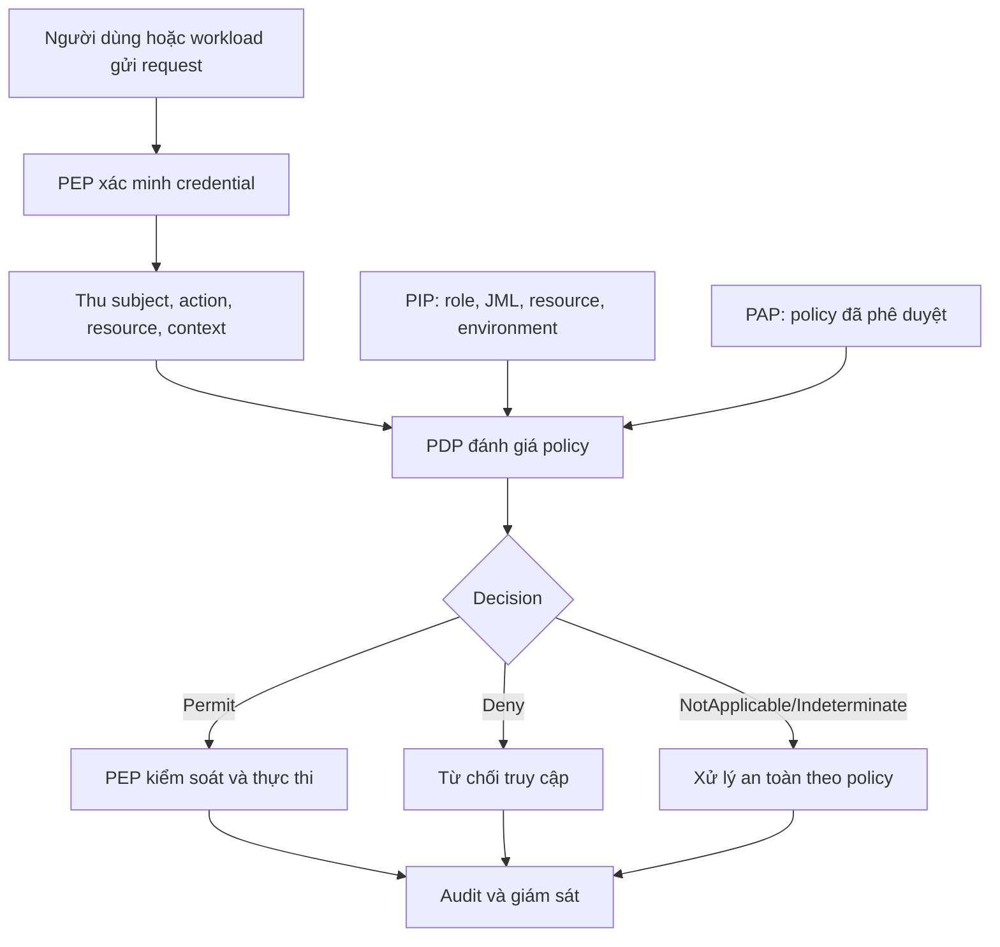

# Policy là gì trong PBAC và vòng đời danh tính IAM?

**Policy** (*chính sách*) là một tập quy tắc có cấu trúc xác định **trong điều kiện nào một chủ thể được phép hoặc bị từ chối thực hiện hành động trên tài nguyên**. Trong **Policy-Based Access Control (PBAC)**, chính sách là cơ sở trung tâm cho quyết định phân quyền: hệ thống đánh giá yêu cầu truy cập theo chính sách được quản trị, thay vì rải rác các câu lệnh kiểm tra quyền không nhất quán trong từng ứng dụng.

Ví dụ, chính sách có thể quy định: “Nhân viên Finance còn quan hệ lao động hợp lệ, được gán quyền duyệt hóa đơn, không phải người tạo hóa đơn và đã xác thực với mức bảo đảm phù hợp thì mới được phê duyệt hóa đơn trong phạm vi được giao.” Điều này khác với việc chỉ hỏi “người dùng có đăng nhập hay không?” hoặc “có thuộc nhóm Finance không?”.

Trong mô hình **Identity and Access Management (IAM)** theo **Joiner–Mover–Leaver (JML)**, policy cần bảo đảm quyền được cấp khi có căn cứ, được cập nhật khi thay đổi nhiệm vụ và bị thu hồi khi quan hệ kết thúc. PBAC kết hợp với **IdP, SSO, SCIM, RBAC/ABAC, service account, kiểm toán và đối soát** để ngăn quyền truy cập tồn dư.

## 1. Policy là gì và khác các khái niệm liên quan?

| Khái niệm | Ý nghĩa | Ví dụ |
| --- | --- | --- |
| **Policy** | Tập quy tắc đưa ra quyết định truy cập | Chỉ manager của dự án được duyệt yêu cầu |
| **Rule** | Một điều kiện/hành động quyết định trong policy | Nếu `subject.team == resource.team` thì xét cho phép đọc |
| **Role** | Tập permission gắn với trách nhiệm trong RBAC | `invoice-approver` |
| **Permission** | Quyền thực hiện một hành động | `invoice.approve` |
| **Attribute** | Dữ liệu mô tả subject, resource hoặc môi trường | `department`, `classification`, `deviceCompliant` |
| **Entitlement** | Quyền được gán hoặc có hiệu lực trong hệ thống đích | Nhóm SaaS, role ERP, ACL |
| **Decision** | Kết quả đánh giá chính sách | Permit, Deny hoặc kết quả khác theo engine |
| **Enforcement** | Việc hệ thống thực sự chặn/cho truy cập | API từ chối request không đủ điều kiện |

**PBAC là cách tổ chức và thực thi quyền bằng policy**, không nhất thiết là một mô hình toán học đối lập hoàn toàn với RBAC hoặc ABAC. Một policy PBAC có thể **sử dụng role của RBAC**, **thuộc tính của ABAC**, quan hệ tài nguyên hoặc điều kiện ngữ cảnh. Điểm quan trọng là **chính sách rõ ràng, quản lý tập trung hoặc có quản trị thống nhất, được kiểm tra và thực thi đúng chỗ**.

Không có nghĩa mọi sản phẩm ghi nhãn “PBAC” đều dùng chung một tiêu chuẩn cú pháp. Cần xác minh mô hình quyết định, thuật toán kết hợp policy và khả năng tích hợp thực tế.

## 2. Một policy trả lời những câu hỏi nào?

Một yêu cầu truy cập cần ít nhất bốn thành phần:

- **Subject:** ai đang yêu cầu, ví dụ nhân viên, đối tác hay workload.
- **Action:** thao tác nào, ví dụ `read`, `edit`, `approve`, `delete`, `export`.
- **Resource:** tài nguyên nào, ví dụ hóa đơn, ticket, tài liệu hoặc API.
- **Context:** điều kiện nào đang áp dụng, như trạng thái JML, tenant, thời gian, mức bảo đảm MFA hoặc tình trạng thiết bị.

Policy xác định **điều kiện cho phép hoặc từ chối** từ các dữ liệu này. Một chính sách tốt còn chỉ rõ **nguồn thuộc tính**, mức tin cậy, độ mới, thời điểm hiệu lực, owner và cách xử lý khi thiếu thông tin.

Ví dụ:

```text
PERMIT approve_invoice IF
    subject.lifecycle_status == "active"
    AND "invoice-approver" IN subject.effective_roles
    AND subject.tenant_id == resource.tenant_id
    AND subject.identity_id != resource.created_by
    AND resource.amount <= subject.approval_limit
    AND context.authentication_assurance >= required_assurance
ELSE DENY
```

Đây là **giả mã**, không phải cú pháp mặc định của mọi policy engine. Thứ tự mức bảo đảm phải được định nghĩa theo hợp đồng; không so sánh chuỗi ký tự `acr` tùy ý. Các trường về identity, role, hạn mức và resource owner phải đến từ **nguồn đáng tin**, không lấy từ dữ liệu tự khai của client.

## 3. Các thành phần trong kiến trúc PBAC

| Thành phần | Vai trò | Ví dụ triển khai |
| --- | --- | --- |
| **PEP — Policy Enforcement Point** | Chặn request và áp dụng quyết định | Backend API, gateway, service endpoint |
| **PDP — Policy Decision Point** | Đánh giá yêu cầu với policy và thuộc tính | Policy engine trong ứng dụng hoặc dịch vụ riêng |
| **PIP — Policy Information Point** | Cung cấp thuộc tính cho quyết định | HRIS, role store, data catalog, risk/device service |
| **PAP — Policy Administration Point** | Quản lý, phê duyệt, phiên bản và xuất bản policy | Quy trình policy-as-code hoặc giao diện quản trị |



Trong ứng dụng nhỏ, các thành phần có thể chạy cùng một tiến trình. Trong doanh nghiệp lớn, PDP hoặc PIP có thể là dịch vụ độc lập. **Tách logic trách nhiệm** quan trọng hơn việc có bao nhiêu máy chủ.

**PDP ra quyết định nhưng PEP mới thực thi.** Một policy được lưu trong công cụ trung tâm mà API không gọi hoặc không áp dụng kết quả thì không bảo vệ được tài nguyên.

## 4. Policy khác Authentication và Federation

**Authentication (AuthN)** xác định yêu cầu đến từ chủ thể được xác minh ở mức thích hợp; **Authorization (AuthZ)** xác định điều chủ thể được làm. **IdP** có thể phát hành ID token OIDC hoặc SAML assertion cho SSO; ứng dụng tiếp nhận cần kiểm tra trust và tạo phiên.

Một phiên đăng nhập có MFA thành công **không tự trao quyền**. Chính sách PBAC vẫn phải kiểm tra:

1. Account/identity còn đủ điều kiện theo JML không?
2. Subject có role/entitlement và phê duyệt hợp lệ không?
3. Resource có thuộc tenant, dự án và phạm vi được giao không?
4. Action có cần MFA mới hoặc điều kiện bảo mật khác không?
5. Có ràng buộc SoD, thời gian hoặc ngoại lệ nào không?

**ID token OIDC không phải access token dùng gọi API.** Resource server phải kiểm tra credential dành đúng audience/scope và tiếp tục thực thi policy theo tài nguyên. SCIM provisioning là cơ chế **tạo/cập nhật/disable account và nhóm**, không phải giao thức PBAC chung để kiểm tra từng request.

## 5. Policy Permit và Deny: không chỉ có hai kết quả

Nhiều policy engine hỗ trợ kết quả phức tạp hơn `true/false`. Ví dụ theo tư duy XACML, một quyết định có thể là:

| Kết quả | Ý nghĩa | Ứng xử an toàn |
| --- | --- | --- |
| **Permit** | Chính sách cho phép theo điều kiện đã đánh giá | PEP vẫn phải thực thi ràng buộc liên quan |
| **Deny** | Chính sách từ chối | PEP chặn request |
| **NotApplicable** | Không có policy phù hợp yêu cầu | Thường từ chối nếu không có quy tắc bao phủ hợp lệ |
| **Indeterminate** | Không thể xác định do lỗi/thiếu thông tin | Không tự động chuyển thành Permit |

Các tên kết quả có thể khác theo sản phẩm. **Fail closed** nghĩa là không cho phép thao tác nhạy cảm khi không thể xác minh điều kiện cần thiết, trừ khi đã có quy trình fallback được thiết kế và phê duyệt trước.

Ví dụ PIP không trả trạng thái `lifecycle_status`. Không nên giả định người dùng vẫn active và cho truy cập. Cần đánh giá độ rủi ro, xử lý lỗi, cảnh báo và cơ chế vận hành phù hợp.

## 6. Policy combining: khi nhiều quy tắc xung đột

Một yêu cầu có thể khớp nhiều policy:

- Policy A cho phép `finance-reader` đọc báo cáo.
- Policy B cấm mọi truy cập của account đã Leaver.
- Policy C chỉ cho phép xuất dữ liệu từ thiết bị compliant.
- Policy D tạm thời hạn chế hệ thống khi có sự cố.

Nếu chỉ lấy policy đầu tiên khớp, kết quả có thể sai. Cần định nghĩa **cách kết hợp quyết định** như deny-overrides, permit-overrides, first-applicable hoặc cơ chế tùy engine, rồi kiểm thử các trường hợp.

| Tình huống | Chính sách cho phép | Chính sách từ chối | Kết quả mục tiêu |
| --- | --- | --- | --- |
| Nhân viên active, có quyền đọc | Có | Không | Permit |
| Leaver còn role cũ | Có do role tồn dư | Có do lifecycle | Deny |
| Người dùng có role nhưng sai tenant | Có do role | Có do tenant | Deny |
| Được duyệt JIT nhưng hết hạn | Có do approval cũ | Có do expiry | Deny |
| PDP thiếu thuộc tính bắt buộc | Không xác định | Không xác định | Không được tự Permit |

**Không có thuật toán combining “đúng tuyệt đối” cho mọi nghiệp vụ**; tổ chức phải chọn hợp đồng rõ ràng, đặc biệt ở chính sách phủ định rủi ro cao như Leaver, cross-tenant hoặc SoD.

## 7. Policy với RBAC, ABAC và ReBAC

PBAC có thể biểu diễn nhiều kiểu logic:

**Dựa trên vai trò — RBAC:** nếu user có `ticket-reader`, cho phép tác vụ đọc ticket theo điều kiện khác. Role giúp quản trị quyền theo công việc.

**Dựa trên thuộc tính — ABAC:** chỉ cho phép nếu `subject.tenant == resource.tenant`, dữ liệu có mức phân loại phù hợp và môi trường đáp ứng chính sách.

**Dựa trên quan hệ — ReBAC:** chỉ cho phép nếu user là thành viên của dự án sở hữu tài nguyên hoặc được owner chia sẻ theo cơ chế quan hệ được quản lý.

```text
PERMIT read_document IF
    subject.lifecycle_status == "active"
    AND (
        "document-auditor" IN subject.roles
        OR subject.identity_id IN resource.authorized_project_members
    )
    AND subject.tenant_id == resource.tenant_id
    AND resource.classification IN subject.allowed_classifications
ELSE DENY
```

Không nên tự coi role `document-auditor` đủ để bỏ qua **tenant isolation**, vì phần điều kiện sau vẫn phải đúng. Chính sách phải được kiểm tra với cả các yêu cầu đổi `resourceId` trên URL nhằm ngăn **Broken Object Level Authorization (BOLA/IDOR)**.

## 8. Policy lifecycle: chính sách cũng có vòng đời

Không chỉ identity mới có lifecycle. Bản thân policy cần:

1. **Draft:** mô tả mục tiêu, owner, phạm vi tài nguyên và yêu cầu nghiệp vụ.
2. **Review:** đánh giá least privilege, ràng buộc SoD, tác động dữ liệu và ngoại lệ.
3. **Approve:** người có thẩm quyền phê duyệt; tách người viết và người phê duyệt khi phù hợp.
4. **Test:** chạy unit test, negative tests, mô phỏng tài nguyên, phân tích tác động.
5. **Publish/Deploy:** triển khai policy version được kiểm soát.
6. **Observe:** ghi nhận quyết định, lỗi, độ trễ và các trường hợp bất thường.
7. **Revise:** điều chỉnh do đổi pháp lý, nghiệp vụ, vai trò hoặc dữ liệu.
8. **Retire:** vô hiệu hóa policy cũ và xóa các ngoại lệ không còn dùng.

**Policy-as-code** là một cách hiện thực hóa: lưu policy có version, kiểm tra tự động, peer review và triển khai qua pipeline. Không bắt buộc mọi tổ chức phải sử dụng cùng một ngôn ngữ policy; việc chọn công cụ phụ thuộc hạ tầng và yêu cầu quản trị.

## 9. Source of truth và độ tin cậy thuộc tính

Một policy tốt có thể cho quyết định sai nếu đầu vào không đúng. Cần chỉ rõ **nguồn có thẩm quyền**:

| Thuộc tính | Nguồn có thể có thẩm quyền | Rủi ro |
| --- | --- | --- |
| `lifecycle_status` | HRIS/hệ thống quan hệ qua IAM | Leaver vẫn được coi active |
| `department` / `manager` | HRIS hoặc tổ chức quản lý | Mover giữ quyền cũ |
| `effective_roles` | IAM/IGA và entitlement tại đích | Role được tính nhưng chưa áp dụng |
| `resource.owner` | Ứng dụng nghiệp vụ/data owner | BOLA hoặc chia sẻ sai |
| `tenant_id` | Hệ thống tenant và identity correlation | Cross-tenant access |
| `device_compliance` | MDM/attestation tin cậy | Client tự khai thiết bị compliant |
| `session_assurance` | IdP/session service theo hợp đồng | MFA cũ bị coi còn mới |
| `contract_expiry` | Contract/sponsor system | Partner còn quyền sau hợp đồng |

Thông tin phải được **ràng buộc đúng subject/resource**, đủ mới, có phiên bản hoặc TTL và không để client tự thay đổi. Nếu policy dựa trên dữ liệu không sẵn có, phải có chiến lược xử lý lỗi an toàn.

## 10. Áp dụng policy trong Joiner

**Joiner** tạo quan hệ đủ điều kiện cấp account và quyền ban đầu:

- HR hoặc nguồn nhân sự xác nhận danh tính và ngày hiệu lực.
- IAM tính **desired state** dựa trên vị trí, bộ phận và điều kiện đặc thù.
- Policy xác định role nào có thể cấp tự động, role nào yêu cầu approval.
- SCIM/connector provision account, group hoặc entitlement tại ứng dụng.
- IdP/SSO/MFA thực thi xác thực khi quyền bắt đầu có hiệu lực.
- PEP/PDP kiểm tra điều kiện runtime, kể cả ngày bắt đầu làm việc.
- Reconciliation đọc lại quyền thực tế ở ứng dụng để phát hiện cấp thiếu/cấp thừa.

Ví dụ Minh vào nhóm Support. Policy cho phép `support-reader` từ ngày đầu làm việc nhưng cấm `customer-export-admin` nếu chưa có phê duyệt. Việc account đã được tạo trước một tuần **không cho phép** bỏ qua thời điểm hiệu lực.

**Policy provisioning và policy runtime cần nhất quán**, nhưng không phải cùng một thao tác: IAM có thể cấp role mục tiêu, còn API vẫn phải kiểm soát truy cập dựa trên role hiện hành và các điều kiện tài nguyên.

## 11. Áp dụng policy trong Mover

**Mover** là lúc quyền cần được tính lại theo nhiệm vụ mới, không chỉ cộng thêm role.

| Trước Mover | Sau Mover theo policy | Điều phải thu hồi |
| --- | --- | --- |
| Finance và `invoice-approver` | Analytics và `report-reader` | Quyền approve hóa đơn |
| Dự án A | Dự án B | ACL/role và scope của A |
| Operator thường | Operator có JIT admin được phê duyệt | Không tạo quyền admin vĩnh viễn |
| Truy cập dữ liệu nội bộ | Truy cập dữ liệu hạn chế mới | Điều kiện ABAC cũ không phù hợp |

Khi Hà chuyển từ Finance sang Analytics, một policy mới có thể cho role `analytics-reader`. Nhưng nếu ERP vẫn có role cũ do gán trực tiếp, PEP ở ERP phải từ chối thao tác theo chính sách mới khi có khả năng thực thi. IAM đồng thời phải **deprovision role cũ ở ERP** và kiểm chứng bằng readback.

**Không chỉ sửa claim IdP hoặc nhóm AD rồi kết luận quyền đã thay đổi hoàn toàn.** Quyền có thể được lưu trực tiếp trong ứng dụng, ACL, cache hoặc token cũ.

## 12. Áp dụng policy trong Leaver

Khi người dùng hoặc đối tác kết thúc quan hệ, policy phải tạo căn cứ mạnh để **ngăn mọi hành động không còn hợp lệ**:

```text
DENY access IF
    subject.lifecycle_status != "active"
    OR subject.contract_expired == true
    OR subject.account_disabled == true
```

Giả mã trên đơn giản hóa logic; trong hệ thống thật phải phân biệt các trường hợp đặc biệt, nguồn có thẩm quyền và chính sách cho tài khoản kỹ thuật. **Không để policy Permit theo role cũ ghi đè lệnh Deny cho Leaver** do thuật toán combining sai.

Các bước cần đồng bộ:

1. Disable account tại IdP/directory và chặn đăng nhập mới.
2. Deprovision user/group/role qua SCIM/connector hoặc API.
3. Thu hồi phiên/refresh token và kiểm soát access token còn hạn theo khả năng nền tảng.
4. Gỡ ACL và quyền trực tiếp ở ứng dụng; kiểm tra các đường đăng nhập độc lập.
5. Readback account và thử negative authorization.
6. Ghi audit, cảnh báo sai lệch và đóng workflow chỉ khi có bằng chứng phù hợp.

**Disable IdP không tự thu hồi mọi phiên RP**, và SCIM không phải giao thức chấm dứt session. Vì vậy policy tại API cần đánh giá khả năng ngăn quyền tồn dư trong thời gian token/session cũ chưa hết hạn.

## 13. Policy cho partner và tài khoản dịch vụ

### Partner identity

Một người của doanh nghiệp đối tác có thể đăng nhập qua IdP đối tác nhưng **không mặc nhiên có quyền** ở hệ thống cung cấp. Policy cần kiểm tra **partner ID, sponsor, tenant, hợp đồng, project và thời hạn**. Khi hợp đồng kết thúc, phía cung cấp phải chủ động thu hồi quyền B2B dù IdP đối tác vẫn xác thực người dùng.

Ví dụ:

```text
PERMIT read_partner_order IF
    subject.partner_id == resource.partner_id
    AND resource.contract_id IN subject.active_contracts
    AND subject.lifecycle_status == "active"
    AND "partner-order-reader" IN subject.roles
ELSE DENY
```

### Service/workload identity

Workload có identity kỹ thuật, không nên dùng token cá nhân của kỹ sư để chạy lâu dài. Policy có thể giới hạn **service ID, môi trường staging/production, namespace, audience, API scope và owner**.

Khi kỹ sư quản trị workload nghỉ việc, chính sách phải thu hồi quyền cá nhân và chuyển owner workload. **Không xóa account dịch vụ đang chạy một cách mù quáng** nếu chưa kiểm tra phụ thuộc, credential và nghĩa vụ vận hành.

## 14. Policy đặc quyền, SoD và JIT

**Separation of Duties (SoD)** là ràng buộc tránh để một người vừa tạo vừa duyệt một giao dịch nhạy cảm. Có thể xây dựng policy ở cấp role hoặc cấp giao dịch:

- **Static SoD:** không gán đồng thời các role xung đột.
- **Dynamic SoD:** không kích hoạt đồng thời các role xung đột trong cùng ngữ cảnh theo chính sách.
- **Transaction-level SoD:** không cho phép chủ thể phê duyệt đối tượng do chính họ tạo.

**Just-in-Time (JIT) access** cho phép kích hoạt quyền đặc biệt trong khoảng thời gian hữu hạn. Policy phải kiểm tra eligibility, phê duyệt, scope, step-up MFA nếu cần, expiry và audit.

Ví dụ một kỹ sư được duyệt `production-operator` trong 30 phút để xử lý sự cố. Khi thời gian hết, role phải không còn hiệu lực ở API và phiên/tokens liên quan phải được xử lý theo thiết kế. **Chỉ tắt nút quản trị trên UI không đủ**.

## 15. Chính sách tối thiểu và ngăn privilege escalation

Những nguyên tắc quan trọng:

1. **Least privilege:** cho phép đúng mức cần thiết.
2. **Deny by default:** không có quy tắc cho phép hợp lệ thì từ chối.
3. **Fail closed:** lỗi policy/thuộc tính không làm quyền tự tăng.
4. **Separation of duties:** phân tách chức năng xung đột.
5. **Complete mediation:** kiểm tra mọi hành động quan trọng tại backend/resource.
6. **Tenant isolation:** policy phải giới hạn quyền theo đúng tenant/tài nguyên.
7. **Time-bounded exception:** quyền ngoại lệ có owner, hạn và audit.
8. **Policy versioning:** mọi thay đổi quan trọng đều có lịch sử và review.

Ví dụ một endpoint `GET /invoices/{id}` kiểm tra user có role `invoice-reader` rồi trả mọi hóa đơn theo ID. Đây là kiểm tra **chưa đủ** vì không ràng buộc quyền trên từng object. Policy phải xét tenant, owner hoặc phạm vi dữ liệu; nếu không, có thể xảy ra **BOLA/IDOR**.

Không nên cấp quyền cao hơn chỉ vì một client gửi request với `role=admin` hoặc `deviceCompliant=true` trong JSON/header. Thuộc tính phải được kiểm chứng từ nguồn tin cậy.

## 16. Performance, cache và tính mới của quyết định

PBAC có thể cần truy vấn nhiều PIP và policy phức tạp. Khi triển khai cần cân bằng độ trễ và độ mới:

| Cơ chế | Lợi ích | Rủi ro |
| --- | --- | --- |
| Cache decision | Giảm số lần gọi PDP | Dùng kết quả Permit cũ sau Mover/Leaver |
| Cache attribute | Giảm tải PIP | Không phản ánh role/trạng thái mới |
| Precompute entitlement | Đơn giản hóa request runtime | Độ trễ đồng bộ và quyền dư |
| Token claim | Truyền thông tin thuận tiện | JWT tự chứa có thể cũ đến khi hết hạn |
| Event-driven invalidation | Cập nhật nhanh khi có JML event | Event có thể mất, trễ hoặc bị lặp |

Cache phải có **TTL, version, phạm vi subject/action/resource** và cơ chế làm mới/thu hồi phù hợp. Đối với Leaver hoặc quyền đặc biệt, chính sách có thể yêu cầu kiểm tra trạng thái mới tại thời điểm truy cập thay vì tin hoàn toàn vào claim cũ.

Một quyết định Permit cho `read` không được tự dùng lại cho `delete`; quyết định tại tenant A cũng không được dùng cho tenant B. **Cache key** phải bao gồm đủ các thuộc tính ảnh hưởng tới quyết định.

## 17. Policy testing và rollout an toàn

Trước khi phát hành policy mới, cần kiểm thử cả kết quả mong đợi và tình huống tấn công:

| Kịch bản | Kết quả mong muốn |
| --- | --- |
| User active, có role và đúng tenant | Permit nếu các điều kiện khác đạt |
| User active nhưng sai tenant | Deny |
| User thiếu role | Deny |
| Leaver còn role cũ | Deny |
| Mover đã mất quyền Finance | Không thể approve invoice |
| JIT role hết hạn | Deny thao tác đặc quyền |
| Thiếu dữ liệu bắt buộc từ PIP | Không tự Permit |
| Credential/token không hợp lệ | Deny trước khi đánh giá quyền |
| Service account staging gọi production | Deny theo environment và scope |
| Request truy cập object của người khác | Deny nếu không có căn cứ |
| Hai policy xung đột | Áp dụng đúng combining algorithm |

Có thể dùng **shadow evaluation** hoặc thử policy mới song song để so sánh quyết định trước khi kích hoạt, nhưng không được để kết quả thử tự tạo quyền cho production. Khi rollout nên có version, canary, giám sát tỷ lệ Deny/Permit bất thường và kế hoạch rollback có kiểm soát.

Rollback policy cũng phải giữ các ràng buộc an ninh cốt lõi: không phục hồi policy cho phép Leaver hoặc tenant chéo chỉ để giảm lỗi người dùng.

## 18. Audit và governance của policy

Những sự kiện cần lưu gồm:

- Ai tạo/sửa/phê duyệt policy và lý do thay đổi.
- Phiên bản policy và phạm vi ứng dụng.
- Điều kiện nguồn dữ liệu và mức độ cập nhật.
- Subject/action/resource đã được đánh giá trong giới hạn riêng tư.
- Decision, correlation ID, thời điểm, lỗi PDP/PIP.
- Ngoại lệ, hạn hiệu lực và người chịu trách nhiệm.
- Hành động provisioning/deprovisioning và kết quả đối soát.

**Không ghi access token, refresh token, password, cookie, private key hoặc dữ liệu cá nhân không cần thiết vào log**. Audit log chỉ có giá trị khi được bảo vệ tính toàn vẹn, giới hạn truy cập và có chính sách lưu giữ phù hợp.

Các chỉ số vận hành hữu ích gồm tỷ lệ API có PEP, số policy không có owner, số ngoại lệ quá hạn, độ trễ PDP, tỷ lệ Indeterminate, số vi phạm SoD, quyền tồn dư sau Mover và **Leaver time to deny** — thời gian từ sự kiện chấm dứt đến lúc tài nguyên thực sự từ chối truy cập.

## 19. Tình huống tự kiểm tra

**Tình huống A:** User đăng nhập bằng MFA mạnh nhưng không có role duyệt hóa đơn. Policy có nên cho duyệt không? **Không.** MFA không tự cấp entitlement.

**Tình huống B:** Một policy cho phép Finance đọc báo cáo, policy khác từ chối mọi Leaver. Người đã nghỉ vẫn có role Finance. Kết quả phù hợp? **Deny.** Cần combining phù hợp để ràng buộc lifecycle thắng.

**Tình huống C:** API không biết tenant của resource nhưng vẫn cho Permit nếu user có role đọc. Có an toàn không? **Không.** Thiếu điều kiện bắt buộc phải xử lý an toàn.

**Tình huống D:** Policy đã cập nhật tại trung tâm nhưng API không gọi PDP và tiếp tục dùng điều kiện cũ. PBAC đã thực thi chưa? **Chưa.** Cần PEP áp dụng policy thực tế.

**Tình huống E:** Nhân viên đã Mover, role ERP cũ vẫn tồn tại dù IdP đã bỏ nhóm. Có thể kết luận quyền đã thu hồi không? **Không.** Cần đối soát và deprovision tại ERP.

**Tình huống F:** Workload chỉ cần đọc báo cáo nhưng được cấp quyền production-admin. Hướng xử lý? **Giảm xuống quyền tối thiểu**, kiểm tra môi trường, owner, scope và vòng đời credential.

## Ghi nhớ

**Policy trong PBAC** là tập quy tắc xác định **ai được làm gì, trên tài nguyên nào, trong điều kiện nào**; policy chỉ có tác dụng khi được **đánh giá và thực thi** bởi hệ thống thực tế. Thiết kế an toàn cần **PAP/PDP/PIP/PEP, nguồn thuộc tính tin cậy, combining rõ ràng, least privilege, deny by default, kiểm thử, versioning và audit**. Trong **IAM Joiner–Mover–Leaver**, phối hợp **IdP/SSO, SCIM/connector, RBAC/ABAC và quản trị service identity** để policy phản ánh đúng quyền hợp lệ và giúp **thu hồi truy cập tồn dư** khi vai trò hoặc quan hệ thay đổi.
