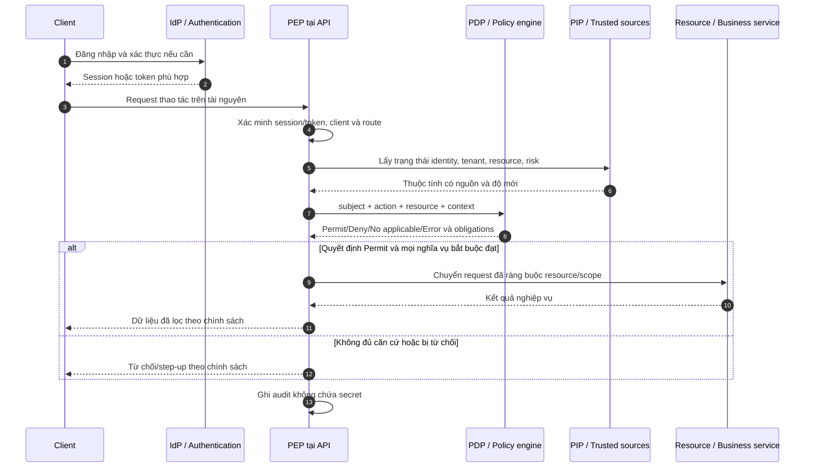
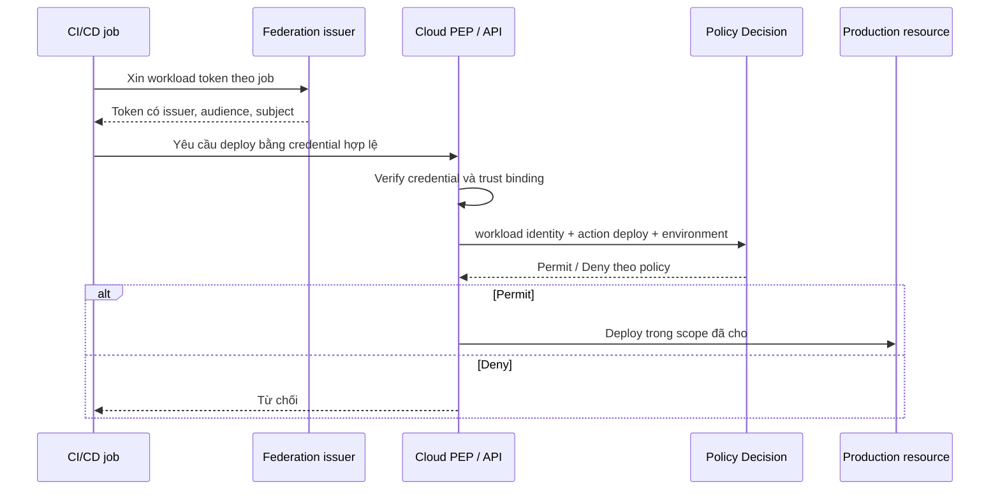

# Policy Enforcement Point (PEP) trong PBAC và quản lý vòng đời danh tính IAM

## 1. Policy Enforcement Point là gì?

**Policy Enforcement Point (PEP)** là thành phần **chặn và kiểm soát việc thực hiện một yêu cầu truy cập** tại ranh giới của tài nguyên hoặc thao tác được bảo vệ. PEP thu thập những thông tin cần thiết về chủ thể, hành động, tài nguyên và ngữ cảnh; gửi hoặc đối chiếu chúng với chính sách; rồi **thực thi quyết định** bằng cách cho phép, từ chối, yêu cầu bước bổ sung hoặc áp dụng điều kiện đi kèm theo kiến trúc được thiết kế.

Trong **Policy-Based Access Control (PBAC)**, quyền truy cập không nhất thiết chỉ đến từ một nhóm hay vai trò cố định. Một chính sách có thể kết hợp danh tính, vai trò, quan hệ hợp đồng, mức nhạy cảm của tài nguyên, môi trường thực thi và điều kiện thời điểm. PEP là chỗ bảo đảm các quyết định đó **thực sự có hiệu lực đối với request**, thay vì chỉ xuất hiện trong tài liệu hay giao diện.

Ví dụ: nhân viên A đã đăng nhập SSO và có vai trò `finance-reader`. Khi A gọi `GET /reports/584`, PEP của API kiểm tra identity hiện hành, tài nguyên `reportId=584`, pháp nhân của báo cáo, trạng thái nhân sự và các yêu cầu chính sách. Người dùng chỉ được nhận báo cáo nếu có quyết định **Permit** hợp lệ cho **chính hành động và tài nguyên ấy**. Một phiên đăng nhập hợp lệ không tự tạo quyền đọc báo cáo của pháp nhân khác.

Trong module **SECURITY_IDENTITY_ACCESS_MANAGEMENT_IDENTITY_LIFECYCLE**, PEP kết nối quản lý danh tính **Joiner–Mover–Leaver (JML)** với **enforcement tại thời điểm truy cập**. Dữ liệu từ HRIS, Identity Provider (IdP), SSO, SCIM, RBAC/ABAC, IGA và service registry có thể ảnh hưởng quyết định; PEP phải xử lý những thay đổi này để hạn chế **quyền truy cập tồn dư** khi một người đổi vai trò, rời tổ chức hoặc workload ngừng hoạt động.

Sau bài học, người đọc có thể giải thích vai trò PEP, phân biệt PEP với các thành phần chính sách khác, xác định vị trí enforcement đúng, xây dựng request/decision rõ phạm vi, xử lý lỗi và dữ liệu cũ an toàn, đồng thời thiết kế kiểm thử và kiểm toán cho PEP xuyên suốt JML.

> **Thông điệp cốt lõi:** chính sách chỉ bảo vệ tài nguyên khi mọi đường thực thi nhạy cảm đều đi qua một **điểm thực thi không thể bỏ qua**, được cấu hình với dữ liệu đáng tin và từ chối an toàn khi không có đủ căn cứ cho phép.

## 2. PBAC, RBAC, ABAC và PEP: không nên đánh đồng

Tên viết tắt **PBAC** thường được dùng cho **Policy-Based Access Control** trong ngữ cảnh kiến trúc PDP/PEP; ở một số tài liệu khác PBAC còn có thể được dùng với nghĩa *Permission-Based Access Control*. Trong bài này, **PBAC được hiểu nhất quán là kiểm soát truy cập dựa trên chính sách**, theo chủ đề *Policy enforcement point*. Cần xác nhận nghĩa thuật ngữ khi trao đổi giữa các hệ thống hoặc nhà cung cấp.

| Mô hình/khái niệm | Câu hỏi trọng tâm | Ví dụ | Vai trò của PEP |
| --- | --- | --- | --- |
| **RBAC** | Chủ thể được gán role nào và role có quyền gì? | `finance-reader` có `report:read` | Thực thi kết quả đã tính từ role và quyền |
| **ABAC** | Các thuộc tính subject/resource/action/context có thỏa điều kiện? | Chỉ đọc báo cáo thuộc pháp nhân của người dùng | Chặn request nếu thuộc tính/điều kiện không đạt |
| **PBAC** | Chính sách phối hợp các dữ liệu và quy tắc nào để đưa ra quyết định? | Role + tenant + employment status + classification | Áp quyết định và các yêu cầu bắt buộc liên quan |
| **ReBAC** (*relationship-based*) | Chủ thể có quan hệ được phép với tài nguyên không? | Thành viên dự án được xem tài liệu dự án | Kiểm tra quyết định theo quan hệ/graph phù hợp |
| **PEP** | Yêu cầu này được **thực thi** hay **bị chặn** ở đâu? | Middleware của API trả `403` | Là chốt chặn, không phải mô hình cấp quyền riêng |

RBAC, ABAC, ReBAC có thể là **đầu vào hoặc cách biểu diễn chính sách** của PBAC. PEP không nhất thiết tự viết toàn bộ policy; nó có thể gọi một bộ ra quyết định chính sách độc lập rồi áp kết quả. Ngược lại, một ứng dụng có thể đánh giá và thực thi policy ngay trong cùng tiến trình, miễn **ranh giới logic và trách nhiệm được phân biệt**.

**Authentication không phải authorization.** IdP kiểm tra credential và phát token/phiên; PEP kiểm tra yêu cầu truy cập tài nguyên có được phép theo chính sách hiện hành hay không. Người đăng nhập bằng MFA mạnh vẫn phải bị từ chối khi không có entitlement tương ứng.

## 3. PEP, PDP, PAP, PIP và những ranh giới trách nhiệm

Một kiến trúc PBAC thường chia các trách nhiệm sau:

| Thành phần | Tên đầy đủ | Chức năng | Sai lầm cần tránh |
| --- | --- | --- | --- |
| **PEP** | Policy Enforcement Point | Chặn request, thu thập input cần thiết, áp Permit/Deny và nghĩa vụ | Nhận quyết định nhưng vẫn chạy nghiệp vụ trước khi kiểm tra |
| **PDP** | Policy Decision Point | Đánh giá chính sách và trả quyết định cho request cụ thể | Tin mọi thuộc tính do client tự khai mà không xác minh nguồn |
| **PAP** | Policy Administration Point | Tạo, phê duyệt, phiên bản hóa, phân phối và quản trị policy | Sửa policy production không có review/rollback |
| **PIP** | Policy Information Point | Cung cấp thuộc tính và dữ liệu ngữ cảnh đáng tin | Dùng thông tin HR/nhóm đã stale mà không có thời hạn hợp lệ |
| **Identity/SSO** | IdP, Authentication Service | Xác thực và tạo phiên/claim danh tính | Đồng nhất login success với quyền tài nguyên |
| **IGA/Provisioning** | IAM/IGA, SCIM connector | Cấp, cập nhật, thu hồi account/role/group theo lifecycle | Cho rằng `active=false` sẽ lập tức hủy mọi token ở mọi API |

Các vai trò trên là **khái niệm kiến trúc**, không bắt buộc phải chạy trên các máy chủ riêng. Trong hệ thống nhỏ, PEP và PDP có thể cùng nằm trong backend; ở hệ thống lớn, PDP có thể là service dùng chung hoặc engine nhúng trong từng ứng dụng. **Điểm mấu chốt** là quyết định được tính đúng ngữ cảnh và đường thực thi không cho phép vượt chốt kiểm tra.

### Quan hệ với các kiến trúc chuẩn

Các thuật ngữ PEP/PDP/PAP/PIP xuất hiện trong nhiều mô hình điều khiển truy cập như XACML và kiến trúc zero trust. **Không phải mọi sản phẩm sử dụng cùng cấu trúc request, kết quả hay bộ trạng thái**; khi tích hợp cần bám theo hợp đồng cụ thể của engine/chính sách, không tự giả định tên thuộc tính hay giá trị quyết định là một chuẩn JSON phổ quát.

## 4. Luồng yêu cầu: từ xác thực đến thực thi policy



Có thể phân tách việc lấy thuộc tính: **PEP gửi subject/resource ID đến PDP, PDP tự gọi PIP**, hoặc PEP thu thập một phần ngữ cảnh. Hai kiểu đều hợp lý tùy trust boundary. Quan trọng là **PDP phải biết các trường nào đáng tin và nguồn nào có thẩm quyền**, còn PEP không được biến thuộc tính do client tự nhập thành sự thật nghiệp vụ.

**Thứ tự quan trọng:** kiểm tra quyền phải diễn ra **trước hành động có side effect**. Nếu PEP gọi API xóa dữ liệu rồi mới hỏi PDP, việc trả `403` sau đó không thu hồi được thao tác đã thực hiện.

### Ba lớp chứng minh khác nhau

1. **Authentication evidence:** token/session có hợp lệ và gắn đúng chủ thể không?
2. **Authorization decision:** chủ thể được làm action cụ thể trên resource cụ thể trong context hiện tại không?
3. **Enforcement evidence:** service đã áp quyết định, không cho bypass và có dấu vết đủ để kiểm toán không?

Chỉ có bước 1 hoặc 2 mà thiếu bước 3 thì hệ thống vẫn có thể để lọt truy cập.

## 5. Input của một yêu cầu authorization

Một PEP nên tạo hoặc truyền **ngữ cảnh có cấu trúc**, không chỉ gửi `role=admin` hoặc `allowed=true`. Các nhóm thông tin cơ bản:

| Nhóm | Thuộc tính minh họa | Nguồn cần tin cậy |
| --- | --- | --- |
| **Subject** | `identityId`, `accountId`, loại nhân viên/guest/service, trạng thái JML | Identity registry, IdP, HRIS/contract, service registry |
| **Authentication context** | Issuer, subject, authentication time, assurance, client/workload identity | Token/session được xác minh, IdP và policy được thỏa thuận |
| **Action** | `invoice:approve`, `report:read`, `user:disable` | Route/action chuẩn hóa phía server, không lấy từ query tùy ý |
| **Resource** | ID, owner, tenant, legal entity, classification, trạng thái | Data store/resource owner đáng tin |
| **Environment** | Thời gian, mạng, thiết bị, chính sách rủi ro, request metadata | Hệ thống đo/kiểm chứng theo chính sách |
| **Policy context** | Policy version, entitlement snapshot, yêu cầu step-up | PAP/IGA/PDP và nguồn chính sách được phê duyệt |
| **Request identity** | Request ID, correlation ID, trace ID | Gateway/server, có giới hạn tránh spoofing |

Ví dụ input **giả định** cho PEP/PDP, không phải schema chuẩn bắt buộc:

```json
{
  "requestId": "req-8401",
  "subject": {
    "identityId": "id-1042",
    "type": "EMPLOYEE",
    "lifecycleStatus": "ACTIVE",
    "roles": ["finance-report-reader"],
    "legalEntity": "VN"
  },
  "action": "report:read",
  "resource": {
    "id": "report-584",
    "type": "financial-report",
    "legalEntity": "VN",
    "classification": "CONFIDENTIAL"
  },
  "context": {
    "authenticatedBy": "corporate-idp",
    "assurance": "PHISHING_RESISTANT",
    "requestTime": "2026-11-23T02:00:00Z"
  }
}
```

**Đừng lấy `lifecycleStatus: ACTIVE` từ JSON mà client gửi rồi mặc nhiên tin.** Trường này phải được PEP/PDP tra từ nguồn có thẩm quyền hoặc một assertion đáng tin có thời hạn/chính sách rõ ràng. Tương tự, `resource.legalEntity` cần xuất phát từ chính bản ghi báo cáo, không phải từ tham số `?legalEntity=VN` để client tự chọn.

### Cần khóa định danh ổn định

Email, tên đăng nhập và DN có thể đổi hoặc được tái sử dụng. PEP nên liên kết `(trustedIssuer, subject)` hoặc account binding phù hợp với **identity ID chuẩn**; tại SaaS/SCIM còn có ID User do provider cấp. Đối tượng không rõ mapping phải bị từ chối hoặc chuyển luồng review, không chọn “bản ghi đầu tiên”.

## 6. Decision: Permit, Deny, NotApplicable và lỗi đánh giá

Một mô hình decision thường có trạng thái như **Permit**, **Deny**, **NotApplicable** và **Indeterminate/Error**, đặc biệt trong hệ sinh thái chính sách theo kiểu XACML. Tên, cấu trúc và ngữ nghĩa chính xác **tùy engine**. Có engine chỉ trả boolean; tổ chức phải định nghĩa rõ cách dịch kết quả sang enforcement.

| Decision | Ý nghĩa | PEP nên làm gì? |
| --- | --- | --- |
| **Permit** | Chính sách áp dụng đã cho phép trong scope đã đánh giá | Chỉ thực thi nếu context còn hợp lệ và nghĩa vụ bắt buộc đã được xử lý |
| **Deny** | Chính sách cấm hành động | Dừng thao tác, trả lỗi phù hợp, ghi audit |
| **NotApplicable** | Không có policy nào áp dụng cho request | **Không tự coi là Permit**; thường từ chối hoặc dùng chính sách fallback được duyệt |
| **Indeterminate / Error** | Thiếu dữ liệu, lỗi PDP/PIP hoặc xung đột không giải được | Không tự cho phép; áp quy tắc failure đã được phê duyệt |
| **Step-up required** | Cần xác thực mạnh hơn hoặc điều kiện bổ sung | Không thực hiện thao tác trước khi điều kiện đạt; bắt đầu flow tương ứng nếu có |
| **Permit with obligations** | Cho phép kèm việc phải làm, như mask field hoặc ghi audit bắt buộc | Áp đầy đủ obligation theo hợp đồng hoặc từ chối nếu không thể đáp ứng |

**Deny-by-default** nghĩa là mọi đường truy cập không có cơ sở cho phép hợp lệ đều bị chặn. Điều này khác việc “về mặt UI, nút bấm bị ẩn”: client vẫn có thể gọi API trực tiếp, nên enforcement phải nằm ở chốt tin cậy phía server/tài nguyên.

### Policy combining và xung đột

Có thể tồn tại policy: role cho phép `report:read`, nhưng policy bảo vệ dữ liệu cấm xuất báo cáo mật trên thiết bị không quản lý. **PDP** cần quy tắc xử lý kết quả kết hợp rõ ràng (ví dụ deny-overrides hoặc mô hình ưu tiên có giải thích); PEP chỉ áp decision cuối và các obligation đã được định nghĩa. **Không mặc định “một Permit thắng mọi Deny”** hoặc tự cộng quyền mà bỏ qua policy giới hạn.

## 7. PEP có thể triển khai ở những vị trí nào?

Không tồn tại một vị trí duy nhất đúng cho mọi tài nguyên. Cần đặt PEP ở **mọi đường vào nhạy cảm** và ở lớp có đủ thông tin để kiểm tra đúng scope.

| Vị trí PEP | Ưu điểm | Giới hạn và điều cần bổ sung |
| --- | --- | --- |
| **API Gateway** | Chặn sớm route/client/token; policy nhất quán cho nhiều API | Có thể không biết owner, tenant hoặc classification của bản ghi cụ thể |
| **Service mesh / sidecar / proxy** | Kiểm soát identity dịch vụ, mTLS, tuyến gọi service-to-service | Không tự hiểu permission cấp đối tượng hay ngữ nghĩa nghiệp vụ |
| **Backend middleware** | Tập trung kiểm tra authentication và quyền theo route/action | Nếu mapping route thiếu hoặc endpoint bypass middleware, có lỗ hổng |
| **Application service/domain layer** | Biết resource thật, ownership, trạng thái giao dịch | Cần thiết kế nhất quán, tránh mỗi developer xử lý khác |
| **Data-access layer / database policy** | Có thể giới hạn row, column hoặc tenant gần dữ liệu | Phải kiểm tra context identity truyền xuống DB và các đường truy cập khác |
| **Job/worker/message consumer** | Chặn thao tác bất đồng bộ ngoài luồng HTTP | Phải truyền actor, trust và version chính sách đúng qua queue |
| **Admin console/PAM** | Kiểm soát tác vụ đặc quyền và step-up | Không chỉ ẩn nút; phải khóa API backend hoặc session đặc quyền |
| **Frontend UI** | Ẩn/khóa chức năng không phù hợp, cải thiện UX | **Không phải PEP bảo mật đủ tin cậy** vì client có thể bị sửa/bỏ qua |

**Defense in depth** có thể gồm gateway PEP chặn request chưa xác thực, mesh PEP giới hạn service identity, backend/domain PEP kiểm tra đối tượng, rồi database kiểm tra tenant/row. Các lớp bổ sung nhau nhưng **không được giả định một lớp khác sẽ làm nhiệm vụ mà không có hợp đồng cụ thể**.

### Tránh "gateway-only authorization"

Gateway thường biết `GET /reports/{id}` nhưng không biết báo cáo 584 thuộc tenant nào. Nếu gateway chỉ kiểm tra `role=finance-reader`, API có thể trả dữ liệu tenant khác qua **Broken Object-Level Authorization (BOLA/IDOR)**. Cần PEP gần logic tài nguyên hoặc khả năng gửi dữ liệu resource đáng tin đến PDP.

## 8. Ràng buộc resource và tránh bypass theo đường truy cập

Một chốt PEP phải **không thể bị bỏ qua** bởi đường khác, chẳng hạn RPC nội bộ, endpoint admin, batch, export CSV, GraphQL resolver, truy vấn database trực tiếp hoặc một API phiên bản cũ.

Các câu hỏi thiết kế:

1. Request nào có thể thay đổi hoặc đọc tài nguyên? Có bao gồm `GET` trả dữ liệu nhạy cảm, upload/download, bulk operation và tác vụ async?
2. Cùng một quyền có được kiểm tra ở **mọi route và protocol** không?
3. Nếu gateway được phép gọi backend, liệu client khác có thể **gọi backend trực tiếp** bỏ qua gateway?
4. Service có tin header `X-User-Id` do client gửi thay vì nhận identity từ kết nối/token đã xác minh?
5. Một endpoint `/reports/export` có thực thi kiểm tra giống `/reports/{id}` không?
6. Khi request chứa **nhiều resource ID**, PEP có đánh giá từng đối tượng hoặc tập đã xác định phạm vi không?

### Định danh tài nguyên ở phía server

Không chỉ kiểm tra rằng `request.tenantId == session.tenantId` nếu client có thể chỉnh cả hai trường. PEP phải **tải resource theo ID thực và xác định tenant/owner từ dữ liệu server**, sau đó kiểm tra điều kiện và ràng buộc truy vấn trả về đúng phạm vi.

Ví dụ logic an toàn hơn:

```text
report = reportRepository.findById(reportId)
if report == NOT_FOUND:
    return NOT_FOUND

context = trustedContext(
    authenticatedSubject = session.subject,
    action = "report:read",
    resource = report.id,
    resourceLegalEntity = report.legalEntity,
    resourceClassification = report.classification
)
decision = policyEngine.evaluate(context)

if decision.effect != PERMIT:
    return FORBIDDEN

response = renderReportWithinAuthorizedScope(report, decision)
if not applyRequiredResponseObligations(response, decision):
    return FORBIDDEN

return response
```

Ví dụ là **giả mã**; mục tiêu là **không trả dữ liệu khi chưa nhận Permit hợp lệ và xử lý đầy đủ nghĩa vụ bắt buộc**. Phản hồi phải chỉ được gửi sau khi việc lọc và bảo vệ dữ liệu hoàn tất. Với báo cáo lớn, stream hoặc pagination phải kiểm tra scope tương ứng trong từng bước, không kiểm tra một trang rồi cho phép tải tất cả.

## 9. Nghĩa vụ đi kèm quyết định (*obligations*) và advice

Một số hệ thống policy trả thêm **obligations** hoặc **advice**. Obligation là công việc **bắt buộc phải hoàn thành** khi áp Permit hoặc Deny theo quy tắc engine; advice thường là đề xuất không bắt buộc. Cần tham chiếu hợp đồng chính xác của PDP: không phải mọi engine hỗ trợ hoặc đặt tên hai loại như nhau.

| Nghĩa vụ minh họa | Ví dụ | Yêu cầu thực thi |
| --- | --- | --- |
| **Step-up authentication** | Yêu cầu passkey/MFA mạnh khi phê duyệt thanh toán | Không phê duyệt trước khi có phiên xác thực phù hợp |
| **Field masking** | Ẩn một phần số tài khoản ngân hàng | Áp trước khi serialization/trả response |
| **Row/tenant filtering** | Chỉ đọc record thuộc `partnerId` được phép | Ràng buộc ở query/domain, không lọc hình thức trên UI |
| **Audit bắt buộc** | Ghi hành động cấp quyền quản trị | Xử lý trường hợp audit sink lỗi theo chính sách |
| **Time-bound grant** | Chỉ cho phép thay cấu hình trong cửa sổ bảo trì | Kiểm tra thời gian hiện hành, không tin clock phía client |
| **Approval / dual control** | Giao dịch vượt ngưỡng cần người thứ hai | Giữ giao dịch ở trạng thái chờ, không xem là hoàn tất |
| **Data loss prevention** | Chặn export dữ liệu có nhãn nhạy cảm | Kiểm tra loại dữ liệu và kênh xuất |

Nếu PDP trả `Permit` kèm nghĩa vụ bắt buộc `maskBankAccount`, nhưng backend không thể thực hiện masking, **không được trả dữ liệu nguyên bản**. Cách xử lý an toàn là từ chối hoặc dùng một đường xử lý đã được policy chấp thuận.

### Phạm vi và tính nguyên tử

Một nghĩa vụ có thể cần thực thi **trước** hoặc **cùng** side effect (ví dụ duyệt thanh toán), trong khi việc ghi nhận sau giao dịch có thể là **post-obligation**. Phải định nghĩa hệ thống có đảm bảo nguyên tử giữa policy check, side effect và audit hay không. Không nên giả định một lời gọi PEP/PDP riêng biệt tự tạo được giao dịch phân tán nguyên tử.

## 10. Ví dụ quyết định PEP/PDP có cấu trúc

Dưới đây là một **hợp đồng JSON giả định** giữa policy engine và PEP của một cổng báo cáo, **không phải đặc tả chuẩn XACML/OPA**:

```json
{
  "decisionId": "dec-9504",
  "effect": "PERMIT",
  "subjectId": "id-1042",
  "action": "report:read",
  "resourceId": "report-584",
  "scope": {
    "legalEntity": "VN",
    "maxClassification": "CONFIDENTIAL"
  },
  "policyVersion": "policy-finance-v13",
  "evaluatedAt": "2026-11-23T02:00:00Z",
  "validUntil": "2026-11-23T02:00:30Z",
  "obligations": [
    {
      "type": "MASK_FIELD",
      "field": "bankAccountNumber"
    },
    {
      "type": "AUDIT_EVENT",
      "eventName": "CONFIDENTIAL_REPORT_READ"
    }
  ]
}
```

PEP phải xác minh **response đến từ PDP được tin cậy** qua kênh/service identity phù hợp và **được gắn với request**. Nếu có hệ thống phân phối hoặc cache decision, cần ràng buộc `subjectId`, action, resource, scope, thời gian và policy version để không dùng một Permit của tài nguyên A cho tài nguyên B.

`validUntil` chỉ là trường **của hợp đồng ví dụ**, không phải thuộc tính tự động được mọi PDP cung cấp. **Thời hạn có hiệu lực không nên vượt giới hạn cache/revocation đã được phê duyệt**, đặc biệt với account đang có nguy cơ Leaver hoặc quyền đặc biệt.

## 11. Pseudocode: PEP xử lý một API nhạy cảm

PEP tốt phải kiểm tra **identity, resource, decision, nghĩa vụ** và không để logic nghiệp vụ xảy ra trước khi qua chốt.

```text
readFinancialReport(httpRequest):
    principal = authenticator.verifySessionOrAccessToken(httpRequest)
    if principal == UNAUTHENTICATED:
        return HTTP_401

    identity = identityRegistry.resolveTrustedPrincipal(principal)
    if identity == UNKNOWN_OR_AMBIGUOUS:
        return HTTP_403

    report = reportStore.findById(httpRequest.path.reportId)
    if report == NOT_FOUND:
        return HTTP_404

    policyInput = {
        "subjectId": identity.stableId,
        "identityStatus": trustedLifecycleState(identity),
        "roles": trustedEntitlements(identity),
        "action": "report:read",
        "resourceId": report.id,
        "resourceTenantId": report.tenantId,
        "resourceClassification": report.classification,
        "context": trustedServerContext(httpRequest)
    }

    decision = pdp.evaluate(policyInput)

    if decision == ERROR_OR_UNAVAILABLE:
        return safeFailureAccordingToApprovedPolicy()

    if decision.effect != PERMIT:
        audit.recordDeniedWithoutSecret(identity, report, decision)
        return HTTP_403

    if not decisionMatchesExactRequest(decision, policyInput):
        return HTTP_403

    if not enforceAllMandatoryPreObligations(decision, httpRequest):
        return HTTP_403_OR_STEP_UP_REQUIRED

    result = reportStore.readAuthorizedScope(report, decision.scope)
    response = enforceResponseObligations(result, decision.obligations)

    if response.hasUnfulfilledMandatoryObligation:
        return HTTP_403

    audit.recordDecisionAndExecution(identity, report, decision)
    return HTTP_200_WITH(response)
```

Đây là **giả mã khái niệm**, không phải thư viện thực tế. Một hệ thống thật phải xử lý exception, phản hồi đã bắt đầu stream, audit bắt buộc trước/trong giao dịch, kiểm soát transaction và TOCTOU, chống resource enumeration, cũng như cách ánh xạ HTTP error theo API contract.

### Hai yêu cầu kỹ thuật khó bỏ qua

- **Từ chối an toàn khi không có Permit:** `null`, `undefined`, timeout, NotApplicable hoặc decision bị sai scope không được xem như cho phép.
- **Bao phủ mọi đường gọi:** middleware, domain service, background job và dữ liệu được trả về phải có các chốt phù hợp. Không viết authorization chỉ trong controller mà bỏ qua method được job gọi trực tiếp.

## 12. PIP và chất lượng dữ liệu thuộc tính

Một quyết định chính sách có thể hoàn toàn sai nếu **dữ liệu đầu vào sai hoặc đã cũ**. PIP là khái niệm đại diện cho các nguồn thông tin được tin cậy, không phải “mọi API trả được JSON”.

Ví dụ về nguồn có thẩm quyền:

| Thuộc tính | Nguồn được cân nhắc | Rủi ro nếu lấy sai |
| --- | --- | --- |
| `employmentStatus` | HRIS/identity registry đã chuẩn hóa | Người đã Leaver vẫn được xem là ACTIVE |
| `contractExpiresAt` | Contract registry/sponsor của bên tiếp nhận | Guest quá hạn vẫn có quyền |
| `roleAssignments` | IGA role catalog, directory/IdP theo mô hình sở hữu | Grant ngoài luồng hoặc role đã bị thu hồi không thấy |
| `resourceTenantId` | Resource store/backend đáng tin | Cross-tenant data leak khi client tự đặt tenant |
| `classification` | Data catalog/resource owner | Tài liệu nhạy cảm bị xử lý như dữ liệu công khai |
| `deviceTrust` | Hệ thống quản lý thiết bị/IdP theo hợp đồng | Tin header do client tự gửi là thiết bị “managed” |
| `serviceOwner` | Service registry/workload governance | Workload không owner vẫn giữ quyền admin |

### Độ mới, provenance và xử lý không có dữ liệu

Thiết kế nên xác định:

1. Trường nào **bắt buộc** cho quyết định, trường nào có thể vắng mặt.
2. Nguồn, thời điểm cập nhật, thời điểm hiệu lực, namespace và độ tin cậy của từng trường.
3. TTL/cache policy phù hợp mức rủi ro; quyền Leaver và privileged action cần giới hạn stale dữ liệu.
4. Đường xử lý khi PIP timeout, HRIS không truy cập được hoặc hai nguồn mâu thuẫn.
5. Cách chứng minh một thuộc tính không bị client/connector không có thẩm quyền ghi đè.

Không nên đưa quy tắc “thiếu `contractActive` thì coi là true” vào chính sách B2B. Với điều kiện bắt buộc, **không có dữ liệu đáng tin phải dẫn đến không cấp quyền**, trừ khi có một policy ngoại lệ được thiết kế và phê duyệt riêng.

## 13. Ranh giới xác thực: IdP/SSO, token và PEP

IdP thường xác thực bằng passkey, mật khẩu/MFA hoặc phương thức dành cho workload. OIDC/SAML có thể mang kết quả xác thực tới ứng dụng. **PEP không thể bỏ qua bước xác minh token rồi tin một `sub` do client gửi**, cũng không nên coi `email` là khóa danh tính toàn cục.

Một luồng hợp lý:

1. **Xác minh token hoặc session** theo issuer, chữ ký, audience, hạn dùng và các điều kiện giao thức liên quan.
2. **Resolve identity** theo khóa ổn định, ví dụ `(issuer, sub)` và account binding tới `identityId`.
3. **Kiểm tra trạng thái lifecycle** và các policy cần thiết theo mức độ nhạy cảm.
4. **Xây dựng action/resource context phía server**.
5. **Gọi PDP hoặc đánh giá policy tin cậy**, áp decision và obligations.
6. **Ghi audit** với trường tham chiếu không lộ bearer token.

**OIDC ID token không phải access token dùng tùy ý để gọi API**. Resource server phải kiểm tra đúng loại token, audience/scope và hợp đồng bảo mật. Một JWT có chữ ký đúng nhưng phát cho API khác không được PEP chấp nhận.

### Reauthentication và step-up

Khi thao tác nhạy cảm như cấp quyền quản trị, đổi thông tin thanh toán hoặc xuất dữ liệu mật, policy có thể yêu cầu xác thực mới với mức đảm bảo cao hơn. PEP nên **trì hoãn hoặc chặn thao tác** rồi điều hướng đến luồng step-up được tin cậy; sau khi xác thực lại, PEP **đánh giá lại policy**, vì thuộc tính/quyền/tài nguyên có thể đã thay đổi.

## 14. PEP trong Joiner: chỉ cho phép đúng thời điểm

Khi một người mới gia nhập, HRIS/contract registry xác nhận quan hệ; identity proofing/enrollment liên kết đúng chủ thể với danh tính chuẩn; IAM/IGA tính quyền birthright và quyền đã được duyệt.

PEP cần bảo đảm:

- **Identity/account đã được kích hoạt** theo thời điểm hiệu lực, không chỉ tồn tại entry tại IdP hoặc SCIM.
- Chủ thể có **đúng role/entitlement được cấp**, không suy account mới = quyền truy cập toàn hệ thống.
- Các yêu cầu của MFA, thiết bị, phiên hoặc ABAC phù hợp rủi ro.
- Nếu provisioning đến sớm, PEP không cho sử dụng tài nguyên trước ngày bắt đầu theo policy.
- Nếu quyền đang `PENDING_APPROVAL`, không tự quy đổi thành Permit.
- Guest B2B phải có sponsor, tổ chức đối tác và thời hạn truy cập trong miền sở hữu tài nguyên.

Ví dụ, SCIM tạo User `active=true` tại SaaS trước 08:00 ngày nhân viên bắt đầu. Nếu policy yêu cầu chỉ có hiệu lực từ 08:00, PEP phải có tín hiệu đáng tin về `effectiveAt` hoặc việc kích hoạt account phải được orchestration kiểm soát. **SCIM tạo account thành công không thay được enforcement theo thời điểm**.

## 15. PEP trong Mover: không để quyền cũ tiếp tục dùng

**Mover** bao gồm đổi bộ phận, chức danh, dự án, cấp quản lý, pháp nhân hoặc scope dữ liệu. IAM/IGA tính `toGrant`, `toRevoke`, `toKeep` từ nguồn mới; PEP phải áp chính sách truy cập dựa trên **trạng thái quyền có hiệu lực hiện hành**.

Ví dụ:

```text
Trước Mover:
  roles: SALES_AGENT
  directGrant: customer-export

Sau Mover:
  roles: FINANCE_REPORT_READER
  revoke: SALES_AGENT, customer-export
  keep: EMPLOYEE_BASIC

Rủi ro:
  JWT còn claim SALES_AGENT
  SaaS direct grant chưa bị thu hồi
  cached PDP decision vẫn Permit customer-export
```

Để giảm quyền tích lũy, cần:

1. Tính desired entitlements và kiểm tra xung đột **Segregation of Duties (SoD)**.
2. Thu hồi vai trò/nhóm cũ qua IdP, LDAP, SCIM hoặc connector phù hợp.
3. Cập nhật policy/thuộc tính đầu vào PDP; invalidation cache theo identity/entitlement khi cần.
4. Áp authorization **tại resource runtime**, không tin claim stale vô thời hạn.
5. Xem xét kết thúc hoặc làm mới session/token có quyền cũ, đặc biệt cho quyền nhạy cảm.
6. Đọc lại actual/effective access và kiểm tra đường thực thi không còn cho phép thao tác cũ.

**Một người có thể vẫn đăng nhập SSO thành công sau Mover**, vì họ vẫn là nhân viên. Điều bắt buộc là PEP không tiếp tục cho phép những action/resource đã bị thu hồi. Logout có thể hữu ích để thay claim nhưng **không thay thế gỡ entitlement và đánh giá quyền runtime**.

## 16. PEP trong Leaver, guest hết hạn và rehire

Khi HRIS hoặc nguồn hợp đồng xác nhận **Leaver**, tổ chức cần ngăn đăng nhập mới và giảm thời gian những quyền đã cấp có thể bị sử dụng. PEP là lớp **chặn truy cập tài nguyên ngay cả khi một số account hoặc token chưa kịp được dọn**.

| Đường truy cập | Vấn đề còn lại sau Leaver | Biện pháp phối hợp |
| --- | --- | --- |
| IdP login | Account còn active trong lúc đồng bộ | Disable/chặn xác thực theo nguồn có thẩm quyền |
| Ứng dụng SCIM | User/Group cập nhật chậm | SCIM deprovision + local account checks + reconciliation |
| SSO session | RP giữ cookie riêng | Session invalidation hoặc account-state check tại PEP |
| JWT access token | Token tự chứa còn `exp` trong tương lai | TTL hợp lý, revocation/introspection hoặc đánh giá trạng thái tại PEP |
| API key/PAT | Credential không gắn browser SSO | Inventory và revoke riêng |
| Guest B2B | Home IdP vẫn xác thực người đó | PEP phía tổ chức tiếp nhận kiểm tra guest contract/sponsor |
| Data platform/PAM | Quyền trực tiếp hoặc phiên đặc quyền còn | Thu hồi role/session theo hệ thống và kiểm tra enforcement |

**PEP chỉ chặn được đường truy cập mà nó thực sự bảo vệ**. Một API bypass PEP hoặc đường gọi database trực tiếp không tự trở nên an toàn khi gateway từ chối. Cần bao phủ mọi đường vào và kiểm thử thực tế.

### Rehire không phải hồi sinh role cũ

Khi nhân viên quay lại, hệ thống phải xác minh liên kết danh tính, quan hệ mới và **lifecycle generation**; tính lại quyền được phép từ đầu. Cache Permit cũ hoặc event Mover/Joiner cũ **không được tái kích hoạt** quyền Leaver đã thu hồi. PEP nên dùng decision gắn với trạng thái quyền hiện hành và policy version phù hợp.

### Leaver và fail-safe

Nếu nguồn trạng thái lifecycle mất kết nối ngay sau khi có tín hiệu Leaver, tổ chức cần quy tắc đã định rõ: chẳng hạn **chặn các quyền đặc quyền, không cho dùng dữ liệu stale quá giới hạn và ưu tiên trạng thái revoke đã biết**. Không nên thiết kế “PIP lỗi ⇒ coi tất cả user là ACTIVE”.

## 17. PEP cho service account và workload identity

**Non-human identities (NHI)** như service account, container, CI/CD pipeline hoặc batch job thường dùng mTLS, client credentials, managed identity hoặc workload federation. Chúng không có phiên browser SSO như con người, nhưng **vẫn cần PEP kiểm tra quyền theo workload và tài nguyên**.

Ví dụ một pipeline có thể nhận token ngắn hạn từ cloud B dựa trên OIDC identity của CI platform A. PEP/B policy engine phải kiểm tra:

- **Issuer, audience, subject** và chữ ký/bằng chứng liên quan đúng trust policy.
- Scope gắn với **repo, branch, environment, namespace hoặc service account** theo claim đáng tin.
- Workload có owner và mục đích hợp lệ trong service registry.
- Tài nguyên đích có cho phép hành động, môi trường và thời hạn này không.
- Trust policy không cho mọi pipeline của một tổ chức rộng được quyền production.



**Leaver của kỹ sư tạo service account không đồng nghĩa workload đã ngừng.** IAM phải chuyển giao owner, kiểm tra quyền và credential. Khi workload thực sự kết thúc, phải revoke trust, token/secret, vai trò và đối soát; PEP cần từ chối request sau thời điểm thu hồi.

Không dùng “dịch vụ chạy trong mạng nội bộ” làm lý do bỏ PEP. Service-to-service cũng cần authentication và authorization, đặc biệt với quyền dữ liệu và thao tác quản trị.

## 18. Cache quyết định và nguy cơ sử dụng quyền tồn dư

Để giảm độ trễ khi gọi PDP, PEP có thể **cache decision**. Nhưng một Permit được tính hôm qua không nên được dùng hôm nay khi nhân viên đã Leaver hoặc resource đã đổi chủ sở hữu.

### Khóa cache phải đủ ngữ cảnh

Ít nhất cần xem xét **subject, client/issuer, action, resource, scope, policy version, entitlement version và ngữ cảnh liên quan**. Không cache chung chỉ theo `userId` hoặc chỉ theo route `GET /reports/{id}` nếu quyết định phụ thuộc tenant, classification, thiết bị hoặc thời gian.

### Chiến lược cache an toàn

1. Giới hạn TTL theo rủi ro và độ mới của các thuộc tính quan trọng.
2. Phân biệt cache **Permit** với **Deny**; không giả định cùng thời gian sống.
3. Có cơ chế invalidate khi `lifecycleStatus`, role/entitlement, hợp đồng, policy hoặc resource classification thay đổi.
4. Gắn policy version/entitlement version và không tái sử dụng decision sau khi version đổi.
5. Với quyền nhạy cảm, giảm hoặc loại bỏ cache Permit nếu không đảm bảo thu hồi trong cửa sổ yêu cầu.
6. Nếu không thể kiểm chứng freshness theo chính sách, không dùng quyết định stale để cho phép.
7. Đo **revocation latency** thực tế từ nguồn sự kiện đến khi PEP từ chối request.

**Không có một TTL chung** phù hợp cho mọi hệ thống. Cache 30 giây có thể hợp lý cho một kiểu quyền đọc nhất định nhưng quá dài đối với thao tác đặc quyền cần thu hồi gần tức thì. Việc chọn TTL phải gắn với yêu cầu kinh doanh và mức rủi ro, không chỉ với hiệu năng.

### Một ví dụ dễ sai

PEP cache `Permit(report:read)` theo `identityId` mà bỏ qua `resourceId`. Người dùng được xem báo cáo A, rồi mở báo cáo B của tenant khác; kết quả Permit A có thể bị tái sử dụng cho B. **Đó là lỗi ràng buộc decision**, không phải lỗi “cache chưa tối ưu”.

## 19. TOCTOU và các thao tác kéo dài

**Time-of-Check to Time-of-Use (TOCTOU)** xảy ra khi trạng thái thay đổi **sau thời điểm kiểm tra** nhưng **trước hoặc trong lúc sử dụng quyền**. Một PEP có thể nhận Permit khi báo cáo vẫn thuộc tenant A, nhưng trước khi dữ liệu được ghi hoặc gửi đi, tài nguyên bị đổi chủ/nhãn bảo mật.

Các tình huống thường gặp:

- Một thao tác chuyển tiền được phê duyệt lúc 10:00 nhưng thực thi lúc 10:30 sau khi tài khoản bị khóa.
- Job export dữ liệu kéo dài hàng giờ trong khi người dùng bị Mover/Leaver.
- Một queue message chứa `isAuthorized=true` được xử lý sau khi policy đã đổi.
- Bulk request kiểm tra chỉ object đầu tiên nhưng thực hiện trên cả tập object.
- Người dùng đổi resource ID sau policy check thông qua race condition hoặc alias/path không được ràng buộc.

### Biện pháp thiết kế

- Đưa kiểm tra quyền **gần thời điểm thực thi side effect**, nhất là với thao tác nhạy cảm.
- Ràng buộc decision với **resource ID, action, scope và version trạng thái**.
- Với workflow async, truyền actor identity theo cách tin cậy và **đánh giá lại tại consumer** nếu quyền phụ thuộc thời điểm thực thi.
- Dùng transaction, optimistic concurrency, row-level policy hoặc điều kiện dữ liệu khi nền tảng hỗ trợ; không cho rằng PDP call tạo transaction với database.
- Với stream dài, pagination hoặc bulk job, kiểm tra mỗi phạm vi hoặc tại checkpoint theo chính sách.
- Nếu quyền bị thu hồi trong khi công việc đang chạy, cần cơ chế **hủy/pause/giới hạn kết quả** ở nơi có thể thực hiện và chính sách rõ cho tác vụ không thể đảo ngược.

**Không nên lưu một boolean `authorized=true` trong message queue rồi sử dụng vô thời hạn**. Nếu có capability/token ủy quyền dành riêng cho tác vụ, phải giới hạn audience, action, resource, scope, hạn và cơ chế thu hồi theo thiết kế.

## 20. PEP khi PDP hoặc PIP không khả dụng: tính sẵn sàng và an toàn

Một thách thức thực tế là dịch vụ ra quyết định/nguồn thuộc tính có thể lỗi mạng, timeout, chưa đồng bộ hoặc ngừng hoạt động.

**Fail closed** trong authorization nghĩa là không cho phép một thao tác khi chưa có cơ sở xác thực/chính sách cần thiết để cấp quyền. Tuy nhiên, cách triển khai cần hiểu **mức dịch vụ và các đường phục hồi đã được phê duyệt**, không đồng nhất với việc sập toàn bộ hạ tầng.

| Tình huống | Phản ứng an toàn cần thiết | Lưu ý vận hành |
| --- | --- | --- |
| PDP timeout | Không tự tạo Permit; trả lỗi có kiểm soát | Timeout ngắn, circuit breaker, quan sát độ trễ |
| PIP thiếu trạng thái hợp đồng | Không mặc định guest vẫn active | Cảnh báo owner và nguồn hợp đồng |
| Policy version chưa tải xong | Dùng bộ policy đã được duyệt và còn hợp lệ **nếu policy cho phép**; nếu không, từ chối | Không dùng bản cũ quá giới hạn thu hồi |
| Audit sink lỗi | Xử lý theo tính bắt buộc của obligation | Với audit bắt buộc cho giao dịch nhạy cảm, không “bỏ qua cho tiện” |
| Quyền đọc công khai | Có thể có policy riêng cho dữ liệu public | Không nhầm lỗi PDP thành quyền public |
| Quyền đặc quyền/PAM | Không cho bypass rộng khi PDP lỗi | Dự phòng có kiểm soát, tài khoản khẩn cấp theo policy |
| Identity status conflict | Chưa rõ ACTIVE hay LEAVER | Không mở quyền nhạy cảm cho đến khi giải quyết |
| Đồng bộ nhiều vùng | Dữ liệu policy/entitlement lệch version | Theo dõi freshness, hạn chế cache và rollout |

### Tránh hai cực đoan sai

**Sai 1 — Fail open:** `if (pdpError) allow()`. Đây là lỗ hổng vì kẻ tấn công có thể cố gây lỗi PDP để được truy cập.

**Sai 2 — Một chính sách dự phòng không có thiết kế:** tổ chức có thể cần vận hành dịch vụ công khai hoặc đường xử lý sự cố ngay khi PDP lỗi; nên xây dựng **policy ngoại lệ cụ thể, tối thiểu, độc lập và có kiểm toán**, chứ không tắt toàn bộ authorization.

### Thiết kế hiệu năng

PEP nằm trên đường request nên cần độ trễ có kiểm soát: timeout, bulk authorization có contract rõ, PDP gần service, data cache giới hạn, circuit breaker, tracing và kiểm tra tải. Tối ưu không được thay đổi **ngữ nghĩa quyền**. Một lần gọi PDP nhanh nhưng thiếu resource context không phải tối ưu an toàn.

## 21. Policy lifecycle và quản trị thay đổi PEP/PDP

Không chỉ các danh tính có vòng đời; **policy và bản cấu hình enforcement** cũng cần được quản trị.

Một quy trình thay đổi policy nên gồm:

1. **Authoring:** policy owner mô tả mục tiêu, subject/action/resource, ngoại lệ và tác động.
2. **Review:** Security, application/data owner kiểm tra least privilege, SoD, tenant isolation và đường bypass.
3. **Versioning:** lưu version, reviewer, phê duyệt và khả năng quay lại bản đã kiểm chứng.
4. **Testing:** kiểm thử unit policy, integration PEP và negative scenarios; không chỉ “rule parse thành công”.
5. **Staging/shadow mode:** có thể so quyết định policy mới với hiện tại mà chưa áp, nếu thiết kế bảo mật cho phép và không lộ dữ liệu.
6. **Canary rollout:** phát hành hạn chế cho phạm vi/tenant phù hợp, giám sát Deny bất thường và rủi ro Permit sai.
7. **Activation:** bảo đảm PEP và PDP dùng policy version phù hợp; không có cửa sổ fail-open khi reload.
8. **Monitoring:** cảnh báo lỗi decision, độ trễ và drift giữa các PEP.
9. **Retirement:** dừng policy cũ sau chuyển tiếp, xóa exception không còn cần và lưu audit theo chính sách.

### Thử nghiệm policy không được phá quyền hiện hành

**Shadow mode** hữu ích để nhận diện một policy mới quá chặt, nhưng không nên phát lệnh có side effect hoặc expose dữ liệu chỉ vì policy shadow trả Permit. Quyết định shadow chỉ là **dữ liệu so sánh**, không được thay quyết định được áp trong production.

**Rollback** không mặc nhiên luôn an toàn: nếu bản policy cũ cho phép quyền đã bị thu hồi vì Leaver hoặc sự cố, quay lại bản cũ có thể tái mở truy cập. Cần áp tiêu chí rollback kết hợp **policy version và nguồn trạng thái JML hiện tại**.

## 22. Threat model: các lỗi PEP dễ dẫn tới vượt quyền

| Tấn công hoặc lỗi | Kết quả xấu | Biện pháp |
| --- | --- | --- |
| **Bypass PEP** | Gọi backend/worker/DB qua đường không kiểm tra | Chặn ở mọi entrypoint, phân đoạn mạng, kiểm soát service identity |
| **Tin header do client tự khai** | Giả mạo `X-User-Role: admin` | Lấy identity từ token/session/mTLS đã xác minh; bỏ header không tin cậy |
| **BOLA/IDOR** | Đổi `resourceId` đọc tài nguyên người khác | Tra resource thật và kiểm tra object-level |
| **Tenant confusion** | Dùng claim/resource của tenant khác | Ràng buộc issuer, subject, tenant, resource owner |
| **Over-broad Permit** | Quyền route chung cho mọi dữ liệu | Kiểm tra action/resource/scope/classification |
| **Missing policy = allow** | Không có rule nhưng vẫn thực thi | Deny-by-default và trạng thái NotApplicable rõ |
| **Không thực thi obligation** | Trả dữ liệu không mask hoặc giao dịch không audit | Áp nghĩa vụ bắt buộc hoặc từ chối |
| **Stale cache** | Mover/Leaver vẫn dùng quyền cũ | TTL, invalidation, entitlement version và readback |
| **Lỗi PDP bị biến thành Permit** | Gây DoS lên PDP để vượt quyền | Fail closed và đường phục hồi có kiểm soát |
| **Confused deputy** | Service được quyền rộng thực hiện thay actor không có quyền | Truyền actor/resource context đáng tin và kiểm tra từng bước |
| **Sửa role ngoài luồng** | Claim/group cao quyền dù chưa duyệt | Nguồn chính sách, provenance và reconciliation |
| **GraphQL/bulk bỏ lọt** | Chỉ kiểm tra request ngoài, không kiểm tra từng object | Resolver/domain PEP, scope và giới hạn theo từng phần tử |
| **Policy injection** | Client kiểm soát biểu thức policy hoặc attribute đáng tin | PAP có phân quyền, validate input, không evaluate code tùy ý |
| **Không bảo vệ PDP link** | Giả decision Permit hoặc sửa context | mTLS/authn giữa dịch vụ, integrity và request binding |
| **Audit log chứa token** | Token bị đánh cắp qua observability | Redaction, tham chiếu an toàn, phân quyền log |

**Một PEP không ngăn mọi kiểu tấn công**. Nếu API đã cho phép `report:read` nhưng có lỗi SQL injection trong truy vấn, cần kiểm soát ở tầng dữ liệu và ứng dụng. Ngược lại, chống SQL injection tốt không thay thế authorization ở PEP.

## 23. Kiểm thử PEP: policy unit, tích hợp và end-to-end

Cần kiểm thử **đúng quyết định**, **đúng enforcement** và **đúng phản ứng JML**. Một unit test của PDP trả Deny không chứng minh backend đã chặn request nếu đường gọi quên middleware.

### Ma trận ca kiểm thử tối thiểu

| ID | Kịch bản | Kết quả kỳ vọng |
| --- | --- | --- |
| P-01 | Chủ thể ACTIVE, đúng role, resource cùng tenant | Permit đúng action và scope |
| P-02 | Không có session/token hợp lệ | Từ chối authentication, không truy vấn dữ liệu |
| P-03 | Token đúng chữ ký nhưng sai audience | Từ chối |
| P-04 | Token hợp lệ, không có entitlement | Deny, không thực hiện side effect |
| P-05 | Chủ thể đổi `resourceId` sang tenant khác | Deny hoặc không tiết lộ resource theo policy |
| P-06 | Subject hoặc resource không thể resolve chính xác | Không tự Permit |
| P-07 | PDP trả NotApplicable/Indeterminate | Từ chối an toàn theo hợp đồng |
| P-08 | PDP timeout/mất mạng | Không fail open, có audit và cảnh báo |
| P-09 | Permit có obligation masking nhưng masking lỗi | Không trả dữ liệu nguyên bản |
| P-10 | Yêu cầu step-up khi approve thanh toán | Không approve trước khi xác thực lại hợp lệ |
| P-11 | Người dùng bị Mover, claim JWT còn role cũ | Quyền cũ bị chặn trong cửa sổ SLA |
| P-12 | Leaver trong khi còn RP session | Không còn đường truy cập không hợp lệ |
| P-13 | Guest hết hợp đồng, home IdP vẫn login được | PEP của bên tiếp nhận từ chối |
| P-14 | Service workload sai branch/environment | Không được triển khai production |
| P-15 | Cache Permit tài nguyên A dùng cho tài nguyên B | Không tái sử dụng decision |
| P-16 | Queue job chạy sau khi actor bị thu hồi | Re-evaluate/deny theo policy |
| P-17 | Bulk export nhiều resource, một resource không được phép | Không tiết lộ phần tử ngoài scope |
| P-18 | Gọi backend trực tiếp bỏ gateway | Chặn bởi network/service/domain controls |
| P-19 | PEP nhận decision bị giả từ nguồn không tin cậy | Từ chối, không thực thi |
| P-20 | Policy rollout/rollback có Leaver mới | Không tái cấp quyền do policy cũ |
| P-21 | Grant trực tiếp ở SaaS sau khi IdP group gỡ | E2E phát hiện quyền còn tồn dư |
| P-22 | Audit sink cần thiết không khả dụng | Không bỏ obligation bắt buộc theo policy |
| P-23 | Cùng request lặp sau timeout | Không thực hiện side effect trái policy/thiếu idempotency |
| P-24 | Client gửi `lifecycleStatus=ACTIVE` giả | PEP không tin trạng thái tự khai |

### Cần phân biệt ba kiểu PASS

- **PDP decision test PASS:** engine trả đúng quyết định cho tập input kiểm thử.
- **PEP integration test PASS:** ứng dụng thực sự chặn hoặc thực hiện action đúng kết quả và obligations.
- **JML end-to-end PASS:** sau HRIS/IGA/SCIM/IdP thay đổi, quyền runtime đúng ở **mọi đích liên quan**, không còn truy cập tồn dư vượt SLA.

**Không chuyển trạng thái `SKIPPED` thành `PASS`** khi môi trường không có khả năng thử session revocation, tenant isolation hoặc service-to-service bypass. Ghi rõ phần thiếu và người chịu trách nhiệm.

## 24. Kiểm toán và quan sát điểm thực thi chính sách

Một sự kiện access decision cần có khả năng trả lời: **ai yêu cầu gì, tại đâu, với chính sách nào, kết quả nào đã được áp dụng và tại sao**.

Các trường log đáng cân nhắc:

- `requestId`, thời gian, `identityId` hoặc service ID, issuer/client tham chiếu.
- Action, resource type/ID được bảo vệ, tenant/scope và classification ở mức cần thiết.
- PEP instance/service, PDP/policy version, decision ID, kết quả Permit/Deny/Error.
- Reason code/tham chiếu policy (không lộ các bí mật hoặc nội dung policy nhạy cảm ra client).
- Obligation được yêu cầu và trạng thái áp dụng; event step-up nếu có.
- Sự kiện JML/SCIM/IGA liên quan và freshness/version của thuộc tính quan trọng.
- Kết quả enforcement: blocked, executed, partial, async pending hoặc failed.
- Correlation với audit nghiệp vụ ở resource owner và các exception/approval cần thiết.

**Không ghi raw access token, ID token, cookie, client secret, mật khẩu, private key hoặc toàn bộ dữ liệu PII nhạy cảm** chỉ để debug. Log có thể lưu tham chiếu, mã tương quan, hash/ID được bảo vệ theo chính sách; người được quyền đọc log phải được giới hạn.

### Metrics vận hành

| Chỉ số | Giá trị phân tích |
| --- | --- |
| **Authorization deny rate** | Phát hiện rule mới quá chặt, tấn công hoặc quyền cấp sai |
| **PDP decision latency** | Đo thời gian đánh giá và ảnh hưởng hiệu năng |
| **PEP enforcement coverage** | Tỷ lệ entrypoint/route/job có enforcement được xác minh |
| **Indeterminate/timeout rate** | Chất lượng PIP/PDP, nhu cầu dự phòng |
| **Stale decision rejection** | Số request bị từ chối vì policy/entitlement version cũ |
| **JML revocation latency** | Từ sự kiện Leaver/Mover đến request cũ bị từ chối tại PEP |
| **Cross-tenant deny events** | Phát hiện thao tác truy cập sai tenant |
| **Obligation fulfillment rate** | Masking, audit, step-up thực sự hoàn thành |
| **Privilege exception age** | Quyền ngoại lệ có owner và thời hạn hay chưa |
| **Reconciliation drift** | Quyền đích khác desired state và tác động runtime |

**Deny tăng không nhất thiết là xấu.** Có thể policy mới vừa sửa lỗ hổng. Ngược lại, Permit rate cao không chứng minh an toàn; cần phân tích theo resource/action/risk tier và kiểm chứng kết quả.

## 25. Tình huống thực tế: Finance Mover, token cũ và PEP

Một doanh nghiệp có HRIS, IAM/IGA, IdP SSO, CRM và Finance API. Nhân viên **Lan** có `identityId=id-518`, ban đầu làm Sales với quyền xuất báo cáo khách hàng. Sau một đợt Mover, Lan chuyển sang Finance.

### Giai đoạn A — Trước Mover

HRIS ghi `department=Sales`. IGA cấp role `SALES_AGENT`; CRM có nhóm `sales-export`. IdP phát access token/phiên hợp lệ. PEP tại CRM kiểm tra `customer:export` bằng kết quả PDP và role/scope của Lan, cho phép chỉ khi chính sách thỏa điều kiện.

### Giai đoạn B — Mover và quyền mới

HRIS phát event `sourceVersion=42` với ngày hiệu lực mới. IGA gỡ `SALES_AGENT`, cấp `FINANCE_REPORT_READER` và yêu cầu SCIM cập nhật nhóm tại SaaS. Nhưng một JWT cũ vẫn chứa role Sales, còn cache Permit ở CRM chưa hết TTL.

**Thiết kế PEP yếu:** CRM chỉ kiểm tra chữ ký JWT và `roles` trong token, cho phép tiếp tục export dù quyền trong IGA đã bị thu hồi.

**Thiết kế PEP có kiểm soát:** CRM kiểm tra entitlement/lifecycle version còn hợp lệ với nguồn tin cậy hoặc có cơ chế cache invalidation/revocation phù hợp, sau đó từ chối `customer:export`. Hệ thống đồng thời xử lý direct grant không do SCIM quản lý và rà soát session/token cũ. Mức độ tức thì phụ thuộc SLA và công nghệ, không tự tuyên bố mọi JWT mất hiệu lực khi SCIM trả thành công.

### Giai đoạn C — Truy cập Finance

Lan gọi `GET /reports/584`, báo cáo thuộc pháp nhân VN với classification CONFIDENTIAL. PEP xác minh identity, tải metadata báo cáo ở server, gửi `report:read` đến PDP. PDP trả Permit kèm nghĩa vụ che số tài khoản ngân hàng và audit. PEP chỉ trả phiên bản đã mask, đúng scope tài nguyên.

Nếu Lan đổi ID sang một báo cáo của pháp nhân khác, PDP trả Deny hoặc không có Permit theo chính sách, và PEP không trả dữ liệu — dù token hợp lệ và role `FINANCE_REPORT_READER` có mặt.

### Giai đoạn D — Leaver

Sau đó Lan nghỉ việc. HRIS phát Leaver; IAM vô hiệu hóa IdP, thu hồi nhóm/account ở SaaS qua SCIM và xử lý phiên/credential. Finance API PEP vẫn phải kiểm tra trạng thái chính sách thích hợp, vì một access token tự chứa có thể còn hợp lệ theo `exp` sau logout. Những endpoint không được PEP bảo vệ được phát hiện qua kiểm thử bypass và đưa vào kế hoạch khắc phục.

**Kết quả mong muốn:** chính sách không chỉ “đúng trên giấy” mà **chặn hành động cũ, chỉ mở đúng báo cáo mới và thực sự từ chối truy cập sau Leaver**. Readback SCIM và thử API phải cùng được ghi nhận trong audit.

## 26. Những sai lầm phổ biến khi thiết kế PEP

**Sai lầm 1 — “PDP trả Permit là xong.”** Nếu ứng dụng quên chặn request hoặc bỏ qua obligation, policy không có hiệu lực.

**Sai lầm 2 — “SSO login thành công nghĩa là có quyền.”** Authentication xác nhận credential/phiên; authorization phải dựa trên action/resource/policy.

**Sai lầm 3 — “Gateway đã kiểm tra role, backend không cần kiểm tra nữa.”** Gateway có thể thiếu dữ liệu owner/tenant/classification; phải kiểm tra object-level tại chốt phù hợp.

**Sai lầm 4 — “Mọi JWT đúng chữ ký đều chấp nhận.”** Phải xác minh audience, issuer, thời gian, mục đích token và trạng thái quyền theo chính sách.

**Sai lầm 5 — “Không lấy được policy thì tạm cho qua.”** Một đường fail-open có thể bị kẻ tấn công kích hoạt bằng việc gây lỗi PDP.

**Sai lầm 6 — “Obligation chỉ là đề xuất.”** Nếu hợp đồng định nghĩa bắt buộc, bỏ masking/audit/step-up là vi phạm policy.

**Sai lầm 7 — “Cache Permit theo user là đủ.”** Decision còn phụ thuộc action, resource, tenant, thời gian, policy và entitlement version.

**Sai lầm 8 — “Chỉ cần lấy `tenantId` từ request.”** Client có thể sửa giá trị; PEP phải dựa vào resource và nguồn có thẩm quyền.

**Sai lầm 9 — “SCIM `active=false` hủy mọi API token.”** Deprovisioning và token lifecycle khác nhau; phải kiểm tra đường truy cập thực tế.

**Sai lầm 10 — “Một lần check trước queue job là đủ mãi mãi.”** Công việc chạy sau có thể chịu trạng thái policy/JML mới; cần kiểm tra lại hoặc capability có phạm vi/hạn rõ.

**Sai lầm 11 — “PEP chỉ áp dụng cho nhân viên.”** Service account, guest, ứng dụng và workload cũng cần authorization được kiểm soát.

**Sai lầm 12 — “Audit log nên chứa cả token để dễ điều tra.”** Ghi credential thật vào log tạo một nguồn rò rỉ mới.

**Sai lầm 13 — “Policy rollback luôn an toàn.”** Policy cũ có thể cho phép quyền vừa bị thu hồi; rollback phải giữ nguyên yêu cầu JML và kiểm soát rủi ro mới nhất.

**Sai lầm 14 — “Ẩn nút thao tác là enforcement.”** UI có thể bị sửa/bỏ qua; API hoặc lớp dữ liệu phải chặn thực sự.

## 27. Checklist triển khai Policy Enforcement Point

1. **Phạm vi:** đã liệt kê toàn bộ HTTP API, RPC, job, message consumer, database và admin path có tác động tới tài nguyên chưa?
2. **Vị trí:** PEP nằm tại ranh giới không thể bypass; gateway, mesh, domain, data layer phối hợp có hợp đồng rõ ràng chưa?
3. **Danh tính:** principal từ token/session/mTLS đã được xác minh issuer, audience, hạn và account binding chưa?
4. **Input:** subject/action/resource/context có cấu trúc, trường quan trọng đến từ nguồn có thẩm quyền và có provenance chưa?
5. **RBAC/ABAC:** đã tính role, direct grant, scope, tenant, resource owner, classification và SoD đúng chính sách chưa?
6. **Decision:** PEP có chỉ cho Permit hợp lệ, xử lý Deny/NotApplicable/Indeterminate/Error rõ ràng không?
7. **Obligations:** masking, row filter, step-up, audit/approval bắt buộc được áp đúng thời điểm không?
8. **Resource-level:** kiểm tra được ID tài nguyên thực và mỗi phần tử bulk/stream, tránh BOLA/IDOR và cross-tenant không?
9. **Chống bypass:** backend không bị gọi trực tiếp ngoài chốt; service-to-service và job async có policy tương đương không?
10. **Lỗi và dự phòng:** PDP/PIP timeout có fail-safe phù hợp, không fail-open và có đường vận hành khẩn cấp đã phê duyệt không?
11. **Caching:** cache key có đủ context, TTL phù hợp, invalidation khi JML/policy/resource đổi và đo được revocation latency không?
12. **TOCTOU:** có đánh giá lại khi thực thi tác vụ kéo dài hoặc khi dữ liệu/identity đổi giữa check và use không?
13. **Joiner:** chưa đến ngày bắt đầu hoặc chưa duyệt entitlement thì account tồn tại cũng không được truy cập sớm chứ?
14. **Mover:** gỡ quyền cũ, cập nhật decision/cache và xử lý session/token còn claim cũ theo SLA chưa?
15. **Leaver:** khóa mới ở IdP, deprovision SCIM, xử lý token/phiên/credential độc lập và PEP từ chối truy cập tồn dư chưa?
16. **Guest/B2B:** resource organization có thể chặn theo hợp đồng/sponsor dù home IdP vẫn xác thực không?
17. **Workload:** trust issuer/subject/audience, môi trường, service owner và scope được kiểm tra cho mỗi M2M action không?
18. **Policy governance:** PAP có owner, version, approval, staging/shadow, canary, rollout và rollback an toàn không?
19. **Kiểm thử:** unit PDP, integration PEP và JML E2E có test deny/bypass/failover/stale cache/SoD không?
20. **Observability:** có audit decision **và enforcement thực tế**, metrics rủi ro, retry/partial và reconciliation mà không lộ secret không?

**Policy Enforcement Point là nơi chính sách được biến thành hành động kiểm soát có thể kiểm chứng.** Một hệ thống PBAC tốt không dừng ở việc PDP tính đúng Permit hay Deny: PEP phải bảo vệ mọi đường truy cập, dùng dữ liệu đáng tin, ràng buộc quyết định với subject/action/resource/context, thực thi nghĩa vụ và phản ứng an toàn với lỗi, cache hay race condition. Khi kết nối với IdP/SSO, SCIM, RBAC/ABAC, IGA, tài khoản dịch vụ và các sự kiện **Joiner–Mover–Leaver**, PEP giúp tổ chức thực hiện **đúng người, đúng quyền, đúng tài nguyên, đúng thời điểm — và chặn quyền truy cập khi không còn hợp lệ**.
