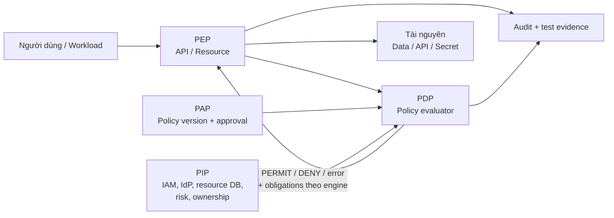
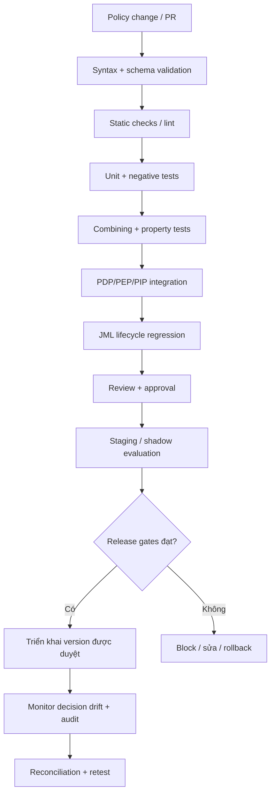

# Policy testing trong PBAC: Kiểm thử chính sách phân quyền theo vòng đời danh tính

Một nhân viên đăng nhập thành công qua **Single Sign-On (SSO)**, có role `finance-reader` và mở ứng dụng báo cáo. Với bản ghi của phòng Finance, hệ thống cho phép đọc; với bản ghi của HR, hệ thống từ chối. Nhóm kiểm thử đánh dấu chính sách phân quyền đã hoạt động. Tuy nhiên, ngay sau khi nhân viên chuyển từ Finance sang Support, phiên cũ vẫn đọc được báo cáo Finance. Khi nhân viên nghỉ việc, ứng dụng chặn đăng nhập mới nhưng một API token cũ vẫn cho phép export dữ liệu.

Những trường hợp này đặt ra câu hỏi cốt lõi: **làm thế nào chứng minh chính sách thực sự bảo vệ tài nguyên ở mọi trạng thái hợp lệ và không hợp lệ, kể cả khi danh tính, thuộc tính và phiên thay đổi?**

Trong **Policy-Based Access Control (PBAC)**, **policy testing** là quá trình kiểm chứng có hệ thống rằng **chính sách được định nghĩa, đánh giá, kết hợp và thực thi** tạo ra quyết định truy cập đúng theo yêu cầu bảo mật và nghiệp vụ. Kết quả phải đúng cả với những yêu cầu **được phép** (positive tests) lẫn những yêu cầu **bắt buộc bị từ chối** (negative tests), kể cả khi thuộc tính thiếu, policy xung đột, dịch vụ phụ thuộc lỗi hoặc quyền vừa bị thu hồi.

Bài thuộc chương **PBAC** trong mô-đun **Identity Lifecycle** của IAM (Identity and Access Management). Nội dung tập trung vào phương pháp thiết kế test, dữ liệu kiểm thử, kiểm tra **Policy Decision Point (PDP)** và **Policy Enforcement Point (PEP)**, tích hợp **IdP, SSO, SCIM, RBAC/ABAC**, đặc quyền và tài khoản dịch vụ; đồng thời kiểm chứng **Joiner–Mover–Leaver (JML)** để giảm **quyền truy cập tồn dư (residual access)**.

> **Tiêu chí cốt lõi:** Một test policy đạt **PASS** khi **đúng action, đúng subject, đúng resource, đúng thời điểm** được xử lý theo **đúng chính sách và có bằng chứng thực thi**. Chỉ kiểm rằng policy engine trả `PERMIT` cho một người dùng mẫu là chưa đủ.

## 1. Policy testing là gì và khác kiểm thử đăng nhập ra sao?

Một policy có thể diễn đạt:

```text
PERMIT report.read khi:
  subject.lifecycleState == ACTIVE
  AND subject.roles chứa finance-reader
  AND subject.tenantId == resource.tenantId
  AND subject.department == resource.ownerDepartment
  AND resource.classification phù hợp subject.clearance
```

Đây là **pseudocode**. Policy engine thực tế có cú pháp, ngữ nghĩa, quy tắc xử lý lỗi và mô hình phân quyền riêng.

**Policy testing** trả lời:

1. Với subject đủ điều kiện, policy có cho đúng action trên đúng resource không?
2. Chỉ cần một điều kiện quan trọng sai, quyết định có bị từ chối không?
3. Khi dữ liệu quan trọng không xác minh được, hệ thống có xử lý an toàn không?
4. Nếu nhiều policy cùng áp dụng, kết quả kết hợp có đúng chiến lược đã cấu hình không?
5. PEP có **thực thi** kết quả PDP ở API/resource thực, thay vì chỉ ẩn nút trên UI không?
6. Sau khi quyền hoặc trạng thái JML thay đổi, cache/session/token còn tạo đường truy cập sai không?
7. Có thể giải thích **policy version, dữ kiện, quyết định và hiệu lực** của mỗi phép thử không?

### 1.1. Phân biệt những loại kiểm thử liên quan

| Loại kiểm thử | Điều được xác minh | Giới hạn |
|---|---|---|
| **Authentication testing** | SAML/OIDC, xác minh người dùng, token, MFA, login. | Đăng nhập đúng không chứng minh resource access đúng. |
| **Policy unit testing** | Logic của policy với input đã cố định. | Không tự chứng minh dữ liệu PIP hoặc PEP thực thi đúng. |
| **Authorization integration testing** | PDP/PEP/PIP, mapping thuộc tính, kết quả thực thi. | Chưa chắc bao phủ mọi thay đổi JML xuyên hệ thống. |
| **Provisioning testing** | SCIM/connector tạo, cập nhật, vô hiệu hóa User/Group. | API thành công không chứng minh session/token đã bị chặn. |
| **Lifecycle testing** | Quyền hiệu lực trong Joiner–Mover–Leaver. | Cần kết hợp account, role, session, API và resource. |
| **Reconciliation testing** | Desired state so với actual/effective access. | Cần đọc đủ nguồn; thiếu quan sát phải ghi UNKNOWN. |
| **Security negative testing** | Từ chối yêu cầu vượt quyền, sai tenant, giả mạo và lỗi dữ kiện. | Chỉ kiểm các case đã thiết kế, không chứng minh không có mọi lỗ hổng. |

### 1.2. PBAC khác RBAC và ABAC ở điểm nào?

- **RBAC (Role-Based Access Control):** quản lý quyền qua vai trò.
- **ABAC (Attribute-Based Access Control):** quyết định quyền dựa trên thuộc tính subject, action, resource và environment.
- **PBAC (Policy-Based Access Control):** tổ chức việc quyết định và thực thi truy cập quanh **những policy được quản trị**, có thể sử dụng role, attribute, quan hệ, điều kiện môi trường, approvals và các rule khác.

PBAC không bắt buộc phải thay thế RBAC hoặc ABAC. Một policy PBAC có thể **kết hợp** role và thuộc tính: `role=editor`, `tenant match`, `resource.state=DRAFT`, `session có MFA đủ mới`. Vì vậy test phải xác định **điều kiện quyết định đầy đủ**, không chỉ “role nào vào được màn hình nào”.

## 2. Kiến trúc PBAC cần được kiểm thử

Các vai trò logic phổ biến:

- **Policy Administration Point (PAP):** nơi tạo, duyệt, phiên bản hóa, phát hành và ngừng policy.
- **Policy Decision Point (PDP):** nhận context, đánh giá các policy phù hợp và trả quyết định.
- **Policy Enforcement Point (PEP):** thực thi quyết định tại API, service, gateway hoặc nơi bảo vệ tài nguyên.
- **Policy Information Point (PIP):** nguồn cung cấp subject/resource/environment attributes, quan hệ, trạng thái và độ mới.
- **Identity/entitlement systems:** HRIS, IAM/IGA, IdP, directory, SCIM connector, PAM và hệ thống đích cung cấp dữ liệu hoặc thay đổi trạng thái.

### 2.1. Luồng quyết định



Test một hệ thống PBAC cần kiểm từ **đầu vào** đến **quyền hiệu lực**:

1. PEP có lấy principal đã xác thực thay vì tin chuỗi ID client tự nhập không?
2. PIP có lấy đúng attribute từ authority và ở phiên bản phù hợp không?
3. PDP có đánh giá đúng policy được phát hành, chứ không phải phiên bản test cũ không?
4. Quy tắc kết hợp nhiều policy có đúng không?
5. Obligation/step-up có được thực hiện trước hành động nhạy cảm không?
6. PEP có chặn đường gọi API khác hoặc đường truy cập nội bộ tương đương không?
7. Có audit đầy đủ để chứng minh kết quả và nguyên nhân không?

### 2.2. PDP trả PERMIT chưa phải quyền đã được thực thi

Giả sử unit test PDP trả `DENY` cho `invoice.delete`. Nhưng backend chỉ gọi PDP ở màn hình giao diện; endpoint `DELETE /api/invoices/{id}` không kiểm lại. Policy logic đúng nhưng **hệ thống vẫn có lỗi authorization**.

Cần phân biệt:

```text
Decision correctness:
  PDP trả quyết định đúng theo policy.

Enforcement correctness:
  API/resource thực sự thực thi hoặc từ chối hành động đúng.

Lifecycle correctness:
  Quyết định và thực thi còn đúng sau khi trạng thái thay đổi.
```

## 3. Xác lập “đáp án đúng” trước khi viết test

Một sai lầm lớn là tạo test dựa trên **kết quả đang chạy**: nếu hệ thống hiện trả PERMIT, ta ghi PERMIT làm expected. Như vậy chỉ đóng băng cả lỗi đã có.

Expected decision phải được suy ra từ **yêu cầu nghiệp vụ/bảo mật đã duyệt**, threat model và policy specification độc lập với code thực hiện.

### 3.1. Policy contract

Mỗi policy nên có tài liệu ngắn xác định:

| Thành phần | Ví dụ | Vì sao cần kiểm thử |
|---|---|---|
| **Policy ID** | `finance-report-access` | Biết đúng rule được kiểm. |
| **Version** | `v4` | Phát hiện thay đổi behavior khi release. |
| **Scope** | Tenant A, reports Finance. | Không nhầm quyền global. |
| **Subjects** | Người dùng ACTIVE có role đọc. | Test trạng thái và tư cách. |
| **Actions** | `report.read`, `report.export`. | Hai hành động có rủi ro khác nhau. |
| **Resources** | Báo cáo có tenant, ownerDepartment, classification. | Kiểm resource-level rules. |
| **Environment/session** | Assurance, thời gian, risk. | Kiểm điều kiện truy cập nhạy cảm. |
| **Effect/combining** | Permit/deny và nguyên tắc kết hợp. | Kiểm nhiều rule cùng áp dụng. |
| **Missing data behavior** | Không cấp export khi thiếu classification. | Tránh fail-open. |
| **Obligations** | Yêu cầu MFA mới hơn và audit export. | Kiểm PEP thực thi đủ. |
| **Lifecycle behavior** | Gỡ quyền khi Mover/Leaver. | Kiểm policy với trạng thái mới/cũ. |
| **Owner/approval** | Data owner + Security. | Truy vết trách nhiệm thay đổi. |

### 3.2. Ví dụ policy contract dạng khái niệm

```yaml
id: finance-report-access
version: v4
scope:
  application: reporting
  tenant: tenant-a
subjectRequirements:
  lifecycleState: ACTIVE
  rolesAny:
    - finance-reader
resourceRequirements:
  sameTenant: true
  sameDepartment: true
actions:
  report.read:
    requireClearance: true
  report.export:
    requireClearance: true
    requireRecentMfa: true
    auditLevel: HIGH
fallback:
  missingSecurityAttribute: NO_PERMIT
  policyEvaluationError: NO_PERMIT
```

Đây là **pseudoconfig giải thích policy**, không phải YAML áp dụng trực tiếp cho OPA, XACML, Cedar hoặc bất kỳ engine nào. Các biểu diễn như `NO_PERMIT` cần được ánh xạ sang hành vi engine và PEP thực tế.

### 3.3. Tách bảng quy tắc khỏi dữ liệu test

Policy spec phải chỉ ra **điều kiện**. Test fixture phải tạo ra **giá trị đầu vào cụ thể** để kiểm những điều kiện đó. Ví dụ:

```text
Rule: subject.department == resource.ownerDepartment

Case 1:
  subject.department = FINANCE
  resource.ownerDepartment = FINANCE
  => Điều kiện đúng

Case 2:
  subject.department = SUPPORT
  resource.ownerDepartment = FINANCE
  => Điều kiện sai

Case 3:
  subject.department = UNKNOWN
  resource.ownerDepartment = FINANCE
  => Không có bằng chứng đủ để PERMIT theo policy
```

## 4. Chuẩn hóa input và expected outcome

Policy testing hiệu quả cần thống nhất **mô hình yêu cầu**. Một request authorization thường xét:

```text
(subject, action, resource, environment, session, policyVersion)
```

Một ví dụ JSON:

```json
{
  "requestId": "req-test-0042",
  "subject": {
    "id": "person-1045",
    "type": "HUMAN",
    "lifecycleState": "ACTIVE",
    "tenantId": "tenant-a",
    "department": "FINANCE",
    "roles": ["finance-reader"]
  },
  "action": "report.read",
  "resource": {
    "id": "report-007",
    "tenantId": "tenant-a",
    "ownerDepartment": "FINANCE",
    "classification": "CONFIDENTIAL"
  },
  "environment": {
    "now": "2026-12-01T09:00:00+07:00"
  },
  "session": {
    "issuer": "https://login.example.invalid",
    "verified": true,
    "mfaSatisfied": true
  },
  "policyVersion": "v4"
}
```

Dữ liệu hoàn toàn hư cấu. Trong thực tế, **`verified=true` và `mfaSatisfied=true` không được tin chỉ vì client tự gửi**; test PDP có thể dùng fixture, còn test tích hợp phải xác minh chúng được tạo từ cơ chế xác thực/session đáng tin.

### 4.1. Không phải mọi engine chỉ có PERMIT và DENY

Một số mô hình policy hỗ trợ các kết quả như:

| Kết quả logic | Ý nghĩa | Điều cần test |
|---|---|---|
| **PERMIT/ALLOW** | Policy cho phép hành động trong context đang xét. | PEP thực thi đúng action và nghĩa vụ. |
| **DENY** | Policy xác định yêu cầu không được phép. | PEP từ chối thực sự. |
| **NOT_APPLICABLE** | Rule hoặc policy không áp dụng cho request. | Bộ kết hợp/default xử lý đúng, không coi là PERMIT. |
| **INDETERMINATE/ERROR** | Thiếu dữ liệu, lỗi đánh giá hoặc kết quả chưa thể quyết định. | Không fail-open ở hành động nhạy cảm; ghi lỗi có thể điều tra. |

Các tên và khả năng phân biệt **phụ thuộc engine**. Ví dụ không phải engine nào cũng công bố bốn trạng thái. Khi viết test, cần định nghĩa cả **internal decision** lẫn **hành vi PEP cuối cùng**.

### 4.2. Kiểm chứng cả obligations và advice

Một số policy có thể trả kèm yêu cầu:

- Thực hiện **step-up MFA**.
- Đảm bảo approval hợp lệ.
- Mask hoặc giới hạn trường dữ liệu.
- Ghi audit chi tiết hơn.
- Chặn export vượt hạn mức.
- Áp dụng Just-in-Time (JIT) privilege activation.

Không nên ghi PASS chỉ vì PDP trả PERMIT nếu **PEP bỏ qua obligation bắt buộc**. Một lời khuyên không bắt buộc (advice), nếu engine có khái niệm này, phải được phân biệt với obligation theo hợp đồng đã duyệt.

## 5. Thiết kế ma trận kiểm thử từ điều kiện policy

### 5.1. Ma trận ALLOW/DENY cơ bản

Giả sử policy đọc báo cáo yêu cầu: user ACTIVE, có role, cùng tenant và cùng department.

| Test ID | ACTIVE | Có role | Cùng tenant | Cùng department | Expected |
|---|---|---|---|---|---|
| `PB-01` | Có | Có | Có | Có | PERMIT. |
| `PB-02` | Không | Có | Có | Có | DENY. |
| `PB-03` | Có | Không | Có | Có | DENY. |
| `PB-04` | Có | Có | Không | Có | DENY. |
| `PB-05` | Có | Có | Có | Không | DENY. |
| `PB-06` | Có | Có | Có | UNKNOWN | Không PERMIT nếu thuộc tính bắt buộc. |
| `PB-07` | Có | Có | UNKNOWN | Có | Không PERMIT. |
| `PB-08` | TERMINATED | Không | Không | Không | DENY. |

Nhóm `PB-02` đến `PB-05` thay **một điều kiện mỗi lần** so với happy path, giúp tìm ra điều kiện nào bị bỏ qua. `PB-06`/`PB-07` kiểm **missing/unknown attributes**, vốn thường là nguyên nhân của fail-open.

### 5.2. Kiểm tra từng action, không gộp quyền

| Subject | Resource | Action | Expected |
|---|---|---|---|
| Finance reader đủ điều kiện | Report Finance cùng tenant | `report.read` | PERMIT. |
| Finance reader đủ điều kiện | Cùng report | `report.export` nhưng chưa step-up | DENY hoặc yêu cầu step-up theo policy. |
| Finance reader đủ điều kiện | Cùng report | `report.delete` | DENY. |
| Finance editor có quyền sửa | Report DRAFT | `report.update` | PERMIT nếu đủ điều kiện. |
| Finance editor có quyền sửa | Report LOCKED | `report.update` | DENY. |
| Admin tenant A | Report tenant B | `report.delete` | DENY, trừ policy liên tenant được duyệt rõ. |

**Một role có quyền `read` không ngầm có quyền `export` hay `delete`.** Action thường phản ánh mức rủi ro khác nhau.

### 5.3. Boundary value analysis

Policy có thể phụ thuộc:

- Hạn mức thanh toán.
- Ngày bắt đầu và kết thúc grant.
- Thời gian từ lần MFA gần nhất.
- Tối đa số bản ghi export.
- Số ngày hợp đồng còn hiệu lực.
- Độ sâu nhóm hoặc quan hệ project.

Ví dụ quyền JIT hợp lệ khi:

```text
validFrom <= now < validUntil
```

Test ít nhất các mốc: **ngay trước `validFrom`**, **tại `validFrom`**, **ngay trước `validUntil`**, **tại `validUntil`** và **sau đó**. Chính sách cần quyết định rõ ranh giới đóng/mở; tránh phụ thuộc timezone của trình duyệt.

## 6. Kiểm thử nhiều policy cùng áp dụng

PBAC có thể có nhiều policy:

- Rule chung: subject phải ACTIVE.
- Rule tenant: subject và resource cùng tenant.
- Rule role: reader được đọc.
- Rule dữ liệu nhạy cảm: RESTRICTED cần assurance cao.
- Rule SoD: approver không được tự duyệt yêu cầu mình tạo.
- Rule ngoại lệ: một tác vụ khẩn cấp có thể có quy trình phê duyệt riêng.

**Từng rule đúng không chứng minh kết quả kết hợp đúng.**

### 6.1. Chính sách kết hợp

Tùy công cụ, hệ thống có thể dùng những chiến lược như:

- **Deny-overrides:** một quyết định DENY có hiệu lực ưu tiên theo ngữ nghĩa cụ thể của engine.
- **Permit-overrides:** một quyết định PERMIT có thể ưu tiên theo ngữ nghĩa engine.
- **First-applicable:** policy áp dụng đầu tiên quyết định kết quả.
- **Ordered variants hoặc custom-combining:** thứ tự và điều kiện có thể quyết định.
- **Default deny:** không có policy cho phép thì PEP từ chối theo thiết kế.

**Không giả định mọi PBAC engine cùng thứ tự ưu tiên.** Trước khi test phải biết cách engine đang kết hợp PERMIT, DENY, NOT_APPLICABLE và INDETERMINATE, đặc biệt khi policy lỗi.

### 6.2. Ví dụ xung đột đáng kiểm

```text
Policy A: PERMIT document.read cho finance-reader.
Policy B: DENY document.read nếu document.classification=RESTRICTED.
Input: finance-reader truy cập document RESTRICTED.
```

Nếu **security contract** quy định rule bảo vệ độ nhạy phải thắng, test phải bảo đảm kết quả cuối là DENY. Không chỉ test từng policy riêng lẻ; cần **integration test bộ kết hợp**.

### 6.3. Ma trận combine

| Policy A | Policy B | Kết quả mong đợi | Ghi chú |
|---|---|---|---|
| PERMIT | NOT_APPLICABLE | Theo chiến lược đã công bố. | Kiểm policy đúng scope. |
| PERMIT | DENY | Theo chính sách xung đột đã phê duyệt. | Trường hợp quan trọng để phát hiện cấp quyền quá rộng. |
| DENY | NOT_APPLICABLE | Theo chiến lược kết hợp. | Không bỏ qua DENY vô tình. |
| NOT_APPLICABLE | NOT_APPLICABLE | Không tự cấp quyền nếu thiếu căn cứ. | Kiểm default behavior ở PEP. |
| PERMIT | INDETERMINATE | Theo ngữ nghĩa engine, rủi ro và hợp đồng đã duyệt. | Không âm thầm biến lỗi thành PERMIT. |
| DENY | INDETERMINATE | Theo ngữ nghĩa engine và PEP. | Kiểm lý do, alert, không chỉ status HTTP. |

Tài liệu test phải ghi **actual combining algorithm**; bảng trên cố ý không áp một “expected” cứng cho mọi engine.

### 6.4. Thử thay đổi thứ tự

Nếu engine dùng **first-applicable**, thay thứ tự khai báo policy có thể đổi quyết định. Test phải chứng minh thứ tự version được phát hành là thứ tự được chủ sở hữu policy phê duyệt. Với chiến lược không phụ thuộc thứ tự, có thể kiểm hoán đổi rule không làm thay đổi những quyết định mà hợp đồng yêu cầu ổn định.

## 7. Kiểm thử thuộc tính và độ tin cậy của PIP

Policy thường phụ thuộc vào dữ liệu từ nhiều hệ thống:

| Thuộc tính | Nguồn nên xem xét | Test rủi ro |
|---|---|---|
| `subject.lifecycleState` | HRIS/IAM, theo authority. | Sự kiện Leaver đến chậm. |
| `subject.department` | HRIS hoặc nguồn đã duyệt. | Mover nhưng session giữ giá trị cũ. |
| `subject.roles` | IAM/IGA, IdP hoặc target theo policy. | Direct grant bị bỏ sót. |
| `resource.tenantId` | Resource database/server. | Client giả tenant trong URL/body. |
| `resource.classification` | Resource catalog/data steward. | Classification thiếu hoặc bị hạ trái phép. |
| `resource.ownerId` | Hệ thống nghiệp vụ. | Owner đã Leaver hoặc bị thay đổi. |
| `session.auth_time` | IdP/OP và session manager đáng tin. | MFA cũ nhưng policy yêu cầu step-up. |
| `devicePosture` | Endpoint management/risk service. | Dữ liệu quá hạn hoặc không thể kiểm. |
| `workload.ownerTeam` | Service catalog. | Service principal không có owner. |

### 7.1. Thuộc tính thiếu phải được biểu diễn rõ

Ví dụ nguồn không trả `resource.classification`. Các khả năng:

- Resource chưa được phân loại.
- PIP bị lỗi mạng.
- Caller không đủ ACL để đọc.
- Trường chưa đồng bộ sang replica.
- Query sai base/tenant.
- Source có dữ liệu nhưng sai schema.

**UNKNOWN không phải PUBLIC**. Test phải xác minh không có đường nào chuyển missing value thành giá trị làm cho PERMIT mà không qua quy tắc được duyệt.

### 7.2. Thuộc tính do client cung cấp

Một request HTTP có:

```http
GET /tenants/tenant-a/reports/report-007 HTTP/1.1
X-Department: FINANCE
X-Role: admin
```

Nếu client tự gửi các header trên, chúng **không phải subject claims đáng tin**. Test integration cần cố tình thay header và xác minh:

- PEP không dựa vào role/department tự khai để mở quyền.
- Resource tenant được lấy từ database hoặc nguồn server-side đáng tin.
- Principal được lấy từ token/session đã kiểm issuer, audience, signature và context.
- Gateway/proxy được cấu hình loại bỏ header nhạy cảm mà client có thể giả.

### 7.3. Provenance và freshness

Một thuộc tính phục vụ quyết định quan trọng nên có thể gắn:

```json
{
  "attribute": "department",
  "value": "FINANCE",
  "source": "hris",
  "sourceVersion": 82,
  "effectiveAt": "2026-12-01T09:00:00+07:00",
  "observedAt": "2026-12-01T09:00:04+07:00",
  "verificationStatus": "TRUSTED"
}
```

Đây là ví dụ metadata, không phải trường bắt buộc của mọi PDP. Test không chỉ kiểm `value`, mà còn kiểm **thời điểm, nguồn và độ mới** nếu policy dựa vào các yếu tố đó.

## 8. Kiểm thử Joiner: quyền chỉ bắt đầu đúng lúc

**Joiner** là giai đoạn danh tính được xác minh, enrollment, tạo account và cấp quyền ban đầu theo nhiệm vụ.

Một kịch bản:

1. HRIS tạo người mới với `startDate` trong tương lai.
2. IdP có thể đã có account để enrollment theo chính sách.
3. SaaS được pre-provision hoặc chờ JIT provisioning.
4. Policy PBAC phải tránh mở quyền trước khi điều kiện hiệu lực và approval được đáp ứng.
5. Khi đến mốc được phép, user nhận quyền tối thiểu đã duyệt.

### 8.1. Ma trận Joiner

| Test | Trạng thái | Expected |
|---|---|---|
| `JNR-01` | Identity chưa proofing đủ nhưng có username. | Không cấp quyền chỉ dựa trên username. |
| `JNR-02` | Account đã tạo, ngày bắt đầu chưa tới. | Quyền nghiệp vụ bị DENY nếu policy chưa cho phép. |
| `JNR-03` | ACTIVE, đủ role cơ sở và đúng resource. | PERMIT trong scope. |
| `JNR-04` | ACTIVE nhưng chưa được cấp role bắt buộc. | DENY; không tự cấp role admin để “đăng nhập được”. |
| `JNR-05` | SCIM tạo account trùng hoặc mapping mơ hồ. | Không gắn nhầm subject; mở finding. |
| `JNR-06` | Hai IdP phát cùng email nhưng subject khác. | Không tự merge chỉ theo email. |
| `JNR-07` | Role vừa cấp và session chứa claims cũ. | Hành vi theo policy cập nhật, không vượt scope. |

### 8.2. Expected policy khác expected provisioning

Một Joiner có thể đăng nhập IdP thành công nhưng **chưa đủ quyền ứng dụng**. Nếu target chưa provision, test PBAC nên kiểm **DENY an toàn hoặc workflow enrollment hợp lệ**, không tự xem login thất bại là lỗi policy hoặc tự tạo quyền chưa phê duyệt.

## 9. Kiểm thử Mover: cấp mới đồng thời thu hồi cũ

**Mover** là tình huống dễ phát sinh **privilege creep**: quyền mới được thêm nhưng quyền cũ không bị gỡ hết.

Giả sử Mai chuyển từ Support sang Finance:

```text
Trước Mover:
  department = SUPPORT
  roles = [support-reader]
  ALLOW support.ticket.read
  DENY finance.report.read

Sau Mover (desired):
  department = FINANCE
  roles = [finance-reader]
  DENY support.ticket.read
  ALLOW finance.report.read nếu đủ điều kiện
```

### 9.1. Ma trận Mover

| Test | Input thay đổi | Expected |
|---|---|---|
| `MVR-01` | Department đổi, role cũ phải gỡ. | DENY action thuộc phạm vi cũ. |
| `MVR-02` | Role mới được phê duyệt. | PERMIT action mới chỉ trong scope được cấp. |
| `MVR-03` | Direct grant tại SaaS vẫn còn. | Phát hiện và chặn/trả finding theo policy. |
| `MVR-04` | Group lồng nhau còn cấp role cũ. | Không bỏ sót effective permission. |
| `MVR-05` | Session chứa claim Support từ trước Mover. | Quyền cũ bị chặn trong giới hạn thu hồi đã phê duyệt. |
| `MVR-06` | Event cũ tới sau event mới. | Không ghi đè quyền hiện hành bằng trạng thái cũ. |
| `MVR-07` | Role mới và cũ tạo xung đột SoD. | DENY/không kích hoạt tổ hợp xung đột. |
| `MVR-08` | Tài nguyên chuyển owner/team cùng thời điểm. | Đánh giá theo resource attributes hiện hành. |

### 9.2. Test quyền âm tính có giá trị quyết định

Sau Mover, test chỉ thấy `department=FINANCE` ở IdP **không đủ**. Phải thử hoặc đọc lại **quyền hiệu lực** với phiên/token/API được phép:

- Người dùng không còn được đọc ticket Support.
- Người dùng không còn được xuất dữ liệu Support.
- Quyền quản trị phụ hoặc token cũ không vượt quá policy.
- Người dùng được đọc dữ liệu Finance nếu có role, clearance, tenant và approval tương ứng.

### 9.3. Trường hợp event đến sai thứ tự

Giả sử nguồn authoritative phát:

```text
Version 40: department=SUPPORT
Version 41: department=FINANCE
Version 42: lifecycleState=TERMINATED
```

Nếu message version 41 đến **sau** version 42 và policy consumer chấp nhận như trạng thái hiện hành, người đã Leaver có thể được mở lại quyền Finance. Test cần kiểm **version/effectiveAt/authority và cách xử lý stale event**; không chỉ kiểm thứ tự happy path.

## 10. Kiểm thử Leaver và quyền truy cập tồn dư

**Leaver** là trường hợp quan trọng nhất để xác nhận policy không chỉ dựa vào quyền từng được cấp.

### 10.1. Các đường cần kiểm

- **Đăng nhập mới:** IdP/OP còn cấp kết quả xác thực hay không?
- **Account tại ứng dụng:** SCIM/connector đã disable hoặc gỡ role theo policy chưa?
- **Phiên ứng dụng:** SP/RP đã tạo session trước đó còn được resource server chấp nhận không?
- **API access token:** token tự chứa hoặc token do app cấp riêng có thể vẫn hợp lệ không?
- **Refresh token/long-lived credential:** có còn khả năng lấy token mới không?
- **Đường đăng nhập local:** có mật khẩu hoặc tài khoản tách khỏi SSO không?
- **Tài khoản đặc quyền:** PAM/PIM active/eligible và session quản trị đã được thu hồi chưa?
- **Quyền gián tiếp:** nested group, direct grant, delegation, nhóm dự án hoặc share link còn hợp lệ không?
- **Ownership:** tài nguyên nghiệp vụ do người nghỉ việc tạo cần được bàn giao nhưng không tái cấp quyền cá nhân.

### 10.2. Ma trận Leaver

| Test | Tình huống | Expected |
|---|---|---|
| `LVR-01` | Subject TERMINATED, request mới có token cũ. | Resource DENY theo chính sách hiệu lực. |
| `LVR-02` | Account IdP disabled, session SP chưa hết hạn. | Không còn hành động cấm trong giới hạn thu hồi. |
| `LVR-03` | SCIM `active=false` thành công, role direct còn. | Reconciliation phát hiện quyền tồn dư. |
| `LVR-04` | Access token còn hạn. | Kiểm khả năng revoke/introspect/TTL và policy tại API. |
| `LVR-05` | Password reset link trước Leaver còn hiệu lực. | Không được kích hoạt lại quyền Leaver. |
| `LVR-06` | Event Mover cũ tới sau Leaver. | Không phục hồi quyền. |
| `LVR-07` | Account disabled nhưng privileged role eligible còn. | Phát hiện và thu hồi theo policy. |
| `LVR-08` | Subject tái tuyển dụng. | Quyền mới phải được duyệt, không khôi phục mặc định toàn bộ quyền cũ. |
| `LVR-09` | Connector target không đọc được session. | Ghi UNKNOWN/coverage gap, không báo mọi phiên đã sạch. |

### 10.3. Phân biệt chặn login và chặn truy cập

Khóa account ở IdP chủ yếu ngăn **xác thực mới** hoặc những hành động do IdP kiểm soát. Một session SaaS và access token đã phát hành có thể vẫn hoạt động theo thiết kế. Policy test phải đánh giá **quyền tại PEP/API**, không chỉ xem giao diện IdP.

Với một resource server sử dụng JWT tự chứa, việc cập nhật `lifecycleState` tại HRIS không tự sửa claim trong token cũ. Có thể cần token ngắn hạn, introspection, revocation marker, session invalidation hoặc kiểm account state tại API theo mức rủi ro.

## 11. Chính sách SSO, IdP, SCIM và PBAC có liên quan nhưng không đồng nhất

### 11.1. Authentication context có thể trở thành đầu vào policy

Trong SAML/OIDC, ứng dụng có thể nhận:

- Subject identifier đã xác minh.
- Issuer tin cậy và tenant mapping.
- Thời điểm hoặc ngữ cảnh xác thực.
- Role/group/department claims nếu IdP hỗ trợ và đã được thỏa thuận.
- Điều kiện để yêu cầu step-up khi action nhạy cảm.

Nhưng một assertion hoặc ID Token có chữ ký hợp lệ không chứng minh **mọi quyền ở ứng dụng** được cấp đúng. Test phải kiểm issuer, audience, subject mapping và độ mới của claims trước khi policy sử dụng.

### 11.2. OIDC ID Token không phải API Access Token

- **ID Token** hướng tới Relying Party và mô tả thông tin đăng nhập.
- **Access Token** hướng tới Resource Server/API với audience/scope và cách kiểm riêng.
- **Session cookie** do ứng dụng phát có thời hạn và trạng thái riêng.

Test PBAC không được chỉ kiểm “JWT hợp lệ” rồi cho API truy cập. Phải xác minh **loại token, audience, scope, issuer, account/tenant, action và resource policy**.

### 11.3. SCIM chỉ bảo đảm phần provisioning được hỗ trợ

SCIM có thể quản lý User/Group và những thuộc tính mà target triển khai. Tuy nhiên:

- Một role cục bộ ở SaaS có thể không nằm trong SCIM.
- Session và OAuth token có thể không bị thu hồi bởi một thao tác SCIM.
- User được disable không đồng nghĩa mọi dữ liệu thuộc sở hữu được bàn giao.
- Connector có thể trả thành công nhưng trạng thái thực tế cập nhật bất đồng bộ.

**Policy testing sau provisioning** cần kiểm cả **desired state** và **actual/effective access**; nếu chỉ có phản hồi HTTP thành công, bằng chứng chưa đủ.

### 11.4. Các lớp bằng chứng

| Lớp | Bằng chứng | Điều chưa thể kết luận |
|---|---|---|
| HRIS/IAM | Lifecycle event, role mục tiêu. | Target đã áp dụng hay chưa. |
| IdP/Directory | Account disabled, group đã gỡ. | SP session, API key còn hay không. |
| SCIM/Connector | API provisioning success. | Role direct và quyền hiệu lực tại target. |
| PDP | Decision cho input tại thời điểm test. | PEP và tài nguyên thực có thực thi không. |
| PEP/API | Kết quả hành động theo principal và resource. | Các đường truy cập không nằm trong phạm vi test. |
| Reconciliation | Readback và đối chiếu nhiều target. | Những lớp được ghi UNKNOWN do thiếu khả năng quan sát. |

## 12. Kiểm thử quyền đặc quyền, SoD và JIT

**Privileged access** cần test nhiều điều kiện hơn một role thông thường. Một user có `platform-operator` nhưng chưa kích hoạt JIT không nên mặc nhiên có quyền `production.deploy`.

### 12.1. Những điều kiện cần có

```text
PERMIT production.deploy khi:
  subject.lifecycleState == ACTIVE
  AND subject có quyền eligible cho project
  AND privilegedActivation.active == true
  AND now < privilegedActivation.expiresAt
  AND privilegedActivation.scope chứa project đích
  AND session đáp ứng MFA/step-up
  AND changeApproval còn hiệu lực
  AND không vi phạm SoD
```

### 12.2. Test case đặc quyền

| Test | Input | Expected |
|---|---|---|
| `PRV-01` | User có role eligible nhưng chưa active. | DENY. |
| `PRV-02` | Activation active đúng scope, assurance và approval. | PERMIT trong thời hạn. |
| `PRV-03` | JIT hết hạn đúng tại boundary. | DENY. |
| `PRV-04` | Activation cho project A, request tới B. | DENY. |
| `PRV-05` | User chuyển vị trí, eligible role cũ chưa gỡ. | Phát hiện và chặn theo policy. |
| `PRV-06` | User đã Leaver, session PAM vẫn còn. | Không thể tiếp tục action ngoài policy. |
| `PRV-07` | Người đề xuất cũng là người duyệt. | DENY nếu SoD yêu cầu độc lập. |
| `PRV-08` | Break-glass flag chỉ do client gửi. | Không tạo ngoại lệ quyền. |

### 12.3. SoD không chỉ là một role

Ví dụ thanh toán:

```text
DENY invoice.approve nếu:
    subject.id == invoice.createdBy
```

Trong chính sách thật có thể còn SoD theo bộ quyền, loại giao dịch hoặc người phê duyệt. Test phải dùng **resource attribute có nguồn tin cậy** và những tình huống xung đột, không chỉ nhìn danh sách nhóm của subject.

### 12.4. Break-glass phải có hợp đồng test riêng

Một policy khẩn cấp có thể cho phép quyền vượt quy trình thường trong tình huống được phê duyệt. Test phải xác minh:

- Chỉ principal được chỉ định mới kích hoạt được.
- Có điều kiện, lý do, scope và giới hạn thời gian.
- Có logging/alert, giám sát và review sau sử dụng.
- Không bị kích hoạt bởi header/query parameter do client tự gửi.
- Sau khi kết thúc hoặc account owner Leaver, đường truy cập bị thu hồi.

Không dùng một test “admin có quyền tất cả” thay cho toàn bộ ma trận đặc quyền.

## 13. Kiểm thử service account và machine identity

PBAC không chỉ áp dụng cho con người. Workload có thể dùng access token, mTLS, service principal hoặc credential ngắn hạn.

### 13.1. Context của workload

| Thuộc tính | Ví dụ | Test quan trọng |
|---|---|---|
| `subject.type` | `WORKLOAD` | Policy không yêu cầu HRIS employmentState của người. |
| `workloadId` | `invoice-sync` | Khớp identity của workload đã xác minh. |
| `ownerTeam` | `finance-platform` | Owner có hiệu lực, không phải người tạo đã Leaver. |
| `environment` | `production` | Secret môi trường test không mở production. |
| `audience` | `finance-api` | Token cho API khác bị từ chối. |
| `tenantId` | `tenant-a` | Không vượt tenant. |
| `purpose` | `invoice-import` | Chỉ action/resource đã duyệt. |
| `credentialState` | Valid, revoked, expired. | Thu hồi rotation và replay. |

### 13.2. Ma trận workload

| Test | Trường hợp | Expected |
|---|---|---|
| `SVC-01` | Workload hợp lệ, đúng audience, đúng resource. | PERMIT theo scope. |
| `SVC-02` | Credential cho staging dùng ở production. | DENY. |
| `SVC-03` | Token cho API A được gửi sang API B. | DENY. |
| `SVC-04` | Service account đã decommission. | DENY dù credential cũ còn được trình bày. |
| `SVC-05` | Owner kỹ sư Leaver nhưng workload vẫn hợp lệ. | Không tự xóa workload; chuyển owner và xử lý quyền cá nhân. |
| `SVC-06` | Delegated token chỉ có quyền read, workload cố delete. | DENY. |
| `SVC-07` | Client tự khai `purpose=admin`. | Không tin purpose chưa kiểm chứng. |

### 13.3. Delegation và on-behalf-of

Một service có thể gọi API thay người dùng. Policy cần phân biệt:

- **Acting principal**: workload/client thực hiện request.
- **End-user subject**: người dùng được đại diện.
- **Delegated scopes**: quyền được ủy quyền thực sự.
- **Resource**: tài nguyên và tenant đích.
- **Token provenance**: issuer/audience/expiry và ràng buộc grant.

Test phải từ chối khi service sử dụng quyền admin riêng của mình để mở rộng tác vụ thay mặt user không có quyền. **Workload authentication** không tự biến mọi user request thành privileged request.

## 14. Kiểm thử đa tenant và bảo vệ resource-level access

Một ứng dụng SaaS có thể cùng lúc phục vụ tenant A và B. Test không được dựa vào việc ID tài nguyên “khó đoán” để ngăn truy cập.

### 14.1. Các trường hợp phải có

1. User tenant A đọc resource tenant A đúng role → PERMIT khi đủ điều kiện.
2. User tenant A đọc resource tenant B → DENY.
3. User thay tenant ID trên URL/header/query → không mở quyền.
4. Hai IdP có cùng email nhưng issuer/subject khác → không ghép account.
5. Token hợp lệ của client B gửi tới API A → từ chối theo audience/policy.
6. Cache ALLOW của tenant A không được dùng cho tenant B.
7. Admin tenant A không tự thành Global Admin.
8. List/search/pagination chỉ trả những bản ghi người dùng được phép thấy.
9. Resource chuyển tenant trong khi request đang chạy → không sử dụng quyền cũ khi commit.
10. API đồng bộ nội bộ, background job và GraphQL endpoint cũng có PEP phù hợp.

### 14.2. BOLA/IDOR và policy testing

**Broken Object Level Authorization (BOLA)** có thể xuất hiện khi API xác thực đúng user nhưng không kiểm user đó có quyền với object ID đang được yêu cầu.

```http
GET /api/projects/project-101 HTTP/1.1
Authorization: Bearer <sandbox-access-token>
```

Trong sandbox, thay resource ID từ project được phép sang project không được phép. Test PASS khi API từ chối truy cập sai, không trả dữ liệu nhạy cảm và không có side effect trái policy.

Không cần sử dụng danh sách ID thật hoặc chạy quét trên hệ thống ngoài phạm vi phê duyệt. Dùng **fixture và tenant test** đã được ủy quyền.

## 15. Property-based, metamorphic và mutation testing cho policy

Ma trận case cụ thể là nền tảng, nhưng những cách kiểm thử nâng cao có thể tìm lỗi mà bảng ví dụ bỏ sót.

### 15.1. Property-based testing

Thay vì viết riêng từng case, sinh những biến thể **đầu vào hợp lệ theo schema** và kiểm các bất biến đã được duyệt.

Ví dụ property:

```text
Với policy không có ngoại lệ liên tenant:
  Nếu subject.tenantId != resource.tenantId,
  thì decision cuối cùng không được PERMIT.
```

Hoặc:

```text
Nếu subject.lifecycleState == TERMINATED:
  Không action protected nào được PERMIT
  ngoài tập hành động administrative được policy định nghĩa rõ.
```

**Cảnh báo:** Không tự khẳng định quy tắc đơn điệu “bớt một role thì chắc chắn không thể tăng quyền” cho mọi PBAC. Những hệ thống có deny rules, ngoại lệ, combining algorithms hoặc chính sách dựa vào vắng mặt role có thể có hành vi khác; property phải dựa trên hợp đồng được duyệt.

### 15.2. Metamorphic testing

Metamorphic test tạo một input mới từ input gốc và kỳ vọng quan hệ kết quả.

Ví dụ:

| Biến đổi | Expected nếu hợp đồng quy định |
|---|---|
| Đổi resource tenant sang tenant khác, giữ nguyên subject. | PERMIT trước đó chuyển thành DENY. |
| Đổi subject lifecycle từ ACTIVE sang TERMINATED. | Không tiếp tục PERMIT action được bảo vệ. |
| Đổi classification từ INTERNAL lên RESTRICTED. | Không mở rộng tập người được phép, trừ ngoại lệ chính thức. |
| Cho grant JIT hết hạn. | Action đặc quyền bị DENY. |
| Đổi request từ `read` sang `delete` mà không có quyền delete. | DENY. |
| Xóa thuộc tính bảo mật bắt buộc. | Không tự PERMIT do missing value. |

Những expected này **không phải định luật chung**; chúng chỉ đúng khi policy có điều kiện như đã nêu.

### 15.3. Policy mutation testing

Có thể chủ động tạo **biến thể sai trong sandbox** để xem test có phát hiện:

- Bỏ điều kiện tenant.
- Đổi AND thành OR.
- Bỏ kiểm lifecycleState.
- Bỏ điều kiện JIT expiry.
- Cho phép khi classification UNKNOWN.
- Đảo nhánh PERMIT/DENY.
- Bỏ rule SoD.
- Đổi priority/combining của policy.

Nếu một test suite vẫn PASS khi bỏ điều kiện tenant, bộ test có **lỗ hổng coverage nghiêm trọng**. Mutation phải thực hiện trên **bản sao cấu hình test**, không tạo thay đổi vô tình tới policy production.

### 15.4. Fuzzing và đầu vào bất thường

Fuzz test có thể sinh:

- Thuộc tính thiếu, null, kiểu dữ liệu sai.
- Chuỗi quá dài, ký tự Unicode, giá trị enum lạ.
- ID trùng, resource không có owner.
- Timestamp không hợp lệ hoặc vượt khoảng.
- Nhóm lồng nhau, vòng tham chiếu, role dư.
- Collection lớn, attribute đa trị.
- Dữ liệu conflict giữa hai nguồn.

Mục tiêu là policy **không bị crash, không fail-open và không quyết định ngoài contract** khi nhận dữ liệu không hợp lệ.

## 16. Kiểm thử cache, thời gian và trạng thái đang thay đổi

Policy decision có thể được cache để giảm độ trễ, nhưng **ALLOW cũ có thể trở thành sai**.

### 16.1. Các lớp cache

- Claims trong SAML assertion/ID Token.
- Access token tự chứa ở API.
- Session state của SP/RP.
- Cache nhóm/role trong ứng dụng.
- PDP decision cache.
- PIP attribute cache.
- Resource metadata/search index.
- Quyền theo project hoặc policy đã compile.

### 16.2. Cache key cần đủ phạm vi

Một cache nguy hiểm:

```text
key = subjectId + action
```

Nó không chứa **tenant/resource/role version/policy version**. PERMIT cho report A có thể bị dùng sai cho report B.

Một mô hình tham khảo:

```text
key = hash(
  subjectId,
  tenantId,
  action,
  resourceId,
  entitlementVersion,
  resourceVersion,
  policyVersion,
  relevantSessionContext
)
```

Không bắt buộc cache theo đúng bộ khóa này nếu có cơ chế invalidation tương đương, nhưng test phải chứng minh **không tái sử dụng ALLOW ngoài phạm vi context được đánh giá**.

### 16.3. Kiểm thử revocation latency

Ví dụ:

1. 09:00: Grant JIT được thu hồi.
2. 09:00:10: IAM báo provisioning xong.
3. 09:01: API còn dùng token cũ.
4. 09:02: Resource bắt đầu từ chối.

Test phải so **thời điểm policy quy định chặn quyền** với **thời điểm resource thực sự không còn cho hành động**. Nếu hệ thống chấp nhận một khoảng trễ có kiểm soát, cần ghi rõ SLA/ngoại lệ theo rủi ro; không tự gọi “ngay lập tức” chỉ vì IdP cập nhật nhanh.

### 16.4. TOCTOU: kiểm xong trước khi thực hiện

**Time-of-Check to Time-of-Use (TOCTOU)** xảy ra khi resource đổi thuộc tính giữa lúc kiểm quyền và lúc thực hiện:

```text
10:00: PDP PERMIT invoice.approve vì state=PENDING.
10:00: một request khác chuyển state=CANCELLED.
10:00: request đầu vẫn commit approve.
```

Với hành động quan trọng, cần test **version/transaction/conditional write** hoặc revalidate trạng thái trước commit.

Ví dụ SQL chỉ minh họa kiểm điều kiện ghi:

```sql
UPDATE invoices
SET state='APPROVED', version=version+1
WHERE id=:invoiceId
  AND tenant_id=:trustedTenantId
  AND state='PENDING_APPROVAL'
  AND version=:expectedVersion;
```

Lệnh này **không tự thay thế authorization**. API phải kiểm actor/permission/SoD và số dòng cập nhật, đồng thời có xử lý race condition phù hợp.

## 17. Tổ chức test suite: unit, integration và end-to-end

### 17.1. Unit test policy

**Mục tiêu:** cô lập rule và algorithm với input cố định.

- Fixture subject/resource/action rõ ràng.
- Không phụ thuộc network/HRIS thật.
- Mock hoặc cố định PIP attributes.
- Kiểm PERMIT, DENY, missing data và boundary values.
- Kiểm kết quả kết hợp nhiều policy.
- Giữ test deterministic: clock và policy version được cố định.

**Giới hạn:** unit test không xác nhận PEP đã gọi PDP tại tất cả endpoint.

### 17.2. Component/integration test

**Mục tiêu:** xác nhận kết nối giữa các lớp:

- Token/session → principal context.
- PEP → PDP → PIP.
- Resource repository → resource attributes.
- SCIM/Directory/IdP adapters → subject state.
- Policy store → active version.
- Quyết định → HTTP/API action.
- Obligation → thực thi MFA, masking, audit.
- Error/timeouts → hành vi không fail-open.

### 17.3. End-to-end lifecycle test

**Mục tiêu:** xác minh thay đổi JML thực sự đến resource:

1. Tạo Joiner hoặc subject fixture được ủy quyền.
2. Provision user/group theo luồng sandbox.
3. Login hoặc nhận credential test theo cơ chế hợp lệ.
4. Thử action đúng và sai.
5. Phát sự kiện Mover/Leaver.
6. Quan sát provisioning và session/token.
7. Thử lại API/resource với phiên cũ, mới.
8. Readback effective entitlements và ghi finding.
9. Cleanup các đối tượng và credential thử nghiệm.

### 17.4. Contract test giữa hệ thống

Một policy có thể dựa vào `departmentCode` từ HRIS, nhưng connector lại gửi `department` hoặc `deptCode`. Contract test giúp phát hiện:

- Sai tên hoặc kiểu thuộc tính.
- Giá trị enum khác nhau giữa nguồn.
- Thiếu tenant/project scope.
- Event không có version/effectiveAt.
- Mapping subject ID thay đổi.
- IdP role claim bị đổi nghĩa.
- Resource classification từ catalog không đồng bộ.

## 18. Tạo test case có cấu trúc

### 18.1. Mẫu test case YAML

```yaml
testId: PBAC-TENANT-004
title: "Reader tenant A không được đọc report tenant B"
level: POLICY_INTEGRATION
environment: sandbox
policy:
  id: finance-report-access
  version: v4
input:
  subject:
    id: person-test-01
    lifecycleState: ACTIVE
    tenantId: tenant-a
    department: FINANCE
    roles: [finance-reader]
  action: report.read
  resource:
    id: report-test-b
    tenantId: tenant-b
    ownerDepartment: FINANCE
    classification: INTERNAL
expected:
  policyDecision: DENY
  effectiveAccess: DENY
  sessionCreatedByThisTest: false
  sensitiveDataReturned: false
evidence:
  - sanitizedPolicyEvaluation
  - sanitizedApiResponse
cleanup:
  - removeSandboxFixtures
```

Đây là **schema minh họa**, không phải cú pháp của một framework nhất định. Test suite thật phải định nghĩa rõ trường optional/required, giá trị mặc định, chính sách secret redaction và cách phân loại FAIL/BLOCKED.

### 18.2. Mẫu JSON kết quả

```json
{
  "runId": "pbac-ci-20261201-012",
  "testId": "PBAC-TENANT-004",
  "policyVersion": "v4",
  "expectedDecision": "DENY",
  "observedDecision": "DENY",
  "expectedEffectiveAccess": "DENY",
  "observedEffectiveAccess": "DENY",
  "result": "PASS",
  "evidenceRef": "audit/pbac-ci-012/test-004",
  "observedAt": "2026-12-01T10:05:00+07:00"
}
```

Bằng chứng thật cần lưu ở kho có quyền truy cập phù hợp, không lưu token hoặc thông tin cá nhân ngoài nhu cầu.

### 18.3. Pseudocode test runner

```text
for each case in policyTestSuite:
    setupSandboxFixture(case.input)
    context = buildVerifiedTestContext(case.input)

    decision = evaluatePublishedPolicy(
        case.policyVersion, context
    )
    assertDecisionMatches(decision, case.expected.policyDecision)

    if case.level includes INTEGRATION:
        response = invokeProtectedAction(
            case.action, case.resource, authorizedTestClient
        )
        assertEffectiveAccess(response, case.expected.effectiveAccess)
        assertNoSensitiveDataLeak(response)

    recordSanitizedEvidence(case.id, decision, response)
    cleanupSandboxFixture(case.id)
```

Trong hệ thống thực cần thêm setup/teardown an toàn cả khi test FAIL, tránh xung đột dữ liệu khi chạy song song, dùng danh tính test đã phê duyệt và cơ chế chờ đồng bộ theo timeout rõ.

### 18.4. Ví dụ Java cấp khái niệm

```java
record AuthorizationInput(
    String subjectId,
    String action,
    String resourceId,
    String tenantId
) {}

enum Decision {
    PERMIT, DENY, INDETERMINATE
}

interface PolicyEvaluator {
    Decision evaluate(AuthorizationInput input);
}

// Pseudocode test: hàm test và setup fixture cần được triển khai.
void tenantIsolationTest(PolicyEvaluator evaluator) {
    AuthorizationInput input = new AuthorizationInput(
        "test-user-tenant-a",
        "report.read",
        "report-tenant-b",
        "tenant-a"
    );

    Decision result = evaluator.evaluate(input);
    assert result == Decision.DENY;
}
```

Đây **không phải test hoàn chỉnh**: một implementation thật phải đọc resource tenant từ dữ liệu server-side, xây đủ subject/session context, dùng assertion framework và kiểm hành vi PEP. Java `assert` có thể bị tắt tùy cấu hình runtime; unit test nên dùng assertion của test framework được dùng trong dự án.

## 19. Negative testing và kiểm thử bảo mật

Không nên chỉ kiểm người có role hợp lệ. Những lỗi nguy hiểm thường nằm ở đường **chấp nhận sai**.

### 19.1. Ma trận security negative

| ID | Tình huống | Expected |
|---|---|---|
| `SEC-01` | Client sửa `tenantId` ở URL/header. | Không được cross-tenant PERMIT. |
| `SEC-02` | Client gửi `X-Role: admin`. | Không tin role do client tự khai. |
| `SEC-03` | Resource ID hợp lệ nhưng thuộc owner khác. | DENY nếu không có quyền phù hợp. |
| `SEC-04` | ID Token được gửi đến API như Access Token. | API từ chối nếu token không hợp lệ cho nó. |
| `SEC-05` | Token issuer hoặc audience sai. | Không tạo principal/quyền. |
| `SEC-06` | Resource classification bị hạ bằng API không có quyền sửa nhãn. | Chặn mass assignment/property-level escalation. |
| `SEC-07` | Policy service trả timeout. | Không fail-open action nhạy cảm. |
| `SEC-08` | PIP thiếu department/owner. | Không tự suy ra dữ liệu cho PERMIT. |
| `SEC-09` | Session đã bị revoke nhưng cache còn. | Không cho action ngoài policy. |
| `SEC-10` | User Mover còn group nested cũ. | Không còn quyền vượt desired state. |
| `SEC-11` | User Leaver có quyền admin direct. | Chặn và báo finding. |
| `SEC-12` | Workload dùng credential sai audience. | DENY. |
| `SEC-13` | PDP trả obligation MFA nhưng PEP bỏ qua. | Test FAIL, không thực hiện hành động. |
| `SEC-14` | List API trả tổng số bản ghi của tenant khác. | Không lộ thông tin ngoài policy. |
| `SEC-15` | Chuyển owner/resource giữa lúc kiểm quyền. | Transaction/revalidation chặn sai quyền. |

### 19.2. Kiểm thử trong phạm vi được phép

Dùng **sandbox, tài khoản test và tài nguyên giả lập**. Không lấy token thật của người khác, không quét các endpoint bên ngoài phạm vi được phép, không tắt policy production để tạo lỗi. Kịch bản security phải có phê duyệt và khả năng khôi phục dữ liệu/role test.

## 20. Khả năng chịu lỗi và hiệu năng của PDP/PEP/PIP

Một policy đúng về logic có thể không bảo vệ được hệ thống nếu đánh giá chậm hoặc dịch vụ phụ thuộc không sẵn sàng.

### 20.1. Failure modes cần test

| Lỗi | Câu hỏi | Expected theo policy an toàn |
|---|---|---|
| PDP timeout | PEP xử lý ra sao khi chưa có quyết định? | Không tự PERMIT action nhạy cảm. |
| PIP không truy cập được | Thuộc tính bắt buộc lấy từ đâu? | Không dùng dữ liệu giả làm current state. |
| Policy bundle lỗi | Có dùng version cũ chưa phê duyệt? | Theo cơ chế rollback/fail-safe được duyệt và có audit. |
| Resource DB trả dữ liệu stale | Permission có thể sai? | Kiểm freshness/version hoặc chặn theo risk policy. |
| Cache mất kết nối | PEP có bỏ kiểm authorization? | Không bỏ qua kiểm tra chỉ để tăng availability. |
| IdP outage | Session cũ có còn dùng được? | Theo session policy, không tạo login mới không xác thực. |
| SCIM connector lỗi | Mover/Leaver có hoàn tất giả? | Ghi finding và retry có kiểm soát; readback. |
| Split-brain policy version | Các node quyết định khác nhau? | Phát hiện drift, rollback/khôi phục và kiểm chứng. |

Không có một đáp án timeout cố định cho mọi hệ thống; cần xác định **mức rủi ro, hành động và policy fallback**. Với thao tác đặc quyền hoặc dữ liệu nhạy cảm, không nên cho phép chỉ vì PDP/PIP tạm mất kết nối.

### 20.2. Kiểm thử hiệu năng

- Đo p50/p95/p99 policy evaluation latency với input tiêu biểu.
- Đo thời gian lấy attributes từ PIP và cache hit/miss.
- Kiểm nhiều request đồng thời, nhiều tenant và nhiều resource.
- Kiểm rule theo nested group/relationship phức tạp.
- Kiểm performance khi policy bundle lớn hoặc version mới được phát hành.
- Đo độ trễ quyền bị chặn sau revoke.
- Quan sát tỷ lệ lỗi, timeout và fallback theo loại action.
- Không chạy test tải vượt phạm vi cho phép trên IdP/PDP production.

**Hiệu năng không được tối ưu bằng cách bỏ authorization** hoặc cache ALLOW vô thời hạn.

## 21. CI/CD và quản trị thay đổi policy

Một hệ thống PBAC tốt coi policy là tài sản cần **version, review, test, release và rollback**.

### 21.1. Pipeline đề xuất



Pipeline là **một mô hình đề xuất**, không có nghĩa mọi thay đổi đều phải thực hiện đúng các bước theo cùng thứ tự. Với hệ thống an ninh cao, một số approval có thể cần diễn ra trước test trên dữ liệu nhạy cảm hoặc có release stage bổ sung.

### 21.2. Gate chặn release

Một tập điều kiện phù hợp có thể gồm:

- Không có FAIL mở ở **tenant isolation, Leaver, privileged access, signature/token validation phụ thuộc**.
- Negative tests quan trọng đều chứng minh **DENY đúng**.
- Unit và integration tests của policy version mới PASS.
- Combining algorithm và default behavior được kiểm.
- Test scenario JML có readback quyền thực tế, không chỉ dữ liệu IdP.
- Không có policy change chưa có owner/approval.
- Các test BLOCKED/INCONCLUSIVE được ghi rõ, có quyết định chấp nhận rủi ro phù hợp.
- Có kế hoạch rollback, giám sát và audit cho version được triển khai.

Đây là **tiêu chí đề xuất**; tổ chức xác định mức bắt buộc theo hệ thống, không coi con số tùy ý là tiêu chuẩn chung.

### 21.3. Shadow evaluation và canary

Một kỹ thuật giảm rủi ro là đánh giá **policy mới ở chế độ shadow**: request thực tế được kiểm bởi policy đang áp dụng, còn policy mới được chạy song song để **so sánh quyết định mà không tự thay đổi quyền**.

Ví dụ:

```json
{
  "subjectRef": "sanitized-user-1045",
  "action": "report.read",
  "resourceRef": "report-007",
  "currentPolicy": { "version": "v4", "decision": "PERMIT" },
  "candidatePolicy": { "version": "v5", "decision": "DENY" },
  "changeClass": "TIGHTEN_ACCESS"
}
```

Dữ liệu giả. Shadow mode phải có **bảo vệ dữ liệu và giới hạn side effect**: không thực thi nghĩa vụ gây thay đổi trạng thái, không ghi token thô vào log. Khác biệt PERMIT → DENY có thể là sửa lỗi hoặc làm gián đoạn nghiệp vụ; DENY → PERMIT có thể là tính năng hợp lệ hoặc mở rộng quyền ngoài dự kiến. Cần review theo policy contract.

### 21.4. Rollback không được khôi phục quyền Leaver

Rollback policy version để sửa lỗi triển khai phải giữ **trạng thái vòng đời và dữ liệu mới nhất**. Không dùng snapshot account/entitlement cũ làm sống lại các quyền đã thu hồi sau Leaver hoặc Mover.

## 22. Audit, bằng chứng và chỉ số chất lượng

### 22.1. Mỗi test cần dấu vết

Một báo cáo nên ghi:

| Trường | Ý nghĩa |
|---|---|
| `runId` | Nhận diện đợt chạy. |
| `testCaseId` | Kịch bản chính xác. |
| `policyId/version` | Policy thực sự được đánh giá. |
| `environment` | Sandbox/staging và cấu hình. |
| `subject/resource reference` | Định danh thử nghiệm tối thiểu. |
| `expectedDecision` | Kết quả theo spec. |
| `observedDecision` | Kết quả engine. |
| `observedEffectiveAccess` | Quyền tại API/resource. |
| `attributes/provenance` | Nguồn và version của dữ kiện cần kiểm. |
| `observedAt` | Thời điểm và mốc lifecycle liên quan. |
| `result` | PASS/FAIL/BLOCKED/INCONCLUSIVE/NOT_RUN. |
| `evidenceRef` | Tham chiếu log đã che dữ liệu nhạy cảm. |
| `owner/severity` | Người xử lý và mức ưu tiên nếu FAIL. |

Không ghi raw SAML assertion, ID Token, Access Token, mật khẩu, refresh token, session cookie, private key hoặc dữ liệu nhân sự không cần thiết.

### 22.2. Phân biệt kết quả test

| Kết quả | Khi nào dùng |
|---|---|
| **PASS** | Decision và effective access đúng expected, có bằng chứng đủ trong phạm vi. |
| **FAIL** | Quyền cho phép/từ chối sai, nghĩa vụ không thực thi hoặc state không đúng. |
| **BLOCKED** | Không chạy được do môi trường/phụ thuộc chưa có. |
| **INCONCLUSIVE** | Đã chạy nhưng bằng chứng chưa đủ để kết luận. |
| **NOT_RUN** | Chưa thực hiện trong kỳ. |
| **NOT_APPLICABLE** | Tính năng không tồn tại hoặc ngoài scope đã giải thích. |

Một test Leaver không kiểm được API token **không được báo PASS cho mọi đường truy cập** chỉ vì account IdP đã disabled.

### 22.3. Chỉ số cần theo dõi

| Chỉ số | Đặt câu hỏi |
|---|---|
| **Policy test coverage** | Những rule, action, subject/resource class nào đã được test? |
| **Critical negative-case pass rate** | Bao nhiêu điều kiện từ chối rủi ro cao được kiểm chứng? |
| **Unauthorized PERMIT count** | Có test nào cho phép ngoài chính sách không? |
| **Unexpected DENY count** | Có chặn nhầm nghiệp vụ hợp lệ không? |
| **Missing/indeterminate handling coverage** | Bao nhiêu đường lỗi dữ liệu đã được test? |
| **Policy decision drift** | Candidate và deployed policy khác nhau ở đâu? |
| **PEP enforcement gap** | Có endpoint không thực thi quyết định đúng không? |
| **Post-Mover residual access** | Quyền cũ còn PERMIT bao lâu sau Mover? |
| **Post-Leaver access-block latency** | Bao lâu quyền hiệu lực mới bị chặn? |
| **Privileged JIT expiry compliance** | Có session/token còn cho quyền sau hạn không? |
| **Policy evaluation p95 latency** | Mất bao lâu để ra quyết định dưới tải thực tế? |
| **UNKNOWN coverage** | Target/phiên/quyền nào chưa đủ dữ liệu? |

Không gộp tất cả thành tỷ lệ “authorization PASS 99%”: một FAIL cho cross-tenant hoặc Global Admin có thể quan trọng hơn hàng nghìn test đọc dữ liệu ít nhạy cảm.

## 23. Ví dụ xuyên suốt: kiểm thử policy quản lý báo cáo sau Mover

### 23.1. Bối cảnh

Doanh nghiệp có cổng báo cáo sử dụng OIDC SSO. User được tạo tại IdP, các group được đồng bộ qua SCIM đến ứng dụng. Policy PBAC quyết định quyền đọc/export báo cáo theo role, tenant, department, classification và MFA.

Nhân viên Linh thuộc **Support** trước ngày chuyển sang **Finance**. Hai resource thử nghiệm:

```yaml
reports:
  - id: support-report-001
    tenantId: tenant-a
    ownerDepartment: SUPPORT
    classification: INTERNAL
    state: PUBLISHED
  - id: finance-report-001
    tenantId: tenant-a
    ownerDepartment: FINANCE
    classification: CONFIDENTIAL
    state: PUBLISHED
```

### 23.2. Policy mong muốn

```text
PERMIT report.read khi:
  subject.ACTIVE
  AND role phù hợp
  AND subject.tenantId == resource.tenantId
  AND subject.department == resource.ownerDepartment
  AND clearance đủ cho classification

PERMIT report.export chỉ khi tất cả điều kiện read đúng
  AND subject có permission export
  AND session MFA đủ mới
  AND không vi phạm chính sách dữ liệu
```

### 23.3. Trước Mover

| Action | Resource | Expected |
|---|---|---|
| `report.read` | Support report | PERMIT khi đủ role. |
| `report.read` | Finance report | DENY. |
| `report.export` | Support report | Theo permission export và MFA, không tự suy từ read. |
| `report.read` | Resource tenant B | DENY. |

### 23.4. Sau Mover

IAM nhận sự kiện authoritative:

```json
{
  "eventId": "mover-2026-042",
  "subjectId": "person-linh",
  "effectiveAt": "2026-12-01T09:00:00+07:00",
  "sourceVersion": 42,
  "department": "FINANCE",
  "addRoles": ["finance-reader"],
  "removeRoles": ["support-reader"]
}
```

Kịch bản test:

1. Confirm HRIS/IAM đã áp mốc và version mới.
2. Readback IdP/SCIM group, kiểm role trực tiếp ở ứng dụng.
3. Dùng **phiên được lập trước Mover** để thử Support report: DENY sau thời hạn policy yêu cầu.
4. Dùng phiên phù hợp để thử Finance report: PERMIT **nếu** đủ role, clearance và tenant.
5. Thử export Finance report không có MFA đủ mới: DENY hoặc yêu cầu step-up.
6. Thử resource tenant khác: DENY.
7. Thử service API với token cũ trong sandbox: kiểm revocation/TTL theo policy.
8. Lưu testRunId, policy version, observedAt, readback, finding và cleanup.

### 23.5. Một lỗi điển hình

Ứng dụng trả PERMIT cho Support report sau Mover do cache role Support cũ. Kiểm PDP với context mới trả DENY, nhưng PEP không gọi lại PDP khi session còn tồn tại.

**Kết luận:** unit test policy PASS nhưng **integration/lifecycle test FAIL**. Giải pháp phải xem xét **session cache, attribute freshness, invalidation, PEP enforcement và quyền trực tiếp tại target**, không đơn thuần sửa rule PDP.

### 23.6. Tiếp tục tới Leaver

Nếu Linh sau đó Leaver:

- Login mới bị chặn theo IdP.
- SCIM/connector deprovision User/Group tại target.
- Policy resource từ chối quyền cá nhân theo trạng thái mới.
- Session và token cũ được xử lý theo revocation/TTL đã định.
- Report còn phục vụ nghiệp vụ được bàn giao owner, không xóa theo user.
- Reconciliation kiểm effective access và ghi rõ phần UNKNOWN.

## 24. Những lỗi thường gặp khi policy testing

| Sai lầm | Hậu quả | Cách cải thiện |
|---|---|---|
| Chỉ test một user có quyền. | Bỏ qua điều kiện từ chối. | Ma trận ALLOW/DENY và boundary. |
| Expected lấy từ observed hiện tại. | Khóa chặt lỗi đã có. | Dựa trên policy contract độc lập. |
| Unit test PDP mà không test PEP. | API có thể bypass. | Integration/E2E resource test. |
| Không test combining algorithm. | Rule hạn chế bị rule rộng ghi đè. | Conflict matrix theo engine. |
| Coi NOT_APPLICABLE là PERMIT. | Fail-open khi thiếu rule. | Default behavior rõ, test PEP. |
| Gặp lỗi PIP thì dùng role/admin mặc định. | Mở quyền khi mất dữ liệu. | INDETERMINATE và xử lý an toàn. |
| Tin role/tenant từ HTTP header. | Spoofing/cross-tenant. | Principal/resource context từ nguồn tin cậy. |
| Chỉ đọc group IdP sau Mover. | Direct grant và session cũ vẫn còn. | Effective access test tại target. |
| Chỉ xác nhận SCIM success sau Leaver. | Token/API còn dùng được. | Readback/session/revocation test. |
| Không test source version/effectiveAt. | Event cũ khôi phục quyền. | Ordering/identity-lifecycle tests. |
| Không test timestamp boundary. | JIT còn quyền sau hết hạn. | Trước/tại/sau expiry. |
| Dùng cùng fixture cho mọi tenant. | Bỏ sót cross-tenant linking. | Dữ liệu độc lập và case trùng email. |
| Cache decision theo subject/action. | Dùng ALLOW cho resource khác. | Key/invalidation theo scope. |
| Chỉ kiểm HTTP 200/403. | Có thể lộ dữ liệu hoặc side effect trước deny. | Kiểm response body, write state, audit. |
| Không kiểm obligations. | PERMIT được thực thi khi chưa step-up/approval. | Assertion nghĩa vụ tại PEP. |
| Không test workload. | Machine identity vượt quyền. | Policy riêng theo subject type, audience, owner. |
| Dùng token/secret thật trong CI log. | Lộ credential. | Fixture giả, redaction, secret management. |
| Test chạy ở production ngoài phạm vi. | Gây gián đoạn hoặc rò dữ liệu. | Sandbox, approval, cleanup và rollback. |
| Đánh dấu BLOCKED thành PASS. | Báo cáo coverage sai. | Báo đúng trạng thái và owner. |
| Rollback policy kèm dữ liệu entitlement cũ. | Quyền Leaver được khôi phục. | Tách policy rollback và current lifecycle state. |

## 25. Bài tập tình huống

### Tình huống A — PDP đúng, PEP sai

Policy engine trả DENY cho `invoice.delete`, nhưng endpoint của một API phụ không gọi engine và vẫn xóa hóa đơn.

**Câu hỏi:** Test nào còn thiếu?

**Gợi ý:** integration/end-to-end PEP enforcement, kiểm side effect trên resource và inventory endpoint có cùng action.

### Tình huống B — Rule allow và deny xung đột

Policy A cho role `reader` đọc tài liệu. Policy B từ chối đọc tài liệu `RESTRICTED`. Khi cả hai rule áp dụng, PDP cho PERMIT.

**Câu hỏi:** Cần kiểm gì trước khi sửa?

**Gợi ý:** policy contract về conflict precedence, combining algorithm thực tế, thứ tự rule, semantics INDETERMINATE/NOT_APPLICABLE và test tại PDP/PEP.

### Tình huống C — Leaver còn token cũ

IdP disabled account, SCIM cập nhật `active=false`, nhưng API dùng access token được phát trước đó và vẫn PERMIT action nhạy cảm.

**Câu hỏi:** Bằng chứng nào cần bổ sung?

**Gợi ý:** resource-level effective access bằng token sandbox cũ, revocation/TTL, session policy, thời điểm Leaver và coverage của những đường credential khác.

### Tình huống D — Missing classification

PIP không trả `resource.classification` vì lỗi cache. Policy tự gán PUBLIC rồi PERMIT export.

**Câu hỏi:** Test phải kỳ vọng gì?

**Gợi ý:** thiếu dữ liệu không tự đồng nghĩa PUBLIC; theo contract đã duyệt phải không PERMIT export nhạy cảm, ghi lỗi và không tạo side effect.

### Tình huống E — Worker có quyền rộng

Service principal của pipeline staging trình bày token đúng chữ ký nhưng có audience production API và yêu cầu xóa resource ngoài tenant.

**Câu hỏi:** Những chiều context nào cần test?

**Gợi ý:** issuer/audience, subject.type/workload identity, environment, tenant/resource scope, action permission, credential lifecycle.

### Tình huống F — JIT hết hạn khi cache còn

Role `production-admin` được kích hoạt trong 15 phút; sau hạn, PDP cache PERMIT cũ còn trả cho action `production.deploy`.

**Câu hỏi:** Cần kiểm boundary và cache như thế nào?

**Gợi ý:** test tại/sau expiry, privilege version, session/token, PEP target action và invalidation theo JIT.

### Tình huống G — Shadow policy mở rộng quyền

Khi so version v4/v5, 500 request trước đây DENY nay trở thành PERMIT. Developer cho rằng đây là cải thiện trải nghiệm người dùng.

**Câu hỏi:** Có thể release ngay không?

**Gợi ý:** cần phân loại difference theo action/tenant/resource sensitivity, policy contract, approvals, negative tests và đánh giá rủi ro. DENY → PERMIT có thể là chức năng hợp lệ hoặc lỗi tăng quyền.

## 26. Checklist policy testing trước khi phát hành

1. Đã có **policy contract độc lập** với implementation, gồm ID/version/owner/approval?
2. Test xác định đúng **subject, action, resource, environment, session** và tenant?
3. Có kiểm ít nhất một **positive case** hợp lệ cho từng action quan trọng?
4. Có **negative cases** tách từng điều kiện bắt buộc?
5. Có test role không đủ, scope sai, tenant sai, resource không thuộc quyền?
6. Có test thuộc tính quan trọng **MISSING/UNKNOWN/INVALID/CONFLICTING**?
7. Có xác minh PIP lấy đúng nguồn và độ mới, không tin header/client tự khai?
8. Có test policy effect, combining/priority và default behavior theo engine?
9. Có kiểm NOT_APPLICABLE/INDETERMINATE không tự thành PERMIT?
10. Có kiểm **obligations** như MFA mới, approval, masking và audit ở PEP?
11. PEP có chạy tại **API/resource** thay vì chỉ frontend?
12. Có kiểm đường gọi API phụ, background job và service-to-service?
13. Có test **Joiner trước/sau ngày hiệu lực** và least privilege?
14. Có test **Mover gỡ role/grant/nhóm cũ** chứ không chỉ thêm quyền mới?
15. Có test **Leaver** với phiên/token/local login/privileged path còn tồn tại?
16. Có test event gửi lặp, đến sai thứ tự và source version cũ?
17. Có test tái tuyển dụng không tự khôi phục grant lịch sử?
18. Có test **PAM eligible/active, JIT expiry, SoD, break-glass**?
19. Có test service account/workload issuer/audience/owner/scope và delegation?
20. Có test **tenant isolation, BOLA/IDOR, role spoofing, mass assignment**?
21. Có test cache decision, claim/session stale và resource attribute change?
22. Có test **TOCTOU**, transaction/version khi action thay đổi resource?
23. Có test policy engine/PIP/SCIM/IdP outage không fail-open?
24. Có test performance và revocation latency với ngưỡng đã duyệt?
25. Có unit, integration, lifecycle E2E, negative và regression ở các lớp thích hợp?
26. Có kiểm các **policy mutations** rủi ro cao bị test suite phát hiện?
27. Có CI release gate và quy trình review policy/rollback?
28. Có so sánh shadow/canary trước khi mở rộng PERMIT quan trọng?
29. Có audit đủ decision ID, policy version, source context và outcome, không log secret?
30. Có phân biệt PASS/FAIL/BLOCKED/INCONCLUSIVE/NOT_RUN và ghi coverage?
31. Có owner cho finding, quyết định remediation và retest có bằng chứng?
32. Có cleanup fixture và thu hồi mọi account/credential/role test?
33. Sau JML, có **readback effective access** ở hệ thống thực thi thay vì chỉ IdP/SCIM?
34. Có báo rõ target/session/token không quan sát được dưới dạng **UNKNOWN**?
35. Tiêu chí cuối cùng có xác nhận **quyền hợp lệ được cấp, quyền không hợp lệ bị chặn và quyền tồn dư được xử lý**?

## Kết luận

**Policy testing trong PBAC** là quá trình kiểm chứng toàn bộ chuỗi **policy specification → input context → đánh giá PDP → thực thi PEP → quyền hiệu lực tại tài nguyên**. Một bộ test tốt không chỉ chứng minh user có role hợp lệ được PERMIT, mà còn kiểm rằng **sai tenant, sai resource, thiếu attribute, hết thời hạn, vi phạm SoD, lỗi PIP hoặc chính sách xung đột không làm lộ quyền**. Test cần kết hợp unit, integration, negative/security, boundary, regression và end-to-end với policy version và bằng chứng audit rõ ràng.

Đối với **Identity Lifecycle**, các kịch bản **Joiner–Mover–Leaver** là phần không thể thiếu. **IdP/SSO** xác thực danh tính, **SCIM/connector** đồng bộ account/nhóm, **RBAC/ABAC** cung cấp logic theo role và thuộc tính, còn PBAC điều phối việc quyết định/truyền đạt/thực thi những chính sách này. Chỉ khi **PEP và resource** được kiểm chứng đã từ chối quyền cũ sau Mover/Leaver, tổ chức mới có căn cứ để khẳng định đã giảm **quyền truy cập tồn dư** — thay vì chỉ kiểm rằng chính sách trông đúng trên màn hình hoặc API provisioning trả thành công.
