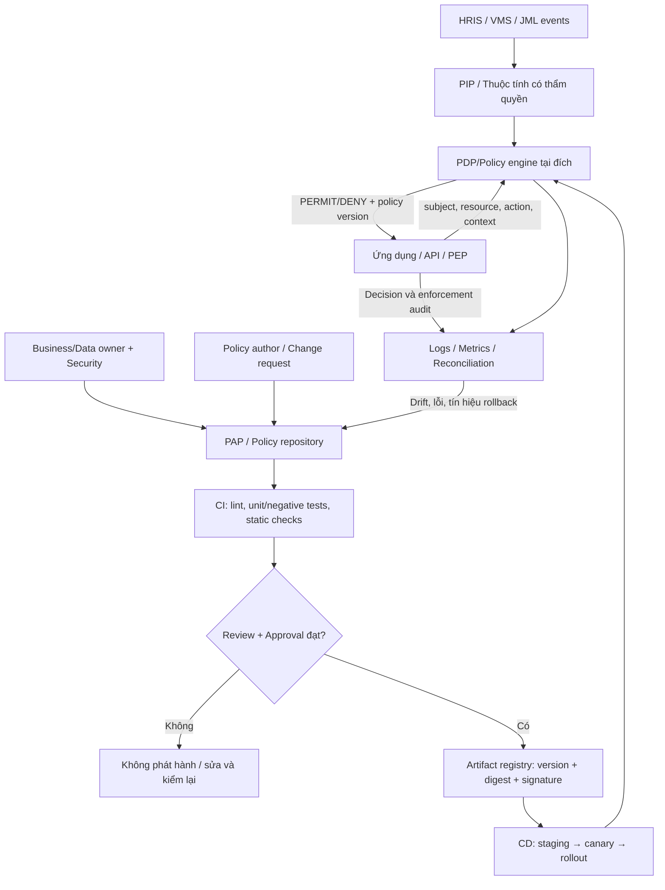
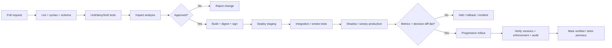

# Policy deployment trong PBAC và quản lý vòng đời danh tính IAM

## 1. Policy deployment là gì?

**Policy deployment (triển khai chính sách)** là quá trình đưa một **phiên bản chính sách kiểm soát truy cập** đã được xây dựng, kiểm thử và phê duyệt vào môi trường thực thi để những yêu cầu truy cập thực tế được đánh giá theo phiên bản đó. Trong **Policy-Based Access Control (PBAC)**, chính sách là nơi biểu diễn điều kiện cho phép hoặc từ chối một hành động, còn deployment bảo đảm các điều kiện ấy **được phát hành đúng phiên bản, đúng phạm vi, đúng thời điểm và có thể kiểm chứng**.

Ví dụ: doanh nghiệp thay quy định “chỉ nhân viên đang hoạt động, thuộc dự án P1 và đã xác thực đủ mạnh mới được xuất dữ liệu P1”. Nhóm IAM cập nhật policy, kiểm tra rằng nhân viên dự án khác không được xuất, triển khai tới các bộ đánh giá quyền (PDP), quan sát quyết định thực tế và ghi lại bằng chứng chính sách mới đã có hiệu lực.

**Soạn policy thành công chưa có nghĩa đã deploy thành công.** Một file hợp lệ trong Git có thể chưa được nạp vào PDP; một PDP đã nạp có thể chưa được PEP ở ứng dụng sử dụng; các node khác có thể còn cache phiên bản cũ. Vì thế policy deployment cần cả **quản trị thay đổi** và **xác minh hiệu lực ở điểm thực thi**.

### 1.1. Kết quả kỳ vọng

Một đợt triển khai đạt yêu cầu khi:

1. Chính sách có **nguồn, chủ sở hữu, phiên bản và phê duyệt** rõ ràng.
2. Đã kiểm thử cú pháp, ngữ nghĩa, trường hợp bị từ chối và tác động đến người dùng hiện có.
3. Từng thành phần nhận đúng artifact, chính sách và schema tương thích.
4. Quyết định truy cập thực tế phản ánh đúng chính sách ở **đúng tenant, môi trường và tập ứng dụng**.
5. Có dữ liệu audit để biết node nào dùng phiên bản nào, khi nào.
6. Có phương án rollback hoặc giảm thiểu rủi ro phù hợp, đặc biệt khi một bản policy gây **cấp quyền ngoài ý muốn**.
7. Những thay đổi quyền trong **Joiner–Mover–Leaver (JML)** không bị bỏ sót, ghi đè hoặc hồi sinh bởi phiên bản policy cũ.

## 2. PBAC nằm ở đâu trong hệ sinh thái IAM?

**PBAC** nhấn mạnh rằng quyết định truy cập được điều khiển bởi **các policy được khai báo và quản trị**. Nó không nhất thiết loại bỏ RBAC hoặc ABAC: policy có thể sử dụng **vai trò (RBAC)**, **thuộc tính (ABAC)**, trạng thái tài khoản, phân loại dữ liệu, thời gian, MFA và các điều kiện nghiệp vụ.

| Thành phần | Vai trò với policy deployment | Không được đồng nhất |
|---|---|---|
| **HRIS/VMS/sponsor** | Cung cấp quan hệ, ngày hiệu lực và sự kiện JML | Không tự quyết mọi quyền tại ứng dụng |
| **IAM/IGA** | Tính quyền mong muốn, phê duyệt, SoD và access review | Không tự chứng minh ứng dụng đã áp policy |
| **Policy Administration Point (PAP)** | Quản trị, kiểm soát phiên bản, xuất bản policy | Không phải nơi luôn thực thi từng request |
| **Policy Decision Point (PDP)** | Đánh giá policy với ngữ cảnh truy cập | Không tự chặn request nếu PEP bỏ qua |
| **Policy Enforcement Point (PEP)** | Chặn/cho phép hành động ở ứng dụng/API | Không được chỉ dựa vào việc ẩn nút UI |
| **Policy Information Point (PIP)** | Cung cấp subject/resource/environment attributes | Không mặc nhiên là nguồn có thẩm quyền |
| **IdP / MFA / SSO** | Cung cấp danh tính, trạng thái xác thực, phiên và token | Không thay thế authorization nghiệp vụ |
| **Directory / SCIM** | Đồng bộ tài khoản, group và thuộc tính tới ứng dụng | Không tự thu hồi mọi token và session |
| **Reconciliation / Audit** | Kiểm tra trạng thái được áp dụng, quyền hiệu lực và drift | Không nên chỉ ghi nhận HTTP 2xx |

Một tổ chức có thể dùng policy engine riêng, policy tích hợp trong ứng dụng hoặc kết hợp cả hai. Những thuật ngữ PAP/PDP/PEP/PIP mô tả **vai trò logic**, không bắt buộc tương ứng với bốn máy chủ độc lập.

## 3. Policy definition, publication và deployment khác nhau thế nào?

| Bước | Sản phẩm đầu ra | Câu hỏi cần trả lời |
|---|---|---|
| **Authoring** | Bản nháp rule/policy | Chính sách phải quyết định gì? |
| **Validation** | Kết quả phân tích và kiểm tra cú pháp/schema | Artifact có hợp lệ không? |
| **Testing** | Bằng chứng policy cho phép/từ chối đúng | Có gây overgrant hoặc khóa nhầm không? |
| **Review/Approval** | Quyết định của owner và Security | Có được phép thay đổi không? |
| **Packaging/Signing** | Policy artifact có phiên bản và integrity | Artifact nào sẽ được phân phối? |
| **Publication** | Bản policy đã được công bố ở registry/repository | Ai có thể lấy bản đã duyệt? |
| **Deployment** | PDP/PEP nhận và dùng phiên bản được chỉ định | Môi trường đích đã nạp đúng chưa? |
| **Activation** | Version thực sự được chọn để đánh giá | Bản mới đã áp cho request nào? |
| **Verification** | Bằng chứng phiên bản và quyết định ở đích | Truy cập thực tế đã đúng chưa? |
| **Rollback/Retirement** | Quay về bản an toàn hoặc ngừng sử dụng | Có thể khôi phục mà không tạo quyền trái phép? |

**Cần phân biệt “deployed” và “active”.** Một bundle policy có thể đã tải xuống tất cả node nhưng vẫn ở chế độ `SHADOW`, chưa ảnh hưởng quyết định thật. Ngược lại, một bản active ở nửa số node là một **triển khai chưa hội tụ**.

## 4. Các thành phần và đường đi của policy



### 4.1. Một request đi qua những đâu?

Giả sử ứng dụng báo cáo nhận `POST /reports/42/export`:

1. **PEP** xác thực ngữ cảnh request và xác định action nghiệp vụ `report:export`.
2. **PIP** cung cấp trạng thái người dùng, dự án, phân loại báo cáo, mức MFA và dữ liệu khác.
3. **PDP** đánh giá policy **đang active**.
4. PDP trả quyết định và metadata cần thiết.
5. PEP thực thi **DENY** hoặc chỉ cho phép nếu **PERMIT** và các obligation bắt buộc được hoàn thành.
6. Hệ thống ghi audit chứa **policy version/digest** đã dùng, không chỉ log tên endpoint.

Nếu PEP bỏ qua PDP hoặc dùng một role đã cache không còn hợp lệ thì **policy được deploy đúng vẫn không bảo vệ được tài nguyên**.

## 5. Những đơn vị cần version trong policy deployment

Không chỉ file policy mới cần phiên bản. Một quyết định có thể thay đổi do nhiều thành phần.

| Đơn vị | Ví dụ | Tại sao cần version |
|---|---|---|
| **Policy source** | `report-export.rego` hoặc rule khác | Truy vết thay đổi điều kiện |
| **Policy bundle/artifact** | `access-policy-2026.11.23.2` | Xác định bộ policy được build |
| **Policy data** | Mapping role, group, tenant và resource class | Dữ liệu thay đổi khiến kết quả policy đổi |
| **Schema** | `authz-input-v3` | Contract giữa PEP, PIP và PDP |
| **Action catalogue** | `actions-v5` | Tránh `report:export` bị hiểu thành `report:read` |
| **Policy engine/runtime** | Phiên bản PDP được kiểm thử | Ngữ nghĩa engine/cấu hình có thể thay đổi |
| **Deployment manifest** | tenant, region, cohort, rollout percentage | Xác định bản nào active ở đâu |
| **Decision record** | policy digest + context reference | Điều tra quyết định lịch sử |

### 5.1. Semver có thể hữu ích nhưng không đủ

Một hệ thống có thể dùng version kiểu `MAJOR.MINOR.PATCH` hoặc commit hash. **Version dễ đọc không thay thế digest bất biến** để kiểm tra artifact thực sự. Hai bản cùng nhãn nhưng nội dung khác nhau tạo rủi ro kiểm toán.

Khuyến nghị dùng **mã phiên bản rõ ràng, digest của artifact và bản ghi phê duyệt**. Không tái sử dụng một nhãn release cho nội dung mới.

## 6. Policy-as-Code và cấu trúc repository

**Policy-as-Code (PaC)** là cách lưu policy dưới dạng mã/khai báo có quản lý thay đổi, kiểm thử tự động và phát hành tương tự ứng dụng.

Một bố cục khái niệm:

```text
policy-source/
  access/
    reports/
      export-policy
      viewer-policy
    identity/
      account-disable-policy
      role-grant-policy
  data-contract/
    subject-schema
    resource-schema
    action-schema
  tests/
    allow-cases
    deny-cases
    jml-cases
  deployment/
    staging-manifest
    production-manifest
```

Đây là **cấu trúc ví dụ**, không phải chỉ thị tạo thêm tệp trong module học hiện tại.

### 6.1. Quy tắc authoring

- Mỗi policy có **owner**, mục đích và đối tượng áp dụng.
- Tách **policy code**, dữ liệu có thẩm quyền và **bí mật**.
- Duy trì **default deny** cho những thao tác chưa được chứng minh hợp lệ.
- Định nghĩa rõ thứ tự hoặc thuật toán kết hợp policy khi nhiều rule cùng áp dụng.
- Có test cho tình huống được phép, bị từ chối và thiếu dữ liệu.
- Đánh giá tác động khi đổi role mapping, action catalogue hoặc deny rule.
- Không đặt password, API token hoặc dữ liệu nhân sự nhạy cảm vào policy source.

### 6.2. PBAC có thể dùng nhiều ngôn ngữ

Các công nghệ như **OPA/Rego**, **Cedar**, **XACML**, policy engine tích hợp cloud hoặc hệ thống authorization tự xây dựng có mô hình triển khai khác nhau. Không mặc định cú pháp, combining algorithm, cơ chế bundle và quyết định lỗi đều giống nhau.

**Mục tiêu bài học là quy trình triển khai policy an toàn**, không đồng nhất PBAC với một công cụ cụ thể.

## 7. Ví dụ policy: kiểm soát xuất báo cáo

Giả sử công ty muốn: *chỉ nhân viên đang hoạt động, thuộc dự án của báo cáo, có role xuất dữ liệu, cùng tenant và thiết bị tin cậy mới được xuất báo cáo không hạn chế*.

Mã giả độc lập công nghệ:

```text
DENY BY DEFAULT

PERMIT if
    request.action == "report:export"
    AND subject.relationship_status == "ACTIVE"
    AND "report_exporter" in subject.effective_roles
    AND subject.tenant_id == resource.tenant_id
    AND subject.project_id == resource.project_id
    AND resource.classification != "RESTRICTED"
    AND environment.device_trusted == true
    AND environment.authn_is_fresh_enough == true
```

### 7.1. Điểm cần lưu ý

- Action phải được xác định **phía server** từ thao tác thật, không tin `action=read` do caller tự khai báo.
- `subject.relationship_status` phải đến từ nguồn được IAM/PIP tin cậy, không từ một form người dùng.
- `effective_roles` có thể đến từ RBAC, nhưng policy còn kiểm tra ABAC.
- `device_trusted` và `authn_is_fresh_enough` phải có bằng chứng/định nghĩa rõ; không là boolean client tùy ý.
- Nếu thiếu thuộc tính bắt buộc, xử lý an toàn theo quy tắc fail-closed của điểm thực thi.
- Policy phải được kiểm thử với các biến thể phạm vi, tenant và trạng thái Leaver.

### 7.2. Một ví dụ Rego tối giản

Ví dụ sau dành cho môi trường dùng OPA/Rego theo cú pháp `rego.v1`; không có nghĩa mọi PBAC engine đều chạy được đoạn này.

```rego
package enterprise.reports

import rego.v1

default allow := false

allow if {
    input.action == "report:export"
    input.subject.relationship_status == "ACTIVE"
    "report_exporter" in input.subject.roles
    input.subject.tenant_id == input.resource.tenant_id
    input.subject.project_id == input.resource.project_id
    input.resource.classification != "RESTRICTED"
    input.environment.device_trusted == true
    input.environment.authn_is_fresh_enough == true
}
```

Trong triển khai thật, cần xác định chính xác input contract, **khóa nguồn dữ liệu đáng tin**, version policy và bảo vệ PEP. Đoạn policy trên **không xử lý mọi ngoại lệ, SoD hay tình huống account linking**; phải bổ sung theo yêu cầu nghiệp vụ.

## 8. Kiểm thử policy trước deployment

Một policy có cú pháp đúng vẫn có thể **cấp quyền sai**. Vì vậy pipeline phải kiểm thử ngữ nghĩa, nhất là các trường hợp **DENY**.

### 8.1. Những lớp kiểm thử nên có

| Lớp kiểm thử | Mục tiêu | Ví dụ |
|---|---|---|
| **Syntax/compile** | Policy hợp lệ với engine | Không có lỗi cú pháp Rego/Cedar/XACML |
| **Schema validation** | Input và policy dùng đúng thuộc tính | `tenant_id` không bị đọc nhầm thành `tenantName` |
| **Unit test** | Rule đơn lẻ trả quyết định mong đợi | Người khác tenant bị DENY |
| **Negative test** | Không mở quyền khi thiếu điều kiện | Chưa MFA đủ mạnh vẫn bị từ chối |
| **Boundary test** | Ngày hiệu lực và giá trị sát ngưỡng | Leaver đúng `effective_at` không còn quyền |
| **SoD test** | Không cho xung đột nghiệp vụ | Người tạo hóa đơn không tự duyệt |
| **Regression test** | Chống thay đổi sai những quyền cũ | Viewer vẫn đọc nhưng không export |
| **Integration test** | PEP/PDP/PIP và ứng dụng ghép đúng | Node dùng đúng policy digest |
| **Performance test** | Độ trễ và tải chấp nhận được | Không timeout hàng loạt khi tăng QPS |
| **Failure-mode test** | PDP/PIP không sẵn sàng | Thao tác nhạy cảm không fail-open |

### 8.2. Bảng test cho policy xuất báo cáo

| Case | Subject | Resource/environment | Kỳ vọng |
|---|---|---|---|
| Đủ mọi điều kiện | ACTIVE, role exporter, đúng dự án | Cùng tenant, thiết bị tin cậy | PERMIT |
| Thiếu role | ACTIVE, chỉ viewer | Đúng dự án | DENY |
| Sai dự án | ACTIVE, exporter | Report thuộc P2 thay vì P1 | DENY |
| Sai tenant | ACTIVE, exporter | Report tenant khác | DENY |
| Leaver | TERMINATED, exporter còn cache | Các điều kiện khác đúng | DENY |
| Mover chưa cập nhật role | ACTIVE, role cũ | Dự án cũ đã hết assignment | DENY |
| Thiết bị không tin cậy | ACTIVE, exporter | `device_trusted=false` | DENY |
| Thiếu thông tin device | ACTIVE, exporter | Chưa biết trạng thái device | Không được mặc định PERMIT |
| Resource restricted | ACTIVE, exporter | `classification=RESTRICTED` | DENY |
| PDP lỗi | Bất kỳ | Không lấy được quyết định | PEP áp dụng chế độ lỗi đã phê duyệt, không tự allow |

**Không chỉ test happy path.** Với chính sách bảo mật, test “không được phép” là bằng chứng thiết yếu để phát hiện overgrant.

## 9. Kiểm thử tác động (impact analysis) trước khi phát hành

Ngay cả khi tất cả unit test đạt, một thay đổi có thể gây ảnh hưởng tới hàng nghìn người vì dữ liệu thực tế phức tạp hơn dữ liệu thử.

### 9.1. Phân tích chênh lệch quyết định

Chạy cùng một tập yêu cầu/đầu vào đã được phép dùng để kiểm thử qua:

- `policy_current`: chính sách đang active.
- `policy_candidate`: chính sách đề xuất.

Lập bảng so sánh:

| Old → New | Ý nghĩa | Hành động đánh giá |
|---|---|---|
| PERMIT → PERMIT | Không đổi quyết định | Kiểm tra điều kiện khác có thay đổi ngoài dự kiến không |
| DENY → DENY | Vẫn bị từ chối | Đánh giá lý do và coverage |
| **DENY → PERMIT** | **Mở thêm quyền** | Bắt buộc review theo rủi ro, nguồn và phê duyệt |
| **PERMIT → DENY** | **Thu hẹp quyền** | Xác định có khóa nhầm nghiệp vụ không; ưu tiên bảo mật |
| ERROR → PERMIT | Có thể biến thiếu dữ liệu thành cho phép | Kiểm tra fail-open, thường không chấp nhận |
| PERMIT → ERROR | Có thể gây lỗi vận hành | Sửa schema/nguồn trước rollout |

### 9.2. Dữ liệu kiểm thử phải được bảo vệ

Replay những yêu cầu thực tế có thể chứa PII và thông tin tài nguyên nhạy cảm. Khi dùng production-derived traffic cho shadow test:

- Chỉ thu thập thuộc tính cần thiết và được phép.
- Dùng mã định danh đã tối thiểu hóa/pseudonym hóa khi thích hợp.
- Không ghi token hoặc cookie thô.
- Giới hạn người đọc log và thời gian lưu.
- Không đưa dữ liệu production vào môi trường thử không đạt mức bảo vệ.

### 9.3. Có thể dùng formal checks nhưng không nên tự giả định đầy đủ

Với policy quan trọng, có thể dùng phân tích tĩnh hoặc kiểm chứng tính chất như “người khác tenant không bao giờ được PERMIT” nếu công cụ hỗ trợ. Tuy nhiên **mô hình đầu vào thiếu hoặc giả định sai** vẫn tạo lỗ hổng. Kiểm chứng phải đi kèm integration test và xác minh enforcement.

## 10. Review, approval và phân tách nhiệm vụ

Triển khai policy làm thay đổi **ai được làm gì**, nên quy trình phê duyệt phải phù hợp tác động.

| Loại thay đổi | Ví dụ | Kiểm soát khuyến nghị |
|---|---|---|
| Thu hẹp quyền có căn cứ | Chặn export khi user Leaver | Owner và Security review tùy mức ảnh hưởng, phát hành khẩn khi cần |
| Mở quyền thường | Cho nhóm dự án mới xem báo cáo | Business/Data Owner phê duyệt, test tenant/scope |
| Cấp quyền đặc quyền | Cho role vận hành quản trị production | SoD, Security/PAM và phê duyệt độc lập |
| Đổi quy tắc duyệt thanh toán | Điều chỉnh invoice approval | Finance owner, kiểm tra gian lận và transaction SoD |
| Thay default deny | Tác động tới mọi resource không có rule | Thẩm định bảo mật nghiêm ngặt |
| Đổi policy trên nhiều tenant | Rollout đồng loạt | Phân tích blast radius và phê duyệt phạm vi |
| Emergency deny | Phong tỏa đường truy cập bị lợi dụng | Quy trình break-glass/emergency change có hậu kiểm |

### 10.1. Tránh self-approval

Người viết policy không nên có thể **tự phê duyệt và tự phát hành** một thay đổi mở quyền đặc quyền cho chính mình. Tối thiểu cần quyền riêng cho author, reviewer, approver và deployer theo chính sách nội bộ.

### 10.2. Quy trình khẩn cấp có kiểm soát

Khi phát hiện lỗ hổng authorization, có thể cần chặn một action ngay. Quy trình khẩn phải có:

- Người quyết định và căn cứ.
- Phạm vi giới hạn và rollback/expiry rõ.
- Kênh triển khai đủ tin cậy.
- Kiểm thử tối thiểu đối với rule deny.
- Audit, thông báo và **review sau sự cố**.

Không dùng lý do khẩn cấp để bỏ qua kiểm tra integrity hoặc đưa policy chưa biết nguồn vào production.

## 11. Đóng gói policy artifact

**Artifact** là bộ chính sách và dữ liệu đi kèm đã được build theo một phiên bản. Thành phần có thể gồm code policy, metadata, data đã duyệt, schema references và manifest triển khai.

Ví dụ manifest **minh họa**, không phải định dạng chuẩn chung:

```yaml
policy_bundle:
  name: enterprise-access
  version: "2026.11.23-2"
  source_revision: "commit-7d2f"
  digest: "sha256:<immutable-content-digest>"
  policy_engine: "approved-engine-family"
  input_schema_version: "authz-input-v3"
  action_catalog_version: "actions-v5"
  scope:
    environment: production
    tenant: tenant-company
  rollout:
    strategy: canary
    initial_percent: 5
  approval:
    change_id: "CHG-1042"
    security_review: approved
    data_owner_review: approved
```

Dòng digest là **placeholder**, không phải hash thật. Không được sử dụng tên phiên bản giống nhau cho hai artifact khác nội dung.

### 11.1. Integrity và provenance

- Artifact phải có **digest** được xác minh trước khi tải/nạp.
- Với cơ chế hỗ trợ ký, cần **chữ ký và nguồn phát hành đáng tin**.
- Kho artifact và quyền phát hành phải được giới hạn.
- Không build một bản mới ngay trong production từ nhánh mã không được kiểm duyệt.
- Có thể lưu **SBOM/provenance** cho thành phần liên quan theo yêu cầu chuỗi cung ứng phần mềm.
- Tách **mã policy** khỏi secret và những dữ liệu nhạy cảm không cần phân phối.

### 11.2. Chính sách và data có thể phải triển khai cùng nhau

Một policy mới đòi trường `resource.classification` sẽ ra kết quả sai nếu PIP/PEP chưa cung cấp trường đó. Do đó, manifest nên chỉ rõ **schema contract và dependency versions**. Nếu không tương thích, chặn deployment thay vì fail-open.

## 12. CI/CD pipeline cho policy deployment

Một pipeline minh họa:



### 12.1. Những quality gate nên bắt buộc

1. **Syntax/compile/schema PASS**.
2. Không có secret, credential hoặc dữ liệu cá nhân nhạy cảm bị commit sai.
3. Tất cả test quan trọng, đặc biệt **negative và JML tests**, đạt.
4. Không có mở quyền ngoài kế hoạch theo diff quyết định.
5. Policy đã được **owner và Security** phê duyệt đúng mức rủi ro.
6. Artifact được ký/đóng gói hoặc có integrity control tương đương.
7. Staging chạy đúng input contract và engine runtime production.
8. Canary có thể dừng/rollback; quan sát được policy version từng node.
9. Kết quả sau rollout đạt mục tiêu ở **PEP**, không chỉ ở registry.

### 12.2. Không bỏ qua integration test

Một policy cho phép `report:read` có thể vượt unit test nhưng PEP gửi action `reports:read` (thừa chữ “s”) vào PDP. Kết quả ở production sẽ sai. Cần test **end-to-end từ API → input mapping → PDP → PEP → response**, bao gồm cả trường hợp bị từ chối.

## 13. Các chiến lược triển khai

| Chiến lược | Cách hoạt động | Phù hợp khi | Rủi ro |
|---|---|---|---|
| **All-at-once** | Chuyển toàn bộ đích sang phiên bản mới | Phạm vi nhỏ, rủi ro đã đánh giá thấp | Blast radius lớn nếu sai |
| **Rolling** | Thay lần lượt các node/region | Hệ thống nhiều instance | Trong thời gian ngắn nhiều version cùng active |
| **Canary** | Áp bản mới cho một cohort nhỏ | Cần quan sát tác động thực tế | Cần routing ổn định và đo so sánh |
| **Blue–green** | Hai môi trường policy hoạt động, chuyển traffic có kiểm soát | Hạ tầng hỗ trợ chuyển nhanh | Phải đồng bộ dữ liệu và phiên bản PEP/PIP |
| **Shadow/observe-only** | Bản mới tính quyết định nhưng **không enforce** | Phân tích trước rollout | Không phải bằng chứng an toàn tuyệt đối khi không nhận đủ traffic |
| **Tenant/region phased rollout** | Triển khai từng tenant/region | Hệ thống đa tenant hoặc đa khu vực | Có thể tạo bất nhất khi người dùng di chuyển phạm vi |

**Không nên canary ngẫu nhiên theo từng request** nếu cùng một người có thể lúc được PERMIT, lúc DENY do đổi node. Cần routing ổn định theo chủ thể/tenant/cohort và hiểu tác động đến phiên.

### 13.1. Canary gate

Theo dõi ít nhất:

- Số quyết định `DENY→PERMIT` khác so với baseline.
- Số quyết định `PERMIT→DENY` không nằm trong kế hoạch.
- Tỷ lệ lỗi, `INDETERMINATE`, thiếu thuộc tính.
- P95/P99 latency và timeout của PDP/PEP.
- Tỷ lệ node báo đúng digest mới.
- Sự cố bảo mật, ticket người dùng hợp lệ bị khóa.
- Cảnh báo cross-tenant, privileged action và policy bypass.

Không mở rộng rollout khi số liệu không đủ để chứng minh điều kiện dừng đã đạt.

## 14. Shadow deployment và quyết định so sánh

**Shadow deployment** cho phép bộ policy mới được đánh giá song song với bản active nhằm so sánh quyết định, nhưng **kết quả shadow không được dùng để cấp quyền thật** khi chưa qua phê duyệt.

Ví dụ:

```text
Request:
  subject=I-1042
  action=report:export
  resource=report-P1-77

Active policy v12:
  decision=DENY

Shadow policy v13:
  decision=PERMIT

Diff:
  DENY -> PERMIT
  severity=HIGH
  needs_owner_review=true
```

### 14.1. Không gửi tác động phụ trong shadow

Shadow PDP chỉ nên **đánh giá quyết định** và ghi metadata được cho phép. Nó không được:

- Tự gán role.
- Bật account đã disable.
- Gọi API thanh toán hoặc xóa tài nguyên.
- Gửi email hoặc tiết lộ dữ liệu ngoài phạm vi.
- Tạo session mới chỉ vì chính sách candidate PERMIT.

### 14.2. Giới hạn của shadow

- Không có đủ mọi tình huống hiếm, emergency và Leaver.
- Request bị từ chối trước PDP có thể không xuất hiện trong sample.
- Dữ liệu shadow có thể chậm hơn dữ liệu active.
- Kết quả phụ thuộc cách xử lý missing attribute và policy combining.
- Nếu production có nhiều PEP, shadow tại một PEP chưa bao phủ các đường khác.

Vì thế shadow là **một lớp đánh giá rủi ro**, không thay thế test suite và phê duyệt.

## 15. Rollback: quay về phiên bản nào?

**Rollback** là đưa hệ thống về một **phiên bản policy đã được xác nhận an toàn trong bối cảnh hiện tại** khi bản vừa triển khai gây sai lệch. Rollback cần chuẩn bị **trước** rollout.

### 15.1. Điều kiện rollback

- Tăng đột ngột `DENY→PERMIT` ngoài kế hoạch.
- Phát hiện cross-tenant access hoặc bypass SoD.
- Privileged action được PERMIT sai.
- Tỷ lệ lỗi PDP/PEP hoặc thiếu thuộc tính vượt ngưỡng.
- Nhiều node có version không đồng nhất quá giới hạn.
- Ứng dụng thiết yếu bị DENY ngoài kế hoạch nghiêm trọng.

### 15.2. Rollback không tự động là “an toàn nhất”

Nếu policy cũ từng cho phép một quyền giờ đã bị cấm do Leaver hoặc sự cố, **khôi phục nguyên bản cũ có thể mở lại quyền đó**. Khi đó ưu tiên có thể là:

- Giữ **deny khẩn cấp** với quyền đã bị thu hồi.
- Revert phần thay đổi không mong muốn thay vì toàn bộ bundle.
- Deploy một **hotfix an toàn** đã qua kiểm tra khẩn.
- Dùng cơ chế chặn account ở IdP/PEP hoặc API gateway phù hợp.
- Đối soát trạng thái thực tế sau khi chuyển phiên bản.

**Rollback version không đồng nghĩa rollback entitlement hay quan hệ HRIS.** Không được kích hoạt lại người đã nghỉ việc chỉ để cứu một đợt phát hành policy.

### 15.3. Ví dụ checklist rollback

```text
1. Stop new rollout waves
2. Record active/candidate versions by region and tenant
3. Identify privilege expansion and impacted subjects/resources
4. Activate approved safe version or emergency deny guard
5. Verify every PEP/PDP now uses expected digest
6. Re-run deny tests for critical actions and Leaver
7. Check residual sessions/tokens/entitlements
8. Open incident/change postmortem with evidence
```

## 16. Phiên bản policy không đồng nhất giữa node

Một hệ thống có nhiều PDP hoặc PEP có thể rơi vào tình huống:

| Node | Active policy | Tác động |
|---|---|---|
| `pdp-a` | `v13` | Bắt đầu áp rule mới |
| `pdp-b` | `v12` | Vẫn áp rule cũ |
| `pdp-c` | `v13` | Áp rule mới |
| `pep-report-1` | Cache `v12` | Có thể dùng quyết định cũ |
| `pep-report-2` | Đọc `v13` | Quyết định khác theo routing |

### 16.1. Cách hạn chế bất nhất

- Gắn **active policy version/digest** vào decision logs.
- Kiểm soát **routing** hoặc quá trình chuyển version theo nhóm ổn định.
- Có readiness/health check chỉ nhận traffic khi node đã nạp version chấp thuận.
- Định nghĩa **maximum skew** giữa các node và thời hạn hội tụ.
- Với hành động đặc quyền, đánh giá policy tại điểm thực thi có khả năng kiểm tra version hiện hành.
- Khi quy định yêu cầu, tạm chặn action nhạy cảm thay vì dùng bản quá cũ.

### 16.2. Atomic activation trong từng node khác global atomicity

Một node có thể nạp policy artifact mới rồi **chuyển tham chiếu active atomically**, tránh thời điểm dùng nửa file cũ nửa file mới. Nhưng điều đó **không tạo giao dịch nguyên tử toàn cluster**. Để bảo đảm nhất quán trên nhiều vùng, cần chiến lược phát hành, routing và kiểm tra hội tụ riêng.

## 17. Policy cache, data freshness và revocation

Ngay cả khi policy bản mới đã active, **quyết định được cache** hoặc thuộc tính cũ vẫn có thể cho quyền sai.

Có ba loại độ mới cần tách biệt:

1. **Policy freshness:** node đã nhận đúng policy mới chưa?
2. **Attribute freshness:** PIP/IdP/HRIS/group mapping đã cập nhật chưa?
3. **Decision/session freshness:** PEP có đang dùng kết quả cũ hoặc token/session đã phát hành không?

### 17.1. Ví dụ nguy hiểm

1. Nhân viên Linh chuyển từ dự án P1 sang P2.
2. IAM đã cập nhật policy chỉ cho phép dữ liệu theo assignment hiện tại.
3. PIP vẫn trả `assigned_project=P1` vì cache cũ.
4. PEP đánh giá `report:export` dựa trên dữ liệu cũ và PERMIT.
5. Người dùng vẫn xuất được dữ liệu P1 sau Mover.

**Deploy policy mới không tự làm mới dữ liệu nguồn hoặc JWT cũ.**

### 17.2. Các cơ chế giảm rủi ro

- TTL và invalidation phù hợp cho policy cache và decision cache.
- Gắn cache key với **subject, resource, action, tenant, policy version, context** cần thiết.
- Dùng `source_version` hoặc thời điểm cập nhật để phát hiện stale HR/JML attributes.
- Với Leaver và privileged action, ưu tiên kiểm tra trạng thái hiện hành tại PEP/API khi thiết kế hỗ trợ.
- Xử lý session/token riêng: revoke, introspection, ngắn hạn hoặc kiểm tra quyền động.
- Đối soát sau triển khai để biết quyền thực tế có còn tồn dư không.

## 18. Hành vi khi PDP/PIP không khả dụng

**Policy deployment** phải quy định hành vi khi node không tải được policy mới hoặc không lấy được thuộc tính cần đánh giá.

| Lỗi | Rủi ro | Hành vi cần xác định |
|---|---|---|
| Không tải được artifact | Node dùng bản cũ hoặc không có policy | Từ chối nhận traffic hoặc dùng fallback đã duyệt với phạm vi rõ |
| Digest/chữ ký không khớp | Artifact có thể bị sửa | Không active bundle, cảnh báo bảo mật |
| Input schema không tương thích | Policy đánh giá sai trường | Chặn rollout; không tự PERMIT |
| PIP timeout | Thiếu thuộc tính để quyết định | Với action nhạy cảm: fail-closed và xử lý lỗi rõ |
| PDP timeout | Không có kết quả hợp lệ | PEP áp dụng chính sách lỗi an toàn |
| Combining algorithm lỗi | Rule PERMIT và DENY kết hợp sai | Dừng release, kiểm tra lại policy semantics |
| Node một vùng còn policy cũ | Phản hồi quyền không nhất quán | Phân vùng traffic/loại node theo kế hoạch |
| Audit sink lỗi | Mất dấu vết cho action đặc quyền | Cơ chế audit bền vững hoặc chặn thao tác theo policy |

### 18.1. Fail-closed không có nghĩa “tắt mọi hệ thống vô thời hạn”

Tùy nghiệp vụ, có thể có **chế độ vận hành suy giảm** cho tài nguyên công khai hoặc tác vụ đọc không nhạy cảm. Nhưng phải thiết kế/duyệt trước, không dùng `allow=true` trong exception handler. Với hành động cấp quyền, xuất dữ liệu nhạy cảm và quản trị, **không có quyết định hợp lệ thì không thực thi** theo nguyên tắc fail-closed.

### 18.2. Break-glass có kiểm soát

Nếu cần khôi phục dịch vụ khi policy engine lỗi, cơ chế break-glass phải là **đường truy cập đã được thiết kế**, với danh tính đặc biệt được bảo vệ, MFA hoặc kiểm soát tương đương phù hợp, thời hạn, scope, cảnh báo và hậu kiểm. Không “cho qua mọi quyền” vì một sự cố PDP.

## 19. Phối hợp rollout policy với database/schema migration

Một policy mới có thể đòi **thuộc tính hoặc event contract** mà PEP/PIP chưa cung cấp.

Ví dụ policy v13 dùng `resource.data_classification`, trong khi PIP cũ chỉ trả `resource.classification`.

### 19.1. Chiến lược expand–migrate–contract

1. **Expand:** PEP/PIP bắt đầu cung cấp trường mới, vẫn duy trì trường cũ trong thời gian chuyển tiếp.
2. **Validate:** kiểm tra dữ liệu mới đúng và đủ coverage, không cho phép sai khi thiếu.
3. **Deploy policy:** policy mới dùng trường mới sau khi dependency sẵn sàng.
4. **Migrate:** điều chỉnh các consumer còn dùng trường cũ.
5. **Contract:** loại trường cũ khi đã không còn phụ thuộc.

### 19.2. Bảo vệ compatibility

- Phiên bản schema trong manifest và audit.
- Contract test giữa PEP/PIP và PDP.
- Không đổi ý nghĩa `ACTIVE` hoặc role ID mà không thông báo.
- Có kế hoạch fallback cho dữ liệu thiếu, **không làm rộng quyền**.
- Không rollback policy về bản không hiểu schema hiện tại mà không kiểm tra.

Một deployment có thể **thành công kỹ thuật** nhưng gây từ chối hàng loạt vì dữ liệu chưa sẵn sàng; cần kiểm tra compatibility như một quality gate.

## 20. Policy deployment cho Joiner lifecycle

**Joiner** là giai đoạn chuẩn bị danh tính, xác minh người dùng và cấp quyền ban đầu.

Ví dụ policy cần đảm bảo:

- Người được phép **pre-provision** tài khoản trước ngày bắt đầu.
- Chỉ tài khoản đã identity proofing và đáp ứng điều kiện được **activate** đúng thời điểm.
- Quyền nghiệp vụ chỉ cấp theo RBAC/ABAC, phê duyệt và SoD.
- MFA/IdP/SSO bảo vệ đăng nhập, nhưng **không tự cấp entitlement**.

### 20.1. Ví dụ rule khái niệm

```text
PERMIT account:provision WHEN
    source_event.type == APPROVED_JOINER
    AND identity_linking == VERIFIED

PERMIT account:activate WHEN
    relationship.status == ACTIVE
    AND environment.now >= relationship.effective_at
    AND identity_proofing == SUFFICIENT
    AND required_authenticator_enrollment == COMPLETED

PERMIT role:assign WHEN
    requested_role in approved_role_set(identity)
    AND no_sod_conflict(identity, requested_role)
```

### 20.2. Vì sao deployment phải xét thời điểm hiệu lực?

Nếu một bản policy mới lỡ bỏ điều kiện `effective_at`, các tài khoản pre-hire có thể được kích hoạt sớm. Trước rollout phải có **negative test Joiner chưa đến ngày bắt đầu**, nhất là khi policy áp lên nhiều ứng dụng.

### 20.3. Policy và provisioning là hai đường riêng

PAP/PDP có thể từ chối action `role:assign`, nhưng connector SCIM với token quá rộng vẫn có thể sửa Group nếu không được kiểm soát. Cần áp policy ở **đường thực thi provisioning** hoặc bảo đảm IAM là đầu mối tin cậy, cùng kiểm soát khả năng gọi SCIM và audit.

## 21. Policy deployment cho Mover lifecycle

**Mover** thường thay đổi phòng ban, manager, dự án, tenant hoặc mức đặc quyền.

Một policy mới có thể:

- Thay quy tắc role mapping `department → business role`.
- Bổ sung SoD cho vai trò mới.
- Giới hạn permission theo `project_id` hoặc data classification.
- Yêu cầu MFA mạnh hơn khi truy cập dữ liệu tài chính.
- Thu hẹp quyền của nhóm cũ sau tái cơ cấu.

### 21.1. Phân biệt hai nguồn thay đổi

1. **Đổi policy:** cùng một người và thuộc tính, quyết định mới khác trước.
2. **Đổi thuộc tính/danh tính:** policy giữ nguyên nhưng employee/project/role assignment mới làm quyết định thay đổi.

Hai loại cần được kiểm toán riêng. Không gán mọi sai lệch quyền cho “deploy policy lỗi” khi nguyên nhân là HRIS event hoặc SCIM connector chưa đồng bộ.

### 21.2. Không cấp thêm mà quên thu hồi

Một quy trình Mover tốt tính:

```text
desired_roles = evaluate_current_assignments_and_policy(identity)
observed_roles = read_target_roles(identity)

roles_to_revoke = observed_roles - desired_roles
roles_to_grant = desired_roles - observed_roles
```

Khi rollout policy thay role mapping, cần tính **tác động tới những quyền đang có** và bảo đảm **revoke quyền cũ**. Chỉ thêm role mới có thể tạo privilege creep.

### 21.3. Tránh stale event cấp lại quyền

Khi retry một job cấp nhóm sinh từ policy version cũ, IAM phải kiểm tra **policy hiện hành và nguồn JML mới nhất**. Nếu job đã bị superseded, không gửi lại lệnh grant. Đây là vấn đề orchestration, không thể giải quyết chỉ bằng việc đổi rule trong PDP.

## 22. Policy deployment cho Leaver lifecycle

**Leaver** là tình huống cần ưu tiên giảm quyền tồn dư. Policy cần ngăn tài khoản đã chấm dứt quan hệ tiếp tục dùng các action nhạy cảm, kể cả khi một số nhóm hoặc claim vẫn còn.

### 22.1. Hai lớp bảo vệ

**Lớp 1 — Lifecycle enforcement:**

- Disable account IdP hoặc chặn đăng nhập mới.
- Thu hồi role, group, entitlement tại ứng dụng.
- Deprovision qua SCIM/API khi hỗ trợ.
- Thu hồi session, refresh/access token hoặc credential độc lập theo cơ chế từng hệ thống.

**Lớp 2 — Policy enforcement:**

- PDP/PEP kiểm tra tài khoản và quan hệ hiện hành tại mức độ cần thiết.
- Action nhạy cảm bị từ chối khi subject ở trạng thái `TERMINATED` hoặc `SUSPENDED`.
- Không cho chính sách phiên bản cũ hoặc cache stale duy trì đặc quyền.
- Ghi audit và xử lý ngoại lệ khi chưa kiểm chứng được trạng thái đích.

### 22.2. Test bắt buộc trước khi rollout

```text
Case: Leaver with stale role claim
subject.relationship_status = TERMINATED
subject.token_roles = [production_admin]
action = production:deploy

Expected:
    DENY
    no new deployment side effect
```

Nếu policy candidate cho PERMIT trong ca này, phải chặn rollout dù các test happy path khác đạt.

### 22.3. Rollback không hồi sinh Leaver

Khi cần rollback một bản policy gây lỗi, **không rollback cả trạng thái HR hoặc entitlement**. Nếu bản policy cũ cho phép thao tác mà bản mới đang dùng làm deny khẩn cấp, cần giữ guardrail deny và phát hành hotfix phù hợp.

## 23. IdP, SSO, SCIM và phạm vi policy enforcement

Các công nghệ IAM thường có **vòng đời và điểm thực thi khác nhau**.

| Công nghệ | Tín hiệu/điều khiển có thể dùng | Giới hạn cần nhớ |
|---|---|---|
| **IdP** | Trạng thái account, MFA context, session | App có thể còn phiên riêng |
| **OIDC/SAML SSO** | Assertion/token với issuer, audience, auth_time, claims | Token là snapshot; role cũ có thể tồn tại |
| **SCIM** | User active, Groups members, thuộc tính | PATCH không tự hủy token hoặc local role ngoài quản lý |
| **RBAC/IGA** | Gán business role, tech role và approval | Role catalog có thể lệch thực tế |
| **ABAC/PBAC** | Quyết định dựa trên role, attribute và policy version | Nếu PEP bỏ qua rule, policy không bảo vệ tài nguyên |
| **PAM/JIT** | Phiên đặc quyền ngắn hạn và approval | Cần kiểm soát session và expiry riêng |
| **Workload identity** | Danh tính máy, secret/credential, scope | Không gắn người nghỉ việc với disable workload tự động |

### 23.1. Cấp quyền trong token không đồng nghĩa quyền hiện hành

Một JWT đã phát hành với role `report_exporter` không tự mất nội dung khi policy/role mapping đổi. Vì vậy policy deployment phải đánh giá:

- Token lifetime, revocation hoặc introspection khi có.
- App session và cache permission.
- Quyền local của SaaS ngoài IdP.
- Khả năng API áp policy hiện hành **tại thời điểm request**.
- Tốc độ phổ biến policy và dữ liệu giữa các region.

### 23.2. Policy áp tại đâu?

Một tổ chức có thể deploy policy ở API gateway, service mesh, từng microservice, cloud authorization service hoặc điểm kiểm soát dữ liệu. **Không nên tin rằng deploy vào gateway tự bảo vệ toàn bộ đường gọi nội bộ** nếu có API/batch/consumer khác đi vòng qua gateway.

## 24. Quyền của pipeline và service account phát hành policy

Deployment thường do một **service account/CI runner** thực hiện. Đây là danh tính máy có quyền rất nhạy cảm vì nó có thể thay đổi luật truy cập của nhiều người.

### 24.1. Các quyền nên tách biệt

| Vai trò kỹ thuật | Quyền cần thiết |
|---|---|
| Policy author | Đề xuất hoặc sửa source qua code review |
| Reviewer/approver | Phê duyệt theo governance, không tự sửa lén |
| Build runner | Đọc source đã duyệt, build/test/package |
| Artifact publisher | Ghi artifact đã ký vào registry |
| Deployment runner | Đọc đúng artifact, phát hành đúng môi trường/tenant |
| Runtime PDP | Đọc artifact phù hợp, không có quyền sửa nguồn |
| Audit reader | Đọc log theo phạm vi đã duyệt, không can thiệp policy |

Không nên để **cùng một token** vừa sửa source policy, tự phê duyệt, xuất bản artifact và deploy production khi không có kiểm soát độc lập.

### 24.2. Bí mật và workload identity

- Ưu tiên **workload identity/federation** cho CI/CD nếu nền tảng hỗ trợ.
- Nếu phải dùng client secret/API key, lưu trong secret manager, giới hạn scope và rotate.
- Giới hạn quyền **theo môi trường, tenant và artifact**.
- Audit mọi lần deploy, rollback và thao tác mở quyền đặc biệt.
- Không cấp quyền `policy:admin_all` cho bot chỉ để thay một policy nhỏ.
- Khi người sở hữu pipeline nghỉ việc, **bàn giao ownership** và thu hồi quyền cá nhân, không tự xóa runner còn cần chạy.

## 25. Bảo vệ supply chain và pipeline integrity

Một policy đúng nhưng bị thay đổi trái phép khi build/phân phối có thể gây **cấp quyền hàng loạt**.

Các điểm bảo vệ quan trọng:

1. Bảo vệ repository bằng quyền phù hợp và code review bắt buộc.
2. Chặn commit chứa secret và kiểm tra dependency theo chính sách.
3. Dùng môi trường build tin cậy, không cho pipeline chạy mã tùy ý từ nhánh không được phép với quyền deploy.
4. Ghi commit, build ID và digest gắn với artifact.
5. Xác minh chữ ký/digest ở đích theo cơ chế triển khai.
6. Không dùng URL tải bundle tự do do caller cung cấp.
7. Giới hạn ai được đổi production rollout manifest.
8. Phân biệt quyền **deploy policy** và quyền **sửa policy data**.
9. Lưu audit bất biến hoặc có kiểm soát chống sửa và retention phù hợp.
10. Theo dõi thay đổi bất thường ở registry, PAP, PDP và PEP.

**Policy deployment là một phần của supply-chain security**, bởi thay đổi nhỏ ở rule có thể tác động đến mọi request của một dịch vụ.

## 26. Quan sát và bằng chứng deployment

Để chứng minh một policy đã được áp dụng, cần nhiều lớp bằng chứng thay vì một log “deployment succeeded”.

| Lớp | Bằng chứng | Chưa đủ để kết luận điều gì |
|---|---|---|
| Source | Commit hash, PR review, approval | Artifact đã build đúng |
| Build | Artifact digest, test results | Production đã tải bundle |
| Registry | Artifact published/signed | PDP đã active |
| Rollout | Target/node ack, active digest | PEP thực sự gọi PDP |
| Decision | PDP log policy version và result | PEP đã enforce mọi request |
| Enforcement | API/PEP audit action/result | Các API ngoài phạm vi cũng được bảo vệ |
| Reconciliation | Đối soát quyền và trạng thái đích | Mọi token không quan sát được đã bị thu hồi |

### 26.1. Một bản ghi deployment minh họa

```json
{
  "deployment_id": "pbac-deploy-2026-0118",
  "change_id": "CHG-1042",
  "policy_bundle": "enterprise-access",
  "policy_version": "2026.11.23-2",
  "artifact_digest_ref": "sha256:verified-digest-ref",
  "environment": "production",
  "tenant": "tenant-company",
  "strategy": "canary-then-progressive",
  "approved_by": ["security-owner", "data-owner"],
  "targets_expected": 12,
  "targets_active_expected_version": 12,
  "validation": {
    "negative_tests": "PASS",
    "integration_tests": "PASS",
    "decision_diff_review": "APPROVED",
    "critical_pep_checks": "PASS"
  },
  "state": "VERIFIED",
  "verified_at": "2026-11-23T10:45:00Z"
}
```

Giá trị là **ví dụ**, không phải bản ghi deployment thật. `state=VERIFIED` phải dựa trên các kiểm tra đã thực hiện theo **phạm vi đã định nghĩa**, không dùng một cờ tự đặt để tuyên bố mọi hệ thống và mọi phiên đã an toàn.

### 26.2. Decision audit cần có gì?

Khi API từ chối hoặc cho phép `report:export`, log nên có:

- Correlation/request ID, subject ID, resource reference, action ID.
- Tenant/scope, policy ID + version hoặc digest.
- Quyết định và reason code phù hợp.
- Source/attribute version nếu cần kiểm toán JML.
- Kết quả PEP thực thi (không chỉ quyết định PDP).
- Timestamp và môi trường/instance được phép ghi nhận.

Không ghi **password, session cookie, bearer token hay toàn bộ hồ sơ nhân sự** vào decision log.

## 27. KPI và ngưỡng dừng rollout

Một bộ chỉ số giúp phát hiện khi policy candidate gây rủi ro.

| Chỉ số | Ý nghĩa |
|---|---|
| **Policy convergence time** | Thời gian đến khi tất cả target hợp lệ dùng version mong muốn |
| **Version skew** | Số/tỷ lệ node đang chạy version khác |
| **Decision diff DENY→PERMIT** | Số trường hợp mở quyền so với baseline |
| **Unexpected PERMIT→DENY** | Số trường hợp người dùng hợp lệ bị khóa ngoài kế hoạch |
| **PDP error/indeterminate rate** | Lỗi đánh giá và thuộc tính thiếu |
| **P95/P99 decision latency** | Tác động hiệu năng |
| **Policy bypass detection** | Request nhạy cảm không đi qua PEP/PDP |
| **Unauthorized privileged actions** | Những quyết định PERMIT bất thường ở quyền đặc biệt |
| **Leaver access-block latency** | Độ trễ từ Leaver đến khi action nhạy cảm bị từ chối |
| **Rollback time and success** | Khả năng quay về cấu hình an toàn có kiểm chứng |
| **Audit completeness** | Tỷ lệ decision có policy version/digest và context cần thiết |
| **Reconciliation drift rate** | Quyền thực tế còn lệch sau thay đổi policy/JML |

### 27.1. Ngưỡng là chính sách vận hành, không phải giá trị đoán

Không có một con số **ngưỡng DENY→PERMIT hoặc P99** chuẩn cho mọi tổ chức. Nhóm bảo mật/owner phải xác định ngưỡng theo độ nhạy tài nguyên và đặc điểm hệ thống.

Với **cross-tenant grant trái phép** hoặc **đặc quyền admin được PERMIT sai**, thậm chí một trường hợp có thể đủ để **dừng rollout và điều tra**.

## 28. Tình huống thực tế: triển khai policy sau tái cơ cấu

Giả sử công ty có ba thành phần:

- **IdP** cho đăng nhập SSO và MFA.
- **ReportCenter** quản lý dữ liệu dự án, dùng PBAC trong API.
- **IAM/IGA** tính assignment và quản lý nhóm/role qua SCIM.

Nhân viên **Hà**, `identity_id=I-2407`, đang làm dự án P1. Công ty muốn triển khai policy mới: **chỉ nhân viên có assignment dự án hiện hành, role xuất dữ liệu và MFA đáp ứng yêu cầu mới được export**.

### Giai đoạn A — Chuẩn bị

- Data owner mô tả điều kiện dữ liệu P1 và phạm vi quyền.
- Security cùng IAM xác định thuộc tính tin cậy: `relationship_status`, `assigned_projects`, `effective_roles`, `authn_context`.
- Nhóm policy author soạn phiên bản mới.
- Unit test kiểm tra viewer, exporter, khác tenant, Leaver và MFA không đủ.

### Giai đoạn B — Tác động đến Mover

Hà chuyển P1 sang P2. HRIS cập nhật assignment; IAM thu hồi role và group P1, cấp P2 sau phê duyệt. Trong impact analysis, bản policy mới từ chối `report:export` ở P1 ngay cả khi token của Hà còn role cũ và PIP đã có trạng thái mới.

**Nếu PIP vẫn cung cấp assignment P1 do cache cũ, policy đơn thuần không đủ:** cần kiểm soát data freshness hoặc chặn phiên/token theo rủi ro.

### Giai đoạn C — Canary

Nhóm triển khai chạy shadow trên một tập request, xem những quyết định `DENY→PERMIT` và `PERMIT→DENY`. Sau review, policy v13 được kích hoạt cho một cohort nhỏ, quan sát lỗi và audit phiên bản.

Không cho phép cohort thay đổi ngẫu nhiên liên tục khiến Hà nhận kết quả khác nhau giữa hai request liên tiếp.

### Giai đoạn D — Rollout và xác minh

Các node ReportCenter báo đã nạp đúng digest. Kiểm thử API xác nhận:

- Viewer không thể export.
- Exporter đúng dự án được phép khi đủ điều kiện.
- Người khác tenant bị từ chối.
- Hà sau Mover không còn export P1.
- Tài khoản TERMINATED không còn được thực hiện action nhạy cảm.

### Giai đoạn E — Phát hiện bất thường

Sau rollout, một PEP nội bộ vẫn dùng policy v12 nên cho phép một action đáng lẽ đã bị chặn. Monitoring phát hiện **version skew**. Đội vận hành loại node đó khỏi đường xử lý hoặc áp cơ chế chặn phù hợp, đồng bộ version rồi kiểm tra lại trước khi đánh dấu `VERIFIED`.

### Giai đoạn F — Leaver

Hà nghỉ việc. IAM disable IdP, thu hồi group/role qua SCIM và xử lý phiên/token. PBAC tiếp tục từ chối các action nếu trạng thái đã cập nhật. **Không coi “policy mới active” là bằng chứng offboarding hoàn tất**, vì còn app khác, local role và credential riêng cần đối soát.

## 29. Các tình huống kiểm thử policy deployment

| Tình huống | Kết quả mong đợi |
|---|---|
| Policy source sai cú pháp | Pipeline chặn trước build |
| Policy gọi thuộc tính không có trong input schema | Chặn hoặc phát hiện qua contract test, không fail-open |
| Candidate mở `report:export` cho viewer | Negative test/decision diff phát hiện |
| Candidate vô tình bỏ điều kiện `tenant_id` | Cross-tenant test DENY thất bại, chặn rollout |
| Người tạo hóa đơn tự duyệt | SoD test DENY |
| User TERMINATED nhưng token còn role admin | Policy/PEP vẫn chặn action nhạy cảm theo trạng thái đáng tin |
| Policy có thiếu dữ liệu bắt buộc | Không tự PERMIT, ghi tình huống INDETERMINATE |
| Artifact digest sai | Node từ chối nạp và cảnh báo |
| Policy bundle đúng nhưng schema engine không tương thích | Gate chặn activation |
| PR do author tự duyệt quyền admin | Governance từ chối theo SoD |
| Pipeline secret bị đưa vào bundle | Secret scan và review chặn |
| Shadow policy trả PERMIT cho điều active DENY | Có diff/risk review, shadow không thực thi |
| Canary có lỗi DENY→PERMIT trái kế hoạch | Dừng rollout và đánh giá rollback |
| Node cũ chưa nhận version | Readiness/version skew phát hiện và xử lý |
| Một request đi qua nhiều node khác policy | Routing/consistency control giảm quyết định bất nhất |
| PDP timeout khi gọi action đặc quyền | Fail-closed theo thiết kế được phê duyệt |
| PIP trả dữ liệu JML cũ | Freshness control cảnh báo hoặc chặn hành động theo policy |
| Cache decision không gắn policy version | Kiểm thử phát hiện nguy cơ dùng quyết định cũ |
| Rollback về bản cũ có grant sai | Không dùng rollback mù; áp deny guard/hotfix an toàn |
| Mover đã gỡ role nhưng SCIM connector lỗi | Reconciliation đánh dấu chưa VERIFIED |
| Joiner pre-hire chưa đến ngày hiệu lực | Không activate hoặc cấp quyền sớm |
| Job Joiner cũ retry sau Leaver | Không cấp lại, đánh dấu SUPERSEDED |
| Leaver ở IdP nhưng app session còn | Không tuyên bố đã chặn toàn bộ truy cập khi chưa kiểm tra |
| Policy update cho một tenant ảnh hưởng tenant khác | Scope test và rollout manifest chặn |
| Deployment runner thiếu scope production | Từ chối, không tự nâng quyền |
| Workload owner nghỉ việc | Chuyển owner và thu hồi quyền cá nhân, không tự xóa bot đang chạy |
| PEP không gửi action thực tế | End-to-end authorization test phát hiện bypass |
| Audit chỉ có build success | Chưa được coi deployment VERIFIED |
| Privileged action không có policy version trong log | Audit completeness test thất bại |
| Nhóm role đổi trong app local ngoài IAM | Phát hiện drift và xử lý theo ownership |
| Giữ hai version trong rollout quá hạn | Chặn rollout/không mở rộng và cảnh báo |

## 30. Những sai lầm thường gặp

| Sai lầm | Rủi ro | Cách phòng tránh |
|---|---|---|
| Deploy thẳng policy mới vào production không test | Mở quyền hoặc khóa dịch vụ diện rộng | CI/CD, staging, negative và regression tests |
| Chỉ kiểm tra policy compile | Sai ngữ nghĩa vẫn lọt | Impact analysis và decision diff |
| Coi pull request merge là policy active | Không biết PDP/PEP dùng bản nào | Manifest, active digest và readback |
| Tái sử dụng version với nội dung khác | Không truy vết, rollback mơ hồ | Artifact bất biến và digest |
| Không có approval cho rule mở quyền | Lạm quyền | Owner/Security review, SoD |
| Để runner tự sửa/duyệt/deploy | Supply-chain compromise | Phân tách quyền pipeline |
| Rollout all-at-once cho rule nhạy cảm | Blast radius quá lớn | Canary/shadow/rolling phù hợp |
| Shadow policy thực thi side effect | Tác động production trước phê duyệt | Evaluation-only |
| Canary không ổn định theo cohort | Người dùng nhận quyền lúc có lúc không | Consistent routing và version strategy |
| Rollback mù về bản cũ | Mở lại quyền đã bị thu hồi | Verified safe rollback và emergency deny |
| Không tính policy schema dependency | Missing attribute hoặc quyết định sai | Contract test, expand–migrate–contract |
| PEP fail-open khi PDP timeout | Người không được phép vẫn truy cập | Fail-closed cho action nhạy cảm |
| Chỉ cập nhật policy, không đồng bộ role/SCIM | Quyền thực tế vẫn cũ | Lifecycle orchestration và reconciliation |
| Nhầm IdP session với app session | Leaver còn truy cập SaaS | Token/session revocation và readback |
| Không xét token/cache cũ | Privilege creep sau Mover/Leaver | TTL, invalidation và authorization recheck |
| Chỉ log HTTP 200 của deployment | Không biết enforcement thực tế | Decision audit và PEP verification |
| Không đo PERMIT→DENY và DENY→PERMIT | Không phát hiện cấp thừa hoặc khóa nhầm | Decision diff và thresholds |
| Một node vẫn dùng policy cũ | Quyền không nhất quán | Version skew monitoring và readiness |
| Tự xóa service account khi owner nghỉ việc | Gián đoạn workload hợp lệ | CMDB/service catalog và owner handoff |

## 31. Nguyên tắc cần ghi nhớ

**Policy deployment không phải thao tác “copy file rule lên server”**, mà là quá trình phát hành **một phiên bản chính sách có kiểm soát** và chứng minh rằng nó thực sự được thực thi an toàn trên các hệ thống đích.

Những nguyên tắc quan trọng:

1. **Đặt PBAC đúng vai trò:** policy có thể phối hợp RBAC/ABAC, nhưng phải có PEP thực thi và dữ liệu PIP đáng tin.
2. **Quản lý toàn vòng đời policy:** author → validate → test → approve → package → deploy → activate → verify → retire/rollback.
3. **Phiên bản hóa đầy đủ:** policy source, bundle digest, schema, action catalogue, runtime và deployment manifest.
4. **Kiểm thử cả cấp và từ chối quyền:** đặc biệt cross-tenant, SoD, data export, privileged access và Leaver.
5. **Kiểm soát mở quyền mới:** mọi thay đổi DENY→PERMIT phải có căn cứ và phê duyệt tương xứng.
6. **Bảo vệ pipeline và artifact:** least privilege, review độc lập, integrity/signature, secret hygiene và provenance.
7. **Triển khai từng phần khi cần:** shadow, canary, rolling và điều kiện dừng dựa trên metrics đáng tin.
8. **Rollback có hiểu biết:** chỉ quay về cấu hình an toàn; không hồi sinh quyền của người đã Leaver.
9. **Không nhầm deployment với hiệu lực:** kiểm tra digest tại từng node, PEP call path, decision và quyền thực tế.
10. **Quản lý cache/độ mới:** policy version, role data, HR events, IdP claims và app sessions có vòng đời khác nhau.
11. **Phối hợp JML end-to-end:** Joiner cấp quyền đúng lúc, Mover vừa cấp vừa thu hồi, Leaver ngăn mọi đường truy cập không còn hợp lệ.
12. **Đối soát và audit có phạm vi:** tách SENT/APPLIED/VERIFIED; không tuyên bố thu hồi mọi token khi chưa chứng minh.
13. **Bảo vệ cả workload:** CI/CD, service account và các API máy–máy cần policy, owner, credential và quyền riêng.
14. **Duy trì quan sát sau phát hành:** lỗi PDP, version skew, decision diff, privileged events và quyền truy cập tồn dư.

**Kết luận:** một chính sách PBAC chỉ mang lại giá trị khi **được thiết kế đúng, triển khai đúng, có bằng chứng đang được thực thi và có thể điều chỉnh an toàn**. Kết hợp policy deployment với **IdP, MFA, SSO, SCIM, RBAC/ABAC, quản trị tài khoản dịch vụ, audit và vòng đời Joiner–Mover–Leaver** giúp tổ chức vừa bảo đảm truy cập hợp lệ vừa giảm **quyền truy cập tồn dư** khi danh tính hoặc nhiệm vụ thay đổi.
