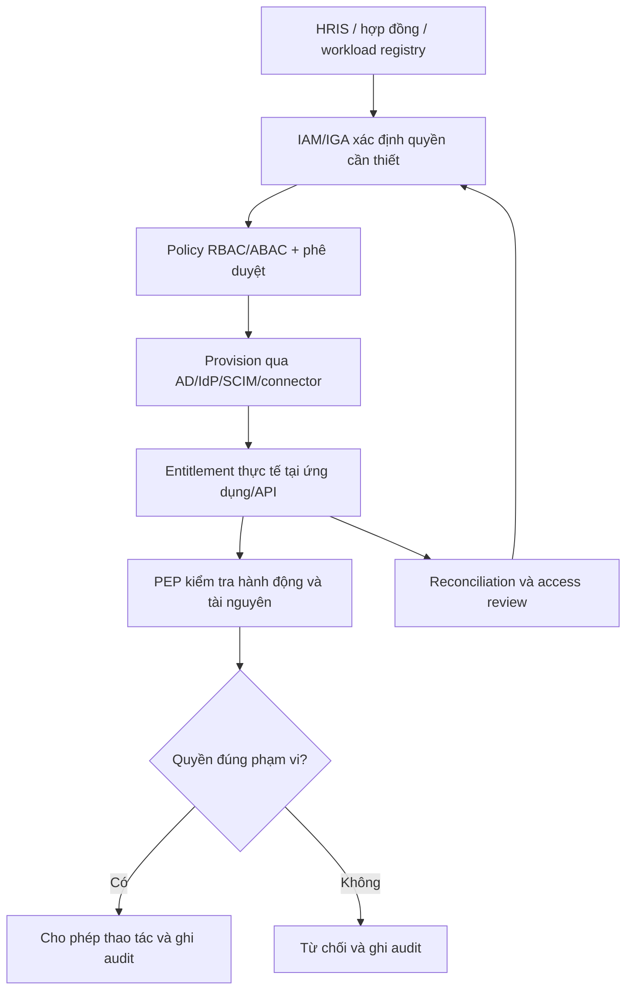
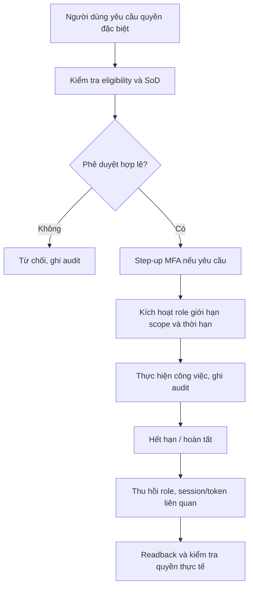

# Least privilege là gì trong quản lý vòng đời danh tính IAM?

**Least privilege** (*nguyên tắc đặc quyền tối thiểu*) là nguyên tắc bảo mật yêu cầu **mỗi chủ thể chỉ nhận những quyền thực sự cần thiết để hoàn thành công việc hợp lệ, trên đúng tài nguyên, trong đúng phạm vi và thời gian cần thiết**. Chủ thể có thể là nhân viên, đối tác, quản trị viên, tài khoản dịch vụ hoặc workload tự động.

Ví dụ, nhân viên hỗ trợ chỉ cần đọc ticket được phân công thì không nên có quyền xem mọi hồ sơ khách hàng, xóa cơ sở dữ liệu hoặc quản trị tài khoản. Một job chỉ cần tải báo cáo từ API cũng không nên dùng access token có quyền `admin`. Quyền tối thiểu không có nghĩa **cấm tất cả**, mà là **thiết kế quyền vừa đủ để công việc được thực hiện an toàn và có kiểm soát**.

Trong **Identity and Access Management (IAM)**, least privilege phải được duy trì xuyên suốt **Joiner–Mover–Leaver (JML)**: cấp quyền ban đầu theo nhiệm vụ, giảm hoặc thay quyền khi đổi vai trò và thu hồi khi chấm dứt quan hệ. Để làm được điều đó, tổ chức cần kết hợp **IdP, SSO, SCIM/connector, RBAC/ABAC, quản trị tài khoản dịch vụ, kiểm toán và đối soát quyền thực tế**.

## 1. Tại sao least privilege quan trọng?

Càng nhiều quyền, hậu quả của một tài khoản bị chiếm hoặc thao tác nhầm càng lớn. Một tài khoản chỉ được đọc tài liệu của một dự án gây ảnh hưởng khác với một tài khoản có thể xóa dữ liệu sản xuất, tạo administrator hoặc truy cập mọi tenant.

| Không áp dụng quyền tối thiểu | Rủi ro | Khi áp dụng đúng |
| --- | --- | --- |
| Mọi nhân viên đều có quyền export dữ liệu | Rò dữ liệu trên diện rộng | Export chỉ cấp cho vai trò và dữ liệu cần thiết |
| Nhân viên Mover giữ role cũ | Tích lũy đặc quyền | Tính lại và gỡ quyền không còn căn cứ |
| Mọi service account dùng quyền admin | Lan truyền đặc quyền khi secret lộ | Chia scope theo workload và tài nguyên |
| Quyền khẩn cấp tồn tại vĩnh viễn | Lạm dụng quyền đặc biệt | Quyền có thời hạn, phê duyệt và giám sát |
| Người đã nghỉ vẫn còn phiên SaaS | Truy cập tồn dư sau Leaver | Chặn phiên, token và entitlement tại đích |
| Role chung cho nhiều partner | Truy cập xuyên tenant | Cô lập tenant, hợp đồng, dự án theo ABAC |

Least privilege giảm **attack surface** và **blast radius**: kẻ tấn công lấy được một credential không mặc nhiên có thể thực hiện mọi hành động.

Tuy nhiên, chỉ cấp ít quyền không tự bảo đảm an toàn. Hệ thống còn cần xác thực mạnh, vá lỗi, bảo vệ dữ liệu, kiểm tra authorization và giám sát hoạt động bất thường.

## 2. Quyền tối thiểu là tối thiểu theo những chiều nào?

Một quyền hợp lệ cần được giới hạn ít nhất theo:

1. **Chủ thể:** ai hoặc workload nào được cấp quyền?
2. **Hành động:** đọc, tạo, cập nhật, phê duyệt, xuất hay xóa?
3. **Tài nguyên:** dự án, bảng dữ liệu, thư mục, API, tenant nào?
4. **Ngữ cảnh:** môi trường production hay staging, thiết bị và phiên nào?
5. **Thời gian:** từ khi nào, đến khi nào và có cần xác thực lại không?
6. **Mục đích và quan hệ:** công việc, hợp đồng hoặc trách nhiệm nào làm căn cứ?
7. **Đường thực thi:** quyền được áp dụng qua role, group, ACL, token hay API key nào?

Ví dụ `orders:read` có thể là phạm vi OAuth hợp lệ, nhưng **không đủ** nếu API không giới hạn đơn hàng theo owner hoặc tenant. Ngược lại, chỉ kiểm tra cùng tenant vẫn chưa đủ để cho phép thao tác `delete` khi người dùng chỉ cần đọc.

## 3. Phân biệt least privilege với những nguyên tắc gần gũi

| Nguyên tắc | Nội dung | Quan hệ với least privilege |
| --- | --- | --- |
| **Need to know** | Chỉ xem thông tin cần biết | Tập trung vào dữ liệu, là một ứng dụng cụ thể |
| **Deny by default** | Không có căn cứ cho phép thì từ chối | Cơ chế thực thi bảo vệ quyền tối thiểu |
| **Separation of Duties (SoD)** | Phân tách các nhiệm vụ xung đột | Ngăn tập hợp quyền nguy hiểm dù từng quyền có lý do |
| **Just-in-Time (JIT)** | Chỉ kích hoạt quyền khi cần, trong thời hạn ngắn | Giảm thời gian tồn tại của đặc quyền |
| **Zero Trust** | Không mặc định tin cậy theo vị trí mạng | Phối hợp xác minh liên tục và quyền tối thiểu |
| **Defense in depth** | Nhiều lớp bảo vệ độc lập | Quyền tối thiểu là một lớp quan trọng |

Ví dụ một người có thể thực sự cần cả quyền tạo và duyệt hóa đơn trong hai nhiệm vụ khác nhau, nhưng chính sách **SoD** vẫn có thể cấm họ tự duyệt hóa đơn do mình tạo. Do đó least privilege và SoD phải được đánh giá cùng nhau, không thay thế lẫn nhau.

## 4. Least privilege trong các mô hình authorization

**RBAC (Role-Based Access Control)** gói permission thành role để cấp theo trách nhiệm. Một role chuẩn cần tập quyền vừa đủ, owner rõ và khả năng rà soát.

**ABAC (Attribute-Based Access Control)** giới hạn quyền theo thuộc tính của chủ thể, tài nguyên, hành động và môi trường. Nó giúp tránh tạo vô số role cho từng dự án, tenant hay khu vực.

**PBAC (Policy-Based Access Control)** tổ chức các quy tắc cho phép/từ chối thành policy có thể quản trị, kiểm thử và thực thi nhất quán.

**ACL hoặc quyền trực tiếp** có thể vẫn cần cho một tài nguyên cụ thể, nhưng phải được đưa vào kiểm toán vì dễ bị bỏ sót khi chỉ kiểm tra nhóm trung tâm.

Ví dụ chính sách giả mã kết hợp RBAC và ABAC:

```text
PERMIT read_customer_ticket IF
    subject.lifecycle_status == "active"
    AND "support-reader" IN subject.effective_roles
    AND subject.tenant_id == resource.tenant_id
    AND resource.assigned_team IN subject.authorized_teams
ELSE DENY
```

Đây không phải cú pháp của một sản phẩm IAM cụ thể. Thông tin về role, tenant, nhóm và trạng thái JML phải được kiểm chứng từ nguồn đáng tin, không nhận trực tiếp từ trường do người dùng tự gửi.

## 5. Least privilege không chỉ là gán role



**Gán role đúng trong IAM nhưng chưa cập nhật tại ứng dụng** có thể làm người dùng thiếu quyền. Ngược lại, gỡ nhóm IdP nhưng ứng dụng còn một role cục bộ có thể làm người đã Mover hoặc Leaver tiếp tục truy cập.

Bởi vậy phải quan sát **effective entitlement** tại nơi tài nguyên thực sự được bảo vệ, không chỉ tin vào trạng thái dự kiến của workflow.

## 6. Xác định tập quyền cần thiết

Trước khi cấp quyền, cần trả lời:

- Nhiệm vụ nào đòi hỏi quyền này?
- Chủ thể cần **xem**, **chỉnh sửa**, **phê duyệt** hay **quản trị**?
- Phạm vi dữ liệu là một bản ghi, một dự án, một tenant hay toàn bộ hệ thống?
- Quyền có thể cấp dưới dạng role ít đặc quyền hơn không?
- Có cần phê duyệt của data owner/application owner không?
- Quyền bắt đầu và kết thúc vào thời điểm nào?
- Có xảy ra xung đột nhiệm vụ với role hiện có không?
- Có đường truy cập khác qua nhóm lồng nhau, tài khoản phụ hoặc token không?

Ví dụ trong hệ thống CRM:

| Nhu cầu công việc | Quyền nên xem xét | Quyền không nên mặc định cấp |
| --- | --- | --- |
| Xử lý ticket được giao | `ticket.read`, `ticket.comment` trong team | `crm.admin`, `customer.export_all` |
| Quản lý lịch trực | `schedule.update` cho nhóm được giao | Quản lý mọi account toàn công ty |
| Phê duyệt giảm giá | `discount.approve` trong hạn mức | Thay đổi cấu hình hạn mức |
| Xem báo cáo tổng hợp | `report.read` cho tập dữ liệu hợp lệ | Truy xuất trường PII không cần thiết |

Quyền phải phù hợp **công việc thực tế**, không chỉ tên chức danh. Hai người cùng chức danh có thể có dự án và trách nhiệm khác nhau.

## 7. Joiner: cấp ít nhất nhưng không cấp thiếu

Joiner là điểm bắt đầu của vòng đời quyền. Một người mới cần đủ quyền thực hiện công việc nhưng không nhận đặc quyền vượt quá nhiệm vụ.

Quy trình mẫu:

1. HRIS hoặc nguồn quan hệ xác nhận identity, bộ phận, người quản lý và ngày hiệu lực.
2. IAM xác minh và liên kết đúng identity với account đích.
3. RBAC tính **birthright access** tối thiểu cho vị trí.
4. ABAC giới hạn tenant, dự án, vùng dữ liệu và thời gian.
5. Quyền nhạy cảm đi qua owner và phê duyệt riêng.
6. SCIM/connector tạo account và đồng bộ role/group theo hỗ trợ.
7. IdP/SSO và MFA bảo đảm đăng nhập phù hợp mức rủi ro.
8. IAM đọc lại quyền tại ứng dụng, kiểm thử Permit/Deny và ghi audit.

**Chuẩn bị account trước ngày làm việc không đồng nghĩa cho phép sử dụng trước thời điểm bắt đầu.** Nếu ngày hiệu lực chưa đến, ứng dụng phải kiểm soát trạng thái và policy tương ứng.

Cấp quá ít quyền đến mức cản trở công việc thường khiến người dùng tìm cách chia sẻ tài khoản hoặc dùng credential không quản lý. Vì vậy least privilege là **vừa đủ và có cơ chế yêu cầu bổ sung rõ ràng**, không phải từ chối mọi nhu cầu hợp lệ.

## 8. Mover: giảm quyền cũ, không chỉ cộng quyền mới

Mover xảy ra khi nhân viên chuyển bộ phận, dự án, chức vụ hoặc thay đổi phạm vi trách nhiệm. Rủi ro điển hình là **privilege accumulation**: quyền mới được thêm vào trong khi quyền cũ không bị gỡ.

| Trước Mover | Sau Mover mong muốn | Sai lệch cần phát hiện |
| --- | --- | --- |
| `invoice-approver` | `analytics-reader` | ERP còn role duyệt hóa đơn |
| Quyền dự án A | Quyền dự án B | ACL dự án A tồn dư |
| Quyền quản trị hạ tầng | Vai trò không quản trị | Token hoặc tài khoản admin phụ vẫn hoạt động |
| Scope toàn khu vực | Chỉ scope một chi nhánh | API tiếp tục chấp nhận phạm vi cũ |

Một quy trình đúng cần tính lại **desired entitlements**, so với **observed entitlements** và xử lý cả chiều cấp thiếu lẫn thu hồi thừa.

Khi cần bàn giao, quyền ngoại lệ có thể được duy trì **có thời hạn, owner, lý do và giám sát**. Không để ngoại lệ bàn giao thành một quyền vĩnh viễn không được tái đánh giá.

## 9. Leaver: quyền tối thiểu trở về không còn quyền công việc

Khi quan hệ lao động/hợp đồng kết thúc, tập quyền nghiệp vụ của người đã nghỉ thường phải bị thu hồi theo chính sách. Nhưng **disable account ở IdP chưa bảo đảm mọi session và token đã mất hiệu lực**.

| Đường truy cập | Hành động Leaver | Bằng chứng |
| --- | --- | --- |
| Account IdP/directory | Disable và ngăn xác thực mới | Không thể đăng nhập lại |
| SaaS/application | SCIM/connector/API deprovision account và role | Readback account/entitlement |
| Session/SSO | Thu hồi hoặc chặn phiên tại ứng dụng | Session cũ không thực hiện quyền |
| Access/refresh token | Thu hồi khi hỗ trợ, kiểm soát TTL và trạng thái | API từ chối truy cập trái policy |
| ACL/group cục bộ | Gỡ quyền trực tiếp, nhóm lồng nhau | Không còn effective permission |
| API key/credential phụ | Thu hồi hoặc xoay nếu liên quan | Không còn đường truy cập độc lập |

Một JWT tự chứa có thể còn được API chấp nhận đến khi hết hạn nếu không có kiểm tra trạng thái hiện hành hoặc cơ chế revoke tương ứng. **Leaver chỉ hoàn tất về mặt truy cập khi những đường truy cập liên quan đã được xử lý và kiểm chứng**.

Giữ hồ sơ người dùng cho mục đích kiểm toán không có nghĩa duy trì quyền đăng nhập hay quyền truy cập tài nguyên.

## 10. IdP, SSO và SCIM phục vụ least privilege thế nào?

| Thành phần | Đóng góp | Giới hạn |
| --- | --- | --- |
| **IdP** | Xác thực, MFA, quản lý một phần trạng thái account/group | Không tự quyết định mọi permission ứng dụng |
| **SSO/OIDC/SAML** | Liên kết xác thực giữa IdP và RP/SP | Không tự thu hồi mọi app session |
| **SCIM** | Tạo/cập nhật/disable user và group | Không phải giao thức thực thi authorization tại API |
| **RBAC** | Gói permission thành role theo công việc | Role quá rộng gây overprivilege |
| **ABAC/PBAC** | Giới hạn truy cập theo tài nguyên/ngữ cảnh/policy | Cần nguồn thuộc tính tin cậy và PEP |
| **IGA/JML** | Phê duyệt, cấp/gỡ quyền theo quan hệ | Cần readback để chứng minh đích đã áp dụng |
| **Audit/reconciliation** | Theo dõi thay đổi và quyền tồn dư | Không thay thế việc chặn request |

**ID token OIDC** chứng minh thông tin xác thực cho RP; **access token** dành cho resource server theo audience/scope phù hợp. API không được chấp nhận ID token làm credential truy cập tùy ý. Scope OAuth là một lớp giới hạn nhưng **không thay thế kiểm tra quyền theo từng tài nguyên**.

## 11. Least privilege với tài khoản dịch vụ và workload

Workload thường chạy liên tục hoặc theo lịch và ít có khả năng tương tác xác thực như con người. Vì vậy credential quá mạnh hoặc tồn tại lâu có thể tạo rủi ro lớn.

Các kiểm soát cần có:

- **Identity riêng cho từng workload hoặc nhóm workload có ranh giới rõ**, tránh dùng chung account admin.
- **Scope API tối thiểu**: read-only nếu chỉ đọc; chỉ một bucket, queue, namespace hoặc database schema khi đủ.
- **Credential ngắn hạn/managed identity** khi có thể; quản lý secret và rotation.
- **Ràng buộc audience, issuer, môi trường** để token staging không gọi API production.
- **Không dùng token nhân viên** làm credential lâu dài của job.
- **Owner rõ ràng** và quy trình bàn giao khi người quản lý workload Mover/Leaver.
- **Audit theo service identity** và tách khỏi hành động quản trị do con người thực hiện.

Ví dụ job báo cáo cần `reports.read` trên dữ liệu tổng hợp. Không cấp `database.owner` hoặc quyền xóa bảng để “tránh lỗi permission”. Nếu quyền tối thiểu chưa đủ, xác định thao tác thực tế còn thiếu rồi sửa chính sách có kiểm soát.

**Service account không tự bị xóa khi kỹ sư tạo ra nó nghỉ việc**. Phải kiểm tra phụ thuộc, chuyển owner, thu hồi quyền cá nhân đối với secret/CI-CD và điều chỉnh quyền workload theo nhu cầu tiếp tục vận hành.

## 12. Tài khoản đặc quyền và Just-in-Time Access

Quyền quản trị hệ thống, tạo tài khoản, thay đổi chính sách hoặc truy cập dữ liệu nhạy cảm cần kiểm soát chặt hơn quyền thường.

**Privileged Access Management (PAM)** và **Just-in-Time (JIT)** cho phép người đủ điều kiện kích hoạt đặc quyền trong thời hạn, có lý do/phê duyệt và kiểm toán.

Quy trình minh họa:



**MFA không tự cấp đặc quyền**. Một người xác thực rất mạnh vẫn phải có căn cứ và phê duyệt để dùng role `production-admin`.

Thời hạn JIT phải được thực thi ở hệ thống đích hoặc qua cơ chế kiểm soát phiên/token phù hợp. **Chỉ xóa quyền trong giao diện IAM trong khi API vẫn chấp nhận session cũ** chưa đáp ứng yêu cầu quyền tối thiểu theo thời gian.

## 13. Separation of Duties và quyền tối thiểu

**Separation of Duties (SoD)** hạn chế việc một chủ thể có tập quyền xung đột, ví dụ vừa tạo vừa phê duyệt cùng một khoản thanh toán.

- **Static SoD:** không cho gán đồng thời hai role xung đột.
- **Dynamic SoD:** hạn chế kích hoạt cùng lúc các role trong ngữ cảnh theo chính sách.
- **Transaction-level SoD:** không cho tự phê duyệt tài nguyên do chính mình tạo.

Một người có thể được giao nhiều trách nhiệm hợp lệ, nhưng tổ chức vẫn cần phân tách những bước kiểm soát quan trọng. Nếu có ngoại lệ khẩn cấp, cần phê duyệt độc lập, giới hạn thời gian, theo dõi và đối soát sau sự kiện.

## 14. Quyền tối thiểu trong hệ thống đa tenant và đối tác

Một đối tác B2B đăng nhập thành công qua IdP riêng vẫn không được tự động có quyền trên mọi dữ liệu của doanh nghiệp cung cấp.

Ví dụ chính sách:

```text
PERMIT read_order IF
    subject.lifecycle_status == "active"
    AND subject.partner_id == resource.partner_id
    AND resource.contract_id IN subject.active_contracts
    AND "partner-order-reader" IN subject.effective_roles
ELSE DENY
```

Đây là giả mã. Các trường `partner_id` và `contract_id` phải lấy từ nguồn đã xác minh và dữ liệu tài nguyên tại server. **Không dùng IP, email hoặc group claim không được kiểm soát làm bằng chứng duy nhất về tenant và quyền**.

Khi hợp đồng hết hạn, đơn vị sở hữu ứng dụng phải chủ động thu hồi quyền B2B, kể cả khi IdP của partner vẫn cho người dùng đăng nhập.

## 15. Rủi ro thường gặp khi triển khai

| Sai lầm | Hậu quả | Khắc phục |
| --- | --- | --- |
| Dùng role `admin` để xử lý lỗi thiếu quyền | Tăng blast radius | Xác định permission thật sự cần |
| Gán role theo department mà không xét tài nguyên | Truy cập quá phạm vi | RBAC kết hợp ABAC |
| Chỉ ẩn nút chức năng ở UI | API vẫn bị gọi trái phép | Enforcement tại backend |
| Chỉ dựa vào scope OAuth | BOLA/IDOR theo object | Kiểm tra owner/tenant/resource |
| Quyền cũ sau Mover không bị thu hồi | Privilege creep | Recompute và reconcile |
| Chỉ disable IdP khi Leaver | Phiên/role ứng dụng tồn dư | Thu hồi ở RP/API và kiểm chứng |
| Nhóm lồng nhau không được kiểm tra | Bỏ sót quyền hiệu lực | Tính effective permissions |
| Token/secret tồn tại quá lâu | Credential bị lộ vẫn dùng được | Hạn ngắn, rotation, revoke khi khả thi |
| Quyền JIT không hết hạn ở ứng dụng | Đặc quyền thành vĩnh viễn | Thực thi expiry và readback |
| Owner của entitlement không rõ | Không ai rà soát | Bổ sung role/application owner |

Một lỗi phổ biến là áp dụng least privilege **chỉ tại thời điểm cấp quyền**. Nguyên tắc này cần được duy trì liên tục vì công việc, tài nguyên, quan hệ lao động và mức rủi ro đều thay đổi.

## 16. Phân quyền theo đối tượng: ngăn BOLA/IDOR

Giả sử API:

```http
GET /api/customer-tickets/T-1002
Authorization: Bearer <access-token>
```

Kiểm tra token có scope `tickets:read` là cần thiết nhưng chưa đủ. API còn phải hỏi: **T-1002 có thuộc tenant, dự án và phạm vi phân công của subject hay không?**

Nếu người dùng đổi ID từ `T-1002` sang `T-1003` và API trả ticket của bộ phận khác, ứng dụng có thể mắc lỗi **Broken Object Level Authorization (BOLA/IDOR)**.

Phòng tránh:

1. Xác thực access token đúng issuer, audience và các điều kiện cần thiết.
2. Xác định subject từ nguồn tin cậy.
3. Tải thuộc tính owner/tenant của resource từ server.
4. Đánh giá hành động `read` với đúng tài nguyên.
5. Từ chối nếu không có permission hoặc thuộc tính cần thiết.
6. Áp dụng tương tự cho truy vấn danh sách, export và cập nhật trường nhạy cảm.

**Role tối thiểu nhưng resource check thiếu vẫn có thể gây rò dữ liệu lớn**. Cần kiểm tra ở điểm thực thi mỗi request, không chỉ ở trang giao diện trước đó.

## 17. Account reconciliation và access review

Least privilege cần bằng chứng từ hệ thống đang lưu và thực thi quyền.

```text
desired_entitlements =
    quyền hợp lệ theo JML + role + phê duyệt + ngoại lệ còn hạn

observed_entitlements =
    role + group + ACL + quyền cục bộ quan sát tại hệ thống đích

missing = desired_entitlements - observed_entitlements
excess  = observed_entitlements - desired_entitlements
```

Đây là mô hình logic. Trong triển khai cần xử lý role kế thừa, nhóm lồng nhau, quyền trực tiếp, account phụ, session và token. Những trường hợp `excess` có thể là quyền dư thực sự hoặc ngoại lệ hợp lệ chưa được ghi nhận; phải có quy trình điều tra và phê duyệt.

Quy trình đóng vòng:

1. Nhận sự kiện JML hoặc chu kỳ access review.
2. Tính desired state từ nguồn có thẩm quyền.
3. Đọc observed state tại IdP/AD và từng ứng dụng.
4. Phân loại thiếu quyền, dư quyền và ngoại lệ.
5. Thực hiện provision/deprovision theo kiểm soát.
6. Đọc lại trạng thái và thử hành động Permit/Deny.
7. Lưu audit, mở cảnh báo nếu quyền nhạy cảm chưa mất hiệu lực.

**Không kết luận thành công chỉ vì connector trả HTTP 200**. Ứng dụng có thể vẫn lưu role cục bộ hoặc session cũ; cần xác minh trạng thái quyền thực tế.

## 18. Đo lường hiệu quả và audit

Những chỉ số hữu ích:

- **Excess entitlement count:** số quyền quan sát được ngoài desired state.
- **Privileged account coverage:** tỷ lệ account đặc quyền có owner, MFA và chính sách kiểm soát.
- **Mover residual access:** số quyền của vai trò cũ chưa bị thu hồi.
- **Leaver time to deny:** thời gian từ sự kiện chấm dứt đến khi truy cập thực tế bị từ chối.
- **JIT privilege duration:** thời gian đặc quyền được kích hoạt.
- **Orphaned identity/entitlement rate:** account hoặc quyền không có chủ thể/owner hợp lệ.
- **Access review completion:** tỷ lệ quyền được xác nhận hoặc thu hồi đúng hạn.
- **Cross-tenant negative test coverage:** độ bao phủ kiểm thử truy cập sai tenant.
- **Service-account scope violations:** workload được cấp quyền vượt nhu cầu.

Audit cần ghi identity ổn định, target account, quyền/role, nguồn phê duyệt, owner, thời điểm, hệ thống đích và bằng chứng readback. **Không đưa mật khẩu, mã OTP, token, cookie, private key hoặc secret thô vào log**.

Số quyền dư ít không đồng nghĩa rủi ro thấp nếu một quyền dư duy nhất là `production-admin`. Cần ưu tiên theo **mức nhạy cảm, phạm vi ảnh hưởng và khả năng khai thác**.

## 19. Checklist áp dụng least privilege

| Câu hỏi | Kỳ vọng |
| --- | --- |
| Account có identity hoặc owner hợp lệ? | Có, kể cả workload |
| Permission có gắn với nhiệm vụ cụ thể? | Có lý do và chủ sở hữu |
| Role có quyền admin ngoài nhu cầu? | Không |
| API có kiểm tra action và object? | Có ở backend |
| Tenant/dự án/hợp đồng có được giới hạn? | Có bằng ABAC/policy thích hợp |
| Quyền nhạy cảm có phê duyệt và ngày hết hạn? | Có |
| Mover có gỡ role cũ? | Có và đã readback |
| Leaver có chặn session/token và quyền cục bộ? | Có theo khả năng và chính sách |
| Service account có scope, owner, credential lifecycle? | Có |
| Đối soát có phát hiện entitlement tồn dư? | Có, có quy trình xử lý |

## 20. Câu hỏi tự kiểm tra

**Tình huống A:** Một developer cần đọc log production nhưng được cấp `production-admin` vì nhanh hơn. Có đúng least privilege không? **Không.** Cần quyền đọc log có giới hạn và phê duyệt thích hợp.

**Tình huống B:** Một nhân viên chuyển từ Finance sang Support nhưng giữ quyền duyệt hóa đơn. Điểm sai? **Privilege accumulation sau Mover**; phải thu hồi role cũ và đối soát ERP.

**Tình huống C:** IdP đã disable Leaver nhưng cookie CRM vẫn truy cập được. Đã đáp ứng quyền tối thiểu chưa? **Chưa.** Phải xử lý session và entitlement tại CRM/API.

**Tình huống D:** Access token có `orders:read` nên API cho đọc mọi đơn hàng. Có an toàn không? **Không.** Cần kiểm tra owner/tenant trên từng order.

**Tình huống E:** Job sao lưu chỉ cần ghi vào một bucket nhưng có quyền xóa mọi bucket. Hướng xử lý? **Giới hạn quyền theo action/resource và identity workload**.

**Tình huống F:** JIT admin role đã hết hạn nhưng phiên quản trị cũ còn dùng được. Cần làm gì? **Bảo đảm việc hết hạn được thực thi tại API/session/token**, rồi readback và kiểm thử từ chối.

## Ghi nhớ

**Least privilege** nghĩa là **cấp đúng quyền cần thiết, đúng tài nguyên, đúng thời điểm và thu hồi ngay khi không còn căn cứ**. Để thực hiện bền vững cần phối hợp **RBAC/ABAC/PBAC, SoD, JIT/PAM, IdP/SSO, SCIM, quản trị service account, access review và reconciliation**. Trong **IAM Joiner–Mover–Leaver**, không chỉ quan tâm quyền được ghi trên hệ thống quản lý, mà phải **kiểm chứng quyền hiệu lực tại ứng dụng, phiên và API** để giảm đặc quyền dư và quyền truy cập tồn dư.
