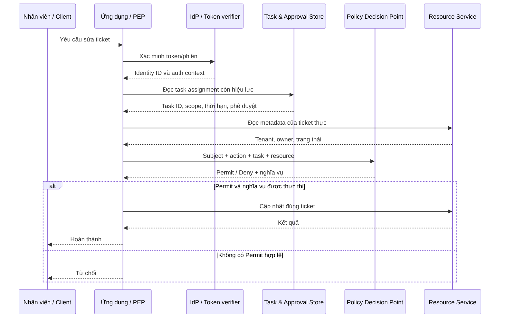
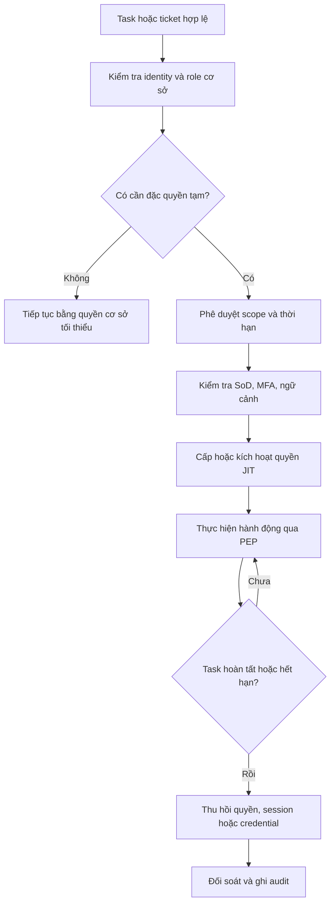

# Quyền theo nhiệm vụ trong Least Privilege: Cấp đúng quyền, đúng việc, đúng thời điểm

**Quyền theo nhiệm vụ** là cách xác định và cấp quyền truy cập dựa trên **công việc cụ thể mà một chủ thể được giao thực hiện**, thay vì cấp sẵn mọi khả năng có thể cần trong tương lai. Trong nguyên tắc **Least Privilege** (*đặc quyền tối thiểu*), một danh tính chỉ nên có **mức quyền nhỏ nhất đủ để hoàn thành nhiệm vụ hợp lệ**, trên **đúng tài nguyên**, trong **đúng phạm vi** và **trong khoảng thời gian cần thiết**.

Ví dụ, nhân viên hỗ trợ được phân công xử lý yêu cầu hoàn tiền `refund-782` cần xem thông tin liên quan và ghi nhận kết quả xử lý; họ **không tự động cần** quyền hoàn tiền mọi giao dịch, đọc mọi hồ sơ khách hàng hay thay đổi cấu hình hệ thống thanh toán. Nếu tác vụ có bước phê duyệt tài chính, quyền đó có thể thuộc **người được phân công phê duyệt khác**, không phải bất kỳ người nào tham gia yêu cầu.

Bài thuộc chương **Least privilege** của module `SECURITY_IDENTITY_ACCESS_MANAGEMENT_IDENTITY_LIFECYCLE`. Trọng tâm module là quản lý vòng đời danh tính theo **Joiner–Mover–Leaver (JML)**: xác minh, tạo tài khoản và cấp quyền, rà soát khi chuyển vai trò, vô hiệu hóa và thu hồi khi quan hệ kết thúc. Nội dung kết nối **IdP, SSO, SCIM, RBAC/ABAC/PBAC, tài khoản dịch vụ, kiểm toán và giảm quyền truy cập tồn dư**.

Sau bài học, bạn có thể mô tả quyền theo nhiệm vụ, phân biệt nó với role/chức danh, xây dựng ma trận task–action–resource, đặt phạm vi và thời hạn cấp quyền, triển khai Just-in-Time (JIT) cho nhiệm vụ nhạy cảm, áp dụng Separation of Duties (SoD), xử lý Joiner–Mover–Leaver và đối soát quyền thực tế.

## 1. Quyền theo nhiệm vụ giải quyết điều gì?

Các tổ chức thường muốn nhân viên hoàn thành công việc ngay, nên dễ cấp quyền theo cách “cho rộng để khỏi thiếu”. Quyết định thuận tiện ban đầu này có thể tạo **privilege creep**: quyền được tích lũy sau những lần chuyển dự án, đổi bộ phận hoặc hỗ trợ sự cố, nhưng hiếm khi bị gỡ.

Có ba cách nhìn khác nhau:

| Cách cấp quyền | Câu hỏi chủ đạo | Ví dụ | Nguy cơ nếu dùng không kiểm soát |
| --- | --- | --- | --- |
| **Theo chức danh** | “Người này thuộc đội nào?” | Mọi nhân viên Support có role `support-agent` | Mọi người trong đội đều xem được dữ liệu không liên quan |
| **Theo nhiệm vụ** | “Người này đang được giao việc gì?” | Chỉ xử lý ticket `support-214` | Không gỡ quyền khi ticket hoàn tất |
| **Theo ngữ cảnh** | “Trong điều kiện nào quyền được sử dụng?” | Đúng tenant, thiết bị tin cậy, trong ca trực | Tin vào thuộc tính sai hoặc token cũ |

**Quyền theo nhiệm vụ không nhất thiết là một giao thức hay sản phẩm riêng.** Đây là nguyên tắc thiết kế cấp quyền theo **mục đích công việc có thể kiểm chứng**. Tổ chức có thể hiện thực bằng RBAC, ABAC, PBAC, JIT/PAM, entitlement theo đối tượng, approval workflow hoặc phối hợp nhiều cơ chế.

Điểm cốt lõi là **nhiệm vụ phải có ranh giới**. “Là nhân viên tài chính” là bối cảnh công việc rộng, còn “phê duyệt hóa đơn INV-782 thuộc đơn vị A trước 17:00 sau khi đã được người khác kiểm tra” là nhiệm vụ cụ thể có hành động, tài nguyên và điều kiện xác định.

### Lợi ích thực tế

- Giảm tác động khi tài khoản người dùng hoặc workload bị chiếm đoạt.
- Giảm sai sót do tài khoản có khả năng sửa/xóa dữ liệu ngoài phần việc.
- Hạn chế xung đột giữa người tạo, người kiểm tra và người phê duyệt.
- Tạo căn cứ kiểm toán: **quyền này được cấp để làm việc gì, do ai yêu cầu, do ai phê duyệt và hết hạn khi nào?**
- Thu hồi dễ hơn khi người dùng Mover, Leaver hoặc nhiệm vụ kết thúc.
- Hỗ trợ cấp quyền tạm thời cho tác vụ hiếm gặp mà không giữ đặc quyền thường trực.

## 2. Một nhiệm vụ phải được mô tả bằng những yếu tố nào?

Để biến công việc thành quyền truy cập, cần xác định tối thiểu **chủ thể, hành động, tài nguyên, phạm vi, thời hạn và căn cứ phê duyệt**.

| Thành phần | Câu hỏi | Ví dụ |
| --- | --- | --- |
| **Subject** | Ai thực hiện? | `iam-user-1042`, không chỉ tên/email |
| **Task** | Việc gì được giao? | Xử lý sự cố `INC-482` |
| **Action** | Được thao tác nào? | `logs.read`, `service.restart` |
| **Resource** | Đối tượng nào? | Dịch vụ `order-api` |
| **Scope** | Giới hạn tenant, hệ thống, dữ liệu, môi trường? | Chỉ `staging`, cụm `cluster-02` |
| **Time** | Bắt đầu và kết thúc khi nào? | Từ 10:00 đến 11:30 |
| **Conditions** | Điều kiện được phép? | MFA mạnh, thiết bị tin cậy, ticket còn mở |
| **Approval** | Ai có thẩm quyền duyệt? | Owner hệ thống và trực ca |
| **Grant provenance** | Quyền phát sinh từ đâu? | `taskId=INC-482`, `approvalId=APR-22` |
| **Evidence** | Xác nhận đã cấp, dùng và thu hồi ra sao? | Log PEP, trạng thái PAM, readback target |

Ví dụ dữ liệu đề xuất **minh họa**:

```yaml
taskId: INC-482
assigneeIdentityId: iam-user-1042
purpose: Investigate order-api latency
resource:
  service: order-api
  environment: staging
  cluster: cluster-02
requestedActions:
  - logs.read
  - deployment.status.read
validFrom: "2026-12-01T03:00:00Z"
validUntil: "2026-12-01T04:30:00Z"
approval:
  owner: platform-operations
  approvalId: APR-22
conditions:
  requireStrongAuthentication: true
  ticketMustRemainOpen: true
```

Đây **không phải schema bắt buộc** của PAM, IAM hoặc Kubernetes. Nó minh họa cách gắn một quyền với nhiệm vụ có giới hạn rõ ràng. Những thuộc tính như `ticketMustRemainOpen` **chỉ có hiệu lực nếu được một thành phần chính sách thực sự kiểm tra**; ghi trong YAML không tự làm API từ chối khi ticket đóng.

### Công thức tư duy về quyền tối thiểu

Về mặt khái niệm, tập quyền cần thiết cho nhiệm vụ `t` có thể ký hiệu là:

\[
RequiredPermissions(t)=\{p\mid p\ \text{cần thiết để thực hiện nhiệm vụ }t\}.
\]

Một thiết kế hướng tới:

\[
GrantedPermissions(u,t)\subseteq RequiredPermissions(t)\cup ApprovedDependencies(t),
\]

đồng thời bảo đảm nhiệm vụ hợp lệ vẫn có thể hoàn thành. Đây là **mô hình tư duy**, không phải công thức đủ để triển khai authorization: các permission có thể còn phụ thuộc tài nguyên, thời điểm, role, scope, điều kiện rủi ro và quan hệ giữa các hành động.

**Least privilege không có nghĩa “cấp ít đến mức không làm được việc”.** Nó là cấp **đủ**, không hơn. Nếu một nhiệm vụ thực sự cần nhiều hành động liên quan, phải tài liệu hóa và phê duyệt những phụ thuộc đó thay vì bỏ sót hoặc giải quyết bằng quyền admin toàn cục.

## 3. Role mô tả chức năng, nhiệm vụ mô tả nhu cầu cụ thể

**Role-Based Access Control (RBAC)** phù hợp với các chức năng ổn định như `sales-agent`, `support-reader`, `audit-reviewer`. Nhưng role thường trả lời “người này thuộc nhóm công việc nào?”, chưa chắc trả lời “người này được sửa bản ghi nào hôm nay?”.

| Nội dung | Role cơ sở | Quyền theo nhiệm vụ |
| --- | --- | --- |
| Mức hạt | Chức năng được dùng lặp lại | Công việc, ticket, dự án hoặc đối tượng cụ thể |
| Thời hạn | Theo quan hệ công việc hoặc kỳ review | Theo ca trực, ticket, bước workflow, hạn công việc |
| Phạm vi | Có thể rộng theo ứng dụng/nhóm | Hạn chế resource, hành động và dữ liệu gắn nhiệm vụ |
| Đối tượng cấp | Nhiều người có cùng vai trò | Người/workload được phân công |
| Bằng chứng | Role catalog, owner, assignment | Task ID, ticket, approver, grant, sử dụng, thu hồi |
| Rủi ro | Role quá rộng, quyền tích lũy | Nhiệm vụ không được đóng, quyền tạm không hết hạn |

Ví dụ đội Support có role `support-agent` giúp truy cập chức năng tra cứu ticket. Quyền **xem thông tin chi tiết** của khách hàng `customer-542` chỉ được dùng nếu ticket được gán cho nhân viên và dữ liệu đó cần thiết để xử lý. Với giao dịch hoàn tiền, bước thực thi có thể cần role hoặc quyền tạm riêng đã được duyệt.

Điều này có thể triển khai bằng **RBAC cho chức năng**, kết hợp **ABAC/PBAC cho scope và ngữ cảnh**. Không cần tạo một role mới cho từng ticket nếu ứng dụng có thể đánh giá quan hệ `ticket.assigneeId == subject.identityId`.

## 4. Quyền theo nhiệm vụ và nguyên tắc Need-to-Know / Need-to-Do

Hai khái niệm hỗ trợ thiết kế là:

- **Need-to-know:** chủ thể chỉ được **xem** dữ liệu cần thiết cho nhiệm vụ.
- **Need-to-do:** chủ thể chỉ được **thao tác** những hành động cần thiết để hoàn thành nhiệm vụ.

Một nhân viên có thể cần đọc trạng thái thanh toán nhưng không cần xem toàn bộ thông tin cá nhân của khách hàng. Họ có thể cần cập nhật một trường giải thích xử lý nhưng không cần quyền xóa giao dịch.

Ví dụ phân rã nhiệm vụ “giải quyết khiếu nại đơn hàng”:

| Bước | Hành động cần | Quyền không nên cấp mặc định |
| --- | --- | --- |
| Tìm ticket được giao | `ticket.read.assigned` | `ticket.read.all` |
| Kiểm tra đơn liên quan | `order.read.linked` | `order.export.all` |
| Ghi chú kết quả | `ticket.comment.create` | `ticket.delete` |
| Đề xuất hoàn tiền | `refund.request.create` | `refund.execute` |
| Duyệt đề xuất | Chuyển cho người có quyền phê duyệt | Không tự cấp quyền duyệt cho người đề xuất |
| Đóng yêu cầu | `ticket.close.assigned` | `ticket.reopen.all` |

**Quyền xem và quyền sửa phải được tách rõ.** Một nhiệm vụ có thể cần đọc toàn bộ thông tin kỹ thuật nhưng chỉ được ghi vào một tài nguyên; tránh cấp chung `read-write-admin` chỉ vì đơn giản cấu hình.

### Resource scope và data minimization

Ngay cả khi role cho phép `customer.read`, API có thể chỉ trả những trường cần thiết cho nhiệm vụ. Hạn chế ở hai mức:

1. **Object-level:** nhân viên được phép truy cập bản ghi nào?
2. **Field-level/data-level:** trong bản ghi đó, được xem hoặc sửa trường nào?

Ví dụ ticket hỗ trợ cần địa chỉ giao hàng nhưng không cần số tài khoản ngân hàng đầy đủ. **Masking/redaction** có thể là nghĩa vụ thực thi bổ sung, không chỉ điều kiện kiểm tra Permit/Deny.

## 5. Mối liên hệ với RBAC, ABAC và PBAC

**Quyền theo nhiệm vụ** không cạnh tranh trực tiếp với RBAC/ABAC/PBAC; nó mô tả **cách xác định nhu cầu tối thiểu**, còn các mô hình kia giúp diễn đạt và thực thi.

| Mô hình | Đóng góp | Ví dụ trong cùng một nhiệm vụ |
| --- | --- | --- |
| **RBAC** | Chức năng cơ sở | `support-agent` có khả năng yêu cầu xem ticket |
| **ABAC** | Ràng buộc theo thuộc tính chủ thể/tài nguyên | `ticket.assignee == identityId` và cùng tenant |
| **PBAC** | Kết hợp policy, ngoại lệ, guardrail và decision | Chặn nếu Leaver, vượt phạm vi, vi phạm SoD |
| **JIT/PAM** | Cấp/kích hoạt đặc quyền có hạn | Quyền `deployment.restart` chỉ trong cửa sổ sự cố |
| **SCIM/provisioning** | Đưa account/group/entitlement kỳ vọng đến hệ thống đích | Đồng bộ quyền ứng dụng theo role/task khi đích hỗ trợ |
| **PEP/API** | Thực sự chặn hoặc cho thao tác | Từ chối request thay resource ID ngoài ticket |

Một policy minh họa:

```text
PERMIT ticket.update khi tất cả điều kiện đúng:
    subject.status == ACTIVE
    AND subject.hasRole("support-agent")
    AND task.status == OPEN
    AND task.assigneeIdentityId == subject.identityId
    AND resource.ticketId == task.id
    AND resource.tenantId == subject.tenantId
    AND action IN task.allowedActions
    AND now BETWEEN task.validFrom AND task.validUntil
    AND không có policy Deny/SoD áp dụng

Nếu thiếu căn cứ đáng tin: DENY hoặc xử lý theo lỗi bảo mật đã thiết kế.
```

Đây là **giả mã**, không phải cú pháp một policy engine cụ thể. Những trường `task.status`, `resource.tenantId` và thời hạn phải đến từ **nguồn có thẩm quyền**; không tin giá trị do HTTP client tự khai báo.

### Tránh role explosion

Nếu mỗi nhiệm vụ tạo một static role vĩnh viễn, IAM có thể phát sinh hàng nghìn role khó quản lý. Thay vào đó, role nên mô tả **khả năng theo loại công việc**; task ID, resource ID và thời hạn được kiểm tra bằng policy hoặc entitlement có phạm vi khi truy cập.

## 6. Authorization tại API: từ task assignment đến Permit/Deny

Một task được giao không tự biến mọi request thành Permit. API phải xác minh **chủ thể, action, resource và trạng thái nhiệm vụ hiện hành**.



Một số hệ thống có PDP nhúng trong backend; không nhất thiết gọi dịch vụ ngoài cho mỗi request. Nhưng **PEP phải bảo vệ mọi đường truy cập**, gồm API batch, admin endpoint và request gọi trực tiếp, chứ không chỉ ẩn nút trên giao diện.

### Lỗi truy cập đối tượng (BOLA/IDOR)

Nếu ứng dụng kiểm tra role `support-agent` nhưng cho user sửa `ticketId` do họ gửi tùy ý, họ có thể đổi ID để sửa ticket của người khác. Quyền theo nhiệm vụ đòi hỏi API kiểm tra **ticket cụ thể có nằm trong nhiệm vụ được giao không**.

Một request có token hợp lệ vẫn có thể bị Deny vì resource ID không thuộc phạm vi đó. **Authentication không phải authorization** và “có role” không đồng nghĩa “được sửa mọi bản ghi”.

## 7. Just-in-Time: Cấp quyền khi cần, hết việc thì thu hồi

Với nhiệm vụ nhạy cảm hoặc hiếm gặp, **Just-in-Time (JIT)** giúp tránh cấp đặc quyền thường trực (*standing privilege*). Quyền có thể được phê duyệt trước nhưng **chỉ kích hoạt trong khoảng thời gian cần thiết**.

Ví dụ kỹ sư vận hành cần restart một service trong 45 phút để xử lý sự cố:

1. Người phụ trách tạo ticket hợp lệ, nêu service, môi trường, hành động và rủi ro.
2. Hệ thống xác minh identity, role cơ sở và điều kiện MFA/PAM.
3. Owner hoặc người trực ca phê duyệt yêu cầu đặc quyền trong phạm vi cần thiết.
4. Quyền `service.restart` được cấp cho **đúng service** và **đúng khoảng thời gian**.
5. Hệ thống ghi nhận phiên/thao tác; yêu cầu ngoài scope bị từ chối.
6. Khi hết hạn hoặc ticket đóng, thu hồi assignment/credential và kiểm tra phiên/token tồn dư.
7. Đối soát trạng thái tại đích, lưu bằng chứng, báo lỗi nếu thu hồi chưa thành công.



**Quyền có ngày hết hạn trong cơ sở dữ liệu IAM nhưng còn hoạt động ở đích chưa phải đã thu hồi thành công.** Cần xử lý token, cache, session và quyền cục bộ theo khả năng nền tảng.

### “Đúng thời gian” gồm những thời điểm nào?

Nên phân biệt:

- **requestedAt:** lúc yêu cầu quyền.
- **approvedAt:** lúc được phê duyệt.
- **validFrom/validUntil:** phạm vi hiệu lực của grant.
- **provisionedAt:** lúc quyền xuất hiện ở đích.
- **revokedAt:** lúc hệ thống gửi yêu cầu thu hồi.
- **verifiedAt:** lúc quan sát được quyền đã mất hiệu lực ở đích.

Một grant hết hạn lúc 11:00 nhưng connector chưa gỡ đến 11:20 vẫn có **khoảng tồn dư 20 phút**. Với quyền đặc quyền cao, SLA và biện pháp chặn ở PEP/token phải cân nhắc khoảng này.

## 8. Approval và Separation of Duties theo từng bước nhiệm vụ

Một nhiệm vụ nhạy cảm có thể gồm nhiều bước do **những chủ thể khác nhau** thực hiện:

| Bước | Người phù hợp | Quyền cần | Kiểm soát |
| --- | --- | --- | --- |
| Tạo yêu cầu thanh toán | Người đề nghị | `payment.create` | Đúng đơn vị và hạn mức đề nghị |
| Kiểm tra chứng từ | Người kiểm tra | `payment.review` | Không tự sửa nguồn chứng từ |
| Phê duyệt | Người được giao duyệt | `payment.approve` | Không duyệt giao dịch do chính mình tạo |
| Thực thi thanh toán | Dịch vụ thanh toán | `payment.execute` | Chỉ giao dịch đã duyệt, có bằng chứng |
| Kiểm toán | Auditor | `payment.audit.read` | Read-only, không sửa/xóa chứng từ |

**Separation of Duties (SoD)** không chỉ là cấm gán hai role xung đột. Với workflow, cần kiểm tra trên **từng đối tượng giao dịch**: ai tạo, ai sửa, ai kiểm tra và ai duyệt. Một người chuyển role vẫn không nên tự duyệt một giao dịch họ đã tạo từ phiên trước.

Phân biệt:

- **Static SoD (SSD):** hạn chế gán đồng thời các role xung đột.
- **Dynamic SoD (DSD):** hạn chế kích hoạt đồng thời những role trong phiên/ngữ cảnh.
- **Object/workflow SoD:** hạn chế thao tác trên **tài nguyên và lịch sử nhiệm vụ** cụ thể.

Với hệ thống không hỗ trợ DSD, có thể cần kiểm soát tại **PDP/PEP**, phê duyệt theo nhiệm vụ và quyền JIT. Không nên đặt tên rule “SoD” rồi tin rằng ứng dụng đã thực thi.

## 9. Quyền theo nhiệm vụ trong Joiner

Ở giai đoạn **Joiner**, doanh nghiệp thường cần chuẩn bị tài khoản trước ngày nhận việc. Nhưng **tài khoản tồn tại sớm không đồng nghĩa quyền nghiệp vụ được kích hoạt sớm**.

Quy trình đề xuất:

1. HRIS xác nhận người, quan hệ, ngày bắt đầu và ID nhân sự ổn định.
2. IAM liên kết `identityId` với account tại IdP và ứng dụng; không chỉ dựa vào email có thể thay đổi.
3. Gán **role nền tảng** đúng chức năng nếu đủ căn cứ, theo phê duyệt và thời điểm hiệu lực.
4. Phân công **task thực tế** qua workflow hoặc hệ thống nghiệp vụ.
5. Cấp thêm quyền theo nhiệm vụ khi task có người được giao, scope và thời hạn.
6. IdP/SSO xác thực; PEP kiểm tra quyền theo nhiệm vụ ở ứng dụng.
7. Đối soát quyền quan sát và quyền hiệu lực tại từng đích.

Ví dụ nhân viên mới được phân công xử lý hồ sơ hỗ trợ từ ngày 01/12. Trước giờ bắt đầu, họ có thể hoàn tất enrollment MFA nhưng **không được truy cập dữ liệu khách hàng**. Sau khi bắt đầu, role `support-agent` chỉ cho phép sử dụng chức năng; quyền xem hồ sơ cụ thể còn dựa vào ticket được giao.

**Không giải quyết chậm provisioning bằng cách cấp vai trò admin cho Joiner.** Nếu thiếu quyền thực sự cần thiết, xác định nguyên nhân từ dữ liệu HR, policy, role mapping hoặc connector, rồi sửa ở lớp đúng.

## 10. Quyền theo nhiệm vụ trong Mover

**Mover** là thay đổi vai trò, dự án, đơn vị, người quản lý hoặc tư cách làm việc. Một người có thể hoàn thành nhiệm vụ cũ, chuyển sang nhiệm vụ mới và vẫn giữ các grant đã cấp trước đó nếu không có quy trình thu hồi.

Ví dụ An chuyển từ **Customer Support** sang **Quality Audit**:

| Thành phần | Trước Mover | Sau Mover |
| --- | --- | --- |
| Role cơ sở | `support-agent` | `audit-reader` |
| Ticket đang xử lý | Được phân công | Cần bàn giao hoặc kết thúc |
| Quyền sửa ticket | Trong ticket được giao | Gỡ khi không còn nhiệm vụ |
| Quyền đọc báo cáo | Chưa có | Cấp theo nhiệm vụ audit |
| Quyền dữ liệu nhạy cảm | Theo scope hỗ trợ | Chỉ scope kiểm toán được duyệt |
| Session/token | Có thể chứa claims cũ | Phải xử lý theo chính sách thu hồi |

Quy trình Mover cần:

1. Xác minh sự kiện từ nguồn có thẩm quyền, phiên bản sự kiện và `effectiveAt`.
2. Xác định **task nào còn thuộc trách nhiệm của người đó** và task nào phải bàn giao.
3. Tính lại role, entitlement, scope và quyền JIT/ngoại lệ còn hợp lệ.
4. Gỡ quyền nhiệm vụ cũ, kể cả quyền cấp trực tiếp, nested group và ngoại lệ chưa hết hạn.
5. Cấp quyền mới đúng phạm vi, tránh thời điểm cùng lúc sở hữu hai quyền xung đột.
6. Xử lý cache, session và token có thể chứa role cũ.
7. Đối soát và xác minh người chuyển vai trò **không còn hành động được bằng quyền không hợp lệ**.

### Bàn giao task không phải chuyển mọi đặc quyền

Nếu An bàn giao ticket cho Bình, Bình cần **những quyền để xử lý ticket đó**, không phải được sao chép tất cả role/permission của An. Hệ thống phải giữ nguồn gốc grant, cập nhật owner/assignee và chấm dứt quyền của An nếu không còn căn cứ.

**Không nên tái cấp quyền dựa trên một sự kiện Mover cũ đến muộn** sau Leaver mới hơn. IAM cần dùng phiên bản nguồn/snapshot đáng tin và xử lý idempotent để tránh bật lại quyền đã bị thu hồi.

## 11. Quyền theo nhiệm vụ trong Leaver

**Leaver** không chỉ làm mất một role hay gỡ một group. Nó làm kết thúc **căn cứ công việc** cho những quyền dựa trên quan hệ đã chấm dứt.

1. Nhận sự kiện Leaver có thẩm quyền, xác minh `identityId`, nguồn và thời điểm hiệu lực.
2. Vô hiệu hóa/chặn đăng nhập mới tại IdP/directory theo chính sách.
3. Kết thúc hoặc chuyển giao nhiệm vụ, task assignment, quyền JIT và ngoại lệ liên quan.
4. Gỡ group, application role, entitlement và quyền trực tiếp ở ứng dụng qua SCIM/API hoặc thủ công có kiểm soát.
5. Xem xét session, refresh token, access token và các đường đăng nhập local.
6. Nếu người nghỉ việc quản lý secret kỹ thuật, chuyển owner và luân chuyển/thu hồi credential theo mức rủi ro.
7. Đối soát từng đích, kiểm tra quyền hiệu lực và lưu audit.

**Chỉ xóa task assignment trong hệ thống quản lý ticket không bảo đảm quyền API đã bị vô hiệu hóa.** Nếu ứng dụng đã cấp role trực tiếp khi mở ticket, cần gỡ role đó; nếu token còn hạn, phải biết chính sách thu hồi; nếu có session local, cần chặn theo cơ chế ứng dụng.

### Phải tránh hai cực đoan

- **Giữ mọi thứ:** tài khoản bị khóa nhưng secret, quyền ứng dụng hoặc token độc lập vẫn tồn tại.
- **Xóa mọi thứ:** xóa nhầm account/dữ liệu phục vụ công việc, audit và nhiệm vụ còn cần được chuyển cho người khác.

Thiết kế tốt **ngừng quyền cá nhân**, **bảo toàn dữ liệu theo chính sách** và **bàn giao công việc hợp lệ** mà không mang theo đặc quyền của người nghỉ việc.

## 12. Workload identity: cấp quyền máy theo đúng job

Nguyên tắc quyền theo nhiệm vụ áp dụng cả **service account, service principal, workload identity và OAuth client**.

Ví dụ job `report-sync-prod` chỉ cần đọc dữ liệu tổng hợp của `org-17` và ghi báo cáo cuối ngày. Nó không cần role quản trị tenant hoặc khả năng đọc dữ liệu nhân sự ngoài phạm vi.

| Nhu cầu workload | Quyền nên cấp | Không nên mặc định cấp |
| --- | --- | --- |
| Đồng bộ báo cáo | `reports.read` và `reports.write` trên phạm vi được duyệt | `tenant.admin` |
| Backup một database | Quyền backup/snapshot đúng database | Toàn quyền mọi database |
| Deploy staging | Quyền deploy đúng namespace staging | Toàn quyền cụm production |
| Gửi email thông báo | Chỉ chức năng gửi trong kênh/tenant cho phép | Đọc toàn bộ mailbox |
| Tạo báo cáo theo lịch | Quyền ngắn hạn hoặc credential được quản lý | Secret cá nhân dùng chung vô thời hạn |

**Client Credentials Grant** thể hiện quyền của **ứng dụng**, không phải bằng chứng một nhân viên đã đăng nhập. API phải phân biệt quyền application-only với quyền delegated user. Một backend có app-only token mạnh không được dùng quyền đó để bỏ qua authorization của người dùng đã phát lệnh — đây là nguy cơ *confused deputy*.

### Credential lifecycle cho máy

Mỗi workload cần:

- Owner/team và mục đích rõ ràng, có người chịu trách nhiệm.
- Scope API/resource chính xác, tách dev/test/prod.
- Secret/chứng chỉ/workload identity được bảo vệ; ưu tiên credential ngắn hạn hoặc cơ chế federation khi phù hợp.
- Rotation/revocation có kiểm thử phụ thuộc.
- Thời điểm hết hạn/decommission và bằng chứng thu hồi quyền.
- Cảnh báo nếu credential không có owner hoặc còn hoạt động sau khi job ngừng.

Khi nhân viên sở hữu workload nghỉ việc, **không tự xóa dịch vụ đang cần thiết**; cần chuyển owner, giới hạn quyền và luân chuyển bí mật mà người đó có thể biết.

## 13. Thiết kế grant theo nhiệm vụ và provenance

Quyền theo nhiệm vụ chỉ được quản lý bền vững khi hệ thống biết **quyền phát sinh vì đâu** (*grant provenance*).

Ví dụ một quyền `logs.read` có thể đến từ:

- Role cơ sở `platform-observer`;
- Task `INC-482`;
- Ngoại lệ khẩn `BREAKGLASS-12` có hạn;
- Quyền cấp trực tiếp từ admin ứng dụng;
- Group lồng nhau tại directory.

Nếu một task kết thúc nhưng quyền còn được role cơ sở cho phép, gỡ quyền đó toàn cục có thể làm người dùng mất khả năng làm nhiệm vụ khác. Ngược lại, nếu role cơ sở không cho phép, task kết thúc phải làm mất **căn cứ cấp tạm**.

Một mô hình ghi nhận cấp quyền:

```yaml
grantId: grant-6042
principalId: iam-user-1042
action: logs.read
target: order-api
scope:
  environment: staging
  cluster: cluster-02
source:
  type: TASK
  taskId: INC-482
approvedBy: platform-operations
validFrom: "2026-12-01T03:00:00Z"
validUntil: "2026-12-01T04:30:00Z"
status: ACTIVE
```

**Tình trạng `ACTIVE` trong bản ghi IAM không chứng minh token/permission đã hiện thực đúng ở đích.** Cần lưu trạng thái provisioning và readback riêng nếu yêu cầu bảo đảm thu hồi cao.

### Gỡ quyền theo căn cứ, không theo suy đoán

Khi task hết hạn:

1. Đánh dấu căn cứ `TASK` không còn hợp lệ.
2. Tính lại **tập entitlement mong đợi** từ **tất cả căn cứ còn hợp lệ**.
3. Đối chiếu với entitlement thực tế.
4. Thu hồi phần **không còn bất kỳ căn cứ hợp lệ nào**.
5. Kiểm tra session/token và xác minh kết quả tại đích.

Cách này tránh lỗi “gỡ một task thì gỡ luôn quyền cần cho role khác” và lỗi ngược lại “task kết thúc nhưng quyền cấp trực tiếp không bị thu hồi”.

## 14. Đối soát Desired, Observed và Effective Access

Ba khái niệm cần phân biệt:

| Trạng thái | Ý nghĩa | Ví dụ |
| --- | --- | --- |
| **Desired access** | Quyền **được phép có** theo công việc, policy, thời điểm, phê duyệt | An chỉ được `logs.read` ở staging đến 11:30 |
| **Observed access** | Quyền/account/role **được ghi nhận** tại hệ thống đích | Nhóm `staging-operators` vẫn chứa An |
| **Effective access** | Hành động mà chủ thể **thực sự có thể thực hiện** với phiên/token hiện tại | An vẫn restart service dù task đã đóng |

Một bản ghi trạng thái mẫu:

```yaml
identityId: iam-user-1042
taskId: INC-482
asOf: "2026-12-01T04:45:00Z"
desired:
  logsReadStaging: false
  restartStaging: false
observed:
  stagingOperatorGroup: true
  localAppRole: false
effectiveAccessCheck:
  restartStaging: true
finding:
  type: EXCESS_ACCESS
  reason: EXPIRED_TASK_GRANT
  severity: HIGH
```

Ở đây quyền đã hết thời gian nhưng vẫn có hiệu lực. Không được đóng nhiệm vụ thu hồi chỉ vì đã ghi một request `removeGroupMember` mà chưa xác minh thay đổi đã đến đích.

### Giả mã reconciliation

```text
reconcileTaskPrivileges(identityId, asOf):
    identity = loadTrustedIdentityAndLifecycle(identityId, asOf)
    assignments = loadApprovedTaskAssignments(identityId)
    baseRoles = loadValidBaseRoles(identityId)

    validTasks = filterTasksByAssigneeStatusAndTime(
        assignments, identity, asOf
    )
    desired = computeEntitlements(baseRoles, validTasks, policies)
    desired = applySoDAndScopeRestrictions(desired)

    for each target in targetsRelevantTo(identityId):
        observed = readAllAccountGrantsWithFreshness(target, identityId)

        if observed.isIncompleteOrStale:
            recordFinding(target, "UNKNOWN_STATE")
            retryAndEscalate()
            continue

        excess = observed.entitlements - desired[target]
        missing = desired[target] - observed.entitlements
        verifyGrantProvenanceAndRisk(excess, missing)
        applyApprovedChangesIdempotently(target, excess, missing)
        verifyTargetStateAndEffectiveAccess(target)

    recordAuditWithoutSecrets()
```

Đây là **giả mã học tập**, không phải mã production. Triển khai thật cần xử lý phân trang, sự kiện đến muộn, phiên bản nguồn, concurrency, role hierarchy, quyền của ứng dụng khác sở hữu, cache, loại resource, phạm vi API và trách nhiệm xử lý ngoại lệ.

### Dữ liệu thiếu không đồng nghĩa “không còn nhiệm vụ”

Nếu connector đọc thiếu một trang kết quả hoặc task service timeout, IAM không nên tự suy tất cả grant phải bị xóa hoặc được phép giữ nguyên vô thời hạn mà không cảnh báo. Cần **phân biệt trạng thái không xác định với trạng thái hợp lệ**. Đặc biệt, Leaver khẩn cấp có sự kiện xác thực phải có đường chặn an toàn theo chính sách, không phụ thuộc batch đối soát đang lỗi.

## 15. Quyền theo nhiệm vụ và token/session còn hiệu lực

Một quyền có thể đã bị gỡ khỏi group nhưng **access token tự chứa** được phát trước đó vẫn còn hạn. Nếu API chỉ kiểm tra chữ ký và `exp` mà không cập nhật trạng thái quyền, người dùng vẫn có thể thực hiện action cũ.

Những lựa chọn cần đánh giá theo rủi ro:

- Token thời hạn ngắn với quyền nhạy cảm.
- Introspection hoặc kiểm tra trạng thái session/quyền ở server khi cần.
- Invalidation cache và session version khi grant hết hạn.
- Kiểm tra task assignment **tại request**, đặc biệt với action ghi/phê duyệt.
- Revocation hoặc denylist theo khả năng hệ thống.
- JIT/PAM với điểm thực thi được kiểm soát và cơ chế kết thúc phiên.

**Không có một TTL phổ quát**. Quyền đọc log staging có thể có mức rủi ro khác quyền chuyển tiền production. Tổ chức phải định nghĩa SLA thu hồi và kiểm chứng **thời gian quyền thực sự biến mất**.

### Logout không thay thế deprovisioning

Federated logout ở IdP có thể kết thúc phiên SSO, nhưng không tự gỡ role trực tiếp hoặc chặn mọi API token tại ứng dụng. Ngược lại, SCIM `active=false` không bảo đảm mọi session đã kết thúc. Quyền theo nhiệm vụ cần được thực thi tại **ứng dụng và API**, phối hợp IdP/SSO, provisioning và session management.

## 16. Khi nào cần ngoại lệ và break-glass?

Có trường hợp sự cố production buộc một người thực hiện tác vụ chưa nằm trong role thường ngày. Hệ thống có thể hỗ trợ **break-glass** hoặc đặc quyền JIT khẩn, nhưng ngoại lệ phải **có chủ đích và có hạn**.

Một ngoại lệ nên có:

- Danh tính được xác minh và phương thức xác thực mạnh.
- Mục đích/ticket sự cố cụ thể và owner chịu trách nhiệm.
- Scope hành động/tài nguyên nhỏ nhất có thể.
- Lý do vượt quy trình thông thường, người phê duyệt hoặc cơ chế khẩn được duyệt trước.
- Thời hạn ngắn, tự kết thúc hoặc có đường thu hồi nhanh.
- Ghi audit, cảnh báo sử dụng và review sau sự cố.
- Cơ chế chặn các hành động ngoài phạm vi ngay cả khi đang ở chế độ khẩn.

**Break-glass không phải “tắt kiểm soát truy cập”.** Một tài khoản toàn quyền dùng chung không xác định được người thực hiện, không có hạn và không ghi log là rủi ro lớn. Ngoại lệ nên được thiết kế để hỗ trợ cứu sự cố nhưng vẫn giữ khả năng truy vết, giới hạn và thu hồi.

## 17. Những sai lầm thường gặp

| Sai lầm | Hậu quả | Cách khắc phục |
| --- | --- | --- |
| Cấp admin toàn ứng dụng cho một task nhỏ | Tăng tác động khi account bị chiếm | Quyền chi tiết theo action/resource |
| Role bộ phận thay thế kiểm tra ticket | Đọc/sửa dữ liệu ngoài nhiệm vụ | Kết hợp role với task assignment và ABAC |
| Quên gỡ quyền sau ticket | Quyền tồn dư | Grant có hạn, auto-expiry, readback |
| Sao chép toàn bộ quyền người bàn giao | Privilege creep ở người nhận | Tính entitlement cần cho task |
| Không kiểm tra người tạo/phê duyệt | Một người tự duyệt giao dịch | SoD trên tài nguyên và lịch sử workflow |
| Chỉ giới hạn ở UI | API có thể gọi trực tiếp | PEP ở backend/API |
| Tin dữ liệu do client gửi | Giả role, tenant hoặc task ID | PIP/nguồn thuộc tính đáng tin |
| Gỡ role làm mất quyền còn căn cứ từ role khác | Gián đoạn hợp lệ | Tính lại desired state theo grant provenance |
| Cache token/role quá lâu | Quyền Mover/Leaver vẫn sử dụng được | TTL/invalidation, kiểm tra trạng thái |
| Mọi task đều tạo static role mới | Role explosion | Role cơ sở + điều kiện task |
| Ngoại lệ không hạn và không owner | Quyền tạm thành vĩnh viễn | Approval, expiry, review, audit |
| Chỉ đo connector success | Không thấy quyền hiệu lực còn sót | Đối soát observed/effective access |
| Xóa account máy khi nhân viên sở hữu nghỉ việc | Gián đoạn dịch vụ | Chuyển owner và kiểm soát workload riêng |
| Ghi secret hoặc dữ liệu nhạy cảm vào audit | Rò rỉ và tăng phạm vi sự cố | Redaction, phân quyền và thời hạn lưu |

## 18. Kiểm toán và chỉ số chất lượng

Một quyền theo nhiệm vụ cần được giải thích được **vì sao tồn tại** và **khi nào chấm dứt**. Audit nên kết nối:

- `identityId` / workload principal ID ổn định;
- `taskId`, mục đích và owner;
- Requested actions, resource scope, môi trường;
- Phê duyệt, policy version và SoD checks;
- Requested/approved/validFrom/validUntil timestamps;
- Provisioning, enforcement, revocation và verification outcomes;
- Correlation ID phục vụ điều tra, nhưng **không lộ token hay secret**.

Ví dụ bản ghi audit tối giản:

```yaml
eventId: task-access-0098
identityId: iam-user-1042
taskId: INC-482
action: service.restart
target: order-api
scope: staging
policyVersion: least-privilege-v6
decision: DENY
reason: TASK_EXPIRED
evaluatedAt: "2026-12-01T04:45:00Z"
enforcement: BLOCKED
correlationId: request-8fb2
```

**Không lưu mật khẩu, refresh/access token, client secret, cookie hoặc payload nghiệp vụ nhạy cảm** vào audit. Có thể giữ tham chiếu resource và reason code, kèm chính sách phân quyền và thời hạn lưu.

| Chỉ số | Phản ánh |
| --- | --- |
| Tỷ lệ task có owner, scope, expiry | Chất lượng căn cứ cấp quyền |
| Tỷ lệ grant tạm hết hạn nhưng vẫn active tại đích | Residual privilege |
| Thời gian từ task close đến verified revoke | Tốc độ thu hồi thực tế |
| Số quyền admin thường trực so với JIT | Mức giảm standing privilege |
| Số grant không có task/approval | Quyền mồ côi hoặc không giải thích được |
| Tỷ lệ Mover giữ quyền nhiệm vụ cũ | Privilege creep |
| Leaver còn session/token hoặc role đích | Offboarding chưa hoàn tất |
| SoD conflicts bị chặn | Hiệu quả kiểm soát nhiệm vụ |
| Tỷ lệ request denied vì sai scope | Phát hiện sử dụng quyền ngoài nhiệm vụ |
| Tỷ lệ quyền được cấp nhưng không dùng | Cơ hội thu hẹp role hoặc grant |
| Thời gian phê duyệt và hoàn thành task | Đảm bảo least privilege không vô tình cản trở vận hành |

**Không chỉ đếm số quyền đã thu hồi**. Thu hồi một quyền không dùng có thể ít giá trị hơn vô hiệu hóa một token vẫn cho phép sửa production. Đánh giá theo **rủi ro, phạm vi dữ liệu, mức đặc quyền và khả năng truy cập thực tế**.

## 19. Tình huống xuyên suốt: Hỗ trợ khách hàng và sự cố production

Giả sử doanh nghiệp có IdP trung tâm, CRM, hệ thống ticket, OrderAPI và dịch vụ báo cáo. Nhân viên **An** ban đầu làm hỗ trợ khách hàng, sau đó chuyển sang giám sát chất lượng.

### Giai đoạn 1 — Joiner

HR xác nhận An bắt đầu lúc 09:00. IAM provision account và role `support-agent`, nhưng dữ liệu khách hàng chỉ có thể đọc nếu ticket được giao. Khi ticket `SUP-204` được gán cho An, PEP cho xem một số trường của khách hàng liên quan. An **không có quyền export toàn bộ CRM**.

### Giai đoạn 2 — Xử lý hoàn tiền

An được giao đề xuất hoàn tiền cho đơn `ORD-782`. Task cho `refund.request.create` nhưng **không cho `refund.execute`**. Một nhân viên khác có quyền phê duyệt thực hiện bước kế tiếp sau khi kiểm tra SoD.

### Giai đoạn 3 — Hỗ trợ sự cố kỹ thuật

An được cử hỗ trợ đọc log OrderAPI trong 45 phút. PAM/JIT cấp `logs.read` cho `staging/cluster-02` sau phê duyệt. An không được restart production. Sau khi ticket đóng, hệ thống gỡ quyền tạm và đọc lại trạng thái ở đích.

### Giai đoạn 4 — Mover

An chuyển sang Quality Audit. Role `support-agent` kết thúc, task còn mở được bàn giao cho Bình. IAM cấp `audit-reader` theo căn cứ mới, gỡ quyền sửa ticket và những grant JIT đã hết hạn. API không được tiếp tục chấp nhận role cũ chỉ vì token còn claim trước Mover.

### Giai đoạn 5 — Leaver

HR phát Leaver lúc 17:00. IdP chặn xác thực mới, IAM kết thúc assignment và entitlement liên quan, ứng dụng xử lý session/token theo chính sách. Các task đang xử lý được chuyển người phụ trách chứ không giữ quyền An để “đỡ gián đoạn”. Hồ sơ chỉ hoàn tất khi có **bằng chứng thu hồi ở từng đích quan trọng**.

### Tổng hợp quyết định

| Tình huống | Quyền cần thiết | Kết quả mong đợi |
| --- | --- | --- |
| An đọc ticket được giao khi ACTIVE | `ticket.read.assigned` | Permit |
| An đổi ticket ID sang ticket của người khác | Không có căn cứ | Deny |
| An đề xuất hoàn tiền theo task | `refund.request.create` | Permit nếu đủ điều kiện |
| An tự thực thi hoàn tiền | Không có quyền phê duyệt/thực thi | Deny |
| An đọc log staging trong cửa sổ JIT | `logs.read` đúng scope | Permit |
| An restart production bằng grant log | Không nằm trong task | Deny |
| Ticket JIT đã hết hạn | Grant không còn hợp lệ | Deny và kiểm chứng revoke |
| Sau Mover, An sửa ticket Support cũ | Không còn assignment | Deny |
| Sau Leaver, An dùng token cũ | Căn cứ quan hệ đã hết | Chặn theo SLA và cơ chế API |

## 20. Checklist thiết kế quyền theo nhiệm vụ

1. Nhiệm vụ có **ID, owner, người được giao và nguồn phê duyệt đáng tin** không?
2. Đã mô tả chính xác **action, resource, scope và môi trường** chưa?
3. Có giới hạn **validFrom/validUntil** hoặc sự kiện đóng nhiệm vụ không?
4. Role cơ sở có thật sự cần quyền đặc quyền thường trực không, hay nên dùng JIT/PAM?
5. Có kiểm tra **SoD** ở mức role và dữ liệu nghiệp vụ không?
6. API/PEP có ngăn request đổi tài nguyên hoặc tenant trái phạm vi không?
7. Các thuộc tính quyết định có đến từ PIP/nguồn đáng tin, không do caller tự khai không?
8. IdP/SSO, SCIM/API và ứng dụng có ánh xạ identity ID ổn định không?
9. Khi task được bàn giao, người cũ có bị thu hồi quyền và người mới chỉ nhận quyền cần thiết không?
10. Mover có tính lại quyền, xử lý grant trực tiếp, token và cache cũ không?
11. Leaver có chặn account, kết thúc task, xử lý session/token và kiểm chứng tại đích không?
12. Workload identity có owner, scope API và credential lifecycle riêng không?
13. Có theo dõi **desired–observed–effective access** và xử lý trạng thái chưa xác minh không?
14. Có audit đủ giải thích mục đích/approval/thời hạn mà không ghi secret không?
15. Có kiểm thử trực tiếp những hành động bị cấm, không chỉ kiểm tra UI hay group membership không?

## 21. Câu hỏi tự kiểm tra

**Câu 1.** Một nhân viên có role `support-agent`. Điều đó có nghĩa họ được xem mọi ticket và mọi hồ sơ khách hàng không?

**Trả lời:** Không. Role có thể cho phép **loại chức năng**, còn quyền theo nhiệm vụ/ABAC phải giới hạn ticket được giao, tenant và trường dữ liệu cần thiết.

**Câu 2.** “Quyền theo nhiệm vụ” có nhất thiết phải là một mô hình kiểm soát truy cập tách biệt RBAC và ABAC không?

**Trả lời:** Không. Đây là nguyên tắc cấp và kiểm tra quyền gắn với công việc cụ thể; có thể triển khai bằng RBAC cho khả năng cơ sở, ABAC/PBAC cho phạm vi và JIT/PAM cho thời hạn đặc quyền.

**Câu 3.** Task hết hạn nhưng một user vẫn nằm trong nhóm admin ở ứng dụng. Đã hoàn tất thu hồi chưa?

**Trả lời:** Chưa. Cần đối soát observed/effective access, gỡ grant không còn căn cứ và đánh giá session/token còn dùng được.

**Câu 4.** Khi bàn giao ticket từ An sang Bình, có nên sao chép toàn bộ role của An cho Bình không?

**Trả lời:** Không. Chỉ cấp những quyền Bình cần cho ticket và nhiệm vụ mới; thu hồi quyền An nếu không còn căn cứ.

**Câu 5.** Vì sao phải kiểm tra người tạo và người phê duyệt thanh toán dù đã có role phù hợp?

**Trả lời:** Để thực thi Separation of Duties trên **giao dịch thực**, tránh một người tự tạo rồi tự duyệt, kể cả qua nhiều phiên hoặc sau Mover.

**Câu 6.** Workload dùng Client Credentials được cấp `report.write`. Có thể dùng token đó để duyệt yêu cầu thay mặt người dùng mà không kiểm tra quyền người dùng không?

**Trả lời:** Không. Quyền của workload không chứng minh quyền của nhân viên khởi tạo nghiệp vụ. Cần chống *confused deputy* và áp authorization đúng principal/ngữ cảnh.

**Câu 7.** IdP đã disable Leaver nhưng API còn nhận token cũ. Vậy có thể báo quyền đã được thu hồi hoàn toàn không?

**Trả lời:** Không. Phải xác minh các đường truy cập thực tế, xử lý token/session theo chính sách và theo dõi thời gian tồn dư tại các API đích.

## Kết luận

**Quyền theo nhiệm vụ** biến nguyên tắc **Least Privilege** thành yêu cầu có thể triển khai: **đúng chủ thể, đúng việc, đúng hành động, đúng tài nguyên, đúng phạm vi và đúng thời hạn**. Role cơ sở giúp quản lý chức năng ổn định, còn task assignment, ABAC/PBAC, SoD và JIT/PAM thu hẹp quyền đến nhu cầu thực tế. Quyền chỉ thực sự được kiểm soát khi **PEP/API thực thi**, grant có provenance và expiry, session/token được quản lý phù hợp, và kết quả thu hồi được **đối soát tại đích**. Trong vòng đời **Joiner–Mover–Leaver**, cách tiếp cận này giúp cấp đủ quyền khi gia nhập, tránh tích lũy đặc quyền khi đổi nhiệm vụ và giảm **quyền truy cập tồn dư** sau khi người dùng hoặc workload không còn căn cứ sử dụng.
