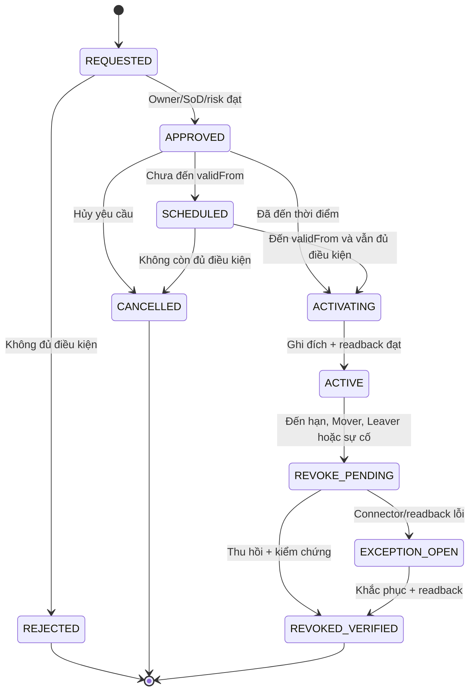
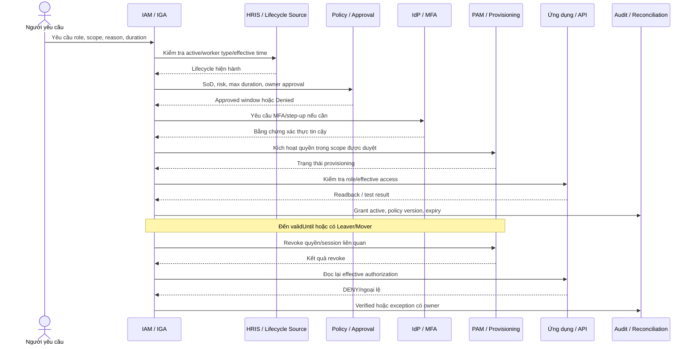

# Quyền theo thời gian trong nguyên tắc Least privilege và vòng đời IAM

## Mục tiêu học tập

Sau khi học xong, người học có thể:

1. Giải thích **quyền theo thời gian (time-bound/temporal access)** và vì sao nó là một phần quan trọng của **least privilege** trong quản lý vòng đời danh tính.
2. Phân biệt **quyền thường trực**, **quyền có thời hạn**, **Just-in-Time (JIT)**, **Just-Enough Access (JEA)**, **privileged elevation** và **break-glass**.
3. Thiết kế bản ghi cấp quyền có **thời điểm bắt đầu, thời điểm kết thúc, phạm vi, mục đích, chủ sở hữu, phê duyệt và trạng thái** đủ để kiểm toán.
4. Phân biệt **thời hạn hiệu lực của quyền** với **tuổi session IdP/SSO**, **thời hạn access token**, **refresh token**, **MFA freshness** và thời hạn account.
5. Xây dựng cơ chế **cấp – thực thi – tự hết hạn – thu hồi – xác minh** trong mô hình Joiner–Mover–Leaver (JML), kể cả khi Mover/Leaver đến trước hạn quyền.
6. Kết hợp RBAC, ABAC, IdP, PAM, directory groups, SCIM và ứng dụng đích để hạn chế quyền tồn dư.
7. Xử lý lệch múi giờ, đồng hồ, event trễ/trùng, race condition, sai lệch dữ liệu và các lỗi vận hành của job thu hồi.
8. Thiết kế kiểm toán, reconciliation và bài kiểm thử đủ chứng minh quyền **thực sự không còn dùng được** sau thời điểm cho phép.

## 1. Quyền theo thời gian là gì?

Trong **Identity and Access Management (IAM)**, một quyền không chỉ được xác định bởi **ai** có thể làm **việc gì** trên **tài nguyên nào**, mà còn bởi **khi nào quyền được phép bắt đầu, kéo dài bao lâu và điều kiện nào làm nó kết thúc sớm**.

**Quyền theo thời gian** là quyền truy cập có một **khoảng hiệu lực hoặc điều kiện thời gian được quản lý và thực thi**. Nó có thể là quyền tạm cấp cho một ca hỗ trợ, một phiên làm việc quản trị, một dự án, một hợp đồng hoặc một nhiệm vụ tự động.

Ví dụ: lúc 14:00, kỹ sư Lan được phê duyệt quyền `database.read_diagnostics` cho cụm production nhằm phân tích sự cố, có hiệu lực từ 14:15 đến 15:15. Ngoài khoảng này, Lan **không được phép sử dụng quyền đó**. Nếu HR xác nhận Lan đã Leaver lúc 14:30, quyền phải kết thúc sớm hơn 15:15.

Điểm cốt lõi của **least privilege** là không cấp nhiều quyền hơn cần thiết về **chức năng, tài nguyên, đối tượng và thời gian**. Một quyền đúng công việc nhưng tồn tại vĩnh viễn vẫn có thể vi phạm nguyên tắc tối thiểu.

### 1.1. Bốn chiều giới hạn quyền

| Chiều | Câu hỏi | Ví dụ |
|---|---|---|
| **Subject** | Ai được cấp? | Account quản trị riêng của Lan |
| **Action** | Được làm gì? | Chỉ đọc diagnostic, không sửa dữ liệu |
| **Resource/scope** | Trên tài nguyên nào? | Một database cụ thể trong tenant production |
| **Time** | Bắt đầu/kết thúc khi nào? | 14:15–15:15 theo mốc thời gian rõ |

Một thiết kế hoàn chỉnh thường bổ sung **mục đích sử dụng, approval, MFA, trạng thái thiết bị, ngữ cảnh rủi ro và khả năng kiểm toán**. Không nên dùng thời hạn làm lý do bỏ qua các chiều còn lại.

### 1.2. Ví dụ quyền đúng scope nhưng sai thời gian

Một nhân viên hỗ trợ đã hoàn thành đợt sửa lỗi tháng trước. Người đó vẫn nằm trong group `prod-admins` vì job thu hồi thất bại. Dù chưa có dấu hiệu lạm dụng, đây là **standing privilege** không còn nhu cầu và tạo rủi ro nếu account bị phishing hoặc credential bị đánh cắp.

Thay vì cấp quyền quản trị vĩnh viễn, hệ thống có thể chỉ cho phép yêu cầu nâng quyền trong một cửa sổ ngắn, được duyệt và được tự động kết thúc.

### 1.3. “Hết hạn” là yêu cầu bảo mật, không phải nhãn UI

Nếu giao diện hiển thị “quyền hết hạn lúc 15:15” nhưng backend vẫn cho phép truy cập sau mốc đó, hệ thống **chưa thực thi quyền theo thời gian**. Cần phân biệt:

- **Ý định:** policy xác định quyền chỉ hợp lệ đến 15:15.
- **Cập nhật cấu hình:** role/group/grant bị gỡ hoặc đánh dấu expired.
- **Enforcement:** API, PAM gateway hay ứng dụng thực sự từ chối sử dụng quyền.
- **Bằng chứng:** readback và audit xác nhận trạng thái/decision.

Một cơ chế chỉ có lịch thu hồi nhưng không kiểm tra quyền ở runtime có thể có **cửa sổ truy cập tồn dư** khi scheduler chậm, connector lỗi hoặc token cũ còn hiệu lực.

## 2. Phân biệt các mô hình cấp quyền theo thời gian

| Mô hình | Ý nghĩa | Ví dụ | Lưu ý |
|---|---|---|---|
| **Standing access** | Quyền thường trực khi account còn hợp lệ | Nhân viên đọc cổng thông tin | Vẫn phải review và thu hồi khi mất điều kiện |
| **Time-bound access** | Quyền có ngày/giờ bắt đầu, kết thúc | Quyền đọc báo cáo dự án trong hai tuần | Cần thực thi hạn và expiry đáng tin |
| **Just-in-Time (JIT)** | Chỉ cấp/kích hoạt quyền khi thực sự cần, thường trong khoảng ngắn | Nâng quyền admin trong 30 phút | Có thể kết hợp approval, MFA, session control |
| **Just-Enough Access (JEA)** | Giới hạn **chỉ đủ năng lực cần thiết** | Chỉ được restart một service | JEA nói về phạm vi quyền; không đồng nghĩa JIT |
| **Just-in-Time Privileged Access** | JIT áp dụng đặc biệt cho quyền cao | Quản trị máy chủ theo ticket | Cần PAM, audit và revoke nghiêm ngặt |
| **Break-glass** | Quyền khẩn cấp vượt luồng thông thường được kiểm soát | Truy cập khôi phục khi IdP gặp sự cố | Phải có giới hạn, monitoring, hậu kiểm |
| **Time-limited delegation** | Ủy quyền thay mặt có hạn | Trưởng nhóm giao quyền duyệt trong kỳ nghỉ | Không được vượt quyền người ủy quyền theo policy |
| **Ephemeral workload credential** | Credential ngắn hạn cho máy–máy | Token OIDC của CI job | Hạn token khác hạn entitlement của workload |

**JIT và JEA bổ sung cho nhau**: JIT trả lời *khi nào quyền được bật*, JEA trả lời *mức quyền vừa đủ là gì*. Một quyền admin toàn hệ thống bật 15 phút vẫn có blast radius lớn; một quyền chỉ đọc rất hẹp nhưng giữ vĩnh viễn vẫn có rủi ro tích lũy.

### 2.1. Zero Standing Privilege (ZSP)

**Zero Standing Privilege** là định hướng giảm tối đa quyền đặc biệt tồn tại thường trực. Người quản trị có thể có danh tính **eligible** cho một role nhưng chưa được **active** trong role đó. Khi cần thao tác, họ yêu cầu nâng quyền theo chính sách.

Không nên diễn giải ZSP thành “không ai có quyền truy cập bất cứ thứ gì”. Nhiều quyền cơ sở, năng lực vận hành và tài khoản dịch vụ vẫn cần tồn tại để tổ chức hoạt động. Mục tiêu là giảm **privilege standing không cần thiết**, nhất là quyền đặc biệt.

### 2.2. Eligible khác Active

Ví dụ:

```text
Identity: Lan
Role: ProductionIncidentResponder
Eligibility: Có thể yêu cầu nâng quyền khi trực ca
Activation: Chưa kích hoạt
Effective permission: Không có quyền sửa production

Khi ticket được duyệt:
Activation window: 14:15–15:15
Effective permission: Đọc log và restart service được chỉ định
```

Một UI hiển thị user “có thể nhận role” không có nghĩa role đó đang được cấp quyền tại API. Thiết kế phải quản trị tách biệt **eligibility, activation và effective permission**.

## 3. Mô hình dữ liệu cho một grant có thời hạn

Một **grant** là bản ghi cấp quyền hoặc sự kiện cấp quyền cụ thể tới subject. Với quyền theo thời gian, nên lưu đủ metadata để phân biệt **đã được phê duyệt**, **đã kích hoạt**, **đã hết hạn** và **đã thực sự thu hồi tại đích**.

### 3.1. Các trường quan trọng

| Trường | Ý nghĩa |
|---|---|
| `grantId` | ID duy nhất của lần cấp quyền |
| `identityId` và `accountId` | Chủ thể và account đích đã được correlation |
| `targetSystem`, `tenantId` | Hệ thống và phạm vi tổ chức |
| `roleId` hoặc `permissionId` | Năng lực được cấp |
| `resourceScope` | Server, database, project, branch, dataset cụ thể |
| `validFrom` | Thời điểm sớm nhất quyền bắt đầu hợp lệ |
| `validUntil` | Thời điểm quyền không còn hợp lệ |
| `requestedDuration` | Thời lượng người dùng yêu cầu |
| `maxPermittedDuration` | Trần do policy cho phép |
| `requestReason` / `ticketId` | Lý do nghiệp vụ và liên kết công việc |
| `approvedBy` | Chủ thể có thẩm quyền duyệt |
| `sourceEventId` / `policyVersion` | Nguồn quyết định và phiên bản chính sách |
| `grantOwner` | Chủ sở hữu chịu trách nhiệm |
| `activationState` | Requested/approved/active/expired/... |
| `revocationState` | Trạng thái thu hồi ở từng hệ thống |
| `createdAt` / `updatedAt` | Dấu thời gian kiểm toán |
| `readbackEvidence` | Bằng chứng trạng thái sau thực thi |

Đối với quyền nhạy cảm còn cần **MFA assurance, session ID hoặc session reference được bảo vệ, SoD evaluation, nguồn định danh thiết bị** và các yếu tố kiểm soát theo risk class.

### 3.2. Ví dụ JSON grant

```json
{
  "grantId": "GRANT-8842",
  "identityId": "IDN-2048",
  "accountId": "PAM-U-932",
  "targetSystem": "PROD_DATABASE",
  "tenantId": "corp-vn",
  "roleId": "DatabaseIncidentReader",
  "permissions": ["db.logs.read", "db.metrics.read"],
  "resourceScope": {
    "clusterId": "prod-db-cluster-03"
  },
  "validFrom": "2026-12-03T07:15:00Z",
  "validUntil": "2026-12-03T08:15:00Z",
  "ticketId": "INC-4821",
  "reason": "Investigate connection saturation",
  "approvedBy": "ONCALL-LEAD",
  "policyVersion": "temporal-access-v4",
  "lifecycleSourceVersion": 52,
  "activationState": "APPROVED",
  "revocationState": "NOT_YET_REQUIRED"
}
```

Đây là **schema minh họa nội bộ**, không phải schema chuẩn của SCIM, OAuth, PAM hay RBAC. Thời gian ghi theo UTC trong ví dụ; ở giao diện có thể chuyển theo múi giờ người dùng, nhưng policy cần định nghĩa mốc tính thống nhất.

### 3.3. Thời gian theo khoảng nửa mở

Một cách xác định rõ boundary là:

```text
Access is time-eligible when:
    validFrom <= trustedNow < validUntil

At trustedNow == validFrom:
    có thể bắt đầu sử dụng nếu các điều kiện khác đạt.

At trustedNow == validUntil:
    quyền không còn được phép.
```

Mô hình **[validFrom, validUntil)** tránh nhập nhằng ở điểm kết thúc. Không nên có lúc server dùng `<= validUntil`, server khác dùng `< validUntil`. Nguồn thời gian phải đáng tin, không lấy giờ do client tự gửi làm căn cứ cho phép.

### 3.4. Chính sách thời lượng tối đa

Người dùng có thể yêu cầu 8 giờ, nhưng policy chỉ cho role đó tối đa 1 giờ. Hệ thống cần quyết định rõ:

- Từ chối yêu cầu vượt trần hoặc tự giới hạn trong phạm vi được duyệt.
- Tính thời gian dựa trên **thời điểm phê duyệt** hay **thời điểm kích hoạt**.
- Có cho phép gia hạn không, ai duyệt lại, giới hạn số lần.
- Có cho phép đặt lịch trước không và điều kiện kiểm tra lại lúc bắt đầu.
- Nếu account bị suspended/Leaver giữa chừng thì **kết thúc sớm**.

Không nên để user tự sửa `validUntil` của grant sau approval thông qua API không kiểm tra thẩm quyền.

## 4. Cấu trúc vòng đời một quyền tạm

Một grant có thể trải qua các trạng thái:



Sơ đồ **minh họa workflow**; không phải chuẩn định nghĩa state của PAM/SCIM. Hệ thống thực có thể dùng trạng thái `EXPIRED` và `DEACTIVATED` riêng, nhưng không được coi “đến hạn” đồng nghĩa “đã revoke ở mọi đích”.

### 4.1. Ba thời điểm cần tách

| Thời điểm | Ý nghĩa |
|---|---|
| **Policy eligibility time** | Người dùng đủ điều kiện yêu cầu/kích hoạt role |
| **Grant effective time** | Quyền được phép sử dụng theo grant |
| **Actual enforcement time** | Ứng dụng/API/PAM thực sự cho phép hoặc từ chối |

Ví dụ grant bắt đầu 14:15 nhưng provisioning kết thúc 14:17 thì quyền **không tự coi là đã được cấp lúc 14:15**. Ngược lại, grant hết 15:15 nhưng job gỡ group chạy 15:20 thì có khả năng tồn tại một khoảng residual access nếu backend không kiểm tra thời hạn.

### 4.2. Trạng thái nội bộ không thay thế trạng thái ở đích

```text
Grant state in IAM:
    EXPIRED

Directory group:
    user still a member  -> chưa thu hồi membership

App session:
    old privileged claim -> có thể còn nguy cơ

PAM target:
    session terminated    -> bằng chứng giảm rủi ro

Effective API access:
    DENY after validUntil -> kiểm chứng enforcement
```

Một báo cáo chính xác phải phân biệt **grant expired**, **membership removed**, **session revoked** và **effective access denied**.

## 5. Luồng cấp quyền Just-in-Time



Luồng có thể khác tùy nền tảng: một số PAM cấp session proxy mà không gán group lâu dài; một số IGA sử dụng group động; một số cloud provider phát token JIT. **Không mặc định tất cả thành phần đều hỗ trợ những API trong sơ đồ.**

### 5.1. Điều kiện trước khi kích hoạt

Người yêu cầu cần đạt đồng thời:

1. Identity được correlation đúng với account và tenant.
2. Nguồn nhân sự/contractor xác nhận còn đủ điều kiện.
3. Role/permission phù hợp nhiệm vụ và resource scope.
4. Không có SoD conflict chưa được xử lý.
5. Approval có thẩm quyền và chưa hết hạn.
6. Thời lượng không vượt trần policy.
7. MFA/step-up đạt mức bảo đảm theo rủi ro.
8. Không có security hold, revoke event hoặc tài khoản disabled.
9. Không tồn tại grant chồng lấn tạo vượt quyền theo policy.
10. Hệ thống đích sẵn sàng áp dụng giới hạn thời gian và thu hồi.

Một **approval không phải authorization vĩnh viễn**: khi đến thời điểm activation, phải **đánh giá lại điều kiện** vì người dùng có thể đã Mover, Leaver hoặc bị khóa sau lúc phê duyệt.

### 5.2. Kích hoạt quyền theo đúng phạm vi

Thay vì cấp `GlobalAdmin` cho toàn bộ cloud, hãy xem nhiệm vụ thực cần hành động gì, trên resource nào. Ví dụ sửa sự cố máy chủ có thể chỉ yêu cầu `service.restart` và `logs.read` trên một service nhất định. **JIT + JEA** giảm cả thời gian lẫn mức độ thiệt hại nếu credential bị lộ.

### 5.3. Gia hạn và tái phê duyệt

Một nguy cơ phổ biến là “quyền 30 phút” nhưng nhân viên liên tục tự bấm **Extend** không cần kiểm tra mới, tạo standing access trên thực tế.

Gia hạn cần:

- Được policy cho phép rõ ràng.
- Kiểm tra lại lifecycle, risk, scope, SoD và thời lượng tích lũy.
- Có approval hoặc hạn mức tự gia hạn phù hợp.
- Sinh grant version/decision record mới hoặc bản cập nhật có audit.
- Không làm hồi sinh session/token đã revoke vì lý do compromise.
- Không vượt thời gian kết thúc hợp đồng hoặc lịch trực được duyệt.

### 5.4. Khẩn cấp không đồng nghĩa bỏ kiểm soát

Break-glass có thể cần khi IdP/PAM chính gặp sự cố. Kênh khẩn cấp phải được bảo vệ, lưu secret trong vault, có khả năng kiểm toán độc lập, giới hạn thời gian và review sau sử dụng. Không nên phát password break-glass cho bất kỳ người gọi help desk nào chỉ dựa vào lời khai “đang khẩn”.

## 6. Thời hạn quyền khác với timeout của SSO và token

Đây là điểm dễ nhầm nhất khi triển khai quyền theo thời gian.

| Đối tượng | Quy định điều gì | Khi hết hạn |
|---|---|---|
| **Grant `validUntil`** | Quyền nghiệp vụ được phép tới mốc nào | Hệ thống phải không còn cho dùng quyền |
| **IdP SSO session** | Phiên xác thực tại IdP | Lần login mới có thể cần xác thực lại |
| **App-local session** | Phiên trong ứng dụng | Ứng dụng có thể yêu cầu tạo phiên mới |
| **SAML assertion validity** | Khoảng chấp nhận assertion | Không tự kết thúc app session đã tạo |
| **OIDC ID token** | Dữ liệu sự kiện xác thực cho RP theo giao thức | Không tự xử lý role/permission ở API |
| **OAuth access token** | Khoảng token có thể được API chấp nhận | Không đảm bảo permission trong token còn đúng trước hạn |
| **Refresh token** | Khả năng xin access token mới theo policy | Không phải quyền nghiệp vụ tồn tại vô hạn |
| **MFA freshness** | Độ mới của một lần xác thực mạnh | Có thể buộc step-up dù grant còn hạn |
| **PAM session lease** | Phiên đặc quyền được PAM kiểm soát | Có thể kết thúc session mà không chấm dứt tất cả account |
| **Account lifetime** | Khi account còn được phép hoạt động | Không tự xóa token ứng dụng nếu không có cơ chế revoke |

### 6.1. Grant hết hạn nhưng JWT còn hợp lệ

Giả sử:

```text
14:00  Access token được phát, exp = 15:00.
14:05  Quyền db.read được kích hoạt, validUntil = 14:35.
14:35  Grant hết hạn.
14:40  API vẫn chấp nhận JWT ký hợp lệ và claim role=db.read.
```

Nếu API chỉ kiểm tra chữ ký và `exp`, nó có thể tiếp tục cho phép đến 15:00. **Đây là quyền tồn dư**, dù IAM đã đánh dấu grant hết hạn.

Biện pháp có thể gồm:

- API/PDP tra quyền hiện hành với `validUntil` trước mỗi hành động nhạy cảm.
- Token ngắn hạn hơn và bảo đảm issuer không cấp lại quyền đã hết.
- Introspection, denylist, token revocation hoặc event-driven invalidation khi hỗ trợ.
- PAM session proxy đóng đường truy cập tại hạn.
- Không đưa quyền đặc biệt lâu dài vào token có tuổi quá dài.

Một token ngắn hạn chỉ **thu hẹp cửa sổ**, không bảo đảm revoke tức thời.

### 6.2. Timeout không tạo quyền

IdP session có thể còn 8 giờ; quyền JIT chỉ sống 30 phút. Sau khi grant hết hạn, user có thể vẫn login vào cổng thông tin như một nhân viên bình thường, nhưng không được dùng role admin vừa hết hạn.

Ngược lại, grant JIT có thể còn thời hạn nhưng phiên IdP hết hạn hoặc MFA không đủ mới. Khi đó vẫn phải **xác thực lại đúng mức** trước khi thực thi.

### 6.3. Quyền “trong phiên” và quyền “đã lưu”

Một số hệ thống cấp session đặc quyền tạm mà không tạo membership lâu dài. Một số hệ thống lại thêm user vào group AD hoặc SCIM rồi dựa vào job để gỡ. Hai kiến trúc có mức rủi ro khác:

- **Session-bound elevation:** dễ gắn thời hạn vào chính proxy/session, nhưng phải chặn mọi đường truy cập ngoài proxy.
- **Group-based time-bound grant:** dễ tích hợp, nhưng có replication delay, role cache và JWT/SSO claims tồn dư.
- **Token-scoped capability:** có thể giới hạn TTL/action/resource, nhưng cần kiểm tra issuer và audience, và cơ chế thu hồi trước hạn khi cần.

Không nên khẳng định “PAM đã đóng session” là đủ nếu principal vẫn có thể dùng SSH key hoặc API token ngoài PAM.

## 7. Thời điểm, múi giờ và đồng hồ tin cậy

### 7.1. Lưu thời gian với mốc không nhập nhằng

Một grant có thể được người dùng yêu cầu ở giờ Việt Nam, nhưng hệ thống đồng bộ đa quốc gia. Nên ghi thời điểm bằng **timestamp có timezone offset hoặc chuẩn UTC**.

Ví dụ:

```text
Giờ Việt Nam: 2026-12-03 14:15:00 +07:00
Cùng thời điểm UTC: 2026-12-03T07:15:00Z

validFrom  = 2026-12-03T07:15:00Z
validUntil = 2026-12-03T08:15:00Z
```

Không ghi `2026-12-03 14:15` mà không có timezone nếu dữ liệu sẽ được diễn giải qua nhiều region. Một số quốc gia dùng daylight saving time; việc cộng giờ theo ngày lịch có thể khác cộng **duration** theo timestamp thực.

### 7.2. Khác biệt giữa time instant và business calendar

Một số quyền tồn tại theo **cửa sổ giờ cố định**, một số theo **ngày làm việc hoặc ca trực**. Cần phân biệt:

- “Cho phép trong 60 phút kể từ lúc kích hoạt”.
- “Cho phép đến 17:00 ngày thứ Sáu theo giờ cơ sở”.
- “Chỉ được truy cập trong ca đã phân công”.
- “Có thể yêu cầu JIT khi đang on-call”.
- “Quyền dự án hết khi deliverable được nghiệm thu”, dù chưa tới ngày dự kiến.

Nếu lịch trực thay đổi hoặc hợp đồng kết thúc sớm, **effective access phải phản ánh điều kiện mới**, không chỉ so timestamp.

### 7.3. Clock skew và time source

Nhiều server có thể lệch đồng hồ. Đối với một grant hết hạn vào `T`, cần đồng bộ time source bằng cơ chế thích hợp, log thời gian hệ thống và định nghĩa cách xử lý skew nhỏ trong giao thức.

Không nên nới rộng cửa sổ cho phép chỉ vì server lệch nhiều phút. Khi đồng hồ không đủ đáng tin cho quyền rủi ro cao, cần **fail closed hoặc tạm dừng cấp/duy trì quyền** theo policy vận hành.

### 7.4. Không dùng giờ do client tự gửi

Request có thể chứa:

```json
{
  "action": "db.admin",
  "clientSaysTime": "2026-12-03T07:20:00Z"
}
```

Giá trị `clientSaysTime` là dữ liệu do người dùng kiểm soát, không thể quyết định quyền còn hạn. PEP/PDP phải dùng **server trusted time**, cùng điều kiện grant và account hiện hành.

## 8. RBAC và ABAC thực thi quyền có thời hạn

### 8.1. RBAC: grant role có `validFrom/validUntil`

Trong RBAC, user/account được gán role; role chứa permission. Có thể mở rộng bản ghi assignment thêm thời hạn:

```text
Account Lan -> Role DatabaseIncidentReader
Grant validFrom  = 14:15
Grant validUntil = 15:15

Role DatabaseIncidentReader:
    db.logs.read
    db.metrics.read
```

Một số ứng dụng chỉ có bảng `user_roles` mà không có cột thời hạn. Trong trường hợp đó, phải dùng **provisioning + revoke scheduler** hoặc mô hình policy khác để thực thi thời gian; không thể chỉ hiển thị thời hạn trong IAM catalog mà coi app đã hiểu.

### 8.2. ABAC: thời gian là thuộc tính của quyết định

ABAC có thể xét:

- `subject.lifecycleState`.
- `subject.accountState`.
- `subject.activeGrants`.
- `resource.scope`.
- `action`.
- `environment.trustedNow`.
- `environment.authenticationAssurance`.

Pseudocode:

```text
Permit(subject, action, resource, context) WHEN
    subject.lifecycleState == ACTIVE
    AND subject.accountState == ENABLED
    AND hasApprovedGrant(subject, action, resource)
    AND grant.validFrom <= context.trustedNow
    AND context.trustedNow < grant.validUntil
    AND grant.status == ACTIVE
    AND grant.scope.matches(resource)
    AND context.authnAssuranceMeetsPolicy
    AND NOT context.securityHold
```

Đây là logic minh họa, không phải cú pháp XACML/Cedar/Rego hay một policy engine cụ thể. **Thiếu thuộc tính grant hoặc timestamp không được tự biến thành Permit**.

### 8.3. Kết hợp thời gian với scope và SoD

| Điều kiện | Rủi ro nếu bỏ qua |
|---|---|
| Grant vẫn trong hạn | Cho dùng quyền sau khi hết hạn |
| Account chưa Leaver/suspended | Người không còn tư cách tiếp tục truy cập |
| Role/permission được duyệt | Quyền ngoài trách nhiệm |
| Resource đúng tenant, project, branch | Vượt phạm vi tài nguyên |
| Không có SoD conflict | Tự tạo và tự duyệt giao dịch |
| MFA/step-up đủ mới | Lạm dụng session cũ hoặc phishing |
| Không vượt trần privilege | Một grant nhỏ cộng với grant khác thành quyền quá rộng |
| Không có risk hold | Vẫn thao tác dù đang có incident |

**Một grant có thời hạn không tự hợp pháp hóa quyền xung đột SoD hoặc quyền vượt tenant**. Các điều kiện phải được kiểm tra kết hợp.

### 8.4. Effective access và grant provenance

Một account có thể nhận cùng permission từ nhiều nguồn:

```text
Permission: report.read

Grant A: Birthright, không có hạn cố định nhưng phụ thuộc ACTIVE.
Grant B: Dự án A, đến 31/12.
Grant C: On-call JIT, 14:00–15:00.
```

Nếu Grant C hết hạn, **permission có thể vẫn hợp lệ qua Grant A hoặc B** nếu cùng resource/action và policy cho phép. Cần lưu provenance và tính effective access từ **mọi grant đang hợp lệ**, thay vì xóa mù permission vốn còn được nguồn khác sở hữu.

Ngược lại, đối với quyền `prod.admin` chỉ đến từ Grant C, hết hạn phải chặn ngay, không được giữ do role snapshot ở app.

## 9. Tích hợp IdP, SSO, directory, SCIM và PAM

### 9.1. IdP và SSO xác thực, không tự biết hạn grant nghiệp vụ

Một IdP có thể dùng SAML/OIDC để đăng nhập ứng dụng và truyền claim role/group. Tuy nhiên, nhiều ứng dụng cấp role lúc login rồi giữ app-local session. IAM phải biết **đích có đọc grant expiry khi runtime không**.

Nếu app không hỗ trợ expiration trực tiếp, có thể cần:

- Provision group/role khi kích hoạt.
- Gỡ group/role khi hết hạn.
- Thu hồi/refresh app session nếu rủi ro yêu cầu.
- Reconcile target membership và effective permission.

### 9.2. Directory group có thể dùng để phân phối role tạm

Ví dụ:

```text
IAM JIT approved:
    Identity Lan eligible for 60-minute database diagnostics

Directory:
    Add Lan to grp-db-diagnostics-jit

PAM / Database gateway:
    Maps group to restricted read-only role

At expiration:
    Remove Lan from group
    Terminate managed session when required
    Verify no effective diagnostics access remains
```

Nếu directory có replication delay hoặc token Kerberos/SSO đã nhận group trước đó, việc gỡ group **không nhất thiết làm quyền mất ngay**. Các quyền đặc biệt cần biện pháp giảm rủi ro phù hợp với phiên và caching.

### 9.3. SCIM có thể cấp/gỡ membership nhưng không chuẩn hóa mọi hạn grant

**SCIM 2.0** hỗ trợ quản lý `User` và `Group`, có thể dùng để thêm hoặc gỡ membership khi service provider hỗ trợ. Nó **không định nghĩa một cách chung để mọi ứng dụng hiểu và thực thi `grant.validUntil` ở mức business role**.

Ví dụ gỡ thành viên qua SCIM PATCH khi nhóm được quản lý bởi connector:

```http
PATCH /scim/v2/Groups/scim-group-401 HTTP/1.1
Authorization: Bearer <redacted>
Content-Type: application/scim+json

{
  "schemas": [
    "urn:ietf:params:scim:api:messages:2.0:PatchOp"
  ],
  "Operations": [
    {
      "op": "remove",
      "path": "members[value eq \"scim-user-2401\"]"
    }
  ]
}
```

Yêu cầu trên minh họa cú pháp SCIM PATCH filter path; khả năng xử lý và semantics của từng đích cần kiểm thử. Sau lệnh phải đọc lại `Group.members`/effective role. Không gửi token thật trong tài liệu hay log.

Nếu SCIM provider không hỗ trợ nested group hoặc role expiry, không được giả định app tự xử lý. Cần connector hoặc API ứng dụng riêng, kèm reconciliation.

### 9.4. SCIM User.active=false là account-level

Vô hiệu toàn account qua `User.active=false` có thể phù hợp với Leaver, nhưng **không nên dùng để kết thúc một grant JIT đơn lẻ** nếu người dùng vẫn cần vào các chức năng khác của ứng dụng.

Ví dụ Lan chỉ hết quyền quản trị database, nhưng vẫn có quyền đọc tài liệu nội bộ. Việc deactivate toàn bộ User có thể làm gián đoạn không cần thiết. Phải chọn đúng mức **role/group/permission revoke** và giữ account hợp lệ nếu lifecycle còn ACTIVE.

### 9.5. PAM hỗ trợ gì?

PAM có thể điều phối:

- Yêu cầu và phê duyệt session đặc quyền.
- Credential checkout/rotation theo chính sách.
- Cấp elevation có thời hạn.
- Định tuyến phiên qua gateway/proxy.
- Ghi audit và cảnh báo hoạt động quản trị.
- Chấm dứt session hoặc thu hồi privilege.

Nhưng **khả năng chính xác phụ thuộc sản phẩm và loại tài nguyên**. Không giả định PAM có thể hủy mọi SSH session, cloud token, database connection hay credential đã được sao chép ngoài hệ thống.

## 10. Quyền theo thời gian trong Joiner–Mover–Leaver

### 10.1. Joiner: có thể pre-provision nhưng chưa active

Người mới thường có ngày bắt đầu trong tương lai. IAM có thể chuẩn bị account, dữ liệu hồ sơ hoặc group mapping trước, nhưng **không nên kích hoạt quyền vượt ngày có hiệu lực và điều kiện proofing/approval**.

```text
Joiner record:
    employmentStart = 2026-12-10T09:00:00+07:00

Account:
    pre-provisioned

Desired access:
    Không cho đăng nhập trước khi đạt điều kiện Joiner
    Chỉ kích hoạt quyền cơ sở sau employmentStart
```

Cần kiểm tra việc thay đổi ngày bắt đầu, hợp đồng bị hủy hoặc identity proofing thất bại. **Một scheduled activation tạo từ dữ liệu cũ không được kích hoạt quyền trái trạng thái nguồn mới nhất**.

### 10.2. Mover: có thể chấm dứt quyền trước `validUntil`

Khi Lan chuyển khỏi đội production lúc 14:30, một grant admin JIT có `validUntil=15:15` có thể không còn phù hợp. Chính sách phải kiểm tra **continued eligibility**.

Một cách tính:

```text
EffectiveAccessAllowed =
    grant đang trong khoảng hiệu lực
    AND identity/account còn ACTIVE
    AND người dùng còn đủ điều kiện role/job
    AND approval còn hợp lệ
    AND không có revoke/security hold
```

Mốc `validUntil` là **trần thời gian**, không phải lời hứa quyền chắc chắn sống đến tận phút cuối.

### 10.3. Leaver: luôn ưu tiên chặn quyền

Leaver thường tác động tới toàn bộ access của identity. Khi mốc Leaver có hiệu lực:

1. Vô hiệu login/account ở IdP và ứng dụng cần thiết.
2. Chặn mọi grant thường trực/JIT đang active, bao gồm những grant chưa đến hạn.
3. Revoke PAM session, token, API key và credential mà người nghỉ có thể dùng.
4. Thu hồi group/role/entitlement theo policy.
5. Ngăn scheduled activation và pending approval sau Leaver.
6. Đối soát target state và mọi đường login độc lập.
7. Ghi exception khi không thể xác minh revoke đúng SLA.

**Chỉ đợi `validUntil` để hết quyền là sai nếu Leaver yêu cầu chặn sớm hơn.** Tương tự, account đã disabled nhưng token ứng dụng vẫn dùng được có thể tạo residual access.

### 10.4. Rehire: không hồi sinh grant cũ

Nếu người đã nghỉ trở lại, IAM phải xác minh identity correlation, proofing, contract mới, role/job mới và chính sách hiện hành. Không được tự bật lại những grant JIT đã hết, đã revoke hoặc từ kỳ làm việc trước.

Một nguồn dữ liệu lưu `validUntil` ở tương lai **không chứng minh grant cũ còn hợp lệ** sau một Leaver và rehire mới. Cần ràng buộc grant với **employment/engagement epoch hoặc lifecycle version** phù hợp.

### 10.5. Nhà thầu và sponsor

Với contractor, giới hạn thời gian có thể gồm:

- Ngày hết hợp đồng từ nguồn có thẩm quyền.
- Mốc hết assignment/dự án.
- Cửa sổ yêu cầu quyền JIT.
- Sponsor approval còn hiệu lực.
- Expiry của guest account.

**Thời điểm sớm nhất làm mất điều kiện** phải được xem xét. Nếu hợp đồng kết thúc trước khi grant JIT hết, hệ thống không tiếp tục cho quyền chỉ vì user vẫn có credential.

## 11. Thời hạn hiệu lực khi có nhiều điều kiện

Một cách tư duy là **quyền chỉ tồn tại trong giao của các cửa sổ hợp lệ**:

```text
Grant window:             [14:00, 16:00)
Employment eligibility:   [08:00, 15:00)
Project assignment:       [09:00, 14:45)
MFA freshness condition:  cần xác thực đủ mới tại thời điểm action

Effective access window <= [14:00, 14:45)
và còn tùy MFA/risk/account status tại mỗi request.
```

Công thức minh họa cho các điều kiện kết thúc có thể định lượng:

```text
T_effective_end = min(
    T_grant_end, T_employment_end, T_assignment_end, T_revocation
)
```

Mốc `T_revocation` không nhất thiết luôn có sẵn; có thể là sự kiện chặn trước hạn. Những điều kiện động như MFA, SoD, risk hold hoặc status resource phải được đánh giá theo cách phù hợp, không thể đơn giản hóa toàn bộ thành một phép `min`.

### 11.1. Không tự động làm tròn thời gian theo ngày

Một grant `validUntil=2026-12-03T15:15:00+07:00` không nên bị xử lý thành “hết ngày 03/12” nếu quy định là **đúng phút**. Làm tròn tăng thời hạn ngoài policy.

Đặc biệt với JIT/PAM, nên dùng instant/timezone và quy định boundary chính xác; các rule theo ngày kinh doanh phải được nêu rõ theo lịch/múi giờ tương ứng.

## 12. Scheduler, queue và cơ chế tự thu hồi

Một kiến trúc tạm quyền thường có scheduler hoặc event-driven worker để kích hoạt và thu hồi.

### 12.1. Không chỉ phụ thuộc một job chạy đúng phút

Một job có thể bị trễ do:

- Queue backlog.
- Network/connector lỗi.
- IdP/PAM hoặc ứng dụng đích không phản hồi.
- Nền tảng bị maintenance.
- Job chạy lại sau restart.
- Bản ghi grant bị đổi thời hạn.
- Worker bị mất event.
- Giới hạn API hoặc 429.

Nếu app không tự kiểm tra `validUntil` tại runtime, trễ job là trễ bảo mật. Vì vậy với quyền nhạy cảm nên có **điểm enforcement trực tiếp theo thời gian hoặc session lease**, kết hợp scheduler để dọn cấu hình.

### 12.2. Pseudocode scheduler an toàn

```text
function processDueGrant(grantId, now):
    grant = loadCurrentGrant(grantId)
    lifecycle = loadLatestAuthoritativeLifecycle(grant.identityId)

    if grant is absent or terminal:
        return NO_OP

    if lifecycle.status not in ALLOWED_LIFECYCLE_STATES:
        ensureRevocation(grant)
        return

    if grant.status == APPROVED and now >= grant.validFrom:
        if now >= grant.validUntil:
            cancelWithoutActivation(grant)
            return

        if not revalidateApprovalScopeAndRisk(grant, lifecycle):
            cancelWithoutActivation(grant)
            return

        activateWithVersionGuard(grant)
        verifyTargetState(grant)

    if grant.status == ACTIVE and now >= grant.validUntil:
        revokeWithRetryAndReadback(grant)
```

Đây là pseudocode. Trong triển khai thật cần đồng hồ tin cậy, khóa concurrency, dữ liệu event version, phân quyền connector, idempotency và biện pháp xử lý khi kết quả request **không chắc chắn**.

### 12.3. Retry và idempotency

Một request gỡ role có thể timeout sau khi ứng dụng đã xử lý. Không thể kết luận chưa revoke hoặc đã revoke chỉ từ kết quả kết nối.

Quy trình tốt:

1. Dùng grant ID và target account/role ID ổn định.
2. Đọc lại actual state sau timeout.
3. Nếu đã revoke, ghi evidence.
4. Nếu chưa revoke, retry theo backoff và giới hạn.
5. Nếu API không đọc được, mở exception/incident theo độ nhạy.
6. Không cấp lại quyền do logic retry của một activation cũ.
7. Giữ nguồn lifecycle mới nhất là điều kiện cuối trước mọi write.

**Không dùng request ID cũ để hợp thức hóa quyền sau khi người dùng đã Leaver**.

### 12.4. Race condition giữa activate và revoke

```text
14:59:59.900  Worker A chuẩn bị activate Grant G.
15:00:00.000  Grant G đến validUntil.
15:00:00.100  Worker B gửi revoke.
15:00:00.200  Worker A hoàn tất add group với dữ liệu cũ.
```

Kết quả có thể là quyền **bị thêm lại sau khi đã thu hồi**. Cần:

- Version guard hoặc compare-and-set.
- Khóa logic theo `grantId + target` khi phù hợp.
- Re-evaluate `now < validUntil` ngay trước commit.
- Đặt revoke/terminated state ưu tiên hơn activation cũ.
- Dùng reconciliation để sửa sai lệch nếu API đích không giao dịch nguyên tử.
- Không coi việc chạy một job revoke là bảo đảm đã chặn mọi write tiếp theo.

## 13. Reconciliation quyền theo thời gian

**Desired state** là tập quyền người dùng **được phép có tại thời điểm đánh giá**, tính từ nguồn có thẩm quyền và các grant được phê duyệt. **Actual state** là trạng thái role/group/permission/session có thể quan sát ở hệ thống đích.

### 13.1. Quy tắc desired state

```text
desiredGrantActive(grant, identity, now) =
    identity.lifecycleState == ACTIVE
    AND grant.status not in [REVOKED, CANCELLED, EXPIRED]
    AND grant.isApproved
    AND grant.validFrom <= now
    AND now < grant.validUntil
    AND grant.roleIsStillEligible
    AND grant.scopeAndRiskStillValid
```

Pseudocode chỉ là mô hình khái niệm. Thực tế cần xét account/tenant, SoD, security hold, nguồn role, policy version và các điều kiện động.

### 13.2. Ma trận sai lệch

| Desired | Actual | Ý nghĩa | Xử lý |
|---|---|---|---|
| Grant đang active | App chưa có role | **Missing access** | Kiểm tra provisioning/approval; cấp khi vẫn hợp lệ |
| Grant đã hết hạn | App còn role | **Expired grant still active** | Revoke ưu tiên, xác minh quyền runtime |
| Identity Leaver | PAM session còn mở | **Residual privileged session** | Terminate/revoke, incident khi vượt SLA |
| Grant chưa bắt đầu | App đã có role | **Early activation** | Gỡ quyền, điều tra scheduler/policy |
| Grant được hủy | Connector retry add group | **Stale activation replay** | Chặn event cũ, readback |
| Role đã gỡ | Token cũ còn claim | **Stale authorization** | Token/session handling và PDP reevaluation |
| Grant đã hết hạn | API không đọc được | **Unknown** | Connector exception, không báo verified |
| Grant có nguồn khác hợp lệ | Quyền vẫn còn | **Không nhất thiết sai** | Xác minh grant provenance và scope |
| Grant vượt max duration | Chưa active | **Policy violation pending** | Từ chối/khoanh thời gian theo policy |
| Account Mover mất eligibility | Role vẫn active | **Eligibility drift** | Revoke, xem xét quyền liên quan |

### 13.3. Readback phải kiểm tra đúng lớp

Ví dụ revoke qua directory:

```text
1. IAM ghi GRANT_EXPIRED.
2. LDAP/AD group gỡ member.
3. Cloud IdP đồng bộ membership.
4. SaaS app cập nhật role.
5. PAM session bị terminate nếu liên quan.
6. API từ chối action sau validUntil.
7. Audit/exception được ghi với từng kết quả.
```

**Một phản hồi 2xx ở bước 2 không chứng minh bước 6.** Với ứng dụng không có API xem session hoặc test authorization, cần ghi rõ giới hạn quan sát và biện pháp giảm rủi ro.

### 13.4. Quyền có nhiều nguồn

Nếu cùng role được cấp bởi hai grant khác nhau, hết hạn một grant không nhất thiết làm role mất hiệu lực. Hệ thống nên duy trì mapping **grant provenance → effective assignment** và chỉ gỡ actual role khi không còn bất kỳ nguồn hợp lệ nào cho **cùng scope và action**.

Ngược lại, role còn active do một direct grant không được IAM quản lý phải được phát hiện như **excess/unknown entitlement** và đưa vào review.

## 14. Tài khoản đặc quyền, dịch vụ và workload identity

### 14.1. Privileged access

Đối với admin cloud, database, Kubernetes, domain controller hoặc hệ thống thanh toán, thời hạn chỉ là một lớp phòng vệ. Cần kết hợp:

- **MFA/phishing-resistant authentication** khi khả thi.
- **PAM/JIT** thay quyền admin thường trực.
- **JEA** giới hạn thao tác/tài nguyên.
- **Session recording** hoặc audit phù hợp và bảo vệ dữ liệu.
- **SoD/dual approval** cho thay đổi nhạy cảm.
- **Không chia sẻ account admin** nếu có thể quản lý cá nhân.
- **Revoke trên sự kiện rủi ro** ngay cả trước expiry.
- **Review privilege elevation** theo owner và lý do.

JIT toàn quyền `root` trong một giờ không đồng nghĩa ít rủi ro nếu có thể xóa dữ liệu trong một giây. Cần giảm **cả quyền và thời gian**.

### 14.2. Machine-to-machine access

Workload có thể dùng token ngắn hạn, chứng chỉ, managed identity hoặc federation. Trong môi trường này có hai loại thời hạn:

1. **Credential lifetime:** token/chứng chỉ hết hạn khi nào.
2. **Workload authorization/entitlement lifetime:** workload được phép hành động tới khi nào.

Ví dụ job migration chỉ cần quyền `schema.migrate` trong đợt triển khai. Token của job có TTL 10 phút nhưng workflow có thể liên tục xin token mới nếu role vẫn tồn tại. Muốn chặn sau deploy, phải **thu hồi entitlement hoặc chặn policy** chứ không chỉ dựa vào từng token hết hạn.

### 14.3. Không áp JML người dùng trực tiếp cho workload

Một microservice không có `employmentStatus`. Nó cần owner team, mục đích, môi trường, thời điểm deployment và lifecycle riêng.

Khi nhân viên từng sở hữu secret nghỉ việc:

- Thu hồi quyền cá nhân của người nghỉ.
- Chuyển ownership/service sponsorship.
- Rotate secret hoặc credential từng có nguy cơ bị biết.
- Đánh giá role và giới hạn quyền của service.
- Không vô hiệu workload còn thiết yếu chỉ vì creator Leaver nếu owner/team còn trách nhiệm.

### 14.4. Guest và tài khoản đối tác

Guest/partner identity có thể được mời theo một khoảng thời gian, nhưng quyền ở ứng dụng có thể được giữ lâu hơn thời hạn mời. Cần xét hợp đồng, sponsor, thời hạn tenant access và app-local group.

Nếu đối tác xác thực qua IdP riêng, SSO thành công **không chứng minh** họ vẫn được phép vào tài nguyên của tổ chức sau khi sponsor đã rút quyền.

## 15. Quản trị thay đổi, phê duyệt và SoD

### 15.1. Ma trận risk-based approval

Ví dụ **mang tính minh họa**, không phải quy định chung:

| Quyền | Thời lượng tối đa minh họa | Approval | Kiểm soát bổ sung |
|---|---|---|---|
| Đọc dashboard nội bộ | Theo quan hệ nhân sự | Birthright nếu đủ điều kiện | Access review định kỳ |
| Đọc dữ liệu dự án tạm | Đến mốc dự án | Project owner | Scope theo dự án, auto expiry |
| Xuất dữ liệu khách hàng | 30 phút | Data owner | MFA/giám sát export |
| Restart một service | 60 phút | On-call lead | JIT + JEA + session audit |
| Quản trị cloud production | 15–60 phút | Approver độc lập theo risk | PAM, MFA mạnh, phạm vi hẹp |
| Break-glass | Thời lượng ngắn theo policy | Quy trình khẩn riêng | Vault, alert, dual control/hậu kiểm |
| CI/CD deploy job | Trong pipeline run | Pipeline/workload policy | Federation, action/resource scope |

Các con số trên chỉ để cho thấy phương pháp **phân loại rủi ro**. Tổ chức phải xác định mốc cụ thể theo hệ thống, tiêu chuẩn, nghiệp vụ và năng lực revoke.

### 15.2. Phê duyệt không thay thế enforcement

Người quản lý có thể duyệt một quyền đến 15:00; nếu app không biết thời gian đó, role vẫn có thể tồn tại vĩnh viễn. Quy trình governance phải kết nối approval tới **cơ chế quyền hiệu lực ở đích**, không chỉ email hoặc ticket.

### 15.3. SoD trong quyền có thời hạn

Một hệ thống có thể cấm người tạo payment tự duyệt payment. Nếu cấp hai quyền xung đột trong các cửa sổ khác nhau nhưng cùng một giao dịch, vẫn có thể vi phạm SoD nếu không kiểm tra **người tạo resource và người duyệt**.

- **Static SoD:** ngăn gán các role xung đột cùng lúc.
- **Dynamic/transactional SoD:** ngăn sử dụng quyền xung đột trên cùng giao dịch.
- **Time-bound separation:** có thể giảm thời gian các vai trò đồng thời, nhưng không tự thay thế kiểm tra theo resource.

Một approval JIT không được vượt các luật SoD bắt buộc nếu không có ngoại lệ với thẩm quyền và bảo vệ tương ứng.

## 16. Chính sách quyền theo thời gian minh họa

Ví dụ YAML dưới đây là **mô hình policy nội bộ để học**, không phải cấu hình có thể chạy ngay trong một PAM, IdP, SCIM, Cedar, XACML hoặc Spring Security cụ thể.

```yaml
policyId: temporal-least-privilege-v4
scope:
  identityTypes: [HUMAN, WORKLOAD]
  highRiskRoles:
    - ProductionIncidentResponder
    - DatabaseIncidentReader

grant:
  requireStableIdentityAndTargetCorrelation: true
  requireApprovedScopeAndPurpose: true
  useHalfOpenTimeWindow: true
  rejectMissingOrInvalidTimestamps: true
  maxDurationByRisk:
    LOW: policy-defined
    HIGH: short-and-approved
  allowExtensionOnlyWithReevaluation: true

humanEligibility:
  requireCurrentLifecycleState: ACTIVE
  requireAccountEnabled: true
  rejectAfterEffectiveLeaver: true
  requireApprovedMfaForPrivilegedElevation: true

authorization:
  enforceTrustedServerTime: true
  validateGrantWindowAtUse: true
  validateResourceAndTenantScope: true
  enforceSeparationOfDuties: true
  doNotPermitOnMissingCriticalAttributes: true

revocation:
  triggerOnExpiration: true
  triggerOnMoverLossOfEligibility: true
  triggerOnLeaver: true
  triggerOnConfirmedCompromise: true
  reconcileTargetRoleAndSession: true
  requireReadbackEvidence: true

governance:
  policyOwner: IDENTITY-SECURITY
  privilegedGrantAudit: true
  exceptionMustHaveOwnerAndExpiry: true
```

**Không sao chép nguyên YAML vào production**. Đặc biệt, `maxDurationByRisk` chỉ nêu nguyên tắc; cần dịch thành ngưỡng và semantics rõ theo sản phẩm/ứng dụng.

### 16.1. Mô hình quyết định trước khi dùng quyền

```text
function canUseTimeBoundPermission(subject, resource, action, now):
    identity = resolveTrustedIdentity(subject)
    account = resolveTargetAccount(subject, resource.tenantId)
    grant = resolveCurrentApprovedGrant(identity, account, action, resource)

    if identity.lifecycleState != ACTIVE:
        return DENY("IDENTITY_NOT_ACTIVE")

    if account.status != ENABLED:
        return DENY("ACCOUNT_DISABLED")

    if grant is missing or grant.status != ACTIVE:
        return DENY("NO_ACTIVE_GRANT")

    if now < grant.validFrom or now >= grant.validUntil:
        return DENY("OUTSIDE_GRANT_WINDOW")

    if not grant.scope.includes(resource):
        return DENY("RESOURCE_OUTSIDE_SCOPE")

    if not grant.roleEligible or not grant.approvalStillValid:
        return DENY("NO_LONGER_ELIGIBLE")

    if violatesSodOrRiskPolicy(identity, action, resource):
        return DENY("SOD_OR_RISK")

    if not authenticationMeetsPolicy(subject, action):
        return DENY("REAUTHENTICATION_REQUIRED")

    return PERMIT_WITH_REQUIRED_AUDIT
```

Đây là pseudocode để thảo luận các guard. Trong triển khai thật, phải xác định cách đọc grant/identity đồng nhất, quản lý latency, khóa transaction, policy combining và cách xử lý Indeterminate.

### 16.2. Bảo vệ API phía backend

Ví dụ Java-oriented pseudocode:

```java
// Minh họa kiến trúc; không phải lớp Spring có thể biên dịch nguyên trạng.
@Transactional
public DiagnosticResult readProductionDiagnostics(
        AuthenticatedPrincipal actor, String clusterId) {

    Cluster cluster = clusterRepository.findAuthorizedCandidate(clusterId);

    TemporalDecision decision = authorizationService.evaluate(
        actor,
        "db.logs.read",
        cluster,
        clock.instant()
    );

    if (!decision.isPermit()) {
        throw new AccessDeniedException("Time-bound access denied");
    }

    auditService.recordDecision(actor.identityId(), clusterId, decision);
    return diagnosticService.readWithinApprovedScope(cluster);
}
```

Cần bảo đảm controller, service, RPC và background job không có đường vòng bỏ qua enforcement. Nếu audit là obligation bắt buộc phải thực hiện trước thao tác, cần xử lý fail/transaction tương ứng; không chỉ ghi log tùy ý sau khi đã trả dữ liệu nhạy cảm.

## 17. Audit và bằng chứng thu hồi quyền

### 17.1. Audit cần trả lời điều gì?

Một hồ sơ cấp quyền có thời hạn phải truy vết:

1. Ai yêu cầu, khi nào, từ identity/account nào?
2. Nguồn HR/contractor và lifecycle version lúc phê duyệt/kích hoạt?
3. Role/permission, target, tenant và resource scope là gì?
4. Vì sao cần quyền, ticket/case nào, ai chịu trách nhiệm?
5. `validFrom`, `validUntil` và giới hạn duration được tính thế nào?
6. Ai duyệt, có SoD check, MFA/step-up không?
7. Khi nào connector thực sự cấp quyền và readback?
8. Quyền hết hạn tự nhiên hay bị chấm dứt sớm do Mover/Leaver/risk?
9. Ai/cơ chế nào gửi revoke, hệ thống đích phản hồi gì?
10. Token/session và effective permission có được xác minh chặn không?
11. Ngoại lệ nào còn mở, owner và hạn xử lý?
12. Có grant nào được kích hoạt lại trái policy sau khi hết hạn không?

### 17.2. Ví dụ audit event

```json
{
  "eventType": "TEMPORAL_ACCESS_REVOKED",
  "grantId": "GRANT-8842",
  "identityId": "IDN-2048",
  "accountId": "PAM-U-932",
  "targetSystem": "PROD_DATABASE",
  "roleId": "DatabaseIncidentReader",
  "validFrom": "2026-12-03T07:15:00Z",
  "validUntil": "2026-12-03T08:15:00Z",
  "revokeReason": "GRANT_EXPIRED",
  "policyVersion": "temporal-access-v4",
  "sourceLifecycleVersion": 52,
  "requestState": "REVOKE_APPLIED",
  "targetRoleReadback": "VERIFIED",
  "managedSessionState": "TERMINATED",
  "effectiveAccessCheck": "DENIED",
  "correlationId": "IAM-TEMP-9021"
}
```

Đây là **schema và giá trị minh họa**. Không ghi password, access/refresh token, session cookie, private key, recovery code hoặc secret PAM vào log. Với session reference và thuộc tính nhân sự nhạy cảm, cần giới hạn quyền và retention.

### 17.3. Phân biệt trạng thái đủ bằng chứng

| Trạng thái | Điều đã xác minh |
|---|---|
| `APPROVED` | Phê duyệt đúng policy |
| `ACTIVATION_REQUESTED` | Đã gửi lệnh kích hoạt |
| `ACTIVE_VERIFIED` | Đích đã có quyền hiệu lực trong scope |
| `EXPIRED_BY_POLICY` | Đồng hồ đã vượt hạn |
| `REVOKE_REQUESTED` | Đã gửi lệnh thu hồi |
| `TARGET_ROLE_REMOVED` | App/directory không còn gán role từ grant |
| `SESSION_REVOKED` | Các phiên thuộc phạm vi đã được xử lý |
| `EFFECTIVE_ACCESS_DENIED` | Thao tác không còn được Permit trong scope kiểm tra |
| `EXCEPTION_OPEN` | Chưa chứng minh được, có owner/SLA |
| `CLOSED_WITH_EVIDENCE` | Đáp ứng tất cả tiêu chí deprovision liên quan |

Một record `EXPIRED_BY_POLICY` tự nó **không chứng minh** trạng thái `TARGET_ROLE_REMOVED` hoặc `EFFECTIVE_ACCESS_DENIED`.

## 18. Metrics và giám sát quyền theo thời gian

| Chỉ số | Ý nghĩa |
|---|---|
| **Temporary grant count** | Số grant tạm theo risk class và hệ thống |
| **Standing privileged access coverage** | Số/tỷ lệ quyền đặc quyền vẫn thường trực |
| **JIT adoption** | Phạm vi ứng dụng dùng quyền chỉ kích hoạt khi cần |
| **Median/P95 grant duration** | Thời lượng quyền được yêu cầu và thực dùng |
| **Grant extension rate** | Tần suất gia hạn, dấu hiệu đứng quyền kéo dài |
| **Expired-but-active count** | Grant đã hết hạn nhưng target còn quyền |
| **Revocation latency P50/P95** | Từ mốc hết hạn/revoke tới lúc quyền thực tế bị chặn |
| **Early activation count** | Quyền được bật trước `validFrom` |
| **JML early termination count** | Grant bị dừng sớm do Mover/Leaver |
| **Stale role/session residual count** | Token/session có thể dùng quyền cũ |
| **Scheduler/connector failure rate** | Lỗi hạ tầng cấp/gỡ quyền |
| **Reconciliation exception age** | Thời gian drift chưa giải quyết |
| **SoD or scope violation rate** | Hành vi bị ngăn do xung đột/phạm vi |
| **Break-glass use and review** | Số lần quyền khẩn cấp và review sau sử dụng |
| **Time source health** | Độ lệch đồng hồ ảnh hưởng time policy |
| **Readback evidence completeness** | Grant có đủ bằng chứng active/revoked theo scope |

Các số liệu phải có **mẫu số, loại grant, target, mốc thời gian chuẩn và cách định nghĩa verified**. Một hệ thống có “100% grant expired” nhưng còn nhiều phiên/token đang hoạt động không nên báo cáo là bảo mật đã hoàn tất.

### 18.1. Cảnh báo ưu tiên cao

- Một grant admin vẫn có hiệu lực ở app sau `validUntil`.
- IAM báo expired nhưng PAM session vẫn mở.
- Account Leaver được kích hoạt grant JIT qua scheduled job cũ.
- Thời hạn grant bị kéo dài vượt max duration không có approval.
- API chấp nhận token với role admin sau khi role đã bị thu hồi.
- Một grant được cấp vượt tenant, scope hoặc trái SoD.
- Đột ngột tăng nhiều quyền đặc quyền cùng lúc.
- Cùng user liên tục gia hạn quyền để né giới hạn.
- Connector mất kết nối trong lúc đang có grant sắp hết hạn.
- Đồng hồ của các node lệch vượt tolerance cho policy.
- Quyền tồn tại không có owner hoặc không có ticket/justification.

Cảnh báo cần gắn severity, owner, thời hạn và runbook; điều tra dữ liệu thực tế trước khi kết luận lạm dụng.

## 19. Kiểm thử chính sách quyền có thời hạn

### 19.1. Bảng kiểm thử chức năng và bảo mật

| Tình huống | Kết quả mong muốn |
|---|---|
| Chưa tới `validFrom` | Không cho sử dụng quyền |
| Đúng thời điểm `validFrom` | Có thể Permit nếu mọi guard đạt |
| Trước `validUntil` một khoảnh khắc | Có thể Permit nếu đủ điều kiện |
| Đúng `validUntil` | Không còn Permit |
| Grant đã hết nhưng app group chưa được gỡ | Runtime chặn; mở exception xử lý nhóm |
| IdP session còn nhưng JIT đã hết | Không được dùng role JIT |
| Access token còn `exp` nhưng grant đã revoke | Không được tiếp tục dùng permission theo cơ chế đã thiết kế |
| Mover làm mất eligibility trước hạn | Revoke sớm, chặn action |
| Leaver trước khi scheduled activation chạy | Không kích hoạt; audit stale task |
| Event Joiner cũ đến sau Leaver | Không hồi sinh grant |
| Hai worker activate/revoke chạy đua | Không để quyền còn active sau revoke cuối |
| Connector PATCH timeout | Readback, retry có giới hạn, không tự báo success |
| Grant hết hạn nhưng nguồn khác còn quyền tương đương | Quyền còn lại chỉ trong scope nguồn còn hợp lệ |
| Không xác minh được trusted time | Không Permit quyền rủi ro cao theo policy |
| Đồng hồ application và PAM lệch | Phát hiện, không tự nới rộng quyền ngoài policy |
| Gia hạn sau expiry không approval mới | Từ chối theo chính sách |
| JIT permission tạo SoD conflict | Không Permit giao dịch xung đột |
| Quyền chỉ ở database A, request sang database B | Deny |
| App-local token không hỗ trợ revoke | Có biện pháp bù, giới hạn và exception |
| Workload token mới được cấp sau nhiệm vụ đã kết thúc | Token/permission không cho phép action đã hết hạn |

### 19.2. Kiểm thử positive và negative

**Positive tests** đảm bảo người đủ quyền thực hiện được công việc trong khoảng hợp lệ. **Negative tests** xác nhận không thể dùng quyền trước, sau, ngoài scope hoặc khi bị revoke.

Đặc biệt cần kiểm thử boundary theo instant, nhiều time zone, clock skew, race condition và khả năng nhận event JML đúng thứ tự.

### 19.3. Test gia hạn

Không chỉ kiểm tra grant hết hạn; cần thử:

1. Yêu cầu gia hạn khi còn 5 phút.
2. Request được approval theo policy và tạo version mới.
3. Có event Mover/Leaver chen vào giữa approval và activation.
4. Worker cũ xử lý callback sau khi grant đã revoked.
5. API cần quyết định theo **nguồn và version mới nhất**.
6. Đối soát không làm tồn tại song song hai grant ngoài ý muốn.

## 20. Tình huống thực hành: quyền admin 60 phút nhưng còn sử dụng sau hạn

**Bối cảnh:** Công ty dùng IdP SSO, IGA cấp group tạm qua LDAP/AD, PAM cho phép truy cập máy chủ và ứng dụng kiểm tra role từ access token. Kỹ sư Bình được duyệt quyền `ProductionIncidentResponder` từ 14:00 đến 15:00 để khắc phục sự cố.

Lúc 14:00, Bình được thêm vào group admin; ứng dụng phát JWT với hạn đến 16:00. Đến 14:45, Bình chuyển sang bộ phận không còn eligibility production, nhưng event Mover bị trễ. Lúc 15:00, job gỡ group lỗi do connector bị rate limit. PAM đóng một session quản trị, song Bình vẫn có SSH key riêng được tạo trong thời gian nâng quyền. Đến 15:10, Bình dùng JWT cũ để thực hiện action vốn đòi role tạm.

### 20.1. Câu hỏi phân tích

1. Quyền `ProductionIncidentResponder` phải kết thúc lúc nào?
2. Vì sao `validUntil=15:00` không bảo đảm quyền đã bị thu hồi?
3. JWT `exp=16:00` và grant `validUntil=15:00` khác nhau thế nào?
4. Mover lúc 14:45 có thể tác động ra sao dù job Mover đến muộn?
5. PAM đóng một session đã đủ để coi Leaver/Mover revoke hoàn tất chưa?
6. SSH key được tạo trong phiên JIT cần được quản trị thế nào?
7. Connector lỗi 429 nên được xử lý thế nào?
8. Những bằng chứng nào phải có trước khi đóng case?
9. Có cần mở lại quyền thêm 60 phút để sửa lỗi thu hồi không?
10. Cải tiến kiến trúc nào giúp không phụ thuộc duy nhất vào scheduled job?

### 20.2. Hướng giải

**Bước 1 — Quyền phải chấm dứt ở mốc mất điều kiện sớm nhất.** Grant có giới hạn 15:00; nếu Mover đã có hiệu lực 14:45 và quyền production không còn phù hợp, effective authorization phải chặn từ mốc mất eligibility theo chính sách. Không thể tự giả định quyền còn hợp lệ tới 15:00 chỉ vì approval cũ.

**Bước 2 — Không đồng nhất grant expiry và token expiry.** JWT có thể còn hợp lệ về chữ ký và `exp` đến 16:00. Nếu API tin role trong token mà không kiểm tra grant hiện hành, nó vẫn có thể Permit sai sau 15:00.

**Bước 3 — Xử lý group và PAM.** Retry việc gỡ membership theo `Retry-After`/backoff nếu server hỗ trợ và readback; đồng thời chặn quyền ở PEP/PDP hoặc PAM. PAM session đã đóng không tự hủy SSH key riêng hoặc app session khác.

**Bước 4 — Thu hồi credential phát sinh.** Tìm credential/key/token mà phiên JIT tạo ra, gắn ownership, scope, expiry hoặc revoke tương ứng. Nếu kiến trúc không thu hồi tự động, phải quản lý exception/incident và giới hạn khả năng sử dụng.

**Bước 5 — Chống event trễ.** Source lifecycle mới nhất phải được kiểm tra trước mọi activation, refresh hoặc regrant. Mover có thể chấm dứt một grant trước hạn, tùy ngữ nghĩa mốc hiệu lực được phê duyệt.

**Bước 6 — Readback và audit.** Xác minh membership đích, PAM session, token runtime, SSH key và effective API permission; ghi rõ trường nào `VERIFIED`, trường nào `EXCEPTION_OPEN`.

**Bước 7 — Cải tiến.** Thiết kế PEP kiểm tra `validUntil` và eligibility ở runtime cho quyền cao, dùng token thời hạn phù hợp, PAM session lease, event invalidation và reconciliation, không phụ thuộc duy nhất vào job gỡ group.

### 20.3. Bài tập đúng/sai

1. “Least privilege bao gồm giới hạn thời gian, không chỉ scope hành động.”
2. “JIT và JEA là hai khái niệm hoàn toàn giống nhau.”
3. “Một grant có `validUntil` nhưng app không thực thi thì chưa đủ bảo đảm quyền hết hạn.”
4. “Đúng thời điểm `validUntil` trong mô hình [from, until) thì quyền đã hết.”
5. “Access token còn hạn bảo đảm mọi role trong token vẫn được phép dùng.”
6. “Leaver có thể đòi thu hồi quyền JIT sớm hơn hạn đã duyệt.”
7. “Một grant tạm có thể tồn tại cùng các quyền thường trực khác, cần tính provenance.”
8. “Chỉ xóa group ở IdP là đủ để thu hồi mọi app-local session.”
9. “SCIM chuẩn hóa semantics thời hạn tất cả role nghiệp vụ của mọi SaaS.”
10. “Một scheduler trễ có thể làm tăng cửa sổ quyền tồn dư.”
11. “JIT không cần MFA hoặc SoD vì thời hạn đã ngắn.”
12. “Khi Mover làm mất eligibility, phải đánh giá lại grant dù chưa đến hạn.”
13. “Rehire có thể tự khôi phục mọi grant từ kỳ làm việc cũ.”
14. “Quyền service account và thời hạn workload token là hai lớp khác nhau.”
15. “Hệ thống nên dùng server time tin cậy để đánh giá quyền, không dùng thời gian do client khai.”
16. “Lỗi connector khi revoke phải được theo dõi và readback, không tự coi là thành công.”
17. “Một quyền JIT có thể bị lạm dụng nếu được liên tục gia hạn không review.”
18. “Effective access có thể phải xét giao của nhiều khoảng hợp lệ và các điều kiện động.”
19. “PAM đóng session luôn đồng nghĩa mọi SSH key và API token liên quan đã bị revoke.”
20. “Chỉ khi có bằng chứng enforcement/revocation phù hợp mới nên đóng case.”

**Đáp án:** 1 Đúng; 2 Sai; 3 Đúng; 4 Đúng; 5 Sai; 6 Đúng; 7 Đúng; 8 Sai; 9 Sai; 10 Đúng; 11 Sai; 12 Đúng; 13 Sai; 14 Đúng; 15 Đúng; 16 Đúng; 17 Đúng; 18 Đúng; 19 Sai; 20 Đúng.

## 21. Những nguyên tắc cần ghi nhớ

1. **Quyền theo thời gian là giới hạn quyền truy cập bằng điều kiện bắt đầu/kết thúc và mất điều kiện sớm**, cùng action và resource scope.
2. **JIT là cấp/kích hoạt đúng lúc; JEA là chỉ cấp đủ năng lực**. Kết hợp cả hai giúp giảm standing privilege.
3. **Eligibility, approval, activation, effective access và revocation là các trạng thái khác nhau**; không đồng nhất giấy duyệt với quyền runtime.
4. **Thời hạn grant không giống thời hạn IdP session, SSO, JWT, refresh token hoặc MFA freshness**. Token còn hạn có thể mang role đã hết.
5. **Điều kiện thời gian nên sử dụng timestamp không nhập nhằng, trusted server time và boundary nhất quán**, ví dụ `validFrom <= now < validUntil`.
6. **RBAC quản lý role/permission; ABAC có thể thực thi thời gian, scope và lifecycle ngay khi request**. Thiếu thuộc tính quan trọng không được cho phép.
7. **Joiner chỉ kích hoạt khi đủ điều kiện; Mover có thể chấm dứt grant sớm; Leaver phải chặn mọi quyền còn tồn tại**, kể cả grant chưa hết hạn.
8. **SCIM/directory có thể cấp/gỡ group**, nhưng không bảo đảm mọi app hiểu thời hạn grant hoặc tự revoke token/session.
9. **Scheduler, retry và event-driven workflow phải chống stale event, race condition và duplicate**, kèm readback và exception có owner.
10. **Quyền đặc quyền và workload cần policy riêng**, bảo vệ credential, token, session và SoD tương xứng mức rủi ro.
11. **Grant provenance và effective permissions** giúp không xóa nhầm quyền từ nguồn khác, đồng thời tránh giữ quyền không còn owner.
12. **Audit và reconciliation phải chứng minh quyền thật đã bị chặn ở đích**, không chỉ là trạng thái hết hạn trong IAM.

Thiết kế **quyền theo thời gian** giúp nguyên tắc **least privilege** trở thành một kiểm soát có thể thực thi, thay vì chỉ một danh sách role tĩnh. Khi liên kết đúng với IdP, SSO, SCIM, RBAC/ABAC, PAM, quản lý tài khoản dịch vụ và vòng đời **Joiner–Mover–Leaver**, tổ chức giảm thời gian phơi lộ đặc quyền, hạn chế quyền truy cập tồn dư và giữ được bằng chứng kiểm toán về từng lần cấp và thu hồi.
