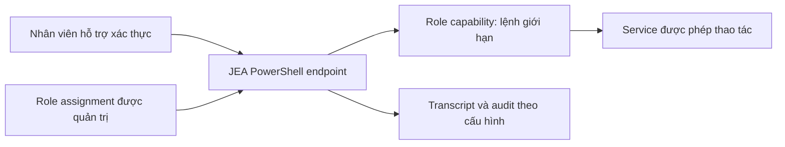
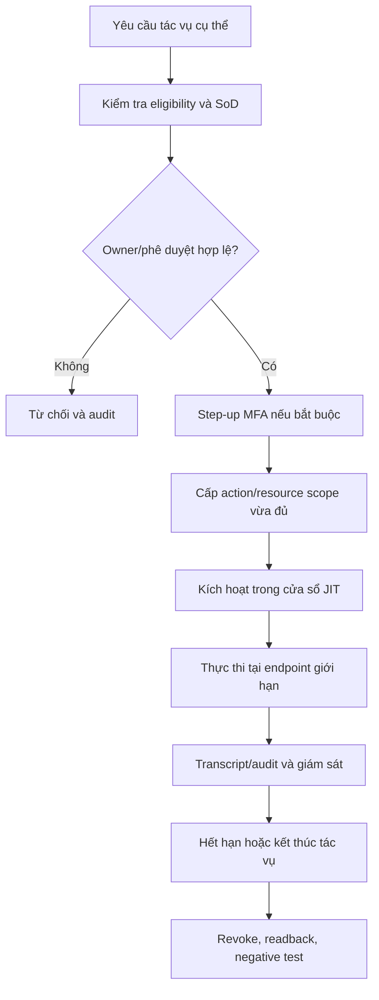

# Just-enough access trong nguyên tắc Least privilege và vòng đời danh tính IAM

**Just-enough access (JEA)** là cách cấp **vừa đủ quyền cho một tác vụ hoặc trách nhiệm đã xác định**, thay vì cung cấp toàn bộ quyền của tài khoản quản trị hoặc role rộng. Mục tiêu là người dùng hay workload có thể hoàn thành công việc hợp lệ, nhưng không có thêm những hành động, tài nguyên hoặc phạm vi không cần thiết.

Ví dụ, kỹ sư hỗ trợ cần khởi động lại một dịch vụ Windows đang lỗi. Người đó chỉ cần khả năng thực hiện thao tác khởi động lại **dịch vụ được chỉ định trên máy được phê duyệt**, không cần quyền Domain Admin, khả năng sửa mọi file hệ thống hay đọc toàn bộ bí mật của máy chủ. Đây là tinh thần *just enough*.

Trong **Identity and Access Management (IAM)**, JEA phải được đặt trong quy trình **Joiner–Mover–Leaver (JML)**. Khi Joiner, cấp quyền cơ bản theo công việc; khi Mover, thay đổi đúng phạm vi và thu hồi quyền cũ; khi Leaver, xóa căn cứ được phép truy cập và kiểm chứng phiên, token, nhóm và quyền cục bộ đã bị xử lý. **IdP, SSO, SCIM, RBAC/ABAC, tài khoản dịch vụ và kiểm toán** cần phối hợp để tránh quyền truy cập tồn dư.

## 1. Just-enough access giải quyết vấn đề nào?

Một mô hình phân quyền thiếu chi tiết thường chỉ có hai lựa chọn: người dùng không làm được việc hoặc được cấp quyền quản trị quá rộng. Khi gặp lỗi thiếu quyền, quản trị viên có thể cấp tạm role `admin` rồi quên thu hồi. Kết quả là **privilege creep**: đặc quyền tích lũy dần qua các dự án và vị trí.

| Nhu cầu hợp lệ | Cấp quá rộng | Just-enough access |
| --- | --- | --- |
| Đọc log lỗi của một dịch vụ | Administrator toàn máy | Chỉ được đọc log thuộc dịch vụ liên quan |
| Khởi động lại một worker | Quyền quản lý mọi service | Chỉ thao tác restart trên service được chỉ định |
| Xem báo cáo của một dự án | `report-admin` toàn tenant | `report-reader` cho dự án đó |
| Tạo tài khoản trong một đơn vị | Domain Admin | Quyền tạo/sửa account trong OU hoặc phạm vi được ủy quyền |
| Triển khai một ứng dụng | Owner của toàn cluster | Quyền deploy vào namespace cụ thể |
| Job xuất báo cáo | Token toàn quyền database | Chỉ đọc bảng/view cần thiết và ghi tới đích được phép |

JEA giảm **blast radius** khi credential bị chiếm, hạn chế lỗi thao tác và làm rõ trách nhiệm. Tuy nhiên, **JEA không tự thay thế xác thực mạnh, kiểm soát phiên, giám sát và phản ứng sự cố**.

## 2. Phân biệt Just-enough access, Least privilege và Just-in-Time

| Khái niệm | Câu hỏi chính | Trọng tâm |
| --- | --- | --- |
| **Least privilege** | Chủ thể có quyền nào là ít nhất để làm việc? | Nguyên tắc tổng quát về quyền tối thiểu |
| **Just-enough access (JEA)** | Chính xác tác vụ, hành động và tài nguyên nào được phép? | Độ hạt và giới hạn phạm vi quyền |
| **Just-in-Time (JIT) access** | Khi nào được dùng quyền và trong bao lâu? | Giới hạn thời gian kích hoạt |
| **Privileged Access Management (PAM)** | Đặc quyền được cấp, sử dụng, bảo vệ và kiểm toán ra sao? | Quy trình và công cụ quản trị đặc quyền |
| **Separation of Duties (SoD)** | Những quyền nào không nên cùng được một người thực hiện? | Ngăn xung đột nhiệm vụ |
| **RBAC/ABAC** | Quyền được biểu diễn và quyết định bằng cơ chế nào? | Mô hình phân quyền |

**JEA và JIT bổ sung cho nhau nhưng không đồng nghĩa**. Một quyền `global-admin` chỉ tồn tại 15 phút vẫn quá rộng nếu tác vụ chỉ là khởi động lại một dịch vụ. Ngược lại, quyền khởi động lại đúng một dịch vụ nhưng tồn tại vĩnh viễn có thể không phù hợp với nhu cầu khẩn cấp. Thiết kế tốt thường kết hợp **just enough về chức năng và tài nguyên** với **just in time về thời gian**.

Tên gọi **Just Enough Administration (JEA)** cũng được Microsoft dùng cho một công nghệ quản trị Windows/PowerShell cụ thể. Bài này bàn trước hết về **nguyên tắc cấp vừa đủ quyền**, đồng thời giới thiệu công nghệ JEA của Windows như một ví dụ triển khai; không coi hai phạm vi hoàn toàn đồng nhất.

## 3. Đơn vị thiết kế: subject, action, resource và context

Một quyền JEA có thể mô hình hóa dưới dạng:

```text
<subject, action, resource, scope, context, validity>
```

Trong đó:

- **Subject:** nhân viên, đối tác, tài khoản quản trị chuyên biệt hoặc workload.
- **Action:** xem, cập nhật, khởi động lại, triển khai, phê duyệt hoặc xóa.
- **Resource:** dịch vụ, VM, bucket, bản ghi, API, namespace hoặc tenant cụ thể.
- **Scope:** giới hạn dự án, môi trường, nhóm máy hoặc loại dữ liệu.
- **Context:** tình trạng JML, mức bảo đảm phiên, điều kiện thiết bị, phê duyệt.
- **Validity:** thời điểm bắt đầu và kết thúc, cùng quy tắc thu hồi.

Ví dụ:

```json
{
  "subject": "engineer-218",
  "action": "restart",
  "resourceType": "windows-service",
  "resourceIds": ["OrderProcessor"],
  "hostScope": ["app-node-03"],
  "environment": "production",
  "approvedTicket": "INC-2048",
  "validUntil": "2026-11-23T09:30:00Z"
}
```

Đây là **mô hình minh họa**, không phải schema chuẩn của SCIM hoặc Windows JEA. Trong thực tế cần **khóa định danh ổn định, owner, phê duyệt, phiên bản policy và nguồn dữ liệu tin cậy**. Client không được tự sửa `resourceIds`, `validUntil` hay `approvedTicket` để nâng quyền.

## 4. Các lớp JEA phải đồng thời được bảo đảm

| Lớp kiểm soát | Câu hỏi | Sai lầm thường gặp |
| --- | --- | --- |
| **Identity** | Có đúng người hoặc workload hợp lệ không? | Dùng chung tài khoản admin, không xác định owner |
| **Authentication** | Phương thức xác thực đủ tin cậy chưa? | Cấp quyền nhạy cảm chỉ dựa trên mật khẩu yếu |
| **Eligibility** | Chủ thể có được phép yêu cầu tác vụ này không? | Bất kỳ nhân viên nào cũng có thể xin production admin |
| **Permission** | Hành động nào thực sự cần? | Cấp full CRUD khi chỉ cần read |
| **Resource scope** | Tài nguyên nào được phép thao tác? | Cấp quyền trên toàn tenant khi chỉ một dự án |
| **Time** | Quyền có cần hết hạn? | Ngoại lệ kéo dài vô hạn |
| **Enforcement** | API/OS có thực sự chặn thao tác ngoài phạm vi? | Chỉ ẩn nút trên UI |
| **Revocation** | Quyền bị gỡ khi điều kiện thay đổi chưa? | Role gỡ rồi nhưng token cũ còn dùng được |

JEA chỉ có ý nghĩa khi **điểm thực thi (Policy Enforcement Point — PEP)** không cho phép vượt qua phạm vi được duyệt. Một màn hình chỉ hiển thị nút “Restart” không đủ nếu backend vẫn cho chạy các lệnh khác qua API.

## 5. Từ nhu cầu công việc đến bộ quyền JEA

Quy trình xác định quyền vừa đủ bắt đầu ở **tác vụ nghiệp vụ** chứ không bắt đầu bằng việc chọn role lớn nhất có sẵn.

1. **Mô tả tác vụ:** ví dụ “restart dịch vụ OrderProcessor khi có sự cố đã được duyệt”.
2. **Liệt kê hành động cần:** xem trạng thái, đọc log liên quan, restart dịch vụ.
3. **Chỉ định tài nguyên:** một dịch vụ, một hoặc vài máy, đúng môi trường.
4. **Xác định thao tác bị cấm:** chạy shell tùy ý, sửa cấu hình bảo mật, đọc secret, tạo user.
5. **Chọn cơ chế thực thi:** API giới hạn thao tác, RBAC/ABAC, delegated administration hoặc endpoint JEA chuyên dụng.
6. **Áp dụng phê duyệt và thời hạn:** theo độ nhạy cảm của tác vụ.
7. **Kiểm thử cả Permit lẫn Deny:** thao tác hợp lệ thành công; thao tác ngoài phạm vi bị từ chối.
8. **Ghi audit và rà soát:** bảo đảm quyền không còn khi nhu cầu kết thúc.

**Không nên cấp quyền rộng trước rồi hứa sẽ giám sát**. Audit rất quan trọng, nhưng không thay thế cơ chế từ chối lệnh vượt phạm vi ngay tại thời điểm sử dụng.

## 6. Ví dụ Windows Just Enough Administration (JEA)

Trong Windows PowerShell, **Just Enough Administration** cung cấp khả năng xây dựng **endpoint quản trị bị giới hạn**, cho phép người vận hành dùng một tập lệnh/công cụ được công bố mà không cần trở thành quản trị viên toàn quyền trong phiên thông thường.

Hai khái niệm quan trọng:

- **Role Capability:** mô tả các command, function, provider và khả năng được phơi bày cho một vai trò khi kết nối endpoint.
- **Session Configuration:** xác định endpoint, các principal được phép kết nối và ánh xạ họ tới role capability; có thể cấu hình ngữ cảnh chạy được ủy quyền theo cơ chế được hỗ trợ.



Sơ đồ chỉ nêu kiến trúc. Một triển khai JEA thật cần kiểm tra cẩn thận **các command được công bố, tham số được phép, function wrapper, quyền thực thi và mọi đường thoát ra ngữ cảnh đặc quyền**.

Ví dụ, nếu endpoint cho phép gọi `Stop-Service` với mọi tên dịch vụ, người dùng có thể dừng các thành phần ngoài nhiệm vụ. Thay vì vậy, có thể công bố một **wrapper được kiểm thử** chỉ cho restart đúng dịch vụ và máy mục tiêu được duyệt.

**Không giả định tạo endpoint JEA là an toàn mặc định.** Cấu hình role capability lỏng lẻo, command có khả năng chạy mã tùy ý hoặc đường truy cập bên ngoài endpoint có thể làm mất giới hạn.

## 7. Ví dụ chính sách tác vụ cấp ứng dụng

Không phải hệ thống nào cũng dùng PowerShell. Trong ứng dụng/API, JEA có thể được diễn đạt bằng RBAC kết hợp ABAC hoặc PBAC:

```text
PERMIT restart_worker IF
    subject.lifecycle_status == "active"
    AND "service-operator" IN subject.effective_roles
    AND action == "restart"
    AND resource.service_id == "order-processor"
    AND resource.environment == subject.approved_environment
    AND request.change_ticket IN subject.valid_approvals
    AND now < subject.privilege_expiry
ELSE DENY
```

Đây là giả mã. Ứng dụng phải lấy role, tài nguyên, ticket, expiry và môi trường từ **nguồn đáng tin**. Chỉ kiểm tra role `service-operator` mà bỏ kiểm tra **service ID** có thể biến một quyền hẹp thành quyền restart mọi service.

Nếu API nhận request cho resource khác, ví dụ `billing-database`, phải từ chối ngay cả khi người dùng đăng nhập đúng và có MFA mạnh. **Xác thực tốt không tự mở rộng phạm vi authorization**.

## 8. RBAC hay ABAC để biểu diễn Just-enough access?

**RBAC** hữu ích khi có tập thao tác chức năng ổn định, ví dụ `log-reader`, `service-restarter`, `report-viewer`. Role nên chứa **permission cần thiết**, không phải một gói quyền khó giải thích.

**ABAC** hữu ích khi quyền cần giới hạn theo **dự án, tenant, đối tác, môi trường, loại tài nguyên hoặc thời hạn**. Thay vì tạo hàng nghìn role `restarter-serviceA-host1`, có thể dùng role chức năng kết hợp các thuộc tính phạm vi đã phê duyệt.

| Thiết kế | Ví dụ | Nhận xét |
| --- | --- | --- |
| Chỉ role rộng | `production-admin` | Quá nhiều thao tác ngoài nhiệm vụ |
| Role chức năng | `service-restarter` | Giới hạn thao tác nhưng cần giới hạn tài nguyên |
| Role + ABAC | `service-restarter` và `serviceId` được duyệt | Thường phù hợp với quyền theo nhiệm vụ |
| Role + JIT | Role chỉ hoạt động 30 phút | Giảm thời gian tồn tại quyền |
| Role + ABAC + JIT | Đúng thao tác, service, host và thời gian | Kết hợp chức năng, phạm vi và thời hạn |

JEA có thể sử dụng **policy engine** để ra quyết định, nhưng chính sách phải được thực thi ở backend/OS/API, không chỉ trong công cụ phê duyệt.

## 9. Just-enough access trong Joiner

Khi nhân viên mới vào tổ chức, **birthright access** chỉ nên cung cấp quyền cơ bản phù hợp nhiệm vụ.

Ví dụ Lan gia nhập đội hỗ trợ hạ tầng:

- HRIS xác nhận danh tính, ngày bắt đầu và người quản lý.
- IAM xác định role `ops-observer` cho phép đọc trạng thái hệ thống.
- Quyền restart production **không mặc định có sẵn**; Lan phải đáp ứng điều kiện đào tạo, phê duyệt hoặc làm việc theo ca.
- IdP/SSO cung cấp xác thực, MFA theo chính sách.
- SCIM/connector hoặc API quản trị cập nhật account/role ở hệ thống đích.
- IAM đọc lại và kiểm thử rằng Lan có quyền xem trạng thái nhưng không có quyền xóa dịch vụ hoặc sửa cấu hình bảo mật.

**Tạo account trước ngày bắt đầu không đồng nghĩa có quyền sử dụng trước ngày hiệu lực**. JEA không bỏ qua điều kiện JML chỉ để hoàn tất onboarding nhanh.

## 10. Just-enough access trong Mover

Khi người dùng đổi vai trò, quyền vừa đủ cần được **tính lại**, không chỉ cộng thêm quyền mới.

| Sự kiện Mover | Quyền cũ | Quyền mới hợp lệ | Kiểm chứng |
| --- | --- | --- | --- |
| Support sang Analytics | Đọc ticket hỗ trợ | Đọc báo cáo dự án được giao | Ticket cũ không còn truy cập |
| Operator sang Auditor | Restart dịch vụ | Xem log/audit theo scope | Không còn restart production |
| Dự án A sang B | Quyền namespace A | Quyền namespace B | API từ chối namespace A |
| Rời ca trực khẩn cấp | Quyền JIT tạm | Quyền nền tảng bình thường | Phiên/token quản trị hết hiệu lực |

Nếu role cũ vẫn được gán trực tiếp tại ứng dụng đích, việc gỡ nhóm trên IdP có thể **không đủ**. Cần kiểm tra group lồng nhau, ACL, role cục bộ và token đang còn hiệu lực.

Đối với thời gian bàn giao, quyền cũ nếu thật sự cần phải được cấp dưới dạng **ngoại lệ có owner, lý do, phạm vi và thời hạn**. Không để quyền bàn giao kéo dài vĩnh viễn.

## 11. Just-enough access trong Leaver

Khi một nhân viên hoặc đối tác nghỉ việc, tập quyền cho công việc thường không còn căn cứ. Cần xử lý nhiều lớp:

1. **Disable identity/account** tại IdP/directory để ngăn đăng nhập mới.
2. **Deprovision role, group và ACL** qua SCIM/connector/API ở hệ thống đích.
3. **Thu hồi quyền JIT hoặc role activation**, kể cả quyền đặc biệt còn trong cửa sổ.
4. **Xử lý session ứng dụng, refresh token và access token** theo khả năng nền tảng.
5. **Thu hồi credential phụ** như API key hoặc khóa dùng trong automation cá nhân.
6. **Readback và kiểm thử từ chối**, không chỉ tin trạng thái workflow.

**Disable IdP không lập tức đóng mọi phiên ở RP**, và SCIM `active=false` không tự thu hồi mọi access token. Nếu API dựa trên JWT tự chứa, token có thể tiếp tục được chấp nhận tới hạn khi không có kiểm tra trạng thái hiện hành hoặc biện pháp thu hồi phù hợp.

JEA chỉ thực sự được duy trì sau Leaver khi **người không còn quan hệ không thể tiếp tục sử dụng quyền cũ tại tài nguyên**, thay vì chỉ không đăng nhập mới được.

## 12. Quản lý quyền đặc biệt bằng JEA + JIT

Một quy trình cấp quyền nhạy cảm có thể gồm:



Sơ đồ mang tính khái niệm. **Eligibility** cho phép một người yêu cầu quyền; nó **không có nghĩa mọi yêu cầu đều tự được duyệt**. Khi quyền JIT hết hạn, điểm thực thi phải ngăn thao tác mới; chỉ xóa role khỏi UI chưa đủ nếu session quyền cao còn dùng được.

Với tác vụ rất nhạy cảm, **SoD** có thể yêu cầu người phê duyệt độc lập với người thực thi. Quá trình kiểm toán phải cho biết **ai yêu cầu, ai duyệt, quyền gì, vì sao, ở đâu và trong bao lâu**.

## 13. Service account và workload cũng cần Just-enough access

Workload tự động có thể chạy hằng ngày hoặc liên tục, nên rất dễ bị cấp quyền rộng “cho tiện”. Một service identity nên gắn với **owner, tác vụ, môi trường, resource và API scope cụ thể**.

Ví dụ job `daily-report-exporter` cần:
- Đọc dữ liệu từ một view tổng hợp có kiểm soát.
- Ghi file báo cáo vào một bucket và prefix riêng.
- Không đọc secret khác, không xóa bucket và không thay đổi user/role.
- Credential có thời hạn ngắn hoặc được quản lý, giới hạn audience của API.
- Audit tách biệt khỏi identity cá nhân của kỹ sư vận hành.

**Không dùng access token cá nhân lâu dài cho job production**. Khi chủ sở hữu nhân sự nghỉ việc, cần chuyển owner workload, thu hồi quyền cá nhân đối với secret/CI/CD và kiểm tra phụ thuộc trước khi thay credential hoặc tắt workload.

Trong workload identity federation, token của môi trường staging không được phép dùng như credential production chỉ vì nó được phát từ một issuer tin cậy; phải kiểm tra **subject binding, audience, environment và scope**.

## 14. JEA với partner và phạm vi tenant

Một đối tác B2B có thể cần xem đơn hàng của khách hàng được phân công. **Partner IdP xác thực thành công không tự cho phép truy cập toàn bộ đơn hàng** của bên cung cấp dịch vụ.

```text
PERMIT read_partner_order IF
    subject.lifecycle_status == "active"
    AND subject.partner_id == resource.partner_id
    AND resource.contract_id IN subject.active_contracts
    AND "partner-order-reader" IN subject.effective_roles
    AND action == "read"
ELSE DENY
```

Cần sử dụng identity ổn định, partner ID, hợp đồng và tài nguyên đã được xác minh; không dựa duy nhất vào email hoặc IP để liên kết tenant.

Khi nhân viên partner rời dự án hoặc hợp đồng kết thúc, bên cung cấp phải chủ động **deprovision quyền B2B** và kiểm tra session hiện hữu, thay vì chỉ chờ thông báo khóa tài khoản từ đối tác.

## 15. Các sai lầm phổ biến khi triển khai Just-enough access

| Sai lầm | Tác động | Cách xử lý |
| --- | --- | --- |
| Cấp `admin` để sửa lỗi permission | Blast radius lớn | Phân tích thao tác thiếu và tạo quyền hẹp |
| Giới hạn thời gian nhưng không giới hạn chức năng | Quyền quá rộng trong cửa sổ JIT | JEA kết hợp JIT |
| Giới hạn chức năng nhưng không giới hạn tài nguyên | Thao tác được trên mọi tenant/host | ABAC và resource scope |
| Chỉ ẩn nút UI | Backend vẫn thực thi hành động bị cấm | Enforcement phía server |
| Cho chạy shell hoặc lệnh tùy ý qua endpoint JEA | Có thể thoát khỏi giới hạn dự kiến | Allowlist command và wrapper được kiểm thử |
| Sử dụng token chứa claim quyền cũ | Quyền tồn dư sau Mover/Leaver | TTL, revoke, kiểm tra trạng thái |
| Không đối soát quyền gán trực tiếp | Role cục bộ bị bỏ sót | Readback entitlement ở đích |
| Quyền khẩn cấp không tự hết hạn | Đặc quyền tồn tại lâu dài | Expiry, owner và hậu kiểm |
| Tài khoản dịch vụ không có owner | Credential và scope tồn dư | Inventory và lifecycle workload |
| Audit có nhưng không có khả năng thu hồi | Phát hiện sau khi thiệt hại xảy ra | Thiết kế kiểm soát thực thi và revoke |

Không nên nhầm **có tính năng audit** với **đã áp dụng quyền tối thiểu**. Audit hỗ trợ điều tra và cải tiến; **PEP/OS/API** mới là nơi kiểm soát thao tác tại thời điểm thực hiện.

## 16. Kiểm thử chức năng và kiểm thử phủ định

Một thiết kế JEA phải vượt qua hai nhóm kiểm thử:

**Positive test:** người được phê duyệt vẫn hoàn thành nhiệm vụ được giao.

**Negative test:** người đó không thể làm thêm những việc ngoài nhiệm vụ, kể cả qua đường API trực tiếp hoặc tài khoản phụ.

| Tình huống | Kết quả mong muốn |
| --- | --- |
| Operator restart đúng service được duyệt | Permit |
| Operator restart service khác | Deny |
| Operator chạy lệnh quản trị không được công bố | Deny |
| Operator đọc log ngoài phạm vi | Deny |
| Role hợp lệ nhưng JIT hết hạn | Deny |
| Role hợp lệ nhưng user đã Leaver | Deny |
| User thuộc tenant A yêu cầu dữ liệu tenant B | Deny |
| Service token staging gọi API production | Deny |
| Workload read-only thử xóa dữ liệu | Deny |
| Mover còn phiên chứa claim role cũ | Không được tiếp tục đặc quyền trái chính sách |
| Connector trả success nhưng role đích chưa đổi | Phát hiện qua readback và cảnh báo |

Với Windows JEA, cần kiểm tra cụ thể **command, parameter, argument, wildcard và các hàm gián tiếp có thể kích hoạt lệnh ngoài phạm vi**, không chỉ xem danh sách command được phép trên giấy.

## 17. Đo quyền thực tế và account reconciliation

Một bộ quyền được mô tả tốt trong IAM vẫn có thể không phản ánh trạng thái ở ứng dụng đích.

```text
desired_permissions = minimum_permissions(task, approvals, current_JML)
actual_permissions = effective_permissions(target_account, groups, roles, ACL)

missing = desired_permissions - actual_permissions
excess = actual_permissions - desired_permissions
```

Đây là mô hình logic; trong triển khai phải xét **nhóm lồng nhau, role kế thừa, quyền trực tiếp, account phụ, token, session và ngoại lệ còn hiệu lực**. Không tự xóa một tài khoản kỹ thuật chưa xác định phụ thuộc, nhưng phải điều tra và quản trị mọi quyền không có căn cứ.

Quy trình đóng vòng:

1. Xác định **identity hoặc workload owner**.
2. Tính quyền vừa đủ theo tác vụ, thời điểm và phê duyệt.
3. Đọc entitlement hiện hành từ IdP/AD và ứng dụng đích.
4. Phân loại quyền thiếu, quyền dư và ngoại lệ.
5. Cấp/gỡ qua SCIM, API, connector hoặc công cụ đặc quyền tương ứng.
6. **Đọc lại**, chạy kiểm thử Permit/Deny và đánh giá session/token.
7. Lưu dấu vết, theo dõi sai lệch chưa xử lý và hoàn thiện hồ sơ audit.

**Không coi yêu cầu HTTP 200 từ provisioning connector là bằng chứng quyền thực sự đã bị thu hồi.** Cần readback và kiểm tra hành động tại tài nguyên khi rủi ro yêu cầu.

## 18. Chỉ số vận hành và kiểm toán

Các chỉ số giúp đánh giá hiệu quả JEA:

- **Privileged scope reduction:** tỷ lệ tác vụ không còn cần role admin rộng.
- **Excess entitlement count:** số quyền thực tế ngoài desired state.
- **JIT role expiry compliance:** tỷ lệ quyền tạm thời hết hiệu lực đúng hạn.
- **Mover residual privileged access:** quyền đặc biệt từ vai trò cũ vẫn còn sau Mover.
- **Leaver time to deny:** thời gian từ sự kiện chấm dứt đến khi không thể truy cập.
- **Service account privilege review coverage:** tỷ lệ workload được rà soát quyền và owner.
- **Negative authorization test coverage:** mức bao phủ các hành động ngoài scope.
- **Orphaned access count:** account/role không còn chủ thể hoặc owner hợp lệ.
- **Emergency exception overdue:** quyền ngoại lệ quá hạn hoặc thiếu lý do.

Audit nên ghi identity, tác vụ, resource scope, policy version, approval, thời hạn và kết quả thực thi/thu hồi. Với JEA ở Windows, transcript và những sự kiện quản trị khác có thể bổ sung bằng chứng nếu được cấu hình thích hợp. **Không ghi plaintext password, API token, cookie, private key hoặc dữ liệu nhạy cảm không cần thiết vào log**.

Một quyền `global-admin` tồn dư có rủi ro lớn hơn nhiều quyền đọc nhỏ; vì vậy phải ưu tiên xử lý sai lệch theo **mức độ tác động**, không chỉ đếm số lượng.

## 19. Tình huống tự kiểm tra

**Tình huống A:** Kỹ sư cần restart đúng một dịch vụ nhưng được cấp Domain Admin trong 15 phút. Đây có phải just-enough access không? **Không.** Thời hạn ngắn là JIT, nhưng quyền vẫn quá rộng.

**Tình huống B:** Người dùng có role `service-restarter` và được gọi restart mọi host production. Còn thiếu giới hạn gì? **Resource scope**, ví dụ host/service được phê duyệt.

**Tình huống C:** Nhân viên Mover đã mất role tại IdP nhưng phiên cũ vẫn gọi API quản trị được. JEA đã được duy trì chưa? **Chưa.** Cần xử lý authorization runtime và phiên/token.

**Tình huống D:** Workload chỉ cần đọc báo cáo nhưng token có scope `storage.admin`. Nên làm gì? **Giảm xuống scope đọc cần thiết**, ràng buộc tài nguyên và quản lý vòng đời credential.

**Tình huống E:** Người dùng có MFA mạnh nhưng không có phê duyệt JEA cho tác vụ production. Có được kích hoạt role không? **Không.** MFA không thay thế eligibility hoặc approval.

**Tình huống F:** Sau Leaver, account IdP disabled nhưng role cục bộ trên SaaS vẫn active. Quy trình hoàn tất chưa? **Chưa.** Cần deprovision, readback và kiểm tra truy cập thực tế.

## Ghi nhớ

**Just-enough access** là cách hiện thực hóa **least privilege** bằng việc giới hạn chính xác **hành động, tài nguyên, phạm vi và điều kiện** cho mỗi nhiệm vụ. **JEA** trả lời *được làm gì và ở đâu*, còn **JIT** bổ sung *khi nào và trong bao lâu*; hai cơ chế có thể phối hợp nhưng không thay thế nhau. Trong **IAM Joiner–Mover–Leaver**, cần gắn quyền với nguồn quan hệ, phê duyệt và thời hạn, đồng thời phối hợp **IdP/SSO, SCIM, RBAC/ABAC, quản trị tài khoản dịch vụ, kiểm toán và reconciliation**. Chỉ khi kiểm chứng được quyền thực tế tại **ứng dụng, API và phiên**, tổ chức mới giảm được quyền dư và truy cập tồn dư.
