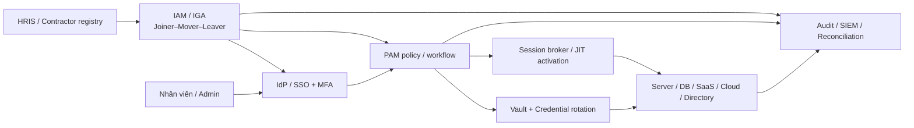
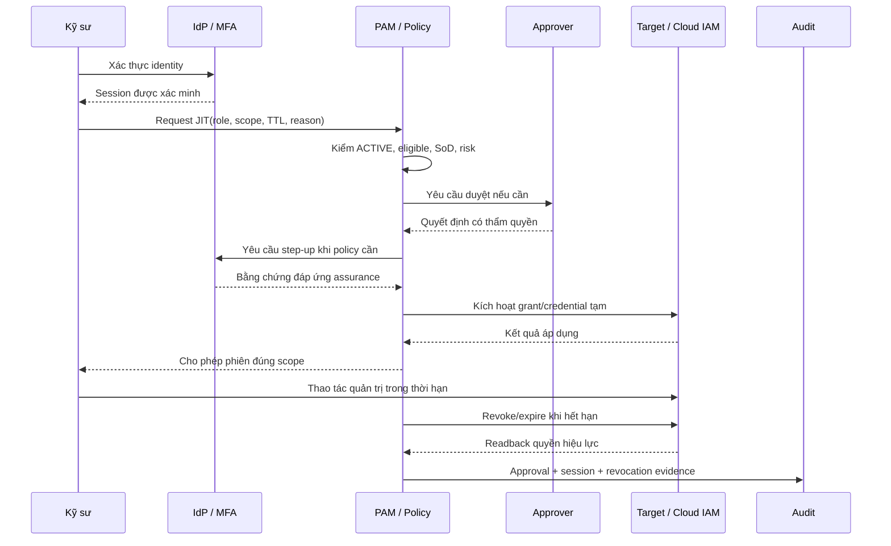

# Privileged Access Management (PAM): Kiểm soát quyền đặc biệt trong vòng đời danh tính IAM

Một kỹ sư vận hành có tài khoản SSO hợp lệ để đọc dashboard hệ thống. Khi sự cố xảy ra, kỹ sư cần quyền quản trị production trong 30 phút để sửa cấu hình. Nếu doanh nghiệp cấp sẵn quyền Administrator vĩnh viễn, một tài khoản bị chiếm đoạt hoặc một nhân viên đã chuyển vai trò có thể tiếp tục sử dụng quyền rất rộng. Nếu chỉ bật MFA mà không giới hạn phạm vi, thời hạn và ghi nhận phiên, doanh nghiệp vẫn khó trả lời: **ai đã thực hiện lệnh gì, với quyền nào, tại hệ thống nào, trong thời gian nào và quyền đã được thu hồi hay chưa?**

**Privileged Access Management (PAM)** là tập hợp chính sách, quy trình và công nghệ nhằm **phát hiện, cấp, bảo vệ, giám sát và thu hồi quyền truy cập đặc quyền** đối với hệ thống, dữ liệu, tài khoản và workload. PAM tập trung vào những thao tác có thể làm thay đổi trạng thái bảo mật hoặc gây tác động lớn: quản trị danh tính, thay chính sách, điều hành máy chủ, truy cập secret, thay cấu hình cloud, xóa dữ liệu hoặc quản lý các tài khoản khác.

Bài học thuộc chương **Privileged access** của mô-đun **Identity Lifecycle** trong **Identity and Access Management (IAM)**. Nội dung gắn PAM với **Joiner–Mover–Leaver (JML)**: xác minh người nhận quyền, cấp quyền tối thiểu, thay đổi hoặc gỡ đặc quyền khi chuyển vai trò, chặn truy cập sau khi rời tổ chức. PAM còn liên kết với **IdP, SSO, SCIM, RBAC/ABAC, tài khoản dịch vụ, kiểm toán và reconciliation** để giảm **quyền truy cập tồn dư (residual access)**.

> **Nguyên tắc cốt lõi:** Quyền quản trị phải có **chủ thể được xác minh, mục đích chính đáng, phạm vi cụ thể, thời hạn, mức xác thực phù hợp, giám sát và bằng chứng thu hồi**. Quản lý đặc quyền không đồng nghĩa chỉ cất mật khẩu root trong vault.

## 1. PAM là gì và bảo vệ điều gì?

**PAM** quản trị **privileged access**: khả năng thực hiện hành động nhạy cảm trên một hệ thống hoặc tập tài nguyên. Đây có thể là quyền được cấp qua tài khoản riêng, role, nhóm, credential, session hoặc cơ chế ủy quyền.

Ví dụ đặc quyền:

- Tạo, vô hiệu hóa hoặc cấp quyền Administrator cho account.
- Thay cấu hình Identity Provider (IdP), SSO, MFA, Conditional Access.
- Quản lý tài khoản domain, directory, group đặc quyền.
- Truy cập máy chủ bằng quyền root/Administrator hoặc quyền tương đương.
- Đọc secret, private key, certificate hoặc token có thể mở truy cập rộng.
- Thay chính sách IAM ở cloud, cấp quyền cho principal khác.
- Triển khai hoặc sửa service production, truy cập database nhạy cảm.
- Xem dữ liệu có tính nhạy cảm cao vượt nhu cầu công việc bình thường.
- Quản trị hệ thống PAM, vault, log và hạ tầng recovery.

Không phải mọi tài khoản tên `admin` đều có cùng đặc quyền; cần xem **effective permissions** trên tài nguyên thật. Ngược lại, một tài khoản không mang tên admin vẫn có thể rất nguy hiểm nếu được quyền tạo token, đổi nhóm quản trị, sửa pipeline, đọc vault hoặc cấp quyền cho chính mình.

### 1.1. Tại sao tài khoản đặc quyền là mục tiêu rủi ro cao?

Một account thường có thể chỉ đọc dữ liệu của chính người dùng. Một principal đặc quyền có thể:

- Tạo hoặc sửa account khác.
- Thay hệ thống ghi log hoặc giám sát.
- Truy xuất dữ liệu của nhiều tenant.
- Tạo credential bền vững và đường truy cập ẩn.
- Thay policy để tự mở rộng quyền.
- Gây gián đoạn hệ thống hoặc mất dữ liệu.

Vì vậy, **xâm phạm một principal đặc quyền** thường có phạm vi ảnh hưởng lớn hơn xâm phạm một user có quyền tối thiểu.

### 1.2. PAM khác Authentication, Authorization và Provisioning

| Hoạt động | Câu hỏi | Vai trò trong PAM |
|---|---|---|
| **Identity proofing** | Đây có đúng người/workload được khai báo không? | Ràng buộc tài khoản đặc quyền với identity có trách nhiệm. |
| **Authentication** | Người truy cập có chứng minh được identity không? | IdP, MFA, passkey, workload credential. |
| **Authorization** | Identity được thực hiện action nào trên tài nguyên nào? | RBAC/ABAC, role scope, policy, approvals. |
| **Provisioning** | Account, role và credential được tạo/cập nhật/gỡ thế nào? | PAM, IAM/IGA, SCIM/API/connector và target. |
| **Privileged session control** | Phiên quản trị được mở, giám sát và kết thúc ra sao? | Proxy/broker, session recording, command controls nếu hỗ trợ. |
| **Audit/reconciliation** | Quyền và phiên thực sự còn hay không? | Readback từ PAM/target và bằng chứng độc lập. |

**MFA là một lớp xác thực, không phải toàn bộ PAM.** Một tài khoản admin được MFA vẫn có thể thừa quyền, hoạt động sai scope hoặc còn tồn tại sau Leaver.

## 2. Phân loại đối tượng đặc quyền

### 2.1. Privileged human accounts

Một người có thể dùng:

1. **Tài khoản làm việc thông thường:** email, chat, ứng dụng công việc.
2. **Tài khoản quản trị riêng:** truy cập hệ thống production hoặc directory.
3. **Quyền nâng tạm thời trên một identity:** kích hoạt role đủ điều kiện trong thời hạn ngắn.
4. **Tài khoản cứu hộ/khẩn cấp:** chỉ dùng theo quy trình break-glass.

Tách tài khoản thường và tài khoản quản trị giúp giảm rủi ro sử dụng nhầm đặc quyền trong hoạt động hàng ngày. Nhưng việc tách account **không tự thay thế MFA, policy, network isolation, session control và readback**.

### 2.2. Shared và built-in accounts

Ví dụ: `root`, account Administrator cục bộ hoặc tài khoản vận hành được nhiều người dùng thông qua PAM.

Rủi ro:

- Khó quy trách nhiệm nếu nhiều người biết cùng password.
- Credential có thể đã bị sao chép ngoài vault.
- Một thay đổi quyền ở IdP không tự thu hồi mật khẩu đã biết.
- Lệnh có thể được thực hiện qua đường SSH/RDP trực tiếp bỏ qua broker.

PAM có thể **check-out secret**, **inject credential mà người dùng không thấy** hoặc **broker phiên** để ràng buộc người thao tác vào danh tính cá nhân, tùy sản phẩm. Nếu người dùng vẫn biết và giữ mật khẩu chung, khả năng quy trách nhiệm và thu hồi chỉ bằng cách khóa PAM sẽ hạn chế.

### 2.3. Non-human privileged identities

Bao gồm:

- Service account chạy ứng dụng hoặc agent.
- CI/CD deployment principal.
- Cloud service principal/workload identity.
- Kubernetes service account có quyền nhạy cảm.
- Database integration user.
- Bot quản trị, automation job, backup account.
- API client có quyền sửa IAM hoặc secret.

Những principal này có thể không sử dụng giao diện SSO người dùng. Cần mô hình **workload identity, trust, credential lifecycle, owner và quyền API** phù hợp.

### 2.4. Phân loại theo tác động và phạm vi

| Loại | Ví dụ | Nguy cơ chính |
|---|---|---|
| Identity administrator | Quản trị IdP/IAM/Directory. | Cấp quyền cho người khác, thay xác thực. |
| Infrastructure administrator | Root/Administrator trên máy chủ. | Điều hành hệ thống, truy cập dữ liệu, persistence. |
| Cloud administrator | Thay IAM role/policy ở cloud. | Escalation, cross-account impact. |
| Database administrator | Quản trị DB và backup. | Xem/sửa dữ liệu lớn, thay audit. |
| Secrets administrator | Quản trị vault/keys. | Lộ credential cấp quyền đến hệ khác. |
| Application administrator | Quản lý tenant, app role. | Thay quyền cục bộ ngoài IAM. |
| Workload deployment principal | Pipeline/CD identity. | Sửa code/artifact, thay production. |
| Emergency principal | Break-glass. | Quyền lớn trong tình huống thiếu kiểm soát bình thường. |

**Phân loại ưu tiên theo khả năng thực tế, không chỉ tên vai trò.** Một `read-only` role có thể vẫn nhạy cảm nếu được đọc toàn bộ dữ liệu hoặc đọc secret.

## 3. Các khái niệm nền tảng: standing privilege, JIT, JEA và PIM

### 3.1. Standing privilege

**Standing privilege** là quyền đặc biệt tồn tại thường trực, không yêu cầu kích hoạt cho mỗi phiên hoặc công việc.

Ưu điểm là sẵn có ngay; nhưng rủi ro gồm:

- Tài khoản bị chiếm đoạt có thể sử dụng quyền bất cứ lúc nào.
- Role cũ không bị gỡ sau Mover.
- Khó phân biệt nhu cầu nghiệp vụ bình thường với hành động ngoài nhiệm vụ.
- Khó giới hạn thời gian và truy vết từng lần sử dụng.

Không phải mọi standing privilege đều bị cấm tuyệt đối. Một số hệ thống cần principal liên tục cho vận hành; tuy nhiên phải đánh giá biện pháp giảm rủi ro, scope và vòng đời riêng.

### 3.2. Just-in-Time (JIT) privileged access

**JIT** cấp hoặc kích hoạt đặc quyền **khi có nhu cầu hợp lệ** và **tự kết thúc theo điều kiện/thời hạn**. Có thể vận hành bằng role activation, group membership tạm thời, credential ngắn hạn hoặc session được broker.

Ví dụ:

```text
Kỹ sư ACTIVE
  -> Request quyền production-read-only
  -> Kiểm role eligible + ticket + MFA + policy
  -> Phê duyệt nếu cần
  -> Kích hoạt quyền 30 phút tại đúng project
  -> Session được kiểm soát
  -> Hết hạn / revoke
  -> Readback + audit
```

**JIT không đồng nghĩa quyền hết ngay nếu mọi thành phần đích vẫn giữ session/token cũ.** Phải kiểm expiry ở điểm thực thi và có cách xử lý phiên/credential còn sống.

### 3.3. Just Enough Administration (JEA)

**JEA** hoặc nguyên tắc **just enough privilege** giới hạn **đúng thao tác cần thiết** thay vì cấp full Administrator.

Ví dụ:

- Được restart một service nhưng không được thay IAM policy.
- Được đọc log production nhưng không được tải toàn bộ database.
- Được deploy một ứng dụng trong namespace cụ thể, không quản trị cluster toàn cục.
- Được reset một account theo quy trình Helpdesk, không được cấp Global Admin.

JIT giải quyết **khi nào quyền được cấp**; JEA giải quyết **quyền được làm những gì**. Nên kết hợp cả hai.

### 3.4. PAM và Privileged Identity Management (PIM)

Trong một số hệ sinh thái, **PIM** tập trung quản lý **vai trò đặc quyền, điều kiện eligible/active, activation, approval và thời hạn**; **PAM** là phạm vi rộng hơn, có thể bao gồm vault, credential, session và các hoạt động quản trị đặc quyền.

Tuy nhiên tên sản phẩm/nhóm tính năng khác nhau tùy nhà cung cấp. Khi thiết kế phải liệt kê **khả năng thực tế** thay vì suy từ nhãn PAM hay PIM.

### 3.5. Eligible khác Active

| Trạng thái | Ý nghĩa | Test quan trọng |
|---|---|---|
| **Not assigned** | Chưa có tư cách nhận role. | Không tự kích hoạt. |
| **Eligible** | Được phép yêu cầu kích hoạt theo policy. | Chưa có active privilege nếu chưa kích hoạt. |
| **Activation pending** | Đang chờ phê duyệt hoặc điều kiện. | Không mở quyền trước approval. |
| **Active** | Quyền đã có hiệu lực trong scope và thời hạn. | Chỉ thao tác được trong scope. |
| **Expired** | Hết thời hạn active grant. | Điểm thực thi từ chối hành động nhạy cảm. |
| **Revoked** | Bị thu hồi trước hoặc đúng hạn. | Session/token không tiếp tục vượt policy. |

Khi một nhân viên Mover/Leaver, IAM cần xem cả **role active và role eligible**, không chỉ những role đang kích hoạt.

## 4. Các thành phần của kiến trúc PAM

Một kiến trúc PAM có thể gồm:

- **Identity source / IdP:** nhận diện và xác thực người quản trị.
- **PAM policy engine:** kiểm yêu cầu quyền, scope, thời hạn, approval và risk.
- **Privileged account inventory/discovery:** tìm các account và credential nhạy cảm.
- **Credential vault/secrets manager:** lưu và quản lý secret theo quyền chặt chẽ.
- **Credential rotation service:** thay credential ở target và cập nhật bản được quản lý.
- **Session broker/proxy:** kết nối tới target theo phiên được ủy quyền.
- **Session monitoring/recording:** ghi hành vi và sự kiện trong phạm vi đã được phê duyệt.
- **Target connector:** tương tác với máy chủ, database, directory, cloud IAM, SaaS.
- **PAM audit/log:** lưu yêu cầu, approval, activation, thực thi, rotation và kết quả.
- **IAM/IGA, SIEM, incident response:** gắn với lifecycle, rà soát và điều tra.

Không phải mọi triển khai cần cùng một sản phẩm cho tất cả thành phần. Những hệ thống chuyên biệt có thể quản lý privilege bằng cloud IAM và credential ngắn hạn mà không cần “password checkout”.

### 4.1. Sơ đồ tổng thể



Sơ đồ mô tả **trách nhiệm logic**, không bắt buộc mọi kết nối mạng phải đi qua vault và broker. Cần xác định **đường truy cập ngoài PAM** và kiểm soát bypass phù hợp.

### 4.2. Truyền quyết định tới điểm thực thi

PAM policy có thể quyết định `ALLOW` kích hoạt role; nhưng target phải **thực sự nhận và thực thi** role mới. Có hai vấn đề khác nhau:

1. **Control plane:** PAM/IAM quyết định và quản trị quyền.
2. **Data plane:** host, database, API, SaaS hoặc cloud platform chấp nhận/từ chối thao tác.

Nếu control plane báo đã revoke nhưng data plane vẫn chấp nhận token/session cũ, tổ chức còn quyền tồn dư.

## 5. Khám phá và lập inventory privileged access

Bước đầu tiên không phải cất mật khẩu, mà là **biết những quyền đặc biệt nào đang tồn tại**.

### 5.1. Các đối tượng cần kiểm kê

- Human admin accounts, tài khoản phụ và local administrator.
- Built-in/shared/default privileged accounts.
- Directory/IdP groups mang quyền admin, kể cả nested group.
- Cloud root hoặc tenant/org administrator, roles, policies.
- SaaS application admin và quyền gán trực tiếp.
- Database, backup, monitoring, hypervisor/virtualization admin.
- CI/CD runners, service principals và deployment credentials.
- SSH keys, API keys, secrets, certificates và long-lived tokens.
- Break-glass identities.
- Delegated privilege, eligible role và quyền có thể **tự nâng quyền**.

### 5.2. Privileged access inventory mẫu

```json
{
  "principalId": "admin-person-1045",
  "principalType": "HUMAN_ADMIN",
  "linkedIdentityId": "person-1045",
  "targetSystem": "production-cluster-a",
  "resourceScope": "namespace-finance",
  "privilege": "deploy-release",
  "assignmentType": "JIT_ELIGIBLE",
  "ownerTeam": "platform-operations",
  "reviewState": "CURRENT",
  "sourceOfGrant": "iam-approved-role",
  "observedAt": "2026-12-01T09:00:00+07:00"
}
```

Dữ liệu hoàn toàn hư cấu. Trong inventory thật, nên có **source, effectiveAt, expiry, approval, quyền trực tiếp/gián tiếp, trạng thái credential và khả năng readback** theo yêu cầu nghiệp vụ.

### 5.3. Privilege path và quyền nâng gián tiếp

Một identity không có role Global Admin vẫn có thể:

- Thêm mình vào nhóm quản trị.
- Sửa policy của role khác.
- Tạo hoặc cấp secret cho tài khoản mạnh hơn.
- Quản lý pipeline deploy chạy bằng quyền cao.
- Sửa hệ thống token issuer hoặc danh sách trusted principals.

Do đó inventory nên xét **đường leo thang đặc quyền** (privilege escalation paths), không chỉ liệt kê role tên `Administrator`. Đây là công việc phân tích quyền và quan hệ phụ thuộc, cần thận trọng với độ đầy đủ của nguồn dữ liệu.

### 5.4. Onboarding vào PAM

Một target account được đưa vào PAM nên có:

1. Mục đích và owner rõ ràng.
2. Phân loại mức rủi ro.
3. Loại credential/session được hỗ trợ.
4. Quy trình xác thực người yêu cầu.
5. Quy tắc cấp/thu hồi quyền.
6. Cơ chế rotation và xác minh sau rotation.
7. Session monitoring nếu áp dụng.
8. Bằng chứng rằng đường bypass ngoài PAM đã được hạn chế hoặc ghi rõ ngoại lệ.
9. Kiểm tra khả năng phục hồi khi PAM outage.

**“Account đã có trong vault” không có nghĩa mọi phiên quản trị đều đi qua PAM.**

## 6. Quản trị danh tính người quản trị và liên kết với IAM

### 6.1. Ràng buộc tài khoản admin với người chịu trách nhiệm

Một người có thể có:

```text
Identity HR/IAM:
  person-1045

Normal account:
  lan.nguyen@example.invalid

Privileged account:
  adm-lan-nguyen

PAM/JIT grants:
  prod-read-only, eligible
  finance-deploy, active 30 phút
```

Mục tiêu là quản trị **một vòng đời identity** với nhiều account và quyền, chứ không coi tài khoản `adm-lan-nguyen` là người hoàn toàn độc lập.

Liên kết cần dùng ID ổn định và nguồn được xác minh; không chỉ dựa vào tên hiển thị hoặc email có thể thay đổi.

### 6.2. Vì sao attribution quan trọng?

Nếu 10 kỹ sư cùng biết password `root`, log trên máy chủ chỉ có thể ghi `root`. Không thể kết luận ai là người thực hiện nếu thiếu bằng chứng bổ sung.

Mô hình an toàn hơn:

- Mỗi kỹ sư xác thực bằng danh tính cá nhân tại PAM.
- PAM cấp quyền hoặc broker phiên có correlation ID.
- Account đích được quản lý và secret không bị tiết lộ khi khả thi.
- Phiên/kết quả lệnh được ghi theo chính sách, gắn với người yêu cầu.
- Credential được rotate khi cần để giảm tác dụng của bản sao cũ.

Tuy nhiên **session recording không tự bảo đảm non-repudiation tuyệt đối**; phải bảo vệ tính toàn vẹn log, đường bypass, thời gian và quyền truy cập hệ thống ghi log.

### 6.3. Tách môi trường người dùng và quản trị

Một số tổ chức dùng thiết bị hoặc môi trường quản trị chuyên dụng (ví dụ privileged workstation) để giảm rủi ro phishing và nhiễm mã độc trong phiên admin.

Chính sách có thể yêu cầu:

- MFA chống phishing cho principal đặc quyền.
- Thiết bị được quản trị và đạt baseline.
- Mạng/kênh truy cập được phép.
- Không dùng session admin cho email/web browsing thông thường.
- Không copy dữ liệu nhạy cảm tùy tiện qua clipboard/file transfer.
- Phân biệt môi trường production và staging.

Đây là **kiểm soát bổ sung dựa trên rủi ro**, không nên tin một cờ `managedDevice=true` do client tự khai.

## 7. Credential vault và quản lý secret đặc quyền

### 7.1. Vault giải quyết bài toán nào?

**Privileged credential vault** lưu trữ và kiểm soát quyền truy cập tới secret, ví dụ mật khẩu admin, SSH private key, database credential hoặc API credential mà sản phẩm hỗ trợ.

Các mục tiêu:

- Giảm secret nằm trong file, chat, script hoặc ghi nhớ của nhiều người.
- Kiểm tra người được truy xuất và mục đích.
- Hạn chế hiển thị secret trực tiếp cho user khi có thể.
- Quản lý rotation và phiên bản credential.
- Ghi audit checkout, injection, revoke và thay đổi.
- Bảo vệ backup, recovery và khả năng phục hồi của kho secret.

**Vault không tự đảm bảo secret chưa từng bị sao chép trước đó.** Nếu secret bị lộ, cần xử lý bằng rotation/revoke và xác minh trạng thái tại target.

### 7.2. Password checkout và password injection

| Cơ chế | Đặc điểm | Rủi ro/kiểm soát |
|---|---|---|
| **Checkout** | Người dùng được phép lấy/nhìn secret theo policy. | Có thể sao chép; cần giới hạn, rotation và audit. |
| **Injection** | PAM điền secret vào phiên mà người dùng không thấy giá trị. | Giảm lộ trực tiếp nhưng không ngăn mọi hành vi trong phiên. |
| **Session proxy/broker** | User truy cập target qua broker. | Hạn chế bypass, bảo vệ phiên và log. |
| **Dynamic credentials** | Tạo credential ngắn hạn cho mục đích cụ thể. | Cần TTL, revoke, cleanup và hạn chế scope. |
| **Federated role/session** | Dùng identity federation để nhận quyền tạm thay static password. | Cần audience, session policy và chặn sau expiration. |

Trong nhiều kiến trúc hiện đại, **credential ngắn hạn hoặc workload federation** phù hợp hơn password tĩnh, nhưng vẫn cần PAM governance ở mức quyền nhạy cảm.

### 7.3. Rotation và xác minh

Một quy trình rotation hợp lệ:

1. Xác định target, credential và workload phụ thuộc.
2. Xác minh quyền thay credential theo chính sách.
3. Sinh credential mới bằng cơ chế bảo mật phù hợp.
4. Cập nhật target theo giao diện được hỗ trợ.
5. Đồng bộ credential tới vault hoặc consumers theo chiến lược an toàn.
6. **Kiểm tra credential mới sử dụng được** trong phạm vi hợp lệ.
7. **Vô hiệu hóa credential cũ** theo plan và cửa sổ chuyển đổi được phê duyệt.
8. Ghi audit và monitor lỗi đăng nhập/gián đoạn.
9. Nếu thất bại, thực hiện rollback hoặc recovery có kiểm soát, không đưa secret lên log.

Không nên khẳng định rotation hoàn tất chỉ vì vault đã đổi giá trị. Cần **readback/truy cập test đúng phạm vi** và xác nhận secret cũ không còn có hiệu lực khi policy yêu cầu.

### 7.4. Khác biệt giữa password, SSH key và API token

- **Password:** rotation thường cần cập nhật giá trị tại account target.
- **SSH key:** có thể cần gỡ public key khỏi authorized principals/hosts hoặc thay chứng thực; không chỉ thay private key ở vault.
- **API key:** cần revoke/disable key cũ tại bên cấp phát và cập nhật consumer.
- **OAuth access token:** có thể hết hạn tự động hoặc cần introspection/revocation; không đồng nhất với password rotation.
- **Certificate/private key:** cần quy trình cấp mới, cập nhật trust/deployment, revoke khi khả thi và xử lý chain/caching.
- **Cloud workload identity:** có thể dùng token ngắn hạn, role binding và issuer trust thay secret tĩnh.

Mọi credential cần phân loại **phạm vi, người tiêu thụ, TTL, phương thức revoke và độ bao phủ**.

## 8. Quy trình cấp quyền đặc biệt theo yêu cầu

Một quy trình JIT có thể gồm:

1. Người dùng đã được xác thực qua IdP/SSO.
2. Người dùng yêu cầu **role, target, scope, thời hạn và lý do**.
3. PAM xác minh identity/lifecycle state còn ACTIVE.
4. PAM kiểm **eligible role**, ticket, thiết bị, risk và các điều kiện.
5. Yêu cầu **step-up MFA** hoặc approval khi policy cần.
6. Kiểm **SoD** và quyền không được tự phê duyệt.
7. PAM kích hoạt quyền hoặc cấp credential/session tạm.
8. Người dùng thao tác qua kênh được kiểm soát.
9. Hết thời hạn, PAM revoke/expire quyền và xử lý session/credential phù hợp.
10. Readback target và lưu audit/evidence.

### 8.1. Sơ đồ trình tự



Thứ tự approval/step-up có thể khác tùy sản phẩm; mục tiêu là **không có quyền active trước khi điều kiện bắt buộc được đáp ứng**.

### 8.2. Request JIT khái niệm

```json
{
  "requestId": "pam-req-20261201-017",
  "subjectId": "person-1045",
  "target": "production-cluster-a",
  "role": "namespace-release-operator",
  "scope": "namespace-finance",
  "requestedMinutes": 30,
  "reason": "Approved maintenance task",
  "changeTicket": "CHG-042",
  "requestedAt": "2026-12-01T09:00:00+07:00"
}
```

Dữ liệu giả. Không dùng `requestedMinutes` do người yêu cầu tự nhập làm quyền thực tế nếu vượt giới hạn chính sách. PAM phải áp **policy maximum TTL**, phê duyệt và resource scope.

### 8.3. Eligible role không tự kích hoạt

Một principal có thể đủ điều kiện request quyền nhưng **chưa được dùng quyền** cho đến khi PAM xác minh đầy đủ các điều kiện.

Ví dụ pseudocode:

```text
PERMIT privilegedActivation nếu:
  subject.lifecycleState == ACTIVE
  AND subject eligibleFor requestedRole
  AND role.scope chứa requestedTarget
  AND requestedTTL <= policy.maxTTL
  AND requiredApproval.valid == true
  AND session.assurance đáp ứng policy
  AND SoD không bị vi phạm
```

**Kết quả PERMIT activation không tự cho phép mọi hành động trên target**. Sau khi cấp quyền, target vẫn phải kiểm authorization với scope và thời hạn thực tế.

## 9. Least privilege, RBAC, ABAC và resource scope

### 9.1. RBAC cho quyền đặc biệt

Một role có thể quy định:

```text
role: production-observer
  - deployments.read
  - logs.read

role: namespace-release-operator
  - deployments.read
  - deployments.update
  - rollouts.restart

role: cluster-security-admin
  - iam.policy.manage
  - cluster.security.configure
```

Tập quyền là **ví dụ**, không phải role sản phẩm. Nên cấp **role ít quyền nhất đáp ứng nhiệm vụ** và giới hạn theo namespace/project/tenant.

### 9.2. ABAC giới hạn theo ngữ cảnh

Policy đặc quyền có thể xét:

- Subject ACTIVE và được liên kết với đúng owner/team.
- Action được yêu cầu và mức nhạy cảm.
- Target thuộc đúng tenant/project/environment.
- Tình trạng thiết bị/mạng hoặc mức rủi ro đã xác minh.
- Thời hạn JIT còn hiệu lực.
- Approval và change ticket phù hợp target.
- Session có MFA đủ mới.
- Incident mode hoặc ngoại lệ có thẩm quyền.

Ví dụ:

```text
ALLOW production.deploy khi:
  subject.ACTIVE
  AND activeJitRole == namespace-release-operator
  AND target.namespace == activeGrant.namespace
  AND activeGrant.expiresAt > trustedClock.now()
  AND session.mfaFreshness phù hợp policy
  AND changeApproval.authorizedFor(target, action)
```

Tất cả thuộc tính phải được lấy từ **nguồn đáng tin**, không tin `X-Role: admin` hoặc `isEmergency=true` do client tự gửi.

### 9.3. Phạm vi quyền và deny-by-default

| Ví dụ yêu cầu | Quyền có hiệu lực | Kết quả mong đợi |
|---|---|---|
| Restart service của namespace Finance. | JIT role chỉ trong namespace Finance, còn hạn. | ALLOW nếu thỏa điều kiện. |
| Thay policy toàn cluster. | Chỉ có namespace release role. | DENY. |
| Thao tác ở tenant B. | Grant chỉ cấp tenant A. | DENY. |
| Dùng role eligible chưa kích hoạt. | Không có active privilege. | DENY. |
| Sử dụng quyền sau expiry. | Grant đã hết hạn. | DENY theo policy. |
| Tự thêm mình vào nhóm admin. | Không có quyền quản trị nhóm. | DENY và ghi audit phù hợp. |

**Đăng nhập thành công không thay thế kiểm quyền ở resource.**

## 10. Approval, Separation of Duties và recertification

### 10.1. Approval phải có ý nghĩa

Một phê duyệt PAM cần xác định:

- Ai yêu cầu?
- Cấp role/action nào?
- Tại target/resource nào?
- Trong bao lâu?
- Lý do và ticket nào?
- Ai được phép phê duyệt?
- Có xung đột với quyền hiện hữu không?
- Approval hết hạn hoặc bị hủy khi nào?

Approval chung “cho user thành admin” không đủ nếu policy chỉ cho phép một phiên khắc phục sự cố tại một resource cụ thể.

### 10.2. Separation of Duties (SoD)

**SoD** giúp tránh một người có toàn bộ khả năng đề xuất, phê duyệt và thực hiện thao tác nhạy cảm khi chính sách yêu cầu phân tách.

Ví dụ:

```text
DENY approvePrivilegedAccess khi:
  approver.subjectId == request.requester.subjectId

DENY payment.approve khi:
  subject.id == payment.createdBy
```

Cần kiểm quyền phê duyệt ở thời điểm quyết định. Nếu manager hoặc approver đã Mover/Leaver, workflow không được gửi approval tới người không còn thẩm quyền.

### 10.3. Access review và attestation

PAM nên hỗ trợ rà soát định kỳ và theo sự kiện:

- Ai đang **eligible** cho role cao?
- Ai có **standing privilege** và vì sao?
- Có account không dùng nhưng còn quyền không?
- Có service principal không có owner không?
- Có quyền cũ sau Mover/Leaver không?
- Có ngoại lệ break-glass tồn tại quá thời hạn không?
- Có role/credential được cấp qua đường ngoài PAM không?

**Review được “Approve” không tự đồng nghĩa mọi quyền cũ đã gỡ.** Với finding, cần remediation và readback tại hệ thống thực thi.

## 11. Privileged session management

### 11.1. Session broker/proxy

PAM có thể làm trung gian để mở phiên quản trị vào SSH, RDP, database console, web administration hoặc giao thức khác tùy sản phẩm.

Lợi ích:

- Xác minh người dùng trước phiên.
- Áp giới hạn target, thời hạn, loại hành động.
- Không trực tiếp tiết lộ password khi khả thi.
- Gắn session ID với yêu cầu/approval.
- Giám sát hoặc ghi lại sự kiện cần thiết.
- Ngắt phiên khi bị thu hồi hoặc khi policy phát hiện điều kiện rủi ro.

Nhưng broker **không tự ngăn được** người dùng truy cập trực tiếp nếu network/credential riêng vẫn cho phép. Cần thiết kế đường quản trị ưu tiên và hạn chế bypass.

### 11.2. Session recording không phải toàn bộ audit

Một hệ thống có thể lưu:

- Thời điểm kết nối/ngắt.
- Identity đã xác thực và target account.
- Target resource/host.
- Ticket/approval/JIT role.
- Lệnh hoặc sự kiện theo giao thức được hỗ trợ.
- Ghi hình phiên nếu policy và sản phẩm hỗ trợ.
- Phát hiện thao tác rủi ro.
- Nguyên nhân kết thúc và kết quả revoke.

**Không phải mọi hành động đều có thể nhìn thấy qua session recording**: giao thức mã hóa end-to-end, kết nối ngoài broker, API token được tạo trong phiên và thao tác qua job phụ có thể không được bao phủ.

### 11.3. Quyền riêng tư và giới hạn ghi phiên

Ghi phiên quản trị có thể chứa:

- Thông tin cá nhân.
- Secret/token hiển thị trên terminal.
- Dữ liệu khách hàng hoặc lệnh chứa mật khẩu.
- Thông tin nghiệp vụ nhạy cảm.

Phải có policy về **mục đích, quyền xem recording, retention, mã hóa, masking, truy cập điều tra và phê duyệt**. Không coi recording là nơi thích hợp để lưu secret thô dài hạn.

### 11.4. Kết thúc phiên và thực thi thu hồi

Khi JIT hết hạn:

1. PAM cập nhật trạng thái active grant.
2. Target role hoặc credential bị thu hồi theo giao diện hỗ trợ.
3. Broker ngắt phiên khi phù hợp.
4. Các session/API token riêng được xử lý theo khả năng thực tế.
5. Readback kiểm tra quyền thực sự đã chặn.
6. Audit ghi thời điểm cuối cùng target từ chối.

Không nên báo “mọi quyền đã thu hồi” chỉ vì PAM đánh dấu request `EXPIRED` nếu token ở target vẫn có thể dùng.

## 12. Phòng chống đường truy cập vòng qua PAM

PAM chỉ kiểm soát được những đường được tích hợp hoặc bị chặn bằng biện pháp bổ sung.

### 12.1. Đường bypass phổ biến

- SSH/RDP trực tiếp bằng account/credential vẫn biết.
- Local administrator password chưa rotate.
- API key hoặc token tự tạo ngoài vault.
- Direct role/permission ở SaaS không đồng bộ.
- Cloud console login theo identity khác.
- Session còn sống dù broker đã đóng request.
- Service principal có quyền quản trị rộng.
- Group lồng nhau tiếp tục cấp đặc quyền.
- Account break-glass chưa đưa vào inventory.
- Quyền sửa IAM policy hoặc cấp quyền cho chính mình.

### 12.2. Biện pháp kiểm soát

- Hạn chế quản trị network tới kênh/bastion được phê duyệt.
- Rotate hoặc loại bỏ credential tĩnh không cần thiết.
- Tách account thường và account quản trị.
- Inventory mọi role/direct grant/group/credential ở target.
- Áp policy trực tiếp tại cloud/API/resource.
- Theo dõi privileged activity ngoài PAM.
- Kiểm session/token sau revoke.
- Rà soát service identities và privilege escalation paths.

**Bằng chứng của PAM không thay thế bằng chứng effective access tại target.**

## 13. PAM tích hợp IdP, SSO và MFA

### 13.1. IdP xác thực người yêu cầu

Một người quản trị có thể đăng nhập PAM bằng SAML hoặc OIDC:

1. Người dùng mở PAM portal.
2. PAM/SP/RP chuyển tới IdP đã đăng ký.
3. IdP xác thực theo chính sách.
4. PAM xác minh assertion/ID Token, issuer/audience/time và account linking.
5. PAM xác định identity và role đủ điều kiện.
6. Với hành động nhạy cảm, PAM yêu cầu MFA/step-up và approval theo policy.
7. PAM cấp quyền hoặc phiên đúng scope.

**SSO chỉ xác thực**, không tự chứng minh người dùng được quyền production admin. PAM phải kiểm dữ liệu hiện hành về role, JIT, trạng thái identity và yêu cầu.

### 13.2. Xác minh nguồn subject

Ví dụ key liên kết trong OIDC thường là cặp **`(iss, sub)`**, cùng phạm vi tenant; trong SAML có thể dùng issuer + persistent subject identifier theo cấu hình.

Không nên liên kết quyền quản trị chỉ bằng email vì email có thể thay đổi hoặc tái sử dụng. Với ứng dụng nhiều tenant, issuer và tenant phải được kiểm đúng.

### 13.3. MFA và authentication freshness

Một policy có thể yêu cầu:

- MFA phù hợp rủi ro khi login PAM.
- Step-up để kích hoạt Global Admin.
- Fresh authentication trong một cửa sổ ngắn trước hành động đặc biệt.
- Thiết bị quản trị đáp ứng điều kiện.
- Không chấp nhận tự khai `mfa=true` trong request.

SAML AuthnContext hoặc OIDC `acr`/`amr`/`auth_time` có thể hỗ trợ policy, nếu IdP và PAM **thống nhất ngữ nghĩa và cách kiểm**.

MFA đã thực hiện **không thay thế quyền và approval**. Một user có MFA đầy đủ nhưng không eligible vẫn phải bị từ chối kích hoạt role.

## 14. PAM, SCIM và account provisioning

**SCIM** hỗ trợ đồng bộ những đối tượng như User/Group tới hệ thống đích nếu sản phẩm hỗ trợ. Có thể dùng SCIM hoặc API/connector để:

- Tạo account quản trị phụ sau Joiner có phê duyệt.
- Cập nhật thuộc tính và nhóm khi Mover.
- Disable/deprovision account khi Leaver.
- Đồng bộ nhóm/role eligible nếu target hỗ trợ.
- Đối soát danh sách user/group.

Nhưng SCIM **không phải giao thức cấp phiên JIT chung** và không mặc nhiên xóa mọi role/token/secret ở target.

### 14.1. Phân biệt các lớp quản trị

| Lớp | Ví dụ | Điều không nên giả định |
|---|---|---|
| Identity | Nhân viên ACTIVE/TERMINATED ở HRIS/IAM. | Target đã đổi role. |
| Directory/IdP | Group admin được gỡ. | SaaS direct grants đã gỡ. |
| SCIM/connector | User `active=false` thành công. | Session/API token đã hết hiệu lực. |
| PAM | JIT request hết hạn. | Target session đã đóng. |
| Target IAM | Role assignment được gỡ. | Credential đã sao chép không dùng được. |
| Resource server | API DENY thao tác cũ. | Mọi đường ngoài phạm vi kiểm đã sạch. |

### 14.2. Provisioning và privileged access approval

Account được pre-provision không đồng nghĩa có quyền sử dụng ngay:

- Account có thể tồn tại để enrollment.
- Role có thể chỉ ở trạng thái eligible.
- JIT activation cần policy và approval.
- PAM vẫn cần chứng minh người thao tác là identity hợp lệ.
- Account Leaver không được phục hồi chỉ vì một SCIM event cũ đến muộn.

## 15. PAM trong Joiner–Mover–Leaver

PAM phải theo dõi **vòng đời identity, account, entitlement, credential và session**, không chỉ quản trị một bảng password.

### 15.1. Joiner — cấp đặc quyền từ nền tảng tối thiểu

Khi một kỹ sư mới vào tổ chức:

1. HRIS hoặc nguồn nhân sự xác minh identity và start date.
2. IAM tạo account thường, IdP và phương thức MFA.
3. PAM inventory/xác định role có thể cần theo job.
4. Quyền nhạy cảm được cấp **eligible** hoặc account quản trị phụ theo policy; không tự cho active Global Admin.
5. Training, approval và SoD được kiểm khi yêu cầu.
6. Quyền quản trị được cấp đúng target/scope và thời hạn.
7. Audit ghi ai duyệt, tại sao, quyền nào và cách kiểm sau cấp.

**Trước thời điểm có hiệu lực**, có account trong directory hoặc IdP chưa chứng minh được phép sử dụng privilege.

### 15.2. Mover — thu hồi quyền cũ trước khi privilege creep

Một kỹ sư chuyển từ đội Database sang Platform:

- HRIS đổi vị trí/manager/team.
- IAM/IGA tính **desired privileged entitlements** mới.
- PAM gỡ eligible/active role không còn phù hợp.
- Credential shared có thể cần rotate nếu người đó từng biết.
- Quyền Platform mới được cấp theo policy và approval.
- Session, direct grant, API token cũ phải được đánh giá.
- Target readback chứng minh quyền Database cũ không còn.
- SoD được xét lại nếu role cũ + mới từng kết hợp tạo xung đột.

Không nên coi việc thêm role Platform là hoàn tất Mover khi role Database vẫn còn active hoặc eligible.

### 15.3. Leaver — chặn toàn bộ đường privilege cá nhân

Khi Leaver có hiệu lực:

1. Nhận sự kiện có thẩm quyền và thời điểm cần chặn.
2. IdP chặn xác thực mới theo policy.
3. PAM thu hồi eligible role, active grant và approval đang chờ.
4. Ngắt hoặc vô hiệu hóa session do PAM kiểm soát khi phù hợp.
5. Gỡ admin account/role/group/direct grant tại target.
6. Thu hồi personal credential, API key, SSH key, token, local login.
7. Rotate **shared secret mà người rời tổ chức có thể đã biết** theo đánh giá rủi ro.
8. Chuyển owner của service account/workload/resource còn hợp lệ.
9. Kiểm readback từ cloud/SaaS/directory/servers và các đường chưa có khả năng quan sát.
10. Ghi bằng chứng đóng quyền, finding và ngoại lệ với owner.

Nếu IdP đã disabled nhưng một access token của cloud/API vẫn hợp lệ, Leaver **chưa được chứng minh đóng hết quyền**.

### 15.4. Ma trận JML

| Sự kiện | PAM desired state | Phải xác minh tại target |
|---|---|---|
| Joiner | Eligible tối thiểu sau proofing/approval. | Không có active privilege trước ngày hiệu lực. |
| Mover | Gỡ eligible/active cũ; cấp mới có scope. | Role cũ và session cũ không còn cho action cấm. |
| Leaver | Thu hồi privilege cá nhân, account và credential. | Đường admin bị DENY; không dùng lại secret/token. |
| Contractor hết hạn | Sponsor/approval hết hiệu lực. | Không còn privilege sau contract end. |
| Tái tuyển dụng | Tính lại quyền và proofing theo policy. | Không tự khôi phục toàn bộ grant lịch sử. |
| Service decommission | Gỡ workload privilege khi không còn nhiệm vụ. | Role/secret/service account bị revoke đúng. |

### 15.5. Xử lý sự kiện trễ, lặp và sai thứ tự

Một luồng IAM có thể nhận:

```text
Version 50: engineer ACTIVE, team=database
Version 51: engineer ACTIVE, team=platform
Version 52: engineer TERMINATED
```

Nếu sự kiện version 51 đến sau version 52 và connector vô điều kiện “mở role Platform”, hệ thống có thể **cấp lại đặc quyền cho Leaver**.

Cần kiểm:

- Stable subject ID và authoritative source.
- Version/effectiveAt có ngữ nghĩa rõ.
- Idempotency cho sự kiện lặp.
- Không tái kích hoạt quyền từ event cũ.
- Readback trạng thái đích.
- Có cơ chế reconcile khi target hoặc connector lỗi.

## 16. Tài khoản dịch vụ, workload và machine identity trong PAM

### 16.1. Tại sao PAM cho máy khác PAM cho người?

Một deployment pipeline có thể cần quyền production liên tục theo sự kiện CI/CD; không thể áp y nguyên quy trình “người nhấp nút MFA mỗi lần job chạy”.

Thay vào đó:

- Xác thực workload bằng cơ chế đáng tin được nền tảng hỗ trợ.
- Dùng credential ngắn hạn, issuer/audience binding khi khả thi.
- Hạn chế role theo project/namespace/service.
- Có owner team và service catalog.
- Ghi audit cho job/run, workload principal và target.
- Rotate/revoke credential và role khi workload ngừng.
- Định kỳ rà soát service identities có quyền cao.

### 16.2. Ví dụ policy workload

```text
ALLOW deployment.apply khi:
  subject.type == WORKLOAD
  AND subject.workloadId == invoice-cd
  AND subject.environment == production
  AND token.issuer thuộc tập tin cậy
  AND token.audience == deployment-api
  AND resource.namespace == finance
  AND subject có permission deployment.apply theo scope
  AND workload.lifecycleState == ACTIVE
```

Giá trị `subject.workloadId` phải được xác minh từ workload identity, không tin header/JSON do một caller tùy ý gửi.

### 16.3. CI/CD và secrets

Rủi ro đặc biệt:

- Secret tĩnh trong source code hoặc build logs.
- Build agent có quyền thay IAM policy hoặc đọc vault quá rộng.
- Developer được sửa pipeline để chạy bằng privileged identity.
- Token production được dùng ở staging.
- Repo hoặc runner bị chuyển owner nhưng quyền cũ chưa gỡ.
- Credential bị sao chép ra artifacts hoặc cache.

Test cần xác nhận **người có quyền sửa pipeline không vô tình có quyền nâng role deployment**, và credential cấp cho job phải giới hạn audience, scope, TTL và môi trường.

### 16.4. Owner con người Leaver, workload còn hợp lệ

Nếu kỹ sư đã tạo service principal rồi nghỉ việc:

1. Thu hồi quyền của **người** trên vault, source repository, cloud.
2. Xác định workload còn chạy và owner team mới.
3. Đánh giá credential mà người đó từng truy xuất; rotate khi cần.
4. Giữ service account nếu workload hợp lệ, không xóa chỉ vì HRIS Leaver.
5. Bổ sung approval/review cho owner mới.
6. Gỡ machine privilege khi **workload decommission** theo quy trình riêng.

Vòng đời identity người và **vòng đời workload** có liên hệ nhưng không đồng nhất.

## 17. PAM trên cloud, Kubernetes, database và SaaS

### 17.1. Cloud IAM

Cloud thường có role/policy, permission boundary, resource-based policies, short-lived credentials và cơ chế federation. PAM nên xét:

- Tài khoản gốc/root và cơ chế bảo vệ khẩn cấp.
- Quyền thay IAM policies, trust relationships và secrets.
- Role across account/subscription/project.
- Quyền gián tiếp thông qua khả năng tạo principal mới.
- Session/role activation TTL và revocation policy.
- Cloud audit logs và readback effective permissions.

**Không chỉ kiểm role assignment trực tiếp:** quyền có thể đến từ nhóm, policy tổ chức, trust, delegated permissions và cấu hình đặc thù nền tảng.

### 17.2. Kubernetes

Một cluster có thể chứa:

- User/group RBAC từ IdP.
- Kubernetes ServiceAccount và RoleBinding/ClusterRoleBinding.
- Admission control và chính sách namespace.
- Secret và token workload.
- CI/CD principal được phép deploy hoặc sửa RBAC.

PAM cần kiểm **scope namespace vs cluster-wide**, ai được sửa RoleBinding, khả năng mint/đọc token và quyền leo thang. Tránh cấp `cluster-admin` cho mọi kỹ sư chỉ để giải quyết lỗi deployment.

### 17.3. Database

Database admin có thể:

- Quản lý user/role.
- Đọc/sửa bảng lớn.
- Thay backup, replication hoặc audit.
- Tạo credential và cấp quyền khác.

Giải pháp PAM có thể gồm session broker, password rotation, role tạm, statement logging và policy data access. Tuy nhiên **có audit DB chưa chắc chứng minh mọi truy cập dữ liệu đã được chặn**, nhất là khi tài khoản có đường truy cập ngoài broker.

### 17.4. SaaS administrators

Nhiều SaaS có **admin role nội bộ** khác với group IdP. Khi Leaver:

- Chặn SSO login mới.
- Deprovision account bằng SCIM/API khi được hỗ trợ.
- Gỡ role trực tiếp và delegated access.
- Thu hồi app session, refresh token và API key theo khả năng.
- Readback admin assignment từ chính SaaS.
- Xử lý break-glass/local admin accounts.

Nếu SaaS chỉ hỗ trợ **đổi role thủ công**, PAM/IGA cần owner và quy trình chứng minh remediation; không kết luận hoàn tất từ một thay đổi IdP.

## 18. Break-glass và truy cập khẩn cấp

**Break-glass** là cơ chế dùng quyền đặc biệt trong tình huống khẩn cấp khi luồng xác thực hoặc phê duyệt thường không khả dụng, ví dụ IdP outage nghiêm trọng.

Mục tiêu: **không tự khóa tổ chức khỏi khả năng phục hồi**, đồng thời không tạo “cửa sau” không bị quản trị.

### 18.1. Yêu cầu tối thiểu

- Danh sách principal/emergency account được phê duyệt.
- Chính sách bảo vệ credential và phương án khôi phục độc lập hợp lý.
- Giới hạn phạm vi và mục đích, chỉ dùng khi điều kiện khẩn cấp xác định.
- Kiểm soát ai có quyền kích hoạt; khi có thể dùng dual control hoặc approval phù hợp.
- Audit/alert gần thời gian thực tới người độc lập.
- Rotation/reseal credential sau sử dụng khi cần.
- Review sau sự kiện và xác nhận quyền đặc biệt không còn mở ngoài quy trình.
- **Diễn tập có phê duyệt** để bảo đảm phương án hoạt động khi IdP/PAM bị sự cố.

### 18.2. Không tạo điểm lỗi đơn của PAM

Nếu toàn bộ tài khoản cứu hộ chỉ được mở bằng chính IdP đang hỏng, không thể khôi phục hệ thống. Thiết kế cần cân nhắc **availability, backup, escrow, recovery và kiểm soát lạm dụng**.

Không có mô hình break-glass chung cho mọi sản phẩm. Với nền tảng hỗ trợ account khẩn cấp, cách bảo vệ, MFA, giám sát và kiểm thử phụ thuộc hướng dẫn sản phẩm cũng như risk policy.

### 18.3. Khác biệt giữa emergency và bypass

| Tình huống | Hợp lệ? | Điều kiện |
|---|---|---|
| Break-glass theo sự kiện đã phê duyệt. | Có thể. | Identity/owner, trigger, audit, giới hạn và review. |
| Developer gán `isEmergency=true` trong HTTP header. | Không. | Không được tin dữ liệu caller tự khai để vượt quyền. |
| Dùng account root cho công việc hàng ngày. | Thường không phù hợp. | Rà soát và thay bằng role ít quyền hơn. |
| Bỏ logging khi dùng account khẩn cấp. | Rủi ro cao. | Cần telemetry/compensating controls theo thiết kế. |
| Tiếp tục dùng secret cũ sau diễn tập. | Tùy policy; cần đánh giá. | Rotate/verify và bảo vệ lại khi phù hợp. |

## 19. Các kịch bản rủi ro PAM thường gặp

| Rủi ro | Cơ chế | Kiểm soát/kiểm chứng |
|---|---|---|
| **Standing Global Admin** | Quyền quá rộng và luôn sẵn sàng. | JIT/JEA, scope, review và readback. |
| **Credential disclosure** | Password/API key bị sao chép ngoài vault. | Rotation/revoke, secret scanning và audit. |
| **Session bypass** | User kết nối trực tiếp không qua broker. | Network restrictions, target audit, inventory bypass. |
| **Privilege escalation path** | User sửa role/pipeline để tự nâng quyền. | Effective privilege analysis, SoD và policy enforcement. |
| **Expired activation still active** | JIT hết hạn nhưng target token còn được dùng. | Revoke session/token, TTL và test resource. |
| **Stale Mover role** | Role cũ vẫn eligible hoặc direct grant còn. | JML change processing và reconciliation. |
| **Leaver admin remains** | IdP khóa nhưng local/SaaS admin còn. | Multi-target deprovision + readback. |
| **Shared secret exposure** | Người nghỉ việc vẫn biết password chung. | Rotate shared secret khi rủi ro yêu cầu. |
| **Unowned service principal** | Principal không có owner hoặc workload không rõ. | Service catalog, review và decommission workflow. |
| **Overbroad vault access** | Reader xem toàn bộ secrets. | RBAC/ABAC per-secret, separation of duties. |
| **Log tampering** | Admin có quyền xóa/sửa audit. | Phân quyền log độc lập, bảo vệ tính toàn vẹn. |
| **Break-glass abuse** | Account khẩn cấp dùng ngoài điều kiện. | Dual control khi phù hợp, monitoring và review. |
| **Cross-tenant grant** | Role tenant A được dùng với B. | Tenant-aware policy và target tests. |
| **Insecure failover** | PAM/IdP hỏng thì bỏ authorization. | Recovery có kiểm soát, không fail-open mặc định. |

## 20. Kiểm toán và bằng chứng PAM

### 20.1. Những sự kiện nên lưu

- Privileged account/role được phát hiện, đưa vào quản lý hoặc thay đổi owner.
- User đăng nhập PAM và kết quả step-up.
- Request JIT, role, target, scope, thời hạn, lý do/ticket.
- Người duyệt, thời điểm, policy version và kết quả SoD.
- Credential checkout/injection, rotate/revoke.
- Session được mở/kết thúc, target account và connection path.
- Event quan trọng hoặc recording reference theo policy.
- Expiry, early revocation và kết quả readback.
- Break-glass activation và review.
- Mover/Leaver deprovisioning, exception và remediation.

### 20.2. Audit record mẫu

```json
{
  "eventType": "PRIVILEGED_ACCESS_ACTIVATION",
  "requestId": "pam-req-20261201-017",
  "subjectId": "person-1045",
  "privilegedAccountRef": "admin-person-1045",
  "targetSystem": "production-cluster-a",
  "scope": "namespace-finance",
  "role": "namespace-release-operator",
  "activationStart": "2026-12-01T09:00:00+07:00",
  "activationExpires": "2026-12-01T09:30:00+07:00",
  "policyId": "prod-jit-access",
  "policyVersion": "v7",
  "approvalRef": "approval-421",
  "sessionRef": "pam-session-9001",
  "result": "ACTIVATED"
}
```

Ví dụ không chứa secret. Log **không nên** chứa mật khẩu, private key, recovery code, raw ID/access token, session cookie hoặc dữ liệu phiên nhạy cảm chưa được bảo vệ.

### 20.3. Bảo vệ tính toàn vẹn và phân quyền audit

- Tách quyền quản trị PAM khỏi quyền sửa/xóa audit.
- Đồng bộ thời gian để so chuỗi sự kiện.
- Dùng retention và storage controls theo yêu cầu.
- Giới hạn người xem recording và thông tin nhân sự.
- Theo dõi log gap hoặc hệ thống gửi log bị lỗi.
- Tránh để privileged user tự xóa bằng chứng về hoạt động của mình.
- Khi export log, giảm PII/secret và giữ correlation ID.

Recording một phiên quản trị có thể chứng minh hoạt động trong kênh đó nhưng **không chứng minh không có hoạt động khác ngoài kênh**.

## 21. KPI, SLO và đo hiệu quả PAM

| Chỉ số | Điều đo | Ý nghĩa |
|---|---|---|
| **Privileged account coverage** | Tỷ lệ principal đặc quyền đã có inventory/owner. | Mức độ quản trị bao phủ. |
| **Standing privilege ratio** | Tỷ lệ quyền đặc biệt luôn active. | Cơ hội giảm quyền thường trực. |
| **JIT activation coverage** | Tỷ lệ tác vụ đủ điều kiện dùng JIT. | Mức chuyển sang cấp quyền đúng lúc. |
| **Privilege activation duration** | Thời gian quyền thực tế được kích hoạt. | Kiểm sự phù hợp với nhiệm vụ. |
| **Expired active grants** | Grant quá hạn nhưng target vẫn cho phép. | Dấu hiệu quyền tồn dư. |
| **Secret rotation compliance** | Credential được thay theo policy và xác minh. | Không chỉ số lần vault đổi password. |
| **Session attribution coverage** | Tỷ lệ phiên biết rõ người/workload chịu trách nhiệm. | Khả năng điều tra. |
| **Privileged Leaver revocation latency** | Từ Leaver có hiệu lực tới khi target từ chối. | Rủi ro quyền tồn dư sau nghỉ việc. |
| **Mover privilege drift** | Quyền cũ còn active/eligible sau Mover. | Privilege creep. |
| **Unowned privileged identities** | Service/admin accounts thiếu owner hợp lệ. | Trách nhiệm và lifecycle gap. |
| **Break-glass usage/review** | Lần kích hoạt, lý do và review. | Phát hiện dùng khẩn cấp ngoài mục đích. |
| **PAM bypass detections** | Hoạt động admin ngoài kênh được kiểm soát. | Phạm vi thực thi và threat detection. |
| **Unknown coverage** | Target/session/credential chưa đọc được trạng thái. | Không đưa kết luận quá khả năng quan sát. |

**Tỷ lệ password đã vào vault không phản ánh đầy đủ PAM maturity.** Cần đo việc thu hồi, đường bypass, secret mới, active grant và quyền hiệu lực.

## 22. Kiểm thử PAM: từ policy tới quyền thực tế

### 22.1. Các lớp test

| Lớp | Nội dung |
|---|---|
| **Policy unit test** | Eligible, scope, TTL, MFA, approval, SoD, break-glass. |
| **Connector integration** | Tạo/gỡ grant, rotate secret và readback. |
| **Identity lifecycle E2E** | Joiner/Mover/Leaver, account phụ, target privilege. |
| **Session test** | Open/terminate/timeout, broker, reconnect, auditing. |
| **Security negative test** | Sai tenant, expired role, account Leaver, bypass, forged context. |
| **Resilience test** | IdP/PAM/vault outage, break-glass recovery được phê duyệt. |
| **Reconciliation test** | Desired-vs-actual, role trực tiếp và quyền gián tiếp. |
| **Operational test** | Key/password rotation, logging, alert và cleanup. |

### 22.2. Ma trận PAM trọng yếu

| ID | Tình huống | Expected |
|---|---|---|
| `PAM-01` | User ACTIVE, eligible đúng scope, approval/MFA hợp lệ. | JIT grant được kích hoạt đúng TTL. |
| `PAM-02` | User không eligible. | DENY activation. |
| `PAM-03` | Request target khác scope. | DENY. |
| `PAM-04` | User tự approve request. | DENY nếu SoD yêu cầu độc lập. |
| `PAM-05` | Session chưa step-up nhưng policy yêu cầu. | Không kích hoạt hoặc phải step-up. |
| `PAM-06` | Grant hết hạn nhưng phiên cũ vẫn mở. | Chặn theo revocation/expiry policy; ghi finding nếu còn quyền. |
| `PAM-07` | Mover còn role eligible cũ. | Role được thu hồi và readback. |
| `PAM-08` | Leaver còn direct admin role tại SaaS. | Bị phát hiện, remediation và verify DENY. |
| `PAM-09` | Rotate secret ở vault nhưng target vẫn chấp nhận secret cũ. | Test FAIL; rotation chưa hoàn tất. |
| `PAM-10` | Người dùng kết nối trực tiếp bằng credential ngoài broker. | Bypass bị chặn hoặc phát hiện như đã thiết kế. |
| `PAM-11` | Workload staging dùng credential cho production. | DENY. |
| `PAM-12` | Token API sai audience hoặc tenant. | DENY. |
| `PAM-13` | Break-glass được kích hoạt đúng quy trình sandbox. | Quyền có hiệu lực, audit/alert và đóng quyền theo plan. |
| `PAM-14` | Event Mover cũ tới sau Leaver. | Không tái kích hoạt role. |
| `PAM-15` | PAM không thể đọc target do lỗi connector. | UNKNOWN/exception, không báo hoàn tất giả. |
| `PAM-16` | Tài khoản shared không có attribution đầy đủ. | Báo coverage gap và xử lý. |
| `PAM-17` | Approval đã hết hạn hoặc ticket không đúng target. | DENY. |
| `PAM-18` | Role production được cấp qua group lồng nhau ngoài PAM. | Detect và xử lý effective privilege ngoài policy. |

**Test âm tính PASS nếu quyền sai bị chặn.** Một test chỉ thấy PAM portal ghi `REVOKED` không đủ nếu resource vẫn chấp nhận phiên/token.

### 22.3. Kịch bản TTL boundary

Nếu JIT grant có hiệu lực:

```text
validFrom <= trustedClock.now() < expiresAt
```

Test tại các mốc **trước, đúng và sau expiry**, cùng trường hợp clock skew/caching theo policy. Tránh lệ thuộc thời gian thực trong unit test; dùng clock giả hoặc fixtures nếu thư viện hỗ trợ.

### 22.4. Kiểm rotation trong sandbox

Một kịch bản rotation test:

1. Tạo account/secret thử nghiệm và ghi bản cũ trong môi trường cô lập.
2. PAM rotate credential theo policy.
3. Xác minh client được phép kết nối bằng credential mới.
4. Xác minh credential cũ **bị target từ chối** sau cửa sổ chuyển đổi.
5. Kiểm audit và tình trạng consumer phụ thuộc.
6. Cleanup secret và account test.

Không dùng credentials production thật để tạo thử nghiệm phá hoại nếu không có phê duyệt, rollback và kế hoạch xử lý gián đoạn.

## 23. Kịch bản thực hành xuyên suốt: kỹ sư chuyển đội rồi nghỉ việc

### 23.1. Bối cảnh

Công ty có:

- IdP/SSO quản lý xác thực người dùng.
- IAM/IGA nhận sự kiện từ HRIS.
- PAM quản lý JIT role và session vào hệ thống production.
- Cloud IAM và database có role riêng.
- CI/CD dùng service principal để deploy.

Kỹ sư **Mai** trước đây thuộc nhóm Database, có role eligible `db-maintainer`. Sau Mover sang Platform, Mai chỉ cần quyền deploy giới hạn namespace. Một thời gian sau, Mai Leaver.

### 23.2. Trước Mover

```yaml
subjectId: person-mai
lifecycleState: ACTIVE
team: database
privilegedAssignments:
  - role: db-maintainer
    state: ELIGIBLE
    target: production-db
  - role: db-readonly
    state: ACTIVE
    target: reporting-db
    expiresAt: "2026-12-01T10:00:00+07:00"
```

Dữ liệu YAML chỉ là mô hình minh họa.

### 23.3. Mover diễn ra

Nguồn HRIS thay team sang Platform:

```json
{
  "eventId": "mover-2026-091",
  "subjectId": "person-mai",
  "sourceVersion": 91,
  "effectiveAt": "2026-12-01T09:00:00+07:00",
  "oldTeam": "database",
  "newTeam": "platform"
}
```

IAM cần:

1. Gỡ eligible role Database không còn nhiệm vụ.
2. Xử lý active DB session còn mở theo mức rủi ro.
3. Kiểm direct grants/secret từng cấp ngoài PAM.
4. Tính quyền Platform mới, với scope/approval mới.
5. Không tự cấp Global Admin.
6. Readback PAM và target; thử action Database cũ phải DENY.
7. Lưu evidence thời điểm áp dụng và mọi ngoại lệ.

**Nếu chỉ cấp thêm Platform role mà giữ Database eligible, đó là privilege creep**, dù không có session Database nào đang hoạt động.

### 23.4. Leaver diễn ra

Khi Mai Leaver:

- IdP khóa xác thực mới.
- PAM thu hồi mọi eligible/active role của Mai và pending approvals.
- Session do PAM quản lý bị kết thúc theo policy.
- Database/cloud/SaaS admin assignment được readback và chặn.
- Credential shared mà Mai đã biết được đánh giá rotation.
- API token, SSH key và local admin ngoài PAM được rà soát.
- Service principal deploy vẫn có thể hợp lệ cho workload, nhưng owner team phải được bàn giao nếu Mai trước đây chịu trách nhiệm.
- IAM ghi finding nếu target chưa xác minh được phiên/token.

### 23.5. Bảng expected vs observed

| Hạng mục | Desired sau Leaver | Nếu observed khác |
|---|---|---|
| IdP human account | Không login mới theo policy. | Điều tra account lifecycle. |
| PAM eligible roles | Không còn quyền eligible cá nhân. | Thu hồi role/cập nhật policy. |
| PAM active grants | Không còn active privilege. | Revoke và kiểm target. |
| DB/cloud admin direct grants | Không còn. | Remediate ngoài PAM. |
| Session/token cũ | Không còn truy cập ngoài rủi ro được duyệt. | Chặn/revoke và báo residual access. |
| Shared secrets Mai từng biết | Được xử lý theo risk policy. | Rotate/restrict khi có nguy cơ. |
| CI/CD service principal | Tiếp tục nếu workload hợp lệ và có owner mới. | Bàn giao/rotate; không xóa vội. |
| Audit/evidence | Có correlation và readback. | Ghi UNKNOWN nếu thiếu quan sát. |

## 24. Mẫu quy trình chính sách PAM và pseudocode

### 24.1. Policy khai báo minh họa

```yaml
policyId: prod-jit-access
version: v7
scope:
  environment: production
  allowedRole: namespace-release-operator
subjectRequirements:
  lifecycleState: ACTIVE
  eligibilityRequired: true
  managedDeviceRequired: true
activation:
  approvalRequired: true
  stepUpRequired: true
  maxDurationMinutes: 30
  selfApprovalAllowed: false
session:
  brokerRequired: true
  auditRequired: true
revocation:
  stopNewSessions: true
  terminateBrokeredSessions: true
  targetReadbackRequired: true
onError:
  missingRequiredEvidence: NO_GRANT
```

Đây là **pseudoconfig**, không phải schema của một vendor. Các khả năng như terminate session và target readback tùy thuộc sản phẩm; nếu không hỗ trợ phải có biện pháp/ngoại lệ tương ứng.

### 24.2. Pseudocode cấp JIT

```text
requestPrivilege(principal, target, role, duration, ticket):
    subject = verifyPrincipalFromTrustedSession(principal)
    require(subject.lifecycleState == ACTIVE)

    entitlement = lookupApprovedEligibility(subject, role, target)
    require(entitlement.exists && entitlement.notExpired)

    policy = loadApprovedPolicy(role, target)
    require(duration <= policy.maxDuration)
    require(scopeAllowed(entitlement, target))
    require(ticketAuthorizedFor(ticket, subject, target))
    require(separationOfDutiesSatisfied(subject, ticket))

    if policy.requiresFreshMFA:
        require(verifiedStepUpSession(subject))

    if policy.requiresApproval:
        require(independentApprovalForExactScope(subject, target, role))

    activation = grantAtTargetWithBoundedExpiry(
        subject, target, role, duration
    )

    require(activation.confirmedByTarget)
    recordAuditWithoutSecrets(activation)
    return activation
```

Giải thích:

- Không dùng `principal.subjectId` từ body không xác thực.
- Không tin giá trị `approval=true` do client tự khai.
- Không cấp quyền nếu eligibility/approval/target confirmation chưa đủ.
- Cần quy trình rollback/remediation nếu target cấp được quyền nhưng ghi audit hoặc bước sau thất bại.
- Grant và target readback có thể bất đồng bộ; cần quản lý trạng thái `PENDING`, `FAILED`, `UNKNOWN`, không báo thành công giả.

### 24.3. Pseudocode hết hạn đặc quyền

```text
expireActivation(activationId):
    activation = loadActivation(activationId)
    markActivationRevocationInProgress()

    revokeTargetGrant(activation.target, activation.grantRef)
    terminateBrokeredSessionIfSupported(activation.sessionRef)
    revokeOrLimitRelatedTokensWhenSupported()

    actualState = readBackTargetPrivilege(
        activation.target, activation.subjectId
    )

    if actualState confirms NO_EFFECTIVE_PRIVILEGE:
        markClosedWithEvidence()
    else if actualState shows privilege:
        openResidualPrivilegeIncidentOrFinding()
    else:
        markUNKNOWNAndEscalateCoverageGap()
```

Đây là **logic khái niệm**. Với credential/token không thể thu hồi tức thời, cần ghi rõ TTL/đường chặn tại resource và mức rủi ro được duyệt.

## 25. Chống fail-open và thiết kế vận hành PAM

### 25.1. Khi PAM/IdP/vault hỏng

Cần phân biệt:

- **Không cấp mới đặc quyền** khi chưa xác minh policy/identity.
- **Các phiên đã mở** được xử lý theo chính sách phiên và rủi ro, không tự hứa chấm dứt tất cả khi dịch vụ mất kết nối.
- **Vault unavailable:** người vận hành không được chuyển sang chia sẻ password qua chat như quy trình bình thường.
- **Break-glass:** khôi phục có kiểm soát, không dựa vào cơ chế đang hỏng nếu không thể.
- **Logging unavailable:** cần policy cho hành động nhạy cảm; không tùy tiện bỏ audit.
- **Target connector lỗi:** không báo revoke hoàn tất nếu chưa readback.
- **Directory/SCIM chậm:** không tự coi subject vẫn ACTIVE chỉ vì cache cũ.

### 25.2. Những lỗi vận hành nguy hiểm

| Lỗi | Hậu quả |
|---|---|
| PAM đánh dấu `EXPIRED` nhưng target còn active role. | Quyền tồn dư. |
| Connector retry event cũ sau Leaver. | Có thể tái cấp admin role. |
| Secret rotate ở vault nhưng không update target. | Gián đoạn hoặc secret cũ vẫn còn. |
| Vault backup có dữ liệu credential cũ nhưng không có recovery policy. | Có thể hồi sinh secret hoặc không khôi phục được. |
| Chỉ giám sát session broker, bỏ API direct grants. | Không phát hiện bypass. |
| Admin có quyền sửa log PAM của chính mình. | Giảm độ tin cậy kiểm toán. |
| Break-glass không được diễn tập. | Không chắc có thể phục hồi khi khẩn cấp. |
| Account service thiếu owner sau khi kỹ sư nghỉ. | Quyền đặc biệt tồn tại không ai chịu trách nhiệm. |

## 26. Checklist triển khai PAM trong IAM Identity Lifecycle

1. Đã định nghĩa rõ **privileged access** theo effective permissions, không chỉ tên tài khoản?
2. Có inventory human admins, shared/built-in accounts, service principals, credentials và emergency accounts?
3. Mỗi privileged principal có **owner, purpose, target, scope và ngày review**?
4. Có liên kết admin account với **stable identity ID** và trạng thái JML?
5. Tài khoản làm việc thường và privileged account có phân tách theo risk policy?
6. Có cơ chế giảm **standing privilege** bằng JIT/JEA khi khả thi?
7. Phân biệt **eligible** với **active** và có kiểm trạng thái sau Mover/Leaver?
8. Request quyền có **role, target, scope, TTL, lý do và ticket**?
9. Approval có đúng thẩm quyền, độc lập khi cần và tránh SoD?
10. MFA/step-up có được IdP/PAM xác minh theo ngữ nghĩa đáng tin?
11. Có chính sách device/network/risk riêng cho thao tác nhạy cảm?
12. Vault có bảo vệ secret, phân quyền đọc và lifecycle rotation?
13. Credential từng lộ hoặc từng được chia sẻ có kế hoạch revoke/rotate tại target?
14. Có ưu tiên credential ngắn hạn hoặc identity federation phù hợp cho workload?
15. Session broker/recording có bao phủ đúng giao thức và **không tạo ảo tưởng mọi đường đều được ghi**?
16. Có biện pháp hạn chế direct SSH/RDP/API ngoài kênh PAM?
17. Có cơ chế ngắt/thu hồi session và token phù hợp với mức rủi ro?
18. Có kiểm quyền tại **target/resource** thay vì chỉ tin trạng thái trong PAM?
19. Role/người quản trị có bị giới hạn theo **tenant, project, namespace, environment**?
20. Có inventory **privilege escalation paths** như quyền sửa policy, pipeline và trust?
21. Có rà soát direct grants/nested groups ngoài IdP/SCIM?
22. Quy trình **Joiner** có proofing, least privilege và ngày hiệu lực?
23. **Mover** có gỡ eligible/active role cũ, quyền trực tiếp và session liên quan?
24. **Leaver** có thu hồi user admin, credentials, JIT, break-glass assignments và token cá nhân?
25. Shared secrets mà Leaver từng biết có được đánh giá rotation theo rủi ro?
26. Service account/workload còn hợp lệ có được bàn giao owner thay vì tự xóa?
27. Có xử lý event JML lặp/trễ/sai thứ tự tránh tái kích hoạt?
28. Có thiết kế break-glass độc lập hợp lý với logging/alert/recovery?
29. Có phân quyền bảo vệ log và session recording khỏi người bị giám sát?
30. Có đo **privileged revocation latency** ở target và cảnh báo quá hạn?
31. Có test expired role/session, cross-tenant, self-approval, credential leak và bypass?
32. Có kiểm rotation secret mới/secret cũ được target chấp nhận ra sao?
33. Có test PAM/IdP outage không fail-open ở thao tác quản trị?
34. Reconciliation có phân biệt **MATCH/MISMATCH/UNKNOWN** theo coverage?
35. Có owner, SLA xử lý và bằng chứng readback cho residual privilege?
36. Chỉ đánh dấu hoàn tất khi **quyền hiệu lực đúng**, không chỉ khi workflow báo `SUCCESS`?

## 27. Bài tập tình huống

### Tình huống A — Quyền eligible vẫn còn sau Mover

Một kỹ sư chuyển từ Database sang Platform. Nhóm IAM đã ngắt active database session nhưng PAM vẫn giữ `db-admin` trong danh sách role eligible.

**Câu hỏi:** Vì sao Mover chưa hoàn tất?

**Gợi ý:** eligible role vẫn là đường có thể kích hoạt đặc quyền. Cần tính lại desired entitlements, thu hồi eligible role cũ, kiểm activation policy và readback tại target.

### Tình huống B — Vault đã rotate nhưng mật khẩu cũ vẫn dùng được

Hệ thống PAM lưu mật khẩu mới cho shared account. Vài phút sau, người dùng thử bằng credential cũ vẫn đăng nhập target thành công.

**Câu hỏi:** Có thể đánh dấu rotation PASS không?

**Gợi ý:** không. Phải xác minh rotation được áp dụng ở target, xử lý những credential song song/ngoại lệ và chặn password cũ theo policy; trạng thái vault không phải bằng chứng cuối cùng.

### Tình huống C — Session recording nhưng không biết ai thao tác

Năm người cùng có mật khẩu root và có thể SSH trực tiếp tới máy chủ. PAM chỉ ghi các phiên mở qua cổng của nó.

**Câu hỏi:** Hạn chế lớn là gì?

**Gợi ý:** kênh direct SSH bypass PAM; audit chỉ bao phủ một phần. Cần identity attribution, quản lý secret, hạn chế đường bypass và target-level monitoring.

### Tình huống D — Leaver còn API token

Nhân viên đã bị disable tại IdP, tài khoản PAM cũng bị khóa, nhưng token cloud tạo trước đó vẫn được chấp nhận cho API quản trị.

**Câu hỏi:** Thành phần nào cần kiểm chứng?

**Gợi ý:** cloud API/resource server, token issuer/audience/TTL, revocation policy, direct privileges và kết quả effective access; không chỉ xem IdP/PAM.

### Tình huống E — Service account do nhân viên nghỉ việc tạo

Một pipeline production dùng service principal có owner cá nhân là kỹ sư vừa Leaver. Nhóm vận hành muốn xóa principal ngay.

**Câu hỏi:** Cần làm gì trước?

**Gợi ý:** xác định workload/owner team, phạm vi quyền, credential exposure, bàn giao ownership và chỉ deprovision khi workload không còn hợp lệ.

### Tình huống F — Break-glass phụ thuộc hoàn toàn vào IdP bị lỗi

Một IdP outage ngăn cả mọi admin và account khẩn cấp đăng nhập vì PAM chỉ hỗ trợ xác thực qua cùng IdP.

**Câu hỏi:** Sai ở đâu?

**Gợi ý:** thiết kế recovery có cùng single point of failure. Cần quy trình break-glass đã phê duyệt và diễn tập khả năng khôi phục độc lập phù hợp mà không biến thành cửa sau không được giám sát.

### Tình huống G — JIT hết hạn nhưng role target chưa gỡ

Kỹ sư có role admin trong 15 phút. PAM hiển thị trạng thái `EXPIRED`, nhưng Kubernetes RoleBinding vẫn tồn tại và API còn cho sửa workload.

**Câu hỏi:** Điều kiện hoàn tất phải là gì?

**Gợi ý:** target readback/authorization phải chứng minh quyền đã bị chặn, xử lý session/token và mở finding nếu quyền thực tế còn hiệu lực.

## Kết luận

**Privileged Access Management (PAM)** là một năng lực trung tâm của IAM nhằm quản lý những quyền có tác động lớn **từ lúc phát hiện, cấp quyền, sử dụng, giám sát cho đến khi thu hồi**. PAM kết hợp **inventory, least privilege, JIT/JEA, xác thực mạnh, approval/SoD, vault, credential rotation, session controls và audit**. Giá trị của PAM nằm ở việc hạn chế quyền thường trực, ràng buộc đặc quyền với danh tính có trách nhiệm, kiểm đúng phạm vi/thời gian và xác minh rằng hệ thống đích thực sự thực thi quyết định.

Trong mô hình **Joiner–Mover–Leaver**, PAM phải theo sát cả account thường, tài khoản quản trị phụ, quyền **eligible/active**, phiên, token, shared secret và workload identities. **IdP/SSO** xác thực chủ thể, **SCIM/connector** có thể đồng bộ account/nhóm, **RBAC/ABAC** mô tả điều kiện đặc quyền, còn **PAM và target policy** quản lý việc kích hoạt và thực thi quyền. Khi **audit/reconciliation** có bằng chứng từ chính resource và mọi ngoại lệ chưa xác minh được ghi nhận, tổ chức mới có thể giảm **quyền truy cập tồn dư** mà vẫn duy trì vận hành và khả năng khôi phục an toàn.
