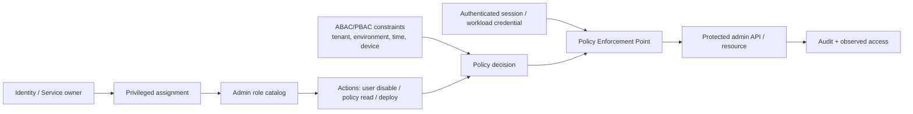
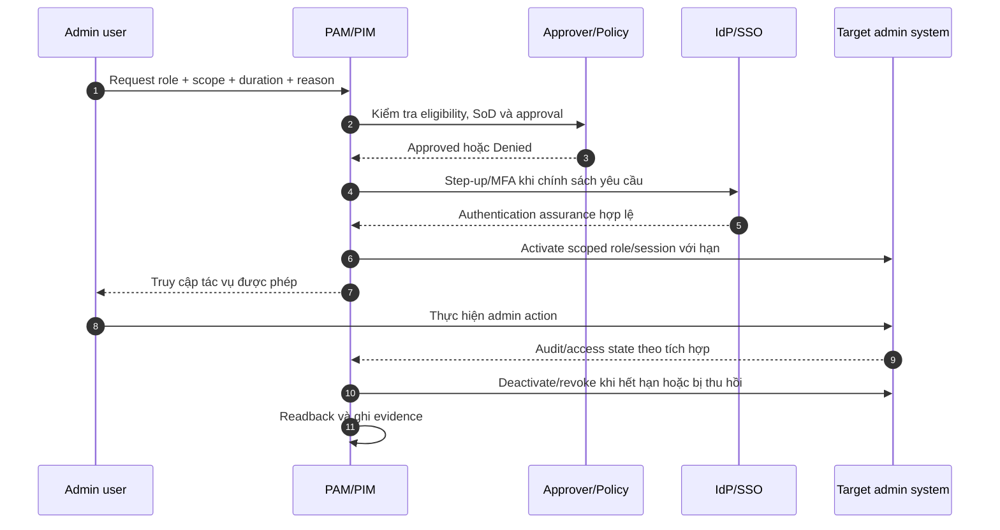
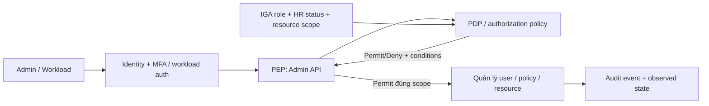

# Admin role trong Privileged Access và quản lý vòng đời danh tính IAM

## 1. Admin role là gì?

**Admin role** (vai trò quản trị) là một tập quyền được thiết kế để một chủ thể có thể **quản lý cấu hình, danh tính, dữ liệu, hạ tầng hoặc cơ chế bảo mật** của một phạm vi hệ thống xác định. Khác với role nghiệp vụ thông thường, admin role thường cho phép thực hiện những thao tác có tác động rộng như tạo tài khoản, cấp quyền cho người khác, thay chính sách bảo mật, quản lý khóa, thay đổi cấu hình hoặc xử lý sự cố.

Ví dụ, một nhân viên hỗ trợ ứng dụng có role `support-ticket-reader` chỉ được xem phiếu hỗ trợ; còn `application-user-admin` có thể khóa tài khoản, đặt lại phương tiện đăng nhập hoặc gán một số vai trò ứng dụng. **Tác động của quyền quản trị nằm ở thao tác được phép và phạm vi đối tượng chịu ảnh hưởng**, không nằm ở chữ “admin” trong tên role.

Một admin role có thể tồn tại trong **Identity Provider (IdP), dịch vụ thư mục, hệ điều hành, nền tảng cloud, hệ quản trị cơ sở dữ liệu, ứng dụng SaaS, công cụ CI/CD, PAM hoặc IAM/IGA**. Mỗi nền tảng định nghĩa quyền cụ thể khác nhau; không có một danh sách hành động `admin` chuẩn dùng chung cho mọi sản phẩm.

Trong module **SECURITY_IDENTITY_ACCESS_MANAGEMENT_IDENTITY_LIFECYCLE**, admin role cần được quản lý xuyên suốt **Joiner–Mover–Leaver (JML)**: xác minh đúng người được trao đặc quyền; cấp đúng phạm vi và thời hạn; rà soát, giảm hoặc đổi vai trò khi thay đổi công việc; thu hồi khi hết nhiệm vụ hoặc nghỉ việc; đồng thời xử lý **IdP, SSO, SCIM, RBAC/ABAC, tài khoản dịch vụ, phiên đặc quyền, kiểm toán và quyền truy cập tồn dư**.

Sau bài học, người đọc có thể phân loại admin role, xác định *blast radius*, thiết kế cấp quyền tối thiểu và quyền có thời hạn, phối hợp **Privileged Access Management (PAM)** với IAM/IGA, áp **Segregation of Duties (SoD)**, xử lý privileged access cho người và workload, và kiểm chứng quyền đã bị thu hồi thật sự.

> **Nguyên tắc xuyên suốt:** một người **có thể đủ điều kiện** nhận admin role nhưng không nhất thiết **đang được kích hoạt đặc quyền** tại mọi thời điểm; một lần đăng nhập SSO thành công cũng không tự cho phép thực hiện tác vụ quản trị.

## 2. Phân biệt admin role, admin account, admin permission và privileged session

Bốn khái niệm dưới đây thường bị dùng lẫn nhau, dẫn tới cấp quyền quá rộng hoặc thu hồi không đầy đủ.

| Khái niệm | Bản chất | Ví dụ | Điểm cần quản lý |
| --- | --- | --- | --- |
| **Admin permission** | Một quyền thao tác cụ thể trên tài nguyên | `user:disable`, `policy:update`, `secret:read` | Action, resource, scope, điều kiện |
| **Admin role** | Tập permission có ý nghĩa quản trị | `tenant-user-admin` | Owner, danh mục quyền, phạm vi, policy |
| **Admin account** | Tài khoản kỹ thuật dùng để thực hiện thao tác quản trị | Account quản trị riêng của một kỹ sư | Liên kết người/owner, credential, MFA, lifecycle |
| **Privileged assignment** | Quan hệ gán role/quyền cho một account | Account A được gán `tenant-user-admin` | Ai phê duyệt, khi nào, hết hạn ra sao |
| **Privileged session** | Phiên hoặc token trong đó đặc quyền được sử dụng | Phiên PAM 30 phút để thay cấu hình | Step-up, giám sát, timeout, revocation |
| **Eligible role** | Role có thể xin/kích hoạt khi đáp ứng điều kiện | Kỹ sư trực vận hành được quyền yêu cầu `prod-operator` | Chỉ eligibility, không tự là quyền đang active |

**Role không phải account.** Một cá nhân có thể có account nhân viên hằng ngày và một account quản trị riêng, cùng được liên kết đến một `identityId` chuẩn. Ngược lại, một service account có thể được gán nhiều role quản trị nhưng không có “người đăng nhập tương tác”.

**Role không phải phiên.** Gỡ role ở danh mục IAM không tự bảo đảm mọi token hoặc session đặc quyền đã phát trước đó không thể tiếp tục sử dụng. Cần biết nền tảng kiểm tra quyền khi nào, token chứa claim gì, phiên có thể bị thu hồi không và API có đánh giá lại authorization theo trạng thái hiện hành không.

### Ba trạng thái dễ nhầm

```text
Eligible: nhân viên được phép yêu cầu role PROD_OPERATOR
Assigned: hệ thống đã gán role theo một mô hình cấp quyền
Active: role hoặc phiên đặc quyền đang được sử dụng hợp lệ
```

Các trạng thái có thể trùng hoặc khác nhau tùy sản phẩm. Một hệ thống dùng standing access không có bước activation; một hệ thống PAM/PIM có thể giữ **eligible assignment** lâu hơn nhưng chỉ **activate** trong thời hạn ngắn. Khi thiết kế lifecycle, phải làm rõ chính xác các trạng thái mà hệ thống đích hỗ trợ.

## 3. Phân loại admin role theo phạm vi và tác động

Không nên xây một role `GLOBAL_ADMIN` rồi dùng nó cho mọi người làm việc vận hành. Cần phân loại theo **ranh giới tổ chức, sản phẩm, tài nguyên và hành động**.

| Loại role | Quyền tiêu biểu | Rủi ro nếu phạm vi quá rộng |
| --- | --- | --- |
| **IAM/Identity admin** | Tạo/khóa user, quản lý nhóm và phương thức xác thực | Chiếm đoạt account khác, mở rộng quyền qua provisioning |
| **Role/Policy admin** | Tạo role, sửa policy, gán role hoặc thay rule SoD | Tự cấp đặc quyền và vô hiệu các chốt bảo mật |
| **Tenant/Organization admin** | Quản lý cấu hình và thành viên của một tenant | Ảnh hưởng toàn bộ tổ chức/tenant, rò dữ liệu chéo |
| **Application admin** | Quản lý tính năng, account và cấu hình một ứng dụng | Tác động tới dữ liệu và hoạt động ứng dụng |
| **Cloud/platform admin** | Quản lý tài nguyên cloud, IAM, mạng hoặc hạ tầng | Blast radius lớn, có thể tiếp cận secrets và dữ liệu |
| **Database admin** | Schema, backup, vận hành DB, quyền dữ liệu | Rủi ro đọc/sửa/xóa lượng dữ liệu lớn |
| **Security admin** | Quản lý công cụ bảo mật, detection và policy | Có thể làm giảm năng lực phát hiện hoặc kiểm soát |
| **Audit/log admin** | Quản lý lưu trữ, cấu hình và truy cập audit | Có thể che giấu hoặc phá bằng chứng nếu SoD yếu |
| **Delegated admin** | Quản lý một OU, dự án, phòng ban hoặc phạm vi nhóm | Vượt quyền nếu scope không được thực thi chính xác |
| **Emergency/break-glass admin** | Truy cập khẩn cấp khi đường thường không khả dụng | Đặc quyền cao, cần giám sát và kiểm thử riêng |
| **Workload/service admin** | Automation quản lý tài nguyên hoặc triển khai | Secret/token lâu hạn có thể bị lạm dụng không cần người |

**Tên role chỉ là nhãn.** Một `user-admin` có thể chỉ đặt lại mật khẩu người dùng thường ở SaaS A, nhưng một `user-admin` khác có thể đặt lại MFA của admin cao nhất hoặc tạo tài khoản đặc quyền. Phải kiểm tra **permission thực tế**, khả năng ủy quyền tiếp, scope và tác động dây chuyền, không so sánh theo tên.

### Blast radius là gì?

**Blast radius** là phạm vi hậu quả nếu quyền bị lạm dụng hoặc credential bị chiếm: số account/tài nguyên/tenant bị ảnh hưởng, khả năng thay security control, khả năng lan sang hệ thống khác và mức độ khó khôi phục.

Role chỉ sửa cấu hình của một dự án thử nghiệm có blast radius khác với role thay policy tổ chức hoặc đọc mọi secret production. Đánh giá blast radius giúp quyết định yêu cầu MFA, JIT, approval, session monitoring, thời hạn và tần suất review.

## 4. Threat model của admin role

Admin role là mục tiêu hấp dẫn vì một quyền có thể tạo ra **nhiều quyền tiếp theo** hoặc vô hiệu các biện pháp kiểm soát.

| Đường rủi ro | Ví dụ | Kiểm soát trọng tâm |
| --- | --- | --- |
| **Credential theft/phishing** | Kẻ xấu chiếm mật khẩu/MFA và truy cập console | MFA chống phishing, passkey/khóa bảo mật, device policy |
| **Privilege escalation** | Account có quyền sửa role tự gán `super-admin` | SoD, kiểm soát grant, policy không cho self-elevation |
| **Privilege chaining** | Quyền đọc secret dẫn đến điều khiển một service account mạnh hơn | Đánh giá hiệu lực dây chuyền và secrets access |
| **Standing privilege** | Quyền production admin luôn tồn tại dù chỉ dùng mỗi tháng | JIT/PAM, role theo nhiệm vụ và thời hạn |
| **Session hijacking** | Cookie hoặc access token đặc quyền bị đánh cắp | Bảo vệ session/token, thời hạn ngắn, revocation, step-up |
| **Stale entitlements** | Mover sang team khác vẫn giữ `prod-admin` | Review JML, readback, runtime authorization |
| **Cross-tenant confusion** | Admin tenant A có thể sửa account tenant B | Resource/tenant-scoped enforcement |
| **Misconfigured delegation** | Delegated admin có thể chuyển nhượng quyền vượt scope | Constraints và kiểm tra target của mọi thao tác |
| **API/control-plane bypass** | UI kiểm tra quyền nhưng API quản trị không kiểm tra | PEP ở backend/control plane và negative tests |
| **Break-glass abuse** | Tài khoản khẩn cấp bị dùng hằng ngày | Owner, bảo vệ credential, alert và post-use review |
| **Shared service admin** | Automation dùng một token admin cho nhiều hệ thống | Workload identity, scope tối thiểu và credential rotation |
| **Log tampering** | Cùng người quản trị quyền và xóa log kiểm toán | SoD, bảo vệ audit độc lập và lưu giữ thích hợp |

**Quản trị đặc quyền không chỉ là chống người ngoài.** Lỗi vận hành, tài khoản mồ côi, phê duyệt thiếu thông tin và automation cấu hình sai cũng có thể tạo tác động tương đương sự cố bảo mật.

### Những gì admin role không thể tự bảo vệ

Một role được đặt tên hợp lý không ngăn lạm dụng nếu:

- Role có quá nhiều quyền ẩn hoặc kế thừa;
- Account có role bị chiếm do recovery yếu;
- API không kiểm tra target resource;
- Policy cho phép admin thay chính sách kiểm tra chính mình;
- Token/secret được chia sẻ ngoài danh sách account chính thức;
- Quyền đã bị gỡ trên IdP nhưng còn trong SaaS hoặc cache.

Do đó phải xem xét **identity + entitlement + session + execution + audit** như một chuỗi liên thông.

## 5. Admin role trong RBAC, ABAC và PBAC

**Role-Based Access Control (RBAC)** là cách phổ biến để mô hình hóa admin role: người dùng/account được gán role; role chứa permissions. Tuy nhiên, một admin role nên được giới hạn thêm bằng **scope và condition**.



Ví dụ một role được biểu diễn ở mức ý tưởng:

```yaml
roleId: TENANT_USER_OPERATOR
purpose: Support user lifecycle for an approved tenant
permissions:
  - user:read
  - user:disable
constraints:
  tenantScope: assignedTenantIds
  targets: nonPrivilegedAccountsOnly
  requiresRecentStrongAuthentication: true
  noSelfPrivilegeGrant: true
owner: identity-operations
```

Đây là **mô hình YAML minh họa**, không phải schema được một sản phẩm IAM/PAM bắt buộc chấp nhận. Các constraint phải được nền tảng **thực thi thật**; việc ghi `noSelfPrivilegeGrant: true` trong một file không mang lại bảo vệ nếu API gán role bỏ qua điều kiện.

### Quyền có hiệu lực quan trọng hơn quyền trong danh mục

Một account có thể có:

1. Vai trò được gán trực tiếp.
2. Vai trò kế thừa từ nhóm directory/IdP hoặc nhóm cloud.
3. Quyền ứng dụng được cấp thủ công.
4. Privileged assignment qua PAM/PIM.
5. Credential thay mặt một workload mạnh hơn.
6. Quyền quản trị được ủy quyền từ hệ thống khác.

Vì vậy việc review phải tính **effective permissions**, bao gồm role hierarchy, nhóm lồng nhau, resource-based policies, direct grants, deny/constraints và scope thực tế. **Không mặc định tất cả quyền được cộng đơn giản**: một số platform có chính sách deny, boundary hoặc điều kiện ưu tiên.

## 6. Least privilege: thiết kế admin role theo nhiệm vụ

**Principle of Least Privilege** yêu cầu chỉ cấp những thao tác, tài nguyên và thời gian cần thiết cho nhiệm vụ đã được phê duyệt.

Thay vì:

```text
ROLE: ALL_PLATFORM_ADMIN
Permissions: * trên mọi subscription/tenant
Duration: Unlimited
```

một thiết kế có kiểm soát hơn có thể là:

```text
ROLE: PROD_LOG_VIEWER
Actions: logs:read, incidents:view
Resources: services thuộc project-orion
Environment: production
Duration: theo trực vận hành
Restrictions: không xem secret, không sửa IAM policy

ROLE: PROD_DEPLOY_OPERATOR
Actions: deploy:execute, deployment:rollback
Resources: project-orion only
Activation: approved JIT session
Restrictions: không gán role, không đổi network policy
```

Các role trên là **khái niệm**, không phải tên/permission API của một cloud cụ thể. Nhiệm vụ phải được ánh xạ vào capability thật của nền tảng.

### Kỹ thuật giảm đặc quyền

- **Tách role đọc/ghi/phê duyệt** thay vì một admin bao trùm.
- **Scope theo tenant/project/environment/resource** thay vì toàn tổ chức.
- **Chỉ cho thao tác đã định danh**, tránh wildcard `*` khi có lựa chọn phù hợp.
- **JIT activation** chỉ trong thời gian làm việc cần quyền cao.
- **Just Enough Administration (JEA)**: giới hạn tới tập lệnh/chức năng quản trị cần thiết, thay vì shell admin rộng; tính năng cụ thể tùy nền tảng.
- **Just-in-time entitlement expiration** để quyền tạm tự hết hạn.
- **Separation of Duties** để tránh một người vừa yêu cầu, vừa duyệt, vừa ghi audit cho quyền của chính mình.
- **Không dùng admin role cho tác vụ thường** như email, web browsing hoặc đọc báo cáo không yêu cầu đặc quyền.

**Một admin role đã được chia nhỏ vẫn có thể quá rộng** nếu mỗi permission thao tác trên toàn tenant hoặc cho phép sửa IAM policy để tự mở rộng quyền. Cần kiểm tra quyền “trao quyền cho quyền khác” và đường truy cập secrets.

## 7. Standing access, Just-in-Time và Privileged Access Management

**Standing privilege** là đặc quyền tồn tại thường trực cho đến khi chủ động thu hồi. Với những nhiệm vụ không cần đặc quyền liên tục, đây là bề mặt rủi ro không cần thiết.

**Privileged Access Management (PAM)** là nhóm kiểm soát và giải pháp để quản lý, bảo vệ, giám sát quyền quản trị và credential/phiên đặc quyền. Một số nền tảng còn sử dụng thuật ngữ **Privileged Identity Management (PIM)** cho việc quản trị role eligible/active theo thời hạn. PAM/PIM và JIT bổ trợ cho nhau nhưng không phải sản phẩm nào cũng có cùng các tính năng.

| Mô hình | Cách hoạt động | Lợi ích | Điều phải kiểm chứng |
| --- | --- | --- | --- |
| **Standing admin** | Role active liên tục | Sẵn sàng thao tác | Chỉ dùng khi có căn cứ; MFA, audit, review chặt |
| **Eligible + activate** | Có eligibility, phải kích hoạt role khi cần | Giảm thời gian quyền cao active | Thời gian tối đa, approval, device/MFA, expiry |
| **JIT permission** | Cấp quyền đúng tác vụ rồi tự thu hồi | Hạn chế cửa sổ rủi ro | Thực thi revoke đúng; session/token cũ được xử lý |
| **JEA/command restriction** | Chỉ mở một tập thao tác quản trị | Giảm blast radius khi phải dùng lệnh | Lệnh có thể gọi gián tiếp chức năng nguy hiểm không |
| **PAM session brokering** | Truy cập đích qua gateway/bastion/PAM | Kiểm soát phiên, có thể ghi log hoặc ghi hình phù hợp | Đường trực tiếp tới hệ thống đích có bị khóa không |
| **Credential vault** | Lưu/luân chuyển secret đặc quyền | Giảm phát tán mật khẩu/khóa | Quyền lấy secret, rotation, audit, backup của vault |

**Eligible không có nghĩa đã active.** Một người được phép xin vai trò `prod-db-admin` có thể phải qua approval, MFA/step-up và activation; sau khi hết hạn, việc truy cập trực tiếp phải bị chặn bởi nền tảng hoặc điểm thực thi tương ứng.

### Luồng kích hoạt JIT



Một lần JIT approval **không tự tạo cơ chế thu hồi token ngoài nền tảng**. Phải biết role được đưa vào token lúc nào, quyền được đánh giá tại request hay chỉ khi tạo phiên, và cách ngăn một token còn hiệu lực sau deactivation.

## 8. Phân tách danh tính thường và đặc quyền

Tổ chức có thể dùng **tài khoản quản trị riêng** cho hoạt động có rủi ro cao, thay vì dùng chung account email/làm việc thường ngày. Mục tiêu là giảm việc sử dụng credential đặc quyền ở các môi trường dễ bị phishing, tiện ích trình duyệt hoặc máy trạm chưa được quản lý.

Ví dụ:

```text
identityId: id-1042
ordinaryAccount: an.nguyen@example.org
privilegedAccount: adm-an.nguyen@example.org
privilegedRole: TENANT_USER_OPERATOR
roleOwner: IAM operations
activationPolicy: MFA + managed device + approval + TTL
```

Đây là cách biểu diễn **minh họa**. Một nền tảng dùng role activation trên cùng account thay vì account tách biệt cũng có thể đáp ứng mục tiêu nếu ranh giới, session, quyền và audit được thực thi thích hợp.

**Tài khoản quản trị riêng vẫn phải liên kết với chủ thể chịu trách nhiệm.** Không nên tạo các account `admin01`, `admin02` không có owner rõ ràng, vì rất khó gắn hành động với người thật và xử lý khi nhân viên nghỉ việc.

### Kiểm soát trong phiên admin

- Xác thực mạnh, ưu tiên **MFA chống phishing** như passkey/khóa bảo mật khi khả thi.
- Step-up hoặc reauthentication cho thao tác rất nhạy cảm; không chỉ dựa vào phiên đã tạo từ lâu.
- Giới hạn thiết bị/quy trình truy cập theo chính sách, ví dụ workstation quản trị chuyên dụng.
- Bảo vệ cookies, bearer tokens, SSH keys và session; không ghi credential vào terminal history hoặc log.
- Timeout nhàn rỗi và timeout tuyệt đối phù hợp; cơ chế sign-out/revoke theo nền tảng.
- Không dùng cùng phiên admin để duyệt web không tin cậy hoặc tác vụ thông thường.
- Giám sát bất thường, truy cập ngoài lịch hoặc các thay đổi tới cấu hình chính sách/quyền.

**Không nên mô tả MFA như một bảo đảm tuyệt đối.** Phương thức khôi phục account, session hijacking, token bị lộ và quyền cấp quá rộng vẫn cần được bảo vệ riêng.

## 9. Quy trình yêu cầu và phê duyệt admin role

Một admin role cần được gán dựa trên **mục đích nghiệp vụ và người phê duyệt đúng thẩm quyền**, không chỉ vì người yêu cầu là nhân viên IT.

### Thông tin tối thiểu của một yêu cầu

| Trường | Ý nghĩa |
| --- | --- |
| `identityId` / `accountId` | Ai và tài khoản nào sẽ nhận quyền |
| `roleId` / `roleVersion` | Chính xác tập quyền đang được yêu cầu |
| `targetSystem` / `tenant` | Nền tảng và phạm vi ảnh hưởng |
| `resourceScope` | Dự án, subscription, OU, dữ liệu hoặc môi trường cụ thể |
| `businessJustification` | Tác vụ nào cần quyền, ticket/change reference |
| `requestedStart`, `requestedEnd` | Thời điểm bắt đầu và hết hạn |
| `riskTier` | Mức ảnh hưởng từ role và các quyền gián tiếp |
| `approver` | Role owner/application owner/data owner hoặc cấp có thẩm quyền |
| `sodEvaluation` | Xung đột quyền và yêu cầu kiểm soát bù |
| `authenticationRequirements` | MFA/step-up, thiết bị, phiên đặc quyền |
| `executionTargetId` | Account/role thực tế tại hệ thống đích |

### Quy trình cấp quyền có kiểm soát

1. **Identity resolution:** xác minh account gắn với đúng người hoặc workload.
2. **Eligibility:** kiểm tra trạng thái nhân sự/hợp đồng/owner và phạm vi công việc.
3. **Role lookup:** lấy permission/scope từ role catalog đã được phê duyệt, không dùng tên role tự khai.
4. **Risk & SoD:** phân tích quyền hiện có, khả năng tự nâng quyền và xung đột.
5. **Approval:** người phê duyệt độc lập trong phạm vi cần thiết; không chấp thuận vì người yêu cầu tự khai “khẩn cấp”.
6. **Provisioning/activation:** cập nhật role tại đích hoặc mở phiên JIT bằng tài khoản connector có quyền tối thiểu.
7. **Readback:** kiểm tra đúng role, scope, thời hạn và trạng thái active tại hệ thống thực tế.
8. **Audit:** lưu lý do, actor, approver, kết quả; theo dõi expiry và review.

**Một yêu cầu được phê duyệt không đồng nghĩa role đã được cấp.** Nếu connector lỗi, tenant sai hoặc role mapping không tồn tại, workflow phải giữ trạng thái chưa hoàn tất và không tự mở quyền rộng hơn để “khắc phục nhanh”.

## 10. Segregation of Duties (SoD) cho admin role

**Segregation of Duties** ngăn một người hoặc một chuỗi quyền có thể tự thực hiện mọi bước nhạy cảm của một quy trình mà không có kiểm soát độc lập.

Các cặp xung đột thường cần cân nhắc:

| Quyền A | Quyền B | Nguy cơ |
| --- | --- | --- |
| **Yêu cầu cấp quyền** | **Tự phê duyệt yêu cầu ấy** | Self-approval, mất kiểm soát độc lập |
| **Gán admin role** | **Sửa mọi audit record liên quan** | Có thể che giấu việc nâng quyền |
| **Tạo giao dịch thanh toán** | **Phê duyệt chính giao dịch đó** | Gian lận hoặc lỗi không được phát hiện |
| **Thay policy bảo mật** | **Tự đánh giá tuân thủ policy ấy** | Mất tính độc lập của đánh giá |
| **Phát hành secret** | **Sử dụng/đọc mọi secret không giới hạn** | Vượt phạm vi nghiệp vụ và lan đặc quyền |
| **Quản lý backup** | **Xóa backup/retention logs không kiểm soát** | Phá khả năng phục hồi hoặc bằng chứng |

### SoD tĩnh, động và theo giao dịch

- **Static SoD:** không cho gán đồng thời những role xung đột.
- **Dynamic SoD:** một số role có thể được gán nhưng không được kích hoạt đồng thời trong cùng ngữ cảnh theo thiết kế.
- **Transaction SoD:** kiểm tra actor tạo/đề xuất và actor phê duyệt **trên chính đối tượng nghiệp vụ**; RBAC danh nghĩa chưa đủ.

Role hierarchy và quyền gián tiếp rất quan trọng. Một người không có `AUDIT_ADMIN` trực tiếp nhưng có quyền cloud root hoặc quyền thay ACL của kho log vẫn có thể kiểm soát audit. **SoD phải xét effective permissions, đường ủy quyền và khả năng thay role policy**, không chỉ tên của hai role.

### Ngoại lệ có giới hạn

Trong một sự cố nghiêm trọng, tổ chức có thể dùng cơ chế phê duyệt khẩn cấp với thời hạn và giám sát riêng. Ngoại lệ cần ghi lý do, người phê duyệt độc lập khi khả thi, scope, hạn, cảnh báo và review sau sử dụng. **Không biến ngoại lệ khẩn cấp thành quyền standing không hết hạn**.

## 11. Enforcement: admin role phải được kiểm tra ở đúng điểm

Một admin role an toàn cần được thực thi tại **Policy Enforcement Point (PEP)** hoặc cơ chế authorization tương đương ở **control plane/API** của hệ thống đích.



Các đầu vào quan trọng của quyết định:

- **Subject:** `identityId`, account, actor hoặc workload owner, loại chủ thể.
- **Action:** ví dụ `user:disable`, `group:modify`, `policy:write`.
- **Resource:** account đích, nhóm, tenant, project, classification, ownership.
- **Context:** thời điểm, trạng thái JML, session assurance, JIT activation, device condition, ticket/changerequest khi được policy yêu cầu.
- **Effective entitlements:** role được gán, scope, quyền kế thừa, direct grant, deny/constraints.
- **Policy version:** phiên bản quy tắc và điều kiện phù hợp.

### Không đủ chỉ ẩn nút quản trị

**UI không phải ranh giới an ninh đầy đủ.** Nếu client có thể gọi trực tiếp API `POST /users/{id}/roles`, API cần kiểm tra quyền actor **và target**. Ví dụ admin được phép đặt lại password của người dùng thường nhưng không được reset MFA của global admin; endpoint phải phân biệt hai trường hợp.

### Tránh confused deputy và BOLA

Một service quản trị có role mạnh được gọi thay người dùng có role yếu có thể trở thành **confused deputy** nếu chỉ kiểm tra quyền của service và bỏ qua quyền actor. Tương tự, **Broken Object-Level Authorization (BOLA/IDOR)** xuất hiện khi API chỉ kiểm tra `isAdmin=true` mà không kiểm tra `tenantId` hoặc owner của tài nguyên đích.

**Quyền trong token không tự đủ.** PEP cần ràng buộc issuer, audience, subject, action, resource và scope, đồng thời xét trạng thái quyền hiện hành khi chính sách yêu cầu.

## 12. Ví dụ cấu trúc privileged assignment và activation

Dưới đây là mô hình JSON **minh họa do hệ thống IAM nội bộ xây dựng**; không phải chuẩn SCIM hoặc giao diện của một PAM/PIM cụ thể:

```json
{
  "requestId": "priv-req-8041",
  "identityId": "id-1042",
  "accountId": "adm-account-442",
  "target": {
    "system": "cloud-platform",
    "environment": "production",
    "scope": "project-orion"
  },
  "role": {
    "id": "PROD_DEPLOY_OPERATOR",
    "version": "v6",
    "riskTier": "HIGH"
  },
  "assignment": {
    "type": "ELIGIBLE",
    "effectiveFrom": "2026-11-23T03:00:00Z",
    "effectiveUntil": "2026-12-23T03:00:00Z"
  },
  "activation": {
    "requestedDurationMinutes": 45,
    "requiresApproval": true,
    "requiresStepUp": true
  },
  "approval": {
    "state": "APPROVED",
    "approverRef": "prod-platform-owner",
    "reasonCode": "MAINTENANCE_CHANGE"
  },
  "execution": {
    "state": "PENDING_ACTIVATION",
    "lastVerifiedAt": null
  }
}
```

**Vì sao phải có hai thời hạn?** Một người có thể đủ điều kiện nhận đặc quyền trong một tháng phục vụ lịch trực, nhưng chỉ được kích hoạt tối đa 45 phút/lần. Cấu hình phải được thực thi ở PAM/target, không chỉ nằm trên giấy.

**`APPROVED` khác `ACTIVE`.** Workflow có thể được duyệt nhưng chưa tạo assignment/activation tại hệ thống. Chỉ đánh dấu hoàn tất khi kiểm chứng target thực tế theo hợp đồng.

### Trường không nên đưa vào báo cáo

Không nhúng **password, private key, access token, session cookie hoặc reset token** vào JSON audit/certification. Dùng ID tham chiếu và mã tương quan phù hợp. Những thông tin về admin role cũng nhạy cảm vì có thể giúp lập bản đồ đặc quyền của tổ chức.

## 13. Kết nối IdP, SSO, SCIM, directory và PAM

Một kiến trúc privileged access thường chứa nhiều thành phần với trách nhiệm riêng.

| Thành phần | Vai trò | Điều cần lưu ý |
| --- | --- | --- |
| **HRIS/Contract registry** | Tình trạng nhân viên, nhà thầu, hạn và nguồn JML | Thẩm quyền nghiệp vụ, không tự cấp admin |
| **Identity registry** | Liên kết người/workload với các account đích | ID ổn định; không dùng email làm khóa duy nhất |
| **IGA/Role catalog** | Quyết định và phê duyệt admin role; SoD, review | Cần owner, risk tier, hạn và mapping |
| **IdP/SSO** | Xác thực, MFA, phát session/token qua OIDC/SAML | Login thành công không tự là admin |
| **LDAP/Directory** | Lưu group, account hoặc thuộc tính của một số hệ thống | Group và cờ account phụ thuộc sản phẩm |
| **SCIM/API connector** | Đồng bộ User/Group/trạng thái hoặc entitlement | SCIM không bảo đảm mọi privileged role được biểu diễn |
| **PAM/PIM** | Quản lý activation, secret hoặc privileged session | Cần tích hợp thu hồi khi JML và kiểm chứng expiry |
| **Target API/PEP** | Thực thi quyền trên action/resource thực tế | Phải chặn bypass, scope, tenant isolation |
| **Audit/SIEM** | Giám sát hành động và thay đổi đặc quyền | Bảo vệ log độc lập và không để lộ secret |

**SCIM không phải giao thức PAM.** SCIM User/Group có thể giúp tạo account hoặc điều chỉnh membership tại một SaaS, nhưng **quyền quản trị sản phẩm** có thể được gán thông qua API khác, nhóm mapping riêng hoặc console. Trước khi kết luận đã thu hồi một admin role, phải kiểm tra **hệ thống thực sự cấp vai trò đó**.

### Group-to-admin-role mapping

Một nhóm `cloud-operators` trên IdP có thể được ánh xạ tới role ở cloud platform. Nếu người dùng bị gỡ khỏi nhóm nhưng cloud đã cấp **direct assignment** riêng, quyền có thể còn. Nếu role được nhúng trong JWT tự chứa, token cũ có thể vẫn còn giá trị theo TTL. IAM phải đối soát **membership, direct assignments và runtime authorization**.

## 14. Joiner: cấp quyền quản trị có điều kiện, không mặc định

**Joiner** trong IAM gồm xác minh quan hệ nhân sự/hợp đồng, identity proofing, enrollment credential, tạo account và quyền tối thiểu. Quyền quản trị thường không nên là **birthright access** rộng chỉ vì job title có chữ “engineer” hoặc “IT”.

Một luồng Joiner an toàn:

1. **HRIS/sponsor xác nhận:** có người hoặc nhà thầu được tuyển vào một trách nhiệm cụ thể, thời điểm bắt đầu rõ.
2. **Identity correlation:** liên kết đúng chủ thể với `identityId`, tránh trùng người/email.
3. **Tạo account thường:** những quyền cơ bản để làm việc được cấp theo policy.
4. **Yêu cầu admin riêng:** chọn role theo nhiệm vụ, hệ thống và scope, không tự cấp toàn tenant.
5. **Risk/SoD review:** xác định quyền hiện có, xung đột và blast radius.
6. **Approver phù hợp:** application/platform owner hoặc Security duyệt theo phân loại.
7. **Enrollment mạnh:** thiết lập MFA/step-up, thiết bị phù hợp và phương tiện phục hồi an toàn.
8. **Provision eligibility/assignment:** PAM/PIM/connector cấp đúng role và hạn, không kích hoạt trước ngày hiệu lực.
9. **Readback và thử quyền:** kiểm chứng role có thể thực hiện tác vụ được phép và không vượt scope.
10. **Audit:** ghi nguồn, policy, approver và kết quả.

### Ví dụ nhân viên mới của đội vận hành

Một kỹ sư mới vào đội platform cần xem log production khi trực. Role `PROD_LOG_VIEWER` phù hợp hơn `GLOBAL_PLATFORM_ADMIN`. Nếu sau này cần triển khai phiên bản ứng dụng, có thể xin role `PROD_DEPLOY_OPERATOR` có hạn qua JIT. **Không dùng quyền của người đi trước làm mẫu mặc định** vì người ấy có thể đã tích lũy nhiều ngoại lệ.

## 15. Mover: giảm đặc quyền trước khi tích lũy quyền mới

**Mover** gồm thay bộ phận, dự án, trách nhiệm hoặc môi trường làm việc. Đây là lúc dễ xuất hiện **privilege creep**: role cũ không bị thu hồi nhưng role mới vẫn được cấp.

```text
Before Mover:
  eligibleRole: ORION_PROD_DEPLOY
  activeRole: ORION_PROD_DEPLOY (until 11:30)
  standingRole: SHARED_SUPPORT_ADMIN

After Mover to data analytics:
  desired: ANALYTICS_DATA_READER
  revoke: ORION_PROD_DEPLOY, SHARED_SUPPORT_ADMIN
  activate: none, unless new task approved
```

IAM/IGA cần:

- Xác minh **event version, effective time, lifecycle generation** từ nguồn có thẩm quyền.
- Tính `toRevoke`, `toGrant`, `toKeep` từ role catalog/policy mới.
- Đánh giá SoD; trong những thay đổi có xung đột, **thu hồi quyền cũ trước khi cấp quyền mới** nếu chính sách yêu cầu.
- Thu hồi **standing assignment, eligibility, activation đang hoạt động, session và token** phù hợp từng nền tảng.
- Kiểm tra cả **group mapping, direct grant, role kế thừa, API key và quyền ở cloud/SaaS**.
- Readback để đảm bảo không còn role quản trị dự án cũ; kiểm thử đường API không còn được phép.
- Ghi exception bàn giao nếu cần, với owner, phạm vi, thời hạn và sự giám sát thích hợp.

**Chỉ cập nhật phòng ban trong HRIS hoặc đổi OU của account LDAP không đủ.** Nếu PAM còn role eligible hoặc cloud còn direct assignment, người dùng có thể kích hoạt/truy cập đặc quyền sau Mover.

### Cửa sổ bàn giao

Có thể cần giữ quyền cũ vài ngày để bàn giao, nhưng không nên giữ toàn bộ admin vĩnh viễn. Dùng role có hạn, scope cụ thể, approval bổ sung và **thu hồi tự động/đối soát khi hết hạn**. Với quyền nhạy cảm, có thể thay quyền standing bằng session JIT có giám sát.

## 16. Leaver: thu hồi nhiều lớp, không chỉ xóa một role

Khi HRIS hoặc nguồn hợp đồng xác nhận **Leaver**, mục tiêu là **chặn mọi đường truy cập không còn hợp lệ**. Thu hồi admin role chỉ là một phần.

| Lớp | Rủi ro còn lại | Hành động cần cân nhắc |
| --- | --- | --- |
| **Identity/IdP** | Account vẫn đăng nhập được hoặc SSO session còn | Disable account, revoke session/refresh token theo nền tảng |
| **PAM/PIM** | Eligible và active role còn tồn tại | Xóa eligibility, deactivate, kết thúc privileged session |
| **Cloud/SaaS** | Direct admin assignment còn | Gỡ đúng resource/tenant; readback |
| **Directory/SCIM** | Nhóm admin hoặc local account vẫn active | Cập nhật User/Group/role qua connector phù hợp |
| **API credentials** | PAT, API key, SSH key, certificate còn dùng | Thu hồi/luân chuyển khóa liên quan |
| **Vault/secrets** | Người đã nghỉ biết hoặc có bản sao secret | Đánh giá rotation, cập nhật quyền vault, bảo vệ bản sao |
| **Break-glass** | Credential khẩn cấp thuộc hoặc bị giữ bởi cá nhân | Chuyển giao, bảo vệ, rotation khi có căn cứ |
| **Automation** | Job vẫn chạy bằng account có owner đã Leaver | Chuyển service owner, đánh giá workload riêng |
| **Audit/evidence** | Không còn biết ai đã thực hiện thao tác | Lưu log, bàn giao và retention theo chính sách |

**Không đợi toàn bộ SLO thành công mới chặn admin access.** Ứng dụng có thể giữ session/token riêng, không hỗ trợ back-channel logout, hoặc có API key độc lập. Những đường truy cập đã nhận diện phải được xử lý tại đúng nơi phát hành/quyết định quyền.

### Không xóa ngay account bằng mọi giá

Chặn đăng nhập/đặc quyền thường cần ưu tiên, nhưng xóa account có thể phải tuân thủ bàn giao dữ liệu, log kiểm toán, legal hold hoặc chính sách retention. **Disabled nhưng còn dữ liệu phục vụ nghĩa vụ hợp pháp** khác với **vẫn có khả năng xác thực hoặc thực hiện action**. Phải kiểm tra cái thứ hai.

### Sự kiện cũ sau Leaver

Nếu hệ thống đồng bộ nhận lại Mover/Joiner cũ sau khi account đã Leaver, không được dùng sự kiện đó để phục hồi group hoặc admin assignment. Cần **version, effectiveAt, nguồn có thẩm quyền và kiểm tra trạng thái hiện hành**. Rehire là một quá trình độc lập với đánh giá role mới.

## 17. Rà soát định kỳ và access certification cho admin role

Admin roles nên là trọng tâm của chương trình **access review/certification** vì một quyền tồn dư có thể tạo hậu quả lớn. Review không nên chỉ xuất danh sách `userName, roleName`.

Một bản ghi review hữu ích cần có:

| Dữ liệu | Tại sao cần? |
| --- | --- |
| `identityId`, loại chủ thể, lifecycle status | Xác định đúng người/workload và trạng thái JML |
| Role ID/version và tên hệ thống | Biết chính xác bộ quyền |
| Permissions và resource scope | Hiểu blast radius, không chỉ tên |
| Assignment source | Phân biệt IGA, IdP group, direct grant, PAM activation |
| Eligible vs active vs standing | Biết đặc quyền có thể được kích hoạt hoặc đang tồn tại |
| Ngày cấp, lần sử dụng, expiry | Phát hiện quyền tồn dư và nhu cầu thực |
| Role owner/approver và lý do | Có người chịu trách nhiệm |
| SoD conflicts và exception | Xử lý xung đột hoặc quyền quá rộng |
| Kết quả revoke/readback | Chứng minh thay đổi đã có hiệu lực tại target |
| Session/credential residual risk | Không bỏ sót token hoặc quyền ngoài SSO |

### Quyết định review

- **KEEP:** còn nhu cầu và đúng phạm vi; ghi lý do, thời hạn, owner.
- **MODIFY:** thu hẹp role, scope, duration hoặc đổi sang JIT.
- **REVOKE:** không còn căn cứ hoặc vi phạm chính sách; thực thi và readback.
- **ESCALATE:** mapping không rõ, SoD, tự cấp quyền hoặc thiếu owner.
- **EXCEPTION:** có lý do đặc biệt, người phê duyệt phù hợp, kiểm soát bù và hạn.

**Reviewer chọn REVOKE chưa có nghĩa đã hoàn tất.** Nếu connector trả lỗi hoặc role còn active trong cloud, trạng thái phải là `PARTIAL`/open remediation, có người chịu trách nhiệm và thời hạn xử lý. **Không lấy tỷ lệ “đã bấm approve” làm thước đo duy nhất của an toàn đặc quyền**.

## 18. Break-glass admin: ngoại lệ phải có vòng đời riêng

**Break-glass account/role** phục vụ truy cập khẩn cấp khi SSO, PAM hoặc quy trình quản trị bình thường gặp sự cố nghiêm trọng. Nó là một ngoại lệ có chủ đích nhưng phải được **kiểm soát chặt, độc lập với một cá nhân và kiểm thử định kỳ theo chính sách**.

Những điểm quan trọng:

1. **Mục đích rõ:** chỉ dùng cho kịch bản khẩn cấp được phép, không dùng để tránh approval thường ngày.
2. **Độc lập phù hợp:** không hoàn toàn phụ thuộc vào chính hệ thống có thể bị sự cố.
3. **Credential bảo vệ mạnh:** phương tiện xác thực và cách giữ bí mật theo khả năng nền tảng, chia quyền sử dụng thích hợp.
4. **Theo dõi và cảnh báo:** phát hiện ngay khi account khẩn cấp được sử dụng hoặc policy của nó thay đổi.
5. **Review sau sử dụng:** ticket sự cố, actor, hành động, lý do và tác động.
6. **Kiểm thử có kiểm soát:** xác nhận đường truy cập hoạt động khi cần, không chạy thử theo cách làm gián đoạn production.
7. **Bàn giao/rotation:** xử lý khi người giữ phương tiện bảo vệ nghỉ việc hoặc credential bị nghi lộ.
8. **Retention/audit:** đảm bảo truy nguyên được sự kiện mà không lộ secret.

**Không nên xóa một break-glass account chỉ vì nhiều tháng chưa dùng**, vì chính mục đích của nó là dự phòng. Nhưng một break-glass không có owner, không được giám sát hoặc có credential chia sẻ công khai cũng không phải phương án an toàn.

### Break-glass và SoD

Một account khẩn cấp có thể có quyền cao hơn mức tối thiểu của từng tác vụ. Bù lại, tổ chức cần **điều kiện kích hoạt, kiểm toán ngoài đường quản trị thông thường, kiểm tra độc lập sau sử dụng và hạn chế sử dụng hằng ngày**. Nên tách quyền quản lý log/audit khỏi người đang dùng break-glass khi kiến trúc hỗ trợ.

## 19. Admin role của service account và workload identity

**Service account** và **workload identity** có thể cần đặc quyền vận hành hạ tầng nhưng không đăng nhập tương tác như nhân viên. Ví dụ pipeline CI/CD có quyền triển khai vào một namespace Kubernetes; controller cloud có quyền tạo tài nguyên trong một project; connector IAM có quyền sửa User/Group trong một OU.

### Những khác biệt phải xét

| Chủ đề | Admin của con người | Admin của workload |
| --- | --- | --- |
| Chủ thể chịu trách nhiệm | Người và manager/sponsor | Service owner, team và workload registry |
| Authentication | Passkey/MFA/SSO/step-up | mTLS, managed identity, workload federation, signed tokens |
| Activation | Có thể xin JIT và duyệt tương tác | Có thể cấp token ngắn hạn theo deployment job/policy |
| Phạm vi | Tác vụ theo phiên/ticket | API/action/resource/environment cụ thể |
| Credential | Session, PAM, admin account | Token, certificate, key, client secret |
| JML trigger | HRIS/contract | Service registry, deployment lifecycle, owner change |
| Audit | Người ra lệnh và action | Workload ID, job/run ID, owner, policy/target |

**Không dùng một tài khoản `svc-admin` chia sẻ cho toàn bộ pipeline.** Khi workload có thể dùng federation, managed identity hoặc token ngắn hạn, tổ chức nên ưu tiên giảm secret tĩnh. Trust cần ràng buộc **issuer, audience, subject, repo/project, environment và phạm vi** phù hợp nền tảng.

### Owner Leaver khác workload Leaver

Nếu kỹ sư tạo service account nghỉ việc nhưng ứng dụng vẫn chạy, cần **chuyển owner, rà soát quyền và credential**, không tự xóa account làm gián đoạn production. Khi **workload thực sự ngừng**, phải thu hồi role, secret, token, certificate, trust và đối soát tại tài nguyên đích.

## 20. Admin role, session/token và quyền tồn dư

Đặc quyền có thể được duy trì qua nhiều cơ chế ngay cả khi bản ghi role đã thay đổi:

- **IdP/SSO session** xác nhận người dùng vẫn đăng nhập nhưng không tự nói role đang còn.
- **RP/application session** có thể giữ thông tin role cũ trong session store.
- **OAuth access token** có thể chứa scope hoặc claim và vẫn hợp lệ đến `exp` theo mô hình kiểm tra.
- **Refresh token** có thể tiếp tục cấp access token nếu chưa bị thu hồi theo khả năng authorization server.
- **API key/PAT** có thể được cấp độc lập với session browser.
- **PAM session/SSH session** có thể tồn tại ngoài vòng đời phiên IdP.
- **Direct cloud role** có thể còn dù membership directory đã được sửa.

**Chỉ logout trình duyệt không đồng nghĩa đã thu hồi toàn bộ đặc quyền.** Cần kiểm tra cơ chế revocation, session termination, TTL, policy re-evaluation và credential rotation của từng nền tảng.

### Một mô hình hiệu lực thời gian

```text
T0: IGA quyết định revoke role PROD_OPERATOR
T1: PAM xóa eligible assignment
T2: Target xóa active role/direct grant
T3: Phiên hoặc token cũ bị từ chối tại resource
T4: Reconciliation xác minh không có đường access tồn dư
```

**`T0` không tự đồng nghĩa `T3` hoặc `T4`.** SLA deprovisioning nên đo từ sự kiện nguồn đến khi **quyền không còn được sử dụng tại điểm thực thi**, không chỉ từ request gửi đi đến HTTP 200.

### Cache và revoke

Một API chỉ xác minh chữ ký JWT tự chứa có thể chấp nhận token cũ đến khi hết hạn nếu không có cách kiểm tra trạng thái. Với quyền đặc biệt, nên cân nhắc token ngắn hạn, quyền được đánh giá lại, introspection/revocation khi hỗ trợ, session termination và cơ chế chặn deny-list theo thiết kế. **Không cam kết thu hồi tức thì nếu nền tảng không có năng lực thực tế để thực thi**.

## 21. Provisioning và readback admin role qua SCIM/API

Một admin role có thể được cấp qua **SCIM Group**, API riêng, directory group hoặc PAM. Cần phân biệt **resource identity**, **membership** và **privileged permission**.

Ví dụ một SCIM PATCH chỉ để minh họa việc gỡ account khỏi Group được map sang role, nếu provider hỗ trợ:

```http
PATCH /scim/v2/Groups/sp-group-operators HTTP/1.1
Authorization: Bearer <CONNECTOR_TEST_TOKEN>
Content-Type: application/scim+json

{
  "schemas": ["urn:ietf:params:scim:api:messages:2.0:PatchOp"],
  "Operations": [
    {"op": "remove", "path": "members[value eq \"sp-user-1042\"]"}
  ]
}
```

**Request trên không phải quy trình thu hồi admin role phổ quát.** SCIM Group ID và User ID phải là ID thật của service provider, không lấy từ email hay role name; Group và PATCH/valuePath phải được provider hỗ trợ; cùng một quyền có thể còn tồn tại qua direct grant hoặc group khác.

Sau request, **readback** cần kiểm tra:

1. Account đích và identity mapping đúng, không nhầm tenant.
2. Group membership đã thay đổi theo expected state.
3. Không có admin role được gán trực tiếp hoặc kế thừa từ nguồn khác.
4. PAM/PIM eligibility/activation liên quan đã được xử lý.
5. API quản trị **thực sự từ chối** hành động không còn quyền.
6. Session/token/credential còn sống được xử lý trong cửa sổ rủi ro đã duyệt.
7. Nếu kết quả chưa xác minh được, đánh dấu `PARTIAL`/escalate.

**SCIM không phải giao thức đăng nhập.** Tạo User, cập nhật `active` hoặc gỡ Group không tự hủy các phiên SSO và token API đã phát; các lớp đó cần kiểm tra riêng.

## 22. Vòng đời admin role trong dữ liệu quản trị

Để tự động hóa có kiểm soát, quản lý **role definition** và **assignment** như những thực thể có vòng đời/phiên bản.

### Role definition

Ví dụ role catalog có thể ghi:

| Trường | Mục đích |
| --- | --- |
| `roleId`, `version` | Khóa ổn định và lịch sử thay đổi |
| `purpose`, `owner` | Nhiệm vụ và người chịu trách nhiệm |
| `permissions`, `scope` | Action/resource thật, không chỉ tên |
| `riskTier`, `blastRadius` | Điều kiện approval, MFA, monitoring |
| `eligibilityRule` | Ai được xin role và khi nào |
| `sodConstraints` | Cặp quyền/role không được đồng thời |
| `maxActivationDuration` | Giới hạn phiên đặc quyền |
| `targetMappings` | Nhóm IdP, SCIM, API role, PAM mapping |
| `status` | Draft/Active/Deprecated/Retired |
| `reviewedAt`, `nextReviewAt` | Tần suất rà soát theo rủi ro |

**Sửa một role có thể ảnh hưởng mọi người đang được gán role đó.** Nếu role `TENANT_USER_OPERATOR` được bổ sung `user:grant-admin`, blast radius của toàn bộ assignment thay đổi, dù không có ai được gán role mới. Cần **role impact analysis** và approval trước khi rollout, không chỉ đánh giá user-role assignment.

### Assignment và activation

Assignment nên ghi identity/account/target, grant source, role version, scope, approval, thời hạn và trạng thái. Activation nên có ID riêng, session/request correlation, thời điểm bắt đầu/kết thúc và evidence. Khi thay role catalog, phải xác định activation đang dùng phiên bản nào và cần thu hồi/đánh giá lại hay không.

### Rehire và identity correlation

Nếu một nhân viên quay lại, không tự phục hồi role/admin account chỉ vì email trùng. Cần xác minh liên kết danh tính, quan hệ lao động mới và **chính sách hiện hành**, đồng thời xử lý role cũ đã hết hiệu lực.

## 23. Giả mã quản trị role theo sự kiện JML

Giả mã dưới đây diễn tả orchestration từ nguồn có thẩm quyền đến observed state. Nó **không phải API sản phẩm**, và phải được hiện thực theo khả năng từng target.

```text
reconcilePrivilegedAccess(jmlEvent):
    require trustedSourceAndAuthorizedEvent(jmlEvent)
    require validEventSchemaAndEffectiveTime(jmlEvent)
    require notOlderThanCurrentIdentityLifecycle(jmlEvent)

    identity = identityRegistry.correlateStableIdentity(jmlEvent)
    if identity.isMissingOrAmbiguous():
        return PENDING_IDENTITY_REVIEW

    desired = iga.computeDesiredPrivilegedAssignments(
        identity = identity,
        sourceEvent = jmlEvent,
        roles = approvedRoleCatalogVersion()
    )
    require desired.respectsEligibilityAndSoDPolicy()

    observed = privilegedAccessInventory.collect(
        identity, includeDirect=true,
        includeEligible=true, includeActive=true,
        includeSessionsAndCredentialReferences=true
    )

    plan = policyAwareDiff(observed, desired)
    plan = orderRevocationsAndGrantsSafely(plan)
    ledger.persistWithEventIdAndSourceVersion(plan)

    for change in plan:
        require connectorHasLeastPrivilegeFor(change)
        result = executeIdempotently(change)
        ledger.recordResult(change, result)

    verified = readBackTargetAssignmentsAndSessionState(identity)
    if verified.matchesDesiredPrivilegedState(desired):
        audit.recordVerifiedJmlPrivilegedAccess(identity, jmlEvent)
        return VERIFIED

    openPartialRemediationWithOwnerAndDeadline(identity, jmlEvent, verified)
    return PARTIAL
```

**Điểm khó của hệ thống thật** là eventual consistency, race condition, event duplicate/out-of-order, token không thể thu hồi tức thì, partial update và hệ thống có grant ngoài connector. Cần có cơ chế reconcile, deadline và kiểm soát an toàn khi quyền cao chưa được thu hồi.

### Không tạo role/admin account mới để vượt conflict

Nếu request tạo account quản trị bị timeout sau khi target đã thành công, retry không nên tạo `admin-2` hoặc tự gán role rộng hơn. Phải đọc lại **provider account ID**, identity correlation và quyền thực tế trước khi quyết định retry hay manual review.

## 24. Kiểm thử admin role và kiểm soát đặc quyền

Một bộ kiểm thử chỉ xác nhận rằng tài khoản admin gọi API thành công là **chưa đủ**. Quan trọng không kém là các hành động **ngoài phạm vi phải bị từ chối**.

| ID | Kịch bản | Kết quả kỳ vọng |
| --- | --- | --- |
| A-01 | User thường gọi API quản trị | Bị từ chối |
| A-02 | Admin đã duyệt thao tác đúng resource/scope | Chỉ thực thi trong phạm vi được cấp |
| A-03 | Admin tenant A đổi target thành tenant B | Bị từ chối, không rò dữ liệu |
| A-04 | Admin quản lý User thường thử đặt lại MFA của global admin | Bị từ chối theo target policy |
| A-05 | Admin có quyền read thử write/delete | Bị từ chối |
| A-06 | Account tự yêu cầu và tự duyệt role đặc biệt | Bị từ chối hoặc chuyển approver độc lập |
| A-07 | Role A và B xung đột SoD | Không đồng thời được cấp/kích hoạt trái policy |
| A-08 | Eligible role chưa kích hoạt | Không có active privileged permission |
| A-09 | Activation hết hạn | API không cho dùng quyền đã hết |
| A-10 | Kích hoạt không đạt MFA/step-up | Không activate |
| A-11 | PAM broker bị bỏ qua để gọi target trực tiếp | Target/network policy từ chối |
| A-12 | Mover sang bộ phận mới | Role/eligibility cũ không còn được dùng |
| A-13 | Leaver đang có privileged session | Không còn thực hiện admin action trong cửa sổ SLA |
| A-14 | SCIM gỡ Group nhưng direct admin grant còn | E2E phát hiện rủi ro tồn dư |
| A-15 | JWT/credential cũ sau role revoke | Resource xử lý theo token revocation/TTL policy được kiểm chứng |
| A-16 | Reviewer chọn REVOKE nhưng API target lỗi | Workflow PARTIAL, không báo hoàn tất |
| A-17 | Mover event cũ đến sau Leaver | Không cấp lại admin role |
| A-18 | Rehire cùng email nhưng khác giai đoạn | Không tự phục hồi privileged assignments cũ |
| A-19 | Service account owner Leaver | Owner được chuyển giao hoặc xử lý theo service policy |
| A-20 | Workload không còn tồn tại | Role, token và trust được thu hồi theo policy |
| A-21 | Break-glass được sử dụng | Có alert và review độc lập sau sử dụng |
| A-22 | Log audit bị thay từ chính admin thường | Từ chối theo SoD và bảo vệ evidence |
| A-23 | Role definition bị mở rộng permissions | Impact review và approval trước rollout |
| A-24 | Đồng thời grant/revoke, ETag/source version conflict | Không ghi đè quyết định mới hoặc tự tăng quyền |
| A-25 | Provider rate limit/timeout | Retry có giới hạn, readback trước retry không tạo trùng |
| A-26 | PEP/PDP không thể kiểm tra policy | Không fail-open, có hành vi dự phòng đã được phê duyệt |

### Ba lớp bằng chứng test

1. **Policy decision:** role và scope đúng theo IGA/RBAC/ABAC/SoD hay không.
2. **Provisioning/PAM execution:** hệ thống đích đã nhận, gán hoặc thu hồi đúng assignment/activation hay không.
3. **Runtime verification:** API hoặc console thật sự cho phép hành động trong scope và từ chối những hành động ngoài scope hay không.

Không chuyển `SKIPPED` thành `PASS` khi sandbox không hỗ trợ revocation hoặc session monitoring. Ghi rõ giới hạn, risk acceptance và bước kiểm chứng cần thiết trước production.

## 25. Kiểm toán, giám sát và các chỉ số privileged access

Admin role yêu cầu **audit có thể truy nguyên người hoặc workload thực hiện hành động**, gắn được request, chính sách, quyết định và kết quả thực thi.

### Những gì nên ghi

- `identityId`, `accountId`, service owner và loại chủ thể.
- Role ID/version, target/resource scope, grant source, eligible/active/standing state.
- Request/approval ID, người phê duyệt, reason code, expiry.
- Authentication assurance và step-up event ở mức cần thiết, không chứa credential.
- PAM session ID hoặc tham chiếu được bảo vệ, thời gian, thao tác.
- Role assignment/revoke request, connector result, readback và trạng thái `PARTIAL`/verified.
- Sự kiện JML, source version, thay đổi SoD/policy và ngoại lệ.
- Sự kiện break-glass, credential rotation, policy change và audit tampering attempt.

**Không ghi raw password, access token, private key, session cookie hoặc secret của vault.** Session recording nếu triển khai cũng cần chính sách bảo vệ dữ liệu riêng: không ghi lại hoặc phát tán các bí mật hiển thị khi không cần, phân quyền đọc và retention thích hợp.

### Metrics cần theo dõi

| Chỉ số | Ý nghĩa |
| --- | --- |
| **Standing privileged assignments** | Có bao nhiêu admin role luôn active? |
| **Eligible vs activated role ratio** | Tỷ lệ role có cơ chế kích hoạt theo nhu cầu |
| **Privileged activation duration** | Quyền cao tồn tại bao lâu mỗi lần? |
| **Privileged access review coverage** | Role/account nào chưa có owner và certification? |
| **Mover privilege creep** | Role cũ còn sau thay đổi nhiệm vụ bao nhiêu? |
| **Leaver privileged access revocation latency** | Từ nguồn Leaver đến lúc target thực sự từ chối quyền |
| **Orphaned privileged accounts** | Account không liên kết chủ thể/owner còn hiệu lực |
| **SoD conflicts and exceptions overdue** | Xung đột chưa giải quyết hoặc ngoại lệ hết hạn |
| **Direct admin grants outside IGA** | Quyền cấp ngoài catalog/connector |
| **Break-glass usage and review** | Lần dùng khẩn cấp có được đánh giá độc lập? |
| **Session/token residual access** | Đường truy cập còn sau revoke assignment |
| **Privileged policy drift** | Quyền thực tế khác desired state |

**Tỷ lệ approval hoặc số lần PAM login không phải bằng chứng duy nhất của bảo mật.** Chất lượng chương trình nằm ở **đặc quyền được giới hạn đúng, thu hồi đúng thời gian và có bằng chứng đối soát**.

## 26. Tình huống thực tế: kỹ sư chuyển đội vẫn giữ quyền production admin

Một doanh nghiệp có HRIS, IdP/SSO, IGA, PAM/PIM, nhóm directory và cloud platform. Nhân viên **An** có `identityId=id-1042`, làm trong nhóm Platform và từng cần quyền triển khai production của dự án Orion.

### Giai đoạn A — Quyền ban đầu

IGA phê duyệt eligibility cho role `ORION_PROD_DEPLOY_OPERATOR` với scope chỉ dự án Orion. Khi cần triển khai, An yêu cầu activation 45 phút, hoàn tất MFA/step-up và phê duyệt theo chính sách. PAM ghi session, cloud kiểm tra quyền action/resource; An không được phép thay IAM policy hoặc đọc secret của dự án khác.

**Mốc đánh giá:** role được kiểm chứng theo permission thật, không chỉ tên; có expiry, owner và audit cho mỗi activation.

### Giai đoạn B — Mover sang Data Analytics

HRIS phát Mover có `sourceVersion=42`. IGA tính desired state mới: role `ANALYTICS_DATA_READER`, không còn role Orion. Connector gỡ nhóm directory mà IdP dùng để ánh xạ role, nhưng An vẫn có **direct assignment** trên cloud và một phiên JIT chưa hết hạn.

Nếu workflow chỉ nhìn kết quả đồng bộ directory, nó có thể báo Mover hoàn tất sai. PAM/IGA phải thu hồi **eligibility, active assignment, direct cloud grant và session** theo khả năng nền tảng; cloud resource API phải từ chối thao tác deploy ngoài quyền mới.

### Giai đoạn C — SoD khi nhận role mới

An cần đọc dữ liệu phân tích, không cần quyền duyệt thay đổi policy production. Nếu một vai trò có khả năng sửa pipeline deployment đồng thời phê duyệt audit, SoD yêu cầu tách hoặc phê duyệt ngoại lệ riêng. Không giữ admin role cũ trong “giai đoạn hỗ trợ” mà không có hạn và owner.

### Giai đoạn D — Leaver

Sau đó An nghỉ việc. IAM chặn account IdP, xử lý privileged account, PAM eligibility/activation, cloud roles, API keys và session/token còn lại. Đội vận hành kiểm tra những service account do An từng tạo: nếu workload còn chạy, **chuyển ownership và đánh giá credential**; không xóa nhầm production job, nhưng không để một service account không owner giữ quyền admin.

### Giai đoạn E — Đối soát và bằng chứng

Kết quả phải trả lời được:

- An còn tài khoản hoặc role được gán ở những target nào?
- Có session/token hoặc direct grant nào còn được chấp nhận sau mốc revoke không?
- Role Orion còn do group mapping, cloud policy hay một source khác tự gán lại không?
- Có quyền service nào thuộc An cần chuyển owner/rotation?
- Đã có evidence từ API cloud/PAM cho việc từ chối deploy không?

**Kết luận tình huống:** xóa một group hoặc chặn IdP không đủ để nói đã thu hồi admin role; phải quan sát **quyền ở target và các đường sử dụng đặc quyền**.

## 27. Những sai lầm phổ biến khi quản lý admin role

**Sai lầm 1 — “Admin là một role chung cho mọi người IT.”** Quyền phải tách theo nhiệm vụ, scope, thời hạn và chủ thể chịu trách nhiệm.

**Sai lầm 2 — “Đã có MFA thì standing global admin là an toàn.”** MFA giảm rủi ro đánh cắp credential, không giải quyết quyền quá rộng, session bị chiếm hoặc lỗi vận hành.

**Sai lầm 3 — “Có đủ điều kiện nhận role đồng nghĩa đang được kích hoạt.”** Eligibility, assignment và active session là các trạng thái khác nhau.

**Sai lầm 4 — “Quản trị viên có thể tự duyệt nâng quyền cho mình.”** Tạo nguy cơ privilege escalation và phá SoD; cần kiểm soát thẩm quyền approval.

**Sai lầm 5 — “Ẩn nút admin là đủ.”** API/control plane phải kiểm tra action, target account và tenant.

**Sai lầm 6 — “SCIM đã gỡ group nên không còn đặc quyền.”** Direct grants, PAM session, JWT và local account có thể vẫn tồn tại.

**Sai lầm 7 — “Mover chỉ cần cấp quyền mới.”** Thiếu revoke khiến privilege creep, đặc biệt khi role cũ có khả năng cấp thêm quyền.

**Sai lầm 8 — “Leaver chỉ cần logout SSO.”** Credential M2M, token, API key và phiên riêng không tự mất.

**Sai lầm 9 — “Break-glass không dùng nhiều nên xóa hoặc bỏ qua review.”** Cần duy trì khả năng khẩn cấp nhưng giám sát/kiểm thử và bảo vệ chặt.

**Sai lầm 10 — “Service account là một nhân viên giả có thể xử lý JML như người.”** Cần owner/workload lifecycle, trust và credential riêng.

**Sai lầm 11 — “Role name cho biết hết quyền.”** Phải tính nested groups, inheritance, direct grants và quyền sửa policy.

**Sai lầm 12 — “HTTP 200 nghĩa là quyền đã bị thu hồi.”** Cần readback tại target và kiểm tra runtime trong cửa sổ SLA.

**Sai lầm 13 — “Rollback cấu hình role cũ luôn an toàn.”** Policy cũ có thể khôi phục đặc quyền vừa bị gỡ do Leaver/sự cố.

**Sai lầm 14 — “Mọi thao tác admin nên dùng chung account để dễ vận hành.”** Account chia sẻ phá khả năng quy trách nhiệm và làm khó thu hồi cá nhân.

**Sai lầm 15 — “Có quyền trên tenant thì tự có quyền trên mọi resource con.”** Phải kiểm tra ngữ nghĩa phân quyền thực tế của nền tảng và ranh giới tài nguyên.

## 28. Checklist thiết kế và rà soát admin role trong IAM lifecycle

1. **Danh mục:** mọi admin role có `roleId`, owner, mô tả nghiệp vụ, version, permissions và trạng thái lifecycle rõ ràng chưa?
2. **Scope:** quyền được giới hạn theo tenant, project, môi trường, resource và loại target chưa?
3. **Blast radius:** đã xem khả năng đọc secrets, cấp lại role, thay security policy và vô hiệu audit chưa?
4. **Least privilege:** có thể tách read/write/approve, JEA hoặc thao tác giới hạn thay vì role `*` không?
5. **Standing vs JIT:** quyền cao có cần luôn active? Có eligibility, activation, TTL và auto-expiry khi phù hợp không?
6. **Identity:** account quản trị liên kết với một cá nhân hoặc service owner ổn định, không dùng shared account vô chủ chưa?
7. **Authentication:** MFA chống phishing, step-up, device policy và secure recovery phù hợp với rủi ro chưa?
8. **Approval:** có người duyệt độc lập, justification, source ticket và hạn; chống self-approval chưa?
9. **SoD:** kiểm tra quyền gián tiếp, role hierarchy và transaction conflicts, có exception có hạn chưa?
10. **PEP:** mọi admin API, console action, CLI, control plane, worker và đường truy cập nội bộ có authorization đúng action/resource không?
11. **IdP/SSO:** token/phiên được xác minh đúng issuer, audience, thời hạn; session cũ được xử lý khi role đổi chưa?
12. **SCIM/Directory:** Group/User và role mapping đúng provider, readback cả direct grant/local roles chưa?
13. **Joiner:** role quản trị không được tự cấp mặc định quá rộng trước ngày bắt đầu và approval?
14. **Mover:** thu hồi role cũ, active/eligible assignments, session/token và ngoại lệ bàn giao; có kiểm tra privilege creep không?
15. **Leaver:** vô hiệu account và thu hồi PAM/cloud/SaaS role, credential, session cùng quyền còn tồn dư theo SLA chưa?
16. **Rehire:** không tự khôi phục toàn bộ đặc quyền cũ chỉ vì email hoặc account lịch sử giống nhau chưa?
17. **Workload:** service account có owner, môi trường, trust điều kiện, token ngắn hạn/secret rotation và thu hồi khi ngừng chưa?
18. **Break-glass:** có mục đích, credential bảo vệ, alert, kiểm thử, hậu kiểm và bàn giao độc lập chưa?
19. **Sự kiện JML:** có source version, effective time, idempotency và chống retry/event cũ cấp lại quyền không?
20. **Readback:** quyết định REVOKE/MODIFY có bằng chứng target state và runtime denial thay vì chỉ status connector chưa?
21. **Audit:** mọi activation, admin action, policy change, privilege grant/revoke và exception có trace không lộ secret chưa?
22. **Review:** role risk-high có certification theo rủi ro, SoD report, phát hiện account mồ côi và direct admin grant chưa?
23. **Metrics:** theo dõi standing privilege, JIT duration, revocation latency, privilege creep và access drift chưa?
24. **Khả năng phục hồi:** lỗi PAM/IdP/PDP có phương án khẩn cấp được duyệt mà không tạo fail-open chung chưa?

**Admin role không phải một nhãn “người quản trị” mà là một gói quyền có phạm vi, điều kiện và vòng đời phải kiểm chứng.** Quản trị đặc quyền an toàn cần xác minh chủ thể, thiết kế role theo least privilege, kiểm tra SoD, yêu cầu approval/step-up/JIT khi phù hợp, thực thi quyền ở đúng API/tài nguyên và giám sát phiên/token. Khi gắn với **Joiner–Mover–Leaver, IdP/SSO, SCIM, RBAC/ABAC, PAM, tài khoản dịch vụ và đối soát**, tổ chức có thể bảo đảm đặc quyền **chỉ được cấp cho đúng chủ thể, đúng tác vụ, đúng thời điểm và được thu hồi thật khi không còn căn cứ**.
