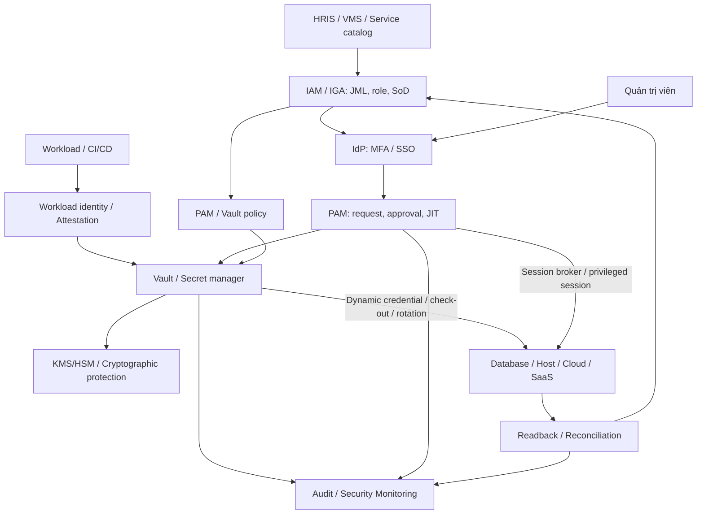
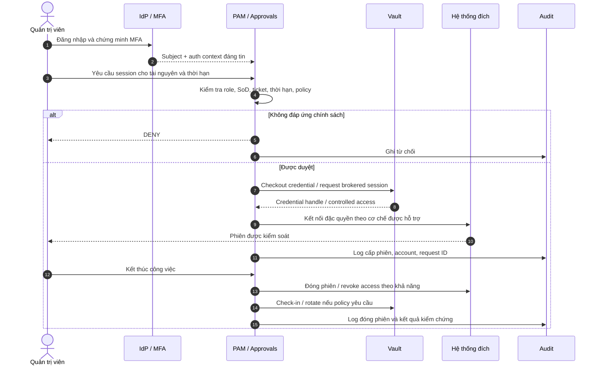

# Vault credential trong quản lý đặc quyền và vòng đời danh tính IAM

## 1. Vault credential là gì?

**Vault credential** là thông tin xác thực hoặc bí mật được **lưu giữ, bảo vệ và cấp quyền sử dụng thông qua một kho bí mật (credential vault/secret vault)** thay vì được đặt tùy tiện trong mã nguồn, file cấu hình, tài liệu vận hành hoặc gửi trực tiếp giữa người dùng. Trong quản lý **Privileged Access Management (PAM)**, vault thường giúp bảo vệ credential có thể mở quyền truy cập nhạy cảm như tài khoản quản trị, hệ thống sản xuất, cơ sở dữ liệu, thiết bị mạng và dịch vụ hạ tầng.

Một **credential** có thể là mật khẩu, khóa SSH riêng, API key, client secret, token hoặc một dạng chứng thư/khóa được quản trị phù hợp. Vault thường kết hợp các khả năng:

- **Bảo vệ lúc lưu**: mã hóa và giới hạn quyền đọc/ghi bí mật.
- **Xác thực và phân quyền**: kiểm tra ai hoặc workload nào được sử dụng bí mật nào.
- **Cấp phát có kiểm soát**: lấy credential, nhận credential tạm thời hoặc mở phiên đặc quyền qua broker.
- **Rotation**: thay đổi credential theo chu kỳ, sự kiện hoặc rủi ro.
- **Revocation**: vô hiệu hóa credential/lease/quyền truy cập ở nơi sử dụng theo khả năng thực tế.
- **Audit**: ghi việc truy cập, cấp phát, thay đổi và thu hồi mà không làm lộ secret.
- **Vận hành an toàn**: quản lý thời hạn, trạng thái, owner, recovery và sự cố.

**Vault không đồng nghĩa với một “hộp đựng mật khẩu”.** Mục tiêu bảo mật là **kiểm soát vòng đời quyền sử dụng credential**, giảm khả năng sao chép bí mật lâu dài và cung cấp bằng chứng ai đã được trao khả năng truy cập đặc quyền.

### 1.1. Một ví dụ ngắn

Quản trị viên An cần sửa lỗi trên máy chủ production. Thay vì dùng mật khẩu `root` được gửi qua chat:

1. An đăng nhập IdP bằng MFA phù hợp.
2. PAM kiểm tra vai trò, ticket, lý do và thời gian được phê duyệt.
3. PAM/vault cho phép An mở phiên đặc quyền hoặc lấy credential **chỉ khi policy chấp thuận**.
4. Nếu có thể, hệ thống dùng **session broker** để An thao tác mà không nhìn thấy mật khẩu.
5. Phiên được giới hạn thời gian, có kiểm toán và ghi nhận các hành động nhạy cảm theo chính sách.
6. Khi công việc kết thúc, PAM đóng phiên và thực hiện rotation/revocation tương ứng.
7. IAM đối soát quyền quản trị, tránh giữ khả năng truy cập sau Mover hoặc Leaver.

Điểm quan trọng: **thu hồi quyền đọc vault không tự động làm một mật khẩu đã bị lộ trở nên vô dụng**. Nếu An từng biết secret tĩnh, cần **rotate credential tại hệ thống đích** và kiểm tra các phiên/khóa đã cấp.

## 2. Vì sao credential đặc quyền cần vault?

Các credential đặc quyền có thể tạo **blast radius** lớn khi bị lộ:

- Mật khẩu quản trị domain có thể ảnh hưởng nhiều máy và tài khoản.
- Mật khẩu root/database admin có thể cho truy cập dữ liệu nhạy cảm.
- API key có quyền quản trị cloud có thể tạo tài nguyên hoặc mở truy cập.
- SSH private key cấp quyền vào máy chủ sản xuất.
- Client secret của một service account có thể tồn tại nhiều năm và được nhiều job dùng.
- Token/PAT có scope rộng có thể vượt ngoài cơ chế SSO của con người.

Nếu các credential này được lưu trong repository, file `.env` chia sẻ, spreadsheet, ticket hoặc chat, tổ chức khó biết **ai đã sao chép**, **ai còn giữ bản cũ**, **cần thay lúc nào** và **quyền nào phải thu hồi khi nhân viên chuyển vai trò**.

Vault giúp giảm rủi ro này nhưng không loại bỏ hoàn toàn nó. Một credential đã được trả ra plaintext có thể bị copy, screenshot, lưu trong memory dump hoặc ghi vào log. Vì vậy cần thiết kế **khả năng không hiển thị secret**, credential ngắn hạn, quyền tối thiểu và rotation tại hệ thống đích khi phù hợp.

### 2.1. Các mục tiêu an ninh

| Mục tiêu | Ý nghĩa | Câu hỏi kiểm tra |
|---|---|---|
| **Confidentiality** | Chỉ chủ thể được phép mới có thể dùng hoặc đọc secret | Có ai đọc trộm từ log/backup không? |
| **Integrity** | Secret và policy không bị thay trái phép | Ai có thể sửa credential hoặc mapping? |
| **Availability** | Ứng dụng cần secret vẫn vận hành an toàn | Vault lỗi thì workload xử lý thế nào? |
| **Least privilege** | Credential chỉ mở đúng phạm vi cần | Secret có quyền admin toàn tenant không cần thiết? |
| **Traceability** | Có bằng chứng yêu cầu/cấp phát/thu hồi | Có gắn được với người, workload, ticket không? |
| **Revocability** | Có khả năng làm mất hiệu lực truy cập | Thu hồi token hay đổi mật khẩu tại đích được không? |
| **Lifecycle governance** | Owner và thời hạn được quản lý | Khi owner nghỉ việc ai chịu trách nhiệm? |

## 3. Phân biệt secret, credential, vault và PAM

| Thuật ngữ | Định nghĩa | Ví dụ |
|---|---|---|
| **Secret** | Thông tin cần giữ bí mật | Password, API key, private key |
| **Credential** | Bằng chứng hoặc vật liệu để xác thực/ủy quyền | Username + password, certificate + private key, bearer token |
| **Vault** | Kho/cơ chế quản trị secret và credential | Secret manager hoặc password vault của PAM |
| **PAM** | Nền tảng/quy trình kiểm soát truy cập đặc quyền | Approval, session brokering, checkout, rotation |
| **Identity Provider (IdP)** | Dịch vụ xác thực và cấp ngữ cảnh đăng nhập SSO | OIDC/SAML và MFA |
| **Key Management Service (KMS)** | Quản lý khóa mã hóa và thao tác mật mã theo năng lực | Bảo vệ khóa dùng mã hóa secret |
| **Hardware Security Module (HSM)** | Thiết bị/phương tiện bảo vệ và thao tác với khóa mật mã | Chống xuất khóa trong phạm vi hỗ trợ |
| **Secret rotation** | Thay secret hợp lệ và phân phối lại cho bên phụ thuộc | Đổi mật khẩu database service account |
| **Dynamic credential** | Credential được tạo ngắn hạn theo yêu cầu | User database tạm có TTL |
| **Session broker** | Trung gian thiết lập phiên truy cập và thực thi kiểm soát | RDP/SSH broker không hiển thị mật khẩu |
| **Break-glass** | Đường truy cập khẩn cấp được quản trị | Credential khôi phục khi IdP/PAM gặp sự cố |

**Không phải mọi vault đều hỗ trợ tạo credential động, session recording hoặc rotation tự động.** Tính năng và ngữ nghĩa cụ thể phụ thuộc sản phẩm, connector và hệ thống đích. Bài này trình bày **nguyên tắc chung**, không ngầm khẳng định một sản phẩm có mọi tính năng.

## 4. Credential nào thường được đưa vào vault?

| Loại | Ví dụ | Rủi ro và yêu cầu quản lý |
|---|---|---|
| **Shared privileged password** | Tài khoản quản trị máy chủ legacy | Người dùng có thể sao chép; cần checkout và rotate |
| **Local administrator password** | Tài khoản quản trị cục bộ máy trạm/server | Cần credential riêng từng máy nếu khả thi, tránh tái sử dụng rộng |
| **Database credential** | User đọc/ghi hoặc admin cơ sở dữ liệu | Có thể tạo credential ngắn hạn với quyền theo workload |
| **SSH private key** | Khóa đăng nhập host sản xuất | Bảo vệ private key, passphrase, phạm vi và vòng đời |
| **Cloud API key** | Khóa truy cập tài nguyên cloud | Ưu tiên workload identity/credential ngắn hạn nếu có |
| **OAuth client secret** | Bí mật của confidential client | Không phân phối cho public client; quản lý rotation |
| **Personal access token (PAT)** | Token của automation trong SaaS | Scope tối thiểu, owner và hạn dùng |
| **TLS private key / certificate** | Khóa máy chủ hoặc client mTLS | Phân phối an toàn, gia hạn/chấm dứt chứng thư |
| **Service account password** | Tài khoản batch job/connector | Quản trị owner, phụ thuộc, rotation không gây gián đoạn |
| **Break-glass credential** | Tài khoản khẩn cấp đã duyệt | Quy trình bảo vệ, phê duyệt/giám sát và kiểm thử riêng |

**Không nên đưa mọi thông tin vào vault chỉ vì nó có dạng chuỗi.** Cần phân loại dữ liệu, mục đích, yêu cầu mã hóa và khả năng vòng đời của từng loại credential.

### 4.1. Credential tĩnh và credential động

- **Static credential:** có giá trị tồn tại lâu hơn một phiên hoặc một request; ví dụ mật khẩu service account cố định. Vault có thể lưu và rotate nó.
- **Dynamic credential:** được tạo theo yêu cầu, thường có **lease/TTL** và quyền giới hạn; ví dụ tài khoản database tạm cho job xử lý.
- **Brokered credential:** secret được PAM sử dụng để mở phiên thay cho người dùng mà không trực tiếp hiển thị secret.
- **Certificate/identity-based authentication:** một số hệ thống dùng chứng thư hoặc token phát hành ngắn hạn thay cho shared password.

Không thể suy ra chỉ từ tên gọi rằng **mọi dynamic credential đều bị vô hiệu hóa ngay sau TTL**; cần xem engine đích và khả năng revocation thực tế.

## 5. Kiến trúc tham chiếu: IAM, PAM, vault và hệ thống đích



Các thành phần có thể tích hợp trong cùng nền tảng. **Vault không nhất thiết trực tiếp gọi KMS/HSM cho mỗi lần đọc**, và workload có thể truy cập vault bằng giao thức/agent khác. Sơ đồ là **kiến trúc logic**, không phải topology bắt buộc.

### 5.1. Hai ranh giới cần kiểm tra

1. **Ai được phép yêu cầu credential?** Chính sách IdP/PAM/vault quyết định chủ thể nào được nhận hoặc dùng secret.
2. **Credential cho phép làm gì tại đích?** Database, hệ điều hành hoặc API đích thực thi quyền thực tế.

Một người có quyền đọc `/vault/prod/db` **không tự động có quyền quản trị toàn database**, nếu credential được cấp chỉ có quyền đọc. Ngược lại, một secret chứa tài khoản admin toàn quyền có thể khiến chính sách vault quá rộng trở thành lỗi nghiêm trọng.

## 6. Vault bảo vệ credential như thế nào?

Một vault có thể dùng **mã hóa dữ liệu khi lưu (encryption at rest)**, TLS khi truyền, kiểm soát quyền và kiểm toán. Tuy nhiên cách thiết kế khác nhau theo sản phẩm.

### 6.1. Mã hóa lúc lưu

Một mô hình phổ biến là **envelope encryption**:

1. Dữ liệu secret được mã hóa bằng **data encryption key (DEK)**.
2. DEK được bảo vệ bằng **key encryption key (KEK)** hoặc một cơ chế quản trị khóa tương đương.
3. KEK có thể được lưu/bảo vệ qua KMS/HSM hoặc hệ thống khóa có kiểm soát.
4. Khi chủ thể được phép đọc, vault giải mã bên trong ranh giới an toàn của nó và trả secret hoặc thực hiện thao tác thay mặt client.

**Mã hóa không thay thế authorization.** Một tài khoản có quyền đọc mọi bí mật sau khi đăng nhập vẫn là rủi ro, dù dữ liệu trên ổ đĩa được mã hóa tốt.

### 6.2. Truyền và xử lý secret

- Dùng **TLS** với xác minh certificate/hostname.
- Không ghi plaintext secret vào access log, error trace, metrics tag hoặc analytics.
- Giảm thời gian secret tồn tại trong memory và giới hạn nơi có thể đọc memory dump.
- Không đưa secret vào URL, query parameter hoặc command-line argument dễ bị ghi nhận.
- Dùng kênh phân phối phù hợp cho container/VM và tránh in secret khi debug.
- Bảo vệ backup và bản sao dữ liệu vault theo mức nhạy cảm tương đương.

### 6.3. Khóa mã hóa và secret có thể dùng vòng đời khác nhau

**Rotation KEK/DEK** khác với **rotation credential tại đích**. Đổi khóa mã hóa kho vault không làm mật khẩu database đã lộ mất hiệu lực. Ngược lại, rotate mật khẩu database không có nghĩa backup vault chứa secret cũ đã được xóa theo chính sách lưu giữ.

## 7. Xác thực vào vault: không tạo “secret zero”

Một câu hỏi quan trọng: **Ứng dụng muốn lấy secret từ vault thì chứng minh mình là ứng dụng hợp lệ bằng gì?** Nếu cần đặt một mật khẩu vault lâu dài ngay trong source code, hệ thống chỉ **chuyển vị trí rủi ro**.

Các phương án xác thực tùy môi trường:

| Chủ thể | Cách tiếp cận ưu tiên khi hỗ trợ | Điều cần đánh giá |
|---|---|---|
| Nhân viên vận hành | IdP/SSO + MFA mạnh | Trạng thái HR, role, device, phishing resistance |
| CI/CD pipeline | Workload identity/OIDC federation từ nền tảng build | Audience, issuer, repository/branch/environment claims |
| Pod/container | Workload identity của orchestrator hoặc token có thời hạn | Service account namespace, audience, cluster trust |
| VM / instance | Identity được hạ tầng phát hành | Instance identity, scope, chống giả mạo metadata |
| Dịch vụ ngoài hạ tầng | mTLS/certificate hoặc cơ chế nhận dạng máy đã duyệt | Issuance, revocation, key protection |
| Tích hợp legacy | Credential bootstrap được bảo vệ, rotation và scope hẹp | Kế hoạch loại bỏ shared secret lâu dài |

### 7.1. Đặc tính cần kiểm tra

- Authentication chứng minh **chủ thể/khối lượng công việc thật**, không chỉ biết một chuỗi dễ sao chép.
- Token cấp để truy cập vault có **audience, TTL, scope và policy** rõ ràng.
- Không dùng một token vault chung cho mọi môi trường.
- Từ chối workload giả danh bằng cách thay `service_name` trong request.
- Có khả năng thu hồi khi workload, máy hoặc nhân viên bị ngừng hoạt động.
- Log đúng identity và workload instance, không ghi token thô.

**Workload identity giảm phụ thuộc vào secret bootstrap tĩnh**, nhưng không tự loại bỏ mọi rủi ro: cần kiểm soát cấu hình trust, nguồn phát hành và phạm vi quyền.

## 8. Authorization trong vault: RBAC, ABAC và policy

Vault cần thực thi **least privilege** trên từng secret, namespace, path, operation và môi trường.

Một policy logic có thể xét:

- **Subject**: employee ID, workload ID, role, nhóm, trạng thái JML.
- **Resource**: credential ID, secret path, owner, environment, classification.
- **Action**: read, issue, rotate, revoke, create, delete, update policy.
- **Environment**: thời gian, MFA freshness, thiết bị quản lý, ticket, risk signal.

### 8.1. Phân biệt các action

| Action | Ý nghĩa | Tác động |
|---|---|---|
| `secret:read` | Đọc giá trị bí mật đã lưu | Có thể làm lộ credential nếu trả plaintext |
| `credential:issue` | Phát credential mới theo role/policy | Tạo quyền truy cập mới ở đích |
| `credential:checkout` | Mượn secret/phiên trong thời gian nhất định | Cần giới hạn phạm vi và tracking |
| `credential:rotate` | Thay giá trị tại vault và đích | Có thể gián đoạn dependency nếu lỗi |
| `credential:revoke` | Làm mất hiệu lực credential/lease | Cần xác minh hệ thống đích đã chặn |
| `policy:update` | Đổi ai được phép truy cập secret | Có thể tăng quyền hàng loạt |
| `secret:delete` | Xóa secret hoặc version | Có thể mất khả năng phục hồi |
| `audit:read` | Truy cập sự kiện kiểm toán | Không được tiết lộ secret/PII quá mức |

**Được quyền đọc không đồng nghĩa được quyền rotate hay thay policy**. Đặc biệt, quyền `policy:update` và quyền sửa secret có thể tạo đường leo thang đặc quyền.

### 8.2. Ví dụ policy khái niệm

```text
PERMIT credential:issue IF
    subject.type == WORKLOAD
    AND subject.workload_id == "report-processor"
    AND subject.environment == "production"
    AND resource.secret_role == "report_readonly"
    AND environment.attestation == VERIFIED

PERMIT credential:checkout IF
    subject.type == HUMAN
    AND subject.employment_status == ACTIVE
    AND subject.pam_role == "database-operator"
    AND request.approval_state == APPROVED
    AND request.expires_at > now
    AND environment.mfa_freshness == SATISFIED

DENY OTHERWISE
```

Đây là **mã giả**, không phải policy chạy được của bất kỳ vault cụ thể. Cần phân biệt một **request đã được phê duyệt** với dữ liệu `approval_state` do client tự khai báo; policy phải lấy trạng thái từ hệ thống phê duyệt đáng tin.

## 9. Từ yêu cầu đến phiên đặc quyền: checkout và check-in

**Credential checkout** là quy trình mượn quyền sử dụng một credential được bảo vệ trong một khoảng thời gian/phiên được phê duyệt.



### 9.1. Check-in không luôn có nghĩa đã thu hồi

Với mật khẩu tĩnh từng hiển thị, người dùng có thể **nhớ hoặc sao chép** credential. Một dấu `CHECKED_IN` chỉ nói rằng quy trình mượn đã kết thúc; cần **rotation tại đích** hoặc cơ chế session brokering không để lộ secret nếu yêu cầu loại bỏ quyền tiếp tục sử dụng.

### 9.2. Giới hạn phiên

Một checkout tốt gắn với:

- Identity/workload được xác thực.
- Target account/resource được duyệt.
- Ticket hoặc mục đích hợp lệ.
- Thời gian bắt đầu, hết hạn và lịch sử gia hạn.
- MFA/approval và dấu vết người phê duyệt.
- Trạng thái `REQUESTED`, `APPROVED`, `ACTIVE`, `EXPIRED`, `REVOKED`.
- Phương án chặn khi có Leaver/sự cố.
- Chính sách lưu và bảo vệ audit/session recording.

## 10. Không hiển thị secret: session brokering và credential injection

**Brokered access** giúp người dùng sử dụng phiên đặc quyền mà **không cần thấy mật khẩu, khóa hoặc token**. PAM có thể đóng vai trò trung gian thiết lập SSH, RDP hoặc phiên tương tự tùy sản phẩm.

Lợi ích:

- Giảm khả năng sao chép secret sang máy cá nhân.
- Dễ giới hạn đích, thời gian và chính sách phiên.
- Hỗ trợ ghi audit và recording khi phù hợp.
- Có thể kết thúc phiên theo chính sách.

Nhưng broker cũng trở thành **thành phần đặc quyền cao**, cần phân vùng mạng, kiểm soát truy cập, bảo vệ recorder/log và hardening. Một broker bị chiếm có thể dẫn tới lạm dụng nhiều credential.

### 10.1. Hạn chế của session recording

Recording có thể cho biết thao tác trong phiên nhưng không bảo đảm phát hiện mọi đường truyền dữ liệu. Nó cũng có thể chứa **PII, thông tin bí mật hoặc màn hình có secret**. Cần chính sách quyền xem, encryption, retention và redaction phù hợp.

### 10.2. Khi phải tiết lộ secret

Một số hệ thống legacy bắt buộc hiển thị hoặc nhập credential thủ công. Khi đó nên:

1. Đánh giá mức đặc quyền và dùng checkout có thời hạn.
2. Yêu cầu MFA/approval phù hợp.
3. Gắn secret với account/đích cụ thể, không chia sẻ rộng.
4. Ghi audit ai xem và khi nào.
5. Rotate secret ngay sau thời hạn/phiên theo khả năng.
6. Kiểm tra các đường truy cập khác như phiên còn sống hoặc khóa phụ.

## 11. Static credential, dynamic credential và lease

### 11.1. Static credential

**Static credential** được quản lý trong vault nhưng có thể vẫn là mật khẩu hoặc khóa tồn tại lâu ở hệ thống đích.

Ví dụ: tài khoản `svc-legacy-sync` đăng nhập database bằng password được vault bảo vệ. Vault có thể cấp giá trị đó cho một workload được phép. Điều cần quan tâm là:

- Secret được dùng bởi bao nhiêu deployment?
- Dịch vụ có thể tiếp tục chạy khi password thay đổi không?
- Có yêu cầu phiên hết hạn hoặc refresh connection?
- Có lịch rotation và owner rõ ràng không?

### 11.2. Dynamic credential

**Dynamic credential** được phát hành theo nhu cầu, thường mang TTL ngắn và quyền cụ thể.

Ví dụ: job báo cáo yêu cầu user database `report_reader_temp` có thể đọc một schema trong thời gian được phê duyệt. Sau khi lease hết hạn hoặc bị revoke, cơ chế vault/DB plugin có thể gỡ user/role hoặc chặn quyền theo tính năng được hỗ trợ.

```text
Workload report-processor
        |
        v
Vault issue credential:
    target = reporting-db
    role = report_readonly
    ttl = 15 minutes
        |
        v
DB credential scoped to read-only operations
        |
        v
Workload completes request
        |
        v
Lease expires / explicit revoke
        |
        v
Verify DB credential is no longer usable
```

**TTL là yêu cầu quản trị, không phải phép màu:** cần xác minh issuer, secret engine và hệ thống đích thật sự có khả năng thu hồi theo thời gian đó.

### 11.3. Lease metadata minh họa

```json
{
  "lease_id": "lease-82d1",
  "credential_reference": "db-readonly-issue-82d1",
  "subject_id": "workload-report-processor",
  "target_system": "reporting-db",
  "authorized_role": "report_readonly",
  "issued_at": "2026-11-23T10:00:00Z",
  "expires_at": "2026-11-23T10:15:00Z",
  "renewable": false,
  "status": "ACTIVE"
}
```

Đây là **mô hình audit/metadata**, không phải phản hồi chuẩn của sản phẩm. Không chứa mật khẩu hoặc token thật.

## 12. Credential lifecycle: từ tạo đến thu hồi

Một credential có **vòng đời riêng**, khác vòng đời người sở hữu hoặc user account.

```mermaid
stateDiagram-v2
    [*] --> REQUESTED
    REQUESTED --> APPROVED: Policy + approval đạt
    REQUESTED --> REJECTED: Không đủ điều kiện
    APPROVED --> ISSUED: Tạo/lưu credential hợp lệ
    ISSUED --> ACTIVE: Đồng bộ tại đích và kiểm chứng
    ACTIVE --> ROTATING: Đến kỳ / sự cố / owner change
    ROTATING --> ACTIVE: New credential verified; old revoked
    ACTIVE --> SUSPENDED: Rủi ro hoặc tạm khóa
    SUSPENDED --> ACTIVE: Khôi phục có thẩm quyền
    ACTIVE --> REVOKING: Hết lease / Leaver / decommission
    SUSPENDED --> REVOKING: Thu hồi theo policy
    REVOKING --> REVOKED: Đích xác nhận đã mất hiệu lực
    REJECTED --> [*]
    REVOKED --> [*]
```



### 12.1. Trạng thái trung gian rất quan trọng

Không nên ghi `REVOKED` nếu mới gửi API thu hồi mà chưa kiểm tra. Có thể cần:

- `ROTATION_PENDING`: đã bắt đầu rotate, dependency chưa xác nhận.
- `REVOKE_PENDING`: đã yêu cầu revoke, đích chưa phản hồi.
- `REVOKE_FAILED`: lỗi cần xử lý.
- `UNKNOWN`: timeout không rõ kết quả.
- `VERIFIED_REVOKED`: bằng chứng từ đích phù hợp đã xác nhận.

### 12.2. Credential và account mapping

Mỗi credential nên có thông tin:

- Credential ID và phiên bản (không chứa secret trong log).
- Tài khoản/đích, tenant, môi trường và quyền thực tế.
- Owner nghiệp vụ và owner kỹ thuật.
- Loại secret và cơ chế tạo/rotation/revocation.
- Danh sách ứng dụng/connector phụ thuộc.
- Thời điểm phát hành, hết hạn và lần thay gần nhất.
- Phê duyệt/ngoại lệ và policy version.
- Bằng chứng readback/verification.

Nếu credential không có owner hoặc mục đích rõ ràng, đó là một **đối tượng cần rà soát**, không phải mặc nhiên được phép tồn tại mãi.

## 13. Rotation: tại sao và khi nào?

**Credential rotation** thay giá trị xác thực hợp lệ để bí mật cũ **không còn dùng được** theo khả năng và hợp đồng hệ thống đích. Rotation có thể xảy ra:

- Theo chính sách vòng đời của một loại credential.
- Sau khi credential được checkout/hiển thị.
- Khi nghi ngờ lộ hoặc bị đánh cắp.
- Khi người có khả năng biết credential trở thành **Mover/Leaver**.
- Khi thay owner, chuyển workload hoặc đổi môi trường.
- Khi phát hiện secret trong source code, log hoặc backup.
- Khi tái cấu trúc quyền và có thể thay bằng credential ít đặc quyền hơn.

**Không áp một lịch rotation tùy tiện cho mọi loại credential**: credential ngắn hạn có TTL/auto-issuance thường xử lý khác password tĩnh của legacy. Cần căn cứ rủi ro, năng lực kỹ thuật và yêu cầu chính sách.

### 13.1. Rotation mật khẩu database

Một quy trình an toàn có thể:

1. Xác định **owner, target account và các workload sử dụng**.
2. Kiểm tra connector có quyền rotation và quyền quản trị phù hợp.
3. Tạo secret mới đủ ngẫu nhiên từ nguồn an toàn.
4. Thực hiện thay credential tại hệ thống đích theo cơ chế cho phép.
5. Lưu và phân phối giá trị mới qua vault, tránh lộ plaintext trong log.
6. Cho workload nạp lại secret, kiểm tra kết nối/công việc thật.
7. Vô hiệu hóa credential cũ, nếu hệ thống có cơ chế dual credential thì chuyển tiếp có kiểm soát.
8. Đối soát secret mới sử dụng được và secret cũ không còn hiệu lực.
9. Ghi event, status, thời điểm và chủ sở hữu thao tác.

### 13.2. Tránh gián đoạn khi xoay secret

Một số DB/ứng dụng chỉ cho **một mật khẩu active cho một account**. Đổi giá trị có thể làm connection pool hoặc job chưa nạp secret mới bị lỗi. Một số hệ thống cho nhiều credential cùng tồn tại để **overlap có hạn**.

Không mặc định luôn có cơ chế dual key hoặc zero-downtime rotation. Phải kiểm tra **API của target**, dependency và kế hoạch rollback trước khi áp dụng.

### 13.3. Rollback rotation không phải phục hồi secret đã lộ

Nếu secret cũ bị lộ, **không được tự đưa lại secret cũ** chỉ để sửa lỗi triển khai. Cần phương án tạo secret mới tiếp theo, xử lý dependency hoặc chuyển sang credential dự phòng an toàn được phê duyệt.

## 14. Phát hành token và thông tin bí mật ngắn hạn

Với nhiều hệ thống hiện đại, **token ngắn hạn hoặc danh tính workload** tốt hơn credential tĩnh khi có khả năng triển khai.

Ví dụ:

- OAuth access token có audience và scope giới hạn.
- Cloud role session credential theo cơ chế tạm thời.
- SSH certificate có thời hạn.
- Database user động được tạo theo lease.
- mTLS client certificate phát hành/rotate theo nền tảng tin cậy.

### 14.1. Thời gian ngắn không đồng nghĩa an toàn tuyệt đối

Một token còn 5 phút vẫn có thể bị sử dụng trái phép nếu bị đánh cắp. Vì vậy cần:

- Audience/scope/resource binding phù hợp.
- Truyền qua kênh bảo vệ, giảm log/copy.
- Nguồn issuance đáng tin và chống giả mạo workload.
- TTL đủ ngắn theo mức rủi ro nhưng không gây lỗi vận hành.
- Cơ chế revoke hoặc chặn tại resource server khi hỗ trợ.
- Audit issuance và hành động nhạy cảm tại đích.

### 14.2. Lease renewal

Một số vault cho phép gia hạn lease. Việc gia hạn cần kiểm tra **workload/subject còn hợp lệ**, không cấp vô hạn cho job đã nghỉ chạy hoặc account Leaver. Policy có thể có **max TTL**, số lần renewal và điều kiện xác thực lại.

## 15. Privileged session và giới hạn truy cập thực tế

Vault và PAM thường bổ sung **kiểm soát phiên** để quyền đặc biệt chỉ tồn tại trong thời gian cần.

Một luồng truy cập nên xét:

| Kiểm soát | Câu hỏi |
|---|---|
| **Role eligibility** | Người đó có thuộc nhóm được phép yêu cầu loại quyền này không? |
| **Reason/ticket** | Mục đích sửa lỗi hoặc change request hợp lệ không? |
| **MFA / step-up** | Mức xác thực có đáp ứng tài nguyên nhạy cảm không? |
| **Approval / SoD** | Ai duyệt? Có tự phê duyệt hoặc xung đột vai trò không? |
| **Time bound** | Phiên được cấp từ khi nào đến khi nào? |
| **Target scope** | Đúng server, DB, tenant và môi trường không? |
| **Session control** | Có broker, command policy hoặc recording khi cần không? |
| **Termination** | Có cơ chế kết thúc phiên thực tế không? |
| **Verification** | Đã vô hiệu hóa credential/phiên và ghi bằng chứng chưa? |

**PAM check-in hoặc đóng terminal phía người dùng không đủ chứng minh mọi session đã bị chấm dứt.** Cần xem kết nối còn tồn tại, token đã cấp và cơ chế session termination của target.

## 16. Just-in-Time access và credential vault

**Just-in-Time (JIT) privileged access** giảm thời gian một danh tính có đặc quyền. Hệ thống có thể:

- Chỉ cấp một role đặc quyền khi đã có yêu cầu hợp lệ.
- Mở session tới tài nguyên theo thời hạn.
- Phát credential động hoặc token ngắn hạn.
- Tự gỡ role/lease khi hết thời gian.
- Ghi audit và review thao tác.

Phân biệt:

- **Standing privilege**: quyền đặc biệt luôn tồn tại dù không sử dụng.
- **Eligible privilege**: người được phép yêu cầu quyền theo policy.
- **Activated privilege**: quyền thực tế được kích hoạt/cấp trong một khoảng.
- **Effective privilege**: quyền mà target đang thực sự cho phép, kể cả qua phiên hoặc credential cũ.

Một người **eligible** không mặc nhiên **active**. Ngược lại, hết thời gian JIT trên bảng điều khiển không tự chứng minh **effective privilege** tại target đã bị thu hồi.

## 17. Joiner lifecycle và quyền truy cập vault

Khi nhân viên mới gia nhập, **không nên phát credential đặc quyền mặc định chỉ vì tài khoản được tạo**.

### 17.1. Quy trình Joiner đề xuất

1. HRIS xác nhận worker ID, quan hệ, bộ phận và ngày bắt đầu.
2. Identity proofing xác minh đúng người được cấp danh tính.
3. IAM/IdP tạo tài khoản và enrollment MFA phù hợp.
4. IGA tính **role eligibility** dựa trên nhiệm vụ, không tự gán đặc quyền rộng.
5. Tài nguyên được gắn owner; role quản trị cần phê duyệt riêng.
6. PAM/vault gán policy cho đúng namespace/credential hoặc role **được duyệt**.
7. Khi cần thao tác, người dùng yêu cầu checkout/JIT theo phê duyệt.
8. Sau phiên, audit và revoke/rotation được kiểm tra.
9. Reconciliation xác minh tài khoản không được cấp thêm quyền ngoài phạm vi.

### 17.2. Pre-provisioning khác cấp secret

Một người chuẩn bị gia nhập có thể được tạo tài khoản IdP trước ngày làm việc để nhận thiết bị. Tuy nhiên **tài khoản tồn tại không có nghĩa được đọc vault production**. Phải kiểm tra `effective_at`, trạng thái HR, MFA và phê duyệt trước khi mở quyền.

### 17.3. Không dùng shared admin credential làm “quyền nhập môn”

Cho nhân viên mới mật khẩu admin dùng chung tạo rủi ro **không truy vết được ai thực hiện thao tác** và khó thu hồi khi một người nghỉ. Nên dùng danh tính riêng, JIT và broker khi khả thi.

## 18. Mover lifecycle: thay đổi quyền vault và secret liên quan

Mover là sự kiện chuyển vai trò, dự án, phòng ban, pháp nhân hoặc phạm vi quản lý. Nếu chỉ thêm quyền vault mới mà không thu hồi quyền cũ, người dùng sẽ có **privilege creep**.

Ví dụ kỹ sư chuyển từ team hạ tầng A sang team dữ liệu B:

| Thành phần | Trước Mover | Sau Mover cần đạt |
|---|---|---|
| IdP groups | `infra-operators` | Gỡ nếu hết assignment; thêm `data-operators` theo duyệt |
| Vault policy | Có thể checkout secret host A | Gỡ quyền A, chỉ cho secret B cần thiết |
| PAM eligible roles | `host-admin` | Thu hồi eligibility cũ, thêm role mới hợp lệ |
| Credential đã xem | Mật khẩu host A từng lộ cho người dùng | Rotate host A nếu chính sách yêu cầu |
| Phiên hoạt động | Có thể còn SSH/RDP session A | Kết thúc/reassess theo rủi ro |
| Service ownership | Có thể owner pipeline A | Bàn giao quyền quản trị và credential phụ thuộc |

### 18.1. Tính chênh lệch desired vs actual

```text
desired_vault_access =
    evaluate(current_active_assignments, approvals, SoD)

observed_vault_access =
    read(vault_policies, PAM_eligibility, outstanding_leases)

access_to_revoke = observed_vault_access - desired_vault_access
access_to_grant  = desired_vault_access - observed_vault_access

for credential_previously_exposed:
    evaluate_rotation_and_target_session_revocation()
```

Nếu người dùng còn **assignment A và B hợp lệ**, không gỡ quyền A chỉ vì một sự kiện chuyển nhóm khác. Tính quyền từ **toàn bộ quan hệ được phê duyệt**.

### 18.2. Quyền bàn giao có hạn

Có thể cần quyền chồng lấn trong thời gian bàn giao. Phải có ticket, owner, scope, `expires_at` và cơ chế thu hồi, không để quyền vault cũ tồn tại vô thời hạn.

## 19. Leaver lifecycle: thu hồi quyền đặc quyền end-to-end

**Leaver** là điểm phải ngăn người đã chấm dứt quan hệ tiếp tục sử dụng credential hoặc phiên đặc quyền.

### 19.1. Các bước phối hợp

1. HRIS/VMS/sponsor phát sự kiện chấm dứt có thẩm quyền với `effective_at`.
2. IAM xác minh identity ID, các tài khoản liên quan và quan hệ còn hợp lệ.
3. Disable hoặc hạn chế tài khoản IdP theo chính sách để chặn xác thực mới.
4. Gỡ **vault policy**, PAM eligible roles và phê duyệt còn hoạt động.
5. Thu hồi **vault token, lease, session checkout** do cá nhân đó sở hữu theo khả năng.
6. Đóng các phiên đặc quyền đang hoạt động tại target.
7. **Rotate mật khẩu/khóa tĩnh** mà người đó có thể đã thấy hoặc sở hữu khi cần.
8. Thu hồi PAT, API key, SSH key và credential độc lập ngoài vault.
9. Deprovision quyền ứng dụng/directory/SCIM và kiểm tra nested/direct grants.
10. Đọc lại trạng thái ở vault, PAM và hệ thống đích; ghi `VERIFIED` theo phạm vi.

### 19.2. Thu hồi quyền vào vault chưa đủ

Một người có thể:

- Đã lưu mật khẩu admin vào password manager riêng.
- Có SSH session đang chạy.
- Có API token ở một client ngoài vault.
- Có một credential độc lập được cấp tại cloud.
- Thuộc group quản trị ở ứng dụng SaaS ngoài PAM.
- Có account local chưa được disable.

Vì vậy, **deprovision trong vault là một phần của Leaver, không phải bằng chứng toàn bộ đặc quyền đã mất hiệu lực**.

### 19.3. Nhiều quan hệ hợp lệ

Nếu một nhà thầu kết thúc dự án P1 nhưng hợp đồng P2 vẫn đang active, cần **thu hồi đúng vault path/role P1** mà không vô hiệu hóa sai toàn bộ identity. Tuy nhiên credential từng dùng cho P1 vẫn có thể cần rotation nếu không còn được phép biết.

## 20. Tài khoản dịch vụ: owner không phải người sử dụng trực tiếp

**Service account, CI/CD runner, bot, scheduled job và workload identity** thường truy cập vault tự động. Nguồn quản trị của chúng không nhất thiết là HRIS.

Một bản ghi service account nên có:

| Trường | Ý nghĩa |
|---|---|
| `workload_id` / `service_account_id` | Định danh kỹ thuật ổn định |
| `owner_team` / `business_owner` | Nhóm chịu trách nhiệm |
| `environment` / `tenant` | Phạm vi triển khai |
| `purpose` | Vì sao cần credential |
| `required_actions` | Quyền tối thiểu tại target |
| `vault_role` / `secret_refs` | Những secret/credential được phép dùng |
| `rotation_strategy` | Cách thay credential không gây gián đoạn |
| `credential_ttl` | Hạn dùng nếu được hỗ trợ |
| `decommission_event` | Sự kiện kết thúc workload |
| `audit_owner` | Người xử lý ngoại lệ và drift |

### 20.1. Owner trở thành Leaver

Một owner nghỉ việc **không đồng nghĩa workload đang chạy phải ngừng**. Workflow phù hợp:

1. Tìm workload/secret đang do người ấy phụ trách.
2. Bàn giao owner được phê duyệt.
3. Thu hồi **quyền quản trị cá nhân** trên vault và pipeline.
4. Đánh giá credential/khóa mà người ấy từng biết, rotate nếu cần.
5. Xác minh workload còn hoạt động với quyền tối thiểu.
6. Khi có sự kiện decommission hợp lệ, revoke credential và dọn secret theo chính sách.

### 20.2. Tránh share TOTP của con người cho máy

Máy nên dùng **workload identity, client certificate, role session hoặc credential động** phù hợp, không lấy tài khoản cá nhân có MFA rồi chia OTP cho nhiều bot. Cách chia sẻ này khó audit và khiến offboarding rủi ro.

## 21. IdP, SSO, SCIM và vault không thay thế nhau

| Thành phần | Làm được gì? | Giới hạn quan trọng |
|---|---|---|
| **IdP** | Xác thực nhân viên, MFA, session, OIDC/SAML | Không mặc nhiên biết secret nào đã bị copy |
| **SSO** | Cho nhiều ứng dụng tin kết quả AuthN | Không thu hồi mọi credential tĩnh ở target |
| **SCIM** | Tạo/cập nhật/disable user/group tại ứng dụng | Không phải giao thức chuẩn quản lý private key/token lease của vault |
| **Directory** | Quản lý account, group và thuộc tính | Disable directory không đóng mọi session ngoài hệ thống |
| **RBAC/ABAC** | Quyết định ai được phép làm gì theo role/attribute | Cần thực thi chính xác ở vault/PAM/target |
| **PAM** | Phê duyệt/JIT/checkout/session control | Tính năng phụ thuộc integration với target |
| **Vault** | Bảo vệ, phát hành, rotate hoặc revoke secret theo khả năng | Không tự biết mọi quyền SaaS/ứng dụng |
| **IGA/Reconciliation** | Phê duyệt, SoD, desired/observed access và audit | Phụ thuộc nguồn/đích có thể đọc trạng thái |

### 21.1. MFA để mở vault, không phải MFA cho mọi workload

Nhân viên truy cập credential đặc quyền thường cần **MFA mạnh và recent authentication** theo chính sách. Workload máy–máy thường được xác thực bởi **workload identity và bằng chứng runtime**, không yêu cầu nhập OTP bởi một người cho mỗi request.

### 21.2. Token SSO khác vault token

Một OIDC ID token chứng minh kết quả đăng nhập cho client đúng audience; **không dùng nó như credential chung để đọc tất cả secret**. Vault cần phương thức xác thực được cấu hình, kiểm tra issuer/audience/policy và cấp token riêng có thời hạn/scope khi thiết kế cần.

## 22. Mẫu thiết kế: Java service truy cập credential an toàn

Giả sử dịch vụ Java `report-processor` cần kết nối database. Thiết kế nên dùng **secret reference** hoặc workload identity, không hardcode mật khẩu vào repository.

Một cấu hình **minh họa**:

```yaml
service:
  name: report-processor
  environment: production

database:
  host: reporting-db.internal
  name: reports
  credential_mode: short_lived
  vault_role_ref: reporting-readonly

vault_auth:
  method: workload_identity
  audience: vault-report-processor
```

**Không đặt `db_password: ...` hoặc vault token tĩnh trong cùng file cấu hình**.

### 22.1. Mã giả Java độc lập sản phẩm

```java
public final class ReportingJob {
    private final WorkloadIdentityProvider identityProvider;
    private final CredentialBroker broker;
    private final DatabaseClient db;

    public void run() {
        WorkloadAssertion assertion =
            identityProvider.obtainAudienceBoundAssertion("vault-report-processor");

        ScopedCredentialLease lease =
            broker.issueCredential(assertion, "reporting-readonly");

        try {
            db.withEphemeralCredential(lease.handle(), connection -> {
                // Chỉ chạy các truy vấn được tài khoản read-only cho phép.
                runApprovedReadOnlyQueries(connection);
            });
        } finally {
            broker.closeOrRevoke(lease.leaseId());
            // Đảm bảo không in credential vào log/exception.
        }
    }
}
```

Đây là **mã giả minh họa**, không phải thư viện Java có thể biên dịch. Trong thực tế:

- Dùng SDK của vault/DB provider được tin cậy.
- Xác minh identity và vault TLS endpoint.
- Không lưu hoặc log plaintext secret từ `lease.handle()`.
- Xử lý timeout, lease expiry, pooling, retry và revoke đúng semantics.
- Không giả định `closeOrRevoke()` sẽ ngay lập tức cắt mọi connection trên DB.
- Định nghĩa phản ứng khi vault không sẵn sàng và chính sách cho phép hay không cho phép dùng cache.

### 22.2. Không tự đọc secret trong Java để “debug”

Sai về nguyên tắc:

```text
logger.info("DB password={}", secretValue)
```

Tốt hơn:

```text
logger.info(
    "Credential issued: leaseId={}, role={}, ttlSeconds={}",
    leaseId,
    role,
    ttlSeconds
)
```

Ngay cả metadata audit cũng nên hạn chế ID/tenant đủ mức, tránh làm lộ cấu trúc hạ tầng không cần thiết.

## 23. API cấp credential: request và response minh họa

Không có một HTTP endpoint thống nhất áp dụng cho tất cả vault. Ví dụ dưới đây thể hiện **hợp đồng API giả định của Credential Broker**, không phải API có thể gọi trực tiếp vào một sản phẩm.

```http
POST /api/credential-leases HTTP/1.1
Host: credential-broker.example.org
Authorization: Bearer <redacted-workload-assertion>
Content-Type: application/json

{
  "workload_id": "report-processor",
  "target": "reporting-db",
  "role": "report_readonly",
  "requested_ttl_seconds": 900
}
```

Một phản hồi có kiểm soát có thể là **credential handle**, tránh trả plaintext cho ứng dụng nếu cơ chế broker hỗ trợ:

```json
{
  "lease_id": "lease-82d1",
  "credential_handle": "opaque-handle-82d1",
  "role": "report_readonly",
  "issued_at": "2026-11-23T10:00:00Z",
  "expires_at": "2026-11-23T10:15:00Z"
}
```

**Các trường này chỉ minh họa**, không khẳng định hệ thống nào cũng cung cấp opaque handle. Một số vault cấp trực tiếp secret cho client; khi đó cần thiết kế giảm rủi ro plaintext/secret exposure.

### 23.1. Client không được tự chọn quyền vượt policy

Dù client gửi `role=database_admin`, server/broker phải kiểm tra **workload identity, môi trường, target, quyền được duyệt và TTL tối đa**. Không cho nâng từ read-only lên admin chỉ bằng sửa JSON.

## 24. Rotation và thay đổi credential có nhiều hệ thống phụ thuộc

Một password tĩnh có thể được dùng bởi hàng chục service. Nếu rotate không có quản lý dependency, dễ gây outage hoặc rò secret mới.

### 24.1. Bản đồ dependency

Ví dụ:

```text
Credential: svc-reporting-db
    |
    +-- report-processor (production)
    +-- nightly-reconciliation (production)
    +-- reporting-maintenance (staging? check isolation)
    +-- legacy-batch-job (unknown owner -> exception)
```

Trước rotation cần biết **environment separation**. Không dùng một credential production cho cả staging/test nếu không có căn cứ và kiểm soát phù hợp.

### 24.2. Những trạng thái rotation nên theo dõi

| Trạng thái | Đã biết | Chưa bảo đảm |
|---|---|---|
| `PLANNED` | Có danh sách target/dependency và owner | Không có secret mới |
| `ISSUED_NEW` | Đã tạo secret mới | Target đã chấp nhận |
| `TARGET_UPDATED` | Đã thay credential tại đích | Tất cả client đã nạp lại |
| `CONSUMERS_VERIFIED` | Client cần thiết đã hoạt động | Credential cũ bị vô hiệu |
| `OLD_REVOKED` | Đã thu hồi secret cũ ở đích | Session đã tạo bằng secret cũ đều đóng |
| `VERIFIED` | Đã kiểm tra theo phạm vi đặt ra | Hệ thống ngoài phạm vi cũng an toàn |

### 24.3. Khi rotation thất bại

- Đừng in secret cũ/mới vào log lỗi.
- Xác định target đã đổi password hay chưa.
- Nếu phản hồi timeout, **readback an toàn hoặc kiểm tra kết nối có kiểm soát**, tránh thay liên tục gây mất đồng bộ.
- Không tự restore secret đã bị lộ.
- Giữ `ROTATION_FAILED` có owner, deadline và runbook.
- Với quyền đặc quyền, áp dụng kiểm soát bù và xử lý sự cố theo mức nghiêm trọng.

## 25. Failure modes: vault không sẵn sàng

Vault là thành phần trọng yếu; mất availability có thể ảnh hưởng khởi động workload hoặc khả năng xử lý sự cố.

| Tình huống | Rủi ro | Hành vi nên thiết kế |
|---|---|---|
| Vault API timeout | Job không lấy được secret | Retry có giới hạn/backoff, không chuyển sang plaintext hardcode |
| Credential lease hết hạn | Query/connection mới thất bại | Renewal/reissue có xác thực lại và giới hạn |
| Mã hóa/khóa vault không truy cập được | Không giải mã secret | HA/DR và key recovery có kiểm soát |
| Khóa truy cập vault bị lộ | Attacker có thể lấy secret | Revoke token, điều tra phạm vi, rotate secret liên quan |
| Database target không cho revoke | Credential còn tồn tại | Theo dõi exception và chặn quyền khác ở target nếu có |
| Workload identity issuer lỗi | Không xác thực được app | Fail-safe, không dùng shared super-token |
| Service account mất owner | Không ai điều phối rotation | Quản trị ownership và cảnh báo |
| Backup/restore không đồng nhất | Secret cũ được phục hồi ngoài ý muốn | DR testing, reconcile version và rotation state |
| PAM session broker lỗi | Phiên đặc quyền không được kết thúc | Từ chối phiên mới và có đường terminate tại target |
| Audit sink lỗi | Không còn chứng cứ đầy đủ | Buffer/audit resilient hoặc chặn action nhạy cảm theo policy |

### 25.1. Có nên cache credential?

Có thể cần cache một số credential để workload không mất sẵn sàng tức thì. Nhưng cache **tăng thời gian secret tồn tại ngoài vault**.

Nếu được phê duyệt:

- Giới hạn TTL và loại credential cache.
- Bảo vệ memory và môi trường lưu.
- Không dùng cache vượt chính sách khi credential đã bị revoke.
- Phân biệt secret đã được rotate với secret còn hợp lệ tại target.
- Với tài khoản admin hoặc trường hợp Leaver nghiêm trọng, ưu tiên **fail-closed** hoặc cơ chế kiểm tra trạng thái còn hiệu lực.

Không bao giờ biến lỗi vault thành lý do tự động dùng **credential hardcoded dự phòng** có quyền cao.

## 26. Break-glass và khôi phục khả năng quản trị

**Break-glass** là đường truy cập khẩn khi IdP, vault hoặc PAM gặp sự cố. Vì có thể vượt quy trình bình thường, nó cần được quản trị chặt.

Một cơ chế an toàn thường cần:

1. Số lượng tài khoản/credential khẩn cấp được giới hạn.
2. Owner và người chịu trách nhiệm khôi phục rõ ràng.
3. Bảo vệ credential độc lập với thành phần có thể đang lỗi, theo thiết kế DR.
4. Truy cập có điều kiện, người giám sát/phê duyệt theo mức rủi ro và hoàn cảnh.
5. Thông báo/cảnh báo ngay sau khi sử dụng.
6. Audit và hậu kiểm đầy đủ.
7. Rotation hoặc tái niêm phong credential sau sự cố.
8. Kiểm thử định kỳ để biết phương án **thật sự hoạt động**.
9. Không dùng break-glass làm tài khoản vận hành hằng ngày.
10. Không tự xóa tài khoản khẩn chỉ vì owner cá nhân nghỉ việc; cần **bàn giao governance**.

### 26.1. Cân bằng khẩn cấp và SoD

Trong sự cố lớn, có thể cần rút gọn một số bước phê duyệt nhưng không nên mất dấu vết. Policy có thể áp **hạn thời gian ngắn, logging bắt buộc, người giám sát và hậu kiểm độc lập** cho tình huống không thể theo luồng chuẩn.

## 27. Mối đe dọa với credential vault

| Mối đe dọa | Cơ chế | Biện pháp giảm rủi ro |
|---|---|---|
| **Credential theft** | Secret bị copy từ client/log/repo | Không hiển thị nếu được; rotate, DLP/secret scanning |
| **Vault token theft** | Token API bị lộ trong CI/CD hoặc máy trạm | Workload identity, TTL/scope, revoke và audit |
| **Overprivileged policy** | Một role đọc được mọi secret production | Least privilege, namespace và ABAC |
| **Malicious policy change** | Attacker mở quyền đọc/rotate cho mình | SoD, review, versioning, audit |
| **Secret-zero** | App giữ super-token để vào vault | Federation/attestation và scoped bootstrap |
| **Stale permission** | Mover/Leaver vẫn có quyền vault | JML event, revoke grants, readback |
| **Stale credential copy** | Người đã checkout giữ mật khẩu cũ | Target-side rotation và session termination |
| **Privilege escalation through automation** | Pipeline có quyền ghi secret/admin path | Pipeline least privilege và approval |
| **Lateral movement** | Shared secret dùng trên nhiều máy | Secret riêng theo target, JIT, segmentation |
| **Token replay** | Token ngắn hạn bị sao chép và sử dụng lại | Audience/scope, binding nếu hỗ trợ, bảo vệ vận chuyển |
| **Insider misuse** | Admin hợp lệ lấy secret ngoài nhu cầu | Approval, session broker, monitoring, recertification |
| **Backup compromise** | Bản sao vault chứa secret | Backup encryption, access controls và restore test |
| **Audit manipulation** | Xóa dấu vết checkout/rotation | Log forwarding, access segregation và retention |
| **Availability attack** | Khóa vault làm workload ngừng hoạt động | HA/DR, rate limit và kế hoạch phục hồi |

### 27.1. Zero Trust không phải “mọi lần đều lấy lại mật khẩu”

Triết lý Zero Trust nhấn mạnh **xác minh rõ chủ thể, đánh giá ngữ cảnh, quyền tối thiểu và giả định nguy cơ bị xâm nhập**. Trong vault, điều đó có thể thể hiện bằng credential ngắn hạn, JIT, policy theo workload và kiểm toán liên tục. Không cần bắt người dùng nhập mật khẩu thủ công vào mọi hệ thống để “tăng bảo mật”.

## 28. Audit và bằng chứng sử dụng credential

Audit cần trả lời: **ai hoặc workload nào xin sử dụng secret gì, từ đâu, theo policy nào, đã có tác động gì và credential còn hiệu lực không?**

| Trường audit | Mục đích |
|---|---|
| `event_id` / `correlation_id` | Liên kết các bước yêu cầu, approval và target |
| `initiator_id` / `subject_type` | Người hoặc workload yêu cầu |
| `credential_id_ref` / `secret_path_ref` | ID tham chiếu, không ghi secret thật |
| `target_system` / `target_account_id` | Hệ thống và account được truy cập |
| `action` | Issue, read, checkout, rotate, revoke, session_open/close |
| `policy_version` / `approval_ref` | Căn cứ quyết định |
| `issued_at` / `expires_at` / `revoked_at` | Mốc vòng đời |
| `lease_id` / `session_id_ref` | Truy vết lease/phiên không lộ token |
| `source_event_id` / `source_version` | Liên hệ Joiner/Mover/Leaver |
| `result` / `reason_code` | Thành công, từ chối, lỗi hoặc chưa rõ |
| `verification_scope` / `verified_at` | Đã xác minh điều gì ở target |
| `risk_signals` | Bất thường cần giám sát theo chính sách |

Ví dụ audit record:

```json
{
  "event_id": "pam-2026-0187",
  "subject_id": "identity-1042",
  "subject_type": "HUMAN",
  "action": "CREDENTIAL_CHECKOUT",
  "credential_ref": "prod-db-operator",
  "target_system": "reporting-db",
  "approval_ref": "change-7710",
  "policy_version": "PAM-V4",
  "mfa_requirement": "SATISFIED",
  "issued_at": "2026-11-23T10:00:00Z",
  "expires_at": "2026-11-23T10:30:00Z",
  "result": "APPROVED",
  "correlation_id": "request-9342"
}
```

Bản ghi **không chứa mật khẩu, private key, bearer token, recovery code hay nội dung session có dữ liệu nhạy cảm**.

### 28.1. Audit an toàn không đồng nghĩa log mọi thứ

- Chỉ thu thập dữ liệu cần cho bảo mật/điều tra và tuân thủ.
- Kiểm soát quyền đọc log, thời hạn lưu và vùng dữ liệu.
- Session recording có thể chứa dữ liệu cá nhân, cần governance riêng.
- Audit truy cập/đổi vault policy, không chỉ audit đọc secret.
- Có cơ chế chống xóa/sửa log trái phép phù hợp chính sách.

## 29. KPI và theo dõi quyền đặc quyền tồn dư

| Chỉ số | Ý nghĩa |
|---|---|
| **Standing privileged credential count** | Số credential admin tồn tại lâu dài |
| **Dynamic credential coverage** | Tỷ lệ use case dùng credential tạm đúng thiết kế |
| **Vault secret owner coverage** | Tỷ lệ secret có owner chịu trách nhiệm |
| **Privileged checkout duration** | Thời gian cấp quyền đặc biệt theo phiên |
| **MFA/approval compliance** | Tỷ lệ checkout/issue cần duyệt đáp ứng policy |
| **Rotation success rate** | Tỷ lệ rotation được xác minh ở target và consumer |
| **Expired lease revocation latency** | Độ trễ từ TTL hết tới khi quyền thực tế bị chặn |
| **Mover privileged-access cleanup time** | Thời gian gỡ quyền vault cũ sau thay đổi vai trò |
| **Leaver privileged-access revocation time** | Thời gian thu hồi quyền đặc biệt sau Leaver |
| **Exposed credential remediation time** | Thời gian từ phát hiện secret lộ đến khi vô hiệu và xác minh |
| **Orphan privileged accounts** | Tài khoản đặc quyền thiếu owner/mục đích |
| **Unverified revocation count** | Lệnh revoke đã gửi nhưng chưa có readback |
| **Break-glass usage** | Số lần dùng tài khoản khẩn và tình trạng hậu kiểm |
| **Direct target bypass count** | Các đường admin không đi qua PAM khi policy yêu cầu |

**Số credential lưu trong vault càng nhiều không đồng nghĩa quản trị càng tốt.** Điều quan trọng là quyền tối thiểu, khả năng thu hồi, audit và **giảm quyền tồn dư ở đích**.

## 30. Reconciliation: kiểm chứng trạng thái tại vault và hệ thống đích

Một lệnh API `revoke lease` hoặc `rotate password` thành công về mặt giao thức có thể **chưa chứng minh** credential đã hết hiệu lực ở target.

### 30.1. Desired state và observed state

```text
Desired state (Leaver identity-1042):
  vault_policy_access = NONE
  PAM_checkout_eligibility = NONE
  active_privileged_sessions = NONE
  credentials_known_by_user = ROTATED_OR_REVOKED

Observed:
  vault roles = removed
  PAM session = closed
  production DB password = not yet rotated
  SSH key grant = still present on one legacy host

Result:
  PARTIALLY_APPLIED
  LEAVER_PRIVILEGED_ACCESS_UNVERIFIED
  Open remediation with target owner and deadline
```

### 30.2. Các cấp xác nhận

| Trạng thái | Bằng chứng |
|---|---|
| `REQUESTED` | IAM/PAM đã phát yêu cầu thu hồi |
| `ACCEPTED` | Vault/connector đã chấp nhận request |
| `APPLIED` | Target cho biết đã đổi trạng thái theo API |
| `VERIFIED` | Có bằng chứng kiểm tra phù hợp quyền đã hết hiệu lực |
| `UNVERIFIED` | Không thể kiểm tra đủ, cần owner/exception |
| `FAILED` | Thao tác lỗi hoặc mục tiêu vẫn còn quyền |
| `SUPERSEDED` | Tác vụ cũ không còn hợp lệ với source/policy mới |

**Phạm vi VERIFICATION phải rõ:** vault token revoked khác với target session closed; password rotated khác với API key independent revoked.

### 30.3. Chống stale event

Một yêu cầu cấp secret từ Joiner/Mover phiên bản cũ có thể nằm trong queue và chạy lại sau Leaver. Trước khi cấp quyền:

1. Kiểm tra `identity_id` hoặc `workload_id` đúng account.
2. Đọc phiên bản nguồn và quan hệ nghiệp vụ **hiện hành**.
3. Tính lại desired vault policy/role.
4. Hủy grant đã `SUPERSEDED`, không replay vô điều kiện.
5. Nếu đã phát credential trái policy, revoke/rotate và kiểm tra ở đích.

## 31. Ví dụ xuyên suốt: quản trị viên thay đổi vai trò rồi nghỉ việc

Giả sử doanh nghiệp dùng:

- **HRIS** quản lý quan hệ nhân viên.
- **IdP/SSO + MFA** xác thực con người.
- **IGA/PAM** quản lý eligibility, SoD và phê duyệt đặc quyền.
- **Vault** lưu/mở credential quản trị và có cơ chế rotation phù hợp.
- **Database/host** là nơi thực thi đặc quyền.
- **Service catalog** quản trị workload và owner.

Nhân viên **Hà**, `identity_id=I-1042`, làm kỹ sư hệ thống.

### 31.1. Joiner — đủ điều kiện nhưng không đứng quyền

HRIS kích hoạt quan hệ của Hà. IGA gán role `ops_engineer` và cho phép yêu cầu phiên sửa lỗi host production theo ticket. Hà đăng nhập IdP bằng MFA mạnh rồi gửi yêu cầu PAM. Sau khi phê duyệt, PAM mở một phiên SSH qua broker theo thời hạn.

Hà **không được nhận mật khẩu admin dùng chung qua chat**, và không được mặc định giữ đặc quyền vô hạn.

### 31.2. Mover — đổi sang đội dữ liệu

Hà chuyển sang Data Platform. IAM:

1. Gỡ quyền `ops_engineer` và vault path host cũ không còn cần.
2. Cấp eligibility mới cho database operator sau approval.
3. Kết thúc phiên host cũ theo policy.
4. Đánh giá rotate các credential tĩnh mà Hà từng được xem.
5. Bàn giao ownership của service account/connector cũ.
6. Đọc lại quyền vault và target host.

Nếu một credential host cũ đã được copy, chỉ gỡ vault policy là **chưa đủ**; cần đổi mật khẩu/khóa tại host.

### 31.3. Leaver — không để đặc quyền tồn dư

Khi Hà nghỉ việc, IAM disable IdP, PAM gỡ eligibility, vault revoke token/lease, kết thúc phiên đang mở và xử lý credential từng cấp cho Hà. Nhóm kỹ thuật kiểm tra:

- Không còn phiên SSH/RDP của Hà.
- Không còn PAT/API key hoặc SSH key cá nhân.
- Credential tĩnh từng lộ đã được rotate theo rủi ro.
- Các service account cần chạy vẫn có owner mới và quyền đúng.
- Mọi target quan trọng đã được đối soát.

Nếu một host legacy chưa xác minh xóa SSH key, trạng thái phải là **UNVERIFIED** với owner xử lý, không ghi Leaver hoàn tất toàn bộ.

## 32. Các tình huống kiểm thử quan trọng

| Tình huống | Kết quả mong đợi |
|---|---|
| Người dùng chưa proofing/không active yêu cầu checkout | Từ chối |
| Người dùng không có role PAM | Từ chối dù biết tên secret path |
| Role phù hợp nhưng thiếu MFA step-up | Từ chối hoặc yêu cầu step-up |
| User tự gửi `approval_state=APPROVED` | Không tin dữ liệu client; đối chiếu nguồn phê duyệt |
| Checkout credential thuộc tenant khác | Từ chối |
| Check-in secret đã hiển thị | Không mặc định secret đã hết hiệu lực; đánh giá rotation |
| Session broker không thể đóng phiên tại target | Báo lỗi/UNVERIFIED, không báo REVOKED |
| Workload có identity hợp lệ xin credential read-only | Issue đúng scope/TTL nếu policy cho phép |
| Workload sửa request role thành admin | Bị policy từ chối |
| Token vault bị lộ | Revoke token, điều tra và rotate secret có nguy cơ |
| Vault TLS certificate không hợp lệ | Kết nối bị từ chối, không tắt xác minh |
| Secret xuất hiện trong application log | Phát hiện và xử lý lộ secret/rotation theo policy |
| Vault API timeout sau cấp lease | Kiểm tra issuance/readback, tránh tạo credential trùng vô hạn |
| Lease hết hạn nhưng DB user còn active | Không ghi VERIFIED, tiếp tục revoke/đối soát |
| Lease renewal từ workload đã bị decommission | Từ chối và revoke |
| Rotation password target thành công nhưng app chưa nạp secret mới | Cảnh báo dependency, không báo rotation hoàn tất |
| Rotation thất bại sau khi old secret bị lộ | Không tự restore secret lộ; xử lý sự cố |
| Backup vault restore chứa credential cũ | Kiểm tra version/rotation, không hồi sinh quyền sai |
| Mover đã gỡ quyền vault nhưng SSH session còn | Terminate hoặc quản lý ngoại lệ theo rủi ro |
| Job cấp credential Mover cũ chạy sau Leaver | Bị SUPERSEDED, không phát grant |
| Leaver đã disable IdP nhưng PAT độc lập còn | Phát hiện và thu hồi PAT |
| Một hợp đồng P1 hết, P2 còn | Chỉ thu hồi scope hết căn cứ, không khóa sai P2 |
| Service account owner nghỉ việc | Chuyển owner, rotate khi cần, không tự xóa workload |
| Break-glass được sử dụng | Có alert, audit, giới hạn và hậu kiểm |
| Vault policy thay đổi cho phép read-all | SoD/review chặn overprivilege |
| Một workload đọc được secret production từ staging | Từ chối do environment isolation |
| Connector không có quyền rotate secret | Báo permission error; không tự nâng thành admin |
| Audit log chứa password/private key | Redaction/secret scanning và xử lý sự cố |
| Chỉ vault role revoked, target credential chưa rotate | Trạng thái partial/unverified |
| Privileged role hết JIT TTL nhưng session còn | Xử lý session, không chỉ thay bảng eligibility |
| Token đã được cấp cho sai audience | Vault từ chối |
| Người dùng có direct target admin ngoài PAM | Reconciliation phát hiện bypass |

## 33. Những sai lầm phổ biến

| Sai lầm | Hậu quả | Giải pháp |
|---|---|---|
| Nghĩ lưu mật khẩu vào vault là an toàn tuyệt đối | Credential bị copy sau checkout vẫn còn dùng được | Broker, rotation, kiểm tra ở đích |
| Dùng một password admin chung trên nhiều host | Dễ lateral movement và không truy vết cá nhân | Credential riêng hoặc JIT theo target |
| Hardcode vault root token trong repository | Tạo secret zero rủi ro cao | Workload identity và token scope hẹp |
| Tài khoản CI/CD được đọc toàn bộ vault | Một pipeline bị chiếm kéo theo nhiều ứng dụng | Namespace/tenant/environment isolation |
| Không gắn owner cho service account | Rotation/offboarding không ai chịu trách nhiệm | Service catalog/CMDB và owner review |
| Rotation vault encryption key thay cho password target | Secret đã lộ vẫn hợp lệ tại đích | Phân biệt key rotation và credential rotation |
| Chỉ gỡ vault role khi Leaver | Credential, session và PAT còn sống | Thu hồi/rotate và reconciliation end-to-end |
| Xem check-in là password revoked | Người dùng vẫn biết password tĩnh | Target-side rotation |
| Tin TTL trong vault là DB đã chặn account | Phụ thuộc plugin/target | Readback revocation |
| Ép rotate đồng loạt không hiểu dependency | Workload outage | Dependency map, staged rotation, verification |
| Log credential để debug | Rò secret diện rộng | Redaction, metadata-only audit |
| Dùng MFA cá nhân của owner cho bot | Không bền vững và khó offboard | Workload identity |
| Không có break-glass được kiểm thử | Không thể khôi phục khi IdP/vault lỗi | DR exercise và governance |
| Break-glass trở thành tài khoản thường dùng | Mất SoD và giám sát | Cảnh báo, time-bound, hậu kiểm |
| Tự xóa workload khi owner nghỉ | Gián đoạn sản xuất | Chuyển owner và kiểm tra dependency |
| Retry issuance mù sau timeout | Credential hoặc lease bị phát nhiều lần | Idempotency/readback và policy mới nhất |
| Không phân biệt credential vs session vs entitlement | Báo thu hồi sai trạng thái | Audit và verification scope riêng |
| Ghi `VERIFIED` khi mới có HTTP 2xx | Quyền đặc quyền tồn dư không được xử lý | Readback target và exception workflow |

## 34. Nguyên tắc cần ghi nhớ

**Vault credential là lớp kiểm soát vòng đời thông tin xác thực và bí mật, đặc biệt quan trọng với quyền đặc quyền.** Khi triển khai trong IAM lifecycle, những nguyên tắc chính gồm:

1. **Hiểu rõ mục tiêu:** bảo vệ secret, giới hạn cấp phát, hỗ trợ rotation/revocation và cung cấp audit; không chỉ lưu password.
2. **Xác thực đúng chủ thể:** con người qua IdP/MFA phù hợp; workload qua danh tính máy và bằng chứng được tin cậy.
3. **Không tạo secret zero:** không hardcode vault super-token vào ứng dụng hoặc CI/CD.
4. **Áp least privilege:** giới hạn secret/role/path, tenant, action và thời gian truy cập; tách quyền read, issue, rotate, revoke và update policy.
5. **Giảm lộ plaintext:** ưu tiên session broker, dynamic credential hoặc handle/identity-based access khi khả thi.
6. **Quản lý checkout và JIT:** phê duyệt, MFA freshness, SoD, ticket, thời hạn và kết thúc phiên.
7. **Phân biệt các vòng đời:** vault access, credential tại target, token/lease và session có thể độc lập.
8. **Rotate/revoke tại đích:** gỡ quyền vào vault không đủ nếu người dùng đã thấy mật khẩu/khóa hoặc token vẫn hợp lệ.
9. **Phối hợp JML:** Joiner cấp eligibility tối thiểu, Mover thu hồi quyền cũ và rà soát secret đã lộ, Leaver chặn mọi đường đặc quyền không còn hợp lệ.
10. **Xử lý riêng service account:** owner, dependency, workload identity, secret rotation và decommission không chỉ dựa HRIS.
11. **Bảo vệ availability:** HA/DR, break-glass, xử lý lỗi và restore không hồi sinh credential cũ.
12. **Theo dõi quyền thực tế:** audit, readback, reconciliation và ngoại lệ có owner khi revoke chưa được xác minh.
13. **Ngăn stale grant:** mọi tác vụ cấp credential hoặc quyền phải dựa trên quan hệ và policy hiện hành trước khi retry.
14. **Không nhầm vault với IdP/SCIM/RBAC:** mỗi hệ thống bảo vệ một phần, cần orchestration end-to-end.

**Kết luận:** một credential được lưu trong vault chỉ thực sự an toàn khi **đúng người hoặc workload được sử dụng nó đúng mục đích, đúng phạm vi, đúng thời gian**, và credential hoặc phiên đó **có thể bị vô hiệu hóa với bằng chứng rõ ràng** khi vai trò thay đổi hoặc quan hệ kết thúc. Kết hợp vault với **PAM, IdP, MFA, SSO, SCIM, RBAC/ABAC, quản trị tài khoản dịch vụ và kiểm toán JML** giúp giảm đáng kể nguy cơ **quyền truy cập đặc quyền tồn dư**.
