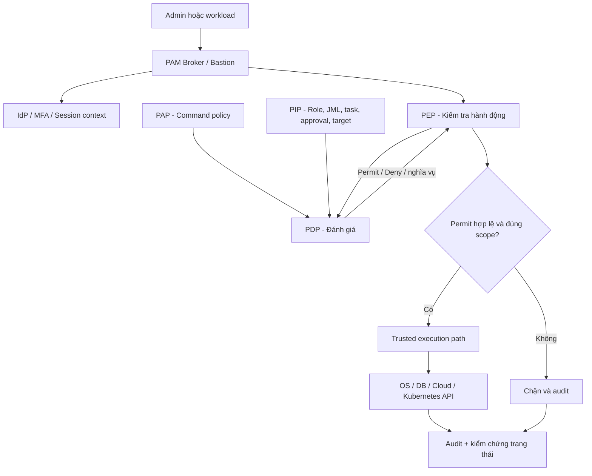
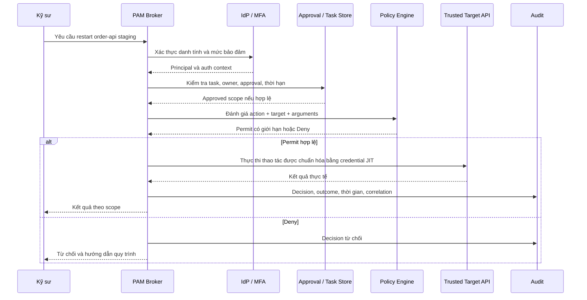

# Command control trong Privileged Access: Kiểm soát lệnh đặc quyền từ yêu cầu đến thực thi

**Command control** (kiểm soát lệnh) trong quản lý **Privileged Access** là tập hợp cơ chế **xác định, giới hạn, phê duyệt, giám sát và thực thi những thao tác mà một chủ thể được phép chạy trên hệ thống đặc quyền**. Đối tượng kiểm soát có thể là lệnh hệ điều hành, thao tác quản trị cơ sở dữ liệu, hành động trên Kubernetes, API hạ tầng hoặc chức năng của công cụ vận hành. Mục đích không phải chỉ để biết người quản trị đã nhập gì, mà là **ngăn các hành động vượt nhiệm vụ và quyền được phê duyệt trước khi chúng gây tác động**.

Ví dụ, kỹ sư vận hành được giao khởi động lại dịch vụ `order-api` trong môi trường staging không mặc nhiên có quyền tạo tài khoản quản trị, sửa cấu hình bảo mật của production hoặc đọc khóa bí mật của những ứng dụng khác. Một phiên SSH hay terminal đã được cấp phép chỉ chứng minh người đó có thể **kết nối**; từng lệnh/hành động nhạy cảm vẫn phải nằm trong **phạm vi công việc**, **đúng tài nguyên**, **đúng thời điểm** và **đúng chính sách**.

Bài thuộc chương **Privileged access** của module `SECURITY_IDENTITY_ACCESS_MANAGEMENT_IDENTITY_LIFECYCLE`. Module tìm hiểu vòng đời danh tính trong IAM theo **Joiner–Mover–Leaver (JML)**, từ xác minh, tạo tài khoản và cấp quyền đến rà soát, thu hồi khi thay đổi vai trò; đồng thời kết nối **IdP, SSO, SCIM, RBAC/ABAC, tài khoản dịch vụ, kiểm toán và giảm quyền truy cập tồn dư**. Trong bức tranh đó, command control là lớp bảo vệ **ở thời điểm hành động đặc quyền được thực thi**, bổ sung cho việc cấp tài khoản và mở phiên truy cập.

Sau bài học, bạn có thể phân biệt kiểm soát lệnh với ghi log phiên; thiết kế chính sách cho phép/từ chối theo danh tính–lệnh–đối số–đích–thời gian; hiểu vị trí PEP/PDP và các giới hạn của shell; áp dụng nguyên tắc JIT/PAM, SoD, bảo vệ command output và đối soát hoạt động đặc quyền xuyên suốt JML.

## 1. Vì sao đăng nhập đặc quyền thành công vẫn chưa đủ?

Một tài khoản quản trị có thể thực hiện nhiều loại thao tác: đọc log, restart service, sửa firewall, quản trị user, truy xuất bí mật, thay chính sách hoặc xóa dữ liệu. Nhưng mỗi **nhiệm vụ thực tế** chỉ cần một phần nhỏ của tập khả năng đó.

Nếu cho kỹ sư quyền `root` toàn máy chỉ để xem trạng thái dịch vụ, cả sai sót vô ý lẫn việc tài khoản bị chiếm đoạt đều có phạm vi tác động lớn. Command control hướng tới việc:

- **Hạn chế bề mặt quyền:** người làm nhiệm vụ nào chỉ được gọi những thao tác phù hợp nhiệm vụ ấy.
- **Giảm quyền thường trực:** dùng phê duyệt và **Just-in-Time (JIT)** cho hành động đặc biệt.
- **Ngăn sai mục tiêu:** lệnh có thể hợp lệ trên staging nhưng bị cấm trên production.
- **Giữ Separation of Duties (SoD):** người thay cấu hình không mặc nhiên được tự phê duyệt và triển khai nó.
- **Tạo trách nhiệm giải trình:** biết ai yêu cầu, ai duyệt, phiên nào đã chạy và kết quả nào đã thực thi.
- **Thu hồi kịp thời:** khi nhiệm vụ kết thúc, nhân sự Mover/Leaver hoặc quyền bị hủy, hành động cũ không còn được phép.

**Command control không thể chỉ là một danh sách từ khóa bị cấm.** Với shell, cùng một hành động hệ thống có thể được thực hiện thông qua nhiều chương trình, thư viện hoặc API. Chặn một tên lệnh cụ thể không tương đương giới hạn được **khả năng thực thi** của chủ thể.

## 2. Phân biệt access control, session control và command control

| Lớp bảo vệ | Câu hỏi chính | Ví dụ | Không tự bảo đảm |
| --- | --- | --- | --- |
| **Identity & authentication** | Ai đang truy cập? Có được xác thực đúng mức không? | IdP, MFA, FIDO2, workload identity | Người đó được thực hiện mọi lệnh |
| **Entitlement / account access** | Được vào hệ thống nào, với vai trò gì? | Role `operations-reader`, SSH principal | Mọi lệnh trong phiên đều hợp lệ |
| **Session control** | Phiên được mở lúc nào, qua kênh nào, có thể dừng/ghi lại không? | PAM broker, bastion, session termination | Ghi phiên tức là đã chặn hành động nguy hiểm |
| **Command control** | Hành động cụ thể có được phép, với đối số và tài nguyên nào? | Chỉ `service.status.read` ở staging | Các API ngoài đường kiểm soát đã bị chặn |
| **Target enforcement** | Hệ điều hành/API/DB thực sự chặn thao tác ngoài quyền không? | sudo hạn chế, RBAC Kubernetes, quyền DB | Policy trung tâm luôn được mọi đích áp đúng |
| **Audit & reconciliation** | Đã xảy ra gì và quyền thực tế còn gì? | Event, audit, đối soát | Bản thân log ngăn được một lệnh |

**Session recording là khả năng quan sát, không đồng nghĩa command enforcement.** Video hoặc transcript ghi lại thao tác có ích cho điều tra, nhưng nếu người dùng vẫn được thực thi lệnh phá hủy trước khi người giám sát xem log, rủi ro chưa được ngăn.

Ngược lại, một policy chặn command không có audit đầy đủ sẽ khó giải thích sau sự cố. Kiểm soát trưởng thành cần **cả quyết định, thực thi, quan sát và thu hồi**.

## 3. Command trong PAM thực sự là đối tượng gì?

Không phải mọi hệ thống đều có “lệnh” theo cùng một biểu diễn.

| Bề mặt đặc quyền | Đối tượng có thể cần kiểm soát | Ví dụ minh họa |
| --- | --- | --- |
| **Linux/Unix** | Executable, tham số, user thực thi, file, capability và hệ thống đích | Đọc trạng thái dịch vụ; thao tác bằng `sudo` |
| **Windows** | Tác vụ quản trị, PowerShell/cmd, WinRM, service/API quản trị | Xem trạng thái service; thay cấu hình |
| **SSH/bastion** | Ai mở phiên, đích nào, lệnh/exec request nào | Vào host staging để kiểm tra |
| **Cơ sở dữ liệu** | Loại câu lệnh SQL, schema/table, đối tượng và quyền dữ liệu | `SELECT` trên view được duyệt |
| **Kubernetes** | Kubernetes API verb, resource, namespace, RBAC context, exec/attach | `get pods` trong namespace staging |
| **Cloud** | API operation, account/subscription, resource và điều kiện IAM | Xem trạng thái instance cụ thể |
| **CI/CD** | Pipeline/action, artifact, environment và approver | Deploy bản build đã duyệt đến staging |
| **Secrets manager** | Hành động xem/đọc/xoay vòng bí mật, path và version | Đọc secret chỉ phục vụ workload được phép |

**Nên kiểm soát ở lớp ngữ nghĩa có thể thực thi được.** Ví dụ một thao tác trên Kubernetes phải được giới hạn bằng **RBAC/API admission và danh tính thực thi**; chỉ lọc chuỗi `kubectl` ở terminal không chặn được một client khác gọi cùng API.

Tương tự, nếu người dùng có quyền sửa file cấu hình trực tiếp, việc chặn lệnh “sửa cấu hình” trong menu PAM không đủ. Cần kiểm tra **quyền ở hệ điều hành, file system và API** thực sự cho phép những thay đổi nào.

## 4. Mô hình một yêu cầu command control

Một yêu cầu điều khiển nên có đủ **chủ thể, nhiệm vụ, hành động, đích, đối số, ngữ cảnh và phê duyệt**.

| Trường | Mục đích | Ví dụ |
| --- | --- | --- |
| `principalId` | Danh tính con người hoặc workload ổn định | `iam-user-1042` |
| `sessionId` | Liên kết một phiên PAM đã xác thực | `pam-session-802` |
| `taskId` | Công việc hoặc ticket làm căn cứ quyền | `INC-482` |
| `action` | Hành động có tên rõ ràng | `service.status.read` |
| `target` | Host, database, namespace hoặc tài nguyên thật | `order-api` ở `staging` |
| `arguments` | Tham số được chuẩn hóa theo schema | `service=order-api` |
| `environment` | Thời gian, mức xác thực, trạng thái thiết bị, rủi ro | MFA mạnh, máy quản lý |
| `approvalRef` | Quyết định phê duyệt áp đúng phạm vi | `APR-22` |
| `policyVersion` | Phiên bản rule được áp | `pam-cmd-v7` |

Ví dụ **request đã chuẩn hóa**, không phải chuỗi lệnh shell để thực thi trực tiếp:

```json
{
  "principalId": "iam-user-1042",
  "sessionId": "pam-session-802",
  "taskId": "INC-482",
  "action": "service.status.read",
  "target": {
    "environment": "staging",
    "service": "order-api",
    "cluster": "cluster-02"
  },
  "arguments": {
    "includeRecentEvents": false
  },
  "requestedAt": "2026-12-01T03:10:00Z"
}
```

Trong thực tế, `principalId` phải đến từ phiên đã được xác thực, `taskId` và phê duyệt phải được kiểm tra tại nguồn tin cậy, còn `requestedAt` phải được xác định bằng đồng hồ tin cậy. Không thể tin mọi trường do người dùng gửi từ giao diện rồi tuyên bố “đã được duyệt”.

### Ranh giới action, args và target

Ba thông số nên được kiểm tra **cùng nhau**:

- **Action:** có thể được gọi loại hành động nào? Ví dụ chỉ đọc trạng thái.
- **Arguments:** có những biến thể nào được cho phép? Ví dụ chỉ một service nằm trong danh sách được duyệt.
- **Target:** được thao tác trên môi trường/tài nguyên nào? Ví dụ staging, không phải production.

**Một executable hợp lệ chưa đủ để cho phép mọi đối số của nó.** Nhiều chương trình quản trị có chế độ cho phép ghi, gọi trình thực thi khác hoặc thao tác một target ngoài scope. Định nghĩa chính sách cần xét **khả năng thực sự của chương trình và dạng tham số**, không chỉ tên file.

## 5. Kiến trúc đánh giá và thực thi: PAP – PIP – PDP – PEP

Trong mô hình **Policy-Based Access Control (PBAC)**, thường có:

- **Policy Administration Point (PAP):** quản lý rule/approval, phiên bản và chủ sở hữu.
- **Policy Information Point (PIP):** cung cấp role, trạng thái nhân sự JML, task, target classification, risk.
- **Policy Decision Point (PDP):** đánh giá request và trả Permit/Deny hoặc trạng thái tương đương.
- **Policy Enforcement Point (PEP):** thực sự cho/chặn lệnh ở ranh giới thực thi.



**PEP phải nằm trên đường đi bắt buộc của hành động.** Nếu hệ thống vẫn cho kết nối SSH trực tiếp bằng tài khoản có cùng đặc quyền, hoặc API cho phép thực thi qua một đường khác không qua policy, việc chặn trong bastion chỉ bảo vệ **một** đường truy cập.

### Command policy tại gateway và tại đích

Một PAM gateway có thể kiểm soát phiên, xác minh yêu cầu và chuyển tiếp command. Tuy nhiên, với thao tác nhạy cảm, nên có **kiểm soát ở đích**: quyền OS/DB/API giới hạn tài khoản thực thi chỉ có những khả năng cần thiết.

Ví dụ một gateway chỉ cho phép thao tác đọc trạng thái; tài khoản/role đích cũng không nên được cấp khả năng sửa mọi service rồi trông chờ gateway lọc đúng 100%. Nếu gateway bị bypass, **quyền đích tối thiểu** vẫn giảm thiểu tác động.

### Decision và enforcement không được đánh đồng

PDP trả `DENY` nhưng command vẫn chạy là lỗi **enforcement**. PEP có nhận thông điệp và chặn không? Có đường hành động trực tiếp không? Quyền ở đích có quá rộng không? Cần có **evidence của hành động đã hoặc chưa thực thi**, không chỉ log “policy matched”.

## 6. Allowlist hay denylist: Nên kiểm soát theo khả năng được duyệt

**Allowlist** xác định những hành động được phép với điều kiện rõ; **denylist** chặn các hành động đã biết nguy hiểm. Đối với tác vụ đặc quyền có phạm vi hẹp, **allowlist theo hành động có cấu trúc** thường là nền phù hợp hơn.

| Phương án | Lợi ích | Giới hạn |
| --- | --- | --- |
| **Allowlist action** | Chỉ các thao tác cần thiết được hỗ trợ | Cần định nghĩa đúng hành động và trường hợp sử dụng |
| **Denylist command** | Chặn nhanh một số thao tác đã biết | Không thể bao quát mọi cách đạt cùng hiệu ứng |
| **Denylist kết hợp allowlist** | Thêm guardrail cho lệnh/tài nguyên nhạy cảm | Vẫn phải hiểu ngữ nghĩa và thứ tự rule |
| **OS/DB/API privileges** | Chặn tại đích và trên nhiều đường truy cập | Cần cấu hình và kiểm thử riêng từng nền tảng |
| **JIT approval** | Hạn chế thời gian dùng khả năng đặc biệt | Không tự kiểm tra mọi command và đối số |
| **Recording / alerting** | Dễ điều tra và phát hiện bất thường | Không thay thế chặn trước thực thi |

**Nguyên tắc mặc định:** Nếu command không được ánh xạ đến một hành động được cho phép rõ ràng, không có căn cứ hợp lệ để thực thi. Trạng thái không tìm thấy rule, thiếu nguồn thuộc tính hoặc PDP lỗi phải có xử lý **fail closed** hoặc phương án khẩn được thiết kế riêng.

### Ví dụ policy allowlist có cấu trúc

```yaml
policyId: cmd-staging-order-status
ownerTeam: platform-operations
policyVersion: 7
effect: PERMIT
subjects:
  requiredRole: operations-observer
tasks:
  approvedTypes:
    - incident-triage
actions:
  - service.status.read
targets:
  environment: staging
  services:
    - order-api
arguments:
  includeRecentEvents: false
conditions:
  accountStatus: ACTIVE
  ticketMustBeOpen: true
  minAuthentication: strong
  managedDeviceRequired: true
  grantMaxMinutes: 60
audit:
  decisionRequired: true
  executionOutcomeRequired: true
```

**Đây là YAML minh họa về policy nghiệp vụ**, không phải định dạng của một PAM cụ thể. Việc có trường `managedDeviceRequired` không tự khiến hệ thống bảo vệ thiết bị nếu PEP/PDP không lấy và xác minh tín hiệu thiết bị thực.

### Deny cho một số rủi ro nền

Ngoài allowlist, tổ chức có thể đặt guardrail từ chối những lớp hành động không phù hợp với phiên:

- Gỡ/tắt cơ chế audit và giám sát bảo mật.
- Thay quyền hoặc credential đặc quyền khi không có approval.
- Thao tác phá hủy hàng loạt ngoài change window.
- Truy cập dữ liệu, tenant hoặc môi trường ngoài task.
- Đổi policy kiểm soát lệnh của chính mình nếu không có phân quyền quản trị.

Những guardrail nên được thực thi ở **nhiều lớp** và có luồng quản trị thay đổi rõ ràng, không chỉ ở bộ lọc chữ đơn giản.

## 7. Vấn đề lớn của shell: văn bản lệnh không phải ngữ nghĩa thực thi

Shell không chỉ chạy tên một chương trình. Nó có thể thực hiện mở rộng biến, wildcard, pipeline, chuyển hướng input/output, command substitution và khởi chạy những interpreter hoặc chương trình phụ. Vì vậy, một bộ lọc dựa vào **chuỗi được nhập** có thể không xác định đúng **những thao tác thật sự xảy ra**.

Cần nhớ những nguyên tắc thiết kế:

1. **Không coi regex chặn vài từ khóa là sandbox.** Những tên chương trình khác nhau có thể dẫn tới cùng khả năng hệ thống.
2. **Không cho lệnh có đặc quyền mở ra shell tùy ý** nếu mục tiêu là giới hạn chặt chẽ hành động; editor, pager, scripting runtime và tool cho phép subprocess cần đánh giá riêng.
3. **Chuẩn hóa đối số trước khi kiểm tra**, và kiểm soát đường dẫn/tham chiếu tài nguyên theo ngữ nghĩa của nền tảng.
4. **Phân biệt shell command với exec request có cấu trúc**; khi có thể, sử dụng API wrapper với command cố định và tham số kiểu dữ liệu rõ, tránh chuyển input tùy ý cho shell.
5. **Giới hạn credential và quyền của tiến trình thực thi**. Nếu tiến trình đã có toàn quyền kernel/OS, lọc ở một giao diện đầu vào không còn là rào chắn duy nhất đáng tin.
6. **Không chỉ kiểm tra command đầu tiên**. Cần hiểu tiến trình con, script được gọi, thao tác phụ và tác động của quyền hệ thống.
7. **Không coi console transcript là danh sách đầy đủ mọi hành động**: chương trình có thể thao tác thông qua API/hệ thống khác mà không hiển thị một dòng lệnh tương ứng.

### Kiểu dữ liệu có cấu trúc an toàn hơn command string tự do

Thay vì cho user truyền một chuỗi tự do:

```text
command = <free-form-shell-text-supplied-by-user>
```

Hệ thống có thể định nghĩa thao tác được duyệt:

```json
{
  "action": "service.restart",
  "target": {
    "environment": "staging",
    "service": "order-api"
  },
  "approvalRef": "APR-22"
}
```

Backend xác minh action, target, phê duyệt và context, sau đó **gọi API/tiện ích được khóa cấu hình**. Không ghép các trường người dùng nhập vào một shell command rồi dựa vào dấu nháy để bảo vệ toàn bộ chính sách.

**Giới hạn quan trọng:** Nếu workflow cần thực sự cấp shell tương tác đầy đủ cho người quản trị, khả năng “chỉ cho phép vài lệnh” có thể không bảo đảm trọn vẹn. Khi đó cần kiểm soát bổ sung ở hệ điều hành, boundary của host/container, credential, network, PAM session, JIT và giám sát.

## 8. Kiểm soát lệnh trong Linux, sudo và SSH

### 8.1. Quyền thực thi ở hệ điều hành

Trên Linux/Unix, có thể dùng phân quyền file, user/group, capabilities, các cơ chế MAC được hỗ trợ (chẳng hạn SELinux/AppArmor), cùng cấu hình phù hợp của `sudo` để giới hạn thao tác. Nhưng **mỗi cơ chế có mục tiêu và giới hạn riêng**:

- File permissions giới hạn truy cập đối tượng, không phải toàn bộ ý nghĩa của command.
- `sudo` có thể giới hạn **những executable và đối số được phép chạy với danh tính khác**, nhưng cấu hình không đúng có thể trao quyền rộng.
- SELinux/AppArmor hoặc cơ chế thực thi theo profile có thể hạn chế khả năng tiến trình, song cần cấu hình và kiểm thử theo hệ thống thực tế.
- Cấp `root` tương tác rồi chỉ log lệnh không tương đương least privilege.

**Không tự viết cấu hình sudoers production dựa vào ví dụ khái niệm.** Phải kiểm tra bản phần mềm, cơ chế so khớp lệnh/đối số, helper được gọi và khả năng ứng dụng được cấp mở chương trình khác. Trước khi thay đổi, cần có đường quản trị khẩn an toàn để tránh tự khóa quyền hợp lệ.

### 8.2. SSH command, shell và forwarding

Khi dùng SSH, cần phân biệt:

- **Interactive shell:** người dùng có môi trường tương tác rộng.
- **Remote command execution:** thực thi một command cụ thể qua SSH.
- **File transfer/forwarding/tunneling:** những loại khả năng khác có thể mở đường thao tác ngoài command được quan sát.

Nếu chính sách chỉ cho phép đọc log qua một command wrapper, còn cùng credential vẫn được dùng để mở shell, tunnel hoặc kết nối trực tiếp, mô hình command control chưa kín. Có thể cần hạn chế **SSH key options, forwarding, TTY, khả năng đăng nhập trực tiếp, tài khoản đích và network reachability** theo tính năng hỗ trợ của hệ thống.

### 8.3. Ghi phiên không thay thế kiểm soát thay đổi

Một session SSH được record có thể giúp điều tra ai chạy gì. Nhưng để ngăn thao tác ngoài nhiệm vụ, cần **enforcement trước khi action được gọi hoặc ở resource đích**. Bản ghi chỉ xuất hiện **sau** khi lệnh chạy không ngăn được hậu quả.

## 9. Command control với database và Kubernetes

### 9.1. Database: kiểm soát quyền SQL theo đối tượng

Một DBA có thể được giao “kiểm tra hiệu năng truy vấn” nhưng không nhất thiết cần quyền sửa dữ liệu sản xuất.

| Nhu cầu | Quyền phù hợp | Quyền không cần mặc định |
| --- | --- | --- |
| Xem trạng thái DB | Metadata/monitoring cần thiết | Thay schema/tài khoản admin |
| Phân tích truy vấn chậm | Read-only trên thông tin hiệu năng được duyệt | Truy xuất mọi bảng PII |
| Backup dữ liệu | Quyền backup đúng database | Drop database |
| Thực hiện migration | Quyền thay đổi được phê duyệt trong cửa sổ | DDL toàn bộ cluster vô thời hạn |
| Khôi phục sự cố | Grant đặc quyền JIT và kiểm soát nhiều lớp | Admin credential dùng chung không giám sát |

**Lọc chuỗi SQL ở proxy không thay thế quyền database.** Stored procedure, views, role, dynamic SQL, trigger hoặc đường API khác có thể thay đổi tác động thực của một request. Cần dùng **DB role, permission đối tượng, transaction và kiểm tra thay đổi** ở lớp engine khi có thể.

### 9.2. Kubernetes: RBAC theo API verb và resource

Một kỹ sư được phép xem pod trong namespace staging có thể chỉ cần `get`, `list` và `watch` trên những resource phù hợp. Họ không đương nhiên được `create`, `delete`, `patch` hay sử dụng các subresource đặc quyền.

Command control có thể bổ sung chính sách tại PAM, nhưng ranh giới thực thi nên xét:

- Kubernetes RBAC trên **verb, resource/subresource, namespace**.
- Admission policy nếu cần hạn chế loại workload và thao tác nhạy cảm.
- Danh tính Kubernetes được gắn với người hoặc workload đúng cách.
- Khả năng truy cập cluster từ ngoài bastion và các token/kubeconfig còn hiệu lực.
- Audit API server và đối soát quyền thực tế.

**Chặn chuỗi `kubectl delete` trong terminal không chứng minh API `delete` bị chặn**. Một công cụ khác có thể gọi cùng Kubernetes API; chính **RBAC và guardrail tại API** mới là kiểm soát cần thiết.

## 10. Quy trình JIT/PAM cho một command nhạy cảm

Giả sử kỹ sư An cần khởi động lại dịch vụ `order-api` trên staging vì incident `INC-482`.



### Các bước kiểm soát cần thiết

1. **Task có thật:** incident/change/ticket phải còn hiệu lực, đúng người được giao.
2. **Đúng identity:** liên kết danh tính người với phiên PAM; không chỉ tin username hiển thị.
3. **MFA/phương thức phù hợp:** với production admin, cân nhắc xác thực chống phishing.
4. **Approval đúng ranh giới:** người phê duyệt được phép duyệt action trên target đã nêu.
5. **Policy nhất quán:** action, tham số, host/namespace, thời gian và SoD đều hợp lệ.
6. **Credential ngắn hạn:** dùng quyền/credential JIT có scope cụ thể khi nền tảng hỗ trợ.
7. **Thực thi qua đường tin cậy:** không ghép input vào shell tự do; không cho đường bypass tương đương.
8. **Thu hồi và xác minh:** kết thúc quyền/phiên, xử lý token và xác nhận quyền không còn hiệu lực.

**Không dùng token admin vĩnh viễn bên trong PAM broker rồi coi mọi action đã an toàn chỉ vì giao diện có nút Approve.** Broker phải bảo vệ secret, giới hạn token dùng ở đích và thiết kế fail closed khi một kiểm tra bắt buộc không thể thực hiện.

## 11. SoD, dual control và thay đổi nhạy cảm

Với tác vụ như tạo tài khoản quản trị, đổi khóa mã hóa, cập nhật firewall hoặc thay chính sách bảo mật, việc **một người tự yêu cầu, tự duyệt và tự thực thi** có thể không phù hợp.

| Giai đoạn | Người/chức năng | Kiểm soát |
| --- | --- | --- |
| Đề xuất | Người thực hiện hoặc owner nghiệp vụ | Mục đích, tác động và target rõ |
| Đánh giá | Chủ hệ thống/security tùy rủi ro | SoD, change window, mức nhạy cảm |
| Phê duyệt | Người có thẩm quyền độc lập khi yêu cầu | Không tự phê duyệt theo chính sách |
| Cấp quyền | PAM/JIT | Credential có scope và hạn |
| Thực thi | Chủ thể được giao | Command/action theo approval |
| Kiểm chứng | Người hoặc hệ thống độc lập phù hợp | Kiểm tra hiệu lực, trạng thái và audit |

**Static SoD (SSD)** có thể cấm gán đồng thời hai role xung đột; **Dynamic SoD (DSD)** hạn chế kích hoạt đồng thời theo phiên. Nhưng để ngăn một người **tự phê duyệt thay đổi đã tạo từ phiên trước**, cần kiểm tra **lịch sử task/change** ở thời điểm cho chạy command.

### Break-glass

Khi có sự cố khẩn và luồng phê duyệt thông thường không thể hoạt động, tổ chức có thể dùng **break-glass** với danh tính và credential được bảo vệ, scope/time giới hạn nếu khả thi, thông báo cho người giám sát và review bắt buộc sau sự cố.

**Break-glass không có nghĩa tắt toàn bộ kiểm soát hoặc dùng tài khoản root chung không truy vết.** Những ngoại lệ phải được định nghĩa trước, thử nghiệm, theo dõi và kiểm toán phù hợp với mức rủi ro.

## 12. Trạng thái của lệnh: Request, Permit, Execute và Verify

Một command control tốt không chỉ có nhãn `ALLOWED` hoặc `BLOCKED`. Cần phân biệt **quyết định trước thực thi** với **kết quả tác động thật**:

| Trạng thái | Ý nghĩa | Bằng chứng |
| --- | --- | --- |
| **REQUESTED** | Chủ thể yêu cầu action | Identity, task, target, arguments |
| **APPROVED** | Approval hợp lệ trong phạm vi yêu cầu | Approver, time, approval ref |
| **PERMIT / DENY** | PDP đưa ra decision | Policy version, rule, reason code |
| **DISPATCHED** | PEP đã gửi yêu cầu thực thi | Request/correlation ID, target |
| **SUCCEEDED / FAILED** | Target phản hồi kết quả thực thi | Exit status hoặc API result đã xác minh |
| **VERIFIED** | Kiểm tra trạng thái tài nguyên sau thao tác | Observed state, kết quả kiểm tra |
| **REVOKED** | Grant/phiên đã được thu hồi có bằng chứng | Revocation and verification times |

**Exit code bằng 0 chưa luôn chứng minh đúng mục tiêu đã đạt.** Một command có thể trả thành công nhưng cập nhật nhầm instance, không hoàn thành trên toàn cluster, hoặc chỉ ghi một tác vụ bất đồng bộ chưa chạy xong. Với thay đổi nhạy cảm, cần kiểm chứng **tình trạng tài nguyên thực**.

### Tránh time-of-check to time-of-use (TOCTOU)

Nếu policy kiểm tra rằng `INC-482` còn mở lúc 10:00 nhưng người vận hành thực thi lúc 11:30 khi ticket đã đóng, quyết định cũ không nên giữ hiệu lực vô hạn. Cần:

- Ràng buộc quyết định với **target, args, session và time window**.
- Xác định thời hạn của authorization decision.
- Kiểm tra lại điều kiện trọng yếu trước khi thực thi thao tác nhạy cảm.
- Với thao tác dài, có chính sách xử lý khi grant hết hạn giữa chừng.
- Tránh **approval cho một action rồi chuyển dùng credential đó ở action khác**.

## 13. Đầu ra của command cũng là dữ liệu nhạy cảm

Command control thường tập trung vào **lệnh được chạy**, nhưng **stdout/stderr, file tạo ra và dữ liệu API trả về** cũng có thể chứa thông tin bảo mật.

Ví dụ một lệnh đọc cấu hình có thể vô tình in secret, token, chuỗi kết nối hoặc dữ liệu khách hàng. Một phiên được record toàn bộ có thể lưu những bí mật đó vào hệ thống audit.

Những kiểm soát cần đánh giá:

- Giới hạn **loại dữ liệu lệnh được phép đọc**, không chỉ quyền chạy executable.
- Kiểm tra path, namespace, tenant và độ nhạy cảm tài nguyên.
- Hạn chế các tùy chọn command có thể xuất nhiều dữ liệu không cần thiết.
- Redact hoặc bảo vệ output khi cần; không tự ý log toàn bộ nội dung chứa secret.
- Phân quyền truy cập session recording, transcript và audit.
- Thiết lập thời hạn lưu, mã hóa và quy trình truy xuất phục vụ điều tra.
- Kiểm soát đường xuất dữ liệu, tệp tải về hoặc forwarding theo khả năng hệ thống.

**Recording càng đầy đủ không mặc định càng an toàn.** Bằng chứng vận hành cần đủ để điều tra nhưng cũng phải tôn trọng **data minimization** và bảo vệ credential.

## 14. Command control trong Joiner–Mover–Leaver

### 14.1. Joiner: chuẩn bị account nhưng không cấp sẵn đặc quyền rộng

Nhân viên mới vào đội vận hành có thể cần đọc log staging. **Không nên vì thuộc đội Platform mà tự động cấp root hoặc cloud-admin**.

1. HRIS xác minh identity ID, trạng thái và ngày bắt đầu.
2. IAM provision account qua IdP/directory, cấp role cơ sở đúng nhiệm vụ.
3. Chính sách PAM quyết định **target nào và action nào** được phép.
4. Đăng ký MFA/phương thức xác thực phù hợp, cấu hình device/trust requirement.
5. Người dùng cần command nhạy cảm sẽ yêu cầu JIT/approval theo task.
6. Kiểm tra hiệu lực từ thời điểm `effectiveAt`, không mở access quá sớm.
7. Kiểm thử các command **bị cấm**, không chỉ command được phép.

Một account có thể đã được tạo và enrollment MFA xong trước ngày nhận việc; điều đó **không có nghĩa quyền dùng production được kích hoạt trước thời điểm được phép**.

### 14.2. Mover: thay đổi nhiệm vụ, thay command scope

Khi một kỹ sư chuyển từ Platform Operations sang Security Audit, họ có thể vẫn cần đọc log nhưng **không cần restart service hay deploy**.

| Thành phần | Trước Mover | Sau Mover | Kiểm tra |
| --- | --- | --- | --- |
| Role cơ sở | `platform-operator` | `security-auditor` | Role cũ bị gỡ nếu không còn căn cứ |
| Command `service.restart` | Có thể được JIT trong task | Không còn căn cứ thông thường | Deny tại PEP/target |
| Đọc audit log | Theo nhu cầu vận hành | Read-only theo scope audit | Giới hạn dữ liệu cần biết |
| Phiên PAM đang mở | Có thể tồn tại | Phải được xem xét chấm dứt/thu hẹp | Không còn quyền từ role cũ |
| SSH key / cloud credential | Có thể thuộc môi trường cũ | Thu hồi/luân chuyển khi cần | Kiểm tra cả đường ngoài broker |
| Task/chứng nhận quyền cũ | Theo đội Platform | Chuyển owner hoặc kết thúc | Grant provenance đầy đủ |

**Mover không chỉ là cấp thêm role mới.** Cần gỡ group, entitlement, JIT grant, SSH key hoặc quyền cục bộ không còn căn cứ, xử lý claim/token cũ và đối soát quyền **được dùng thực sự**.

### 14.3. Leaver: không để phiên và credential cũ mở đường command

Khi HR hoặc nguồn có thẩm quyền xác nhận Leaver, quy trình phải xử lý:

1. **Chặn đăng nhập mới** ở IdP/directory theo `effectiveAt` hoặc chỉ thị khẩn hợp lệ.
2. **Vô hiệu hóa PAM account/role và grant đặc quyền**, kể cả ticket JIT còn mở.
3. **Kết thúc hoặc chặn session đang hoạt động** theo khả năng PAM/target.
4. **Thu hồi key, token, chứng chỉ và credential** mà người đó có thể sử dụng; xem xét quyền local/SSH không qua IdP.
5. **Deprovision ở hệ thống đích** qua SCIM/API hoặc quy trình quản trị.
6. **Kiểm tra các API/host/DB còn cho thực thi lệnh không**, không chỉ tin response của connector.
7. **Bàn giao ownership của script, pipeline hoặc service account**; xử lý bí mật có thể đã biết.

Một phiên PAM có thể đang mở **trước** khi account bị disabled. Nếu PEP chỉ xác minh trạng thái tại thời điểm login, phiên có thể còn thực thi command sau khi Leaver. Cần xác định cơ chế **terminate session, re-evaluate entitlement hoặc chặn ở target** phù hợp.

### 14.4. Rehire và nhiều quan hệ

Người quay lại làm việc phải được xác minh bằng ID ổn định, tính lại role và chính sách command theo nhiệm vụ mới. **Không tự bật lại danh sách lệnh, access key, JIT exception hoặc phiên đặc quyền cũ** chỉ vì username/email trùng.

Với nhà thầu có nhiều hợp đồng, việc kết thúc một quan hệ phải gỡ **quyền bắt nguồn từ quan hệ đó**; quyền độc lập khác chỉ được giữ nếu vẫn có căn cứ hợp lệ và được đánh giá lại theo chính sách.

## 15. Command control cho tài khoản dịch vụ và workload

Không chỉ con người dùng command đặc quyền. **CI/CD runner, deployment worker, backup job, service principal và automation** có thể gọi API hoặc command quản trị với quyền lớn hơn người vận hành thông thường.

| Workload | Nhiệm vụ | Kiểm soát phù hợp |
| --- | --- | --- |
| `backup-job` | Backup database được chỉ định | Chỉ đúng database và storage, không có quyền xóa cluster |
| `deploy-staging` | Deploy image đã duyệt | Chỉ namespace staging, artifact digest hợp lệ |
| `report-sync` | Tạo báo cáo | Scope API đúng tenant, không được sửa policy |
| `incident-diagnostics` | Thu thập chẩn đoán | Chỉ endpoint/metric cần thiết, không xuất secret |
| `rotation-service` | Xoay vòng secret | Chỉ secret/path được giao, kiểm soát owner và audit |

**Không tạo “một tài khoản admin dùng chung cho mọi job”** vì khó hạn chế scope, xác định nguồn hoạt động và thu hồi riêng khi một pipeline bị chiếm đoạt.

Các điểm cần có:

- Workload identity ổn định và **owner chịu trách nhiệm**.
- Credential không lưu trong source code/log; ưu tiên short-lived/federated credential khi phù hợp.
- Mỗi pipeline/job có **allowed action, target, environment** rõ.
- Tách dev/staging/prod; không tái sử dụng credential production ở test.
- Phê duyệt hoặc policy gate cho thay đổi nhạy cảm.
- Audit đủ để liên kết command/API action với run ID, artifact và change.
- Decommission để thu hồi grants, secret, session, service principal khi job ngừng dùng.

**Client Credentials Grant** cho OAuth biểu diễn quyền của **ứng dụng/workload**, không phải quyền của người dùng khởi tạo tác vụ. Backend không được dùng token app-only có đặc quyền rộng để bỏ qua authorization nghiệp vụ của người dùng (*confused deputy*).

Khi người phụ trách workload nghỉ việc, không xóa mù quáng service account còn quan trọng; cần chuyển owner, đánh giá credential người đó từng biết và thu hồi/luân chuyển theo rủi ro.

## 16. Giám sát lệnh: Audit, alert và session recording

Nhật ký command control cần nối được ba sự kiện:

1. **Authorization decision:** tại sao Permit/Deny?
2. **Execution outcome:** command/action có chạy và ảnh hưởng mục tiêu nào?
3. **Privilege lifecycle:** quyền được cấp/hết hạn/thu hồi vào lúc nào?

Ví dụ **audit schema minh họa**, không chứa secret:

```yaml
eventId: pam-command-event-0108
principalId: iam-user-1042
actorType: human
sessionId: pam-session-802
taskId: INC-482
action: service.restart
target:
  environment: staging
  service: order-api
policyVersion: pam-command-v7
decision: PERMIT
approvedBy: platform-operations
decisionAt: "2026-12-01T03:10:00Z"
execution:
  dispatched: true
  outcome: SUCCEEDED
  verified: true
correlationId: request-99f3
```

**Không ghi command arguments/output nhạy cảm một cách mù quáng.** Chúng có thể chứa mật khẩu, token, secret hoặc dữ liệu cá nhân. Khi cần lưu command và transcript để điều tra, cần phân loại, mã hóa, phân quyền và thời hạn lưu theo yêu cầu bảo mật.

### Chỉ số vận hành có ý nghĩa

| Chỉ số | Điều cần quan sát |
| --- | --- |
| Tỷ lệ command Permit/Deny theo action và target | Phát hiện xu hướng, bất thường |
| Số lần chạy ngoài task/scope bị chặn | Đo guardrail hoạt động |
| JIT grant còn hiệu lực sau hết hạn | Phát hiện standing privilege ngoài ý muốn |
| Mover/Leaver còn session đặc quyền | Độ trễ thu hồi |
| Số target có đường bypass PAM | Độ phủ PEP/đường truy cập |
| Lệnh được Permit nhưng không kiểm chứng kết quả | Khoảng thiếu evidence |
| Tỷ lệ command phải dùng quyền root rộng | Cơ hội giảm đặc quyền |
| Policy version drift giữa gateway và target | Khác biệt rule có thể tạo kết quả sai |
| Chênh lệch giữa revokedAt và verifiedAt | Thời gian quyền tồn dư |
| Session recording chứa dữ liệu nhạy cảm | Rủi ro lộ bí mật qua audit |
| Break-glass invocation và overdue review | Kiểm soát ngoại lệ |

Đừng chỉ đo số lệnh bị chặn. Một hệ thống có **rất ít Deny** nhưng mọi người đang giữ quyền root thường trực có thể kém an toàn hơn hệ thống có nhiều Deny hợp lệ và đường thực thi được giới hạn thực sự.

## 17. Xử lý lỗi, tính sẵn sàng và fail closed

Command control là chốt an ninh, nhưng cũng có thể trở thành điểm lỗi trong vận hành. Cần xác định rõ hành vi khi:

| Tình huống | Rủi ro | Ứng xử an toàn |
| --- | --- | --- |
| PDP không phản hồi | Không biết command có được phép không | Không tự Permit; từ chối hoặc dùng đường khẩn đã phê duyệt |
| Task/approval store lỗi | Không kiểm chứng được căn cứ quyền | Xử lý trạng thái chưa xác minh, không dùng approval cũ vô hạn |
| Session bị mất kết nối | Đã dispatch nhưng chưa thấy kết quả | Xác minh execution/target trước khi retry thao tác không idempotent |
| Command chạy lâu hơn TTL | Grant hết hạn giữa tác vụ | Chính sách rõ về tiếp tục/dừng, không tự kéo dài |
| Log/recording service lỗi | Mất bằng chứng với lệnh nhạy cảm | Áp chính sách tạm dừng hoặc đường audit thay thế được duyệt |
| Phiên bị thu hồi khi đang chạy | Action có thể tiếp tục tại target | Có cơ chế terminate/cancel theo nền tảng, xác minh kết quả |
| PAM gateway bị bypass | Người dùng vào thẳng target | Giới hạn network/credential/quyền tại đích, phát hiện lệch |
| Policy mới bị lỗi | Command hợp lệ bị chặn hoặc sai quyền | Phê duyệt, test, rollout và rollback có guardrail |

**Fail closed không đồng nghĩa xóa dữ liệu hay cưỡng bức dừng mọi tiến trình đang chạy trong mọi trường hợp.** Quy trình cần phân biệt **không nhận yêu cầu mới** và **xử lý tác vụ đang thực thi**, theo hậu quả nghiệp vụ và khả năng an toàn của nền tảng.

Với yêu cầu khẩn cấp, cần thiết kế **break-glass** trước, định danh cá nhân và kiểm toán đầy đủ; không tự động bỏ qua chính sách khi dịch vụ đánh giá gặp lỗi.

## 18. Tình huống xuyên suốt: Command control cho đội vận hành

Doanh nghiệp có IdP, PAM broker, Kubernetes staging/production, ứng dụng OrderHub và hệ thống ticket. Nhân viên An được tuyển làm kỹ sư vận hành rồi chuyển sang kiểm toán.

| Mốc | Sự kiện | Quyền command mong đợi | Bằng chứng cần có |
| --- | --- | --- | --- |
| Joiner | An bắt đầu làm việc, có role quan sát | Xem trạng thái staging, không có prod admin | Role/PEP/target mapping đúng |
| Incident | An được giao `INC-482` | Đọc log và restart đúng service theo phê duyệt | Ticket, approval, TTL |
| Trong phiên | An thử sửa firewall production | Deny vì ngoài scope | Decision Deny + không có execution |
| Task hoàn tất | Incident đóng lúc 11:00 | Hết JIT grant và session tương ứng | Verified revoke và target state |
| Mover | An chuyển sang đội Audit | Chỉ thao tác read-only cần cho audit | Gỡ quyền restart/credential cũ |
| Leaver | An rời tổ chức | Không còn mở session hay chạy command theo quan hệ cũ | Account disabled, session ended, key revoked |
| Rehire | An quay lại trong vai trò khác | Tính mới từ chính sách hiện hành | Không tự phục hồi quyền cũ |

### Lỗi A — ghi phiên nhưng không giới hạn quyền ở đích

PAM broker lưu đầy đủ video, nhưng An vẫn có tài khoản SSH được cấp quyền rộng trên production. Một thao tác ngoài task có thể gây hậu quả trước khi người giám sát xem bản ghi. **Recording chỉ cung cấp chứng cứ, không thay command enforcement hoặc target least privilege.**

### Lỗi B — allowlist theo tên executable, không kiểm tra đối số

Policy cho phép một chương trình quản trị vì người dùng cần đọc trạng thái, nhưng chương trình cũng có khả năng sửa dữ liệu với tham số khác. Nếu PEP chỉ so tên chương trình, quyền thực tế rộng hơn nhiệm vụ. Cần policy có cấu trúc, giới hạn action/args/target và **quyền thực thi ở đích**.

### Lỗi C — JIT hết hạn nhưng session còn quyền

IAM đánh dấu grant hết hạn, song session cũ vẫn dùng được credential đặc quyền. **Thời điểm hết hiệu lực trên giấy chưa đủ**; cần thu hồi grant, vô hiệu hóa phiên/credential khi cần và xác minh tại target.

### Lỗi D — Mover bị cấp quyền cũ bởi sự kiện đến muộn

Sau khi An chuyển sang Audit, một sự kiện cấp role Operations cũ được replay. Nếu IAM không kiểm tra phiên bản nguồn và trạng thái hiện hành, quyền restart có thể quay lại. Cần **idempotency, event ordering và reconciliation**, không cấp lại dựa trên message lỗi thời.

## 19. Ma trận kiểm thử trước khi triển khai

| Ca kiểm thử | Kết quả mong đợi |
| --- | --- |
| Đúng principal, task, action, target staging và thời hạn | Permit; execution đúng scope |
| Action cho phép nhưng target production | Deny; target không nhận thao tác |
| Đúng executable nhưng đối số vượt phạm vi | Deny hoặc validation error, không thực thi |
| Command không có allowlist | Default deny |
| User không còn ACTIVE | Deny |
| Task đóng hoặc approval hết hạn | Deny, kể cả phiên còn mở |
| Thiếu trạng thái HR/approval bắt buộc | Không fail open |
| Một role cấp Permit nhưng SoD cấm | Deny theo guardrail |
| Gọi thẳng target ngoài PAM | Bị chặn bởi network/identity/target permission |
| Dùng API khác để đạt cùng hiệu ứng command | Vẫn bị kiểm soát ở resource/API |
| User có token/SSH key cũ sau Mover/Leaver | Không tiếp tục thực hiện action trái quyền |
| Replay một request JIT đã dùng | Không tự tạo thêm quyền hoặc lặp thay đổi ngoài ý muốn |
| Bản ghi audit thiếu outcome thực thi | Đánh dấu chưa xác minh, không báo thành công |
| Command trả success nhưng trạng thái chưa đạt | Chưa đánh dấu VERIFIED |
| Session recording có secret | Được ngăn/che/bảo vệ theo chính sách |
| PAM/PDP offline | Không tự Permit, đường ngoại lệ có kiểm soát |
| Workload chỉ được deploy staging | Không thể đổi production bằng credential đó |

### Kiểm thử cả đường đi ngoài giao diện

Một bộ test tốt không chỉ gửi command qua màn hình PAM. Nó cần kiểm tra **quyền thực ở host, DB, cloud, Kubernetes và API** theo các đường kết nối được phép, bao gồm tài khoản, token và credential có thể tồn tại ngoài broker.

Nếu môi trường dùng shell tương tác đầy đủ, nên xác định **điều gì thực sự được đảm bảo** bởi bộ lọc command và điều gì phải dựa vào quyền OS hoặc kiểm soát nền tảng. Không tuyên bố sandbox an toàn chỉ sau khi thử một số chuỗi lệnh mẫu.

## 20. Checklist thiết kế Command control trong IAM

1. Đã xác định **action, executable/API, đối số, target, scope, thời hạn** cho từng nhiệm vụ đặc quyền chưa?
2. Có liên kết request với **identity ID ổn định, task/approval và session** thay vì chỉ username không?
3. IdP/MFA có đáp ứng mức rủi ro; account còn hiệu lực theo JML không?
4. Command policy ưu tiên **allowlist có cấu trúc** và default deny, không chỉ denylist từ khóa không?
5. PEP có kiểm soát mọi đường thực thi cần bảo vệ, gồm SSH trực tiếp, API, DB, Kubernetes và automation không?
6. Có **target least privilege** để giảm rủi ro nếu bastion hoặc bộ lọc bị bypass không?
7. Với shell, đã đánh giá rủi ro command chaining, interpreter, subprocess và quyền OS chưa?
8. Có phân biệt **command validation**, **authorization** và **execution outcome** không?
9. SoD, dual approval, JIT/PAM và break-glass có owner, scope, expiry và audit không?
10. Joiner có được cấp chỉ quyền cần cho nhiệm vụ, không cấp trước đặc quyền không cần thiết không?
11. Mover có gỡ command scope cũ, xử lý phiên/token và kiểm tra quyền hiệu lực không?
12. Leaver có revoke PAM/IdP, session, SSH key, service credential, account đích và đối soát không?
13. Workload có owner, identity/credential tách biệt và scope API riêng không?
14. Có bảo vệ command output, session recording và dữ liệu audit khỏi lộ secret/PII không?
15. Khi lệnh đã kết thúc, có thể chứng minh **target đã thay đổi đúng** và quyền tạm đã bị thu hồi không?

## 21. Câu hỏi tự kiểm tra

**Câu 1.** Session SSH đã được PAM record đầy đủ. Có thể coi hệ thống đã kiểm soát mọi command không?

**Trả lời:** Không. Recording là quan sát/audit. Command control cần **quyết định và chặn trước hoặc tại thời điểm thực thi**, kết hợp quyền hạn chế ở target.

**Câu 2.** Vì sao chỉ chặn một số từ khóa hoặc tên executable nguy hiểm thường không đủ?

**Trả lời:** Một kết quả hệ thống có thể đạt qua nhiều chương trình, interpreter hoặc API. Cần kiểm soát **khả năng thực thi, đối số, tài nguyên và quyền ở đích**, không chỉ một chuỗi văn bản.

**Câu 3.** Người dùng có quyền `service.restart` trên staging có được restart production không?

**Trả lời:** Không. Quyền phải ràng buộc **action + target + environment**; staging không tự suy ra production. PEP và quyền đích phải kiểm tra đúng scope.

**Câu 4.** JIT grant hết hạn nhưng phiên đặc quyền vẫn mở. Có thể khẳng định đã thu hồi không?

**Trả lời:** Chưa. Cần kiểm tra khả năng tiếp tục chạy hành động, xử lý session/token/credential và xác minh tại target theo chính sách.

**Câu 5.** Khi nhân viên Mover sang bộ phận kiểm toán, vì sao không thể chỉ cấp role Audit mà giữ role Operations cũ?

**Trả lời:** Điều đó gây **privilege creep**. Cần thu hồi role, task và quyền command không còn căn cứ, kể cả access key, quyền đích và phiên đã mở.

**Câu 6.** Workload chạy backup cần quyền với một database cụ thể. Có nên cấp cloud administrator cho nó không?

**Trả lời:** Không, trừ khi có căn cứ đặc biệt được đánh giá rõ. Nên cấp **quyền backup đủ dùng trên đúng database/storage**, credential riêng và audit, tránh đặc quyền toàn môi trường.

**Câu 7.** Một API command trả HTTP 200 nhưng target vẫn chưa thay đổi. Audit nên ghi thế nào?

**Trả lời:** Phải phân biệt request được **tiếp nhận/dispatch** với **kết quả thực thi và xác minh trạng thái**. Chưa quan sát đạt mục tiêu thì không đánh dấu VERIFIED chỉ nhờ HTTP 200.

## Kết luận

**Command control** là kiểm soát **hành động đặc quyền cụ thể** chứ không chỉ tài khoản hay phiên đăng nhập. Một thiết kế đáng tin kết hợp **allowlist theo ngữ nghĩa, kiểm tra đối số và target, IdP/MFA, PAM/JIT, SoD, PEP/PDP, quyền tối thiểu ở hệ thống đích, audit và xác minh kết quả**. Nó phải nhận thức giới hạn của shell, không đồng nhất command recording với enforcement và không bỏ quên API, token, credential hoặc đường kết nối ngoài broker. Trong vòng đời **Joiner–Mover–Leaver**, command control giúp cấp đúng thao tác khi nhân viên bắt đầu nhiệm vụ, gỡ quyền khi thay đổi vai trò và chặn đặc quyền tồn dư khi nghỉ việc. Chỉ khi **quyết định, thực thi, thu hồi và trạng thái thực ở đích** được đối soát, tổ chức mới có thể khẳng định đã kiểm soát được hành động quản trị ở mức phù hợp.
