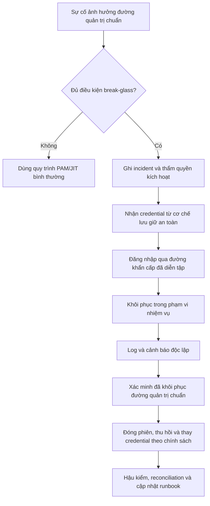

# Break-glass privilege trong Privileged Access và vòng đời danh tính IAM

**Break-glass privilege** là đặc quyền khẩn cấp được chuẩn bị trước để khôi phục quyền kiểm soát hệ thống trong một tình huống nghiêm trọng, khi quy trình truy cập thông thường không còn hoạt động hoặc không thể đáp ứng kịp yêu cầu ứng cứu. Tên gọi “break glass” gợi hình ảnh phá kính lấy thiết bị khẩn cấp: **chỉ sử dụng khi có căn cứ đặc biệt, bị giám sát chặt và phải hậu kiểm**.

Ví dụ, dịch vụ Identity Provider (IdP) gặp sự cố diện rộng làm quản trị viên không thể đăng nhập qua Single Sign-On (SSO). Một tài khoản khẩn cấp được thiết kế độc lập với đường đăng nhập bị lỗi có thể giúp đội ứng cứu khôi phục cấu hình, nhưng không được trở thành tài khoản quản trị dùng hằng ngày.

Trong **Identity and Access Management (IAM)**, break-glass phải tuân thủ **least privilege trong phạm vi có thể**, xác thực phù hợp, tách biệt trách nhiệm, quản lý credential, thời hạn và ghi vết. Nó liên quan trực tiếp vòng đời **Joiner–Mover–Leaver (JML)**: người được giao nhiệm vụ ứng cứu thay đổi theo thời gian, quyền khẩn cấp phải được kiểm tra lại khi đổi vai trò hoặc nghỉ việc và không được để lại quyền truy cập tồn dư.

## 1. Break-glass privilege khác quyền quản trị thông thường thế nào?

| Tiêu chí | Quản trị thông thường | Break-glass privilege |
| --- | --- | --- |
| Mục đích | Vận hành và bảo trì định kỳ | Khôi phục hoặc ứng cứu tình huống đặc biệt |
| Điều kiện sử dụng | Nhiệm vụ, role và phê duyệt theo quy trình | Sự cố nghiêm trọng và tiêu chí kích hoạt rõ ràng |
| Đường truy cập | IdP/SSO/PAM và chính sách chuẩn | Có thể độc lập với một thành phần đang gặp sự cố |
| Thời gian | Theo ca hoặc JIT nếu có | Chỉ trong khoảng ứng cứu cần thiết |
| Đặc quyền | Theo nhiệm vụ và phạm vi thông thường | Đủ để khôi phục dịch vụ, không rộng hơn nhu cầu được thiết kế |
| Giám sát | Audit và giám sát định kỳ | Cảnh báo ưu tiên cao, giám sát trực tiếp và hậu kiểm |
| Sau sử dụng | Kết thúc phiên công việc | Thu hồi, xử lý credential, kiểm tra thay đổi và khôi phục trạng thái |

**Không đồng nhất break-glass với “super-admin vĩnh viễn cho mọi người”.** Một cơ chế khẩn cấp có thể cần đặc quyền cao, nhưng account, quyền và phạm vi phải được giới hạn theo từng nền tảng. Thiết kế cần cân bằng **khả năng khôi phục khi hệ thống lỗi** với **rủi ro của credential có quyền lớn**.

## 2. Những tình huống có thể cần break-glass

Các tình huống hợp lệ thường được xác định trong kế hoạch ứng phó sự cố và khôi phục thảm họa:

- **IdP/SSO outage:** đường xác thực của quản trị viên không khả dụng, cần khôi phục tenant hoặc federation.
- **PAM outage:** hệ thống cấp đặc quyền theo yêu cầu không vận hành, trong khi nhiệm vụ khắc phục là khẩn cấp.
- **MFA hoặc chính sách truy cập cấu hình sai:** mọi quản trị viên hợp lệ bị khóa khỏi hệ thống trọng yếu.
- **Sai cấu hình quyền nghiêm trọng:** không còn người quản trị có thể đảo ngược một thay đổi gây mất dịch vụ.
- **Sự cố an ninh:** phải cô lập tài nguyên, khóa credential hoặc khôi phục kiểm soát theo kế hoạch đã phê duyệt.
- **Khôi phục hạ tầng:** cần truy cập lớp quản trị tối thiểu để đưa hệ thống xác thực trở lại.

Một nhân viên quên mật khẩu, người dùng muốn cài phần mềm tiện hơn hoặc ticket hỗ trợ thông thường **không phải căn cứ mặc định để dùng break-glass**. Nhu cầu vận hành thường ngày nên dùng RBAC, quyền được ủy quyền, Just Enough Administration (JEA) hoặc Just-in-Time (JIT).

## 3. Threat model: cơ chế khẩn cấp có rủi ro gì?

| Rủi ro | Hậu quả | Kiểm soát cần có |
| --- | --- | --- |
| Credential break-glass bị đánh cắp | Kẻ tấn công có quyền cao | Kho bảo vệ mạnh, giới hạn người tiếp cận, giám sát |
| Người vận hành dùng thường xuyên | Bỏ qua quy trình PAM, MFA hoặc SoD | Chính sách sử dụng khẩn cấp, cảnh báo và hậu kiểm |
| Tài khoản phụ thuộc SSO đang lỗi | Không truy cập được khi thực sự cần | Thiết kế và thử đường truy cập độc lập phù hợp |
| Không ai biết cách kích hoạt | Khôi phục chậm hoặc thao tác sai | Runbook có kiểm soát, diễn tập định kỳ |
| Quyền rộng hơn khả năng cần cứu | Tăng phạm vi thiệt hại nếu bị chiếm | Chia theo hệ thống và phạm vi khôi phục |
| Không thu hồi sau sự cố | Privilege persistence | Đóng phiên, rotation, đối soát trạng thái |
| Không có audit độc lập | Không thể xác minh ai đã làm gì | Log/cảnh báo ngoài đường quản trị bị ảnh hưởng |
| Kỹ sư sở hữu đã Leaver | Người cũ vẫn biết đường sử dụng | Chuyển người giữ quyền, thu hồi và thay credential |

**Break-glass là điểm yếu tiềm ẩn có chủ đích để bảo đảm khả năng phục hồi**, vì vậy nó phải được kiểm soát bằng các lớp bảo vệ độc lập và diễn tập thực tế. Một tài khoản có đặc quyền cao nhưng không ai giám sát sẽ trở thành mục tiêu hấp dẫn.

## 4. Kiến trúc tham chiếu

Một số nền tảng yêu cầu tài khoản khẩn cấp có kiểu danh tính và cơ chế xác thực riêng. Thiết kế cụ thể phải dựa vào khả năng của nền tảng và hướng dẫn nhà cung cấp; **không có một cách tạo tài khoản break-glass chung cho mọi IdP, Active Directory, dịch vụ đám mây hoặc hệ thống mạng**.

**Tách biệt đường khẩn cấp** không đồng nghĩa bỏ mọi xác thực. Nếu cơ chế MFA chuẩn cũng phụ thuộc thành phần đang lỗi, cần lựa chọn phương thức dự phòng mạnh, có thể sử dụng khi sự cố xảy ra và bảo vệ credential theo thiết kế đã được xét duyệt.

## 5. Nguyên tắc thiết kế break-glass

1. **Nêu điều kiện kích hoạt:** tình huống, mức nghiêm trọng, tiêu chí phê duyệt và thẩm quyền ứng cứu.
2. **Đảm bảo tính khả dụng độc lập:** xác định các điểm lỗi chung với SSO, PAM, mạng và MFA.
3. **Tách tài khoản khỏi danh tính dùng thường ngày:** hạn chế rủi ro nhầm mục đích, chia sẻ hoặc cấp quyền chéo.
4. **Tối thiểu hóa số lượng và phạm vi:** đủ tài khoản khẩn cấp để khôi phục, không tạo tùy tiện.
5. **Bảo vệ credential đặc biệt:** dùng vault hoặc hình thức lưu giữ được phê duyệt, kiểm soát truy cập và cơ chế phục hồi được kiểm thử.
6. **Cảnh báo khi sử dụng:** mọi đăng nhập, thay đổi quyền và thao tác nhạy cảm phải được quan sát.
7. **Có người chịu trách nhiệm:** owner nghiệp vụ, owner kỹ thuật, người giữ credential và kênh liên lạc.
8. **Khôi phục trạng thái sau sự cố:** đóng session, giảm đặc quyền, xử lý secret và kiểm chứng không còn quyền không hợp lệ.
9. **Đào tạo và diễn tập:** xác nhận quy trình chạy được khi hệ thống phụ thuộc thật sự hỏng.
10. **Đánh giá định kỳ:** cập nhật sau thay đổi kiến trúc, nhân sự hoặc sự cố.

**Không lưu mật khẩu khẩn cấp trong wiki công khai, ticket, nhóm chat hoặc script triển khai**. Runbook có thể chỉ dẫn nơi truy xuất credential theo kiểm soát, không cần chứa credential ở dạng rõ.

## 6. Điều kiện kích hoạt và phê duyệt

Một chính sách có thể xác định mức nghiêm trọng và người phê duyệt. Ví dụ:

| Điều kiện | Hành động |
| --- | --- |
| IdP không khả dụng nhưng hệ thống vẫn có đường quản trị khác | Ưu tiên đường quản trị chuẩn còn hoạt động |
| Hệ thống quản trị trọng yếu mất mọi đường truy cập hợp lệ | Đánh giá kích hoạt theo incident runbook |
| Có nguy cơ mất dữ liệu hoặc gián đoạn dịch vụ nghiêm trọng | Kích hoạt theo thẩm quyền đã định |
| Không thể liên lạc người phê duyệt | Áp dụng quy tắc khẩn cấp đã được định nghĩa trước, không tự tùy tiện |
| Đã khôi phục đường quản trị bình thường | Dừng sử dụng break-glass, chuyển sang PAM/SSO chuẩn |

Trong tình huống mạng/hệ thống hỏng, quy trình có thể phải hỗ trợ **phê duyệt ngoài băng** hoặc cơ chế ủy quyền sẵn. Không nên thiết kế bắt buộc truy cập đúng IdP/PAM đang lỗi để phê duyệt tài khoản khẩn cấp.

Một số môi trường có thể dùng **dual control**: hai người độc lập cùng cho phép lấy credential hoặc thực hiện hành động đặc biệt. Cần đánh giá khả năng thực hiện ngay cả khi một nhân sự không sẵn sàng. Số người và cấp duyệt phải do tổ chức quy định, không tự giả định một số cố định cho mọi sự cố.

## 7. Bảo vệ credential và người giữ quyền

Tài khoản break-glass có thể sở hữu đặc quyền lớn, nên quy trình lưu giữ credential phải được xây dựng như một tài sản bảo mật nhạy cảm.

- **Inventory:** account ID, tenant/hệ thống, phạm vi quyền, owner, người giữ trách nhiệm và trạng thái.
- **Storage:** bảo vệ bằng vault hoặc vật mang/biện pháp được phê duyệt; phân quyền truy xuất.
- **Access control:** người có thể lấy credential được giới hạn, quản lý theo JML.
- **Recovery:** có cách lấy thông tin cần thiết khi đường đăng nhập thường ngày gặp lỗi.
- **Rotation:** thay credential sau sử dụng hoặc khi nghi ngờ lộ, theo quy trình đáp ứng tính sẵn sàng.
- **Testing:** thử quy trình truy xuất và đăng nhập mà không tiết lộ bí mật trong log.
- **Evidence:** ghi thời điểm, lý do, ai nhận và sử dụng quyền, cùng kết quả đóng phiên.

**Không dùng chung tài khoản khẩn cấp một cách không thể truy vết** nếu có phương án phân biệt người thực thi. Khi nền tảng bắt buộc một account khẩn cấp dùng chung, phải bù bằng kiểm soát truy xuất, incident ID, nhật ký phiên và giám sát độc lập.

Nếu một nhân viên bảo quản credential đã Leaver, **thay đổi người phụ trách không tự làm credential cũ mất hiệu lực**. Cần xử lý vật mang, quyền vào vault và thay credential khi có khả năng người cũ còn biết bí mật.

## 8. Mối quan hệ với MFA và conditional access

MFA mạnh thường là yêu cầu quan trọng đối với quyền đặc biệt. Tuy nhiên, một cơ chế khẩn cấp có thể phải vượt qua **một điều kiện phụ thuộc vào dịch vụ đang gặp sự cố** để bảo đảm khả năng khôi phục.

Điều này cần được giải quyết bằng **thiết kế ngoại lệ có giới hạn và phê duyệt trước**, không phải lệnh “tắt MFA trên toàn tenant”.

Ví dụ một chính sách conditional access áp dụng cho quản trị viên thông thường, còn tài khoản break-glass có đường đăng nhập khẩn cấp riêng, được giám sát đặc biệt và kiểm tra định kỳ. Yêu cầu kỹ thuật cụ thể phụ thuộc nền tảng.

**Không coi “được miễn một chính sách” đồng nghĩa với “được miễn mọi kiểm soát”.** Cần lớp bảo vệ khác: lưu giữ credential, điều kiện truy cập, giám sát sự kiện, hạn chế phạm vi và xử lý sau sử dụng.

## 9. Break-glass với JEA, JIT và least privilege

| Cơ chế | Công dụng | Trong tình huống khẩn cấp |
| --- | --- | --- |
| **Least privilege** | Chỉ cấp quyền cần thiết | Chọn quyền đủ khôi phục thay vì siêu quyền không cần |
| **Just Enough Administration (JEA)** | Giới hạn thao tác/lệnh | Nếu đường quản trị còn hoạt động, ưu tiên endpoint bị giới hạn |
| **Just-in-Time (JIT)** | Quyền kích hoạt có thời hạn | Dùng khi PAM/JIT còn sẵn sàng |
| **Break-glass** | Đường vào khẩn cấp khi cơ chế thường bị hỏng/không đáp ứng | Chỉ dùng sau khi xác định điều kiện kích hoạt |
| **Separation of Duties (SoD)** | Tách quyền xung đột | Đảm bảo phê duyệt/hậu kiểm độc lập khi khả thi |

**Break-glass không thay thế JIT/PAM**. Đây là phương án dự phòng cho những trường hợp bất thường. Khi hệ thống bình thường, nên trở về mô hình đặc quyền được cấp theo nhu cầu, thời hạn và scope.

Trong một số sự cố, quyền khẩn cấp phải đủ lớn để khôi phục policy bị cấu hình sai. Vì vậy **không phải lúc nào cũng giới hạn được một command duy nhất**; tổ chức phải mô tả lý do, đánh giá rủi ro và tăng giám sát tương xứng.

## 10. Tình huống: IdP/SSO mất khả dụng

Giả sử doanh nghiệp sử dụng IdP đám mây cho ứng dụng và cổng quản trị. Một cập nhật cấu hình khiến toàn bộ quản trị viên không đăng nhập được.

Quy trình ứng cứu minh họa:

1. **Triage:** xác minh lỗi xuất phát từ IdP/SSO hoặc policy, không nhầm với lỗi cá nhân.
2. **Incident:** mở sự cố, xác định phạm vi, mức nghiêm trọng và người điều phối.
3. **Decision:** xác định đường phục hồi thông thường có thể dùng không; nếu không, xét điều kiện break-glass.
4. **Retrieve:** lấy credential theo quy trình bảo vệ ngoài đường quản trị bị ảnh hưởng.
5. **Authenticate:** dùng tài khoản khẩn cấp đúng tenant và phương thức đã diễn tập.
6. **Recover:** sửa cấu hình gây lỗi, không thay đổi tùy tiện những chính sách khác.
7. **Verify:** quản trị viên thường đăng nhập lại được qua IdP/SSO với điều kiện bảo mật chuẩn.
8. **Close:** dừng break-glass, xử lý session/credential và đối soát mọi thay đổi.
9. **Review:** xác định nguyên nhân gốc, cải thiện kiểm thử, phê duyệt và cảnh báo.

Nếu không ghi nhận ai dùng account, lúc nào và đã sửa gì, đội an ninh sẽ khó phân biệt **ứng cứu hợp lệ** với **lạm dụng đặc quyền**.

## 11. Break-glass với Active Directory, hạ tầng và cloud

Các nền tảng có cơ chế phục hồi khác nhau:

- **Active Directory Domain Services:** cần xem xét tài khoản quản trị miền, khôi phục domain controller và bảo mật thiết bị quản trị. Không tự dùng domain admin làm account dịch vụ hằng ngày.
- **IdP hoặc tenant đám mây:** có thể cần tài khoản khẩn cấp tách khỏi federation/conditional access bị lỗi, theo thiết kế được hỗ trợ.
- **Hệ thống mạng, hypervisor, cơ sở dữ liệu:** có thể có local administrator hoặc recovery identity được lưu giữ riêng.
- **Kubernetes, nền tảng CI/CD:** cần kiểm soát quyền quản trị cluster, cơ chế phục hồi và đường dùng workload identity.
- **Vault/PAM:** cần kế hoạch phục hồi khi kho credential hoặc dịch vụ cấp quyền đặc biệt không khả dụng.

Không áp dụng cùng một **tài khoản và mật khẩu chung** cho tất cả hệ thống. Credential dùng lại xuyên nền tảng làm tăng phạm vi ảnh hưởng nếu một nơi bị xâm phạm.

## 12. Vòng đời Joiner–Mover–Leaver của người được quyền kích hoạt

### Joiner — chỉ định người ứng cứu

Không phải nhân viên mới nào cũng được truy xuất credential break-glass. Việc thêm người vào nhóm ứng cứu cần xác minh danh tính, đào tạo, phê duyệt, phân tách trách nhiệm và giới hạn theo hệ thống.

Có thể chuẩn bị danh sách người chịu trách nhiệm và cách liên hệ trước khi xảy ra sự cố. **Được phép tham gia ứng cứu không có nghĩa luôn giữ quyền quản trị khẩn cấp trong phiên làm việc thông thường**.

### Mover — thay đổi trách nhiệm

Khi kỹ sư chuyển sang bộ phận khác, cần đánh giá liệu họ còn cần truy xuất vault, vật mang bí mật, runbook giới hạn hay nhóm phê duyệt break-glass không.

Chỉ sửa `department` trong HRIS hoặc nhóm IdP có thể không đủ: **credential từng được xem hoặc sao chép không tự mất hiệu lực**. Phải rà soát quyền tại kho bí mật, kênh ngoài băng và quy trình thay credential theo rủi ro.

### Leaver — thu hồi mọi đường khẩn cấp

Khi người giữ quyền nghỉ việc, cần:

1. Thu hồi khả năng truy xuất credential/vault, thiết bị hoặc nơi cất giữ.
2. Xóa quyền phê duyệt và liên hệ khẩn cấp không còn hợp lệ.
3. Xử lý hoặc thay bí mật mà người đó có thể đã biết.
4. Đánh giá session quản trị và token còn hiệu lực.
5. Thay thế nhân sự ứng cứu và kiểm thử khả năng sử dụng còn lại.
6. Lưu bằng chứng thu hồi, đối soát entitlement tại đích.

**Disable tài khoản SSO của Leaver chưa chứng minh họ không thể dùng đường break-glass**, nhất là khi credential khẩn cấp hoạt động độc lập với SSO.

## 13. Service account và workload không nên mượn break-glass

Một job tự động có thể bị gián đoạn khi IdP hoặc PAM lỗi, nhưng **không nên đưa credential break-glass cho workload để hệ thống tiếp tục chạy tự động**. Điều đó biến tài khoản khẩn cấp thành khóa quản trị tồn tại lâu và dễ bị rò trong pipeline, script hoặc log.

Tích hợp machine-to-machine nên dùng **service identity riêng, workload federation hoặc credential được quản lý**, với owner, scope, thời hạn và khả năng thu hồi phù hợp.

Khi service account cần được khôi phục, đội ứng cứu có thể dùng quyền khẩn cấp để **sửa cấu hình hoặc cấp lại credential tối thiểu**, rồi trả workload về đường xác thực chuẩn. Không để job chạy thường xuyên bằng quyền break-glass.

## 14. Xử lý phiên, token và quyền còn sót sau khi dùng

Kết thúc đăng nhập khẩn cấp không đồng nghĩa mọi ảnh hưởng đã được thu hồi:

| Đối tượng | Việc cần kiểm tra |
| --- | --- |
| **Session quản trị** | Đã chấm dứt hoặc bị vô hiệu theo khả năng nền tảng? |
| **Refresh/access token** | Có token được cấp trong sự cố còn hợp lệ không? |
| **Role/group/ACL** | Có quyền tạm thời hoặc gán trực tiếp chưa bị gỡ không? |
| **API key và secret** | Có credential mới được tạo trong quá trình khôi phục không? |
| **Policy exception** | Có rule bỏ qua kiểm soát chưa được hoàn nguyên không? |
| **Local account** | Có tài khoản phục hồi phụ mới tạo chưa được quản trị không? |
| **Audit/monitoring** | Có khoảng trống ghi log hoặc cảnh báo bị tắt không? |

Token tự chứa có thể còn dùng đến khi hết hạn nếu API không hỗ trợ kiểm tra trạng thái hoặc thu hồi tức thời. **Chỉ đổi mật khẩu break-glass không nhất thiết thu hồi mọi session/token đã phát hành**. Cần làm theo khả năng của nền tảng và xác minh lại bằng kiểm thử từ chối truy cập.

## 15. Giám sát và kiểm toán độc lập

Sử dụng break-glass phải tạo cảnh báo có mức ưu tiên cao. Một cơ chế giám sát phù hợp theo dõi:

- Đăng nhập và đăng nhập thất bại bằng account khẩn cấp.
- Truy xuất credential từ vault hoặc quy trình ngoài băng.
- Thời gian, nguồn kết nối và hệ thống đích.
- Thay đổi account, role, group, khóa, policy hoặc cấu hình bảo mật.
- Tạo token/secret và thay đổi quyền trong quá trình ứng cứu.
- Kết thúc phiên, thay credential và xử lý ngoại lệ.
- Sự khác biệt giữa trạng thái trước và sau sự cố.

Log cần gắn với **incident ID** và người chịu trách nhiệm khi có thể, bảo đảm integrity, lưu trữ ngoài phạm vi dễ bị người dùng khẩn cấp sửa/xóa. Không ghi plaintext password, recovery code, token, cookie hoặc khóa riêng vào log/ticket.

**Cảnh báo không thể đợi đến khi sự cố kết thúc mới được bật**. Đường giám sát nên được thiết kế để vẫn hoạt động hoặc phục hồi được khi một phần hệ thống IAM đang lỗi.

## 16. Kiểm thử và diễn tập break-glass

Một tài khoản khẩn cấp chỉ có giá trị nếu **sử dụng được khi cần**. Diễn tập nên bao gồm các kịch bản tích cực và phủ định:

| Kịch bản | Kỳ vọng |
| --- | --- |
| IdP/SSO chính không khả dụng | Đường khẩn cấp vẫn truy cập được theo thiết kế |
| Người không nằm trong nhóm có thẩm quyền | Không truy xuất được credential |
| Tài khoản khẩn cấp đăng nhập ngoài incident | Có cảnh báo và điều tra |
| Người giữ credential đã Mover/Leaver | Không còn quyền truy xuất hoặc credential cũ mất hiệu lực |
| Break-glass dùng đúng phạm vi | Có thể khôi phục hệ thống mục tiêu |
| Dùng ngoài phạm vi khẩn cấp | Bị chặn nếu nền tảng hỗ trợ; ít nhất phải phát hiện và xử lý |
| Sau khôi phục | Session, token, ngoại lệ và quyền tạm được xử lý |
| Quy trình phụ thuộc vào một người vắng mặt | Có phương án liên tục hợp lệ |
| Giám sát chính gặp sự cố | Có kế hoạch lưu và chuyển bằng chứng bổ sung |

**Diễn tập không có nghĩa tự gây gián đoạn production**. Nên dùng môi trường kiểm thử, phạm vi hạn chế hoặc quy trình kiểm tra được phê duyệt. Khi thử trên production, cần kiểm soát thay đổi và các hành động không gây tác động ngoài dự kiến.

## 17. Runbook vận hành break-glass

Một runbook phải đủ rõ để sử dụng trong tình huống áp lực cao nhưng không chứa bí mật:

1. **Trigger:** điều kiện nào cho phép break-glass?
2. **Scope:** hệ thống, tenant, loại sự cố và quyền khôi phục nào?
3. **Authority:** ai được kích hoạt, ai phê duyệt, ai giám sát?
4. **Secure retrieval:** lấy credential ở đâu theo quyền, không in bí mật trong tài liệu.
5. **Authentication:** cách tiếp cận đường đăng nhập dự phòng đã diễn tập.
6. **Allowed actions:** các hành động phục hồi tối thiểu được phép.
7. **Recordkeeping:** incident ID, người thực thi, thời gian và bằng chứng thay đổi.
8. **Exit:** điều kiện ngừng sử dụng và khôi phục đường quản trị bình thường.
9. **Cleanup:** đóng phiên, rotation, thu hồi quyền, khôi phục policy, đối soát.
10. **Post-incident review:** phân tích nguyên nhân, kiểm soát và cải tiến.

Runbook cần có bản dự phòng được bảo vệ và dễ tiếp cận trong trường hợp wiki hoặc hệ thống ticket bị ảnh hưởng. Nhưng **khả năng tiếp cận runbook không đồng nghĩa được cấp quyền đọc credential khẩn cấp**.

## 18. Chỉ số đánh giá chất lượng kiểm soát

Một số chỉ số có thể theo dõi:

- **Break-glass usage frequency:** số lần kích hoạt ngoài lịch kiểm thử.
- **Unauthorized-use alerts:** số lần đăng nhập không gắn incident hợp lệ.
- **Recovery availability:** tỷ lệ diễn tập xác minh đường dự phòng dùng được.
- **Time to revoke emergency access:** thời gian xử lý session/credential sau sự cố.
- **Credential custody coverage:** tỷ lệ account có owner và quy trình bảo vệ được xác minh.
- **Post-use review completion:** tỷ lệ lần sử dụng được hậu kiểm.
- **JML custody drift:** số người đã Mover/Leaver còn quyền truy xuất.
- **Residual privileged entitlement count:** role, ACL hoặc policy exception chưa được hoàn nguyên.
- **Detection latency:** độ trễ từ đăng nhập break-glass đến cảnh báo.
- **Runbook test freshness:** thời gian từ lần diễn tập thành công gần nhất.

Chỉ số phải được diễn giải theo bối cảnh. **Không phải số lần break-glass thấp là chắc chắn tốt** nếu cơ chế chưa từng được diễn tập và không ai biết nó còn hoạt động.

## 19. Câu hỏi tự kiểm tra

**Tình huống A:** Nhân viên cần restart một dịch vụ nhưng PAM vẫn hoạt động. Có nên dùng break-glass để nhanh hơn không? **Không.** Dùng JEA/JIT hoặc quyền được ủy quyền theo quy trình thường.

**Tình huống B:** Account break-glass cũng đăng nhập qua chính IdP bị lỗi. Thiết kế này có ổn không? **Không đáp ứng tốt mục tiêu dự phòng** nếu không có đường xác thực độc lập phù hợp.

**Tình huống C:** Kỹ sư đã Leaver, bị disable SSO nhưng từng biết mật khẩu khẩn cấp. Quy trình Leaver có hoàn tất chưa? **Chưa chắc.** Cần xử lý credential và quyền truy xuất độc lập.

**Tình huống D:** Tài khoản khẩn cấp được dùng nhưng không có incident ID hoặc audit. Có chấp nhận không? **Không nên.** Phải điều tra, lưu bằng chứng và hoàn thiện kiểm soát.

**Tình huống E:** Đổi mật khẩu tài khoản sau sự cố nhưng các access token và session quản trị vẫn còn hoạt động. Có thể coi đã thu hồi xong không? **Không.** Cần xử lý phiên/token theo nền tảng và kiểm chứng.

**Tình huống F:** Một job CI/CD muốn lưu credential break-glass để tự triển khai nếu workload federation lỗi. Có phù hợp không? **Không.** Cần cơ chế khôi phục workload được quản lý riêng, không dùng account khẩn cấp làm credential vận hành thường xuyên.

## Ghi nhớ

**Break-glass privilege** là **đặc quyền khẩn cấp có chuẩn bị, có điều kiện kích hoạt, kiểm soát truy xuất, giám sát và hậu kiểm** để khôi phục hệ thống khi đường quản trị bình thường không sử dụng được. Nó không phải quyền admin tiện lợi dùng hằng ngày và không được biến thành ngoại lệ bảo mật vĩnh viễn. Trong **IAM Joiner–Mover–Leaver**, phải quản lý cả người giữ quyền, credential, session/token, role và policy exception; phối hợp **IdP/SSO, PAM/JIT, SCIM, RBAC/ABAC, service identity, audit và reconciliation** để quyền khẩn cấp vừa **sẵn sàng khi cần** vừa **không tạo truy cập tồn dư sau sự cố**.
