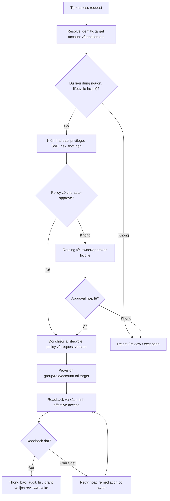
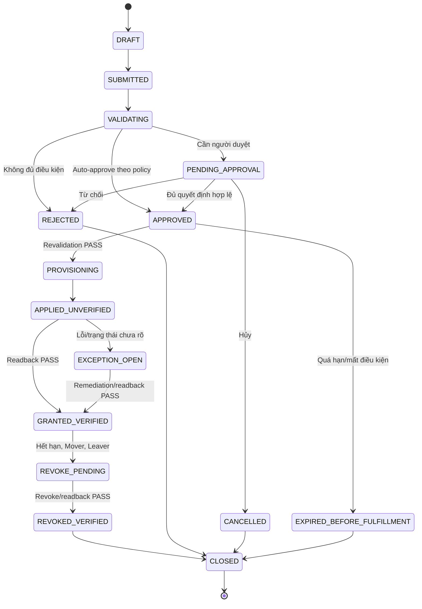
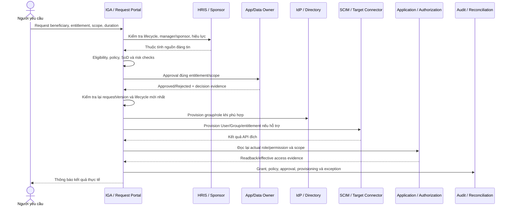

# Yêu cầu quyền trong IAM và vòng đời danh tính Joiner–Mover–Leaver

## Mục tiêu học tập

Sau khi học xong bài này, người học có thể:

1. Giải thích **yêu cầu quyền (access request)** là gì, phân biệt với **đề xuất quyền**, **phê duyệt**, **cấp quyền thực tế**, **kiểm tra quyền có hiệu lực** và **thu hồi quyền**.
2. Xác định những thông tin cần có trong yêu cầu: **người nhận quyền, account/tenant, ứng dụng, entitlement, action, resource scope, mục đích, thời hạn, approver** và bằng chứng.
3. Thiết kế luồng yêu cầu tự phục vụ (self-service) có kiểm tra **eligibility**, **least privilege**, **separation of duties (SoD)**, rủi ro, owner và trạng thái **Joiner–Mover–Leaver (JML)**.
4. Phân biệt các trường hợp **birthright access**, quyền yêu cầu theo vai trò công việc, quyền dự án có hạn, quyền đặc biệt **JIT/PAM**, quyền nhà thầu và quyền của **non-human identity**.
5. Hiểu cách IGA/IAM phối hợp với **HRIS, IdP, SSO, SCIM, directory group, RBAC, ABAC** và hệ thống ứng dụng để thực thi quyền đã được duyệt.
6. Xử lý request trùng, approval cũ, account chưa có, request bị từ chối/hủy, connector timeout, provisioning bất đồng bộ, xung đột version và cấp quyền sai đích.
7. Thiết kế **readback, reconciliation, audit, thông báo, SLA và access review** để ngăn quyền tích lũy và **residual access** sau Mover, Leaver hoặc grant hết hạn.
8. Phân tích kịch bản thực tế và kiểm thử cả trường hợp được cấp quyền hợp lệ lẫn các đường vòng vượt approval hoặc policy.

## 1. Yêu cầu quyền là gì?

Trong hệ thống **Identity and Access Management (IAM)**, **access request** là một yêu cầu có thể kiểm soát và truy vết nhằm **cấp mới, thay đổi, gia hạn hoặc thu hồi quyền truy cập** cho một danh tính/account trên tài nguyên cụ thể.

Ví dụ: nhân viên Lan cần xem báo cáo doanh thu của dự án A trong 14 ngày để kiểm tra số liệu. Lan gửi yêu cầu được thêm vào role `ProjectReportReader` với **scope dự án A**, ngày bắt đầu và ngày kết thúc rõ ràng. Hệ thống cần xác minh Lan còn là nhân viên hợp lệ, quyền đó có phù hợp công việc không, ai được phê duyệt, có xung đột quyền hay không, sau đó mới provision ở ứng dụng và đọc lại kết quả.

**Yêu cầu quyền không đồng nghĩa người gửi có quyền được nhận quyền.** Một người có thể tạo ticket hợp lệ, nhưng kết quả vẫn là `REJECTED` nếu không đáp ứng tiêu chí hoặc không được owner chấp thuận.

Cũng không được đồng nhất **approval thành công** với **provisioning thành công**. Một approver bấm duyệt chỉ xác nhận quyết định được phép cấp trong phạm vi đã xem xét; connector có thể lỗi, đích có thể không nhận, hoặc token/ứng dụng có thể chưa phản ánh quyền mới.

### 1.1. Những khái niệm cần phân biệt

| Khái niệm | Ý nghĩa | Bằng chứng |
|---|---|---|
| **Access request** | Đề nghị thay đổi quyền, có chủ thể và mục đích | Request ID, requester, target, entitlement |
| **Eligibility check** | Người nhận có đủ điều kiện để yêu cầu hoặc nhận quyền không | Lifecycle, role, sponsor, policy |
| **Access approval** | Người/nguồn có thẩm quyền chấp thuận nội dung và phạm vi yêu cầu | Approver, policy version, decision |
| **Access grant** | Bản ghi quyền được cấp theo quyết định hợp lệ | Grant ID, role/permission, scope, hiệu lực |
| **Provisioning** | Ghi account/group/entitlement vào target | Connector operation và kết quả |
| **Effective access** | Đích thực sự cho phép thao tác tương ứng | Target readback, runtime authorization |
| **Access review** | Định kỳ xác nhận quyền còn cần thiết không | Reviewer decision, action và evidence |
| **Access revoke** | Thu hồi entitlement/role/credential/phiên theo policy | State đã thay đổi và xác minh không còn quyền |

Một yêu cầu có thể hợp lệ nhưng chưa được phê duyệt; được phê duyệt nhưng chưa được provision; đã provision nhưng chưa có hiệu lực do đồng bộ; hoặc có hiệu lực nhưng phải bị thu hồi sớm nếu người dùng chuyển vai trò hay nghỉ việc.

### 1.2. Access request nằm ở đâu trong vòng đời IAM?

Mô hình **Joiner–Mover–Leaver** cung cấp trạng thái danh tính có thẩm quyền:

- **Joiner:** có những quyền cơ sở được cấp theo chính sách và những quyền bổ sung phải yêu cầu/phê duyệt.
- **Mover:** cấp quyền phù hợp vị trí mới và thu hồi quyền cũ không còn đủ điều kiện; có thể yêu cầu bổ sung quyền cho nhiệm vụ mới.
- **Leaver:** chấm dứt quyền theo mốc hiệu lực; không tiếp nhận request mới thành đường vòng tái kích hoạt account.
- **Tạm thời/dự án:** quyền có thời hạn hoặc được kích hoạt Just-in-Time để giảm standing privilege.

Access request là **một nguồn yêu cầu quyền**, không phải nguồn duy nhất. HR event có thể tự kích hoạt birthright access; PAM có thể cấp quyền JIT theo policy; SCIM/connector có thể thực thi thay đổi; bộ máy authorization ở ứng dụng mới quyết định truy cập có được cho phép.

## 2. Nguyên tắc thiết kế yêu cầu quyền an toàn

Một quy trình access request tốt tối thiểu phải đáp ứng:

1. **Định danh đúng người nhận:** kết nối identity ID với đúng account và tenant; không chỉ dựa vào email hiển thị.
2. **Có quyền cụ thể:** chọn entitlement từ catalog có owner và giải thích rõ tác dụng.
3. **Phạm vi nhỏ nhất:** action, resource, project/branch/tenant và thời gian đủ cho nhiệm vụ.
4. **Mục đích kiểm chứng được:** ticket dự án, nhiệm vụ, quan hệ công việc hoặc nhu cầu nghiệp vụ.
5. **Điều kiện hiện hành:** kiểm tra nhân sự/contractor còn hiệu lực, account có thể được cấp, không bị security hold.
6. **Policy và SoD:** không cho cấp xung đột nhiệm vụ hoặc quyền vượt eligibility.
7. **Approval đúng thẩm quyền:** người duyệt có quyền xét entitlement đích, độc lập khi cần.
8. **Tính bất biến của nội dung duyệt:** nếu role/scope/thời hạn đổi sau approval phải đánh giá lại, không dùng duyệt cũ.
9. **Triển khai có kiểm soát:** connector có quyền tối thiểu, cập nhật đúng account và xử lý retry an toàn.
10. **Readback và kiểm toán:** kiểm chứng hiệu lực và tự thu hồi/đánh giá lại khi mất điều kiện.

Một request thiếu dữ liệu quan trọng **không nên được hoàn tất tự động bằng cách điền role rộng nhất hoặc người duyệt bất kỳ**.

### 2.1. Least privilege có bốn chiều

| Chiều | Câu hỏi thiết kế | Ví dụ |
|---|---|---|
| Chủ thể | Ai thật sự cần? | Lan ở account cá nhân, không dùng account chung |
| Hành động | Cần được làm gì? | `report.read` thay vì `report.admin` |
| Tài nguyên | Cần trên phạm vi nào? | Dự án A thay vì mọi dự án |
| Thời gian | Cần đến khi nào? | 14 ngày thay vì vô thời hạn |

Có thể bổ sung điều kiện MFA, thiết bị, network, mức độ rủi ro và SoD theo ABAC. Yêu cầu quyền “chỉ xem dữ liệu” chưa hẳn rủi ro thấp nếu dữ liệu là khách hàng nhạy cảm hoặc có thể xuất hàng loạt.

## 3. Các chủ thể và trách nhiệm trong quy trình

| Vai trò | Nhiệm vụ | Điều không nên tự làm |
|---|---|---|
| **Requester** | Gửi yêu cầu, nêu lý do, đối tượng nhận quyền và thời hạn | Tự xem request là approval |
| **Beneficiary** | Người/account sẽ nhận quyền | Mặc định chọn người khác nhận quyền mà không có lý do |
| **Manager/sponsor** | Xác nhận nhu cầu công việc và quan hệ nhân sự/hợp đồng | Phê duyệt thay data owner nếu thiếu thẩm quyền |
| **Application/data owner** | Quyết định entitlement, phạm vi và mức rủi ro | Tự bỏ qua SoD bắt buộc |
| **Risk/SoD reviewer** | Đánh giá xung đột, ngoại lệ và quyền cao | Cho bypass không có evidence |
| **IAM/IGA policy engine** | Kiểm tra policy, routing, version, audit | Tự gán quyền vượt decision |
| **Provisioning connector** | Ghi thay đổi đúng target | Chọn account theo email mơ hồ |
| **IdP/Directory** | Quản lý authentication, group và account | Tự biết mọi permission nội bộ ứng dụng |
| **Target application owner** | Xác minh effective role/account và lỗi đích | Gắn role mới ngoài luồng không ghi nhận |
| **Auditor/Security** | Kiểm tra bằng chứng, drift, bất thường | Sửa log để hợp thức hóa việc cấp quyền |

Một user có thể tạo **request thay mặt người khác**, ví dụ manager gửi giúp nhân viên mới. Khi đó phải ghi riêng **requester** và **beneficiary**, ràng buộc quan hệ ủy quyền được phép, tránh một người gửi yêu cầu để cấp quyền cho account không thuộc phạm vi quản lý.

### 3.1. Owner nghiệp vụ và owner kỹ thuật khác nhau

Owner nghiệp vụ quyết định **quyền đó phục vụ công việc nào, ai được nhận**. Owner kỹ thuật quyết định **cách triển khai và kiểm chứng** trong directory/ứng dụng.

Một manager biết Lan cần xem báo cáo không nhất thiết được phê duyệt role `PayrollExporter`. Access request phải tìm đúng **data owner** hoặc **application owner** theo catalog và policy, thay vì mặc định manager là approver cho mọi quyền.

## 4. Yêu cầu quyền tự động và yêu cầu có phê duyệt

Không phải mọi quyền cần ticket hoặc người duyệt.

### 4.1. Birthright access

**Birthright access** là quyền cơ sở được cấp tự động khi identity đủ điều kiện theo nguồn có thẩm quyền. Ví dụ nhân viên active được đọc cẩm nang và gửi ticket IT.

Đối với birthright, hệ thống có thể **không có access request của cá nhân**, nhưng vẫn cần policy version, dữ liệu nguồn, thời điểm cấp và audit để giải thích vì sao quyền tồn tại.

### 4.2. Requestable access

Các quyền không phải birthright có thể được đưa vào **access catalog** cho người dùng yêu cầu. Ví dụ:

- Đọc báo cáo dự án.
- Chỉnh sửa repository cho một nhóm.
- Truy cập tập dữ liệu có phân loại nhạy cảm.
- Sử dụng phần mềm có license giới hạn.
- Được thêm vào group hỗ trợ vận hành.
- Tham gia một môi trường thử nghiệm với phạm vi đã định.

Từng quyền có thể yêu cầu các approver khác nhau hoặc được **auto-approve** khi policy xác định đủ điều kiện, không có SoD/rủi ro và không có yêu cầu approval thủ công.

### 4.3. Privileged/JIT access

Quyền `production.admin`, `secrets.read`, `iam.role.assign` hoặc `payment.approve` có thể yêu cầu kiểm tra tăng cường, step-up MFA, PAM/JIT, expiry ngắn, dual control hoặc audit phiên.

**Thời hạn ngắn không làm một quyền quá rộng trở nên ít rủi ro trong mọi trường hợp**. Một credential admin có thể gây ảnh hưởng lớn trong vài giây; cần kết hợp **JIT (đúng lúc)** với **JEA (chỉ đủ năng lực)**.

### 4.4. Self-service không phải self-approval

Self-service chỉ có nghĩa **người dùng có thể tạo và theo dõi request trong cổng thống nhất**. Việc request tự động được chấp thuận hay không phải phụ thuộc vào policy/approval, không phải do hệ thống miễn kiểm tra.

## 5. Catalog quyền: người dùng đang yêu cầu cái gì?

Nếu người dùng phải nhập một chuỗi role không có mô tả, họ rất dễ chọn quyền rộng hoặc request sai ứng dụng. Một **access catalog** tốt giúp người dùng chọn quyền đã được quản trị.

### 5.1. Metadata một entitlement có thể yêu cầu

| Trường | Mục đích |
|---|---|
| `entitlementId` | Định danh ổn định cho quyền được quản lý |
| `displayName` | Tên dễ hiểu trên portal |
| `description` | Công việc/hành động có thể làm |
| `applicationId` và `tenantId` | Hệ thống đích và tenant |
| `resourceType` / `resourceScopeModel` | Loại tài nguyên và phạm vi |
| `sensitivity` / `riskClass` | Phân loại rủi ro |
| `businessOwner` / `technicalOwner` | Quy trách nhiệm |
| `eligibilityPolicyId` | Ai có thể yêu cầu |
| `approvalPolicyId` | Luồng phê duyệt |
| `sodConflictSet` | Những quyền/role có thể xung đột |
| `maximumDuration` | Thời gian tối đa có thể cấp |
| `requiresStepUp` | Yêu cầu xác thực mạnh hoặc mới |
| `targetMapping` | Group, role, permission, license tại đích |
| `reviewFrequency` | Chu kỳ xác nhận quyền |
| `catalogState` | Active, deprecated, retired |

### 5.2. Ví dụ catalog JSON

```json
{
  "entitlementId": "ENT-PROJECT-REPORT-READER",
  "displayName": "Đọc báo cáo dự án",
  "description": "Đọc báo cáo được phân quyền của một dự án",
  "applicationId": "PROJECT_ANALYTICS",
  "resourceScopeModel": "PROJECT_ID",
  "riskClass": "MODERATE",
  "businessOwner": "PROJECT-DATA-OWNER",
  "approvalPolicyId": "project-report-v4",
  "eligibilityPolicyId": "active-project-assignee-v2",
  "maximumDurationDays": 30,
  "requiresStepUp": false,
  "targetMapping": {
    "grantType": "APPLICATION_ROLE",
    "roleId": "ProjectReportReader"
  },
  "catalogState": "ACTIVE"
}
```

Schema này **chỉ là ví dụ nội bộ**, không phải cấu trúc chuẩn SCIM hay IdP. Catalog có thể tồn tại trong IGA, IAM, database hoặc hệ thống quyền riêng của ứng dụng.

### 5.3. Quyền hiển thị không có nghĩa được tự cấp

Cổng self-service có thể cho xem entitlement để hiểu chức năng, nhưng khả năng **requestable** và **eligible** phải được đánh giá riêng.

Ví dụ nhân viên Finance có thể nhìn thấy quyền `PayrollExporter` trong catalog để hiểu đường yêu cầu, nhưng vẫn không đủ điều kiện nếu công việc của họ không liên quan dữ liệu lương hoặc SoD không cho phép.

Không nên tự động **ẩn toàn bộ quyền người dùng chưa đủ điều kiện** rồi bỏ qua trải nghiệm khiếu nại; có thể hiển thị lý do từ chối ở mức không tiết lộ dữ liệu nhạy cảm, kèm kênh hỏi owner.

## 6. Nội dung bắt buộc của một access request

Một request cần lưu đủ để **đánh giá đúng, thực thi đúng và kiểm toán được**.

### 6.1. Những trường dữ liệu điển hình

| Trường | Lý do cần |
|---|---|
| `requestId` | Theo dõi duy nhất |
| `requestType` | GRANT, REVOKE, CHANGE_SCOPE, EXTEND, ELEVATE... |
| `requesterIdentityId` | Ai tạo request |
| `beneficiaryIdentityId` | Ai sẽ nhận quyền |
| `beneficiaryAccountId` | Account tại đích, có thể chưa tồn tại |
| `targetApplicationId` / `targetTenantId` | Chặn nhầm hệ thống/tenant |
| `entitlementId` | Quyền trong catalog |
| `resourceScope` | Giới hạn project, branch, environment |
| `businessJustification` | Nhiệm vụ hoặc lý do |
| `ticketOrProjectRef` | Liên kết yêu cầu nghiệp vụ |
| `validFrom` / `validUntil` | Thời gian sử dụng quyền |
| `riskClass` / `policyVersion` | Chính sách khi đánh giá |
| `approverIds` / `approvalState` | Thẩm quyền và trạng thái duyệt |
| `sourceLifecycleVersion` | Kiểm soát event HR đến muộn |
| `requestVersion` | Phân biệt nội dung request thay đổi |
| `targetProvisioningState` | Trạng thái thực thi ở app |
| `readbackEvidence` | Bằng chứng quyền hiệu lực |
| `revocationPlan` | Cách kết thúc quyền |

Một request có thể cần thêm cost center, license availability, sponsor hoặc ngày kết thúc hợp đồng nếu entitlement liên quan.

### 6.2. Ví dụ access request

```json
{
  "requestId": "AR-2026-01482",
  "requestType": "GRANT",
  "requesterIdentityId": "IDN-2048",
  "beneficiaryIdentityId": "IDN-2048",
  "targetApplicationId": "PROJECT_ANALYTICS",
  "targetTenantId": "corp-vn",
  "entitlementId": "ENT-PROJECT-REPORT-READER",
  "resourceScope": {
    "projectIds": ["PROJECT-A"]
  },
  "businessJustification": "Đối soát số liệu kết thúc dự án A",
  "ticketOrProjectRef": "TASK-8821",
  "validFrom": "2026-12-01T02:00:00Z",
  "validUntil": "2026-12-15T02:00:00Z",
  "requestVersion": 1,
  "sourceLifecycleVersion": 52,
  "status": "SUBMITTED"
}
```

Ví dụ chỉ mô tả **hợp đồng dữ liệu nội bộ**. Trong môi trường thật, người gửi có thể cung cấp lý do và phạm vi, nhưng **identity/account mapping, policy, riskClass và lifecycle version phải được lấy/xác minh bởi hệ thống tin cậy**, không tin toàn bộ JSON client tự nhập.

### 6.3. Không đồng nhất tài khoản với danh tính

Một identity có thể có:

- Account IdP thông thường.
- Account quản trị riêng.
- Account ở hai tenant.
- Account ứng dụng SaaS.
- Guest account ở đối tác.

Request phải xác định **đúng account mục tiêu**, không tự lấy email làm khóa duy nhất. Nếu ID đích còn thiếu hoặc mapping mơ hồ, chuyển `CORRELATION_REVIEW`; không provision vào account đầu tiên tìm thấy.

### 6.4. Scope cần được ràng buộc bằng dữ liệu có thẩm quyền

Một user có thể gửi `projectId=PROJECT-A`, nhưng hệ thống phải kiểm tra dự án đó thuộc tenant nào, người dùng có quan hệ công việc gì, owner là ai và policy có cho yêu cầu hay không.

Không cho phép một request tự tạo `scope=ALL_TENANTS` chỉ vì UI có field trống hoặc vì server không kiểm tra giá trị ngoài danh mục.

## 7. Luồng xử lý từ request đến quyền có hiệu lực



Sơ đồ minh họa luồng chính. Một request có thể có nhiều line item, nhiều hệ thống đích, nhiều approval hoặc cần **cancel/review** ở bất kỳ thời điểm nào. Không nên tự động retry vô hạn hoặc bỏ điều kiện revalidation.

### 7.1. Năm lần kiểm tra quan trọng

1. **Khi submit:** identity, quyền được request và scope có hợp lệ không?
2. **Trước approval:** approver có đúng thẩm quyền, SoD/risk có thay đổi không?
3. **Trước provision:** account/lifecycle/policy/expiry có còn phù hợp không?
4. **Sau provision:** application thực tế có đúng group/role/permission được duyệt không?
5. **Trong thời gian sử dụng:** quyền còn cần thiết, account còn active và grant chưa hết hạn không?

**Không chỉ kiểm tra một lần lúc request được tạo**, vì giữa lúc submit và provision, người dùng có thể đã Mover, Leaver hoặc bị khóa do sự cố.

## 8. State machine của access request

| Trạng thái minh họa | Diễn giải |
|---|---|
| `DRAFT` | Người dùng đang soạn |
| `SUBMITTED` | Đã ghi nhận request và version |
| `VALIDATING` | Kiểm tra identity, target, eligibility, scope |
| `PENDING_APPROVAL` | Chờ một hoặc nhiều quyết định |
| `APPROVED` | Tất cả phê duyệt bắt buộc hợp lệ |
| `REJECTED` | Không được chấp thuận |
| `CANCELLED` | Đã hủy theo quy tắc |
| `EXPIRED_BEFORE_FULFILLMENT` | Yêu cầu/approval hết hiệu lực khi chưa cấp |
| `PROVISIONING` | Đang thực thi ở đích |
| `APPLIED_UNVERIFIED` | Đích báo đã xử lý, chưa xác minh đủ |
| `GRANTED_VERIFIED` | Đã đọc lại role/entitlement và kiểm tra điều kiện hiệu lực |
| `PARTIALLY_FULFILLED` | Một phần line item/hệ thống hoàn tất |
| `REVOKE_PENDING` | Đã đến hạn hoặc mất điều kiện |
| `REVOKED_VERIFIED` | Đã xác minh thu hồi đúng phạm vi |
| `EXCEPTION_OPEN` | Có lỗi hoặc trạng thái không chắc chắn, cần owner |
| `CLOSED` | Hoàn tất theo quy trình và lưu evidence |

Các trạng thái trên là **workflow nội bộ minh họa**, không phải thuộc tính chuẩn do SCIM/SAML/OIDC quy định.

### 8.1. Quy trình trạng thái



Hệ thống cần xử lý **đường hủy khi đang provision** và callback đến muộn. Một approval của request version cũ không được hợp thức hóa entitlement/scope đã đổi ở version mới.

### 8.2. Approval hết hạn khi nội dung đổi

Giả sử owner duyệt:

```text
Request v1:
    Role: ProjectReportReader
    Project: A
    End: 15/12
    Approved: YES

Người dùng sửa request thành v2:
    Role: ProjectReportEditor
    Project: A + B
    End: 31/12
```

Không được tiếp tục dùng approval v1 để cấp v2. Nếu sửa đổi tác động tới **role, scope, beneficiary, tenant, mức quyền hoặc thời hạn**, cần đánh giá và phê duyệt lại theo policy. Có thể lưu approvals gắn với **requestVersion hoặc immutable request content hash**.

## 9. Thiết kế approval đúng thẩm quyền

### 9.1. Các kiểu approval

| Kiểu | Sử dụng khi | Cẩn trọng |
|---|---|---|
| **Auto-approval** | Quyền thấp, eligibility rõ, policy đủ | Không bỏ qua SoD/lifecycle |
| **Manager approval** | Xác nhận nhu cầu công việc của nhân viên | Manager không mặc định là data owner |
| **Application owner approval** | Cần chấp nhận role của hệ thống | Phải biết tác động của entitlement |
| **Data owner approval** | Truy cập bộ dữ liệu nhạy cảm | Scope, mục đích, hạn và data handling |
| **Security/risk approval** | Ngoại lệ, admin, SoD conflict | Không được biến ngoại lệ thành mặc định |
| **Multi-stage approval** | Nhiều trách nhiệm độc lập | Không bỏ cấp khi người duyệt đầu đã duyệt |
| **Dual control** | Đặc quyền cao hoặc thay đổi rất nhạy cảm | Hai quyết định phải độc lập theo policy |
| **Emergency approval** | Sự cố khẩn cấp có quy trình riêng | TTL, alert, audit, hậu kiểm |

### 9.2. “Người duyệt chính mình” là một rủi ro

Nếu request cấp `iam.role.assign` do chính user có quyền phê duyệt loại request đó tạo ra, cần xét **self-approval** và phân tách nhiệm vụ. Không phải mọi trường hợp cùng một người requester/beneficiary đều bị cấm; vấn đề là **người yêu cầu tự phê duyệt quyền nhạy cảm cho chính mình** không qua kiểm soát.

Một policy có thể yêu cầu approver **khác beneficiary/requester**, không cùng đường quyền chi phối, hoặc phải có cấp duyệt bổ sung. Điều kiện cụ thể phụ thuộc rủi ro và cấu trúc tổ chức.

### 9.3. Manager chain không tuyệt đối đáng tin

Nguồn quản lý có thể vừa thay đổi do Mover; approval routing dựa trên snapshot cũ có thể gửi sai người. Nên tra quan hệ manager/sponsor từ nguồn HR hoặc hệ thống ủy quyền được quản trị, có timestamp và version.

Khi approver nghỉ việc hoặc chuyển nhóm, request đang chờ phải được **re-route** theo chính sách. Không chuyển tự động cho người duyệt không có thẩm quyền chỉ vì workflow cần đóng nhanh.

### 9.4. Delegated approval

Approver có thể ủy quyền cho người khác trong một khoảng thời gian. Để an toàn cần:

- Phạm vi entitlement, tenant và thời gian được ủy quyền.
- Chủ thể ủy quyền có thẩm quyền thực tế.
- Người nhận không được vượt thẩm quyền nguồn.
- SoD và self-approval vẫn được áp dụng.
- Audit cả người ủy quyền và người thực hiện quyết định.

**Ủy quyền phê duyệt không đồng nghĩa chuyển quyền truy cập vào ứng dụng.** Đó là hai loại grant khác nhau.

## 10. Eligibility, SoD và risk evaluation

### 10.1. Eligibility: người nhận có hợp lệ không?

Kiểm tra có thể dựa vào:

- HRIS/contractor source còn active và đúng ngày hiệu lực.
- Account chưa bị disabled/suspended.
- Identity proofing và correlation đáng tin.
- Worker type, department, job function, location khi thực sự cần.
- Project assignment/sponsor còn hiệu lực.
- Tenant/organization hợp lệ.
- Role/entitlement có thể cấp cho loại account đó.
- Thời gian yêu cầu không vượt hạn hợp đồng hoặc policy.
- Không có security hold hoặc quyết định revoke ưu tiên cao.

**Không tin thuộc tính `department` do người yêu cầu tự nhập**. Đó có thể là tín hiệu để kiểm tra, nhưng dữ liệu quyết định phải từ nguồn được quản trị.

### 10.2. SoD: tổ hợp quyền có nguy hiểm không?

Ví dụ request `payment.approve` khi user đang có `payment.create` có thể tạo xung đột SoD, đặc biệt nếu có thể tự tạo và tự duyệt cùng giao dịch.

Một kiểm tra tốt đánh giá:

1. Role/gán quyền trực tiếp ở target.
2. Permission từ nested group/role hierarchy.
3. Quyền mới nếu request được duyệt.
4. Scope chồng lấn có dẫn đến xung đột không.
5. Rule tĩnh và rule theo giao dịch.
6. Ngoại lệ đã được phê duyệt, expiry và điều kiện giám sát.

Không chỉ so tên role: một role khác có thể chứa cùng permission xung đột.

### 10.3. Rủi ro khi request quyền nhạy cảm

Yêu cầu `data.export_all`, `secrets.read` hoặc `cloud.admin` có thể đòi:

- Business owner/risk owner duyệt.
- Lý do gắn ticket/incident.
- MFA/step-up đủ mạnh.
- Thời hạn ngắn và JIT.
- Resource scope cụ thể.
- PAM/session recording nếu phù hợp.
- Không tự cấp khi thiếu kiểm chứng.
- Review và cảnh báo sau cấp.

Một yêu cầu “cần gấp” làm tăng **ưu tiên xử lý**, không tự làm giảm mức chứng minh cần thiết.

### 10.4. Phân biệt lỗi dữ liệu với bị từ chối

Nếu không lấy được trạng thái nhân sự từ HRIS hoặc ứng dụng đích trả lỗi, đó có thể là **REVIEW_REQUIRED/UNKNOWN**, không phải bằng chứng chắc chắn người dùng đủ hay không đủ điều kiện.

Với quyền cao, không được tự chuyển trạng thái thiếu dữ liệu thành `APPROVED` hoặc `GRANTED` để tránh gián đoạn.

## 11. Hạn quyền, JIT và yêu cầu gia hạn

### 11.1. Nguyên tắc quyền chỉ có hiệu lực trong khoảng cho phép

Mốc thời gian nên được lưu ở dạng **timestamp có timezone offset hoặc UTC**, với ranh giới rõ:

```text
validFrom <= trustedServerNow < validUntil
```

Một request tới `validUntil` phải được kết thúc ngay ở mốc này nếu hệ thống áp dụng khoảng **[from, until)**. Không cộng “đến hết ngày” nếu bản phê duyệt xác định đúng phút.

### 11.2. Giới hạn thời gian theo nhiều nguồn

Ví dụ contractor có contract end ngày 15/12, request quyền kết thúc ngày 31/12. Policy không nên cấp quyền xuyên qua mốc hết hợp đồng nếu không có quyết định có thẩm quyền.

```text
Desired grant must satisfy:
    request window
    approved window
    contract/employment eligibility
    assignment/project eligibility
    account lifecycle
    security hold / explicit revocation

Effective window is bounded by the earliest loss
of any mandatory condition.
```

Mốc `validUntil` là **giới hạn tối đa theo request**, không phải cam kết quyền không bị thu hồi sớm.

### 11.3. Gia hạn là một yêu cầu mới hoặc phiên bản được đánh giá lại

Một người cần thêm 7 ngày có thể yêu cầu `EXTEND`. Cần xem xét:

- Lý do gia hạn và công việc còn dang dở.
- Permission/scope có đổi không.
- Tổng thời gian đã sử dụng.
- SoD, role, eligibility và mốc hợp đồng hiện tại.
- Approver/approval policy đang có hiệu lực.
- Có sự kiện compromise, Leaver hoặc revoke không.
- Có giới hạn số lần gia hạn và yêu cầu review lại không.

**Không hồi sinh một grant đã bị thu hồi vì compromise** bằng cách đổi trường ngày hết hạn trong database.

## 12. Luồng request đến hệ sinh thái IdP/SSO/SCIM



### 12.1. IdP và SSO làm gì?

**IdP** quản lý xác thực, credential/MFA và thường có group/application assignment. **SSO (SAML/OIDC)** truyền kết quả xác thực và claim theo cấu hình tới ứng dụng.

Một user đăng nhập SSO thành công **không có nghĩa** request vào một ứng dụng hoặc dữ liệu cụ thể đã được duyệt. Ngược lại, request được duyệt nhưng IdP account chưa được activate vẫn không được phép đăng nhập trái điều kiện lifecycle.

### 12.2. SCIM làm gì?

**SCIM 2.0** chủ yếu quản lý resource `User` và `Group` ở hệ thống đích. Nó có thể hỗ trợ tạo account, cập nhật `User.active`, gán/gỡ Group membership. Tuy nhiên:

- **SCIM không chuẩn hóa mọi permission và role của mọi SaaS**.
- Role nghiệp vụ có thể phải ánh xạ từ Group hoặc dùng API riêng.
- SCIM `Group.members` không mặc định đồng nghĩa app đã cập nhật session/token.
- HTTP 2xx từ SCIM connector chưa chứng minh effective access đúng.
- Cần kiểm tra mapping giữa identity/account/group ở từng tenant.

### 12.3. RBAC và ABAC trong quá trình cấp quyền

Một request có thể được duyệt vào **role** `ReportReader` theo RBAC. Nhưng khi user xem dữ liệu, ABAC hoặc resource policy vẫn phải kiểm tra:

- User/account còn active.
- Permission `report.read` còn hiệu lực.
- Resource thuộc project/tenant được duyệt.
- Grant chưa hết hạn.
- MFA/device/risk đáp ứng policy.
- Không có hold hoặc deny hiện hành.

**Phê duyệt request không thay thế kiểm tra authorization ở runtime.**

## 13. Provisioning entitlement sau approval

Một approval có thể dẫn tới nhiều hành động phụ thuộc:

1. Tạo hoặc liên kết account đích nếu policy cho phép.
2. Cấp application license nếu cần.
3. Thêm account vào directory/IdP group.
4. Gán role/permission trực tiếp qua API ứng dụng.
5. Cập nhật scope/tenant/project.
6. Tạo grant có expiry và lịch revoke.
7. Thông báo entitlement đã sẵn sàng khi readback đạt.
8. Ghi bằng chứng và exception khi chưa hoàn tất.

### 13.1. Ví dụ cấp membership bằng SCIM

Khi target quản lý quyền bằng SCIM Group và hỗ trợ PATCH:

```http
PATCH /scim/v2/Groups/scim-group-410 HTTP/1.1
Authorization: Bearer <redacted>
Content-Type: application/scim+json

{
  "schemas": [
    "urn:ietf:params:scim:api:messages:2.0:PatchOp"
  ],
  "Operations": [
    {
      "op": "add",
      "path": "members",
      "value": [
        {"value": "scim-user-2048"}
      ]
    }
  ]
}
```

Đây là **lệnh minh họa**, không phải yêu cầu mọi ứng dụng đều hỗ trợ. `scim-user-2048` phải là ID User resource trong **SCIM server đích**, không phải HR ID hoặc email. Sau update cần đọc lại Group, đồng bộ quyền ứng dụng và kiểm tra scope/role thực tế.

### 13.2. Nếu app không hỗ trợ scope qua SCIM

Một ứng dụng có thể chỉ hỗ trợ role toàn cục trong SCIM hoặc không có SCIM. Nếu request chỉ được duyệt cho dự án A nhưng API role cấp quyền **tất cả dự án**, không được coi đó là cấp đúng phạm vi.

Phải tìm cách thực thi scope bằng policy app/ABAC hoặc entitlement hẹp hơn; nếu không thể bảo đảm phạm vi đã duyệt, cần **từ chối, yêu cầu phê duyệt lại hoặc xử lý ngoại lệ có biện pháp kiểm soát**, không âm thầm nâng quyền.

### 13.3. Một request có nhiều line item

Ví dụ Lan yêu cầu hai quyền: `project.read` và `project.export`. Quyền đọc được duyệt, quyền xuất bị từ chối. Workflow cần lưu **decision từng line item**, không tự cấp cả hai vì cùng ticket.

Trạng thái tổng có thể là `PARTIALLY_APPROVED` hoặc `PARTIALLY_FULFILLED`. Thông báo phải cho biết rõ quyền nào thực sự được cấp, quyền nào còn đang chờ hoặc bị từ chối.

## 14. Readback: làm sao biết đã cấp đúng?

**Readback** là việc đọc lại trạng thái từ **hệ thống đích** sau thao tác provisioning để chứng minh kết quả. Với entitlement nhạy cảm, chỉ có response 200/204 ở connector là chưa đủ.

### 14.1. Các mức xác minh

| Mức | Bằng chứng |
|---|---|
| `REQUEST_APPROVED` | Owner/policy đã chấp thuận request |
| `PROVISIONING_REQUESTED` | Connector đã gửi request |
| `TARGET_APPLIED` | API đích trả kết quả xử lý |
| `TARGET_STATE_VERIFIED` | Đã đọc lại membership/role/scope |
| `EFFECTIVE_ACCESS_VERIFIED` | App/API quyết định đúng trong phạm vi thử/quan sát |
| `SESSION_OR_TOKEN_UPDATED` | Phiên/token được xử lý nếu cần |
| `EXCEPTION_OPEN` | Chưa có đủ bằng chứng, có owner xử lý |

Không phải ứng dụng nào cũng cho phép kiểm tra runtime bằng cùng một phương pháp. Nếu target không có API readback quyền hiệu lực, hãy **nêu rõ mức bảo đảm quan sát được**, thay vì đánh dấu verified cho những lớp chưa kiểm tra.

### 14.2. Ví dụ bảng desired và actual

| Yêu cầu đã duyệt | Actual ở target | Kết luận |
|---|---|---|
| `ProjectReportReader`, dự án A, 14 ngày | Role + scope + expiry đúng | Có thể đánh dấu verified trong scope |
| Chỉ đọc dự án A | App gán quyền mọi dự án | **Overprovisioned**; cần sửa/chặn |
| Không được export | App thêm `report.export` | **Excess permission** |
| Role reader | App trả 2xx nhưng GET không có role | `APPLIED_UNVERIFIED` hoặc exception |
| Role trong app | Token/SSO cũ chưa nhận role | Grant đã áp dụng nhưng UX/runtime chưa hội tụ |
| Request đã bị hủy | Connector vẫn thêm group do retry muộn | **Stale fulfillment**; phải thu hồi |
| Beneficiary đã Leaver | App vừa được kích hoạt | **Severe lifecycle violation**; phải chặn |

### 14.3. Đừng xác minh bằng thao tác nguy hiểm thực tế

Không nên thực hiện giao dịch tài chính thật hoặc tải dữ liệu nhạy cảm để “test” entitlement. Có thể dùng **read-only authorization check**, test endpoint, dry-run, sandbox hoặc bằng chứng từ enforcement engine nếu sản phẩm hỗ trợ. Việc kiểm thử phải không tạo tác động nghiệp vụ ngoài phạm vi đã duyệt.

## 15. Request thay đổi hoặc thu hồi quyền

Yêu cầu quyền không chỉ gồm `GRANT`.

### 15.1. Thu hồi theo yêu cầu

Một manager có thể yêu cầu thu hồi quyền dự án của Lan khi Lan không còn tham gia. Yêu cầu này phải:

- Xác định đúng beneficiary/account/entitlement.
- Kiểm tra người yêu cầu có thẩm quyền quản lý quyền đó.
- Hiểu grant đang được sở hữu bởi những nguồn nào.
- Thu hồi đúng scope và không xóa quyền hợp lệ của nguồn khác.
- Xử lý token/session stale nếu rủi ro đòi hỏi.
- Readback và audit kết quả.

**Revoke quyền do dự án cấp không có nghĩa luôn xóa toàn bộ role**, nếu cùng role vẫn được cấp hợp lệ qua nguồn khác. Cần sử dụng grant provenance hoặc effective assignment computation.

### 15.2. Change scope

Ví dụ request cũ `PROJECT-A`, user chuyển sang `PROJECT-B`. Đây là thay đổi phạm vi cần đánh giá:

- Thu hồi quyền dự án A nếu không còn cần.
- Cấp đúng quyền dự án B sau approval.
- Không tự thay thành `ALL_PROJECTS`.
- Kiểm tra app-local caching/role.
- Ghi decision và thời điểm hiệu lực cho cả hai hướng.

### 15.3. Hủy request trước khi có quyền

Nếu người dùng hủy khi yêu cầu đang chờ phê duyệt, workflow cần ngăn cấp quyền. Nếu connector đã gửi lệnh, phải xác định hệ thống đích đã áp dụng hay chưa, rồi **bù trừ bằng thao tác thu hồi** khi phù hợp.

Không mặc định việc đánh dấu `CANCELLED` trong portal tự hoàn tác lệnh provisioning đang chạy.

## 16. Access request trong Joiner–Mover–Leaver

### 16.1. Joiner: tách birthright và additional access

Một Joiner event có thể tạo IdP account và quyền cơ sở theo role công việc. Các quyền bổ sung như truy cập tài chính, dữ liệu khách hàng hoặc quyền dự án có thể cần request riêng.

Luồng:

1. HR xác nhận người mới, ngày hiệu lực và người quản lý.
2. IAM đối chiếu identity/account và proofing.
3. Cấp birthright theo policy, không cần ticket cá nhân nếu đã được chuẩn hóa.
4. Các quyền vượt birthright được request theo catalog/approval.
5. Chưa đến ngày bắt đầu hoặc chưa đạt proofing thì không cho truy cập trái policy.
6. Readback sau provisioning và ghi tất cả nguồn grant.

### 16.2. Mover: gỡ quyền cũ cùng lúc xét quyền mới

Ví dụ Bình chuyển Sales → Finance:

```text
Trước Mover:
    crm.read_sales
    sales.report.export

Yêu cầu quyền mới:
    finance.invoice.read
    finance.report.read

Quyền không còn hợp lệ:
    sales.report.export
    crm.read_sales (nếu không còn nghiệp vụ)
```

Một access request vào role Finance **không tự động thu hồi quyền Sales**. Mover workflow phải tính lại desired state, xử lý quyền cũ, session/token và SoD. Đặc biệt nếu user vẫn có quyền xuất báo cáo Sales cùng quyền phê duyệt Finance, cần đánh giá rủi ro tích lũy.

### 16.3. Leaver: request chưa hoàn tất phải bị chặn

Khi HR/contractor source xác nhận Leaver có hiệu lực:

- Chặn request cấp quyền đang chờ hoặc chuẩn bị provision.
- Thu hồi quyền đã cấp, bao gồm grant có expiry trong tương lai.
- Disable IdP và app-local account theo policy.
- Thu hồi session/token/API key/credential khi liên quan.
- Ngăn callback approval/provisioning đến muộn bật lại account.
- Ghi evidence và exception khi không thể revoke ngay.

**Không có approval nào được ưu tiên cao hơn trạng thái Leaver có hiệu lực** nếu chưa có một quy trình tái kích hoạt danh tính hợp lệ riêng biệt.

### 16.4. Rehire không tự khôi phục request cũ

Một nhân viên quay lại có thể dùng identity ID cũ hoặc account retained. Nhưng request/role/approval của kỳ làm việc trước phải được đánh giá lại theo vị trí, hợp đồng và policy mới.

Một request `APPROVED` được lưu từ năm trước không thể dùng để cấp `production.admin` cho người tái tuyển dụng chỉ vì account có email trùng.

### 16.5. Nhà thầu và guest

Nhà thầu có thể có:

- Hợp đồng với `effectiveEnd` do hệ thống contractor quản lý.
- Sponsor có nhiệm vụ xác nhận yêu cầu.
- Tenant B2B hoặc IdP của đối tác.
- Quyền dự án chỉ trong khoảng thời gian hợp đồng.

Một request cho nhà thầu phải tuân thủ **mốc hết hạn hợp đồng và sponsor authority**. Email đối tác đăng nhập federation thành công không tự bảo đảm người đó vẫn được sponsor cho quyền ứng dụng nội bộ.

## 17. Request của service account và workload identity

**Non-human identity (NHI)** như CI/CD runner, bot, job batch và microservice cũng cần quyền. Nhưng không nên giả vờ đó là người nhân viên để đi qua màn hình manager approval theo cùng cách.

### 17.1. Những thông tin khác biệt

Request workload thường cần:

- Workload/service principal ID.
- Owner team và sponsor chịu trách nhiệm.
- Môi trường và tenant.
- API audience/scope, resource và hành động.
- Mục đích nghiệp vụ/đường pipeline.
- Credential mechanism (managed identity, workload federation, mTLS...).
- Thời gian sử dụng hoặc lifecycle của deployment.
- Risk và approval từ service/API owner.

Ví dụ job `invoice-export-job` chỉ cần `invoice.export_approved` ở dataset được duyệt. Không nên cấp `iam.role.assign` hoặc `secrets.read_all` chỉ vì pipeline cần chạy.

### 17.2. Không gắn credential workload vào nhân viên cá nhân

Khi người tạo job nghỉ việc, cần chuyển owner, kiểm tra secret/certificate, quyền và dependency; không tự disable job thiết yếu nếu team còn có nhiệm vụ hợp lệ. Ngược lại, không giữ credential cá nhân của Leaver làm phương thức xác thực cho workload.

### 17.3. Token ngắn hạn không thay thế entitlement review

Một workload có thể xin token OAuth ngắn hạn liên tục. Nếu entitlement của service principal quá rộng hoặc còn hiệu lực sau khi dự án kết thúc, token TTL ngắn **không xóa rủi ro quyền thừa**. Request và review phải quản trị cả role/scope lẫn credential lifetime.

## 18. Chống lỗi đồng thời, lặp request và event đến muộn

### 18.1. Request trùng

User có thể bấm Submit hai lần hoặc queue gửi cùng message nhiều lần. Nếu workflow không idempotent, hệ thống có thể tạo nhiều grant/approval hoặc thêm membership ngoài ý muốn.

Nên định nghĩa khóa nghiệp vụ như:

```text
requestId
requestVersion
beneficiaryIdentityId
targetApplicationId
targetTenantId
entitlementId
resourceScope
effectiveWindow
```

Không nhất thiết ghép toàn bộ thành khóa database duy nhất, nhưng phải có **correlation và rule chống duplicate**.

### 18.2. Approval đến muộn

Ví dụ:

```text
09:00  Request v1 cho Project A được gửi.
09:30  User hủy request.
10:00  Approver duyệt từ email notification cũ.
10:01  Provisioning worker nhận APPROVED callback.
```

Nếu chỉ tin callback, hệ thống có thể cấp quyền đã bị hủy. Cần kiểm tra **request vẫn ở trạng thái cho phép approval, đúng version và lifecycle hiện hành** trước khi chuyển trạng thái và trước khi ghi đích.

### 18.3. Mover/Leaver chen giữa approval và provision

```text
11:00  Manager duyệt quyền Sales.
11:10  HR phát Mover sang Finance có hiệu lực.
11:11  Request Sales đang trong queue provisioning.
11:12  Connector chuẩn bị thêm user vào Sales group.
```

Provisioning phải đánh giá lại eligibility, approval scope và lifecycle ngay trước write. Nếu quyền Sales không còn hợp lệ, không thêm group chỉ vì quyết định duyệt ở 11:00 từng đúng.

### 18.4. Callback stale và compare-and-set

Một job có thể dùng trạng thái request version 3, trong khi workflow đã chuyển sang version 4 hoặc `CANCELLED`. Cần kiểm soát **state transition + version** bằng transaction/optimistic locking và không cho callback cũ làm lùi trạng thái.

### 18.5. Pseudocode orchestration

```text
function processApprovedAccessRequest(requestId):
    req = loadCurrentRequest(requestId)

    if req.status != APPROVED:
        return NO_OP_OR_REVIEW

    identity = resolveTrustedIdentity(req.beneficiaryIdentityId)
    target = resolveVerifiedTargetAccount(identity, req.target)

    if target is missingOrAmbiguous:
        return OPEN_CORRELATION_REVIEW

    lifecycle = loadLatestAuthoritativeLifecycle(identity)

    if not lifecycle.isEligibleAtCurrentTime:
        return CANCEL_AND_AUDIT("LIFECYCLE_NOT_ELIGIBLE")

    policy = loadCurrentApprovedEntitlementPolicy(req.entitlementId)

    if not approvalMatchesImmutableRequest(req):
        return REEVALUATE_APPROVAL

    if not policy.allows(identity, req.scope, req.validWindow):
        return DENY_OR_REVIEW_POLICY_CHANGE

    if wouldViolateSodOrRiskGuard(identity, req.entitlementId):
        return DENY_OR_ESCALATE

    if req.statusOrVersionChangedSinceLoad:
        return RESTART_WITH_FRESH_STATE

    applyProvisioningIdempotently(req, target)
    verifyTargetEntitlementAndScope(req, target)
    auditAndNotifyActualOutcome(req)
```

Đây là pseudocode khái niệm, không phải code sản phẩm. Triển khai thực tế cần concurrency control, secret management, retry, circuit breaker, readback và phân quyền connector.

### 18.6. Connector timeout không chứng minh thất bại hay thành công

Nếu POST/PATCH đã gửi đến ứng dụng nhưng connection timeout, server có thể đã xử lý. Nên đọc lại target:

- Nếu quyền đúng như desired, cập nhật evidence.
- Nếu quyền chưa có, retry có giới hạn sau khi kiểm tra state mới nhất.
- Nếu quyền sai phạm vi, chặn/sửa và mở incident khi cần.
- Nếu target không đọc được, đánh dấu `UNKNOWN`, không báo granted.
- Nếu request đã bị hủy/Leaver, ưu tiên **revoke** mọi quyền được tạo muộn.

## 19. Thực thi quyền và xử lý token/session

### 19.1. Vì sao role mới chưa dùng được ngay?

Một role/group có thể đã được thêm nhưng người dùng vẫn bị 403 do:

- IdP hoặc cloud directory chưa đồng bộ.
- SCIM connector chưa hoàn tất.
- Ứng dụng cache role cho session hiện tại.
- Access token cũ chưa chứa group/permission mới.
- Resource ABAC scope chưa được cập nhật.
- Account chưa được kích hoạt đúng.
- Owner chỉ duyệt một phần quyền.

Cần phân biệt **request thành công** với **session hiện tại đã có đủ claim**. Có thể yêu cầu reauthentication/refresh theo policy, nhưng không phát token giả hoặc sửa client-side claim để vượt bảo mật.

### 19.2. Quyền đã bị thu hồi nhưng token còn claim cũ

Khi Mover hoặc Leaver, token JWT đã phát hành có thể vẫn chứa role cũ đến khi hết `exp`. Nếu API chỉ tin token snapshot, quyền có thể tồn dư.

Các biện pháp có thể gồm:

- Token TTL phù hợp rủi ro.
- App-local session revocation.
- Introspection hoặc denylist khi được hỗ trợ.
- Authorization engine kiểm tra effective permissions hiện hành.
- Event-driven cache invalidation.
- MFA/step-up và kiểm tra scope ở thao tác nhạy cảm.

**Không có một lệnh SCIM hoặc IdP group removal chung nào tự thu hồi được mọi token và phiên ở mọi ứng dụng.** Hãy đo giới hạn của từng target.

## 20. Access review và recertification sau khi cấp

Một request được phê duyệt đúng lúc chưa chắc tiếp tục đúng mãi. Sau khi cấp:

- Quyền phải có owner và lý do.
- Role nhạy cảm được review theo chu kỳ/rủi ro.
- Dự án kết thúc thì quyền dự án hết.
- Người dùng Mover thì xét lại role đã cấp.
- Leaver thì chặn quyền theo mốc có hiệu lực.
- Approval ngoại lệ phải có expiry.
- Grant có thể bị thu hồi sớm nếu risk hold.

### 20.1. Quyền có nhiều nguồn

Một principal có thể nhận cùng role từ **birthright**, **request được duyệt** và **project assignment**. Nếu request được duyệt hết hạn, role có thể vẫn hợp lệ qua nguồn còn lại; nếu không còn nguồn hợp lệ, phải thu hồi.

Tổ chức cần lưu **grant provenance** để biết workflow nào sở hữu gán quyền nào, tránh xóa mù hoặc giữ quyền không còn lý do.

### 20.2. Phê duyệt không có nghĩa review mãi mãi

Một owner đã duyệt quyền 6 tháng trước có thể nghỉ việc hoặc dự án đã đóng. Access review nên xác minh **người hiện tại còn làm công việc tương ứng, quyền còn cần và scope vẫn đúng**, không chỉ hỏi có từng được duyệt hay không.

### 20.3. Bằng chứng từ hệ thống đích

Một review đáng tin cần danh sách actual role, group, permission hoặc effective access có thể quan sát tại ứng dụng. Danh sách request approved trong IGA **không đủ để biết có quyền được cấp thủ công ngoài quy trình**.

## 21. Kiểm toán yêu cầu quyền

### 21.1. Một case cần trả lời được những câu hỏi gì?

1. Ai yêu cầu và cho ai?
2. Request nhắm tới account, tenant và ứng dụng nào?
3. Entitlement/scope/hạn bắt đầu–kết thúc là gì?
4. Lý do nghiệp vụ và ticket nào?
5. Nguồn lifecycle/manager/sponsor nào đã được dùng?
6. Eligibility và SoD được đánh giá theo policy/version nào?
7. Ai duyệt/từ chối, khi nào, với thẩm quyền gì?
8. Có thay đổi request sau approval không?
9. Connector nào đã thực thi, tại resource ID nào?
10. Target đã đọc lại ra sao và runtime effective access đạt mức nào?
11. Request còn exception, retry hoặc trạng thái không chắc chắn không?
12. Khi nào grant bị thu hồi và ai xác minh?
13. Có quyền thừa, account mồ côi hoặc token còn hiệu lực sau Leaver không?

### 21.2. Ví dụ audit record

```json
{
  "eventType": "ACCESS_REQUEST_FULFILLMENT_VERIFIED",
  "requestId": "AR-2026-01482",
  "requestVersion": 1,
  "requesterIdentityId": "IDN-2048",
  "beneficiaryIdentityId": "IDN-2048",
  "targetApplicationId": "PROJECT_ANALYTICS",
  "targetTenantId": "corp-vn",
  "entitlementId": "ENT-PROJECT-REPORT-READER",
  "scopeReference": "PROJECT-A",
  "policyVersion": "project-report-v4",
  "approvedBy": "PROJECT-DATA-OWNER",
  "sourceLifecycleVersion": 52,
  "connectorState": "APPLIED",
  "targetRoleReadback": "VERIFIED",
  "effectiveAccessReview": "VERIFIED",
  "grantExpiry": "2026-12-15T02:00:00Z",
  "correlationId": "IGA-JOB-9201"
}
```

Đây là **schema minh họa**, không phải SCIM API response. Không ghi password, OTP, access/refresh token, session cookie, private key hoặc giấy tờ xác minh danh tính vào log thông thường. Dữ liệu HR/tài nguyên nhạy cảm phải được minimization và có retention theo policy.

### 21.3. Tách ba loại thời điểm

- **Decision time:** lúc request được chấp thuận/từ chối.
- **Provisioning time:** lúc cập nhật target thực thi.
- **Effective/revocation time:** lúc quyền thực tế có hiệu lực hoặc không còn hiệu lực.

Việc phân biệt những mốc này giúp điều tra SLA và xác định ai còn quyền trong khoảng chờ đồng bộ.

## 22. Metrics và giám sát vận hành

| Chỉ số | Mục đích |
|---|---|
| **Request volume** | Số yêu cầu theo ứng dụng, loại, mức rủi ro |
| **Approval turnaround P50/P95** | Thời gian từ submit đến quyết định |
| **Provisioning latency P50/P95** | Thời gian từ approved đến readback đạt |
| **End-to-end fulfillment latency** | Thời gian người dùng hợp lệ nhận đúng quyền |
| **Auto-approval coverage** | Tỷ lệ request được policy tự xử lý |
| **Rejection and cancellation rate** | Theo dõi request không phù hợp/được hủy |
| **SoD conflict rate** | Tần suất xung đột quyền |
| **Overprovisioning incident count** | Cấp quá scope hoặc permission được duyệt |
| **Unverified target grants** | Request báo applied nhưng thiếu readback |
| **Request retry/duplicate rate** | Chất lượng orchestration/connector |
| **Orphan request/approval count** | Request không owner hoặc approver đã mất thẩm quyền |
| **Expired grant still active** | Quyền đã hết thời hạn nhưng target vẫn cho phép |
| **Mover excess entitlement count** | Quyền của vai trò cũ còn tồn tại |
| **Leaver residual access count** | Account/token còn truy cập sau mốc Leaver |
| **Access review completion rate** | Tỷ lệ review đóng đúng thời hạn |
| **Exception age and SLA breach** | Thời gian sai lệch còn tồn tại |
| **Approval override frequency** | Phát hiện lạm dụng đường ngoại lệ |

KPI cần có **mẫu số, định nghĩa timestamp, phạm vi target và mức kiểm chứng**. Một hệ thống có tỷ lệ phê duyệt 100% chưa chắc tốt: có thể người duyệt đang rubber-stamp mọi yêu cầu.

### 22.1. Cảnh báo đáng chú ý

- Một người tự phê duyệt quyền quản trị cho mình.
- Request cấp `admin` xuất hiện hàng loạt từ cùng requester.
- Quyền được thêm ở target nhưng không có request/approval hợp lệ.
- Request đã hủy mà provisioning vẫn hoàn tất.
- Mover/Leaver vẫn được grant từ queue cũ.
- Scope tại target rộng hơn scope được owner duyệt.
- Auto-approval áp dụng cho entitlement rủi ro cao ngoài policy.
- Connector liên tục 401/403/429/5xx khiến request tồn đọng.
- Role đã hết hạn nhưng vẫn thấy effective access.
- Một approver đã Leaver vẫn có callback `APPROVED` hợp lệ giả tạo.
- Request cùng account/entitlement liên tục bị gia hạn để duy trì standing privilege.

## 23. Những lỗi thiết kế phổ biến và cách phòng tránh

| Lỗi | Hậu quả | Phòng tránh |
|---|---|---|
| Chỉ nhập tên role tự do, không có catalog | Cấp sai hoặc không rõ tác dụng | Entitlement catalog có ID/owner |
| Request cho “mọi quyền” | Vi phạm least privilege | Bắt scope/action/time rõ |
| Approver không có thẩm quyền | Bypass governance | Approval routing theo owner và policy |
| Không có SoD check | Người dùng nhận quyền xung đột | Tính effective roles/permissions |
| Thay nội dung sau approval | Privilege escalation | Immutable/versioned approval |
| Dùng email để map account | Khóa/cấp nhầm người | Stable IDs và tenant correlation |
| Không recheck lifecycle lúc provision | Cấp lại cho Mover/Leaver | Fresh source/version guard |
| Chỉ kiểm tra HTTP 2xx | Báo thành công giả | Readback + effective access |
| Không có grant expiry | Quyền tồn tại vô hạn | Default duration và auto revoke |
| Gỡ group nhưng không xử lý token | Residual access | Session/token/runtime controls |
| Cho request tự approver qua API | Self-approval trái policy | SoD và independent approval |
| Không phân biệt requester và beneficiary | Gán quyền người khác sai | Record và check delegation |
| Không kiểm kê app-local direct grant | Access ngoài quản lý | Reconciliation và review |
| Job lỗi nhưng tự báo hoàn tất | Không ai xử lý sai lệch | Exception owner, SLA, retry |
| Một item bị từ chối nhưng grant cả bundle | Overprovisioning | Decision và apply theo từng item |

## 24. Kiểm thử quy trình yêu cầu quyền

### 24.1. Ma trận kiểm thử

| Tình huống | Kết quả mong muốn |
|---|---|
| Người active yêu cầu role phù hợp, owner phê duyệt | Provision đúng target, readback và audit |
| Request quyền vượt scope công việc | Reject hoặc review theo policy |
| Người dùng tự approve quyền admin | Bị chặn nếu policy cấm self-approval |
| Không lấy được trạng thái HR | Không auto grant; review/exception |
| Request thiếu tenant/beneficiary mapping | Không provision nhầm |
| Quyền đã có từ nguồn hợp lệ khác | Không tạo grant trùng vô nghĩa; provenance rõ |
| Người dùng đổi scope sau approval | Bắt review/approval lại |
| Một bundle gồm một quyền approved, một denied | Chỉ cấp phần approved |
| Request bị hủy khi connector đang chạy | Không để quyền còn active ngoài policy |
| Approval đến từ request version cũ | Bị từ chối |
| Joiner chưa đến ngày bắt đầu | Không cấp quyền sử dụng sớm |
| Mover làm mất eligibility giữa approval và provisioning | Không cấp quyền cũ |
| Leaver có hiệu lực trong khi ticket chờ | Hủy/chặn và xử lý account |
| Connector timeout sau PATCH | Readback, retry có giới hạn, không báo success bừa |
| API target trả 2xx nhưng scope rộng hơn approved | Không đánh dấu granted verified |
| App token chưa có role mới | Phân biệt provisioning với session refresh |
| Quyền đã hết hạn nhưng app session còn | Runtime deny/revoke, mở exception nếu cần |
| Nhà thầu hết hợp đồng trước grant end | Chặn trước hạn |
| Workload request role con người không phù hợp | Từ chối hoặc yêu cầu policy riêng |
| Target multi-tenant có cùng email | Map bằng stable target account/tenant |
| Approver đã Leaver | Re-route, không chấp nhận callback cũ |
| Request rehire dựa approval cũ | Buộc đánh giá policy hiện hành |

### 24.2. Kiểm thử boundary về thời gian

Cần kiểm tra mốc bắt đầu, mốc kết thúc, timezone, lịch làm việc, thời điểm HR event đến trễ, service clocks lệch, grant extension và request version thay đổi lúc callback về.

### 24.3. Kiểm thử phân quyền chính portal access request

Chính **cổng yêu cầu quyền** cũng phải có authorization:

- Requester không sửa request của người khác ngoài thẩm quyền.
- Người duyệt không duyệt entitlement ngoài portfolio.
- Beneficiary không tự đổi role/scope đã được duyệt.
- Reviewer không giả mạo business owner.
- Connector credential không lộ trong API/log.
- Auditor xem được evidence nhưng không thể âm thầm cấp quyền.
- Tenant A không tìm hoặc cập nhật request tenant B.
- Idempotency token không được dùng để replay một grant bị revoke.

Cần kiểm thử cả **frontend UI** và **backend API**, vì ẩn nút ở UI không ngăn người dùng gửi request trực tiếp.

## 25. Tình huống thực hành: request được duyệt nhưng cấp sai phạm vi

**Bối cảnh:** Doanh nghiệp dùng HRIS, IGA, IdP SSO, SCIM và ứng dụng phân tích dữ liệu. Nhân viên Minh thuộc dự án A, cần đọc báo cáo dự án A trong 14 ngày. Minh tạo request `ENT-PROJECT-REPORT-READER` với scope `PROJECT-A`. Manager đồng ý, nhưng quyền thực tế cần thêm data owner phê duyệt.

Các sự kiện sau xảy ra:

- 09:00: Minh submit request phiên bản 1.
- 09:10: Manager duyệt nhu cầu công việc.
- 09:20: Minh sửa scope từ `PROJECT-A` thành `ALL_PROJECTS`.
- 09:30: Một callback từ màn hình duyệt cũ của data owner ghi `APPROVED`.
- 09:40: Connector SCIM thêm Minh vào Group `report-readers` ở target.
- 09:45: Ứng dụng ánh xạ Group này sang role có quyền đọc mọi dự án.
- 10:00: HR cập nhật Mover, Minh không còn thuộc dự án A.
- 10:10: Token SSO cũ vẫn có group `report-readers`.
- 10:15: IGA đánh dấu `COMPLETED` vì connector trả 204.

### 25.1. Câu hỏi

1. Request phiên bản 1 đã được phê duyệt cho phạm vi nào?
2. Việc Minh sửa scope lúc 09:20 có thể kế thừa approval v1 không?
3. Cần kiểm tra gì trước khi chấp nhận callback data owner lúc 09:30?
4. SCIM group membership đã bảo đảm scope dự án A chưa?
5. Vì sao 204 của connector không đủ để kết luận request hoàn tất?
6. Mover 10:00 tác động tới quyền Minh như thế nào?
7. Token chứa group cũ lúc 10:10 có thể gây rủi ro gì?
8. Những bản ghi audit và exception nào cần tồn tại?
9. Có thể khắc phục bằng cách cho app role đọc mọi dự án rồi nhắc user “chỉ xem A” không?
10. Nếu Minh thực sự cần quyền cho dự án B sau Mover, quy trình nên làm gì?

### 25.2. Hướng giải

**Bước 1 — Kiểm tra request/approval version.** Manager và data owner phải duyệt đúng **role, beneficiary, resource scope, duration và requestVersion**. Một callback từ v1 không thể duyệt thay v2 có scope `ALL_PROJECTS`. Workflow phải giữ request v2 ở trạng thái cần đánh giá hoặc từ chối theo policy.

**Bước 2 — SoD và eligibility.** Trước provision cần xác minh identity/account, owner approval, điều kiện theo role/dự án, risk và thay đổi HR mới nhất. Scope mở rộng có thể làm tăng mức rủi ro và đổi người duyệt.

**Bước 3 — Kiểm tra target mapping.** Group `report-readers` thực tế ánh xạ quyền mọi dự án, vượt request chỉ cho A. IAM không được đánh dấu đúng phạm vi. Cần chọn group/role hẹp hơn hoặc ABAC resource scope. Nếu ứng dụng không hỗ trợ giới hạn, từ chối/đánh giá lại quyền theo policy.

**Bước 4 — Xử lý Mover.** Sau 10:00, eligibility cho dự án A có thể mất. IAM phải gỡ grant không còn hợp lệ và xem xét quyền mới theo dự án B nếu cần. Một approval cũ không tự cho quyền dự án khác.

**Bước 5 — Token và session.** Group claim trong token cũ có thể còn; cần xem cách ứng dụng kiểm tra quyền tại runtime, invalidate session/token hoặc rút ngắn cửa sổ tồn dư theo policy.

**Bước 6 — Audit và readback.** Ghi request v1/v2, ai duyệt từng phiên bản, kết quả policy, Group/role thực tế, scope sai, Mover event, token handling và ngoại lệ. Chỉ đóng khi effective permissions đúng hoặc đã thu hồi phần vượt.

### 25.3. Câu hỏi đúng/sai

1. “Access request là yêu cầu thay đổi quyền, không phải bằng chứng quyền đã được cấp.”
2. “Một người đã đăng nhập SSO thì mọi request quyền của họ đều hợp lệ.”
3. “Approver có thể duyệt một role/scope nhưng callback cũ không được tự cấp scope rộng hơn.”
4. “Quyền birthright có thể được cấp tự động khi nguồn lifecycle và policy đủ điều kiện.”
5. “Self-service đồng nghĩa self-approval cho mọi entitlement.”
6. “Requester và beneficiary luôn phải là cùng một người.”
7. “Một entitlement catalog nên có owner, target mapping, risk và scope.”
8. “SCIM Group.members tự chuẩn hóa mọi business permission và resource scope.”
9. “HTTP 2xx từ connector chứng minh mọi app session có quyền đúng.”
10. “SoD cần xét quyền hiệu lực, không chỉ role trực tiếp.”
11. “Khi Mover, chỉ thêm quyền mới mà không gỡ quyền cũ có thể tạo privilege accumulation.”
12. “Khi Leaver, một approved request đang chờ vẫn được provision vì owner đã duyệt.”
13. “Yêu cầu có thời hạn cần được rà soát/gỡ khi mất điều kiện sớm.”
14. “Request version hoặc content hash giúp ngăn sửa scope sau approval.”
15. “Identity–account correlation nên dùng stable IDs và tenant thay vì email đơn độc.”
16. “Một grant trùng quyền có thể đến từ nhiều nguồn hợp lệ cần lưu provenance.”
17. “Trong lỗi connector timeout, phải đối soát actual state trước khi kết luận.”
18. “Token JWT hợp lệ có thể chứa role đã bị gỡ sau Mover.”
19. “Service account có thể yêu cầu quyền nhưng cần sponsor/owner và lifecycle phù hợp.”
20. “Readback chỉ cần xem ticket approved trong IGA.”
21. “Một request multi-item có thể được phê duyệt/cấp một phần.”
22. “Phê duyệt quyền quản trị có thể cần JIT, MFA và dual control theo rủi ro.”

**Đáp án:** 1 Đúng; 2 Sai; 3 Đúng; 4 Đúng; 5 Sai; 6 Sai; 7 Đúng; 8 Sai; 9 Sai; 10 Đúng; 11 Đúng; 12 Sai; 13 Đúng; 14 Đúng; 15 Đúng; 16 Đúng; 17 Đúng; 18 Đúng; 19 Đúng; 20 Sai; 21 Đúng; 22 Đúng.

## 26. Những nguyên tắc cần ghi nhớ

1. **Access request là một quy trình kiểm soát đề nghị thay đổi quyền**, không tự đồng nghĩa approval, provisioning hoặc effective access.
2. **Định danh đúng requester, beneficiary, account và tenant**, sử dụng ID ổn định và correlation có bằng chứng.
3. **Entitlement catalog cần định nghĩa quyền, scope, owner, risk, approval, expiry và target mapping** để người dùng yêu cầu đúng.
4. **Least privilege và SoD phải được kiểm tra trước approval/provisioning**, không chỉ tại màn hình form.
5. **Approval gắn với nội dung/phiên bản cụ thể**; thay role, resource scope, người nhận hoặc thời hạn có thể phải duyệt lại.
6. **Self-service không đồng nghĩa self-approval**, approver phải có thẩm quyền và đáp ứng phân tách nhiệm vụ.
7. **Birthright, quyền bổ sung, JIT/PAM và workload access có nguồn/luồng khác nhau**, cần kiểm soát riêng nhưng quản trị nhất quán.
8. **IdP/SSO xác thực, SCIM provision User/Group, RBAC/ABAC quyết định quyền**, không đánh đồng các lớp.
9. **Joiner cấp đúng quyền đủ điều kiện; Mover cấp quyền mới và gỡ quyền cũ; Leaver chặn mọi yêu cầu/đường truy cập trái trạng thái hiện hành.**
10. **Không tin HTTP 2xx thay cho readback**, phải kiểm tra quyền đích, scope và trạng thái runtime trong phạm vi có thể quan sát.
11. **Quyền có thời hạn cần auto-revoke, review và xử lý grant provenance** để tránh quyền tích lũy hoặc xóa nhầm quyền còn hợp lệ.
12. **Event version, idempotency và concurrency guard** ngăn request/approval cũ tự cấp quyền sau khi đã hủy hoặc Leaver.
13. **Audit cần liên kết request → approval → provision → effective access → revoke**, tách kết quả từng tầng và ngoại lệ.
14. **Chỉ hoàn tất khi đã đáp ứng tiêu chí kiểm chứng theo policy**, không làm đẹp báo cáo bằng cách tự chuyển trạng thái khi connector lỗi.

Một quy trình **Yêu cầu quyền** hiệu quả giúp người cần quyền có thể nhận đúng quyền, đúng mục đích, đúng phạm vi và đúng thời điểm mà không làm mất khả năng kiểm soát. Khi được gắn với **Identity Lifecycle Joiner–Mover–Leaver**, HRIS, IAM/IGA, IdP, SSO, SCIM, RBAC/ABAC, PAM và kiểm toán, access request trở thành công cụ quản trị **least privilege** và giảm **quyền truy cập tồn dư** trong toàn bộ hệ sinh thái.
