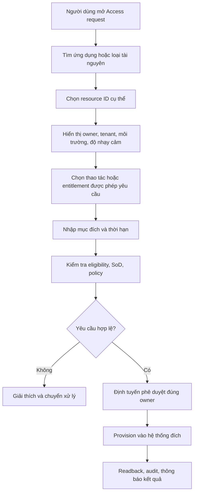

# Chọn tài nguyên trong Access request và quản lý vòng đời danh tính IAM

**Chọn tài nguyên (resource selection)** là bước xác định **đối tượng cụ thể mà một yêu cầu truy cập muốn tác động đến**: ứng dụng, tập dữ liệu, môi trường, dự án, máy chủ, kho bí mật, API hay một thực thể nghiệp vụ. Đây là bước nền tảng trước khi chọn vai trò, quyền thao tác, thời hạn và người phê duyệt.

Ví dụ, câu “Tôi cần quyền xem báo cáo” chưa đủ để cấp quyền an toàn. Người yêu cầu cần làm rõ: **báo cáo nào, ở ứng dụng nào, thuộc tenant/dự án nào, trong môi trường nào và dùng để làm gì?** Sau đó IAM mới có thể xác định entitlement thích hợp và thực hiện quy trình phê duyệt.

Trong **Identity and Access Management (IAM)** theo mô hình **Joiner–Mover–Leaver (JML)**, việc chọn đúng tài nguyên quyết định quyền được cấp **đúng phạm vi**, được cập nhật khi thay đổi công việc và được thu hồi tại đúng hệ thống đích. Bước này liên kết **IdP, SSO, SCIM, RBAC/ABAC, tài khoản dịch vụ, kiểm toán và đối soát** nhằm giảm quyền truy cập tồn dư.

## 1. Tài nguyên là gì trong một yêu cầu truy cập?

**Resource** là đối tượng được bảo vệ mà người dùng hoặc workload muốn truy cập. Tùy hệ thống, tài nguyên có thể ở nhiều cấp độ:

| Loại tài nguyên | Ví dụ | Phạm vi cần làm rõ |
| --- | --- | --- |
| **Ứng dụng** | CRM, ERP, hệ thống nhân sự | Tenant, instance, môi trường |
| **Dữ liệu** | Bộ báo cáo doanh thu | Bộ dữ liệu, độ nhạy cảm, dự án |
| **Đối tượng nghiệp vụ** | Ticket, hóa đơn, hợp đồng | Owner, tenant, phòng ban |
| **Hạ tầng** | Máy chủ, cụm Kubernetes, database | Host, namespace, cluster, production/staging |
| **API** | API tra cứu đơn hàng | Resource server, audience, endpoint, scope |
| **Kho bí mật** | Secret vault | Vault, secret path, quyền đọc/xoay |
| **Tài nguyên đám mây** | Bucket, queue, project | Account/subscription, region, tên tài nguyên |
| **Nhóm/role ở ứng dụng** | `crm-project-reader` | Ứng dụng đích và các quyền thực tế mà role cấp |

Một ứng dụng là **điểm bắt đầu hợp lý** nhưng không phải luôn là cấp đủ chi tiết để kiểm soát. Quyền vào CRM có thể chỉ cho phép mở ứng dụng; quyền xem, sửa hay xuất dữ liệu phải được quản lý riêng theo chính sách.

**Resource khác entitlement:** tài nguyên là thứ cần bảo vệ; entitlement là quyền đã cấp hoặc có thể cấp để thao tác trên tài nguyên. Ví dụ `ERP-Invoices-Region-North` là phạm vi dữ liệu; `invoice.read` là permission, còn role `invoice-reader-north` có thể là cơ chế cấp quyền.

## 2. Chọn tài nguyên trước khi chọn mức quyền

Một yêu cầu đầy đủ thường trả lời các câu hỏi theo thứ tự:

1. **Ai yêu cầu hoặc được cấp?** Subject và account đích phải được liên kết đúng danh tính.
2. **Tài nguyên nào?** Chọn đối tượng bằng định danh ổn định trong danh mục tài nguyên.
3. **Vì sao cần?** Gắn với nhiệm vụ, dự án, sự cố hoặc hợp đồng cụ thể.
4. **Thao tác nào?** Read, write, approve, export, delete hay administer.
5. **Phạm vi nào?** Tenant, nhóm dữ liệu, môi trường, instance hoặc namespace.
6. **Khi nào?** Ngày bắt đầu và thời hạn sử dụng.
7. **Ai sở hữu và phê duyệt?** Resource owner, data owner, application owner hoặc người được ủy quyền.
8. **Kiểm chứng thế nào?** Đọc lại trạng thái và thử quyền được phép/bị cấm tại hệ thống đích.

Thứ tự này giúp tránh cách làm “chọn quyền admin trước, sau đó mới xác định công việc”. Nếu resource chưa rõ hoặc không tồn tại trong danh mục tin cậy, yêu cầu cần được làm rõ hoặc chuyển cho owner xử lý, **không tự gán một tài nguyên gần giống rồi cấp quyền**.

## 3. Danh mục tài nguyên (resource catalog)

Một **resource catalog** giúp người yêu cầu chọn đối tượng dễ hiểu, còn IAM sử dụng định danh máy để thực hiện chính xác. Danh mục có thể được liên kết với CMDB, data catalog, cloud inventory hoặc ứng dụng đích.

| Trường dữ liệu | Công dụng | Ví dụ minh họa |
| --- | --- | --- |
| `resourceId` | Khóa duy nhất và ổn định | `res-crm-customer-north` |
| `displayName` | Tên dễ tìm kiếm | CRM — Khách hàng miền Bắc |
| `resourceType` | Loại đối tượng | `application-dataset` |
| `systemId` | Hệ thống đích | `crm-prod` |
| `tenantId` | Ranh giới tổ chức/khách hàng | `tenant-a` |
| `environment` | Phân biệt production/test | `production` |
| `ownerId` | Người/nhóm chịu trách nhiệm | `data-owner-31` |
| `classification` | Mức nhạy cảm | `confidential` |
| `availableActions` | Tập hành động hỗ trợ | Read, comment, export |
| `lifecycleStatus` | Tài nguyên đang hoạt động hay đã ngừng | `active` |
| `requestPolicyId` | Chính sách phê duyệt tương ứng | `policy-crm-read` |

Các trường trên là **schema minh họa**, không phải chuẩn SCIM bắt buộc. Danh mục cần có quy trình đăng ký tài nguyên, cập nhật owner, xử lý đổi tên/chuyển môi trường và loại khỏi danh sách khi tài nguyên ngừng hoạt động.

**Tên hiển thị không phải khóa duy nhất.** Hai ứng dụng có thể cùng tên “CRM” nhưng thuộc tenant hoặc môi trường khác nhau. Hệ thống phải ghi và truyền **resource ID chính xác** để tránh provision nhầm đích.

## 4. Trải nghiệm chọn tài nguyên trong cổng Access request

Giao diện nên hướng dẫn người dùng từ phạm vi rộng đến đối tượng cụ thể nhưng không để bỏ qua ranh giới bảo mật:



Giao diện có thể tìm bằng tên, nhãn nghiệp vụ, tag hoặc owner nhưng **khi gửi yêu cầu phải sử dụng định danh resource do server xác minh**. Không tin `resourceId`, `tenantId`, `approvalOwner` do client tự sửa trong HTTP request.

### Thông tin hữu ích tại thời điểm chọn

- Tên và mô tả tài nguyên bằng ngôn ngữ nghiệp vụ.
- Môi trường production hoặc non-production.
- Data classification và rủi ro cấp quyền.
- Owner hoặc nhóm phụ trách phê duyệt.
- Các cấp truy cập được hỗ trợ và công dụng của từng cấp.
- Ngày kết thúc mặc định hoặc thời hạn tối đa.
- Điều kiện bắt buộc: đào tạo, MFA, hợp đồng, dự án hoặc approval.
- Những quyền tương tự người dùng đã có, tránh yêu cầu trùng lặp.

Nếu tài nguyên nhạy cảm không được phép hiển thị cho mọi nhân viên, catalog phải lọc danh sách theo **quyền khám phá tài nguyên**. Tuy nhiên, việc không hiển thị trên UI **không thay thế** kiểm tra eligibility và authorization tại backend khi người dùng gửi một ID trực tiếp.

## 5. Ví dụ: yêu cầu quyền đọc báo cáo CRM

Nhân viên Lan cần đọc báo cáo khách hàng của dự án A trong một tháng. Một yêu cầu phù hợp có thể được biểu diễn như sau:

```json
{
  "requesterIdentityId": "EMP-2084",
  "beneficiaryIdentityId": "EMP-2084",
  "resourceId": "crm-prod-project-a-reports",
  "requestedAction": "read",
  "requestedScope": {
    "tenantId": "tenant-a",
    "projectId": "project-a"
  },
  "businessJustification": "Đối soát số liệu dự án A",
  "validFrom": "2026-11-24T00:00:00Z",
  "validUntil": "2026-12-24T00:00:00Z"
}
```

Đây chỉ là mô hình dữ liệu minh họa. Trong thực tế, **identity ID, tenant, resource ID, thời gian và các quyền có thể yêu cầu phải được kiểm chứng phía server**. IAM cần tìm role hoặc entitlement đủ để cấp `read` trong dự án A; không nên cấp `crm-admin` hoặc `customer.export_all`.

Nếu chính sách yêu cầu data owner phê duyệt, workflow phải lấy **owner hiện hành** từ catalog đáng tin, không dùng địa chỉ email người phê duyệt do requester tùy chọn để tránh tự phê duyệt.

## 6. Chọn đúng ranh giới tenant, dự án và môi trường

Một resource có thể tồn tại ở nhiều phạm vi:

| Tên dễ thấy | Định danh thực | Rủi ro nếu chọn sai |
| --- | --- | --- |
| Báo cáo doanh thu | Dataset production tenant A | Lộ dữ liệu tenant khác |
| Báo cáo doanh thu | Dataset staging tenant A | Dùng sai dữ liệu thử nghiệm |
| Báo cáo doanh thu | Dataset production tenant B | Truy cập sai khách hàng |
| Báo cáo doanh thu | Dataset production dự án C | Vượt phạm vi công việc |

Khi chọn tài nguyên, phải thể hiện rõ **tenant, environment, owner và hệ thống đích**. Không suy rằng quyền trên staging tự hợp lệ ở production; một role cùng tên ở hai hệ thống có thể chứa permission khác nhau.

**Cross-tenant access** là rủi ro nghiêm trọng trong ứng dụng SaaS. Cho dù requester có role `report-reader`, API vẫn cần kiểm tra `subject.tenant_id == resource.tenant_id` hoặc quan hệ được ủy quyền hợp lệ.

## 7. Phân biệt Resource selection và Role selection

Trong mô hình **RBAC**, người dùng thường yêu cầu role nhưng role có thể áp dụng trên nhiều tài nguyên. Trong **ABAC**, quyết định còn phụ thuộc thuộc tính tài nguyên và ngữ cảnh. Trong **PBAC**, policy kết hợp các điều kiện ấy.

```text
PERMIT read_report IF
    subject.lifecycle_status == "active"
    AND "report-reader" IN subject.effective_roles
    AND subject.tenant_id == resource.tenant_id
    AND resource.project_id IN subject.authorized_projects
ELSE DENY
```

Đây là giả mã; hệ thống thực thi phải kiểm tra tất cả điều kiện với dữ liệu tin cậy. Chọn role `report-reader` **không thay thế** bước chọn đúng report/dataset và phạm vi dự án.

Một số ứng dụng chỉ hỗ trợ role ở cấp toàn ứng dụng. Nếu không thể biểu đạt phạm vi hẹp cần thiết, owner phải quyết định cơ chế thay thế an toàn, như dataset/view riêng, policy theo tài nguyên hoặc cấp quyền ngoài ứng dụng có kiểm soát. **Không mặc nhiên cấp role rộng vì công cụ không hỗ trợ độ hạt mong muốn**.

## 8. Resource owner và đường phê duyệt

Để định tuyến approval đúng, catalog phải biết **ai chịu trách nhiệm tài nguyên**:

- **Application owner:** quản trị cấu hình, role và vòng đời ứng dụng.
- **Data owner:** quyết định quyền sử dụng dữ liệu nghiệp vụ nhạy cảm.
- **Resource owner:** chịu trách nhiệm một dự án, repo, namespace hoặc service cụ thể.
- **Line manager:** xác nhận nhu cầu công việc của requester.
- **Security/IAM:** kiểm tra chính sách, SoD, mức rủi ro và quy trình.
- **Sponsor đối tác:** xác nhận quan hệ hợp đồng và phạm vi truy cập B2B.

Các vai trò này có thể thuộc cùng một người trong tổ chức nhỏ, nhưng **người yêu cầu không nên tự chọn người duyệt có lợi cho mình** khi chính sách yêu cầu owner độc lập. Owner phải được tra cứu từ nguồn quản trị và có phương án xử lý khi vắng mặt.

Với tài nguyên có mức phân loại cao, phê duyệt có thể cần nhiều cấp. Tuy nhiên, **phê duyệt đủ không thay thế kiểm tra tính hợp lệ của tài nguyên, ngày hiệu lực và SoD**.

## 9. Eligibility: người được cấp có đủ điều kiện không?

Chọn đúng resource vẫn chưa đủ để cho phép cấp quyền. IAM cần kiểm tra **beneficiary** đang trong quan hệ hợp lệ và đáp ứng điều kiện.

Ví dụ:

- Nhân viên Joiner chưa tới ngày bắt đầu có thể chưa được sử dụng production.
- Mover từ Finance sang Support không còn đủ căn cứ nhận resource ERP tài chính.
- Leaver hoặc partner hết hợp đồng không được cấp lại quyền.
- Service account phải có owner, mục đích kỹ thuật và môi trường hợp lệ.
- Quyền production nhạy cảm có thể cần đào tạo, MFA hoặc PAM/JIT.

Cần phân biệt **requester** (người gửi yêu cầu) và **beneficiary** (chủ thể nhận quyền). Một manager có thể yêu cầu thay nhân viên, nhưng quyền cuối cùng phải gắn với identity của người được cấp, không được gán nhầm cho người gửi.

## 10. Resource selection trong Joiner

Ở giai đoạn **Joiner**, resource catalog giúp IAM xác định **birthright resources** mà người mới cần theo nhiệm vụ. Ví dụ nhân viên Support có thể cần hệ thống ticket, knowledge base và dashboard hỗ trợ cơ bản.

Quy trình:

1. HRIS xác nhận identity, phòng ban, ngày hiệu lực và người quản lý.
2. IAM tính danh sách tài nguyên và entitlement tối thiểu.
3. Resource catalog xác định owner, môi trường, phạm vi và yêu cầu phê duyệt.
4. Quyền cơ bản được cấp theo policy; quyền nhạy cảm gửi approval.
5. Connector/SCIM tạo account, group hoặc entitlement ở hệ thống đích.
6. IAM đọc lại và kiểm chứng quyền được phép/bị từ chối.
7. Audit lưu resource ID, entitlement, ngày hiệu lực và kết quả.

**Không chọn mặc định mọi resource của cả phòng ban** chỉ vì nhân viên mới có một chức danh tương ứng. Quyền phải đủ cho công việc và không lớn hơn phạm vi có căn cứ.

## 11. Resource selection trong Mover

Khi nhân viên **Mover**, danh sách tài nguyên cần được tính lại. Ví dụ Hà chuyển từ dự án A sang dự án B:

| Trạng thái | Resource/entitlement | Hành động |
| --- | --- | --- |
| Trước Mover | Repo dự án A, dashboard A | Đánh giá quyền không còn căn cứ |
| Sau Mover | Repo dự án B, dashboard B | Cấp đúng quyền mới |
| Bàn giao tạm thời | Một tập tài nguyên A được phê duyệt | Giới hạn scope và thời hạn |
| Sau bàn giao | Tài nguyên A đã hết hạn | Thu hồi và kiểm chứng |

**Mover không chỉ là yêu cầu thêm tài nguyên mới.** IAM cần xử lý resource cũ thông qua deprovision, gỡ role/ACL, cập nhật ABAC và chấm dứt ngoại lệ hết hạn.

Một ticket phê duyệt đã đóng chưa chắc đồng nghĩa quyền tại repo A bị thu hồi. Cần **reconciliation** giữa quyền mong muốn và quyền quan sát tại repo/ứng dụng.

## 12. Resource selection trong Leaver

Khi một người nghỉ việc hoặc hợp đồng đối tác chấm dứt, IAM phải biết người đó có quyền trên **những resource nào** để thu hồi đầy đủ.

Danh mục kết hợp account correlation và entitlement inventory giúp phát hiện:

- Account SaaS đang active.
- Nhóm IdP/Active Directory và vai trò ứng dụng.
- Tài nguyên có ACL cấp trực tiếp cho subject.
- Repo, cloud project, secret và database được cấp quyền riêng.
- Phiên SSO/RP và access token có thể còn hiệu lực.
- Quyền dự án hoặc hợp đồng có thời hạn nhưng chưa được thu hồi.

**Disable tại IdP không tự thu hồi tất cả app session**, và SCIM `active=false` không bảo đảm mọi API key/ACL mất hiệu lực. Việc chọn/ghi nhận tài nguyên chính xác từ lúc cấp quyền giúp quá trình Leaver xác định **đúng đích phải thu hồi** và có bằng chứng kiểm chứng.

## 13. Chọn tài nguyên cho đối tác và tài khoản dịch vụ

### Partner identity

Với đối tác B2B, resource phải được ràng buộc **partner ID, tenant, hợp đồng và sponsor**. Người dùng đăng nhập hợp lệ từ partner IdP không tự có quyền với mọi resource cùng loại.

Ví dụ hợp đồng cho phép partner X đọc đơn hàng của dự án A. Nếu requester chọn tài nguyên “Toàn bộ đơn hàng” hoặc “Tenant Y”, IAM phải từ chối hoặc yêu cầu xử lý đặc biệt có căn cứ, không coi đây là sai sót có thể bỏ qua.

### Workload/service account

Một workload cần truy cập tài nguyên máy–máy như queue, bucket hoặc API. Yêu cầu phải chỉ rõ **workload identity, môi trường, resource ID, action/scope và owner**.

Không nên cấp quyền trên toàn cloud account cho một job chỉ ghi file vào một bucket. Cũng không nên dùng token đăng nhập cá nhân của kỹ sư làm credential lâu dài của job.

Khi kỹ sư sở hữu workload Leaver, tổ chức phải chuyển owner, rà soát quyền và credential của workload, **không xóa mù tài nguyên đang vận hành**.

## 14. Tài nguyên đặc quyền và Just-enough access

Tài nguyên hạ tầng và bảo mật thường yêu cầu quyền nhạy cảm, ví dụ production database, secret vault hoặc tenant-level IAM policy.

**Least privilege/Just-enough access** yêu cầu giới hạn thao tác và scope cụ thể. **Just-in-Time (JIT)** giới hạn thời gian quyền được kích hoạt. Có thể kết hợp:

```text
PERMIT restart_service IF
    subject.lifecycle_status == "active"
    AND subject.eligible_for("service-restart")
    AND resource.service_id IN subject.approved_services
    AND resource.environment == "production"
    AND request.incident_id IN subject.valid_incidents
    AND current_time < subject.approval_expiry
ELSE DENY
```

Đây là chính sách giả mã. Nếu nhu cầu chỉ là khởi động lại một dịch vụ, **không cấp `production-admin` trên cả cluster**. Đối với quyền khẩn cấp break-glass, cần quy trình riêng có kiểm soát, không biến việc chọn tài nguyên nhạy cảm thành đường tắt bỏ qua PAM.

## 15. Rủi ro thường gặp ở bước chọn tài nguyên

| Sai lầm | Hậu quả | Kiểm soát |
| --- | --- | --- |
| Chọn theo tên thay vì resource ID | Provision nhầm môi trường/tenant | Định danh ổn định, hiển thị metadata |
| Chọn toàn bộ ứng dụng thay vì dataset cần dùng | Cấp quá rộng | Catalog phân cấp và role theo scope |
| Cho requester sửa owner phê duyệt | Tự chọn người duyệt dễ dãi | Owner từ catalog có thẩm quyền |
| Không kiểm tra tenant | Truy cập dữ liệu khách hàng khác | Resource-level ABAC và tenant isolation |
| Resource đã retired vẫn có thể yêu cầu | Cấp quyền vào tài sản không được quản lý | Trạng thái catalog và kiểm soát vòng đời |
| Không xác minh beneficiary | Gán quyền nhầm người | Identity correlation và kiểm tra JML |
| Không ghi resource ID vào audit | Khó tìm đích khi Leaver | Lưu resource ID/target system trong entitlement |
| Chỉ kiểm tra quyền ở UI | API có thể bị gọi trực tiếp | Authorization ở backend |
| Không xử lý quyền cũ khi Mover | Tích lũy quyền | Recompute desired và deprovision |
| Connector trả success nhưng entitlement chưa có | Sai lệch vận hành | Readback và reconciliation |

Với ứng dụng SaaS nhiều tenant, lỗi chọn nhầm resource có thể dẫn tới **cross-tenant data exposure**. Kiểm tra đúng role chưa đủ; cần kiểm tra resource owner và tenant trên từng request.

## 16. Kiểm tra quyền thực tế tại đích

Sau khi approval và provisioning, IAM cần kiểm tra không chỉ “đã cấp role” mà cả **hành động được cho phép trên resource đã chọn**.

```text
desired = entitlement(resource_id, action, scope, beneficiary, expiry)
actual = read_target_entitlement(target_account, resource_id)

if actual != desired:
    investigate_and_reconcile()
```

Giả mã trên mô tả logic; quyền thực tế có thể bao gồm role kế thừa, nhóm lồng nhau, ACL trực tiếp hoặc ABAC runtime nên không thể luôn so bằng phép bằng nhau đơn giản.

Một kế hoạch kiểm thử nên có:

- **Positive test:** chủ thể được phép thao tác trên resource đã được duyệt.
- **Negative test:** không được thao tác trên resource cùng loại nhưng khác dự án/tenant.
- **Expiry test:** quyền tạm thời không còn tác dụng sau hạn.
- **Mover test:** quyền cũ bị từ chối khi chuyển trách nhiệm.
- **Leaver test:** phiên hoặc token cũ không còn cho truy cập trái chính sách.
- **Concurrency test:** cập nhật entitlement đồng thời không làm mất hoặc tăng quyền ngoài ý muốn.

Với thao tác nhạy cảm, readback cần thực hiện tại **API/hệ thống đích** khi có thể, không chỉ nhìn vào bản ghi yêu cầu trong cổng IAM.

## 17. Kiểm toán và chỉ số vận hành

Mỗi yêu cầu chọn tài nguyên nên có dấu vết về **requester, beneficiary, resource ID, target system, action, scope, business justification, owner, policy version, approval, thời hạn và kết quả provisioning/readback**.

Không đưa mật khẩu, access token, refresh token, API key hoặc dữ liệu cá nhân không cần thiết vào log. Catalog có thể chứa thông tin tài sản nhạy cảm nên cần phân quyền đọc và bảo vệ dữ liệu phù hợp.

Các chỉ số hữu ích:

- **Unmapped resource requests:** yêu cầu chọn tài nguyên không có owner/ID hợp lệ.
- **Wrong-target provisioning incidents:** số lần cấp quyền nhầm hệ thống, tenant hoặc môi trường.
- **Excess entitlement count:** số quyền vượt phạm vi được duyệt.
- **Approval routing accuracy:** tỷ lệ yêu cầu được gửi đúng owner.
- **Mover residual-resource access:** tài nguyên cũ vẫn truy cập được sau Mover.
- **Leaver time to deny:** thời gian từ Leaver đến khi resource thực sự từ chối truy cập.
- **Catalog ownership coverage:** tỷ lệ tài nguyên có owner, classification và lifecycle rõ ràng.
- **Reconciliation coverage:** tỷ lệ entitlement đã được đối soát tại đích.

Một số ít tài nguyên nhạy cảm bị cấp nhầm có thể gây rủi ro lớn hơn nhiều yêu cầu truy cập thông thường. Cần ưu tiên kiểm soát và điều tra theo **mức độ ảnh hưởng và độ nhạy cảm**.

## 18. Câu hỏi tự kiểm tra

**Tình huống A:** Lan chọn “CRM” mà không xác định tenant hoặc dataset, nhưng hệ thống cấp `crm-admin`. Có phù hợp không? **Không.** Phải chọn resource/scope và hành động cụ thể theo least privilege.

**Tình huống B:** Hai tài nguyên cùng tên “Báo cáo doanh thu”, một ở staging và một ở production. Có thể dùng tên làm khóa yêu cầu không? **Không.** Cần resource ID, môi trường và owner.

**Tình huống C:** Nhân viên Mover yêu cầu repo dự án B nhưng còn quyền repo A. Đã hoàn tất thay đổi chưa? **Chưa.** Cần thu hồi quyền không còn căn cứ ở A.

**Tình huống D:** Một partner đăng nhập hợp lệ nhưng chọn resource thuộc tenant khác. Có thể cấp vì đã có SSO không? **Không.** Xác thực không thay thế resource-level authorization.

**Tình huống E:** Người gửi yêu cầu tự sửa `approvalOwnerId` sang chính mình. Nên xử lý thế nào? **Không tin trường đó từ client**; hệ thống tra owner đáng tin và kiểm tra SoD.

**Tình huống F:** Sau Leaver, IdP account disabled nhưng API key vẫn truy cập storage bucket đã cấp trước đó. Quy trình đã hoàn tất chưa? **Chưa.** Cần đối soát và thu hồi từng đường truy cập vào resource.

## Ghi nhớ

**Chọn tài nguyên trong Access request** là bước xác định **đúng đối tượng cần truy cập trước khi xác định quyền và phê duyệt**. Tài nguyên phải có **định danh ổn định, hệ thống đích, tenant/môi trường, owner, phân loại và trạng thái vòng đời**; yêu cầu phải chỉ rõ **subject, action, scope, lý do và thời hạn**. Trong **IAM Joiner–Mover–Leaver**, việc chọn và ghi nhận chính xác resource giúp **IdP/SSO, SCIM/connector, RBAC/ABAC, quản trị service account và audit** phối hợp cấp đúng quyền, thu hồi đúng đích và phát hiện quyền truy cập tồn dư.
