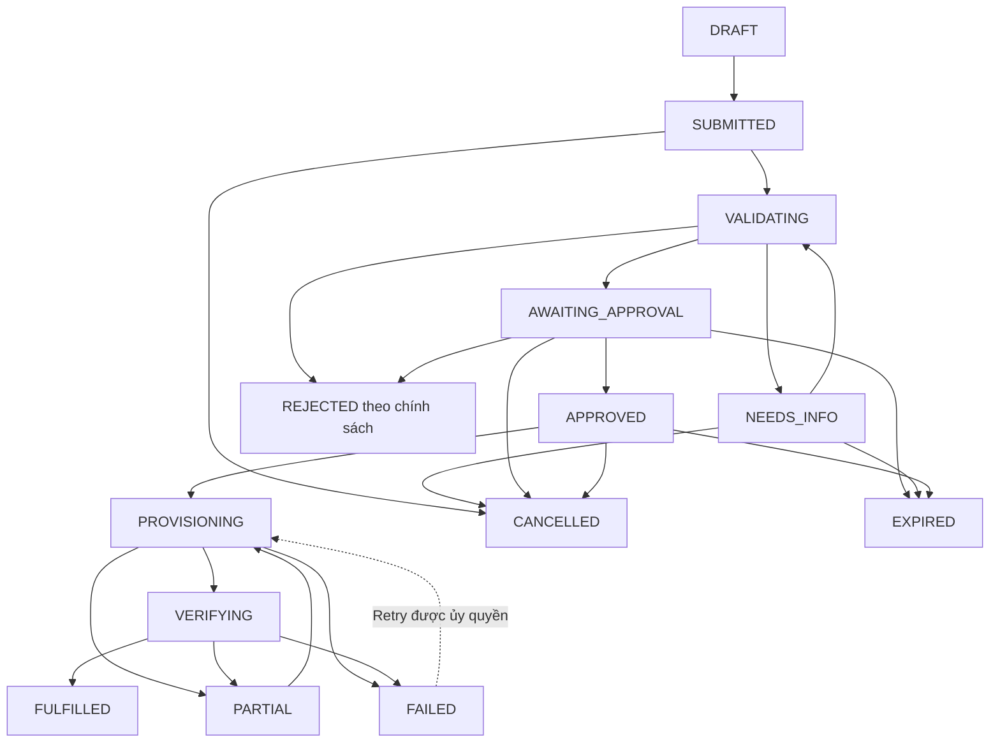

# Trạng thái yêu cầu trong Access Request: Theo dõi từ đề nghị đến quyền có hiệu lực

**Trạng thái yêu cầu** (*request status*) là thông tin cho biết **một yêu cầu truy cập đang ở bước nào, đã được xử lý tới đâu, ai hoặc hệ thống nào phải hành động tiếp theo và kết quả đã được xác minh hay chưa**. Trong quản lý danh tính và quyền truy cập (IAM), một yêu cầu có thể bắt đầu khi nhân viên xin vào ứng dụng, xin thêm role, yêu cầu quyền đặc quyền tạm thời hoặc đề nghị thu hồi quyền không còn cần thiết.

Ví dụ, nhân viên An gửi yêu cầu `AR-2048` để đọc báo cáo tài chính. Người quản lý phê duyệt lúc 09:10, nhưng ứng dụng báo cáo chưa nhận được entitlement vì connector đang lỗi. **Yêu cầu được phê duyệt không có nghĩa An đã được cấp quyền**, càng không chứng minh An **thực sự truy cập được đúng dữ liệu**. Trạng thái tốt phải thể hiện sự khác biệt đó để không gây hiểu lầm cho người yêu cầu, approver và đội vận hành.

Bài thuộc chương **Access request** của module `SECURITY_IDENTITY_ACCESS_MANAGEMENT_IDENTITY_LIFECYCLE`. Module tập trung **vòng đời danh tính Joiner–Mover–Leaver (JML)**: xác minh, tạo tài khoản và cấp quyền, rà soát khi thay đổi vai trò, thu hồi khi kết thúc quan hệ; nội dung liên kết **IdP, SSO, SCIM, RBAC/ABAC, tài khoản dịch vụ, kiểm toán và giảm quyền truy cập tồn dư**. Quản lý trạng thái yêu cầu là cầu nối giữa **quy trình phê duyệt** và **bằng chứng quyền tại từng hệ thống đích**.

Sau bài học, bạn có thể thiết kế state machine cho Access Request, phân biệt trạng thái yêu cầu với trạng thái phê duyệt và entitlement, xác định các chuyển trạng thái hợp lệ, quản lý nhiều hệ thống đích, xử lý lỗi, retry/cancel/expiry, theo dõi SLA, giải quyết sự kiện tới muộn và đối soát kết quả theo JML.

## 1. Vì sao cần quản lý trạng thái yêu cầu?

Trong một tổ chức lớn, access request thường đi qua nhiều bên:

- **Người yêu cầu** mô tả lý do và phạm vi truy cập.
- **Người được cấp quyền** (*beneficiary*) có thể là người yêu cầu hoặc một danh tính khác.
- **Quản lý trực tiếp, chủ ứng dụng, chủ dữ liệu hoặc Security** kiểm tra điều kiện và phê duyệt.
- **IAM/IGA workflow** đánh giá chính sách, tạo công việc provisioning và theo dõi kết quả.
- **IdP, directory, SCIM connector hoặc API của ứng dụng** thay đổi account, group, role hay entitlement.
- **Hệ thống đích** phản ánh trạng thái quan sát được và khả năng truy cập thực tế.
- **Bộ phận kiểm toán** cần truy ra căn cứ cấp quyền, thời điểm và kết quả.

Nếu chỉ có hai trạng thái `Pending` và `Done`, tổ chức có thể gặp các vấn đề:

| Tình huống | Nếu chỉ có “Done” | Hệ quả |
| --- | --- | --- |
| Approver đã đồng ý | Bị đánh dấu xong trước khi gửi connector | Người dùng tưởng đã có quyền |
| SCIM API nhận request nhưng xử lý bất đồng bộ | Bị coi là cấp xong | Quyền ở SaaS có thể chưa thay đổi |
| Một trong ba hệ thống đích lỗi | Bị báo thành công chung | Quyền một phần hoặc thiếu quyền không được phát hiện |
| Yêu cầu bị hủy trong lúc provisioning | Không rõ có quyền nào đã cấp | Quyền tồn dư sau khi hủy |
| Role được cấp nhưng token/session chưa cập nhật | Đã có entitlement trong directory | Người dùng có thể chưa truy cập được hoặc vẫn còn quyền cũ |
| Nhân viên nghỉ việc khi request đang chờ | Approval cũ vẫn được thực thi | Có thể tái cấp quyền sau Leaver |
| Connector không phản hồi | Tự động coi thất bại hay thành công | Retry gây cấp trùng, hoặc bỏ sót xử lý |

**Mục tiêu của trạng thái yêu cầu là nói đúng sự thật về tiến độ và mức xác minh**, không phải chỉ làm đẹp giao diện theo dõi ticket.

## 2. Trạng thái yêu cầu không phải trạng thái tài khoản

Bốn đối tượng cần được tách riêng:

| Đối tượng | Ví dụ trạng thái | Nó trả lời câu hỏi gì? |
| --- | --- | --- |
| **Access Request** | `SUBMITTED`, `AWAITING_APPROVAL`, `PROVISIONING`, `FULFILLED` | Quy trình xin/cấp/thu hồi đã đi đến đâu? |
| **Approval Decision** | `PENDING`, `APPROVED`, `REJECTED`, `EXPIRED` | Người có thẩm quyền đã quyết định điều gì? |
| **Account / Entitlement** | `ACTIVE`, `DISABLED`, `PRESENT`, `REMOVED` | Quyền/tài khoản đang tồn tại ở đích hay không? |
| **Effective Access** | `ALLOWED`, `DENIED`, `UNKNOWN` | Chủ thể có thể thực hiện action trên tài nguyên thực tế không? |

Ví dụ:

```text
Request AR-2048:
  Request status       = PROVISIONING
  Manager approval     = APPROVED
  Application approval = APPROVED
  IdP group assignment = PRESENT
  SaaS application role= UNKNOWN
  Effective API access = UNKNOWN
```

Trong tình huống này, **không có cơ sở** để nói “quyền đã được cấp đầy đủ”. Việc IdP có nhóm mới chưa chứng minh SaaS đã áp role; SaaS có role cũng không tự chứng minh mọi API hoặc tài nguyên đều cho phép đúng phạm vi.

### Trạng thái request và trạng thái grant có vòng đời khác nhau

Một **yêu cầu cấp quyền** có thể đã hoàn tất từ tháng trước, còn **grant** liên quan vẫn đang có hiệu lực hoặc đã hết hạn hôm nay. Đừng đổi một access request lịch sử từ `FULFILLED` sang `REJECTED` chỉ vì quyền sau đó được thu hồi hợp lệ. Cần tạo/ghi nhận **sự kiện thu hồi hoặc yêu cầu thu hồi liên kết** và quản lý vòng đời grant riêng.

Ví dụ:

- `AR-2048`: cấp quyền đọc báo cáo → `FULFILLED` lúc 09:20.
- `GRANT-881`: quyền phát sinh → `ACTIVE` từ 09:20 đến 18:00.
- `RV-301`: công việc thu hồi khi hết hạn → `PROVISIONING` rồi `FULFILLED`.
- `GRANT-881`: quyền → `REVOKED` sau khi xác minh.

Nhờ vậy, lịch sử cho biết **yêu cầu cấp đã thành công**, rồi **quyền bị thu hồi đúng quy định**, thay vì ghi đè lịch sử bằng một trạng thái dễ hiểu sai.

## 3. Mô hình trạng thái cho một Access Request

Không có một bộ status bắt buộc áp dụng cho mọi sản phẩm IAM. Dưới đây là **mô hình tham khảo** có thể điều chỉnh theo chính sách và hệ thống.

| Status | Diễn giải tiếng Việt | Ý nghĩa vận hành |
| --- | --- | --- |
| `DRAFT` | Bản nháp | Chưa gửi chính thức; được phép chỉnh sửa theo quyền |
| `SUBMITTED` | Đã gửi | Request đã được tiếp nhận và cấp ID theo dõi |
| `VALIDATING` | Đang kiểm tra | Xác minh identity, eligibility, scope, SoD và đầu vào |
| `NEEDS_INFO` | Cần bổ sung | Chờ người yêu cầu làm rõ/cung cấp tài liệu hợp lệ |
| `AWAITING_APPROVAL` | Chờ phê duyệt | Chờ một hoặc nhiều quyết định có thẩm quyền |
| `APPROVED` | Đã phê duyệt | Căn cứ cấp quyền hợp lệ tại bước quyết định; **chưa chứng minh quyền đã cấp** |
| `REJECTED` | Bị từ chối | Approval hoặc chính sách không cho phép thực thi yêu cầu |
| `PROVISIONING` | Đang cấp/điều chỉnh quyền | Connector hoặc người vận hành đang thực hiện thay đổi |
| `VERIFYING` | Đang xác minh | Đọc lại account, entitlement, hoặc thử đường truy cập được phê duyệt |
| `FULFILLED` | Hoàn tất và xác minh | Những mục tiêu **bắt buộc** đạt trạng thái mong đợi có bằng chứng |
| `PARTIAL` | Hoàn tất một phần | Một số mục tiêu đã đạt, còn mục tiêu bắt buộc chưa hoàn tất |
| `FAILED` | Thất bại | Không hoàn thành được quy trình theo điều kiện xác định; còn cần xử lý |
| `CANCELLED` | Đã hủy yêu cầu | Ngừng tiến trình được phép; nếu đã có thay đổi, phải xử lý hậu quả |
| `EXPIRED` | Yêu cầu hết hiệu lực | Không còn được thực thi dựa trên approval/request cũ |

**Danh sách trên là quy ước tham khảo**, không phải các giá trị chuẩn của SCIM, OAuth/OIDC, ITSM hay một IdP cụ thể. Cần thống nhất **ngữ nghĩa từng status**, quyền chuyển trạng thái và quy tắc tính khi có nhiều target.

### 3.1. Các nhóm trạng thái

Có thể phân theo mức quản lý:

- **Đang chuẩn bị/thu thập dữ liệu:** `DRAFT`, `SUBMITTED`, `VALIDATING`, `NEEDS_INFO`.
- **Đang ra quyết định:** `AWAITING_APPROVAL`, `APPROVED`, `REJECTED`.
- **Đang thực thi:** `PROVISIONING`, `VERIFYING`, `PARTIAL`.
- **Kết thúc workflow:** `FULFILLED`, `REJECTED`, `CANCELLED`, `EXPIRED` và `FAILED` nếu chính sách định nghĩa là terminal.

**FAILED không phải lúc nào cũng kết thúc vĩnh viễn.** Một số hệ thống cho phép retry một request thất bại; hệ thống khác yêu cầu tạo attempt mới hoặc request mới sau khi sửa lỗi. Phải **tách rõ retry đã được phép** với việc lén thực thi lại một yêu cầu đã bị từ chối.

## 4. State machine tham khảo



Sơ đồ cố ý đơn giản hóa:

1. **Hủy khi đã dispatch provisioning** cần cơ chế dừng công việc/rollback hoặc tác vụ thu hồi riêng; không thể chỉ chuyển nhãn sang `CANCELLED`.
2. Nếu thay đổi policy, identity hoặc entitlement sau phê duyệt, workflow có thể phải **xác minh lại** trước khi thực thi.
3. Một request cần nhiều approver có thể vẫn ở `AWAITING_APPROVAL` dù **một người đã duyệt**, vì còn người khác đang chờ.
4. Nếu một target đã cấp thành công còn target khác thất bại, trạng thái tổng thường là `PARTIAL` chứ không phải `FULFILLED`.
5. Không tự động chuyển một request `REJECTED` sang `APPROVED` chỉ vì một worker retry hoặc một sự kiện cũ được phát lại.

### Nguyên tắc trạng thái terminal

Một trạng thái **terminal** là trạng thái không cho phép tiếp tục tiến hành request theo luồng thông thường. Chẳng hạn `REJECTED`, `CANCELLED` hoặc `EXPIRED` không được tự quay về `PROVISIONING`. Nếu doanh nghiệp cho phép kháng nghị, sửa phạm vi hoặc nộp lại, nên dùng **request phiên bản mới có liên kết lịch sử**, hoặc một cơ chế re-open có authorization và audit rõ ràng.

Với request `FAILED`, trạng thái terminal hay retryable phải được quy định chính xác. Bất kể tên gọi, **không thực thi lại khi căn cứ phê duyệt đã hết hạn, chủ thể đã Leaver hoặc nguồn quyền không còn hợp lệ**.

## 5. Chuyển trạng thái phải có sự kiện và chủ thể có quyền

Không nên cho client tùy ý gọi API `PATCH status=FULFILLED`. Từng chuyển trạng thái phải được thúc đẩy bởi **sự kiện hợp lệ, vai trò được ủy quyền và điều kiện trước khi chuyển**.

| Chuyển trạng thái | Sự kiện/căn cứ | Ai hoặc hệ thống nào có thể thực hiện? |
| --- | --- | --- |
| `DRAFT → SUBMITTED` | Người yêu cầu xác nhận nội dung | Requester được ủy quyền |
| `SUBMITTED → VALIDATING` | Workflow nhận request | IAM/IGA workflow |
| `VALIDATING → NEEDS_INFO` | Thiếu dữ liệu bắt buộc | Workflow/owner được quyền yêu cầu |
| `NEEDS_INFO → VALIDATING` | Đã bổ sung và gửi lại | Requester và workflow |
| `VALIDATING → AWAITING_APPROVAL` | Đủ dữ liệu, đạt điều kiện để xét duyệt | Policy/validation service |
| `AWAITING_APPROVAL → APPROVED` | Tất cả approval bắt buộc hợp lệ | Approval orchestration |
| `AWAITING_APPROVAL → REJECTED` | Quyết định từ chối hoặc policy không cho phép | Approver/decision service có thẩm quyền |
| `APPROVED → PROVISIONING` | Revalidate thành công và dispatch công việc | Provisioning orchestrator |
| `PROVISIONING → VERIFYING` | Các công việc bắt buộc đã xử lý, cần xác minh | Connector/workflow |
| `VERIFYING → FULFILLED` | Trạng thái đích bắt buộc được xác minh | Verification/reconciliation service |
| `PROVISIONING → PARTIAL` | Có kết quả một phần, một số mục tiêu chưa đạt | Orchestrator dựa trên target outcomes |
| `AWAITING_APPROVAL → EXPIRED` | Đến hạn quyết định | Workflow scheduler theo chính sách |
| `… → CANCELLED` | Hủy hợp lệ, không còn work cần thực thi hoặc đã xử lý hậu quả | Request owner/workflow có kiểm soát |

**Không nên để cùng một API cho bất kỳ user nào tự thay đổi trạng thái**, nhất là `APPROVED` và `FULFILLED`. Những trạng thái này ảnh hưởng quyền truy cập và báo cáo kiểm toán nên phải được bảo vệ như thao tác quản trị.

### Invariant: quy tắc luôn phải đúng

Một state machine đáng tin nên duy trì các **bất biến**:

- `APPROVED` chỉ xuất hiện khi những approval **bắt buộc** còn hiệu lực và không có quyết định Deny chặn.
- Không dispatch công việc cấp quyền nếu account/identity bị khóa hoặc không còn đủ điều kiện.
- `FULFILLED` chỉ khi mọi mục tiêu **bắt buộc** được xác minh đạt trạng thái mong đợi.
- `REJECTED` và `EXPIRED` không thể vô tình gây provisioning qua sự kiện cũ.
- Một công việc đã được thực thi không mất dấu chỉ vì request bị hủy.
- Mọi chuyển trạng thái đều có actor, timestamp, nguyên nhân và version để truy vết.
- Không gán status theo **thứ tự nhận callback** nếu các callback có thể đến sai thứ tự hoặc bị lặp.

## 6. Validation: kiểm tra trước khi gửi phê duyệt

Trạng thái `VALIDATING` không chỉ kiểm tra JSON có đủ field. IAM phải xác nhận **yêu cầu có ý nghĩa và đủ căn cứ để xét hay không**.

Các kiểm tra quan trọng:

1. **Danh tính:** requester và beneficiary là ai? Có liên kết với identity ID ổn định không?
2. **Tư cách:** quan hệ nhân sự, nhà thầu, đối tác hoặc workload còn hiệu lực?
3. **Resource và scope:** ứng dụng, role, tenant, môi trường và dữ liệu cần truy cập có tồn tại không?
4. **Entitlement catalog:** quyền yêu cầu có được định nghĩa, có owner và risk classification không?
5. **Quyền hiện có:** người nhận đã có quyền tương đương chưa? Có cần xử lý trùng hoặc mở rộng phạm vi?
6. **SoD:** quyền mới có tạo xung đột tạo–duyệt, quản trị–kiểm toán hoặc vai trò khác không?
7. **Thời điểm:** thời hạn được yêu cầu có nằm trong giới hạn chính sách?
8. **Căn cứ nhiệm vụ:** có ticket/change/task hoặc approval cần thiết cho quyền đặc quyền?
9. **Policy:** hành động có bị cấm theo quy định tenant, HR, data classification hoặc quản trị đặc quyền?
10. **Completeness:** có đủ thuộc tính/nguồn đáng tin và phiên bản dữ liệu để quyết định không?

**Thiếu dữ liệu không đồng nghĩa từ chối vì rủi ro người dùng**, nhưng cũng **không phải lý do để cấp quyền ngay**. Tùy lỗi, request có thể ở `NEEDS_INFO`, `VALIDATING` chờ xử lý hoặc bị từ chối theo chính sách; phải phân loại nguyên nhân để tránh cấp nhầm.

### Hai đường khác nhau: bổ sung thông tin và từ chối

- **NEEDS_INFO:** có thể hoàn thiện mà không thay đổi mục đích cơ bản, ví dụ thiếu mô tả phạm vi hay ticket.
- **REJECTED:** quyết định chính sách hoặc approver kết luận không cho phép, ví dụ xung đột SoD không có đường ngoại lệ hợp lệ.

Không nên dùng `NEEDS_INFO` để giữ request **vô thời hạn** hoặc ngầm vượt qua Deny. Cần timeout và thông báo rõ hành động tiếp theo.

## 7. Approval: nhiều người duyệt và trạng thái tổng

Một yêu cầu có thể cần các bước phê duyệt khác nhau tùy rủi ro:

| Loại quyền | Căn cứ phê duyệt có thể cần | Ví dụ |
| --- | --- | --- |
| Quyền cơ sở được chính sách cho phép tự động | Auto-approval sau validation | `employee-portal.read` cho Joiner ACTIVE |
| Quyền dữ liệu thuộc một đội | Manager hoặc data owner | Báo cáo nội bộ đội |
| Application role có rủi ro | Application owner | `crm.export` |
| Quyền tài chính | Manager và chủ nghiệp vụ, kiểm tra SoD | `payment.approve` |
| Quyền đặc quyền | System owner, Security, JIT/PAM theo chính sách | Deploy production trong change window |
| Workload API grant | API owner và owner workload | `billing.write` cho service principal |

Một request có hai approval bắt buộc:

```yaml
requestId: AR-2048
requestStatus: AWAITING_APPROVAL
approvals:
  - step: manager
    required: true
    status: APPROVED
    approverIdentityId: iam-manager-17
  - step: data-owner
    required: true
    status: PENDING
    approverIdentityId: iam-owner-29
```

**Một approval đã xong không làm request chuyển sang APPROVED khi còn approval bắt buộc khác.**

Phải kiểm tra **người duyệt còn giữ thẩm quyền ở thời điểm quyết định**, không chỉ từng là manager hoặc owner khi request được tạo. Với SoD, requester hoặc beneficiary có thể không được tự phê duyệt yêu cầu của mình.

### Approval gắn với chính xác phạm vi được duyệt

Nếu approver duyệt quyền **read-only** trong 7 ngày, IAM không được tự diễn giải thành **read-write** trong 30 ngày. Những thay đổi vật chất như entitlement, target, scope, expiry, risk level hoặc beneficiary thường cần **revalidation và reapproval** theo chính sách.

Một approval tốt cần ghi **snapshot phạm vi, phiên bản policy và thời hạn quyết định**, thay vì chỉ chứa một boolean `approved=true`.

## 8. Approved khác Provisioned và Fulfilled

Đây là điểm dễ nhầm nhất của toàn bộ workflow.

| Mốc | Có thể khẳng định | Không thể tự khẳng định |
| --- | --- | --- |
| `APPROVED` | Có căn cứ phê duyệt hiện hành cho scope xác định | Quyền đã có ở IdP hoặc ứng dụng |
| `PROVISIONING` | Công việc cấp/điều chỉnh quyền đang được xử lý | Target đã áp thay đổi |
| Connector trả HTTP 200/202 | Request được tiếp nhận/xử lý theo ngữ nghĩa endpoint | Quyền đã effective trên mọi node hay phiên |
| `VERIFYING` | Hệ thống đang kiểm tra trạng thái đích | Đã hoàn tất tất cả quyền bắt buộc |
| `FULFILLED` | Các mục tiêu bắt buộc đạt tiêu chí xác minh đã thiết kế | Mọi quyền sẽ tồn tại mãi hoặc không cần rà soát |
| Grant `ACTIVE` | Quyền còn được ghi nhận là có hiệu lực trong grant lifecycle | Mọi đường API đều luôn Permit; cần kiểm tra policy/PEP |

Một request có thể đi qua:

```text
09:00 SUBMITTED
09:02 VALIDATING
09:05 AWAITING_APPROVAL
09:10 APPROVED
09:11 PROVISIONING
09:12 VERIFYING
09:14 FULFILLED
```

Nếu bước cấp role ở SaaS thất bại, chuỗi phải phản ánh `PARTIAL` hoặc `FAILED` tùy trạng thái từng target; không nhảy tới `FULFILLED` vì approval đã đạt.

### Provisioning bất đồng bộ

SCIM hoặc ứng dụng có thể trả phản hồi phù hợp với việc chấp nhận thao tác nhưng đồng bộ quyền tới node khác sau một khoảng thời gian. Một số SaaS có cache role hoặc session. Workflow cần biết **response connector có nghĩa gì** và điều kiện readback cần đạt.

**Không suy ra tính “đã cấp” từ HTTP status chung.** Kiểm tra đối tượng cụ thể, version/etag nếu có, tài khoản và entitlement đúng target theo cơ chế sản phẩm.

## 9. Request nhiều target: tổng trạng thái và trạng thái con

Một business role có thể ánh xạ đến nhóm IdP, role SaaS và quyền trong ứng dụng nội bộ. Nếu chỉ có một status tổng, các sai lệch sẽ bị che khuất.

Ví dụ yêu cầu `AR-2048` cho ba đích:

```yaml
requestId: AR-2048
type: GRANT_ACCESS
beneficiaryIdentityId: iam-user-1042
overallStatus: PARTIAL
targets:
  - targetId: corporate-idp
    operation: ADD_GROUP
    entitlement: reports-readers
    state: VERIFIED
    required: true
  - targetId: reports-saas
    operation: ADD_APP_ROLE
    entitlement: report-viewer
    state: PENDING_RETRY
    required: true
  - targetId: audit-dashboard
    operation: ENABLE_VIEW
    entitlement: finance-reports
    state: VERIFIED
    required: true
```

**Overall status nên được tính từ kết quả con theo quy tắc rõ ràng.** Ví dụ:
- **FULFILLED:** tất cả target/action bắt buộc đều đã xác minh.
- **PARTIAL:** có thành công thực tế nhưng còn target bắt buộc chưa đạt hoặc chưa xác minh.
- **PROVISIONING / VERIFYING:** đang xử lý, chưa đủ điều kiện kết luận.
- **FAILED:** không thể hoàn thành theo quy tắc đã định, cần can thiệp hoặc attempt mới.

Với target **tùy chọn**, phải quy định mức ảnh hưởng của lỗi đến overall status. Một mục tiêu tùy chọn không nên bị bỏ qua âm thầm nếu nó có tác động bảo mật; có thể báo warning và ghi rõ còn việc tồn đọng.

### Trạng thái con cần theo dõi đủ chi tiết

| Target-level state | Ý nghĩa |
| --- | --- |
| `NOT_STARTED` | Chưa gửi công việc tới đích |
| `QUEUED` | Đã tạo công việc, chờ xử lý |
| `DISPATCHED` | Đã gửi đến connector hoặc hệ thống đích |
| `ACKNOWLEDGED` | Đích nhận request; chưa mặc nhiên hoàn tất |
| `APPLIED` | Đích xác nhận thay đổi theo ngữ nghĩa API |
| `VERIFIED` | Trạng thái mong đợi được đọc lại/kiểm chứng |
| `PENDING_RETRY` | Cần retry có kiểm soát |
| `BLOCKED` | Không thể xử lý vì chính sách hoặc điều kiện bắt buộc |
| `FAILED` | Xử lý thất bại theo phân loại |
| `UNKNOWN` | Không đủ bằng chứng về trạng thái thực của đích |

**UNKNOWN không phải FAILED hay SUCCESS.** Ví dụ một timeout sau khi gửi request có thể xảy ra **sau khi đích đã cấp quyền thành công**. Retry không có idempotency hoặc readback có thể tạo duplicate grant hoặc sai lệch.

## 10. Dữ liệu trạng thái phải hỗ trợ audit, không chỉ UI

Một thiết kế có thể lưu **snapshot trạng thái hiện tại** và **lịch sử sự kiện bất biến**.

| Dữ liệu | Vai trò |
| --- | --- |
| `requestId` | Định danh duy nhất của yêu cầu |
| `requestType` | GRANT / MODIFY / REVOKE / TEMPORARY_ACCESS theo catalog |
| `requesterIdentityId` | Ai khởi tạo? |
| `beneficiaryIdentityId` | Ai được cấp/thu hồi? |
| `resourceRef / entitlementRef` | Quyền nào, ứng dụng nào, phạm vi gì? |
| `taskRef / justification` | Căn cứ công việc, không chứa dữ liệu nhạy cảm quá mức |
| `status` / `statusVersion` | Trạng thái hiện tại và version chống update lỗi thời |
| `approvalSnapshot` | Ai duyệt, duyệt scope nào, lúc nào? |
| `policyVersion` | Chính sách nào đã kiểm tra yêu cầu? |
| `effectiveFrom / validUntil` | Thời điểm quyền được phép hiệu lực |
| `targetStates` | Kết quả từng connector/đích |
| `requestedAt / approvedAt / appliedAt / verifiedAt` | Các mốc riêng biệt |
| `lastTransitionActor` | Ai/hệ thống nào đổi status? |
| `failureCode / retryCount / nextAction` | Hỗ trợ khắc phục |
| `correlationId` / `idempotencyKey` | Nối workflow, callback, retry và audit |

Ví dụ một snapshot **mang tính thiết kế**:

```yaml
requestId: AR-2048
requestType: GRANT_ACCESS
requesterIdentityId: iam-user-1042
beneficiaryIdentityId: iam-user-1042
entitlement: report-viewer
target: reports-saas
scope: org-17
reasonRef: TASK-492
status: VERIFYING
statusVersion: 6
policyVersion: access-policy-v15
requestedAt: "2026-12-01T02:00:00Z"
approvedAt: "2026-12-01T02:10:00Z"
provisioningStartedAt: "2026-12-01T02:11:00Z"
appliedAt: "2026-12-01T02:12:00Z"
verifiedAt: null
validUntil: "2026-12-08T17:00:00Z"
nextAction: READ_BACK_TARGET
correlationId: workflow-98c1
```

Đây **không phải schema chuẩn của một sản phẩm IGA/SCIM**. Không lưu secret, access token, mật khẩu hay hồ sơ HR đầy đủ trong metadata yêu cầu.

### Tránh overwrite lịch sử

Nếu bản ghi chỉ lưu `status=FULFILLED`, người điều tra không biết nó từng bị từ chối, được bổ sung hay đã retry bao nhiêu lần. Cần giữ **event log append-only hoặc audit có kiểm soát**, ví dụ:

```json
{
  "eventId": "evt-7782",
  "requestId": "AR-2048",
  "eventType": "TARGET_VERIFICATION_SUCCEEDED",
  "fromStatus": "VERIFYING",
  "toStatus": "FULFILLED",
  "actorType": "SYSTEM",
  "actorId": "iam-reconciliation",
  "observedAt": "2026-12-01T02:14:00Z",
  "policyVersion": "access-policy-v15",
  "statusVersionBefore": 6,
  "statusVersionAfter": 7,
  "correlationId": "workflow-98c1"
}
```

Event và status snapshot cần nhất quán, tránh trường hợp đã ghi “FULFILLED” trong audit nhưng request vẫn “PROVISIONING” mà không có giải thích hoặc cơ chế sửa lỗi.

## 11. API chuyển trạng thái: quyền, version và idempotency

Một request có thể được nhiều worker/approver/connector cập nhật đồng thời. Nếu chỉ ghi đè status mới nhất, hệ thống dễ gặp **lost update** và xử lý sự kiện sai thứ tự.

### Mô hình kiểm soát phiên bản

Giả sử request có `statusVersion=6`. Hai worker cùng đọc version đó. Worker A hoàn tất xác minh và cập nhật version lên 7; worker B với dữ liệu cũ không được quyền ghi đè status 7 thành `PROVISIONING`.

Có thể dùng **optimistic concurrency / compare-and-swap**:

```text
transitionRequest(requestId, expectedVersion, event):
    current = loadRequestForUpdate(requestId)

    require(current.version == expectedVersion)
    require(actorAllowedForEvent(event.actor, event.type))
    require(isTransitionAllowed(current.status, event.type))
    require(preconditionsStillValid(current, event))

    nextState = reduceState(current, event)
    atomically:
        appendAuditEvent(event, current.status, nextState.status)
        updateSnapshotWithNewVersion(nextState)

    enqueueSideEffectsThroughReliableOutboxIfNeeded()
    return nextState
```

Đây là giả mã. Với hệ thống phân tán, việc cập nhật trạng thái và phát công việc có thể cần **transactional outbox, queue, deduplication và reconciliation**, không thể giả định luôn có một giao dịch nguyên tử trên IAM và tất cả SaaS.

### Idempotency tránh cấp trùng

Một worker có thể bị retry khi timeout. Nếu đã cấp nhóm thành công nhưng chưa nhận callback, chạy lại có thể tạo assignment trùng hoặc xử lý quyền sai.

Nên ràng buộc một thao tác logic với **idempotency key** như `requestId + targetId + entitlement + operation + operationVersion`, hoặc khóa phù hợp với API đích; sau timeout, **kiểm tra trạng thái thật** trước khi retry. Không dùng khóa idempotency như credential bảo mật.

### Sự kiện tới muộn không được bật lại quyền

Ví dụ:

1. 09:00 — request đã phê duyệt, đang chờ provision.
2. 09:05 — HR phát Leaver hợp lệ; account đã bị disable.
3. 09:06 — một callback từ request cũ báo “approval complete”.
4. 09:07 — worker nhận callback và định cấp quyền.

Worker **phải revalidate trạng thái JML hiện hành** và chặn công việc, không dựa vào approval cũ. Duy trì event/version giúp phát hiện callback đến trễ, nhưng cần thêm **kiểm tra nguồn có thẩm quyền** khi điều kiện cấp quyền có thể thay đổi.

## 12. Retry và Failed: thất bại có thể phục hồi khác thất bại nghiệp vụ

Một connector trả lỗi không có nghĩa cùng cách xử lý cho mọi nguyên nhân.

| Nguyên nhân | Ví dụ | Phương án |
| --- | --- | --- |
| **Transient transport error** | Timeout, kết nối tạm mất | Retry/backoff có kiểm soát; readback trước khi lặp |
| **Rate limit** | API đích từ chối vì giới hạn | Respect retry-after, backoff và queue |
| **Unauthorized connector** | Service principal thiếu quyền | Dừng retry vô ích, sửa credential/quyền connector qua quy trình |
| **Invalid entitlement** | Role không tồn tại hoặc mapping sai | Sửa catalog/mapping, có thể yêu cầu phê duyệt lại |
| **Identity mismatch** | Không tìm được user đích hoặc nhiều kết quả | Không tự ghép bằng tên/email; xử lý ngoại lệ |
| **Policy/SoD conflict** | Quyền bị cấm theo chính sách mới | Không retry để vượt Deny |
| **Approval expired** | Phê duyệt hết hạn trước khi dispatch | Dừng và yêu cầu quyết định mới nếu còn nhu cầu |
| **Unknown target outcome** | Timeout sau khi gửi request | Readback và reconciliation, không giả định chưa cấp |
| **Permanent unsupported operation** | SaaS không hỗ trợ grant qua API | Quy trình manual có kiểm chứng hoặc báo không thể hoàn tất |

**Lỗi nghiệp vụ hoặc Deny không phải lỗi kỹ thuật để retry tự động.** Cần phân loại `errorCode`, `retryable`, `requiresReapproval` và `owner` cho từng failure.

### Retry có giới hạn và theo dõi độ trễ

Workflow cần có giới hạn số lần, backoff, thời hạn request và cảnh báo khi vượt SLA. Tránh worker retry vô hạn, đẩy nhiều request lên hệ thống đích hoặc gây thay đổi không mong muốn.

Khi không còn cách tự động xử lý, status có thể chuyển sang `FAILED` hoặc `PARTIAL` kèm **next action**, assignment cho đội xử lý và đường khôi phục rõ. Không được đánh dấu xong chỉ để đóng ticket đúng hạn.

## 13. Hủy yêu cầu: Cancel không phải Undo

Một người dùng có thể hủy yêu cầu vì không cần quyền nữa. Nhưng **thời điểm hủy** quyết định hệ thống phải làm gì.

| Thời điểm hủy | Cách xử lý hợp lý |
| --- | --- |
| `DRAFT` | Bỏ bản nháp theo chính sách |
| `SUBMITTED` / `NEEDS_INFO` | Ngừng review/validation; không có provisioning |
| `AWAITING_APPROVAL` | Ngừng chờ approval; callback đến trễ phải bị bỏ qua |
| `APPROVED`, chưa dispatch | Đánh dấu không còn được phép provision, chặn job đang chờ |
| `PROVISIONING` | Phải xác định công việc đã thực thi ở đâu; cancel an toàn hoặc tạo bù trừ |
| `VERIFYING` | Quyền có thể đã cấp; cần quy trình thu hồi nếu không còn nhu cầu |
| `FULFILLED` | Không “cancel” lịch sử cấp; tạo request thu hồi hoặc kết thúc grant |

**Cancellation không nhất thiết có tính nguyên tử** với SaaS bên ngoài. Khi một request đã gửi công việc cấp quyền, việc user nhấn Cancel không thể bảo đảm target chưa áp thành công ngay sau đó.

Thiết kế có thể sử dụng trạng thái trung gian như `CANCELLING` hoặc công việc **compensation/revocation** để:

1. Chặn dispatch mới.
2. Tìm mọi target đã nhận công việc.
3. Kiểm tra quyền đã xuất hiện hay chưa.
4. Gỡ entitlement do request này tạo **nếu không còn căn cứ hợp lệ khác**.
5. Xác minh target và chỉ sau đó thông báo phạm vi hủy hoàn tất.

**Không xóa mù quáng quyền được role khác vẫn yêu cầu.** Thu hồi phải dựa vào **grant provenance** và tính lại desired state, nhất là khi một entitlement có nhiều nguồn cấp.

## 14. Request expiry, grant expiry và approval expiry

Ba loại “hết hạn” thường bị trộn lẫn:

| Loại | Hết hạn cái gì? | Hành động hệ thống |
| --- | --- | --- |
| **Request expiry** | Không còn tiếp tục workflow yêu cầu cũ | Không dispatch mới; đóng/đánh dấu theo quy trình |
| **Approval expiry** | Quyết định đồng ý không còn dùng làm căn cứ | Revalidate/reapprove nếu request vẫn cần |
| **Grant expiry** | Quyền tạm đã hết thời gian được phép tồn tại | Thu hồi entitlement, session/credential khi cần, xác minh |

Ví dụ, quyền JIT được duyệt lúc 08:00, dùng từ 09:00 đến 10:00. Approval có thể hết hạn nếu không được kích hoạt trước 09:30; nếu đã được cấp, **grant vẫn cần thu hồi lúc 10:00**, bất kể access request lịch sử đang `FULFILLED`.

Một bản ghi nên có timestamp riêng:

```text
submittedAt      = 08:00
approvedAt       = 08:05
approvalValidTo  = 09:30
grantValidFrom   = 09:00
grantValidUntil  = 10:00
provisionedAt    = 09:01
verifiedAt       = 09:02
revokedAt        = 10:00
revokeVerifiedAt = 10:01
```

**Thời điểm gửi yêu cầu revoke khác thời điểm quyền thực sự không còn được chấp nhận.** Những hệ thống đòi hỏi SLA chặn đặc quyền cao phải đo độ trễ tới lúc verified, không chỉ lúc scheduler đặt trạng thái `EXPIRED`.

## 15. SLA, thông báo và ai chịu trách nhiệm ở mỗi bước

Trạng thái chỉ hữu ích khi người liên quan biết **ai cần hành động** và thời gian còn lại.

| Trạng thái | Owner tiếp theo | Loại thông báo phù hợp |
| --- | --- | --- |
| `NEEDS_INFO` | Requester | Thiếu thông tin gì, cách bổ sung, hạn trả lời |
| `AWAITING_APPROVAL` | Approver được phân công | Yêu cầu xem xét, phạm vi, rủi ro, deadline |
| `APPROVED` | IAM/Provisioning | Đã duyệt, đang chuẩn bị cấp; không nói đã có quyền |
| `PROVISIONING` | Connector/platform team | Công việc đang xử lý, target và lỗi nếu có |
| `VERIFYING` | Reconciliation/service owner | Đang đọc lại trạng thái, chưa bảo đảm hoàn tất |
| `PARTIAL` | Owner mục tiêu lỗi và IAM | Các đích đã xong, đích chưa xong, workaround an toàn |
| `FAILED` | Support/owner chỉ định | Nguyên nhân, cách khắc phục, có cần gửi request mới không |
| `FULFILLED` | Beneficiary/owner | Phạm vi quyền, thời điểm hiệu lực, hạn thu hồi và hướng dẫn dùng |
| `REJECTED` | Requester | Lý do phù hợp và đường yêu cầu lại/kháng nghị nếu có |
| `CANCELLED` / `EXPIRED` | Requester/IAM | Request đã ngừng; nếu có grant thì thông báo tình trạng xử lý riêng |

### SLA nên có nhiều đồng hồ

Nên tách:

- **Time to validation:** từ Submitted đến xác minh đủ thông tin.
- **Approval lead time:** từ Waiting Approval đến quyết định đầy đủ.
- **Provisioning latency:** từ Approved/dispatch đến target applied.
- **Verification latency:** từ applied đến trạng thái được xác minh.
- **End-to-end fulfillment time:** từ submitted đến fulfilled.
- **Revocation latency:** từ thời điểm quyền phải mất hiệu lực đến lúc không còn truy cập được.

Nếu pause SLA khi `NEEDS_INFO`, phải ghi **lý do và khoảng thời gian pause** rõ. Không nên sử dụng việc chuyển status qua lại để làm đẹp SLA hoặc che giấu quá hạn.

### Trải nghiệm người dùng

Giao diện nên dùng ngôn ngữ khác biệt:

- **Đã gửi yêu cầu** — chưa có quyết định.
- **Đang chờ người quản lý duyệt** — chưa được cấp.
- **Đã được phê duyệt, đang cấp quyền** — có quyết định, chưa bảo đảm truy cập.
- **Đã cấp ở hai trên ba hệ thống, một hệ thống đang xử lý** — partial.
- **Đã hoàn tất và xác minh** — các điều kiện hoàn tất đã đạt.

Tránh thông báo “Access granted” ngay sau khi approver bấm đồng ý, trừ khi sản phẩm **thực sự đã cấp và kiểm chứng** theo tiêu chí công bố.

## 16. Trạng thái yêu cầu và Joiner

Với **Joiner**, account có thể được chuẩn bị trước ngày bắt đầu làm việc. Access Request cần phản ánh đúng khác biệt giữa **chuẩn bị**, **được phê duyệt** và **có hiệu lực**.

Ví dụ:

| Mốc | Sự kiện | Status/hành vi phù hợp |
| --- | --- | --- |
| 25/11 | HR xác minh nhân viên sẽ bắt đầu 01/12 | Tạo request/đề xuất cấp role cơ sở |
| 26/11 | Manager duyệt role | `APPROVED` nhưng chưa được dùng dữ liệu nếu chưa đến ngày hiệu lực |
| 30/11 | Provision account với policy pre-hire | Có thể đang `PROVISIONING` hoặc đã chuẩn bị xong account; entitlement chưa mở |
| 01/12 09:00 | `effectiveAt` có hiệu lực | Kích hoạt quyền đúng scope, xác minh |
| 01/12 09:05 | Các target cần thiết xác minh | `FULFILLED` đối với mục tiêu đã định |

**Một request được approved trước ngày Joiner không có nghĩa nhân viên được phép truy cập sớm**. Nếu hệ thống hỗ trợ pre-provisioning, có thể theo dõi thêm account preparation state và grant activation time để không nhầm “tạo sẵn account” với “mở quyền”.

Role và entitlement cơ sở có thể tự động theo HR policy, nhưng vẫn phải có **căn cứ nguồn, bản ghi audit và kiểm tra điều kiện hiệu lực**.

## 17. Trạng thái yêu cầu và Mover

**Mover** là khi nhân viên thay bộ phận, vai trò hoặc dự án. IAM phải **tính lại quyền cần có**, không chỉ thêm quyền mới.

Ví dụ An từ Sales chuyển sang Audit. Một workflow có thể bao gồm:

1. Yêu cầu gỡ `crm-sales-editor` không còn căn cứ.
2. Yêu cầu cấp `audit-reader` theo phê duyệt.
3. Kiểm tra SoD giữa role cũ và role mới.
4. Điều chỉnh group ở IdP và application role tại SaaS.
5. Xử lý token/session cũ có thể chứa claim bán hàng.
6. Đọc lại trạng thái và xác minh quyền cũ không còn cho phép hành động.

### Mover có thể tạo nhiều child request

| Child request | Loại | Trạng thái | Ý nghĩa |
| --- | --- | --- | --- |
| `AR-310-A` | REVOKE Sales entitlement | `FULFILLED` | Quyền Sales đã được thu hồi và xác minh |
| `AR-310-B` | GRANT Audit entitlement | `PROVISIONING` | Đang cấp Audit |
| `AR-310-C` | INVALIDATE privileged session | `VERIFYING` | Cần xác nhận phiên cũ không còn hiệu lực |

Nếu workflow tổng báo “Mover completed” ngay sau khi **cấp quyền mới**, nó có thể bỏ sót **quyền cũ còn tồn dư**. Parent status phải phản ánh mục tiêu JML đầy đủ, kể cả revoke và session handling.

### Tránh xung đột SoD trong thời gian chuyển đổi

Với quyền tạo và phê duyệt giao dịch, có thể cần **thu hồi quyền cũ trước khi kích hoạt role mới**. Nếu hai child request chạy song song không kiểm soát, trong một khoảng ngắn người dùng có thể giữ đồng thời hai vai trò xung đột.

Do đó trạng thái workflow có thể bao gồm dependency như `REVOKE_VERIFIED` trước `GRANT_DISPATCHED`. Phải thiết kế dependency thực tế, không chỉ gán hai ticket rời rạc.

## 18. Trạng thái yêu cầu và Leaver

**Leaver** là giai đoạn cần đặc biệt cảnh giác: một access request được phê duyệt từ trước có thể trở thành nguồn **tái cấp quyền** nếu được xử lý muộn.

Khi HR hoặc nguồn có thẩm quyền xác nhận quan hệ làm việc kết thúc:

1. **Đóng/chặn những access request đang chờ** có căn cứ đã mất hiệu lực.
2. Kiểm tra và hủy dispatch của những job provisioning chưa chạy.
3. Disable account/chặn đăng nhập ở IdP/directory theo chính sách.
4. Thu hồi entitlement, group, quyền trực tiếp, role đặc quyền và tài khoản ứng dụng.
5. Thu hồi/chặn session, refresh token, access token và credential khi có khả năng.
6. Theo dõi riêng trạng thái **revoke từng target**, không chỉ status ticket Leaver.
7. Đối soát effective access và xử lý hệ thống chưa xác minh.

**Một workflow Leaver không được hoàn tất chỉ nhờ “disable IdP succeeded”.** Ứng dụng có thể còn account local, phiên đã đăng nhập hoặc token tự chứa còn hạn. Cần định nghĩa rõ **kết quả bắt buộc** theo hệ thống và rủi ro.

### Chính sách Leaver có thể chặn cả request đã Approved

Ví dụ:

```text
09:00  AR-401 APPROVED để thêm role CRM
09:05  HR xác nhận Leaver effectiveAt=09:05
09:06  Connector chuẩn bị chạy AR-401
09:06  Revalidation phát hiện người nhận không còn eligible
09:06  AR-401 bị ngừng, không dispatch grant
09:07  Offboarding tiếp tục revoke và đối soát
```

Nếu grant đã bị cấp một phần trước lúc Leaver, không thể đơn giản đổi request thành `CANCELLED` rồi bỏ mặc quyền. Cần compensation/revoke và kiểm tra kết quả. Điều kiện nguồn phải được xác minh theo **identity ID bền vững**, tránh khóa nhầm hai người cùng tên/email.

### Rehire không tự tiếp tục request cũ

Khi một người quay lại, IAM phải đánh giá lại danh tính và quan hệ mới theo policy hiện hành. Không tự mở lại những request quyền nhạy cảm đã `EXPIRED` hoặc `CANCELLED` trong thời kỳ làm việc trước chỉ vì username trùng.

## 19. Workload và tài khoản dịch vụ cũng có Access Request

Một request có thể xin cấp OAuth client permission, service principal role, API key scope hoặc quyền deploy cho CI/CD runner.

Trong trường hợp này, **beneficiary là workload identity**, còn **requester/approver thường là con người có trách nhiệm quản trị**.

| Thuộc tính | Ví dụ | Ý nghĩa |
| --- | --- | --- |
| `beneficiaryIdentityId` | `svc-report-sync-prod` | Danh tính máy nhận quyền |
| `ownerTeam` | `analytics-platform` | Đội chịu trách nhiệm |
| `requestedPermission` | `reports.write` | Scope cần cấp |
| `resourceScope` | `reporting-api/org-17` | API/tenant hợp lệ |
| `environment` | `production` | Môi trường |
| `credentialType` | Workload federation / secret / certificate | Phương thức xác thực client |
| `validUntil` | Theo yêu cầu của grant | Giới hạn thời hạn |
| `approvalRef` | `APR-WK-22` | Chủ API và owner phê duyệt |

**Không dùng vòng đời nhân viên như một công tắc xóa mọi service account**. Khi người phụ trách ứng dụng Mover/Leaver, cần thu hồi quyền cá nhân và **chuyển owner của workload**, đánh giá/luân chuyển bí mật họ có thể biết, không làm gián đoạn dịch vụ hợp lệ.

Tuy nhiên, quyền máy không có owner hoặc còn tồn tại sau khi workload ngừng sử dụng là **orphaned access**. Hệ thống phải theo dõi status của request cấp, grant hiện tại, credential và quy trình decommission riêng.

## 20. Bảo mật Access Request workflow

Bản thân **thay đổi trạng thái** cũng là thao tác nhạy cảm, vì nó có thể dẫn đến cấp quyền.

| Rủi ro | Biện pháp |
| --- | --- |
| Requester tự đặt `APPROVED` | Phân quyền API, state machine chỉ chấp nhận event có actor phù hợp |
| Tự duyệt quyền của mình | SoD, approver resolution và kiểm tra thẩm quyền |
| Approval cho scope nhỏ bị mở rộng lúc provision | Gắn approval với snapshot resource/entitlement/thời hạn |
| Trạng thái terminal bị đảo bởi callback cũ | Version, idempotency, transition guard |
| Dữ liệu HR lỗi nhưng workflow mặc định ACTIVE | Kiểm tra nguồn có thẩm quyền, xử lý `UNKNOWN` an toàn |
| Request giả mạo beneficiary hoặc target | Xác thực chủ thể, mapping identity/resource đáng tin |
| Connector quyền quá rộng | Service principal least privilege, owner và audit |
| Access request lộ PII, secret hoặc thông tin nội bộ | Data minimization, redaction và ACL theo role |
| Approval bị sửa sau quyết định | Audit bất biến, chữ ký/kiểm soát toàn vẹn khi phù hợp |
| Request hết hạn nhưng worker vẫn xử lý | Revalidation thời gian, policy, trạng thái JML trước dispatch |
| Người dùng hủy nhưng quyền vẫn được cấp | Cancel/compensation/revoke và readback |
| Thông báo email chứa đường link quyền nhạy cảm tùy ý | Kiểm tra redirect và truy cập portal sau xác thực |

### Policy decision phải độc lập với trạng thái hiển thị

Giao diện có thể hiển thị `APPROVED` nhưng API vẫn phải chặn thao tác cấp quyền nếu **approval đã hết hiệu lực**, actor không hợp lệ, policy thay đổi hoặc SoD không còn đáp ứng. Không được coi chuỗi status do client gửi là bằng chứng authorization.

Tương tự, một service chạy quyền máy chỉ được làm thao tác provisioning mà nó đã được cấp ở đúng hệ thống đích; không dùng credential global admin vô hạn chỉ để giải quyết mọi access request.

## 21. Ghi audit và quan sát: điều gì phải giải thích được?

Một hệ thống Access Request trưởng thành cần trả lời:

- Ai gửi yêu cầu? Cho ai? Vì nhiệm vụ gì?
- Xin quyền nào, trên target và scope nào, có thời hạn không?
- Những ai đã duyệt hoặc từ chối, trên căn cứ nào?
- Chính sách và dữ liệu identity/HR nào đã được sử dụng?
- Công việc provisioning đã gửi lúc nào, target phản hồi ra sao?
- Có target nào ở trạng thái `UNKNOWN`, `PARTIAL` hoặc cần xử lý thủ công?
- Quyền có thực sự được xác minh không?
- Khi request bị hủy/hết hạn/Leaver, quyền nào đã bị thu hồi và mất hiệu lực lúc nào?
- Có sự kiện retry, callback muộn hay reapproval làm thay đổi phạm vi không?

Nhật ký cần có **actor, source, event time, observed time, previous/next status, statusVersion, correlationId và reason code**. Không lưu mật khẩu, token, client secret, session cookie, mã MFA hoặc hồ sơ HR đầy đủ trong log request.

### Chỉ số vận hành

| Chỉ số | Mục tiêu theo dõi |
| --- | --- |
| Tỷ lệ request ở từng status | Phát hiện tồn đọng theo bước |
| p50/p95 time to approval | Đo điểm nghẽn người duyệt |
| p50/p95 time to verified fulfillment | Đo thời gian có quyền thực tế |
| Tỷ lệ `PARTIAL` và `UNKNOWN` | Nhận diện thiếu độ tin cậy connector |
| Tỷ lệ request Approved nhưng chưa provision sau SLA | Phát hiện “đã duyệt nhưng chưa có quyền” |
| Request `EXPIRED` vẫn dispatch | Phát hiện lỗi kiểm tra thời hạn |
| Callback đến muộn/duplicate bị bỏ qua đúng | Chất lượng chống race/replay |
| Retry nhiều lần hoặc target lỗi thường xuyên | Sức khỏe hệ thống tích hợp |
| Quyền tồn dư sau `CANCELLED` hoặc Leaver | Kiểm soát rủi ro truy cập |
| Tỷ lệ quyền tạm hết hạn nhưng chưa verified revoke | Đo chất lượng offboarding/JIT |
| SoD conflict hoặc unauthorized transition bị chặn | Hiệu quả chính sách workflow |
| Tỷ lệ yêu cầu hoàn tất có đủ bằng chứng | Chất lượng audit và kiểm toán |

Một dashboard chỉ đếm “Completed tickets” không đủ. Nên phân loại **approval completion**, **technical provisioning**, **verified entitlement** và **effective access** theo rủi ro.

## 22. Tình huống tổng hợp: Quyền báo cáo qua ba hệ thống

Giả sử nhân viên An xin quyền `finance-report-reader` phục vụ dự án có hạn đến 08/12. IAM ánh xạ business entitlement này đến một nhóm IdP, một application role SaaS và một view trong dashboard nội bộ.

| Thời điểm | Sự kiện | Trạng thái tổng | Ghi chú |
| --- | --- | --- | --- |
| 09:00 | An gửi yêu cầu AR-2048 | `SUBMITTED` | Scope và thời hạn được ghi |
| 09:01 | Kiểm tra identity, role và SoD | `VALIDATING` | Xác minh eligibility |
| 09:03 | Cần manager và data owner duyệt | `AWAITING_APPROVAL` | Hai approval bắt buộc |
| 09:10 | Cả hai đồng ý đúng scope | `APPROVED` | Chưa có quyền |
| 09:11 | Bắt đầu cấp ở ba target | `PROVISIONING` | Công việc async |
| 09:12 | IdP và dashboard thành công, SaaS timeout | `PARTIAL` | Không khẳng định SaaS chưa cấp |
| 09:14 | Readback cho thấy SaaS đã nhận role | `VERIFYING` | Kiểm tra các mục tiêu bắt buộc |
| 09:16 | Tất cả target được xác minh | `FULFILLED` | Thông báo quyền và thời hạn |
| 08/12 | Grant tới hạn | Request cấp vẫn `FULFILLED` | Grant lifecycle tạo công việc thu hồi |
| 08/12 | Gỡ quyền và xác minh | Revoke workflow `FULFILLED` | Grant `REVOKED` |

### Sự cố A: Timeout nhưng quyền đã cấp

SaaS nhận lệnh cấp role trước khi kết nối bị timeout. Nếu worker mặc định timeout = “chưa cấp”, rồi tạo thêm grant độc lập, có thể xuất hiện quyền trùng hoặc phát sinh trạng thái khó kiểm toán. **Readback và idempotency** giúp xử lý đúng.

### Sự cố B: Hủy sau khi một target đã cấp

An hủy request lúc 09:13. IdP đã thêm group, dashboard đã cho phép truy cập. Workflow phải ngừng việc còn chờ, kiểm tra những grant đã có và **thu hồi phần không còn căn cứ**, thay vì chỉ gắn `CANCELLED` trong UI.

### Sự cố C: Mover đến trước khi request hoàn tất

Lúc 09:13 HR xác nhận An chuyển sang vị trí không được xem báo cáo tài chính. Approval ban đầu không còn đủ căn cứ. Workflow phải revalidate, chặn các công việc chưa thực thi và thu hồi những quyền đã cấp. **Không để một status `APPROVED` cũ vượt chính sách hiện hành.**

### Sự cố D: Leaver sau phê duyệt

Nếu An nghỉ việc trong lúc SaaS offline, request không được “thành công” khi connector hoạt động lại tuần sau. Cần xử lý trạng thái danh tính mới nhất và ưu tiên offboarding, không làm sống lại entitlement.

## 23. Giả mã orchestration an toàn

Phần sau minh họa tư duy trạng thái, **không phải triển khai production hoàn chỉnh**:

```text
onAccessRequestSubmitted(requestId):
    request = loadRequest(requestId)
    require(request.status == SUBMITTED)

    validation = validateTrustedIdentityAndScope(request)
    if validation.requiresMoreInformation:
        transition(request, NEEDS_INFO, validation.reason)
        return

    if validation.deniedByPolicy:
        transition(request, REJECTED, validation.reason)
        return

    approvals = resolveRequiredApprovals(request, validation.policyVersion)
    transition(request, AWAITING_APPROVAL, approvals)

onApprovalCompleted(requestId, decision):
    request = loadRequest(requestId)
    if request.status != AWAITING_APPROVAL:
        ignoreStaleOrUnauthorizedEventWithAudit()
        return

    verifyApproverAuthorityAndApprovedScope(decision, request)
    recordApprovalImmutably(decision)

    if anyRequiredApprovalRejects():
        transition(request, REJECTED)
    else if allRequiredApprovalsCurrentAndValid():
        transition(request, APPROVED)

beforeProvisioning(requestId):
    request = loadRequest(requestId)
    require(request.status == APPROVED)
    require(not requestExpired(request))
    require(approvalsStillValidForCurrentScope(request))

    lifecycle = readLatestTrustedLifecycle(request.beneficiaryIdentityId)
    require(lifecycleAllowsGrant(lifecycle, request))
    require(noNewPolicyOrSoDBlocker(request))

    transition(request, PROVISIONING)
    enqueueTargetOperationsWithIdempotencyKeys(request)

onTargetOperationResult(requestId, target, result):
    deduplicateAndValidateCallback(target, result)
    updateTargetStatusWithVersionCheck(requestId, target, result)

    if result.isAmbiguous:
        scheduleTargetReadback(target)
    else:
        recomputeAggregateStatusFromRequiredTargets(requestId)

onTargetVerification(requestId):
    request = loadRequest(requestId)
    if allRequiredTargetsVerified(request):
        transition(request, FULFILLED)
    else if someTargetsAppliedOrVerified(request):
        transition(request, PARTIAL)
    else:
        keepProcessingOrRaiseFailureWithOwner(request)
```

Trong môi trường phân tán, còn cần xử lý concurrency, audit transaction, transactional outbox, quyền trên API, dữ liệu đích lỗi thời, quy trình compensation, các target không hỗ trợ readback, và cách phân biệt **revoke** với **grant**. Không được giả định mọi hệ thống đích đồng bộ theo một giao dịch nguyên tử.

## 24. Ma trận kiểm thử trạng thái yêu cầu

| Ca kiểm thử | Điều cần xác minh |
| --- | --- |
| DRAFT gửi hợp lệ | Chuyển sang SUBMITTED với actor và timestamp |
| Thiếu thông tin bắt buộc | NEEDS_INFO, không tạo grant |
| Approval một phần | Vẫn AWAITING_APPROVAL |
| Một approver từ chối | Không được tiếp tục provisioning |
| Requester tự gửi `status=APPROVED` | Bị chặn ở API |
| Approval có scope nhỏ, connector nhận scope lớn | Bị từ chối hoặc yêu cầu phê duyệt lại |
| Approval hết hạn trước provisioning | Không dispatch quyền |
| Connector trả HTTP 202 | Không đánh dấu FULFILLED nếu chưa verified |
| Một trong ba target lỗi | PARTIAL hoặc trạng thái xử lý rõ; không báo đã hoàn tất |
| Callback trùng lặp | Không cấp grant trùng hoặc ghi đè trạng thái mới |
| Callback cũ tới sau REJECTED/CANCELLED | Không tái cấp quyền |
| Timeout sau khi gửi request | Readback trước khi retry |
| User hủy khi đã cấp quyền một phần | Compensation/revoke với audit |
| Mover làm quyền cũ mất căn cứ | Không grant dựa trên approval lỗi thời |
| Leaver xảy ra khi request đang APPROVED | Dừng grant và ưu tiên offboarding |
| Đã gỡ group nhưng token còn quyền | Không tuyên bố revoke effective nếu chưa xử lý theo tiêu chí |
| Grant tạm hết hạn | Revoke workflow và xác minh thời điểm hiệu lực |
| Đích không hỗ trợ API | Manual fulfillment có owner và bằng chứng |
| Quyền từ hai nguồn grant | Chỉ thu hồi khi không còn căn cứ khác |
| Snapshot cập nhật đồng thời | Version/CAS ngăn lost update |
| Failure xảy ra sau dispatch | Trạng thái UNKNOWN/partial được theo dõi, không đoán |
| Workload owner rời tổ chức | Chuyển owner, rà soát credential và grant riêng |

**Kiểm thử không chỉ status label.** Cần kiểm chứng hành vi của **orchestrator, connector, target entitlement, session/token và PEP/API** ở các ranh giới quan trọng.

## 25. Checklist thiết kế trạng thái yêu cầu trong IAM

1. Đã phân biệt **Access Request status**, **Approval status**, **Target status**, **Grant status** và **Effective Access** chưa?
2. Bộ trạng thái có nghĩa rõ, có owner và **chuyển trạng thái hợp lệ** không?
3. Có ngăn requester/client tự đặt `APPROVED` hoặc `FULFILLED` không?
4. Mọi approval có gắn **beneficiary, target, scope, thời hạn và phiên bản chính sách** không?
5. Có revalidate JML/SoD trước khi dispatch provisioning không?
6. Có trạng thái con cho từng connector và target bắt buộc không?
7. `FULFILLED` có yêu cầu **bằng chứng trạng thái mong đợi tại đích** không?
8. Timeout, callback trùng và sai thứ tự có được xử lý bằng idempotency/version không?
9. Có phân biệt lỗi retryable với policy Deny/approval hết hạn không?
10. Cancellation sau khi đã cấp một phần có quy trình compensation/revoke không?
11. Request expiry, approval expiry và grant expiry có độc lập không?
12. Có cảnh báo và owner cho `PARTIAL`, `FAILED`, `UNKNOWN` và request quá SLA không?
13. Mover/Leaver có thể chặn request cấp quyền cũ và xử lý quyền đã được cấp không?
14. Account, group, role và token ở IdP/SSO/SCIM/ứng dụng có được đối soát không?
15. Workload access request có owner, target, scope và credential lifecycle riêng không?
16. Có lưu audit bất biến, reason code, actor và timestamp mà không lộ secret không?
17. Người dùng có thấy **bước tiếp theo và kết quả thật** thay vì chỉ nhãn “Done” không?

## 26. Câu hỏi tự kiểm tra

**Câu 1.** Người quản lý bấm Approve. Yêu cầu có nên chuyển thẳng sang FULFILLED không?

**Trả lời:** Không mặc định. Phải kiểm tra mọi approval bắt buộc, thực hiện provisioning và **xác minh kết quả tại những target yêu cầu**. APPROVED chỉ cho biết căn cứ quyết định, không chứng minh entitlement đã có.

**Câu 2.** Một request cần ba target; hai target được cấp và xác minh, một target còn lỗi. Status nào mô tả chính xác hơn FULFILLED?

**Trả lời:** **PARTIAL** hoặc trạng thái xử lý chưa hoàn tất theo mô hình của sản phẩm, kèm trạng thái con và owner lỗi. Không nên giấu target chưa đạt.

**Câu 3.** Timeout ở connector có chắc nghĩa là target chưa cấp quyền?

**Trả lời:** Không. Timeout có thể xảy ra sau khi target đã xử lý. Cần readback/reconciliation và idempotency trước khi retry.

**Câu 4.** Một người hủy yêu cầu khi trạng thái PROVISIONING. Có đủ để đổi status sang CANCELLED ngay và không làm gì thêm không?

**Trả lời:** Không nếu có thao tác đã dispatch hoặc quyền đã cấp. Cần chặn công việc mới, kiểm tra kết quả cũ và **thu hồi quyền không còn căn cứ** với bằng chứng.

**Câu 5.** Request cấp quyền đã FULFILLED tuần trước, hôm nay grant hết hạn. Có nên chuyển request lịch sử thành REJECTED?

**Trả lời:** Không. Giữ lịch sử cấp đã hoàn tất; ghi **grant expiry và revoke workflow** riêng để bảo toàn audit.

**Câu 6.** Một yêu cầu được APPROVED trước khi người dùng Leaver. Worker nhận approval callback muộn có được provision quyền không?

**Trả lời:** Không. Phải kiểm tra trạng thái JML/eligibility hiện hành, version sự kiện và điều kiện policy trước khi dispatch. Approval cũ không vượt được Leaver.

**Câu 7.** Vì sao một request có status FULFILLED vẫn chưa thay thế access review định kỳ?

**Trả lời:** FULFILLED phản ánh việc **mục tiêu của workflow đã hoàn tất tại thời điểm xác minh**, không chứng minh quyền vẫn cần thiết mãi. Role, công việc, rủi ro và trạng thái tài khoản có thể thay đổi; grant vẫn cần review và thu hồi khi không còn căn cứ.

**Câu 8.** Vì sao cần theo dõi statusVersion ngoài status?

**Trả lời:** Để chống **cập nhật chồng và callback sai thứ tự**, bảo vệ tính hợp lệ của chuyển trạng thái và giữ audit nhất quán khi nhiều worker xử lý đồng thời.

## Kết luận

**Trạng thái yêu cầu trong Access Request là bản ghi tiến độ có thể kiểm chứng từ lúc đề nghị, đánh giá, phê duyệt, provisioning đến khi quyền được xác minh.** Hệ thống cần phân biệt **request, approval, entitlement và effective access**; thiết kế state machine có invariant, owner và quyền chuyển trạng thái; lưu trạng thái con theo target; xử lý retry/cancel/expiry bằng idempotency, version và đối soát. **APPROVED không đồng nghĩa đã cấp quyền, còn FULFILLED phải dựa trên những tiêu chí xác minh rõ ràng**, không chỉ phản hồi connector. Trong **Joiner–Mover–Leaver**, quản lý trạng thái đúng giúp cấp quyền đúng lúc, tránh quyền mới được cấp lại sau khi thay đổi vai trò hoặc nghỉ việc, và giảm **quyền truy cập tồn dư** thông qua thu hồi, xác minh và kiểm toán từng hệ thống đích.
