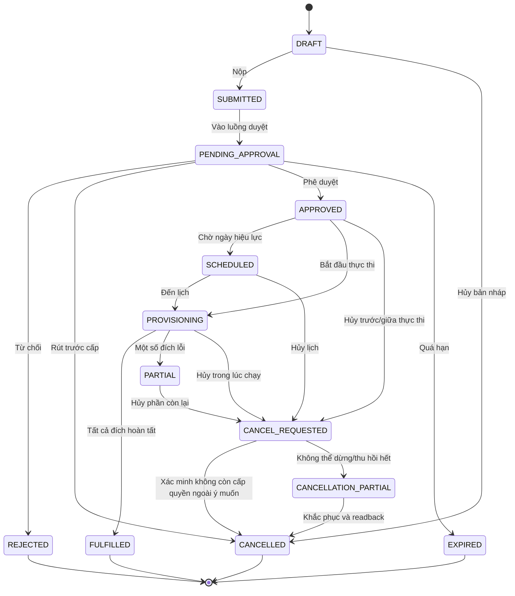
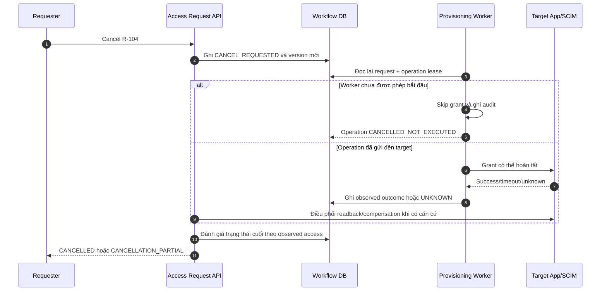
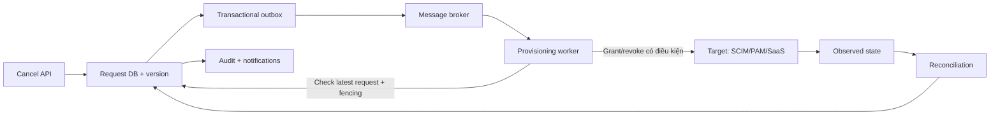

# Hủy yêu cầu truy cập trong Access Request và Identity Lifecycle Management

## 1. Hủy yêu cầu là gì và vì sao quan trọng?

**Hủy yêu cầu truy cập** (*access request cancellation/withdrawal*) là hành động dừng việc tiếp tục xử lý một **yêu cầu cấp, thay đổi hoặc mở rộng quyền truy cập** khi yêu cầu đó không còn cần thiết, được gửi nhầm, hết căn cứ nghiệp vụ hoặc không còn được người có thẩm quyền duy trì. Đây là một phần của quy trình **Access Request Management** trong **Identity and Access Management (IAM)**.

Ví dụ: nhân viên Minh gửi yêu cầu cấp quyền `finance-report-exporter` cho dự án Orion. Trước khi quản lý phê duyệt, dự án được phân công lại nên Minh chọn “Hủy yêu cầu”. Hệ thống phải ngừng luồng phê duyệt liên quan, ghi nhận người hủy/lý do và **không cấp quyền phát sinh từ yêu cầu đó**. Tuy nhiên, nếu yêu cầu đã được phê duyệt và một connector đang thực hiện cấp quyền, một thao tác “hủy” đơn giản trên giao diện có thể **không đủ để ngăn quyền xuất hiện ở ứng dụng đích**.

Trong module **SECURITY_IDENTITY_ACCESS_MANAGEMENT_IDENTITY_LIFECYCLE**, yêu cầu truy cập kết nối với vòng đời danh tính **Joiner–Mover–Leaver (JML)**: tạo danh tính và quyền ban đầu, thay vai trò và quyền khi đổi công việc, rồi thu hồi quyền khi nghỉ việc hoặc hết hợp đồng. Hủy yêu cầu cần phối hợp với **IGA, IdP, SSO, SCIM, RBAC/ABAC, tài khoản dịch vụ, kiểm toán và reconciliation** để tránh tạo quyền truy cập tồn dư.

**Mục tiêu bài học:** sau khi học, bạn có thể phân biệt hủy yêu cầu với từ chối/phê duyệt/thu hồi quyền, thiết kế vòng đời trạng thái, xác định ai được hủy trong từng thời điểm, giải quyết race condition với provisioning, xử lý yêu cầu nhiều hệ thống, bảo vệ API hủy, và kiểm chứng rằng **không có quyền không mong muốn được cấp hoặc tiếp tục tồn tại do yêu cầu đã hủy**.

> **Điểm mấu chốt:** “Yêu cầu đã hủy” là một **trạng thái của workflow**. Nó không tự chứng minh mọi thay đổi tại **target account/entitlement**, phiên hay token đã được ngăn hoặc đảo ngược. Khi tác vụ cấp quyền đã khởi chạy, cần theo dõi cả **trạng thái thực thi** và **quyền thực tế**.

## 2. Phân biệt Cancel, Withdraw, Reject, Expire, Revoke và Rollback

Các từ “hủy”, “rút”, “từ chối”, “hết hạn” và “thu hồi” có thể được dùng không nhất quán trong sản phẩm. Một hệ thống nên định nghĩa **ý nghĩa nghiệp vụ và hiệu lực kỹ thuật** rõ ràng.

| Thuật ngữ | Đối tượng | Khi thường xảy ra | Hệ quả cần bảo đảm |
| --- | --- | --- | --- |
| **Cancel/Withdraw request** | Yêu cầu đang xử lý | Người yêu cầu không còn cần quyền hoặc gửi nhầm | Dừng các bước chưa thực hiện; xử lý cấp quyền đang chạy |
| **Reject/Deny request** | Quyết định phê duyệt yêu cầu | Approver hoặc policy từ chối | Không cấp quyền theo yêu cầu bị từ chối; ghi lý do |
| **Expire request** | Yêu cầu chưa xử lý hết trước deadline | Hết thời gian bổ sung thông tin/phê duyệt | Không tiếp tục workflow, ngăn thực thi muộn |
| **Revoke access** | Quyền, group membership, account, credential hoặc phiên đã được cấp | Hết nhu cầu, Mover, Leaver, sự cố | Quyền thực tế bị thu hồi và được xác minh ở đích |
| **Rollback/Compensation** | Thay đổi provisioning đã thực hiện hoặc đang thực hiện | Hủy giữa chừng, một phần lỗi | Hoàn tác có điều kiện và theo nguồn sở hữu quyền |
| **Delete request record** | Dữ liệu lưu về request | Theo retention sau khi không còn cần lưu | Không thay thế cancel/revoke; không xóa mất audit |
| **Disable account** | Tài khoản tại đích/IdP | Leaver hoặc chặn an ninh | Ngăn sử dụng account theo khả năng nền tảng |
| **Logout/session termination** | Phiên đăng nhập | Người dùng đăng xuất hoặc admin buộc kết thúc | Không tự xóa role hay entitlement |

**Withdraw** có thể được hệ thống định nghĩa là “người gửi rút trước phê duyệt”, còn **Cancel** có thể là tên thao tác chung. Không có yêu cầu rằng mọi sản phẩm phải dùng chính xác cặp tên này; trong bài, **hủy yêu cầu** bao trùm hành động dừng request **theo trạng thái và chính sách**.

**Quan trọng:** khi request đã `FULFILLED`, “hủy request” không thể được dùng thay cho **access revocation**. Hệ thống nên yêu cầu luồng thu hồi độc lập hoặc **chuyển request hủy thành tác vụ thu hồi có liên kết và xác minh**, chứ không chỉ thay nhãn lịch sử sang `CANCELLED`.

### Ba câu hỏi trước khi hủy

1. **Yêu cầu đang ở trạng thái nào?** Chờ duyệt, đã duyệt nhưng chưa cấp, đang cấp, cấp một phần hay đã hoàn tất?
2. **Ai có quyền hủy?** Người yêu cầu, người được cấp, manager/sponsor, approver, owner hoặc IAM operator?
3. **Hệ thống đã thay đổi quyền chưa?** Đã thêm nhóm, cấp license, active privileged role, tạo account, phát token/credential hoặc tạo phiên chưa?

Không có câu trả lời cho câu 3 thì **chưa có cơ sở** để tuyên bố “quyền không bị cấp” sau hủy.

## 3. Yêu cầu truy cập gồm những thông tin nào?

Để có thể hủy an toàn, một access request cần có **định danh ổn định và dữ liệu phục vụ tương quan workflow–provisioning**. Ví dụ cấu trúc nghiệp vụ:

| Trường | Ý nghĩa |
| --- | --- |
| `requestId` | Khóa bất biến của yêu cầu |
| `requestType` | Cấp mới, gia hạn, thay role, quyền tạm hoặc đặc quyền |
| `requesterIdentityId` | Người/automation gửi yêu cầu |
| `beneficiaryIdentityId` | Chủ thể dự kiến nhận quyền; có thể khác requester |
| `targetAccountId` | Tài khoản tại ứng dụng đích, nếu đã được liên kết |
| `targetSystemId` và `tenantId` | Hệ thống/tenant chịu tác động |
| `entitlementId`, `resourceScope` | Vai trò/quyền/tài nguyên chính xác |
| `businessJustification` | Nhu cầu, dự án/ticket/hợp đồng liên quan |
| `requestedFrom`, `requestedUntil` | Cửa sổ quyền mong muốn |
| `workflowState` | Trạng thái yêu cầu và phê duyệt |
| `executionState` | Trạng thái các thao tác provisioning tại đích |
| `requestVersion` | Phiên bản chống sửa cạnh tranh hoặc dùng bản cũ |
| `sourceEventId`, `lifecycleGeneration` | Liên kết tới sự kiện JML khi có |
| `approvers`, `policyVersion` | Quyết định và chính sách phê duyệt |
| `cancelRequestedBy`, `cancelReason`, `cancelRequestedAt` | Dấu vết hủy |
| `linkedRevocationId` | Tác vụ thu hồi khi quyền đã được cấp |
| `targetOperationIds` | Các lệnh provisioning và kết quả có thể đối soát |

**Requester không phải lúc nào cũng là beneficiary.** Manager có thể xin quyền cho nhân viên; một automation của HRIS có thể gửi birthright access theo chính sách. Một người được hưởng quyền có thể không được phép tự hủy một yêu cầu do doanh nghiệp bắt buộc cấp, và một requester cũng có thể không được phép hủy quyền do người khác sở hữu sau khi đã hoàn tất.

**Không dùng email hoặc tên hiển thị làm khóa chính** để hủy và thu hồi: những giá trị này có thể thay đổi hoặc tái sử dụng. Phải dùng `requestId`, identity ID, entitlement ID và ID account/tài nguyên đích đã được xác minh.

## 4. Ai có quyền hủy yêu cầu?

Quyền hủy là một **quyết định authorization**, không phải thuộc tính của nút giao diện. Người gọi API phải được xác thực và đối chiếu với **request cụ thể**, tenant, trạng thái và chính sách.

| Actor | Quyền hủy có thể phù hợp | Giới hạn cần kiểm tra |
| --- | --- | --- |
| **Requester** | Rút request do mình tạo khi còn chờ xử lý | Không mặc định hủy request của người khác hoặc quyền đã cấp |
| **Beneficiary** | Từ chối quyền tự chọn, rút request theo chính sách | Không được hủy quyền bắt buộc do tổ chức duy trì |
| **Manager/sponsor** | Hủy request đã bảo trợ khi nhu cầu/hợp đồng đổi | Phải đúng quan hệ quản lý/sponsor còn hiệu lực |
| **Approver** | Từ chối request hoặc kết thúc yêu cầu theo policy | Không dùng “cancel” để bỏ qua quy trình phê duyệt/audit |
| **Application/data owner** | Ngừng một request vì scope hoặc risk không phù hợp | Chỉ trong phạm vi ứng dụng/tài nguyên mình sở hữu |
| **IAM/IGA operator** | Can thiệp vào request treo hoặc sự cố | Quyền quản trị giới hạn, reason code, audit và SoD |
| **Automation JML** | Hủy các request còn mở khi Leaver/contract expiry | Chỉ tác động đúng identity, đúng lifecycle generation |
| **PAM operator** | Hủy request privileged activation theo quy trình | Không đồng nghĩa revoke mọi active session nếu không thực hiện riêng |

### Những nguyên tắc authorization

- **Default deny** nếu actor không đúng tenant hoặc không có quan hệ hợp lệ với request.
- **Trạng thái là một điều kiện của quyền hủy**: quyền rút trước duyệt không mặc nhiên bao gồm thao tác thu hồi một assignment đã active.
- **Phân tách nhiệm vụ (SoD)**: một admin không nên có thể tự nâng quyền, tự phê duyệt và tùy tiện hủy bằng chứng request.
- **Không tin requester ID trong body**: actor phải đến từ session/token đã xác minh; beneficiary và owner phải tra từ bản ghi request.
- **Quyền ưu tiên an ninh**: khi có Leaver/sự cố, cơ chế hủy do nguồn có thẩm quyền không nên bị chặn chỉ vì requester cá nhân đã mất quyền login; cần workflow machine-to-machine được cấp quyền đúng.

Ví dụ, API `POST /access-requests/req-52/cancel` không được cho phép Alice hủy yêu cầu của Bob chỉ vì Alice đoán được `req-52`. Đó là lỗi **Broken Object-Level Authorization (BOLA/IDOR)**.

## 5. Vòng đời trạng thái của một Access Request

Một mô hình đơn giản chỉ có `PENDING` và `CANCELLED` khó giải quyết cấp quyền bất đồng bộ. Nên phân biệt **request workflow state** với **target execution state**, đồng thời định nghĩa rõ những trạng thái cuối.

### Mô hình trạng thái minh họa



Đây là **state machine gợi ý**, không phải enum bắt buộc của mọi IAM/IGA. Sản phẩm có thể dùng `WITHDRAWN`, `TERMINATED`, `CANCELLED_AFTER_APPROVAL` hoặc tách những trạng thái thành workflow con. Quan trọng là **ngữ nghĩa cuối** phải không mâu thuẫn với quyền thực tế.

### Phân biệt trạng thái workflow và execution

| Workflow state | Execution state có thể đi kèm | Ý nghĩa chính |
| --- | --- | --- |
| `PENDING_APPROVAL` | `NOT_STARTED` | Chưa có cơ sở để cấp quyền |
| `APPROVED` | `NOT_STARTED` hoặc `QUEUED` | Có quyết định phê duyệt, chưa chắc đã thực thi |
| `PROVISIONING` | `RUNNING` | Có thể đã có side effect ở một đích |
| `CANCEL_REQUESTED` | `QUEUED`, `RUNNING` hoặc `UNKNOWN` | Đang cố dừng/cancel hoặc xử lý quyền đã cấp |
| `CANCELLATION_PARTIAL` | `SOME_GRANTED` hoặc `UNVERIFIED` | Chưa đủ bằng chứng không có quyền tồn dư |
| `CANCELLED` | `NONE_GRANTED` hoặc `COMPENSATED_VERIFIED` | Đạt phạm vi hủy đã cam kết |
| `FULFILLED` | `ALL_GRANTED_VERIFIED` | Quyền đã cấp; cần revoke nếu sau này không còn cần |

**Không ép chuyển `FULFILLED → CANCELLED` để “xóa yêu cầu cũ”.** Nếu request đã hoàn tất, nên giữ lịch sử `FULFILLED`, rồi tạo **linked revoke workflow** với trạng thái riêng. Nếu tổ chức dùng thuật ngữ “cancel access” cho tác vụ này, giao diện/API vẫn cần phân biệt nó là **thu hồi quyền đã cấp**, không chỉ rút yêu cầu.

## 6. Điều kiện hủy theo từng giai đoạn

| Giai đoạn | Có thể làm gì? | Điều cần xác minh |
| --- | --- | --- |
| **DRAFT** | Xóa/hủy bản nháp của requester | Không có tác vụ cấp quyền đã phát sinh |
| **SUBMITTED/PENDING_APPROVAL** | Rút/hủy request; ngừng nhắc duyệt | Không có approval/execution cạnh tranh vừa hoàn tất |
| **APPROVED, NOT_STARTED** | Hủy lịch và ngăn provisioning worker | Không còn job đã lấy khỏi queue chuẩn bị chạy |
| **SCHEDULED** | Hủy trước `effectiveAt` | Scheduler không phát tác vụ sau khi cancel |
| **PROVISIONING** | Đánh dấu `CANCEL_REQUESTED`, chặn bước chưa chạy, điều tra bước đang chạy | Có thể phải bù/thu hồi quyền đã cấp |
| **PARTIAL** | Hủy các bước chưa hoàn tất và xử lý các bước đã thành công | Không vô tình thu hồi quyền thuộc request khác |
| **FULFILLED** | Không “rút request” theo nghĩa trước cấp; tạo revoke/change request | Actual permission và session/token cần xử lý |
| **REJECTED/EXPIRED/CANCELLED** | Idempotent no-op hoặc trả trạng thái cuối, theo API contract | Không tạo tác động mới/khôi phục quyền |

Một request đã được **phê duyệt** không phải lúc nào cũng đã được **cấp quyền**. Trong một số hệ thống, việc phê duyệt và provisioning xảy ra gần như ngay lập tức; hệ thống phải dựa vào **execution ledger** thay vì giả định trạng thái `APPROVED` chưa có tác động.

### Hủy quyền bắt buộc có được phép không?

Một số quyền là **birthright access** hoặc do chính sách tổ chức yêu cầu. Ví dụ, tài khoản employee cần quyền truy cập cổng nội bộ để hoàn tất quy trình nhân sự. Nếu quyền là bắt buộc, requester có thể không có quyền tự hủy; hệ thống cần chuyển yêu cầu tới **thay đổi điều kiện nghiệp vụ** hoặc admin policy, thay vì cho phép vô hiệu hóa tùy ý. Quyết định phụ thuộc nguồn có thẩm quyền và quy tắc tổ chức.

## 7. Hủy trước phê duyệt: trường hợp đơn giản nhưng vẫn cần kiểm soát

Ở trạng thái `PENDING_APPROVAL), tác động mong muốn là **dừng workflow**, không tạo quyền mới.

Một trình tự an toàn:

1. Người dùng được xác thực gửi `CancelRequest(requestId, reason)`.
2. IAM đọc request thuộc đúng tenant và kiểm tra quyền actor.
3. Kiểm tra version hiện tại, tránh cạnh tranh với approval đồng thời.
4. Chuyển trạng thái theo giao dịch có điều kiện sang `CANCELLED` nếu chắc chắn **chưa có tác vụ provisioning**.
5. Ghi audit và sự kiện `AccessRequestCancelled` cùng version mới.
6. Ngừng nhắc duyệt, ngăn approval action sau đó, đóng ticket liên quan theo quy tắc.
7. Thông báo requester/beneficiary/approver những người thực sự cần biết.
8. Đối soát để bảo đảm không có job provisioning được xếp hàng hoặc thực thi từ snapshot cũ.

### Hủy không phải xóa lịch sử phê duyệt

Nếu một approver đã nhận thông báo hoặc đã đọc request, hệ thống vẫn nên giữ lịch sử request theo retention. Có thể cần audit ai đã xem, phê duyệt hoặc cố phê duyệt sau khi hủy. **Không xóa request record khỏi database chỉ để nó biến mất khỏi inbox**; hãy chuyển trạng thái và lọc khỏi danh sách “cần xử lý”.

### Thông báo bị trễ

Một approver có thể bấm link email cũ sau khi requester đã hủy. API phê duyệt phải kiểm tra **trạng thái mới nhất** và từ chối hành động, không tin vào thông báo hoặc trang UI đã tải từ nhiều phút trước.

## 8. Hủy sau phê duyệt nhưng trước cấp quyền

Đây là giai đoạn dễ bị nhầm: **approval đã có**, nhưng quyền có thể chưa tạo ở đích vì hệ thống đang chờ lịch hoặc queue.

Ví dụ timeline:

```text
09:00  Request R-104 được approve
09:01  IAM tạo queued operation G-77 để thêm User vào Group
09:02  Requester gửi lệnh cancel R-104
09:03  Worker lấy G-77 từ queue
09:04  SCIM provider trả 200
```

Nếu worker chỉ đọc payload `G-77` được tạo lúc 09:01 mà **không kiểm tra request còn hợp lệ ở 09:03**, hệ thống có thể cấp quyền sau khi request đã hủy. Để tránh:

- Cancel phải **đánh dấu trạng thái và version** bền vững trước khi xác nhận cho requester.
- Worker kiểm tra **trạng thái hiện hành, request version và eligibility** ngay trước khi thực thi side effect.
- Job đã enqueue nhưng chưa bắt đầu có thể được **skip** và ghi reason `CANCELLED_REQUEST`.
- Nếu worker đã bắt đầu, cancel chuyển sang **`CANCEL_REQUESTED`** và chờ kết quả thực tế; không giả định có thể “thu hồi lệnh HTTP” đã gửi.
- Sau khi bảo đảm không có grant được thực hiện, workflow có thể chuyển sang `CANCELLED`.

**Chỉ xóa message trong queue chưa đủ** nếu job đã được consumer lấy, có retry trong dead-letter queue hoặc được tạo bởi một connector khác. Cần chặn ở **nguồn quyết định** và tại nơi thực thi.

## 9. Hủy khi provisioning đang chạy: race condition và kết quả không chắc chắn

Một cuộc đua (*race condition*) xảy ra khi cancel và thao tác grant cùng truy cập trạng thái nhưng không có thứ tự áp dụng được bảo đảm.



Một lệnh HTTP có thể **đã được xử lý ở server** dù client nhận timeout. Vì vậy cancel không nên tuyên bố “không cấp quyền” chỉ vì không có response. Nếu không biết đã cấp chưa, dùng trạng thái **UNKNOWN/UNVERIFIED** và readback theo ID target.

### Chống lost update bằng version

Hãy hình dung Approval và Cancel chạy đồng thời:

- Approval đọc request version 8 và chuẩn bị chuyển sang `APPROVED`.
- Cancel cũng đọc version 8 và muốn chuyển sang `CANCELLED`.

Nếu cả hai ghi mù quáng, thao tác ghi sau có thể che khuất lịch sử của thao tác trước. Sử dụng **optimistic concurrency/CAS** hoặc transaction thích hợp:

```sql
-- SQL minh họa cho workflow DB, không phải SCIM API
UPDATE access_request
SET workflow_state = 'CANCEL_REQUESTED',
    version = version + 1,
    cancelled_by = :actor_id,
    cancel_requested_at = :now
WHERE request_id = :request_id
  AND version = :expected_version
  AND workflow_state IN ('APPROVED', 'SCHEDULED', 'PROVISIONING');
```

Nếu không cập nhật được bản ghi, tải lại trạng thái, xác định yêu cầu đã bị hủy/hoàn tất hay đã đổi version, rồi trả kết quả theo contract. **Không cập nhật theo `requestId` duy nhất mà bỏ qua điều kiện trạng thái và thẩm quyền.**

### Race sau lần kiểm tra cuối

Ngay cả worker kiểm tra `ACTIVE` trước khi gửi request, cancel vẫn có thể đến **sau lần check nhưng trước HTTP grant**. Muốn có bảo đảm mạnh, cần **lease/fencing token, serialization hoặc một trạng thái `RUNNING` được khóa giao dịch** và đường compensation có giám sát. Không thể tạo một transaction nguyên tử xuyên nhiều SaaS nếu các hệ thống không hỗ trợ.

## 10. Hủy một yêu cầu nhiều đích: partial cancellation

Một request có thể tạo **nhiều operation**:

```text
Access Request R-530: "Gia nhập dự án Orion"
  O-01: Tạo User tại Project Portal       -> SUCCEEDED
  O-02: Thêm vào Group readers            -> SUCCEEDED
  O-03: Gán license analytics             -> QUEUED
  O-04: Cấp role report-exporter tại SaaS  -> RUNNING
  O-05: Gửi thông báo                     -> NOT_STARTED
```

Khi cancel ở trạng thái này:

1. Chặn O-03/O-05 nếu chưa bắt đầu và không còn nghĩa vụ khác.
2. Xác định O-04 đã có side effect hay chưa; có thể chuyển sang `UNKNOWN`.
3. Với O-01/O-02, quyết định có cần **compensation** hay không theo nguồn quyền và quan hệ phụ thuộc.
4. Kiểm tra User/Group/license/role thực tế tại từng provider.
5. Không đóng request là `CANCELLED` nếu còn quyền từ **chính request đó** mà chính sách đòi thu hồi.
6. Nếu một đích không thể xử lý ngay, ghi `CANCELLATION_PARTIAL` kèm owner, deadline và biện pháp giảm rủi ro.

**Không đảo ngược toàn bộ thay đổi bằng cách xóa một User dùng chung**. User có thể đã tồn tại trước request hoặc đang được quyền khác sử dụng; compensation phải dựa vào **provenance** của từng grant và dependency, tránh phá quyền hợp lệ ngoài yêu cầu bị hủy.

### Quyết định theo từng line item

Nếu một request có ba entitlement và requester chỉ muốn hủy **một entitlement**, mô hình phải hỗ trợ **partial withdrawal** hoặc yêu cầu requester tạo request mới theo policy. Không nên áp một lệnh “cancel all” chỉ vì UI truyền sai `itemId`.

## 11. Cancel và compensation: đảo ngược đúng phần hệ thống đã làm

**Compensation** là hành động **bù trừ/đảo ngược có điều kiện** khi workflow phân tán đã thực hiện một phần. Đây không phải rollback transaction database với bảo đảm nguyên tử; nhiều target có thể đã phát token, gửi thông báo hoặc có hành vi không thể hoàn nguyên.

| Side effect đã xảy ra | Có thể bù ra sao? | Lưu ý an ninh/nghiệp vụ |
| --- | --- | --- |
| Đã tạo User mới dành riêng cho request | Disable/delete theo chính sách và ownership | Không xóa nếu account đã được dùng bởi luồng hợp lệ khác |
| Đã thêm member vào Group | Gỡ member nếu grant đó chỉ thuộc request bị hủy | Kiểm tra các yêu cầu/quyền khác cùng cần membership |
| Đã cấp một application role | Thu hồi role qua API quản lý đích | Có thể có direct grant hoặc group khác giữ cùng quyền |
| Đã cấp privileged activation | Deactivate/revoke và kết thúc privileged session | PAM session/token cũ có thể còn trong cửa sổ TTL |
| Đã phát token hoặc credential | Revoke/rotate theo khả năng provider | Không thể “thu hồi bản sao” chỉ bằng xóa DB local |
| Đã gửi email chứa link truy cập | Vô hiệu hóa invite/link/token có hạn | Không thể thu hồi email đã nhận |
| Đã tạo tài nguyên do người dùng thao tác | Đánh giá dữ liệu, rollback theo nghiệp vụ nếu cho phép | Không xóa dữ liệu người khác chỉ vì request cấp quyền bị hủy |
| Đã duyệt hóa đơn/đã thực hiện giao dịch | Dùng quy trình khắc phục nghiệp vụ riêng | Hủy access request không đảo ngược giao dịch đã hoàn tất |

### Nguyên tắc provenance

Trước khi gỡ một grant, hỏi **nó có tồn tại trước request không**, có được cấp lại từ request khác không, có đang là birthright access không và ai sở hữu nguồn quyết định. Một request `R-101` có thể đã thêm user vào group `finance-readers`, nhưng một request `R-102` khác cũng có quyết định giữ group đó. Nếu cancel R-101 đơn giản xóa member, R-102 bị ảnh hưởng ngoài ý muốn.

**Điều phối theo desired state hiện hành** thường an toàn hơn “ngược lại tất cả operation lịch sử”. Xóa/thu hồi chỉ khi **không còn căn cứ hợp lệ khác**. Cơ chế “reference count” có thể hỗ trợ một số mapping nhưng không thay thế policy và nguồn có thẩm quyền.

## 12. Sự kiện, queue, outbox và idempotency

Các hệ thống Access Request thường tích hợp **workflow engine, message queue, provisioning connector và target SaaS**. Cancel phải được biểu diễn như một sự kiện bền vững, có thứ tự nghiệp vụ và có thể xử lý lại an toàn.

Một thiết kế có thể sử dụng:

- **Request state/version** lưu tại nguồn sở hữu workflow.
- **Transactional outbox** để ghi thay đổi request và event hủy trong cùng giao dịch DB.
- **At-least-once delivery** với **idempotent consumers** nếu queue có thể phát lại.
- **Per-operation ID và lease/fencing token** để phát hiện job cũ.
- **Saga/compensation orchestration** cho các tác vụ đã thực thi một phần.
- **Reconciliation** để so desired vs observed state khi có timeout/sync trễ.
- **Dead-letter/retry policy** để xử lý lỗi tạm thời mà không cấp lại quyền cũ.



**Không tin việc nhận event theo thứ tự đến của queue là thứ tự nghiệp vụ.** Một event `APPROVED` cũ có thể đến sau event `CANCELLED`. Consumer phải kiểm tra **version và trạng thái hiện tại** trước khi phát lệnh cấp quyền.

### Idempotent Cancel API

Nếu requester bấm “Hủy” hai lần do mạng chậm, lần thứ hai không được tạo hai tác vụ revoke mâu thuẫn. API có thể dùng `Idempotency-Key` do client gửi và/hoặc `requestId + cancelOperationId` do server sinh, với giới hạn retention theo chính sách. **Idempotency-Key không phải header bắt buộc của SCIM** và có thể là hợp đồng riêng của Access Request API.

Nếu request đã `CANCELLED` từ cùng nguyên nhân, server có thể trả trạng thái cuối tương đương; nếu request đã `FULFILLED`, không tự chuyển nó sang `CANCELLED` chỉ vì retry đến muộn.

## 13. Hủy yêu cầu và các sự kiện Joiner

**Joiner** bắt đầu từ xác minh và đăng ký danh tính, HRIS/hợp đồng xác nhận quan hệ, IAM tạo account và cấp quyền ban đầu. Có thể xuất hiện cả **quyền tự động/birthright** và **quyền theo yêu cầu**.

### Hủy quyền theo yêu cầu trước ngày đi làm

Một nhân viên mới chưa đến ngày bắt đầu được manager gửi yêu cầu truy cập ứng dụng bổ sung. Trước ngày hiệu lực, manager thay đổi kế hoạch. Cancel phải ngăn việc cấp quyền đó, bao gồm tác vụ đã xếp lịch cho `effectiveAt`. Nếu một user account đã được tạo để chuẩn bị onboarding, **không tự xóa account** nếu account còn phục vụ các yêu cầu hợp lệ khác.

### Joiner bị hủy vì không nhận việc

Khi HRIS xác nhận ứng viên **không gia nhập**, đây không chỉ là một nút “Cancel Access Request”; đó là **thay đổi trạng thái nguồn có thẩm quyền**, cần hủy tất cả yêu cầu cấp quyền có liên quan, chặn activation đã lên lịch và xử lý những tài khoản/credential đã được tạo.

**Không để self-service cancellation thay cho HRIS update.** Nếu một nhân viên tự hủy request ứng dụng nhưng quan hệ làm việc vẫn ACTIVE, hệ thống không nên tự suy họ đã rời công ty. Ngược lại, khi HRIS xác nhận không nhận việc, không cần chờ người gửi từng request đăng nhập để bấm hủy.

### Tránh tài khoản trùng sau hủy

Một request tạo account bị timeout rồi cancel; người quản trị không thấy kết quả và gửi request mới. Nếu không có correlation theo `identityId`, provider ID và event version, có thể tạo hai account. Trước khi tạo lại, phải tìm và xác minh **account cũ có thực sự tồn tại không**.

## 14. Hủy yêu cầu trong Mover

**Mover** xảy ra khi nhân viên đổi vị trí, team, manager, dự án hoặc pháp nhân. Access request cũ có thể **không còn hợp lệ** ngay cả khi chưa hết thời hạn.

Ví dụ:

```text
10:00  Request R-701: cấp CRM_CUSTOMER_EXPORT cho Sales
10:05  HRIS Mover: nhân viên chuyển sang Finance từ 12:00
10:10  Manager Sales hủy R-701
10:12  Approval email cũ vẫn đến inbox
12:00  IGA tính desired access mới theo Finance
```

Hệ thống cần:

1. Hủy hoặc vô hiệu những request đang chờ không phù hợp **với job code/scope mới**.
2. Ngăn approval cũ tiếp tục phát grant sau ngày hiệu lực Mover.
3. Nếu quyền cũ đã cấp, **revoke theo desired access** của role mới; không chỉ cancel request.
4. Áp kiểm tra **SoD** khi quyền cũ và quyền mới xung đột.
5. Giới hạn ngoại lệ bàn giao bằng owner, scope, `expiresAt` và phê duyệt riêng.
6. Làm mới hoặc chặn phiên/token còn claim cũ trong cửa sổ rủi ro được chấp thuận.

**Không tự hủy mọi request chỉ vì manager thay đổi** nếu quyền vẫn đúng nhiệm vụ và policy cho phép; nhưng phải xét lại approver/sponsor mới và thẩm quyền phê duyệt. Quy tắc cancellation dựa vào nghiệp vụ và thời điểm, không chỉ sự thay đổi một trường.

## 15. Leaver và hợp đồng hết hạn: hủy request chưa hoàn tất là chưa đủ

Với **Leaver**, phải ưu tiên **chặn quyền truy cập hiện có**. Hủy request còn mở chỉ ngăn quyền mới được tạo từ các request ấy.

Một quy trình Leaver có thể gồm:

1. Nhận **event HRIS/contract** từ nguồn có thẩm quyền, với `identityId`, version, `effectiveAt`.
2. Hủy hoặc đánh dấu không hợp lệ **mọi request chưa hoàn tất** của beneficiary theo đúng lifecycle generation.
3. Vô hiệu hóa những **scheduled grants, pending privileged activations và provisioning queue jobs** tương ứng.
4. Disable/chặn account và xác thực tại **IdP/Directory**, kể cả quyền không qua access request.
5. Thu hồi quyền ứng dụng qua **SCIM/API/PAM**, bao gồm role trực tiếp và quyền kế thừa.
6. Xử lý **session, refresh token, access token, API key, PAT, SSH key, vault access** theo năng lực nền tảng và mức rủi ro.
7. Đối soát trạng thái cuối tại các target; ghi `PARTIAL` với owner và deadline nếu còn quyền.

**Không đánh dấu Leaver hoàn tất chỉ vì tất cả request đã chuyển thành `CANCELLED`.** Người đó có thể còn quyền lâu năm được cấp từ request đã `FULFILLED`, nhóm mặc định, account local và credential không qua SSO.

### Guest B2B

Nhà thầu A có thể tiếp tục đăng nhập ở **home IdP của Công ty A** sau khi hợp đồng truy cập tài nguyên của **Công ty B** hết hạn. B phải hủy pending requests, vô hiệu local guest và thu hồi entitlement theo **contract registry/sponsor của B**, không chờ A hủy account home.

### Rehire

Khi người đã nghỉ được tuyển lại, IAM phải kiểm tra **lifecycle generation**, xác minh danh tính và tính quyền mới. Retry của request cũ đã hủy không được tự tạo admin role trong giai đoạn rehire mới. **Không khôi phục tự động mọi request lịch sử** chỉ vì account hoặc email lại xuất hiện.

## 16. Hủy yêu cầu đặc quyền và PAM/JIT

**Privileged Access Management (PAM)** và các quy trình **Just-in-Time (JIT)** có thể dùng request để xin quyền quản trị tạm thời. Hủy request đặc quyền thường có ý nghĩa an ninh lớn hơn hủy quyền đọc thông thường.

| Trạng thái đặc quyền | Yêu cầu hủy | Hành động tương ứng |
| --- | --- | --- |
| Chưa được phê duyệt | Người gửi rút request | Dừng approval, không tạo eligibility/activation |
| Đã duyệt eligibility | Hủy yêu cầu đủ điều kiện | Gỡ eligibility nếu chỉ được cấp từ request bị hủy |
| Sắp đến cửa sổ activation | Hủy lịch JIT | Ngăn activation và token phát sau đó |
| Activation đang hoạt động | Ngừng quyền ngay | **Deactivate/revoke session/role**, không chỉ hủy workflow |
| Privileged session chưa hết hạn | Hủy access theo yêu cầu khẩn | Terminate session/credential theo khả năng PAM/target |
| Đã có thao tác quản trị thành công | Hủy request sau sự kiện | Không đảo ngược tác vụ đã thực hiện; điều tra/khắc phục theo nghiệp vụ |

Ví dụ, một kỹ sư xin `prod-deploy-admin` trong 45 phút, được duyệt và đã kích hoạt được 10 phút. Bấm “Hủy yêu cầu” phải được diễn giải rõ: **ngừng request** hay **kết thúc phiên đặc quyền đang chạy**. Nếu chỉ sửa trạng thái ticket, role active có thể còn đến hết 45 phút. Với quyền cao, nên có hành động **“Kết thúc truy cập đặc quyền”** riêng hoặc workflow rõ ràng liên kết tới PAM/target.

**Khi phát hiện lạm dụng hoặc Leaver, security control có thể cần ưu tiên revoke ngay**, không đợi requester rút request. Quá trình này phải có quyền admin phù hợp, audit và chống việc lợi dụng để phá quyền của người khác.

## 17. Hủy yêu cầu cho service account và workload identity

Các request không chỉ dành cho người dùng tương tác. Một dự án có thể xin quyền cho **service account, CI/CD pipeline, Kubernetes workload hoặc managed identity**.

### Cần gắn yêu cầu với workload thực tế

Một request service nên lưu:

- `serviceId`, owner và backup owner có thẩm quyền.
- `workloadIdentity`, issuer/subject/audience nếu sử dụng federation.
- Môi trường, resource scope, API actions và thời hạn.
- Ticket thay đổi, người duyệt, policy version và credential/trust được tạo.
- Trạng thái deployment hoặc job phụ thuộc để biết hủy có gây tác động vận hành.

Ví dụ, pipeline xin role `orion-prod-deployer` nhưng dự án hoãn triển khai. Nếu grant chưa phát, cancellation dừng request. Nếu cloud role đã cấp hoặc token còn hợp lệ, cần **gỡ trust/assignment, xử lý credential ngắn hạn theo khả năng và xác minh đường API từ workload bị từ chối**.

### Owner Leaver không phải workload Leaver

Kỹ sư tạo service account nghỉ việc có thể khiến **ownership request** phải chuyển giao; không được xóa một workload production đang phục vụ nhiệm vụ hợp lệ chỉ vì owner cũ đã Leaver. Ngược lại, nếu chính workload bị ngừng, cần hủy pending grants **và thu hồi quyền thực tế**, gồm token, secret, certificate và IAM trust.

**Không dùng nút Cancel làm cơ chế quản lý secret.** Credential đã phát phải được revoke/rotate thông qua secret manager, cloud IAM hoặc issuer phù hợp, không thể “rút lại” chỉ bằng trạng thái request.

## 18. Hủy theo batch, nhiều người và yêu cầu cha–con

Hệ thống có thể hỗ trợ manager tạo request theo lô cho 50 nhân viên, hoặc một parent request gồm nhiều line item tại các target khác nhau. Cần phân biệt:

- **Cancel parent:** có nghĩa dừng toàn bộ child requests chưa hoàn tất, hay chỉ đóng yêu cầu tổng?
- **Cancel child:** dừng một entitlement cụ thể mà không chạm những entitlement khác?
- **Cancel for beneficiary:** trong request cấp cho nhiều người, có được hủy riêng một người?
- **Cancel approval task:** hủy bước duyệt của một approver có phải hủy toàn bộ request không?
- **Cancel scheduler:** dừng một lần activation hay tất cả lần sau?

Một thiết kế minh họa:

```text
Parent R-900 "Onboard team Orion"
  R-901 user A -> Project Portal login    : FULFILLED
  R-902 user A -> report-export           : PENDING_APPROVAL
  R-903 user B -> project-reader          : PROVISIONING
  R-904 user C -> privileged-admin        : SCHEDULED
```

Cancel parent có thể dẫn đến: `R-902 CANCELLED`, `R-903 CANCEL_REQUESTED`, `R-904 CANCELLED` còn `R-901 FULFILLED` cần luồng revoke nếu chính sách yêu cầu. **Không đặt parent `CANCELLED` để che child `PARTIAL`**. Ghi trạng thái tổng `PARTIALLY_CANCELLED` hoặc tương đương theo hợp đồng.

**Không lấy quyền cancel parent làm quyền sửa mọi tài nguyên của từng beneficiary.** Mỗi child cần áp các ranh giới actor, tenant, scope và chính sách riêng; nhất là quyền đặc quyền.

## 19. Hủy yêu cầu không làm biến mất quyền hiện có: SCIM, IdP, SSO

Một hệ thống IAM thường quản lý hai tầng:

1. **Workflow:** ai xin quyền, ai duyệt, request đang ở đâu, có bị hủy không.
2. **Target access:** User/Group, role, account status, session và credential thực tế ở IdP/ứng dụng.

Các thành phần phổ biến:

| Thành phần | Khi cancel request cần làm gì? | Điều không thể suy ra |
| --- | --- | --- |
| **IGA/Access request** | Dừng quyết định cấp chưa hoàn tất, ghi audit | Đã xóa mọi role ở target |
| **SCIM client/provider** | Ngừng POST/PATCH chưa thực hiện; compensation nếu đã thêm User/Group | SCIM có endpoint “cancel request” chung |
| **IdP/SSO** | Ngăn account hoặc group grant dự kiến nếu thuộc request | Hủy workflow làm logout toàn bộ session |
| **Directory/LDAP** | Bỏ thao tác add group trong queue; readback membership | DN/Group cache đã được cập nhật đồng bộ tức thì |
| **Application API** | Ngừng role assignment hoặc revoke direct grant nếu cần | Group SCIM gỡ thì direct grant cũng mất |
| **PAM/PIM** | Dừng hoặc kết thúc eligibility/activation và privileged session phù hợp | Approval được hủy thì token đã cấp cũng mất |
| **Resource server/PEP** | Đánh giá quyền hiện hành theo policy và target state | Token có chữ ký hợp lệ tự phản ánh cancel request |

**SCIM v2** cung cấp các thao tác quản lý User/Group theo contract của service provider; **không có một thao tác SCIM chuẩn chung “Cancel Access Request”**. Nếu IAM đã gửi PATCH thêm member, việc hủy phải điều phối **SCIM remove membership**, nhưng chỉ khi role không còn được yêu cầu từ nguồn hợp lệ khác.

### Ví dụ compensation với SCIM Group

Giả sử request `R-310` chỉ cấp Group `sp-group-orion` cho User `sp-user-723`, sau đó bị hủy trong lúc xử lý. Nếu readback chứng minh membership được cấp **duy nhất từ request bị hủy** và không có policy khác giữ quyền, client có thể gửi:

```http
PATCH /scim/v2/Groups/sp-group-orion HTTP/1.1
Authorization: Bearer <CONNECTOR_TEST_TOKEN>
Content-Type: application/scim+json

{
  "schemas": ["urn:ietf:params:scim:api:messages:2.0:PatchOp"],
  "Operations": [
    {
      "op": "remove",
      "path": "members[value eq \"sp-user-723\"]"
    }
  ]
}
```

Request **minh họa**, không dùng token thực. Phải kiểm tra hỗ trợ `PATCH`, schema và Group/User ID của provider, xử lý trạng thái lỗi, và **GET/readback** để xác minh membership/entitlement. **Không nên gọi `PATCH active=false` cho toàn bộ User chỉ vì hủy một request role** khi User còn những quyền hợp lệ khác.

### SSO session không phải trạng thái request

Người dùng có thể đang đăng nhập SSO sau khi request bị hủy; điều đó không sai nếu họ vẫn có quyền cơ bản. Điều cần ngăn là **quyền phát sinh từ request đã hủy**. Ngược lại, nếu quyền đặc biệt đã được cấp và còn token/session chứa claim, phải đánh giá cơ chế revocation/TTL/authorization runtime phù hợp.

## 20. Thiết kế API hủy yêu cầu

Một Access Request service có thể cung cấp endpoint riêng như:

```http
POST /api/access-requests/req-104/cancel HTTP/1.1
Authorization: Bearer <REQUESTER_SESSION_TOKEN>
Content-Type: application/json
Idempotency-Key: cancel-req-104-v9
If-Match: "9"

{
  "reasonCode": "NO_LONGER_REQUIRED",
  "reason": "Dự án đã phân công lại"
}
```

Đây là **API giả định của ứng dụng**, không phải một endpoint được SCIM/OIDC/SAML định nghĩa. `If-Match`, `Idempotency-Key` và tên body field cũng là **lựa chọn thiết kế của hệ thống**.

Một response **minh họa** khi hủy đã được ghi nhận nhưng còn xử lý bất đồng bộ:

```http
HTTP/1.1 202 Accepted
Content-Type: application/json

{
  "requestId": "req-104",
  "workflowState": "CANCEL_REQUESTED",
  "executionState": "RECONCILING",
  "cancelOperationId": "cancel-604",
  "message": "Đã nhận yêu cầu hủy; đang xác minh trạng thái cấp quyền."
}
```

**Không hứa `200 OK` = hoàn tất mọi đích.** Nếu cần điều phối bù và đối soát, một phản hồi như `202 Accepted` có thể thể hiện **hành động hủy đã được tiếp nhận**, chưa phải đã hoàn tất. Khi hệ thống xác nhận chưa có side effect hoặc đã xử lý xong, client có thể GET lại request/cancel operation để thấy trạng thái cuối.

### Mã lỗi và hành vi cần định nghĩa

| Tình huống | Ví dụ kết quả API | Giải thích |
| --- | --- | --- |
| Request hợp lệ, không có provisioning | `200 OK` với `CANCELLED` | Trạng thái cuối đã được xác minh theo contract |
| Hủy cần xử lý bất đồng bộ | `202 Accepted` | Đã nhận; không tuyên bố quyền đã bị thu hồi |
| Người gọi không có quyền | `403 Forbidden` hoặc `404 Not Found` theo policy che giấu tài nguyên | Không lộ request của tenant khác |
| Không xác thực | `401 Unauthorized` | Token/session không đủ |
| Request không tồn tại | `404 Not Found` | Không suy ID hợp lệ |
| Request đã fulfilled | `409 Conflict` kèm hướng dẫn revoke | Không “cancel” quyền đã cấp |
| Version cũ | `412 Precondition Failed` khi hỗ trợ `If-Match` | Client phải làm mới trạng thái |
| Input invalid | `400 Bad Request` hoặc `422` theo contract | Reason code hoặc body không đúng |
| Retry cùng cancel operation | Trả kết quả idempotent | Không gửi lệnh grant/revoke trùng |

Đây là **khuyến nghị thiết kế ứng dụng**, không phải bảng status bắt buộc từ chuẩn SCIM. Hệ thống cần công bố semantics cho frontend và integration consumers.

## 21. Giao diện và thông báo: tránh gây hiểu nhầm “đã hủy”

Một UX tốt phải giúp requester hiểu **trạng thái thực tế**, không che giấu hoạt động provisioning đang chạy.

### Phân biệt các thông báo

- **“Yêu cầu đã được hủy trước khi cấp quyền”**: chỉ hiển thị khi xác minh không có grant phát sinh từ request.
- **“Đã tiếp nhận yêu cầu hủy; đang kiểm tra quyền đã cấp”**: đúng cho `CANCEL_REQUESTED`.
- **“Hủy chưa hoàn tất; đang xử lý quyền còn tồn dư”**: đúng cho `CANCELLATION_PARTIAL`.
- **“Yêu cầu đã hoàn tất; bạn cần gửi yêu cầu thu hồi quyền”**: đúng khi `FULFILLED` và hệ thống không tự mở revoke.
- **“Bạn không có quyền hủy yêu cầu này”**: phù hợp cho lỗi authorization, không tiết lộ nội dung request ngoài scope.

### Thông báo đến ai?

Tùy policy và sensitivity: requester, beneficiary, manager/sponsor, approver đang chờ, application/role owner hoặc IAM operator. Không nhất thiết gửi thông báo cho mọi người từng tham gia. Với yêu cầu đặc quyền, việc hủy/kết thúc phiên có thể cần cảnh báo Security/PAM.

**Đừng gửi thông báo “quyền đã bị thu hồi” khi mới nhận yêu cầu cancel.** Nội dung thông báo phải phản ánh đúng `workflowState` và `executionState`, nhất là khi provider trả timeout.

### Link trong email và quyền truy cập

Nút Cancel từ email nên dẫn tới ứng dụng có **authentication/authorization thật**, không chấp nhận hành động phá hủy chỉ từ một link dễ chuyển tiếp. Nếu dùng link có token tác vụ, phải bảo vệ chống CSRF, replay, hết hạn và lộ qua URL/log theo thiết kế.

## 22. Bảo mật: những tấn công và lỗi thường gặp

| Nguy cơ | Ví dụ | Biện pháp |
| --- | --- | --- |
| **BOLA/IDOR** | Alice hủy request của Bob bằng cách thay ID trên URL | Object-level auth dựa vào actor, tenant, owner |
| **CSRF** | Trang ngoài kích hoạt hủy khi người dùng đang có cookie | CSRF protection/SameSite theo kiến trúc, không GET thay đổi state |
| **Stale approval** | Approver duyệt link cũ sau cancel | Version/state check trong transaction approval |
| **Queue replay** | Event Approved cũ đến sau Cancelled | Source version, fencing và kiểm tra state hiện hành |
| **TOCTOU** | Worker kiểm tra trạng thái rồi cấp quyền khi cancel vừa tới | Lease/serialization, kiểm tra sát side effect và reconciliation |
| **Duplicate cancellation** | Double-click tạo hai revoke dẫn đến lỗi quyền | Idempotency key và operation ledger |
| **Wrong-target compensation** | Gỡ group của người trùng email | ID ổn định, mapping + tenant + provenance |
| **Privilege misuse** | Admin hủy request an ninh để che giấu cấp quyền | SoD, audit độc lập, reason code và approval khi cần |
| **Cross-tenant cancel** | Token tenant A thay state request tenant B | Ràng buộc tenant ở query và authorization |
| **Rehire resurrection** | Retry request cũ cấp role cho giai đoạn mới | Lifecycle generation và source version |
| **Fail open on queue/PDP error** | Xác nhận cancel rồi worker vẫn cấp vì không kiểm trạng thái | Chốt ở worker/target, fail-safe theo policy |
| **Log tampering** | Xóa dấu vết hủy hoặc cấp quyền sai | Audit append-only/tamper-evident theo giải pháp |
| **PII/secret leakage** | Log raw access token hoặc lý do chứa dữ liệu riêng tư | Redaction, retention và phân quyền log |
| **Denial of service** | Actor gửi hủy lặp hàng nghìn lần làm nghẽn queue | Rate limit, idempotency và quota thích hợp |

**Tính toàn vẹn của hủy yêu cầu quan trọng như tính toàn vẹn của cấp quyền.** Một hệ thống có thể cấp quyền rất chặt nhưng vẫn rủi ro nếu người không có thẩm quyền hủy quyền của đồng nghiệp, hoặc if cancelled request vẫn lén được thực thi từ hàng đợi cũ.

### Không lấy `reason` do client gửi làm điều kiện quyền

Lý do hủy có thể do người dùng nhập, cần validate/sanitize để tránh XSS hoặc log injection. Nó giúp giải trình nhưng **không thay kiểm tra identity, quyền và state**. Một chuỗi `"urgent-security"` tự khai không tự ban cho người dùng quyền hủy privileged request của người khác.

## 23. Pseudocode: xử lý yêu cầu hủy tại workflow service

Giả mã dưới đây minh họa một API hủy **có version, idempotency và xử lý bất đồng bộ**. Các hàm và enum là **ví dụ**, không phải API thực của một sản phẩm.

```text
cancelAccessRequest(requestId, authenticatedActor, reason, expectedVersion, idemKey):
    require authenticatedActor.isAuthenticated()
    require reasonIsAcceptable(reason)
    require trustedTenantContext(authenticatedActor)

    if cancellationLedger.contains(idemKey, authenticatedActor, requestId):
        return cancellationLedger.returnPreviousResult(idemKey)

    transaction:
        request = requestRepository.loadForUpdate(requestId)
        if request == NOT_FOUND:
            return NOT_FOUND_OR_FORBIDDEN

        require authorization.canCancel(
            actor=authenticatedActor,
            request=request,
            target=request.target,
            workflowState=request.workflowState
        )

        if request.version != expectedVersion:
            return STALE_VERSION

        if request.workflowState == FULFILLED:
            return REVOKE_REQUIRED

        if request.workflowState in [REJECTED, EXPIRED, CANCELLED]:
            return ALREADY_TERMINAL

        request.workflowState = CANCEL_REQUESTED
        request.cancelRequestedBy = authenticatedActor.identityId
        request.cancelReasonCode = reason.code
        request.version = request.version + 1

        cancellation = ledger.createOnce(
            requestId, idemKey,
            currentVersion=request.version
        )
        outbox.enqueue(
            eventType="ACCESS_REQUEST_CANCEL_REQUESTED",
            requestId=requestId,
            requestVersion=request.version,
            cancelOperationId=cancellation.id
        )
        audit.recordCancelDecisionWithoutSecrets(request, authenticatedActor)

    return ACCEPTED_WITH_OPERATION_ID(cancellation.id)
```

**Lưu ý:** mẫu dùng `loadForUpdate` là một cách triển khai transaction trên database hỗ trợ khóa bản ghi; hệ thống thật có thể dùng optimistic concurrency/CAS. Mọi đường **approval** và **provisioning** cũng phải kiểm tra version/state, không chỉ API hủy. Nếu không, một approval transaction đang mở có thể ghi đè quyết định hủy vừa được xác nhận.

### Lý do không chuyển thẳng sang CANCELLED

Hệ thống không nên đặt `CANCELLED` trước khi biết **những operation đã enqueue/running** có thực hiện side effect không. Với request chắc chắn chưa đi qua provisioning, hệ thống có thể tối ưu để chuyển thẳng sang `CANCELLED` sau khi transaction xác minh; với trạng thái mơ hồ, nên dùng `CANCEL_REQUESTED` đến khi reconciliation hoàn tất.

## 24. Pseudocode: worker chống cấp quyền sau hủy

Một provisioning worker cần coi request state/version là **chốt ngăn cấp quyền muộn**, đồng thời không tự tin rằng một lần kiểm tra là đủ bảo đảm.

```text
processProvisioningOperation(operationId):
    op = operationLedger.load(operationId)
    request = requestRepository.loadCurrent(op.requestId)

    if request.lifecycleGeneration != op.lifecycleGeneration:
        markOperationSkipped("STALE_LIFECYCLE")
        return

    if request.version != op.expectedRequestVersion:
        markOperationForReevaluation("STALE_REQUEST_VERSION")
        return

    if request.workflowState in [CANCEL_REQUESTED, CANCELLED,
                                  REJECTED, EXPIRED]:
        markOperationSkipped("REQUEST_NO_LONGER_APPROVED")
        return

    if not currentlyEligibleAndApproved(request):
        markOperationSkipped("NO_CURRENT_AUTHORIZATION")
        return

    lease = operationLedger.acquireExecutionLease(op)
    if lease == NOT_GRANTED:
        return

    current = requestRepository.loadCurrent(op.requestId)
    if current.isCancellationRequestedOrNoLongerEligible():
        releaseLeaseAndSkip(op)
        return

    result = targetConnector.performWithCorrelationAndLeastPrivilege(op)
    operationLedger.recordSuccessFailureOrUnknown(op, result)

    if requestRepository.loadCurrent(op.requestId).isCancellationRequested():
        reconciliation.enqueue(op.requestId, op.targetId)

    return result
```

**Đây chưa phải bảo đảm nguyên tử giữa workflow DB và SaaS.** Một cancel có thể đến ngay sau lần check cuối hoặc trong lúc HTTP call đang chạy. Quy trình phải có:

- **Execution lease/fencing** hoặc cơ chế tuần tự hóa thích hợp khi có thể.
- **Target operation ID** và trạng thái `UNKNOWN` nếu mất response.
- **Readback** để xác định grant đã thực sự được cấp hay chưa.
- **Compensation theo desired state hiện hành**, không gỡ quyền hợp lệ từ request khác.
- **Reconciliation** và owner xử lý ngoại lệ nếu target không hỗ trợ revoke hoặc không có visibility.

Nếu hệ thống đòi bảo đảm “không bao giờ cấp sau cancel” một cách tuyệt đối, phải **định nghĩa chính xác thời điểm tuyến tính hóa và khả năng phối hợp với target**, vì API phân tán không hỗ trợ transaction chung sẽ có giới hạn. Có thể thay thế bằng yêu cầu an ninh thực dụng hơn: **mọi grant muộn được phát hiện và thu hồi trong SLA**, đồng thời chặn sử dụng bằng authorization runtime khi có thể.

## 25. Audit trail và đối soát sau cancellation

Khi có tranh chấp “tôi đã hủy mà vẫn được cấp quyền”, audit phải tái tạo được **thứ tự quyết định, hành động và trạng thái đích**.

### Những dữ liệu quan trọng

| Nhóm | Trường nên có | Mục đích |
| --- | --- | --- |
| Request | `requestId`, item IDs, target/tenant, entitlement, request version | Xác định đúng yêu cầu |
| Actor | `identityId`, quyền actor, loại hành động, delegated authority | Chứng minh hủy có thẩm quyền |
| Decision | State trước/sau, reason code, policy version, effective time | Giải trình quyết định |
| Approval | Approver, trạng thái approval, thời điểm nhận/thu hồi | Tìm approval cạnh tranh |
| Provisioning | Operation ID, queue/worker, attempt, connector, kết quả | Truy vết grant đã phát |
| Target | Provider ID, observed groups/roles, thời điểm readback | Xác minh quyền thực tế |
| Compensation | Tác vụ revoke, trạng thái, owner, deadline | Xử lý quyền dư |
| JML | HRIS event ID, source version, lifecycle generation | Chống grant từ event cũ |
| Security | Token/session residual check, SoD finding | Xác định rủi ro còn lại |
| Notification | Người nhận, nội dung trạng thái, thời gian | Không phát thông báo thành công giả |

**Không log raw bearer tokens, mật khẩu, API key, private key, session cookie hoặc toàn bộ dữ liệu định danh nhạy cảm.** Dùng ID tham chiếu, redaction và quyền truy cập log theo chính sách. Nếu lý do hủy chứa dữ liệu cá nhân, cần áp minimization và retention.

### Cần ba lớp bằng chứng

1. **Workflow evidence:** request được hủy bởi người có quyền, tại version/state nào.
2. **Execution evidence:** những queued/running operations đã bị skip, hoàn tất hay phải bù.
3. **Runtime observed evidence:** quyền do request bị hủy không tồn tại hoặc không còn được sử dụng trái chính sách ở tài nguyên đích.

Một thao tác chỉ đạt lớp 1 **không đủ** để khẳng định cancellation an toàn. Với những đích không thể kiểm tra runtime, báo cáo phải nói rõ **giới hạn quan sát**, đánh giá rủi ro và người chịu trách nhiệm.

## 26. Giám sát, KPI và SLA cho hủy yêu cầu

Mục đích đo lường không phải tăng số lượt bấm Cancel mà là **ngăn cấp quyền không mong muốn và khắc phục grant muộn**.

| Chỉ số | Câu hỏi |
| --- | --- |
| **Pre-provision cancellation success rate** | Bao nhiêu request hủy trước thực thi không tạo grant? |
| **Cancellation finalization latency** | Từ lúc nhận cancel đến lúc verified `CANCELLED` mất bao lâu? |
| **Late grants after cancel** | Có entitlement nào được cấp sau mốc cancel đã ghi nhận? |
| **Compensation required rate** | Bao nhiêu lần phải thu hồi vì grant đã đi trước? |
| **Compensation verified rate** | Bao nhiêu revoke đã được quan sát thành công ở target? |
| **CANCELLATION_PARTIAL backlog** | Còn bao nhiêu trường hợp và đã treo bao lâu? |
| **Duplicate cancel/replay rate** | Có nhiều retry hoặc event cũ phát lại không? |
| **Unknown target state count** | Có bao nhiêu operation timeout chưa có readback? |
| **Unauthorized cancel attempts** | Có dấu hiệu BOLA/cross-tenant abuse không? |
| **Cancellation-related privilege creep** | Quyền dư do request hủy còn hiệu lực bao lâu? |
| **Approval-after-cancel attempts** | Approver/automation có cố xử lý từ snapshot cũ không? |
| **Orphaned test or production account** | Có account tạo dở không có owner/identity mapping? |

**SLA phải được gắn với rủi ro.** Một yêu cầu đọc tài liệu nội bộ và một request kích hoạt quyền production admin có thể cần thời gian chặn/thu hồi khác nhau. Với quyền đặc quyền, nên có cơ chế can thiệp an ninh và giám sát sớm hơn; không dùng một SLA “24 giờ cho mọi request” nếu rủi ro không cho phép.

### Xử lý vận hành khi hệ thống đích lỗi

Nếu SCIM provider báo `429`, connector timeout hoặc PAM không sẵn sàng, cancellation có thể ở trạng thái `CANCELLATION_PARTIAL`. Phải phân biệt lỗi có thể retry (`429`, `503`, timeout) với lỗi cấu hình/quyền cần xử lý (`400`, `403`). Retry có giới hạn, backoff, cảnh báo và **không tái phát grant** từ thông điệp cũ.

## 27. Ma trận kiểm thử cancellation tối thiểu

Một bộ test tốt cần chạy ở **sandbox với danh tính/entitlement tổng hợp**, không dùng account sản xuất để giả lập thu hồi.

| ID | Kịch bản | Kết quả kỳ vọng |
| --- | --- | --- |
| C-01 | Requester hủy draft | Draft đóng; không có provisioning |
| C-02 | Requester hủy khi `PENDING_APPROVAL` | Approval cũ không thể tiếp tục |
| C-03 | Hủy trước `SCHEDULED` grant đến hạn | Scheduler không cấp quyền |
| C-04 | Approver duyệt đồng thời với cancel | Chỉ một transition hợp lệ theo version |
| C-05 | Worker lấy queued job sau cancel | Worker skip, không grant |
| C-06 | Cancel trong lúc SCIM PATCH đang chạy | `CANCEL_REQUESTED`, readback và compensation |
| C-07 | Target đã cấp nhưng response timeout | Không coi là chưa cấp; đối soát |
| C-08 | Request đã fulfilled | Hướng sang revoke; không rewrite lịch sử |
| C-09 | Request cancel hai lần | Idempotent, không tạo revoke trùng |
| C-10 | Approval event cũ sau Cancelled | Không tái mở/cấp quyền |
| C-11 | Một request có ba target, một target lỗi | Partial, owner/deadline rõ |
| C-12 | Hủy một line item trong request nhiều quyền | Không tác động line item khác |
| C-13 | Cancel group grant cũng có nguồn hợp lệ khác | Không xóa membership đang được policy khác cần |
| C-14 | Hủy grant role privileged đang active | Gắn revoke/terminate PAM theo yêu cầu |
| C-15 | JWT/SSO session còn quyền cũ | Runtime check theo revocation/TTL policy |
| C-16 | Leaver khi còn pending grants | Hủy grants mới và deprovision quyền cũ riêng |
| C-17 | Mover đến khi approval đang chờ | Re-evaluate eligibility, không cấp role cũ |
| C-18 | Rehire sau Leaver | Event cancel/grant cũ không ảnh hưởng generation mới |
| C-19 | Guest hợp đồng hết hạn, home IdP vẫn active | Target guest/entitlement bị chặn |
| C-20 | Workload owner nghỉ nhưng service còn chạy | Chuyển owner, không xóa nhầm workload |
| C-21 | User tenant A hủy request tenant B | Bị từ chối, không rò request |
| C-22 | Request bị CSRF từ website khác | Không đổi state |
| C-23 | IAM operator không có scope đích | Không tự hủy request ngoài quyền |
| C-24 | Provider đổi Group/User ID hoặc mapping không rõ | Manual review, không gỡ nhầm account |
| C-25 | Queue replay và out-of-order events | Version/fencing ngăn grant muộn |
| C-26 | Cancel API timeout sau commit | Retry trả cùng kết quả, không xử lý lặp |
| C-27 | Compensation thất bại `403` | Partial và escalation, không báo hoàn tất |
| C-28 | Provider `429/503` | Backoff/retry có giới hạn |
| C-29 | Record đã `REJECTED/EXPIRED/CANCELLED` | No-op hoặc trạng thái cuối, không phát grant |
| C-30 | Audit/notification lỗi | Theo policy, không tự che giấu quyền còn tồn dư |

**Phân loại kết quả:** `PASS`, `FAIL`, `SKIPPED_UNSUPPORTED` và `BLOCKED_ENVIRONMENT`. Một test chỉ kiểm tra workflow API có thể PASS trong khi **JML end-to-end vẫn FAIL** vì entitlement ở target chưa bị gỡ. Cần tách các lớp kết luận.

## 28. Tình huống thực tế: hủy quyền xuất dữ liệu trong lúc SCIM đang cấp

Giả sử Công ty B vận hành một SaaS quản lý báo cáo dự án. Nhân viên **Hà** có `identityId=id-723`, đã đăng nhập qua IdP SSO và đang có role `project-reader`. Hà gửi request `R-104` để thêm `report-exporter`, vì tưởng cần xuất bộ dữ liệu cho khách hàng.

### Giai đoạn A — Yêu cầu được gửi và duyệt

Hà là requester đồng thời là beneficiary. Manager phê duyệt theo role catalog và scope dự án Orion. IAM tạo operation `O-55` để thêm User vào SCIM Group `orion-exporters`.

```text
09:00  R-104 SUBMITTED
09:05  R-104 APPROVED (v7)
09:06  O-55 QUEUED
09:07  O-55 RUNNING, SCIM request đã gửi
```

### Giai đoạn B — Hà hủy khi nhiệm vụ thay đổi

09:07, quản lý thông báo xuất dữ liệu không còn cần thiết. Hà bấm “Hủy yêu cầu”. Backend xác minh Hà được phép hủy request của mình, ghi `CANCEL_REQUESTED` version 8 và phát sự kiện qua outbox. Giao diện hiển thị **đang xác minh**, không hiển thị “đã thu hồi quyền”.

Trong lúc đó, SCIM provider đã xử lý thêm membership nhưng response bị timeout. Worker đánh dấu trạng thái `UNKNOWN` thay vì mặc định thất bại.

### Giai đoạn C — Readback và compensation

Reconciliation truy vấn Group bằng provider ID và phát hiện Hà **đã là thành viên** của `orion-exporters`. IAM kiểm tra group membership này không được yêu cầu bởi một quyết định khác, rồi gửi PATCH remove member. Target trả phản hồi, IAM đọc lại Group và thử quyền xuất qua API ứng dụng.

Nếu ứng dụng vẫn cho export do một **direct grant** khác, hệ thống phải xử lý grant đó theo nguồn và chính sách riêng; không được xóa một quyền không liên quan mà không có quyết định.

### Giai đoạn D — Xử lý phiên và kiểm toán

Hà vẫn có thể đăng nhập và đọc báo cáo Orion vì `project-reader` còn hợp lệ. Nhưng API `report:export` phải từ chối theo policy sau khi quyền bổ sung được thu hồi. Nếu một access token cũ chứa export scope, ứng dụng phải xử lý trong cửa sổ revocation/TTL đã được chấp thuận.

Audit liên kết `R-104`, `O-55`, version 7/8, actor cancel, SCIM request/timeout, readback, compensation và kiểm tra API. Chỉ khi các điều kiện đã được xác minh, trạng thái `CANCELLED` mới được công bố theo semantics của hệ thống.

### Giai đoạn E — Mover và Leaver về sau

Nếu Hà sau đó chuyển sang dự án khác, IAM phải rà soát **mọi quyền Orion**, không chỉ request `R-104`. Khi Hà nghỉ việc, HRIS Leaver sẽ hủy các request còn mở đồng thời deprovision account, group, session và credential thực tế. **Không lấy lịch sử đã hủy request export làm bằng chứng toàn bộ quyền Orion hoặc quyền công ty đã được thu hồi.**

Tình huống cho thấy **hủy yêu cầu đúng nghĩa là điều phối một trạng thái mong muốn và xử lý mọi side effect phát sinh từ request**, không phải một thao tác sửa trạng thái ticket.

## 29. Những sai lầm phổ biến khi thiết kế chức năng hủy

**Sai lầm 1 — “Bấm Hủy xong là chắc chắn không có quyền.”** Worker có thể đang xử lý hoặc đã cấp quyền trước khi nhận cancel.

**Sai lầm 2 — “Đã approved thì cứ sửa thành CANCELLED.”** Approval và provisioning là hai trạng thái khác nhau, phải kiểm tra execution.

**Sai lầm 3 — “Request fulfilled vẫn có thể cancel để xóa lịch sử.”** Quyền đã cấp cần revoke/modify và bằng chứng riêng, không viết lại request cũ.

**Sai lầm 4 — “Chỉ xóa message khỏi queue.”** Retry/consumer đang chạy vẫn có thể gửi lệnh cấp quyền.

**Sai lầm 5 — “Một lỗi timeout nghĩa là server chưa thay đổi.”** SCIM/API target có thể đã áp thao tác thành công; phải readback.

**Sai lầm 6 — “Compensation = xóa User luôn.”** Account có thể dùng chung cho nhiều quyền hợp lệ, hoặc có nghĩa vụ retention.

**Sai lầm 7 — “Gỡ Group xong là đã thu hồi mọi quyền.”** Direct grant, nhóm khác, session/token có thể vẫn mở quyền.

**Sai lầm 8 — “Người biết request ID đều được hủy.”** Cần object-level authorization theo actor, tenant, owner và state.

**Sai lầm 9 — “Email cancel link không cần đăng nhập vì đã gửi đúng email.”** Link có thể bị chuyển tiếp hoặc lộ; cần bảo vệ và xác minh.

**Sai lầm 10 — “Một request gồm nhiều target chỉ có một status.”** Cần track partial theo operation/line item và trạng thái cuối.

**Sai lầm 11 — “Leaver chỉ việc cancel pending requests.”** Leaver phải deprovision toàn bộ quyền hiện có, kể cả request đã fulfilled và grant ngoài IAM.

**Sai lầm 12 — “Mover hủy toàn bộ request cũ mà không cần xét nghiệp vụ.”** Có request vẫn đúng vai trò mới; phải re-evaluate chính sách và căn cứ hiện hành.

**Sai lầm 13 — “PAM activation đã active vẫn hủy như request chờ duyệt.”** Cần deactivate/session termination và kiểm tra target.

**Sai lầm 14 — “Cancel service account là xóa workload.”** Quyền máy có owner/dependency riêng; phải đánh giá hoạt động và hợp đồng dịch vụ.

**Sai lầm 15 — “Audit chỉ cần ghi người bấm Cancel.”** Cần event version, approval, worker, target readback và compensation.

**Sai lầm 16 — “Retry cancel/grant sẽ luôn an toàn.”** Cần idempotency, provenance, request version và lifecycle generation.

## 30. Checklist triển khai hủy Access Request

1. **Định nghĩa:** sản phẩm có phân biệt Cancel/Withdraw, Reject, Expire, Revoke và Compensation rõ ràng không?
2. **Danh tính:** request có requester/beneficiary/target account/entitlement/tenant ID ổn định không?
3. **Authorization:** ai được hủy ở mỗi state, có kiểm tra object-level, sponsor/owner và SoD không?
4. **Trạng thái:** đã tách workflow state với execution state và có `CANCEL_REQUESTED`, `PARTIAL` khi cần không?
5. **Phê duyệt:** approval action có kiểm tra version/state mới nhất để tránh duyệt request đã hủy không?
6. **Schedule/queue:** có chặn scheduled grant, retry và job cũ sau cancel không?
7. **Race:** có CAS/transaction, execution lease/fencing và recheck sát target operation không?
8. **Idempotency:** cancel lặp, outbox redelivery hoặc network retry có tạo hiệu ứng phụ không?
9. **Partial:** request nhiều target/child được theo dõi theo từng operation và owner không?
10. **Compensation:** có biết grant thuộc request nào, có còn căn cứ khác giữ quyền không?
11. **Target readback:** có kiểm tra User/Group/role thực tế thay vì chỉ tin HTTP status không?
12. **SCIM:** không giả định có SCIM cancel endpoint; dùng thao tác User/Group đúng capability và ID provider?
13. **IdP/SSO:** không đồng nhất cancel với logout, có xử lý token/session khi quyền đã active không?
14. **PAM:** quyền eligible/active và privileged session được hủy/thu hồi đúng thời điểm và phạm vi không?
15. **Joiner:** request chờ trước ngày đi làm có ngăn activation sớm, còn birthright access được xử lý độc lập không?
16. **Mover:** request không phù hợp vai trò mới bị hủy; quyền cũ đã cấp được revoke theo desired state không?
17. **Leaver:** hủy mọi pending grant phù hợp lifecycle generation và deprovision toàn bộ quyền hiện hữu chưa?
18. **Guest/contract:** resource organization có thể hủy request và chặn guest dù home IdP còn active không?
19. **Workload:** cancellation có xét service owner, trust, credential và phụ thuộc production không?
20. **Bảo mật:** API có chống CSRF, BOLA, cross-tenant, replay, stale link và log injection không?
21. **Giao diện:** có phân biệt “đã tiếp nhận hủy”, “đang đối soát”, “đã xác minh” và “chưa hoàn tất” không?
22. **Kiểm toán:** có trace request version, actor, policy, approval, worker, target operation và quyền cuối không?
23. **Đối soát:** các quyền còn tồn dư có owner/deadline/SLA và kiểm tra runtime chứ không chỉ SCIM readback không?
24. **Kiểm thử:** có ca race, timeout sau commit, duplicate, out-of-order, partial, Rehire và privileged session không?
25. **Đóng workflow:** chỉ công bố `CANCELLED` khi đạt tiêu chí cuối đã định, không che `UNKNOWN` hoặc `PARTIAL`?

**Hủy yêu cầu truy cập là một quyết định dừng workflow có điều kiện, không phải lệnh xóa quyền tự động trên mọi hệ thống.** Với yêu cầu chưa thực thi, hệ thống phải khóa trạng thái và ngăn cấp muộn. Với yêu cầu đang chạy, cần theo dõi từng thao tác, đọc lại target và bù trừ/thu hồi đúng phần không còn hợp lệ. Với quyền đã cấp, phải dùng quy trình revocation có kiểm chứng. Khi kết hợp **JML, IdP/SSO, SCIM, RBAC/ABAC, PAM, tài khoản dịch vụ, kiểm toán và reconciliation**, tổ chức có thể bảo đảm **quyền không còn được yêu cầu sẽ không được cấp mới, và những quyền phát sinh ngoài ý muốn sẽ được phát hiện, xử lý, xác nhận theo mức rủi ro**.
