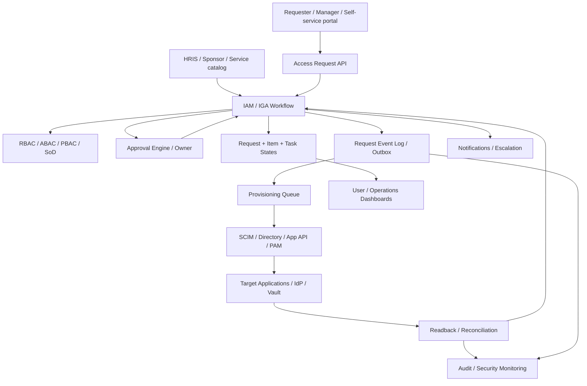
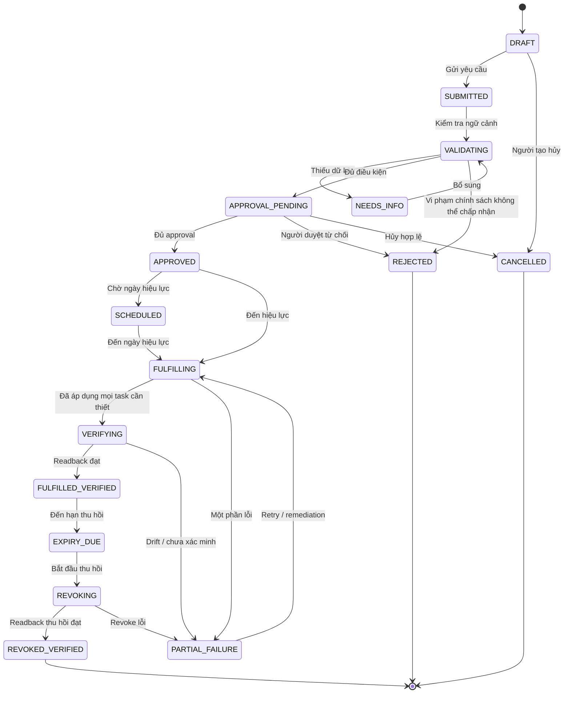
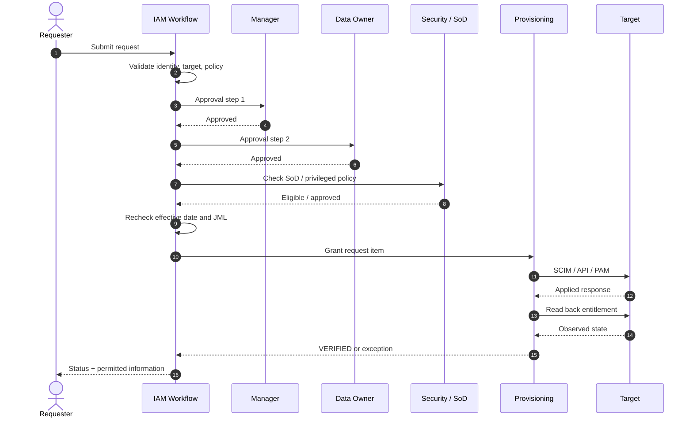
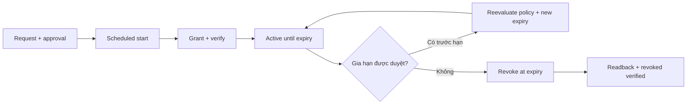

# Theo dõi request cấp quyền truy cập trong vòng đời danh tính IAM

## 1. Theo dõi access request là gì?

**Theo dõi access request (access request tracking)** là quá trình ghi nhận và quan sát **trạng thái, người chịu trách nhiệm, lịch sử phê duyệt, tiến độ thực thi và kết quả xác minh** của một yêu cầu cấp, thay đổi, gia hạn hoặc thu hồi quyền truy cập. Mục tiêu không chỉ là cho người dùng biết “ticket đang ở đâu”, mà còn cung cấp bằng chứng rằng **quyền được xử lý đúng người, đúng tài nguyên, đúng chính sách và đúng thời điểm**.

Ví dụ: nhân viên Linh gửi yêu cầu được đọc báo cáo dự án P1. Quản lý đồng ý; chủ sở hữu dữ liệu phê duyệt; IAM gửi thao tác thêm nhóm qua SCIM; ứng dụng SaaS báo thành công; hệ thống đối soát thấy Linh thực sự có role `project_p1_viewer`. Những sự kiện đó **không xảy ra cùng lúc**, và mỗi mốc phải có trạng thái riêng.

Trong **Identity and Access Management (IAM)** theo mô hình **Joiner–Mover–Leaver (JML)**, một request có thể xuất hiện khi:

- **Joiner:** cấp quyền nền hoặc quyền theo dự án cho nhân viên mới.
- **Mover:** xin quyền mới khi thay vị trí, đồng thời gỡ quyền không còn cần.
- **Leaver:** yêu cầu thu hồi quyền, chấm dứt account, session và credential.
- **Ngoại lệ có hạn:** cấp quyền tạm thời phục vụ dự án, sự cố hay bàn giao.
- **Kiểm toán:** xác minh ai đề nghị, ai phê duyệt, quyền đã tồn tại bao lâu và khi nào bị thu hồi.

**Nguyên tắc trung tâm:** *Approved* không có nghĩa *Provisioned*; *Provisioned* không có nghĩa *Verified*; và *Expired* trong ticket không có nghĩa quyền thực tế đã bị thu hồi.

## 2. Tại sao cần theo dõi request theo từng bước?

Một phiếu ghi đơn giản `status=DONE` không đủ giải thích những tình huống như:

1. Quản lý phê duyệt nhưng chủ sở hữu tài nguyên chưa quyết định.
2. Các bên đã duyệt nhưng SCIM connector bị lỗi.
3. Connector báo HTTP 200 nhưng ứng dụng chưa cập nhật role.
4. Quyền được cấp ở hai hệ thống, còn hệ thống thứ ba timeout.
5. Request bị hủy nhưng job cấp quyền cũ vẫn chạy trong queue.
6. Người dùng đã nghỉ việc nhưng yêu cầu cấp quyền cũ bị retry.
7. Quyền tạm thời hết hạn song vẫn còn session/token và role local.

Một quy trình tracking tốt phải trả lời **năm câu hỏi**:

| Câu hỏi | Câu trả lời hệ thống cần có |
|---|---|
| **Ai yêu cầu?** | Requester, beneficiary, danh tính và nguồn có thẩm quyền |
| **Yêu cầu gì?** | Resource, application, entitlement, scope, thời điểm và lý do |
| **Ai được quyết định?** | Approver, policy, SoD, trạng thái phê duyệt |
| **Đang ở bước nào?** | Workflow state, từng target state, owner và SLA |
| **Đã có hiệu lực chưa?** | Trạng thái quyền thực tế và bằng chứng readback/reconciliation |

### 2.1. Trải nghiệm người dùng và kiểm soát bảo mật

Người yêu cầu cần thấy tiến độ dễ hiểu: `Đang chờ quản lý`, `Đang cấp quyền`, `Đang xác minh` hoặc `Cần bổ sung thông tin`. Đội IAM cần sâu hơn: target ID, event ID, retry count, connector error, expiry và policy version.

**Không nên hiển thị chi tiết bí mật nội bộ** như bearer token, password, session cookie, dữ liệu nhân sự nhạy cảm hoặc credential quản trị trong màn hình tracking.

## 3. Phân biệt request, approval, entitlement và task

Một access request thường chứa nhiều đối tượng logic.

| Khái niệm | Ý nghĩa | Ví dụ |
|---|---|---|
| **Request** | Ý định nghiệp vụ cần phê duyệt/thực hiện | “Cấp quyền xem báo cáo P1 cho Linh” |
| **Request item** | Một quyền hoặc đích cần xử lý | `reports-saas:project_p1_viewer` |
| **Approval** | Quyết định của người có thẩm quyền | Data owner đồng ý đến 30/11 |
| **Provisioning task** | Lệnh kỹ thuật thực thi quyền | SCIM PATCH add user vào Group P1 |
| **Entitlement assignment** | Quyền gán trong IAM hoặc hệ thống đích | Linh có role `project_p1_viewer` |
| **Effective access** | Quyền thực sự có thể sử dụng | API cho phép đọc báo cáo P1 |
| **Verification evidence** | Bằng chứng target có trạng thái mong đợi | GET membership + role readback |
| **Revocation task** | Lệnh chấm dứt quyền theo thời hạn/Leaver | Remove member và invalidate session |
| **Audit event** | Dấu vết bất biến tương đối của chuyển trạng thái | `APPROVED` lúc 09:20 bởi owner |

**Request là một luồng công việc; entitlement là trạng thái quyền.** Một người có thể có entitlement từ nhiều nguồn khác nhau, và một request được hủy không nhất thiết đồng nghĩa có thể xóa mọi quyền liên quan nếu quyền ấy còn căn cứ hợp lệ khác.

### 3.1. Một request có thể gồm nhiều quyền

Yêu cầu “tham gia dự án P1” có thể dẫn đến:

- Tài khoản ứng dụng quản lý dự án.
- Nhóm xem tài liệu.
- Role báo cáo chỉ đọc.
- Membership vào tenant hợp tác.
- Điều kiện MFA hoặc thiết bị phù hợp.

Mỗi target nên có **task/trạng thái riêng**, thay vì đánh dấu tất cả hoàn thành chỉ vì một API trả thành công.

## 4. Các loại request nên được phân loại

| Loại yêu cầu | Ý nghĩa | Điều tracking phải chú ý |
|---|---|---|
| **NEW_ACCESS** | Cấp quyền mới | Phê duyệt, ngày hiệu lực, phạm vi |
| **MODIFY_ACCESS** | Điều chỉnh role hoặc scope | Cấp mới **và** thu hồi phần cũ |
| **EXTEND_ACCESS** | Gia hạn quyền | Kiểm tra thời hạn, căn cứ mới và approval |
| **REVOKE_ACCESS** | Thu hồi một entitlement | Mốc vô hiệu hóa và xác minh |
| **DISABLE_ACCOUNT** | Khóa account | Không nhầm với delete và chấm dứt session |
| **RESTORE_ACCESS** | Khôi phục quyền hợp lệ | Kiểm tra nguyên nhân khóa, proofing, SoD |
| **TEMPORARY_PRIVILEGE** | Kích hoạt đặc quyền có hạn | PAM/JIT, MFA, approval, TTL |
| **EMERGENCY_ACCESS** | Truy cập khẩn cấp | Guardrail, giám sát và hậu kiểm |
| **BULK_ACCESS_CHANGE** | Thay đổi hàng loạt | Danh sách tác động, batch progress, blast radius |
| **ACCESS_REVIEW_REMEDIATION** | Sửa quyền theo access review | Bằng chứng reviewer, thực thi/reconciliation |

Không gộp mọi hành động thành `GRANT`: **yêu cầu thu hồi** có độ ưu tiên và quy tắc SLA khác với yêu cầu cấp mới.

## 5. Các bên tham gia và trách nhiệm

| Vai trò | Trách nhiệm |
|---|---|
| **Requester** | Tạo yêu cầu, cung cấp lý do và theo dõi tiến độ |
| **Beneficiary** | Người hoặc workload thực sự nhận/mất quyền |
| **Manager** | Xác nhận nhu cầu công việc theo phạm vi được ủy quyền |
| **Resource/Data Owner** | Quyết định quyền vào tài nguyên mình sở hữu |
| **Application Owner** | Bảo đảm khả năng provision, kiểm tra role tại đích |
| **IGA/IAM Workflow** | Điều phối policy, phê duyệt, SoD và trạng thái tổng |
| **Security/PAM** | Phê duyệt hoặc giám sát quyền đặc quyền, ngoại lệ |
| **Provisioning Connector** | Thực thi lệnh đến SCIM/API/directory/PAM |
| **Reconciliation Service** | Đọc trạng thái thực tế, xác minh sai lệch |
| **Auditor** | Kiểm tra bằng chứng và thời hạn theo quyền đọc được cấp |

### 5.1. Requester có thể khác beneficiary

Một quản lý có thể xin quyền cho nhân viên; một service owner có thể xin quyền cho bot. Mọi record cần phân biệt:

- `requested_by`: ai gửi yêu cầu.
- `subject_id` hoặc `beneficiary_id`: ai sẽ nhận hoặc mất quyền.
- `approved_by`: ai ra quyết định.
- `executed_by` hoặc `connector_id`: tác vụ nào thực thi.

**Không suy ra người gửi yêu cầu chính là người nhận quyền.** Nhầm lẫn này có thể dẫn đến cấp quyền sai hoặc che khuất trách nhiệm phê duyệt.

## 6. Kiến trúc theo dõi request trong IAM



**Các khối là vai trò logic**; một sản phẩm IGA có thể tích hợp portal, workflow và connector. Điều quan trọng là **event có liên kết được với một yêu cầu duy nhất** và trạng thái không bị thay bởi thao tác đồng thời không kiểm soát.

### 6.1. Ba lớp trạng thái nên tách

1. **Workflow status:** yêu cầu đang chờ gì và ai chịu trách nhiệm.
2. **Fulfillment status:** các tác vụ provision/revoke ở từng target đã làm đến đâu.
3. **Access status:** quyền thực tế có mặt/không còn, còn hạn hay chưa được xác minh.

Một dashboard có thể hiển thị nhãn thân thiện, nhưng **bên dưới không nên ép ba lớp này vào một boolean `approved` hoặc `done`**.

## 7. State machine cho access request

Không có một bộ tên trạng thái bắt buộc cho mọi hệ thống. Mô hình sau là **tham chiếu**, có thể điều chỉnh theo loại request và khả năng sản phẩm.



### 7.1. Phân biệt trạng thái kết thúc và trạng thái chưa đạt

| Trạng thái | Được kết luận gì? | Chưa được kết luận |
|---|---|---|
| `SUBMITTED` | Đã nhận yêu cầu | Có đủ thông tin hoặc quyền hợp lệ |
| `APPROVAL_PENDING` | Đang chờ người duyệt | Sẽ được chấp thuận |
| `APPROVED` | Đã đáp ứng chuỗi phê duyệt | Quyền đã cấp ở đích |
| `SCHEDULED` | Có kế hoạch thực hiện lúc hiệu lực | Quyền đã active |
| `FULFILLING` | Connector đang xử lý | Tất cả target đã áp dụng |
| `VERIFYING` | Đang đọc lại quyền | Đã có bằng chứng cuối |
| `FULFILLED_VERIFIED` | Quyền đã đúng theo phạm vi kiểm tra | Mọi token/phiên ở hệ thống khác đều đúng |
| `PARTIAL_FAILURE` | Có target/task lỗi hoặc chưa chứng minh được | Toàn request vô hiệu |
| `REVOKING` | Đang thu hồi | Quyền đã biến mất |
| `REVOKED_VERIFIED` | Thu hồi đạt theo phạm vi bằng chứng | Mọi hệ thống nằm ngoài phạm vi đã được xử lý |

### 7.2. Workflow cấp và workflow thu hồi không bắt buộc chung một state machine

Đối với yêu cầu `REVOKE_ACCESS` riêng, hành trình có thể là `SUBMITTED → VALIDATED → REVOKING → REVOKED_VERIFIED`, không cần đi qua `APPROVED` nếu **chính sách cho phép workflow thu hồi theo sự kiện có thẩm quyền**. Đặc biệt, Leaver khẩn không nên chờ phê duyệt cấp quyền thông thường.

Đây là **mô hình thiết kế**, không phải danh sách trạng thái chuẩn của SCIM hoặc ITSM.

## 8. Quy tắc chuyển trạng thái (transition invariants)

Một state machine tốt có các điều kiện không được vi phạm.

| Chuyển trạng thái | Điều kiện tối thiểu |
|---|---|
| `DRAFT → SUBMITTED` | Beneficiary, target, entitlement, lý do và phạm vi hợp lệ |
| `SUBMITTED → VALIDATING` | Đã xác định requester/identity và tenant |
| `VALIDATING → APPROVAL_PENDING` | Dữ liệu và policy đủ để quyết định, không có blocker |
| `APPROVAL_PENDING → APPROVED` | Tất cả approval bắt buộc hợp lệ và còn hiệu lực |
| `APPROVED → FULFILLING` | Ngày hiệu lực, trạng thái JML, policy và SoD vẫn hợp lệ |
| `FULFILLING → VERIFYING` | Các task đã có kết quả áp dụng để readback |
| `VERIFYING → FULFILLED_VERIFIED` | Đúng entitlement/subject/tenant ở các target cần thiết |
| `EXPIRY_DUE → REVOKING` | Đến hạn hoặc có lệnh thu hồi hợp lệ |
| `REVOKING → REVOKED_VERIFIED` | Quyền thực tế đã bị gỡ theo phạm vi kiểm tra |
| Bất kỳ grant pending → `CANCELLED/SUPERSEDED` | Không còn được phép thực hiện grant; job liên quan đã bị chặn |

**Không được nhảy từ `APPROVED` sang `FULFILLED_VERIFIED` chỉ vì một connector trả HTTP 200** nếu còn bước triển khai/đối soát chưa hoàn tất.

### 8.1. Tránh sử dụng status như cờ duy nhất

Một request có 3 target có thể có:

- Ứng dụng A: `VERIFIED`.
- Ứng dụng B: `RETRY_PENDING`.
- Ứng dụng C: `DENIED_BY_TARGET`.

Request tổng có thể là `PARTIAL_FAILURE`, nhưng vẫn cần **giữ thông tin từng target**, không ghi lại các task đã thành công thành “failed”.

## 9. Mô hình dữ liệu cần thiết để theo dõi request

Các bảng/tài nguyên logic thường gồm:

- **AccessRequest:** request ID, type, requester, beneficiary, justification, desired effective time, expiration.
- **RequestItem:** entitlement ID, target system, tenant, resource scope, cấp/thu hồi/gia hạn.
- **ApprovalStep:** cấp phê duyệt, owner, thời gian, quyết định, delegation.
- **ExecutionTask:** connector, operation, target object ID, retry count, last error.
- **VerificationRecord:** observed state, nguồn readback, thời điểm, phạm vi.
- **RequestEvent:** chuyển trạng thái có timestamp và actor/cause.
- **Exception:** blocker, owner, mức độ, hạn xử lý và kiểm soát bù.

### 9.1. Ví dụ request JSON

```json
{
  "request_id": "AR-2026-01042",
  "request_type": "NEW_ACCESS",
  "requested_by": "I-3201",
  "beneficiary_id": "I-1042",
  "source_relationship_id": "W-1042",
  "target_tenant": "tenant-company",
  "justification": "Xem báo cáo dự án P1",
  "submitted_at": "2026-11-23T02:15:00Z",
  "requested_effective_at": "2026-12-01T00:00:00Z",
  "expires_at": "2027-01-01T00:00:00Z",
  "overall_status": "APPROVAL_PENDING",
  "request_version": 3,
  "items": [
    {
      "item_id": "ARI-1042-1",
      "target_system": "reports-saas",
      "entitlement_id": "project-p1-viewer",
      "resource_scope": "project:P1",
      "operation": "GRANT",
      "approval_status": "PENDING",
      "fulfillment_status": "NOT_STARTED",
      "verification_status": "NOT_VERIFIED"
    }
  ]
}
```

Toàn bộ ID, tổ chức và mốc thời gian là **dữ liệu giả định**. Không đưa password, PAT, access token, refresh token, private key hoặc credential vào request payload/audit.

### 9.2. Phân biệt ba mốc thời gian

- `requested_effective_at`: khi quyền được yêu cầu bắt đầu có hiệu lực.
- `approved_at`: khi phê duyệt hoàn tất.
- `applied_at` và `verified_at`: khi đích báo áp dụng và lúc được xác minh.

Yêu cầu được duyệt ngày 23/11 nhưng có hiệu lực ngày 01/12 phải **giữ ở `SCHEDULED`**, không cấp role nghiệp vụ sớm.

## 10. Request ID, correlation ID và idempotency key

Theo dõi phân tán cần định danh đúng ở nhiều lớp.

| Định danh | Tác dụng | Ví dụ |
|---|---|---|
| `request_id` | Định danh yêu cầu nghiệp vụ | `AR-2026-01042` |
| `item_id` | Định danh từng entitlement trong yêu cầu | `ARI-1042-1` |
| `approval_step_id` | Xác định một cấp phê duyệt | `APR-511` |
| `task_id` | Phân biệt tác vụ tới một target | `TASK-799` |
| `correlation_id` | Nối log, event, connector và API | `trace-821` |
| `idempotency_key` | Hạn chế xử lý lặp do retry | `ar-1042-grant-reports-p1-v3` |
| `source_event_id` | Liên kết JML/HRIS/PAM event | `hr-mover-555` |
| `source_version` | Phát hiện nguồn dữ liệu đã đổi | `version=37` |
| `target_account_id` | Xác định account thực tế tại đích | `saas-user-1042` |
| `policy_version` | Căn cứ phê duyệt/authorization | `IAM-ACCESS-V8` |

### 10.1. Vì sao không dùng email làm khóa?

Email và username có thể đổi hoặc được tái sử dụng. Một người có thể có nhiều tài khoản SaaS, tenant và quan hệ hợp đồng. Dùng email làm idempotency key hoặc target ID duy nhất dễ gây **ghép nhầm người và cấp quyền cho tài khoản khác**.

Nên dựa vào **identity ID ổn định, target ID đã đối soát và tenant** theo hợp đồng dữ liệu.

### 10.2. Idempotency không đồng nghĩa chính sách luôn còn hiệu lực

Một tác vụ có idempotency key hợp lệ có thể đã **lỗi thời** sau Mover/Leaver. Trước retry grant cần kiểm tra trạng thái JML và policy **hiện tại**; không phát lại thao tác cũ chỉ vì key chưa được đánh dấu thành công.

## 11. Theo dõi giai đoạn gửi và kiểm tra đầu vào

Khi người dùng gửi request, hệ thống cần lưu **snapshot ban đầu** và kiểm tra đầu vào trước khi yêu cầu phê duyệt.

### 11.1. Dữ liệu tối thiểu

1. Requester và beneficiary đúng danh tính.
2. Entitlement/resource/tenant có trong catalogue được quản trị.
3. Loại hành động: grant, revoke, change, extend.
4. Lý do nghiệp vụ và nguồn quan hệ công việc.
5. Ngày bắt đầu/kết thúc phù hợp quy tắc.
6. Người/nhóm sở hữu quyền, luồng approver.
7. Điều kiện approval/SoD và giới hạn đặc quyền.
8. Chính sách áp dụng tại thời điểm gửi.

### 11.2. Khi dữ liệu thiếu

Một request có thể chuyển `NEEDS_INFO` với:

- Trường cần bổ sung.
- Người chịu trách nhiệm.
- Hạn phản hồi.
- Trạng thái SLA tạm dừng hay tiếp tục theo quy tắc.
- Lịch sử thay đổi và lý do.

**Không sửa ngầm entitlement hoặc tăng phạm vi request** khi bổ sung thông tin. Nếu request đổi từ `report:read` sang `report:admin`, phải **đánh giá lại policy và phê duyệt**.

## 12. Theo dõi validation: quyền có hợp lệ về chính sách không?

Validation trả lời “request có đủ điều kiện để đưa vào quy trình quyết định không?”, chưa phải phê duyệt cuối.

Kiểm tra thường gồm:

- Relationship status từ HRIS/VMS/sponsor.
- Mã tài khoản/tenant và liên kết identity chính xác.
- Entitlement có owner và scope hợp lệ.
- Quyền đã tồn tại hay chưa, có bị trùng grant không.
- Thời hạn yêu cầu và giới hạn tối đa.
- **RBAC/ABAC/PBAC:** role, project, tenant, loại tài nguyên.
- **Separation of Duties (SoD):** role hoặc giao dịch có xung đột không.
- Dữ liệu nhạy cảm, vai trò đặc quyền hoặc yêu cầu MFA/JIT.
- Đối tượng có bị khóa, bị thu hồi hoặc đã Leaver không.

### 12.1. Trùng quyền không nhất thiết là lỗi

Nếu người dùng đã có đúng entitlement từ **một assignment khác còn hiệu lực**, request mới có thể được xử lý thành `ALREADY_ENTITLED` hoặc liên kết như căn cứ bổ sung theo thiết kế. Không cấp trùng rồi coi đó là hoàn tất nếu **scope, expiry hoặc nguồn quyền** thực tế khác mong muốn.

### 12.2. Validation phải được đánh giá lại trước grant

Một request có thể được gửi khi nhân viên active, nhưng tới ngày cấp quyền người đó đã nghỉ việc. Không dùng **snapshot status tại thời điểm submit** để bỏ qua kiểm tra JML hiện hành.

## 13. Theo dõi approval theo nhiều cấp

Một request có thể cần approval từ quản lý, chủ sở hữu tài nguyên, bộ phận an ninh hoặc người phê duyệt đặc quyền.



### 13.1. Tuần tự và song song

- **Sequential approval:** quản lý quyết định trước, data owner quyết định sau.
- **Parallel approval:** nhiều owner cùng nhận; policy quyết định cần **tất cả**, một số hay một người của nhóm chấp thuận.
- **Conditional approval:** chỉ yêu cầu Security/PAM nếu role thuộc nhóm đặc quyền.
- **Delegated approval:** người được ủy quyền quyết định thay approver vắng mặt.

Đặc tả phải nêu rõ **ai được quyết định, ngưỡng cần đạt và khi nào một từ chối chấm dứt luồng**.

### 13.2. SoD và self-approval

Người yêu cầu quyền admin không nên tự phê duyệt cho chính mình nếu chính sách yêu cầu hai bên độc lập. Hệ thống phải kiểm tra danh tính thật của người duyệt, kể cả khi có delegation hoặc group approval; không chỉ so sánh tên hiển thị.

### 13.3. Approval có thời hạn

Một phê duyệt có thể hết giá trị nếu entitlement, beneficiary, tenant, scope hoặc rủi ro thay đổi. Nếu request được sửa đáng kể sau khi đã duyệt, cần **invalidate những approval liên quan và yêu cầu phê duyệt lại**, thay vì giữ `APPROVED` cho nội dung mới.

## 14. Ai đang giữ request và SLA của từng bước?

Một quy trình tracking cần xác định **current owner** và **deadline**. Ví dụ:

| Giai đoạn | Owner chính | SLA tham khảo cần cấu hình |
|---|---|---|
| Validation | IAM workflow hoặc team hỗ trợ | Thời gian từ submit đến có kết quả |
| Manager approval | Quản lý được chỉ định | Hạn quyết định theo chính sách |
| Resource owner approval | Data/Application owner | Hạn review quyền tài nguyên |
| Privileged review | Security/PAM | Đánh giá SoD/MFA/JIT |
| Provisioning | Connector/target owner | Thời gian áp dụng ở đích |
| Verification | Reconciliation owner | Thời gian đối soát sau cập nhật |
| Revocation | IAM/security và target owner | Thời gian quyền mất hiệu lực |
| Exception remediation | Owner được gán | Hạn khắc phục theo mức rủi ro |

**Các giá trị SLA phải do tổ chức phê duyệt**; không có một con số tiêu chuẩn áp dụng cho mọi access request. Thường phải phân biệt cấp quyền thông thường với **thu hồi Leaver hoặc quyền đặc quyền rủi ro cao**.

### 14.1. Các mốc đồng hồ

- `submitted_at`: bắt đầu theo dõi.
- `stage_entered_at`: bước hiện tại bắt đầu.
- `due_at`: hạn hoàn thành.
- `paused_at` và `pause_reason`: nếu được phép tạm dừng.
- `escalated_at`: đã chuyển cấp.
- `completed_at`: kết thúc theo định nghĩa cụ thể.

Không **tự dừng SLA** mỗi khi gán `NEEDS_INFO` để làm đẹp chỉ số. Phải có điều kiện tạm dừng và audit rõ ràng.

## 15. Nhắc việc, escalation và tránh spam

Khi request bị giữ quá lâu, workflow có thể:

1. Gửi nhắc việc tới approver hiện tại.
2. Nếu quá hạn, thông báo người quản lý của approver hoặc owner được ủy quyền.
3. Với quyền đặc quyền/Leaver, cảnh báo đến Security hoặc incident queue.
4. Có cơ chế delegation/backup approver đã được phê duyệt.
5. Ghi mốc escalation và người chịu trách nhiệm mới.

### 15.1. Escalation không phải auto-approve

**Quá hạn không đồng nghĩa được phê duyệt.** Với access request cấp quyền, mặc định an toàn là **không cấp** nếu thiếu approval bắt buộc. Tổ chức có thể quy định các ngoại lệ, nhưng phải có policy cụ thể, owner và audit.

### 15.2. Thông báo theo sự kiện có ích

| Sự kiện | Người nhận | Thông tin phù hợp |
|---|---|---|
| `REQUEST_SUBMITTED` | Requester/beneficiary | ID, phạm vi, trạng thái ban đầu |
| `APPROVAL_REQUIRED` | Approver | Mục đích, role, scope, hết hạn |
| `NEEDS_INFO` | Requester | Trường thiếu, owner, deadline |
| `APPROVED` | Requester | Đã duyệt, **chưa hứa có quyền** |
| `PROVISIONING_FAILED` | IAM/target owner | Task ID, lỗi đã redacted, mức ưu tiên |
| `ACCESS_VERIFIED` | Beneficiary | Đích/role có hiệu lực và hạn dùng |
| `EXPIRING_SOON` | Beneficiary/owner | Ngày hết hạn và cách gia hạn |
| `REVOCATION_FAILED` | Security/owner | Quyền có thể còn sống, cần xử lý ngay |

Tránh gửi người dùng những log lỗi chứa secret hoặc account ID nội bộ không cần thiết.

## 16. Approved khác Provisioned và Verified

Đây là phân biệt quan trọng nhất trong theo dõi access request.

```text
SUBMITTED
   |
   v
APPROVED                  <- Business/SoD/owner decision
   |
   v
PROVISIONING              <- Connector đang gửi action
   |
   v
APPLIED                   <- Target xác nhận thay đổi
   |
   v
VERIFIED                  <- Readback/authorization evidence
   |
   v
ACTIVE_UNTIL_EXPIRY       <- Quyền có hiệu lực trong thời hạn
   |
   v
REVOKE_REQUESTED
   |
   v
REVOKED_VERIFIED
```

### 16.1. HTTP thành công chưa đủ

Một SCIM PATCH cập nhật Group trả `200 OK` hoặc `204 No Content` theo khả năng provider chỉ chứng minh **API đã xử lý yêu cầu theo hợp đồng của nó**. Quyền thực tế có thể còn phụ thuộc role mapping, local group, session cache, token đã phát hành và đồng bộ bất đồng bộ.

### 16.2. Không thông báo “đã có quyền” quá sớm

Khi `APPROVED`, portal nên thông báo **“Yêu cầu đã được duyệt, đang thực hiện cấp quyền”**. Chỉ sau `VERIFIED` trong phạm vi xác định mới nên thông báo **“Đã cấp quyền vào hệ thống X”**. Nếu còn target chưa đạt, hiển thị rõ phần hoàn thành và phần chưa.

## 17. Theo dõi các task thực thi ở nhiều target

Một request có thể có nhiều task; cần giữ **status, attempts và evidence riêng cho từng task**.

Ví dụ yêu cầu vào dự án:

| Task | Đích | Thao tác | Trạng thái | Lưu ý |
|---|---|---|---|---|
| T1 | Directory | Add group `project-p1` | VERIFIED | Đọc lại membership |
| T2 | Report SaaS | Gán role `p1-viewer` | APPLIED | Chưa đọc được role |
| T3 | Wiki | Add viewer | RETRY_PENDING | API timeout |
| T4 | IdP | Đánh giá MFA policy | NOT_APPLICABLE | Không cần thay đổi IdP |

Trạng thái request tổng: **PARTIALLY_FULFILLED / VERIFYING** tùy mô hình. Không đánh dấu DONE cho cả request chỉ vì T1 thành công.

### 17.1. Trạng thái task khuyến nghị

```text
QUEUED -> DISPATCHED -> ACKNOWLEDGED -> APPLIED -> VERIFYING -> VERIFIED
                                  |             |               |
                                  v             v               v
                               FAILED       RETRY_PENDING     DRIFT_FOUND
```

Với thao tác có hiệu lực theo lịch, thêm `SCHEDULED`. Với job bị hủy bởi Leaver/policy mới, thêm `SUPERSEDED` và đảm bảo **không được retry**.

### 17.2. Tách retry count khỏi trạng thái kinh doanh

Một task có `attempts=5` vẫn có thể hoàn tất thành công sau readback. Tuy nhiên cần lưu **lịch sử các lần thử**, response đã redacted và lý do retry để điều tra độ tin cậy của connector.

## 18. SCIM provisioning và readback

SCIM 2.0 thường hỗ trợ thao tác với tài nguyên `Users`, `Groups`; khả năng cụ thể tùy provider. Tracking phải phân biệt request IAM với thao tác SCIM.

### 18.1. Ví dụ cấp quyền bằng Group membership

Một task được duyệt cấp `project-p1-viewer` cho user `target-user-1042` có thể dùng:

```http
PATCH /scim/v2/Groups/group-project-p1 HTTP/1.1
Host: scim.example.org
Authorization: Bearer <redacted-token>
Content-Type: application/scim+json

{
  "schemas": ["urn:ietf:params:scim:api:messages:2.0:PatchOp"],
  "Operations": [
    {
      "op": "add",
      "path": "members",
      "value": [
        { "value": "target-user-1042" }
      ]
    }
  ]
}
```

Đây chỉ là ví dụ khi provider hỗ trợ `Groups` và PATCH. API có thể trả lỗi, phản hồi bất đồng bộ hoặc cập nhật không làm xuất hiện permission ngay tại ứng dụng.

### 18.2. Readback cần kiểm tra gì?

- Group đúng `group-project-p1`, tenant đúng.
- Member đúng **target user ID**, không chỉ email.
- Mapping group → role ứng dụng còn hợp lệ.
- Account chưa bị disable hoặc hết quyền theo policy.
- Phạm vi `project:P1` và expiry không bị rộng hơn yêu cầu.
- Nếu có quyền local ngoài SCIM, cần đối soát nguồn đó.

**Không giả định `GET /Groups` luôn đủ chứng minh quyền ứng dụng:** một số SaaS lưu role trực tiếp hoặc dùng cache riêng.

### 18.3. Thu hồi theo đúng member

```json
{
  "schemas": ["urn:ietf:params:scim:api:messages:2.0:PatchOp"],
  "Operations": [
    {
      "op": "remove",
      "path": "members[value eq \"target-user-1042\"]"
    }
  ]
}
```

Tránh dùng `remove path=members` khi chỉ cần gỡ một người vì có thể tác động cả danh sách thành viên. Khi timeout, **đọc lại trạng thái** trước khi retry.

## 19. Tracking trong Joiner lifecycle

**Joiner** thường kết hợp access request với auto-provisioning theo role nền.

Quy trình minh họa:

1. HRIS phát `JOINER_APPROVED` với `identity_id` và ngày bắt đầu.
2. IAM xác minh danh tính, tạo account hoặc đối chiếu account đã tồn tại.
3. IGA tính role nền từ assignment, nguồn và policy hiện hành.
4. Những role mặc định hợp lệ có thể dùng **policy-driven approval** theo quy định; role nhạy cảm cần approval riêng.
5. Request/task được lập cho từng ứng dụng.
6. Nếu chưa tới ngày hiệu lực, request ở `SCHEDULED`.
7. Đến ngày hợp lệ, connector provision tài khoản và entitlement.
8. IdP/MFA hỗ trợ xác thực; ứng dụng thực thi quyền của chính nó.
9. Readback và reconciliation xác minh quyền mới.
10. Người dùng được thông báo **đã có quyền** khi kết quả thực sự đạt.

### 19.1. Không cấp quyền vì pre-provision

Một account được tạo sớm để chuẩn bị email/thiết bị không tự động được truy cập dữ liệu production. Tracking phải tách **account created**, **account enabled**, **role granted** và **access verified**.

### 19.2. Joiner bị hủy

Nếu ứng viên không gia nhập, task cấp quyền chưa chạy phải bị đánh dấu `SUPERSEDED/CANCELLED`. Nếu một account đã được provision, cần workflow thu hồi theo quy tắc. Không cho job cũ retry rồi cấp lại quyền sau hủy.

## 20. Tracking trong Mover lifecycle

**Mover** là thay đổi vai trò/phòng ban/dự án, có thể đòi **cấp quyền mới và thu hồi quyền cũ** trong cùng một tiến trình.

Ví dụ người dùng đổi từ dự án P1 sang P2:

| Giai đoạn | Trước | Sau |
|---|---|---|
| Assignment HR | P1 | P2 |
| Desired role | `p1-viewer` | `p2-viewer` |
| Grant task | Không | Thêm `p2-viewer` nếu được duyệt |
| Revoke task | Không | Gỡ `p1-viewer` nếu hết căn cứ |
| SoD | Vai trò P1 | Kiểm tra quyền chồng lấn P1/P2 |
| Verification | Quyền P1 trước đây | P2 hiện hữu; P1 vắng mặt nếu phải thu hồi |

### 20.1. Không đánh dấu Mover xong khi chỉ grant thành công

Một Mover cần **hai chiều**:

```text
desired_roles = roles_from_current_valid_assignments(identity)
observed_roles = read_effective_roles_across_targets(identity)

grant_candidates = desired_roles - observed_roles
revoke_candidates = observed_roles - desired_roles
```

Nếu P2 đã cấp nhưng P1 còn tồn tại trái policy, request phải giữ trạng thái **PARTIAL_FAILURE/REVOKE_PENDING**. Không ghi hoàn thành chỉ vì người dùng đã mở được ứng dụng mới.

### 20.2. Handover có thời hạn

Nếu nghiệp vụ cho phép giữ quyền P1 thêm ba ngày, cần có **ngoại lệ được phê duyệt, `expires_at`, owner và task revoke đã lập lịch**. Tracking phải theo tới khi **gỡ quyền được xác minh**, không kết thúc vĩnh viễn sau approval.

## 21. Tracking trong Leaver lifecycle

**Leaver** là trường hợp tracking gắn trực tiếp với rủi ro **quyền truy cập tồn dư**. Một request khóa tài khoản có thể thành công ở IdP nhưng vẫn còn session SaaS, PAT, SSH key hoặc role gán trực tiếp.

### 21.1. Các task thường cần theo dõi

1. Nhận sự kiện Leaver có thẩm quyền và thời điểm hiệu lực.
2. Disable IdP hoặc chặn xác thực mới.
3. Thu hồi IdP session, refresh token theo khả năng.
4. Disable/deprovision tài khoản đích qua SCIM/API.
5. Gỡ group, role, direct entitlement.
6. Xử lý phiên local, PAT, API key, SSH key, PAM lease.
7. Kiểm tra tài khoản dịch vụ do người đó quản lý để **bàn giao owner**, không tự xóa workload.
8. Đối soát quyền tại các target quan trọng.
9. Mở incident/exception đối với quyền chưa thể thu hồi trong SLA.

### 21.2. Ưu tiên thu hồi không phụ thuộc approval cấp quyền

Đối với Leaver được xác minh, IAM thường có thể thực hiện **sự kiện lifecycle được ủy quyền** mà không đợi chuỗi phê duyệt cấp role thông thường. Dù vậy, vẫn phải kiểm tra **đúng identity, quan hệ và scope**: người có hợp đồng A kết thúc nhưng hợp đồng B còn hiệu lực có thể cần giữ các quyền thuộc B.

### 21.3. Khi nào được đánh dấu Leaver verified?

Khi đã có bằng chứng phù hợp theo từng phạm vi kiểm soát. Ví dụ:

- `IdP account disabled: VERIFIED`.
- `SaaS role removed: VERIFIED`.
- `PAM session terminated: VERIFIED`.
- `Legacy SSH key removal: UNVERIFIED`.

Yêu cầu tổng **chưa hoàn tất toàn bộ** nếu đường truy cập quan trọng vẫn `UNVERIFIED`; cần owner, deadline và kiểm soát bù.

## 22. Request thời hạn ngắn, gia hạn và expiration

Một quyền tạm thời cần được theo dõi xuyên suốt **khi cấp lẫn khi thu hồi**.

### 22.1. Vòng đời quyền có hạn



### 22.2. Không tự gia hạn

Nếu người dùng xin kéo dài quyền, quy trình `EXTEND_ACCESS` cần xét:

- Quan hệ công việc còn hiệu lực.
- Nhu cầu thật và thời gian cần thiết.
- Tài nguyên/role có đổi không.
- Người phê duyệt còn thẩm quyền không.
- SoD, MFA, mức rủi ro hiện hành.
- Hạn tối đa và chính sách JIT/PAM.

**Quyền hết hạn mà không có quyết định gia hạn hợp lệ phải được thu hồi theo policy.**

### 22.3. Expiry trong request khác expiry ở target

Một trường `expires_at` trong IAM không bảo đảm ứng dụng SaaS có hỗ trợ expiry native. Khi target không hỗ trợ, IAM cần **lập tác vụ revoke**, giám sát và đọc lại kết quả. Nếu timer/job thất bại, vẫn phải phát hiện qua reconciliation.

## 23. Request đặc quyền và emergency access

Yêu cầu `production_admin` hoặc `database_owner` có thể cần:

- Approval nhiều bên theo SoD.
- Step-up MFA hoặc xác thực phishing-resistant.
- PAM/JIT thay vì standing privilege.
- Ticket/mục đích sửa lỗi và phạm vi host/DB.
- TTL ngắn, session brokering/recording theo chính sách.
- Cảnh báo và hậu kiểm.
- Tracking tới **khi quyền/credential/phiên mất hiệu lực**.

### 23.1. Mốc tracking cho PAM

| Mốc | Diễn giải |
|---|---|
| `ELIGIBILITY_APPROVED` | Người dùng đủ điều kiện xin quyền, chưa active |
| `CHECKOUT_REQUESTED` | Đã xin phiên/credential |
| `ACTIVATED` | Privilege thực sự được kích hoạt |
| `SESSION_OPENED` | Phiên truy cập bắt đầu |
| `SESSION_CLOSED` | Broker báo phiên kết thúc |
| `CREDENTIAL_ROTATED` | Secret đã được đổi ở đích theo cơ chế |
| `PRIVILEGE_REVOKED_VERIFIED` | Quyền thực tế đã bị gỡ hoặc hết hiệu lực được kiểm tra |

**Session closed không tự động nghĩa credential tĩnh từng bị tiết lộ đã mất hiệu lực.** Cần rotation/target revocation khi thích hợp.

### 23.2. Break-glass

Emergency access phải dùng đường **được quản trị trước**, có giới hạn, audit, cảnh báo và review sau sự cố. Không biến việc “đang gấp” thành **auto-approve mọi quyền admin** hoặc bỏ điều kiện nhận dạng subject.

## 24. Hủy request, thay đổi request và superseded job

Người gửi có thể muốn hủy hoặc sửa request khi nó đang ở các giai đoạn khác nhau.

| Giai đoạn | Hành vi cần xem xét |
|---|---|
| `DRAFT` | Có thể sửa/hủy theo quyền người tạo |
| `APPROVAL_PENDING` | Hủy có thể chấm dứt approval chưa hoàn tất |
| `APPROVED/SCHEDULED` | Hủy phải chặn job grant đã lên lịch |
| `FULFILLING` | Có thể đã cấp một phần; cần kiểm tra và tạo revoke bù |
| `FULFILLED_VERIFIED` | Không chỉ đặt ticket CANCELLED; cần request thu hồi |
| `REVOKING` | Không được bỏ dở thu hồi do người dùng bấm “Cancel” trái policy |

### 24.1. Hủy request khác hoàn tác quyền

Nếu người dùng hủy sau khi SCIM đã thêm group, hệ thống phải xác định **căn cứ quyền còn tồn tại hay không**. Nếu quyền không còn lý do hợp lệ, tạo task revoke và verify. Nếu quyền thuộc request khác vẫn hợp lệ, không tự xóa nhầm.

### 24.2. Versioning thay đổi nội dung

Nếu requester đổi entitlement từ viewer sang admin:

- Tăng `request_version`.
- Ghi lịch sử những field đã thay đổi.
- Invalidate approval cũ không còn phù hợp.
- Chạy lại validation/SoD.
- Hủy task grant của version cũ nếu chưa thực thi.
- Không coi một request mới là đã được approval dựa trên ID cũ.

## 25. Retry, idempotency và event đến sai thứ tự

Hệ thống IAM gồm nhiều queue và API nên có thể gặp **timeout, duplicate event và event out-of-order**.

### 25.1. Ví dụ stale grant sau Leaver

```mermaid
sequenceDiagram
    autonumber
    participant HR as HRIS
    participant IAM as IAM Workflow
    participant Q as Task Queue
    participant APP as Target SaaS
    HR->>IAM: Joiner approved, version 10
    IAM->>Q: GRANT role P1, source v10
    Q->>APP: SCIM add member
    APP--xQ: Timeout / unknown
    HR->>IAM: Leaver, version 11
    IAM->>APP: Revoke access / disable
    IAM->>Q: Mark grant v10 SUPERSEDED
    Q->>IAM: Retry grant v10?
    IAM-->>Q: DENY retry; desired state changed
    IAM->>APP: GET and reconcile
    APP-->>IAM: Observed entitlement
    IAM->>IAM: VERIFIED or escalation
```

### 25.2. Retry an toàn cần gì?

1. **Idempotency key** xác định cùng một task, tránh gửi lặp không cần.
2. **Source version** để nhận ra sự kiện cũ.
3. **Policy version và desired state hiện hành** để quyết định có còn được thực thi không.
4. **Readback trước retry** khi timeout không rõ request đã áp dụng hay chưa.
5. Backoff có jitter, giới hạn lần thử và thời hạn.
6. Quản lý trạng thái `RETRY_PENDING`, `FAILED`, `SUPERSEDED`.
7. Không cấp lại quyền sau Leaver chỉ vì một task cũ còn trong queue.
8. Audit cho lần thử và kết quả, không chứa credential.

### 25.3. Phân biệt retry kỹ thuật và mở lại phê duyệt

Một retry API cho **request đã được duyệt còn hợp lệ** có thể không cần người dùng gửi lại đơn. Nhưng nếu scope/role/beneficiary đã thay đổi, phải **đánh giá lại** theo chính sách, không giả định approval cũ vẫn có giá trị.

## 26. Event log và trạng thái tổng hợp

Trong các hệ thống lớn, có thể sử dụng **event log có kiểm soát** để lưu mọi chuyển trạng thái rồi tính **current state** từ lịch sử.

Ví dụ chuỗi sự kiện:

```text
2026-11-23T02:15Z REQUEST_SUBMITTED
2026-11-23T02:16Z REQUEST_VALIDATED
2026-11-23T02:20Z MANAGER_APPROVED
2026-11-23T02:28Z DATA_OWNER_APPROVED
2026-12-01T00:00Z PROVISIONING_STARTED
2026-12-01T00:00Z TARGET_CHANGE_APPLIED
2026-12-01T00:01Z TARGET_READBACK_VERIFIED
2027-01-01T00:00Z EXPIRY_TRIGGERED
2027-01-01T00:00Z REVOCATION_STARTED
2027-01-01T00:01Z REVOCATION_VERIFIED
```

### 26.1. Không ghi đè mất lịch sử

Nếu admin đổi status từ `FAILED` sang `VERIFIED` mà không lưu ai đổi, vì sao và có bằng chứng gì, hệ thống **không đủ khả năng kiểm toán**. Nên ghi event/state transition có:

- Actor hoặc service identity.
- Transition trước/sau.
- Timestamp và correlation ID.
- Policy/source version.
- Lý do hoặc error code đã redacted.
- Tham chiếu đến evidence và approval.

### 26.2. Event log phải chống chỉnh sửa trái phép

Tùy yêu cầu kiểm toán, có thể dùng append-only storage, quyền tách biệt, retention và khả năng phát hiện sửa đổi. Không cần khẳng định một event store cụ thể là “bất biến tuyệt đối”; trọng tâm là **bảo vệ integrity, truy vết lịch sử và khôi phục đúng trạng thái**.

## 27. Concurrency: hai người cùng sửa request

Có thể xảy ra:

- Manager phê duyệt ngay khi requester hủy.
- Data owner từ chối trong khi admin đang override.
- Leaver đến đúng lúc worker chuẩn bị grant.
- Hai connector cùng thêm/gỡ một group.
- Một request extension đến khi revoke job vừa bắt đầu.

### 27.1. Optimistic concurrency

Một request có thể có `request_version` hoặc revision number. Khi xử lý transition, chỉ chấp nhận cập nhật nếu version còn như đã đọc.

```text
transition(requestId, expectedVersion, nextState):
    current = loadRequest(requestId)

    if current.version != expectedVersion:
        return CONFLICT_RETRY_WITH_FRESH_STATE

    if not allowedTransition(current.state, nextState):
        return INVALID_TRANSITION

    if nextState grantsAccess:
        assertCurrentRelationshipAndPolicy()

    saveStateAndOutboxAtomically(current, nextState)
```

Đây là **mã giả**. Hệ thống thật cần transaction boundary, xử lý event publication, uniqueness và chống double-fulfillment.

### 27.2. Transactional outbox

Nếu database ghi request `APPROVED` nhưng publish event cấp quyền thất bại, workflow có thể đứng yên. **Transactional outbox** là một phương án lưu state change và outbox event trong cùng transaction, rồi publisher gửi event có retry, nhằm giảm mất đồng bộ.

Outbox **không tạo exactly-once end-to-end** với SCIM/SaaS. Connector vẫn phải xử lý duplicate và idempotency.

## 28. Eventual consistency và trạng thái không rõ

Một target có thể cập nhật bất đồng bộ, IdP đồng bộ group chậm, hoặc API trả timeout sau khi đã áp lệnh.

### 28.1. Trạng thái UNKNOWN không phải FAILED

- `UNKNOWN`: chưa biết kết quả tại đích.
- `FAILED`: đã có bằng chứng thao tác không thể áp dụng hoặc trạng thái sai.
- `APPLIED`: đích báo áp dụng.
- `VERIFIED`: có readback/bằng chứng phù hợp.

**Không lập tức retry vô hạn sau UNKNOWN**, vì có thể làm trùng grant hoặc tạo nhiều credential/token. Cần đọc lại và kiểm tra target ID.

### 28.2. Đặt khoảng chờ theo năng lực đích

Nếu SCIM provider cập nhật role sau một độ trễ, IAM có thể **poll readback với backoff và deadline** theo SLA. Không quy định cố định “chờ 5 giây là VERIFIED” nếu chưa có bằng chứng.

### 28.3. Readback không làm ảnh hưởng production

Không nên thử quyền `invoice:approve` bằng cách thực hiện **phê duyệt một hóa đơn thật**. Có thể dùng API readback entitlement, môi trường kiểm thử hoặc kiểm tra quyền dạng không gây side effect nếu target hỗ trợ. Đối với action nguy hiểm, test theo quy trình an toàn đã duyệt.

## 29. Reconciliation: từ request đến quyền hiệu lực

Reconciliation so sánh **desired access** với **observed access** theo nguồn và policy.

```text
Desired:
  I-1042 -> project-p1-viewer until 2027-01-01
  I-1042 -> no production_admin

Observed:
  reports-saas -> project-p1-viewer PRESENT
  cloud-console -> production_admin PRESENT

Result:
  reports-saas item = VERIFIED
  cloud-console = UNEXPECTED_ENTITLEMENT
  open security remediation
```

### 29.1. Không chỉ kiểm tra request của mình

Một người có thể có quyền ngoài request do:

- Direct grant tại SaaS.
- Nested group.
- Role còn sót sau Mover.
- Tài khoản guest ở tenant khác.
- PAT hoặc API key.
- Credential đặc quyền trong vault.
- Mapping RBAC/ABAC từ nhóm động.

Reconciliation nên phát hiện **quyền thực tế không có căn cứ** cả khi không có request mới nào được gửi.

### 29.2. Thu hồi không được xóa quyền còn căn cứ khác

Nếu Linh có `project-p1-viewer` từ **hai assignment hợp lệ**, hết hạn một request không nhất thiết đồng nghĩa phải gỡ toàn bộ role. IAM cần đánh giá **toàn bộ nguồn quyền hiện hành**, nhất là khi entitlement được hợp nhất thành một membership.

## 30. Theo dõi trạng thái tài khoản và session ngoài request

**Theo dõi request cấp role** không chỉ là kiểm tra một group. Quyền sử dụng ứng dụng còn chịu ảnh hưởng:

| Thành phần | Có thể ảnh hưởng thế nào |
|---|---|
| **IdP session** | Người dùng đã xác thực, có thể đăng nhập SSO không hỏi lại |
| **Application session** | Cookie/session local có thời hạn riêng |
| **OIDC access/refresh token** | Có thể gọi API hoặc gia hạn token theo policy |
| **SAML assertion** | Đã dùng để thiết lập phiên tại SP |
| **RBAC local role** | Có thể còn dù group IdP đã gỡ |
| **ABAC attributes** | Thuộc tính dự án/tenant có thể chậm cập nhật |
| **PAM lease** | Đặc quyền tạm thời có thời hạn và cơ chế thu hồi riêng |
| **API key/PAT** | Có thể không phụ thuộc phiên SSO |
| **SSH key** | Có thể còn trên host sau khi account IdP khóa |

**Disable IdP không tự động hủy mọi application session**, và SCIM PATCH không phải giao thức thu hồi token. Với Leaver hoặc quyền nhạy cảm, phải theo dõi **đúng loại credential và phạm vi revocation**.

## 31. Audit trail và bằng chứng để truy vết

Một request hoàn chỉnh nên cho phép kiểm toán đi từ **lý do nghiệp vụ → policy/approval → tác vụ → trạng thái đích → thời điểm thu hồi**.

### 31.1. Metadata audit gợi ý

| Trường | Tác dụng |
|---|---|
| `request_id`, `item_id`, `task_id` | Liên kết request đến thao tác kỹ thuật |
| `actor_id`, `beneficiary_id` | Ai quyết định/được cấp |
| `target_system`, `target_account_id` | Tài khoản và đích |
| `entitlement_id`, `resource_scope` | Quyền và phạm vi |
| `event_type`, `from_state`, `to_state` | Chuyển trạng thái |
| `event_time`, `effective_at`, `expires_at` | Mốc nghiệp vụ và kỹ thuật |
| `policy_version`, `source_version` | Căn cứ quyết định |
| `approval_id`, `approver_id` | Bằng chứng approval |
| `connector_operation_id` | Liên kết thao tác tới API/queue |
| `verification_ref`, `verified_at` | Readback và phạm vi kiểm chứng |
| `error_code`, `exception_owner` | Theo dõi lỗi và người chịu trách nhiệm |

### 31.2. Ví dụ audit event

```json
{
  "event_id": "ARE-2026-0132",
  "request_id": "AR-2026-01042",
  "item_id": "ARI-1042-1",
  "task_id": "TASK-799",
  "actor_type": "SCIM_CONNECTOR",
  "actor_id": "connector-reports",
  "event_type": "ENTITLEMENT_VERIFIED",
  "from_state": "VERIFYING",
  "to_state": "VERIFIED",
  "target_system": "reports-saas",
  "target_account_id": "saas-user-1042",
  "entitlement_id": "project-p1-viewer",
  "policy_version": "IAM-ACCESS-V8",
  "source_version": 37,
  "observed_state": "PRESENT",
  "verified_at": "2026-12-01T00:01:00Z",
  "correlation_id": "trace-821"
}
```

Không lưu full request headers có bearer token, session cookie hoặc dữ liệu nhạy cảm vào audit; chỉ lưu metadata/đối tượng tham chiếu đúng mục đích.

## 32. Dashboard theo dõi request

Một dashboard nên phục vụ **hai nhóm người dùng** khác nhau: người xin quyền và đội vận hành.

### 32.1. Dashboard self-service

Hiển thị theo quyền người xem:

- ID yêu cầu và mô tả quyền.
- Trạng thái dễ hiểu: chờ duyệt, đang thực hiện, cần bổ sung, thành công, có lỗi.
- Người/cấp phê duyệt hiện tại **trong phạm vi được phép hiển thị**.
- Mốc nộp, mốc dự kiến và ngày hết hạn.
- Hành động hợp lệ: bổ sung thông tin, hủy yêu cầu chưa cấp, xin gia hạn.
- Kết quả theo từng target nếu một request có nhiều đích.

### 32.2. Dashboard vận hành IAM

Có thể thêm:

- Hàng đợi theo trạng thái và target.
- SLA sắp quá hạn/quá hạn.
- Error code và retry count theo connector.
- Request `APPROVED` nhưng `NOT_PROVISIONED`.
- Task `APPLIED` nhưng `UNVERIFIED`.
- Quyền đã hết hạn nhưng chưa `REVOKED_VERIFIED`.
- Leaver có bất kỳ target `ACTIVE/UNKNOWN` nào.
- Approval delegation không hợp lệ hoặc SoD conflict.
- Version drift giữa nguồn HRIS/IGA và hệ thống đích.

**Không hiển thị secret, token hoặc thông tin nhạy cảm chỉ vì người dùng có quyền xem dashboard**.

### 32.3. Các bộ lọc hữu ích

`status`, `request_type`, `owner`, `target_system`, `tenant`, `risk_tier`, `overdue`, `expires_soon`, `JML_event_type` và `verification_status`.

## 33. KPI và SLO nên đo

| Chỉ số | Ý nghĩa |
|---|---|
| **Submission-to-decision time** | Thời gian từ gửi yêu cầu tới quyết định duyệt/từ chối |
| **Decision-to-provision time** | Thời gian từ approval đến target áp dụng |
| **Provision-to-verify time** | Thời gian chờ bằng chứng readback |
| **End-to-end fulfillment time** | Từ submit đến cấp quyền được xác minh |
| **Approval backlog** | Số request chờ approver theo thời gian |
| **SLA breach rate** | Tỷ lệ quá hạn theo loại request/rủi ro |
| **Partial failure count** | Số request nhiều target chưa hoàn tất |
| **Connector retry rate** | Mức độ lỗi kỹ thuật/tải của connector |
| **Unverified entitlement count** | Số quyền đã báo áp dụng nhưng thiếu bằng chứng |
| **Expiry revocation lag** | Độ trễ thu hồi sau ngày hết hạn |
| **Leaver residual-access age** | Thời gian quyền có thể còn tồn tại sau Leaver |
| **Reopened/superseded requests** | Yêu cầu cũ bị thay bởi trạng thái mới |
| **SoD denial rate** | Số yêu cầu bị chặn do xung đột |
| **Exception age** | Thời gian ngoại lệ còn chưa được xử lý |
| **User notification timeliness** | Mức độ kịp thời của thông tin tiến độ |

### 33.1. Không tối ưu sai mục tiêu

Rút ngắn thời gian phê duyệt bằng cách **auto-approve quyền đặc quyền** có thể làm KPI đẹp nhưng tăng rủi ro. Tương tự, đánh dấu `DONE` ngay sau HTTP 200 giúp fulfillment time giảm trên dashboard nhưng làm mất khả năng theo dõi quyền tồn dư.

SLO cần ưu tiên **quyền đúng, thu hồi đúng hạn và bằng chứng đáng tin** hơn số lượng ticket đóng.

## 34. API và event model để tra cứu trạng thái

Trong một nền tảng tích hợp, UI thường dùng API để truy vấn request. Ví dụ sau là **hợp đồng minh họa**, không phải endpoint chuẩn SCIM hay một API sản phẩm cụ thể.

### 34.1. Tra cứu request

```http
GET /api/access-requests/AR-2026-01042 HTTP/1.1
Host: iam.example.org
Authorization: Bearer <redacted-token>
Accept: application/json
```

Phản hồi có thể là:

```json
{
  "request_id": "AR-2026-01042",
  "overall_status": "PARTIAL_FAILURE",
  "beneficiary_id": "I-1042",
  "requested_by": "I-3201",
  "last_updated_at": "2026-12-01T00:08:00Z",
  "items": [
    {
      "item_id": "ARI-1042-1",
      "target": "reports-saas",
      "operation": "GRANT",
      "status": "VERIFIED",
      "verified_at": "2026-12-01T00:01:00Z"
    },
    {
      "item_id": "ARI-1042-2",
      "target": "wiki-saas",
      "operation": "GRANT",
      "status": "RETRY_PENDING",
      "retry_after": "2026-12-01T00:15:00Z"
    }
  ]
}
```

### 34.2. Event webhook

Hệ thống có thể phát một event `ACCESS_REQUEST_STATUS_CHANGED` để thông báo UI hoặc service khác. Event nên mang:

- `event_id` ổn định để consumer xử lý lặp.
- `request_id`, `item_id` và `request_version`.
- `from_state`, `to_state`, `occurred_at`.
- `correlation_id` và metadata tối thiểu.
- Chữ ký/xác thực nguồn, cơ chế replay protection theo thiết kế.

**Không cho webhook tự trở thành nguồn phê duyệt hoặc cấp quyền** nếu chưa xác minh nguồn, signature, event ordering và policy. Consumer phải kiểm tra version, không chấp nhận event cũ ghi đè state mới.

## 35. Mã giả bộ điều phối theo dõi fulfillment

Một cách suy nghĩ là mỗi task có target ID, desired state và nguồn có thẩm quyền.

```text
function processAccessTask(taskId):
    task = loadTask(taskId)
    request = loadRequest(task.requestId)

    if task.state in {VERIFIED, SUPERSEDED}:
        return

    identity = loadCurrentAuthoritativeIdentity(request.beneficiaryId)
    policy = loadCurrentPolicy()
    desired = computeDesiredEntitlement(identity, task.target, policy)

    if task.operation == GRANT and desired != PRESENT:
        markTask(task, SUPERSEDED, "No longer authorized")
        audit(task)
        return

    if task.operation == REVOKE and desired == PRESENT:
        verifyOtherValidAssignmentsBeforeRevocation()

    target = resolveVerifiedTargetAccount(task)
    if target is UNKNOWN:
        setException(task, "TARGET_MAPPING_UNCERTAIN")
        return

    observed = readTargetState(target, task.entitlementId)

    if observed == desired:
        markTask(task, VERIFIED)
        appendEvidence(task, observed)
        return

    if task.isDue and task.retryBudgetRemaining:
        dispatchOperationIdempotently(task, desired)
        markTask(task, VERIFYING)
    else:
        escalateToOwner(task)

    audit(task)
```

Đây là **mã giả giải thích nguyên tắc**, không phải code sẵn có để triển khai. Với `REVOKE` trong quy trình Leaver, cần ưu tiên chính sách an toàn và không để một nhiệm vụ thu hồi bị bỏ qua chỉ vì một phép tính desired state thiếu nguồn.

### 35.1. Những điều cần thêm khi triển khai thật

- Authorization của requester/approver/connector ở từng API.
- Transaction, optimistic concurrency và transactional outbox.
- Idempotency theo request item/target/operation/version.
- Retry/backoff, rate limit và dead-letter queue.
- Phân loại lỗi vĩnh viễn/tạm thời/không rõ kết quả.
- Bảo vệ chống duplicate event và stale grant.
- Quy tắc tổng hợp trạng thái theo nhiều task.
- Giám sát, audit và privacy phù hợp.

## 36. Ví dụ xuyên suốt: cấp quyền P1, chuyển dự án và nghỉ việc

Giả sử **Linh** có `identity_id=I-1042`, đang làm ở dự án P1; công ty dùng HRIS, IAM/IGA, IdP/SSO, SCIM và ReportCenter.

### 36.1. Gửi request

Quản lý gửi `AR-2026-01042` xin role `project-p1-viewer` cho Linh, có hiệu lực ngày 01/12 và hết hạn 01/01. Portal ghi request, beneficiary, người gửi, scope, lý do và thời điểm.

**Tracking:** `SUBMITTED → VALIDATING`.

### 36.2. Phê duyệt

Workflow kiểm tra Linh còn quan hệ hợp lệ, role có trong catalogue và không xung đột SoD. Manager và data owner duyệt.

**Tracking:** approval steps `APPROVED`, overall `SCHEDULED` vì chưa tới ngày hiệu lực.

### 36.3. Cấp quyền

Đúng ngày hiệu lực, IAM gửi SCIM PATCH thêm `target-user-1042` vào Group P1. Target xác nhận; reconciliation đọc lại role.

**Tracking:** `FULFILLING → VERIFYING → FULFILLED_VERIFIED`. Linh nhận thông báo quyền P1 đã sẵn sàng, gồm ngày hết hạn.

### 36.4. Mover

Đến giữa tháng, HRIS báo Linh chuyển sang P2. IAM tính quyền mới và thấy role P1 không còn căn cứ; tạo task revoke P1 và grant P2. API của Wiki P2 timeout sau khi có thể đã áp dụng.

**Tracking:** P1 `REVOKED_VERIFIED`, P2 ReportCenter `VERIFIED`, Wiki `UNKNOWN/RETRY_PENDING`. Mover vẫn **PARTIAL_FAILURE** đến khi kiểm tra xong.

### 36.5. Leaver

Linh nghỉ việc trước ngày quyền P2 hết hạn. IAM nhận Leaver, disable IdP, thu hồi các entitlement P2, xử lý token/phiên. Một SaaS legacy không có readback cho API key của Linh.

**Tracking:** phần IdP và SCIM `VERIFIED`; API key legacy `UNVERIFIED`, mở exception có owner và SLA. Không báo offboarding đã xác minh hoàn toàn.

### 36.6. Bài học

Một request có thể đi qua **nhiều sự kiện nghiệp vụ và nhiều ứng dụng**. Nếu chỉ lưu trạng thái cuối `DONE`, không thể giải thích vì sao Linh có quyền P1, khi nào chuyển P2, ai duyệt, task nào lỗi và liệu quyền đã thật sự được thu hồi sau Leaver.

## 37. Các tình huống kiểm thử quan trọng

| Tình huống | Kết quả mong đợi |
|---|---|
| Requester xin quyền cho người khác | Lưu đúng requester và beneficiary, áp policy ủy quyền |
| Yêu cầu thiếu target/entitlement | `NEEDS_INFO` hoặc từ chối theo validation |
| User không còn active lúc submit | Không cấp quyền |
| User active lúc approve nhưng Leaver trước grant | Job grant bị chặn/SUPERSEDED |
| Manager tự xin và tự duyệt role cấm self-approval | SoD từ chối |
| Data owner từ chối dù manager đã duyệt | Không provision nếu mọi approval bắt buộc chưa đạt |
| Approver ủy quyền cho người không hợp lệ | Delegation bị từ chối |
| Quyền đổi từ viewer sang admin sau approval | Approval cũ không còn dùng được |
| Đến hạn nhưng approver chưa phản hồi | Escalate, **không auto-approve** |
| Approval thành công nhưng SCIM lỗi | Request không thành FULFILLED_VERIFIED |
| Một trong ba target timeout | Tách trạng thái target, overall partial |
| SCIM PATCH thành công nhưng app role chưa có | `VERIFYING/UNVERIFIED` |
| Không có quyền đọc target để verify | Đánh dấu UNVERIFIED, không đoán |
| Deep target account mapping trùng email | Không cấp nhầm, yêu cầu đối chiếu ID |
| Request có ngày hiệu lực tương lai | SCHEDULED, không cấp sớm |
| Request tạm hết hạn | Tự tạo revoke task và verify |
| Gia hạn không có approval hợp lệ | Không kéo dài quyền |
| Hủy request trước grant | Hủy job pending và ngăn retry |
| Hủy sau khi một target đã cấp | Tạo compensation/revoke có kiểm soát |
| Requester sửa permission khi đang processing | Version/conflict và kiểm tra lại |
| Queue gửi duplicate event | Idempotency ngăn xử lý lặp sai |
| Timeout sau grant nhưng target đã cấp | Readback trước retry |
| Stale Joiner grant chạy sau Leaver | SUPERSEDED, không cấp lại |
| Mover có hai assignment hợp lệ | Không xóa quyền còn căn cứ |
| Quyền đến từ nested/direct group | Reconciliation phát hiện effective access |
| Leaver disable IdP nhưng PAT còn | Không coi revocation đã verified toàn bộ |
| PAM JIT hết hạn nhưng session còn | Theo dõi terminate và revoke riêng |
| Worker trả `APPLIED` cho task sai tenant | Verification từ chối |
| Approver trong email bấm link cũ | Xác thực và kiểm tra request version |
| Dashboard xem request của người khác không có quyền | Access control chặn |
| Webhook status lặp/sai thứ tự | Consumer kiểm tra event ID/version |
| Audit chứa bearer token hoặc mật khẩu | Redaction và kiểm tra bảo mật thất bại |
| Kiểm thử API nguy hiểm bằng giao dịch thật | Không thực thi; dùng test an toàn |
| Sự kiện revocation xảy ra đúng khi grant dispatch | Lock/version/recheck ngăn grant trái policy |
| Connector bị rate limit | Backoff/Retry-After, giữ SLA và trạng thái |
| Target xử lý async quá deadline | Cảnh báo owner và exception |
| Reconciliation phát hiện role local ngoài request | Mở remediation theo nguồn quyền |
| Request đã APPROVED nhưng bị DENY bởi policy mới | Re-evaluate, không ép grant bằng approval cũ |

## 38. Những sai lầm thường gặp

| Sai lầm | Hậu quả | Cách khắc phục |
|---|---|---|
| Chỉ lưu `status=APPROVED` | Không biết quyền đã cấp chưa | Tách approval, fulfillment và verification |
| Coi HTTP 2xx là hoàn thành | Bỏ qua role/cache/phiên chưa cập nhật | Readback và đối soát |
| Một request nhiều target nhưng một status | Che giấu partial failure | Request item/task state riêng |
| Không có owner cho bước đang chờ | Request treo không ai xử lý | SLA và escalation |
| Quá hạn tự duyệt | Cấp quyền trái chính sách | Fail-closed và quy trình ngoại lệ |
| Approval bị giữ sau khi scope đổi | Người duyệt không biết quyền mới | Version và reapproval |
| Dùng email làm target ID | Cấp nhầm account | Stable identity và target mapping |
| Retry grant cũ sau Leaver | Quyền tồn dư tái xuất hiện | Source version và desired-state recheck |
| Chỉ thêm role khi Mover | Privilege creep | Theo dõi cả grant và revoke |
| Xóa group khi một user cần revoke | Làm mất quyền người khác | Remove đúng membership |
| Gia hạn bằng cách sửa `expires_at` lén | Bỏ qua phê duyệt | EXTEND_ACCESS riêng có audit |
| Coi account disabled là mọi session vô hiệu | Token/PAT/SSH key còn sống | Tracking nhiều credential/target |
| Coi ticket CANCELLED là quyền đã bị thu hồi | Quyền đã cấp vẫn còn | Compensation và verification |
| Ghi đè event history khi sửa status | Mất bằng chứng kiểm toán | Audit events và versioning |
| Dashboard lộ lý do nhạy cảm/credential | Rò dữ liệu | Phân quyền đọc và redaction |
| Đo tốc độ bằng số ticket DONE | Khuyến khích đóng ticket sai | KPI theo VERIFIED và thời gian revocation |
| Không theo dõi hành động emergency/PAM | Quyền admin tồn dư | JIT, TTL, session và credential lifecycle |
| Reconcile từ một nguồn duy nhất | Bỏ sót direct grants | Nhiều nguồn observed access và ownership |

## 39. Checklist thiết kế một hệ thống tracking

Trước khi triển khai self-service access request, đội IAM có thể kiểm tra:

- **Identity:** requester và beneficiary có ID ổn định, đúng tenant, đúng quan hệ không?
- **Catalogue:** entitlement, resource, scope, owner, hạn và mức rủi ro rõ chưa?
- **Workflow:** state machine, transition guards và owner từng bước đã định nghĩa chưa?
- **Approval:** tuyến quản lý, resource owner, SoD, delegation, expiry có kiểm soát không?
- **Provisioning:** mỗi target có task ID, API, idempotency và mapping rõ không?
- **Verification:** có GET/readback hoặc bằng chứng tương đương? Ai chịu trách nhiệm nếu không có?
- **JML:** ngày hiệu lực, sự kiện Mover/Leaver, stale grant và multiple assignment được xử lý chưa?
- **Expiration:** có lập lịch revoke và xác minh thu hồi không?
- **SLA:** hạn giải quyết, escalation, ưu tiên Leaver và exception owner có rõ không?
- **Security:** quyền đọc/sửa request, MFA/PAM, redaction, audit và chống self-approval đủ chưa?
- **Operations:** có retry, dead-letter queue, outbox, version và monitoring không?
- **Evidence:** có thể truy ra từ một request đến entitlement thực tế tại đích không?

Checklist này cần được điều chỉnh theo mức nhạy cảm của ứng dụng và khả năng tích hợp của provider; không có một bộ workflow duy nhất phù hợp mọi tổ chức.

## 40. Nguyên tắc cần ghi nhớ

**Theo dõi request là quá trình quản trị một yêu cầu từ lúc được nộp cho đến khi quyền được áp dụng, xác minh, hết hạn và thu hồi**. Những nguyên tắc quan trọng gồm:

1. **Tách request, approval, task và entitlement:** một lời phê duyệt không đồng nghĩa quyền đã active.
2. **Tách status theo lớp:** workflow, provisioning và quyền thực tế có thể khác nhau.
3. **Theo dõi từng item/target:** không che giấu lỗi một phần trong request nhiều ứng dụng.
4. **Gắn mọi bước với định danh ổn định:** request ID, item ID, correlation ID, identity ID, target ID, policy/source version.
5. **Phê duyệt đúng người, đúng quyền:** quản lý, owner, SoD và ngoại lệ đặc quyền phải được kiểm soát.
6. **Không auto-approve khi quá hạn:** escalation để giải quyết chờ đợi, không thay thế quyết định chính sách.
7. **Không cấp trước ngày hiệu lực:** tạo account hoặc approve sớm không tự kích hoạt role.
8. **Kết hợp JML:** Joiner cấp đúng lúc, Mover vừa cấp vừa thu hồi, Leaver ưu tiên chặn đường truy cập tồn dư.
9. **Kiểm tra lại trước mỗi grant/retry:** tránh stale event sau Mover/Leaver và request đã bị sửa/hủy.
10. **Đối soát quyền thực tế:** SCIM/API success chưa chứng minh local role, token và session đã đúng.
11. **Theo dõi cả expiry và revocation:** quyền tạm thời không được sống mãi sau khi ticket hết hạn.
12. **Duy trì audit đáng tin:** lưu ai quyết định, căn cứ gì, thay đổi nào, khi nào và được xác minh ở đâu.
13. **Thiết kế retry và concurrency:** idempotency, optimistic version, outbox và readback khi kết quả chưa rõ.
14. **Bảo vệ dữ liệu yêu cầu:** không lộ bí mật, không cho xem/sửa request trái quyền.
15. **Đo kết quả thay vì chỉ số ticket:** theo dõi verified access, revocation lag, drift và SLA phù hợp.

**Kết luận:** một quy trình Access Request chỉ thực sự đáng tin khi hệ thống biết **yêu cầu đang ở bước nào, ai chịu trách nhiệm, quyền nào đã thay đổi và bằng chứng nào chứng minh điều đó**. Gắn tracking với **HRIS, Joiner–Mover–Leaver, IdP, SSO, SCIM, RBAC/ABAC, PAM, audit và reconciliation** giúp cấp quyền đúng nhu cầu, thu hồi đúng thời điểm và giảm **quyền truy cập tồn dư**.
