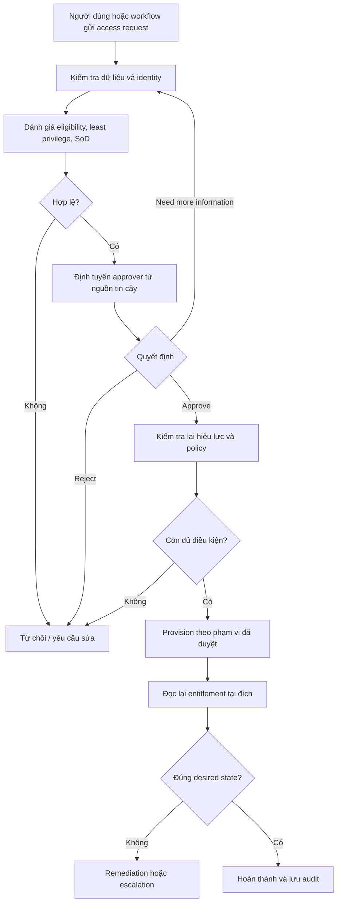
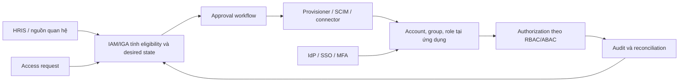

# Approval là gì trong Approval workflow và quản lý vòng đời danh tính IAM?

**Approval** (*phê duyệt*) là quyết định có thẩm quyền về việc **một yêu cầu cấp, thay đổi, duy trì hoặc thu hồi quyền truy cập có được chấp nhận theo chính sách hay không**. Trong Identity and Access Management (IAM), approval giúp xác định *ai có quyền cho phép một chủ thể nhận một entitlement, trên tài nguyên nào, vì lý do gì và trong bao lâu*. Quyết định phải được ghi nhận có thể truy vết, gắn với đúng phiên bản yêu cầu và được kiểm tra trước khi provisioning.

Ví dụ, một nhân viên cần quyền phê duyệt hóa đơn trong ERP. Người quản lý có thể xác nhận nhu cầu công việc, chủ sở hữu ứng dụng đánh giá tác động kỹ thuật và data owner xác nhận phạm vi dữ liệu. Chỉ sau khi đáp ứng chính sách phê duyệt, workflow mới có thể cấp role phù hợp. **Approval không đồng nghĩa quyền đã được cấp**: việc cập nhật role tại ERP và xác minh quyền thực tế là các bước tiếp theo.

Trong mô hình **Joiner–Mover–Leaver (JML)**, approval hỗ trợ cấp quyền ban đầu, xét lại quyền khi đổi vị trí, quản lý ngoại lệ có hạn và xác minh việc thu hồi. Approval liên kết **IdP, SSO, SCIM, RBAC/ABAC, tài khoản dịch vụ, kiểm toán và reconciliation** nhằm giảm quyền truy cập tồn dư.

## 1. Phê duyệt giải quyết vấn đề nào?

Nếu bất kỳ người dùng nào cũng có thể tự thêm mình vào nhóm quản trị, tài khoản hoặc vai trò sẽ mất ý nghĩa kiểm soát. Approval thiết lập ranh giới trách nhiệm giữa **người yêu cầu**, **người nhận quyền**, **người ra quyết định** và **hệ thống thực thi**.

| Vấn đề | Vai trò của approval | Giới hạn cần nhớ |
| --- | --- | --- |
| Yêu cầu quyền không có căn cứ | Xác nhận mục đích nghiệp vụ | Không thay thế kiểm tra tài nguyên và quyền tối thiểu |
| Quyền nhạy cảm bị cấp tùy tiện | Buộc owner thích hợp quyết định | Không thay thế SoD hoặc MFA |
| Quyền vượt thời hạn | Phê duyệt phạm vi và ngày hết hạn | Cần cơ chế thu hồi thật ở đích |
| Khó xác định ai chịu trách nhiệm | Ghi người phê duyệt và lý do | Log phải có tính toàn vẹn và được bảo vệ |
| Thay đổi vai trò khiến quyền chồng chất | Xét lại quyền cũ và quyền mới | Mover cần gỡ quyền, không chỉ cấp mới |
| Người đã nghỉ vẫn còn quyền | Theo dõi ngoại lệ và kiểm chứng thu hồi | Leaver không nên chờ duyệt thủ công không cần thiết để chặn khẩn cấp |

**Approval là một biện pháp quản trị, không tự nó là authorization runtime.** Một API vẫn phải kiểm tra subject–action–resource–context ở mỗi hành động quan trọng ngay cả khi yêu cầu đã được duyệt từ trước.

## 2. Phân biệt approval, authentication, authorization và provisioning

| Hoạt động | Câu hỏi | Ví dụ |
| --- | --- | --- |
| **Authentication (AuthN)** | Người dùng đang đăng nhập là ai? | IdP xác minh passkey/MFA |
| **Approval** | Có người/cơ chế đủ thẩm quyền đồng ý cấp quyền này không? | Data owner duyệt quyền đọc dữ liệu mật |
| **Authorization (AuthZ)** | Request hiện tại có được thực hiện không? | ERP cho phép hoặc từ chối `invoice.approve` |
| **Provisioning** | Quyền được cấu hình ở đích thế nào? | SCIM hoặc connector cập nhật group |
| **Reconciliation** | Quyền đã cấp/thực tế có khớp trạng thái mong muốn? | Đọc lại role ERP và so với approval |
| **Audit** | Ai quyết định, làm gì, khi nào và kết quả ra sao? | Lưu request ID, quyết định, role và bằng chứng |

**Đăng nhập thành công qua SSO không thay thế approval** đối với quyền nhạy cảm. **Approval thành công cũng không thay thế authorization tại backend**: một người được duyệt role `report-reader` vẫn không được đọc báo cáo thuộc tenant khác.

## 3. Những chủ thể tham gia approval workflow

| Vai trò | Trách nhiệm điển hình | Rủi ro nếu thiếu |
| --- | --- | --- |
| **Requester** | Gửi yêu cầu và giải thích nhu cầu | Yêu cầu không đầy đủ |
| **Beneficiary** | Người hoặc workload thực sự nhận quyền | Cấp nhầm tài khoản người gửi |
| **Line manager** | Xác nhận nhiệm vụ của nhân viên | Thiếu căn cứ công việc |
| **Application owner** | Quản trị role và tác động hệ thống | Cấp quyền không phù hợp kỹ thuật |
| **Data/resource owner** | Xác nhận quyền trên dữ liệu/tài nguyên | Truy cập vượt phạm vi |
| **Security/IAM** | Kiểm tra policy, SoD, rủi ro và quy trình | Phê duyệt vi phạm kiểm soát |
| **Sponsor** | Bảo trợ đối tác/nhà thầu theo hợp đồng | Account B2B thiếu người chịu trách nhiệm |
| **Provisioning service** | Thực thi quyết định ở hệ thống đích | Quyết định không được triển khai |
| **Auditor** | Kiểm tra bằng chứng và hiệu lực kiểm soát | Khó phát hiện cấp quyền sai |

Một người có thể giữ nhiều chức năng ở tổ chức nhỏ, nhưng **self-approval** đối với quyền nhạy cảm phải được kiểm soát. Nếu requester cũng là approver theo sơ đồ tổ chức, hệ thống cần chuyển đến người thay thế có thẩm quyền thay vì tự động cho qua.

## 4. Những dữ liệu tối thiểu của một yêu cầu approval

Một quyết định chỉ có ý nghĩa nếu gắn với một đối tượng yêu cầu rõ ràng:

- **Request ID** duy nhất, liên kết với nguồn tạo yêu cầu.
- **Requester/beneficiary identity ID** ổn định và account đích.
- **Resource ID**, target system, tenant, environment và data classification.
- **Entitlement/role/action/scope** thực sự cần được cấp.
- **Business justification** và loại sự kiện JML.
- **Thời điểm hiệu lực**, ngày hết hạn và mức độ khẩn cấp.
- **Policy version**, owner, quy tắc SoD và yêu cầu bổ sung.
- **Approver identity**, kết quả, thời điểm, lý do hoặc điều kiện.
- **Correlation ID** giữa approval, lệnh provisioning, readback và audit.

Ví dụ dữ liệu minh họa:

```json
{
  "requestId": "AR-2048",
  "requesterId": "EMP-410",
  "beneficiaryId": "EMP-410",
  "resourceId": "erp-prod-invoices-north",
  "roleId": "invoice-approver",
  "scope": {"tenantId": "tenant-a", "region": "north"},
  "validFrom": "2026-11-24T00:00:00Z",
  "validUntil": "2026-12-24T00:00:00Z",
  "reason": "Phê duyệt hóa đơn khu vực được giao",
  "policyVersion": "access-approval-v3"
}
```

Đây **không phải schema chuẩn SCIM**. Các trường identity, tenant, resource, owner và policy cần được xác minh phía server. Không cho requester thay giá trị `approverId` hoặc `scope` trong request HTTP để tự chọn người duyệt hay mở rộng quyền.

## 5. Vòng đời một approval request



Các trạng thái có thể gồm `Draft`, `Submitted`, `Pending Approval`, `Approved`, `Rejected`, `Cancelled`, `Expired`, `Provisioning`, `Fulfilled` hoặc `Failed`. Tên trạng thái phụ thuộc sản phẩm. **Approved và Fulfilled không nên bị gộp** vì quyết định đã có nhưng connector có thể lỗi hoặc quyền ở ứng dụng chưa hiệu lực.

## 6. Phê duyệt một cấp, nhiều cấp và song song

| Mô hình | Ví dụ | Điều cần quyết định |
| --- | --- | --- |
| **Một cấp** | Manager duyệt quyền nội bộ rủi ro thấp | Manager có đủ thẩm quyền và dữ liệu không? |
| **Tuần tự** | Manager duyệt rồi data owner duyệt | Có cần tất cả cấp đồng ý không? |
| **Song song** | Security và application owner cùng xét | Quy tắc tổng hợp kết quả thế nào? |
| **Theo rủi ro** | Quyền cơ bản tự cấp; quyền production cần xét riêng | Tiêu chí phân tầng có đáng tin không? |
| **Theo hạn mức** | Giao dịch nhạy cảm cần cấp duyệt cao hơn | Ai xác định hạn mức và phạm vi? |
| **Ủy quyền thay thế** | Owner vắng mặt, deputy đủ thẩm quyền xử lý | Thời hạn ủy quyền và SoD được kiểm soát thế nào? |

Nếu yêu cầu hai approver độc lập cùng đồng ý, **một người approve không đủ**. Nếu một người reject, workflow phải có quy tắc rõ để xử lý; không tự chuyển sang người khác dễ duyệt hơn nhằm vượt policy.

**Approval chain nên được suy ra từ resource owner, data owner, policy và tổ chức**, không chỉ từ email do người gửi yêu cầu nhập.

## 7. Policy và nguyên tắc least privilege trong approval

Approval cần trả lời không chỉ **có cấp hay không**, mà cả **cấp mức nào**. Ví dụ người dùng yêu cầu `crm-admin` để xem báo cáo; approver không nên đơn giản đồng ý vì lý do công việc hợp lệ. Quy trình nên đề xuất quyền đọc giới hạn.

```text
ALLOW_APPROVAL IF
    beneficiary.lifecycle_status == "active"
    AND request.resource_id IN approver.authorized_resources
    AND request.entitlement IN resource.allowed_entitlements
    AND request.scope IS within beneficiary.business_scope
    AND request.valid_until <= policy.maximum_expiry
    AND NOT violates_separation_of_duties(request)
ELSE REJECT_OR_ESCALATE
```

Đây là **giả mã chính sách approval**, không phải cú pháp của một policy engine cụ thể. Cần kiểm tra role kế thừa, nhóm lồng nhau và quyền đã có trước khi cấp mới; nếu không, một yêu cầu tưởng như vô hại có thể tạo ra **tập quyền xung đột**.

## 8. Approval tự động: khi nào có thể?

Không phải mọi access request đều cần người bấm nút. **Policy-based auto-approval** có thể phù hợp với **birthright access** hoặc quyền ít rủi ro khi các điều kiện được quản trị rõ.

Ví dụ nhân viên mới thuộc bộ phận Support có thể tự nhận quyền đọc knowledge base theo chính sách. Tuy nhiên, trường hợp tự động vẫn cần:

1. Nguồn thuộc tính HR/JML có thẩm quyền.
2. Điều kiện eligibility, ngày hiệu lực và role tương ứng.
3. Resource và scope được xác định.
4. Policy version, owner và lịch sử thay đổi.
5. Không có vi phạm SoD hoặc quyền vượt hạn mức.
6. Đường xử lý ngoại lệ và cơ chế thu hồi.
7. Audit ghi lý do auto-approval và kết quả provisioning.

**Auto-approval không phải bỏ kiểm soát**; quyết định được đưa ra bởi quy tắc đã được phê duyệt trước. Nếu dữ liệu thiếu hoặc mâu thuẫn, hệ thống không nên tự suy người dùng đủ điều kiện cho quyền nhạy cảm.

## 9. Approval trong Joiner

Ở giai đoạn **Joiner**, identity proofing, hồ sơ HR và ngày hiệu lực xác định account và tập quyền ban đầu. Phân tách:

- **Birthright role:** có thể cấp tự động theo chính sách khi đủ điều kiện.
- **Entitlement theo nhiệm vụ đặc thù:** yêu cầu manager/resource owner phê duyệt.
- **Quyền production hoặc xuất dữ liệu nhạy cảm:** cần quy trình tăng cường theo rủi ro.
- **Tài khoản chuẩn bị trước ngày bắt đầu:** có thể provision nhưng chưa kích hoạt trước thời điểm cho phép.

Ví dụ nhân viên Lan được gán role `support-reader` mặc định, còn quyền `customer-export` chỉ được cấp khi data owner chấp thuận lý do và thời hạn. Workflow cần xác minh **người nhận quyền đã thực sự đủ điều kiện tại thời điểm cấp**, không chỉ ở thời điểm gửi yêu cầu.

## 10. Approval trong Mover

Khi nhân viên đổi vị trí, access request cho quyền mới phải đi kèm đánh giá **quyền cũ có còn căn cứ hay không**.

| Sự kiện Mover | Approval cần xem xét | Hành động bắt buộc đi kèm |
| --- | --- | --- |
| Finance sang Analytics | Quyền Analytics theo nhiệm vụ | Gỡ quyền Finance không còn hợp lệ |
| Dự án A sang B | Phạm vi tài nguyên B | Thu hồi scope A và ACL cũ |
| Đổi quyền thường sang admin | Eligibility, phê duyệt JIT/PAM | Giới hạn thời gian và đặc quyền |
| Bàn giao trong hai tuần | Ngoại lệ quyền dự án cũ có hạn | Tự hết hạn, đọc lại và hậu kiểm |

**Một approval mới không hợp thức hóa mọi quyền được gán trước đó**. IAM phải tính desired state sau Mover, so với quyền thực tế tại đích và xử lý quyền tồn dư.

Trong trường hợp phê duyệt quyền bàn giao, cần **owner, mục đích, resource ID, scope, ngày hết hạn** và trách nhiệm thu hồi. Không để ngoại lệ tự kéo dài vô thời hạn.

## 11. Approval trong Leaver: không tạo nút thắt thu hồi

Leaver thường yêu cầu **chặn truy cập theo sự kiện có thẩm quyền**, không nên bắt buộc chờ một người phê duyệt thông thường mới được disable account khi rủi ro đã xác định.

Cần phân biệt:

- **Quyết định ngừng quan hệ:** từ HR, hợp đồng hoặc nguồn được ủy quyền.
- **Quyết định thu hồi quyền:** chính sách IAM xử lý khi điều kiện không còn.
- **Ngoại lệ duy trì quyền:** chỉ khi có căn cứ riêng, người có thẩm quyền và kiểm soát chặt.
- **Bằng chứng hoàn thành:** từ IdP, SaaS, session, token, role và API đích.

Sau Leaver, **IdP disable không tự thu hồi mọi phiên ứng dụng**, SCIM `active=false` không chắc thu hồi mọi API key hoặc role gán cục bộ. Quy trình cần chặn session/token theo khả năng và xác minh bằng **negative authorization test**.

Nếu một yêu cầu approval vẫn đang chờ cho nhân viên đã nghỉ, nó phải bị hủy hoặc đánh giá lại; **không được cấp quyền mới dựa trên approval đã lỗi thời**.

## 12. IdP, SSO, SCIM và approval phối hợp ra sao?



**IdP/SSO** xác thực người dùng, **SCIM/connector** cập nhật user/group/entitlement theo khả năng, còn **authorization** quyết định từng thao tác trên tài nguyên. **Approval** tạo căn cứ quản trị để cấp quyền, nhưng không thay thế bất kỳ lớp nào trong ba lớp kia.

Ví dụ approval quyền `invoice-reader` đã được ghi nhưng connector thất bại. Người dùng đăng nhập SSO thành công vẫn có thể thiếu role ở ERP. Cần xử lý failure và đọc lại quyền, **không kết luận hoàn thành chỉ từ trạng thái Approved**.

## 13. SoD và self-approval

**Separation of Duties (SoD)** tránh một người có khả năng tự thực hiện và tự duyệt những nhiệm vụ xung đột. Trong approval workflow, SoD áp dụng cả **người ra quyết định** lẫn **tập quyền được cấp**.

Các kiểm soát quan trọng:

- Người yêu cầu không tự duyệt quyền nhạy cảm của chính mình khi policy cấm.
- Người có nhiệm vụ provision không tự tạo approval hợp lệ thay cho owner.
- Vai trò `payment-creator` và `payment-approver` được kiểm tra xung đột.
- Approval cấp quyền quản trị cần ghi lại lý do và người chịu trách nhiệm.
- Delegation/substitute approver phải được phê duyệt, giới hạn thời gian và kiểm tra xung đột.
- Quy trình khẩn cấp có kiểm soát riêng, không dùng “urgent=true” để bỏ qua mọi phê duyệt.

**MFA hoặc xác thực mạnh không tự trao thẩm quyền phê duyệt.** Chúng xác nhận phiên và giảm rủi ro impersonation, nhưng quyết định approval còn cần đúng owner và policy.

## 14. Approval cho partner và service account

### Đối tác B2B

Với **partner identity**, sponsor có thể xác nhận hợp đồng và dự án; data owner quyết định quyền trên dữ liệu; application owner kiểm tra role và hệ thống đích.

Yêu cầu phải gắn với **partner ID, tenant, resource ID, contract expiry và beneficiary identity**. Việc partner IdP xác thực một người không đồng nghĩa phía cung cấp tự động cấp quyền. Khi hợp đồng hết hiệu lực, quyền cần được thu hồi theo chính sách dù approval cũ vẫn tồn tại trong lịch sử.

### Tài khoản dịch vụ/workload

**Service account** cần owner kỹ thuật/nghiệp vụ, mục đích, phạm vi API, môi trường và lifecycle riêng. Một yêu cầu quyền production cho workload phải chỉ ra **workload ID**, không lấy identity nhân viên làm chủ thể nhận quyền máy–máy.

Khi owner nhân sự Mover/Leaver, phải chuyển người chịu trách nhiệm, thu hồi quyền cá nhân đối với secret/CI-CD và rà soát credential. **Không tự xóa workload đang chạy mà chưa hiểu phụ thuộc**, nhưng cũng không cho quyền kỹ thuật tồn tại không owner hoặc không phê duyệt.

## 15. SLA, reminder, escalation và delegation

Approval có thể bị chậm vì người duyệt vắng mặt. Workflow cần quy định rõ:

| Cơ chế | Mục đích | Điều cần tránh |
| --- | --- | --- |
| **SLA** | Thời gian mong muốn ra quyết định theo độ rủi ro | Coi quá hạn là tự động Permit |
| **Reminder** | Nhắc người có trách nhiệm | Spam hoặc rò chi tiết tài nguyên nhạy cảm |
| **Escalation** | Chuyển tới cấp có thẩm quyền hợp lệ | Escalate cho người không có quyền quyết định |
| **Delegation** | Người được ủy quyền duyệt thay | Ủy quyền vô hạn hoặc tự duyệt |
| **Expiration** | Hủy yêu cầu đã cũ | Cấp quyền sau khi bối cảnh JML đổi |
| **Cancellation** | Requester/owner hủy yêu cầu không còn cần | Để provisioning tiếp tục sau khi hủy |

**Timeout không mặc nhiên được xem là Approved**. Đối với entitlement nhạy cảm, mặc định nên từ chối hoặc chuyển xử lý theo policy. Nếu cần quy trình ứng cứu khẩn cấp, hãy dùng **break-glass/JIT được quản trị riêng** và hậu kiểm, không biến quyền khẩn cấp thành lỗ hổng trong luồng approval bình thường.

## 16. Approval đã duyệt nhưng dữ liệu yêu cầu thay đổi

Một rủi ro quan trọng là **time-of-check/time-of-use (TOCTOU)**. Người duyệt đã xem yêu cầu A, nhưng trước lúc provisioning, role, resource, beneficiary hoặc ngày hết hạn bị thay đổi.

Để tránh:

1. Gắn quyết định approval với **snapshot hoặc version không thể thay đổi âm thầm** của yêu cầu.
2. Nếu nội dung vật chất thay đổi, yêu cầu **phê duyệt lại**.
3. Trước provisioning, đánh giá lại `lifecycle_status`, resource existence, tenant, SoD và thời hạn.
4. Dùng correlation ID/idempotency key để tránh cấp quyền trùng khi workflow retry.
5. Không để một approval cũ được dùng nhiều lần để cấp cho các account khác.
6. Kiểm tra trạng thái `Cancelled`, `Rejected` hoặc `Expired` trước khi gọi connector.

Ví dụ nhân viên được duyệt `report-reader` cho dự án A nhưng request bị sửa thành `report-admin` dự án B. **Không được tái sử dụng approval cũ** vì quyết định đã dựa trên phạm vi khác.

## 17. Sai lầm thường gặp và cách phòng tránh

| Sai lầm | Hậu quả | Kiểm soát |
| --- | --- | --- |
| Cho requester tự nhập approver | Self-approval hoặc routing sai | Tra owner từ catalog tin cậy |
| Dùng một người duyệt mọi loại quyền | Thiếu chuyên môn và trách nhiệm | Risk-based multi-level approval |
| Không phân biệt requester và beneficiary | Gán quyền nhầm account | Identity correlation độc lập |
| Approved được coi là provisioned | Quyền thiếu hoặc lệch | Readback trạng thái đích |
| Auto-approval cho cả admin | Privilege escalation | Policy và phê duyệt đặc quyền |
| Không kiểm tra SoD | Một người có quyền xung đột | Static/dynamic/transaction SoD |
| Quyền tạm thời không có hạn | Privilege accumulation | Expiry và auto-revoke |
| Leaver còn yêu cầu pending | Cấp lại quyền sau nghỉ việc | Revalidate lifecycle trước provisioning |
| Retry provisioning không kiểm soát | Cấp trùng, scope sai | Idempotency, version và reconciliation |
| Không bảo vệ audit | Khó điều tra hoặc xóa dấu vết | Log có integrity và quyền hạn chế |

Phân tích lỗi approval cần kiểm tra **quyết định có đúng thẩm quyền**, **nội dung được duyệt** và **quyền thực tế ở đích**; không chỉ đếm số ticket đã đóng.

## 18. Kiểm thử workflow từ đầu đến cuối

| Tình huống | Kỳ vọng |
| --- | --- |
| Role cơ bản, Joiner đủ điều kiện | Auto-approval theo policy, đúng ngày hiệu lực |
| Role nhạy cảm, thiếu data-owner approval | Không provision |
| Người gửi tự đổi `approverId` | Backend bỏ qua/từ chối dữ liệu không tin cậy |
| Requester tự phê duyệt quyền admin | Bị chặn theo SoD |
| Một trong hai approver từ chối | Không cấp khi policy yêu cầu cả hai đồng ý |
| Approval hết hạn trước khi cấp | Không provision từ quyết định cũ |
| Beneficiary đã Leaver | Không cấp dù approval trước đó hợp lệ |
| Connector trả lỗi sau Approved | Trạng thái không được đánh dấu Fulfilled |
| Provisioning trả success nhưng role đích sai | Readback phát hiện và remediation |
| Partner hết hợp đồng trong lúc pending | Hủy hoặc tái đánh giá yêu cầu |
| Workload thiếu owner | Không cấp quyền nhạy cảm tự động |
| Quyền JIT hết hạn | Quyền runtime và session liên quan bị kiểm soát |

Nên thử cả **positive flow** và **negative flow**, bao gồm request trực tiếp tới backend, concurrent approvals, duplicate events, mất kết nối connector và thay đổi phiên bản policy.

## 19. Audit và chỉ số vận hành

Một bản ghi approval có giá trị kiểm toán cần trả lời: **ai yêu cầu, ai nhận quyền, quyền trên resource nào, ai duyệt, căn cứ nào, thời hạn bao lâu, phiên bản chính sách nào và quyền đã được cấp/thu hồi thực tế chưa?**

Các chỉ số nên theo dõi:

- **Approval lead time:** thời gian từ Submitted đến Approved/Rejected.
- **Approval SLA breach:** số yêu cầu chậm quá thời hạn chính sách.
- **Self-approval violation:** sự kiện xung đột giữa requester và approver.
- **Approved-not-provisioned count:** quyết định đã duyệt nhưng quyền chưa vào đích.
- **Provisioned-without-approval count:** entitlement không có căn cứ phê duyệt hoặc auto-policy hợp lệ.
- **Expired-access count:** quyền quá hạn chưa được thu hồi.
- **Mover residual entitlement:** quyền vai trò cũ còn hiệu lực sau Mover.
- **Leaver time to deny:** độ trễ đến khi không còn truy cập thực tế.
- **Access review exception:** quyền đang hoạt động nhưng không tìm thấy owner/phê duyệt còn hiệu lực.

Audit cần bảo vệ tính toàn vẹn, phân quyền đọc và thời hạn lưu phù hợp. **Không ghi plaintext password, access token, refresh token, cookie, API key hay secret vào ticket hoặc log**. Với tài nguyên nhạy cảm, chỉ lưu metadata cần thiết để điều tra.

## 20. Câu hỏi tự kiểm tra

**Tình huống A:** Quản lý duyệt cấp `invoice-reader`, connector chưa cập nhật ERP. Có thể báo hoàn tất không? **Không.** Approved là quyết định; Fulfilled cần provisioning và readback.

**Tình huống B:** Người yêu cầu nhập chính mình làm người duyệt và backend chấp nhận. Sai ở đâu? **Vi phạm nguyên tắc thẩm quyền và nguy cơ self-approval**; phải tra approver từ policy và owner tin cậy.

**Tình huống C:** Một request đã được duyệt, nhưng beneficiary nghỉ việc trước khi cấp quyền. Có nên tiếp tục? **Không.** Phải kiểm tra lại trạng thái JML ngay trước provisioning.

**Tình huống D:** Quyền nhạy cảm cần hai approver, chỉ một người đồng ý. Có được provision không? **Không**, nếu policy yêu cầu cả hai cùng phê duyệt.

**Tình huống E:** Một nhân viên Mover được cấp role mới nhưng giữ role cũ. Approval mới có chứng minh Mover hoàn tất không? **Không.** Phải deprovision quyền cũ và đối soát tại đích.

**Tình huống F:** Service account không có owner nhưng job vẫn chạy. Có nên auto-approve quyền admin? **Không.** Cần xác định owner, tác vụ, scope và quy trình phê duyệt kỹ thuật phù hợp.

## Ghi nhớ

**Approval trong IAM** là **quyết định có thẩm quyền về yêu cầu quyền**, không đồng nghĩa người dùng đã xác thực, quyền đã được provision hoặc authorization runtime đã cho phép. Một approval tốt phải gắn với **đúng beneficiary, resource, entitlement, scope, lý do, người duyệt, policy version và thời hạn**, đồng thời kiểm soát SoD, self-approval, thay đổi yêu cầu và ngoại lệ. Trong **Joiner–Mover–Leaver**, cần phối hợp **IdP/SSO, SCIM/connector, RBAC/ABAC, service identity, audit và reconciliation** để quyền được cấp đúng căn cứ, sửa đúng khi thay đổi nhiệm vụ và **thu hồi thực tế khi không còn hợp lệ**.
