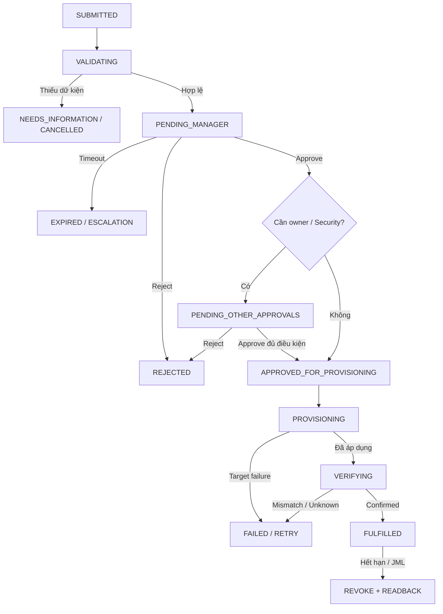
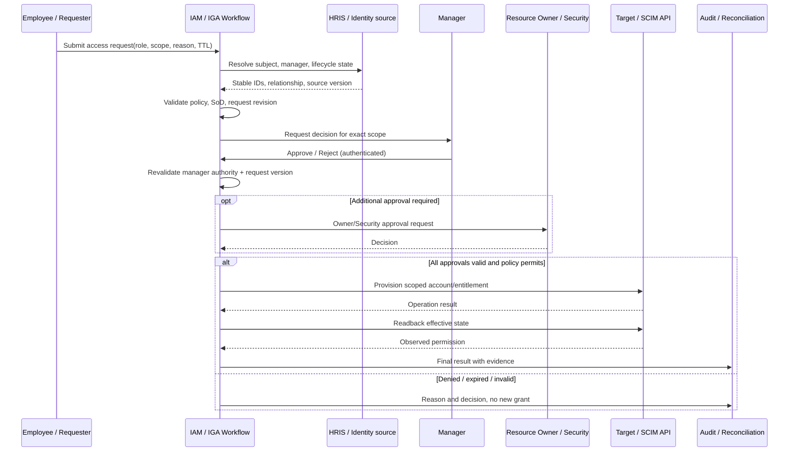

# Manager approval trong IAM: Phê duyệt của người quản lý trong vòng đời danh tính

Một nhân viên vừa chuyển từ bộ phận Support sang Finance và yêu cầu quyền đọc báo cáo tài chính. Hệ thống IAM gửi yêu cầu đến người quản lý trực tiếp (manager). Manager bấm **Approve**, nhưng ứng dụng đích vẫn chưa cấp quyền do một lỗi đồng bộ SCIM. Ở trường hợp khác, manager cũ phê duyệt một yêu cầu sau ngày nhân viên chuyển bộ phận; quyền Support được khôi phục dù không còn cần thiết. Đôi khi người duyệt lại chính là người yêu cầu, hoặc một quyền quản trị rất rộng được cấp chỉ vì manager đồng ý.

Những tình huống này cho thấy một nút **Approve** không tự làm quy trình kiểm soát truy cập trở nên an toàn. **Manager approval** cần trả lời **ai có thẩm quyền quyết định nhu cầu công việc, đang phê duyệt chính xác quyền gì, trong phạm vi nào, vào thời điểm nào**, và quyết định ấy được chuyển thành **quyền hiệu lực** như thế nào.

Trong **Identity and Access Management (IAM)**, **Manager approval** là một bước của **approval workflow** mà người quản lý có thẩm quyền xác nhận hoặc bác bỏ **nhu cầu nghiệp vụ** đối với một yêu cầu truy cập, cấp account, thay đổi entitlement hoặc ngoại lệ theo chính sách. Kết quả phê duyệt là **một dữ kiện quản trị**, không tự thay thế các kiểm tra security policy, resource ownership, Separation of Duties (SoD), provisioning hay authorization tại ứng dụng.

Bài học thuộc chương **Approval workflow** của mô-đun **Identity Lifecycle**. Nội dung kết nối phê duyệt của manager với **Joiner–Mover–Leaver (JML)**, từ xác minh identity và cấp quyền ban đầu đến rà soát, thu hồi quyền khi thay đổi vai trò hoặc rời tổ chức. Các phần thực hành gắn với **IdP, SSO, SCIM, RBAC/ABAC, tài khoản dịch vụ, audit, reconciliation** và mục tiêu giảm **quyền truy cập tồn dư (residual access)**.

> **Nguyên tắc xuyên suốt:** Manager phê duyệt nhu cầu công việc **theo một yêu cầu được giới hạn rõ**. Hệ thống chỉ cấp quyền khi **đúng người duyệt, đúng chính sách, đúng subject, đúng resource/scope, đúng trạng thái vòng đời**, và chỉ đánh dấu hoàn tất sau khi có **bằng chứng trạng thái thực tế** tại hệ thống đích.

## 1. Manager approval là gì?

Một quy trình manager approval có thể áp dụng khi:

- Nhân viên mới cần quyền làm việc ngoài quyền mặc định.
- Nhân viên đang công tác yêu cầu thêm một ứng dụng hoặc vai trò.
- Nhân viên Mover xin quyền cho vai trò mới.
- Nhà thầu cần gia hạn truy cập hoặc đổi sponsor.
- Người dùng xin quyền tạm vào dữ liệu nhạy cảm.
- Manager được yêu cầu xác nhận quyền của cấp dưới trong access review.
- Một ngoại lệ quyền được cân nhắc cùng application owner hoặc Security.
- Quyền đặc biệt cần xác nhận nhu cầu nghiệp vụ trước khi PAM/PIM cho kích hoạt.

### 1.1. Quyết định của manager có ý nghĩa gì?

Ở mức nghiệp vụ, manager thường có thể xác nhận:

1. Người yêu cầu đang làm công việc có cần loại quyền này hay không.
2. Yêu cầu có thuộc phạm vi trách nhiệm của nhóm không.
3. Mục đích, thời hạn và mức độ ưu tiên có hợp lý không.
4. Chi phí hoặc giấy phép ứng dụng có được chấp nhận không.
5. Ai chịu trách nhiệm theo dõi quyền sau khi cấp.

Manager **không mặc nhiên** có thẩm quyền xác định rằng dữ liệu thuộc mọi bộ phận đều có thể được truy cập, rằng một chính sách SoD có thể bị bỏ qua, hay rằng một vai trò Global Administrator được cấp vĩnh viễn.

### 1.2. Phân biệt Approval, Authorization và Provisioning

| Hoạt động | Câu hỏi | Kết quả điển hình |
|---|---|---|
| **Manager approval** | Nhu cầu công việc có được manager có thẩm quyền chấp thuận không? | `APPROVED` / `REJECTED` cho request cụ thể. |
| **Resource owner approval** | Chủ tài nguyên có đồng ý với quyền vào tài nguyên họ quản lý không? | Quyết định theo data/resource ownership. |
| **Security/policy validation** | Yêu cầu có phù hợp least privilege, SoD, risk, tenant và policy không? | Đủ/không đủ điều kiện để cấp quyền. |
| **Provisioning** | Account, role, group đã được tạo/sửa/gỡ tại đích chưa? | Job và trạng thái ghi nhận ở connector/target. |
| **Authorization** | Khi request thật tới API, subject được phép làm action trên resource không? | ALLOW/DENY tại điểm thực thi. |
| **Reconciliation** | Quyền mong muốn có trùng với quyền quan sát được không? | MATCH/MISMATCH/UNKNOWN. |

**Được manager duyệt không đồng nghĩa được ứng dụng cho phép ngay.** Ngược lại, ứng dụng đang cho truy cập không chứng minh quyền từng được phê duyệt hợp lệ.

## 2. Phân vai: requester, manager, owner, sponsor và Security

Một yêu cầu truy cập có thể liên quan nhiều người. Cần định nghĩa rõ trách nhiệm để tránh một vai trò được hiểu là “có thể duyệt mọi thứ”.

| Vai trò | Trách nhiệm điển hình | Giới hạn |
|---|---|---|
| **Requester** | Gửi yêu cầu, giải thích nhu cầu và thời hạn. | Không tự duyệt yêu cầu của mình nếu policy cấm. |
| **Beneficiary / subject** | Người hoặc principal sẽ nhận quyền. | Có thể khác requester nếu manager xin thay nhân viên. |
| **Line manager** | Xác nhận nhu cầu công việc và scope của cấp dưới. | Không phải owner của mọi dữ liệu. |
| **Application owner** | Quy định vai trò ứng dụng và điều kiện sử dụng. | Không mặc nhiên đại diện HR về quan hệ quản lý. |
| **Data/resource owner** | Phê duyệt quyền vào dữ liệu/tài nguyên do họ chịu trách nhiệm. | Không tự cấp role trái IAM policy. |
| **Sponsor** | Chịu trách nhiệm cho nhà thầu hoặc quan hệ bên ngoài. | Cần được xác minh và có thời hạn. |
| **Security/compliance approver** | Đánh giá rủi ro, SoD, policy exception. | Không biến mọi ngoại lệ thành quyền thường trực. |
| **PAM/PIM approver** | Phê duyệt activation đặc quyền theo role/scope. | Không thay thế enforcement tại target. |
| **IAM workflow engine** | Chọn người duyệt, theo dõi trạng thái, thực thi rule. | Không tự tin dữ liệu đầu vào chưa được xác minh. |
| **Target system** | Cấp/gỡ và thực thi quyền thực tế. | Có thể chứa direct grants ngoài workflow. |

### 2.1. Ví dụ cần hai lớp phê duyệt

Một nhân viên Finance yêu cầu quyền xem hồ sơ HR có dữ liệu nhạy cảm:

- Manager xác nhận **công việc thực sự cần** dữ liệu này.
- Data owner của HR xác nhận **phạm vi dữ liệu được phép**.
- Security policy xác minh có xung đột SoD, giới hạn tenant và phân loại dữ liệu hay không.
- IAM/connector chỉ cấp quyền **đúng scope và thời hạn đã duyệt**.
- Hệ thống HR vẫn đánh giá authorization cho từng resource.

Một manager Finance không thể một mình bỏ qua kiểm soát của HR chỉ bằng nút Approve nếu policy yêu cầu cả data owner.

### 2.2. Nhiều approval không phải nhiều lần bấm tùy ý

Workflow nên khai báo rõ:

- **Sequential:** manager duyệt rồi mới gửi tới resource owner.
- **Parallel / all-of:** cả manager và owner phải phê duyệt.
- **Any-of:** một trong những approver được chỉ định đủ thẩm quyền, chỉ khi policy cho phép.
- **Conditional:** chỉ bổ sung Security khi risk, scope hoặc SoD yêu cầu.
- **Quorum:** nhiều người được chọn từ hội đồng, với số phiếu và xung đột thẩm quyền rõ.

Không gộp các quyết định khác nhau vào một trường Boolean `approved=true` không biết **ai, tại bước nào và cho mục đích gì**.

## 3. Xác định manager nào có thẩm quyền

### 3.1. Manager relationship phải có nguồn rõ ràng

Quan hệ cấp trên thường được xác định trong **HRIS** hoặc nguồn nhân sự có thẩm quyền. Một số directory/IdP có thuộc tính manager được đồng bộ từ HRIS; chúng có thể là **bản sao**, không phải authority gốc.

Ví dụ:

```json
{
  "subjectId": "person-1045",
  "managerId": "person-0090",
  "relationshipType": "LINE_MANAGER",
  "source": "hris",
  "sourceVersion": 71,
  "effectiveFrom": "2026-12-01T09:00:00+07:00",
  "observedAt": "2026-12-01T09:00:05+07:00"
}
```

Đây là cấu trúc minh họa. Các trường `sourceVersion` hay `relationshipType` tùy kiến trúc; cốt lõi là không dựa chỉ vào một tên hiển thị hoặc email.

### 3.2. Liên kết bằng định danh ổn định

Manager selection nên dựa trên **stable identity ID** đã được kiểm soát thay vì:

- Tên người (có thể trùng).
- Email (có thể đổi hoặc tái sử dụng).
- Chuỗi `managerName` mà requester tự nhập.
- Group do requester có quyền tự sửa.
- Account directory chưa liên kết với identity của tổ chức.

Ví dụ:

```text
Beneficiary: person-1045
  -> HRIS manager reference: person-0090
  -> IAM account mapping: account-manager-0090
  -> IdP subject được xác minh: (issuer, sub)
  -> Workflow assignment: manager-approval-task-271
```

Một SAML assertion/OIDC ID Token hợp lệ xác thực **người bấm Approve**, nhưng hệ thống vẫn phải đối chiếu identity đó với **người có thẩm quyền ở workflow**.

### 3.3. Kiểm tra điều kiện của manager

Một manager được chọn phải thỏa quy tắc policy, có thể bao gồm:

1. Identity quản lý còn ACTIVE và account không bị khóa vì lý do làm mất thẩm quyền.
2. Quan hệ quản lý phù hợp mốc hiệu lực của yêu cầu.
3. Manager thuộc tổ chức/tenant có quyền quyết định.
4. Không phải requester/beneficiary nếu self-approval bị cấm.
5. Không bị xung đột SoD cho resource/action đang xét.
6. Có phương thức authentication/step-up phù hợp độ nhạy.
7. Không bị vô hiệu thẩm quyền qua sự kiện Mover/Leaver hoặc delegation hết hạn.

Việc manager đang là người quản lý trực tiếp **không tự có nghĩa manager biết hoặc được phép phê duyệt mọi role**.

## 4. Những tình huống manager relationship không đơn giản

### 4.1. Nhân viên mới chưa có manager

Một Joiner có thể chưa được gán manager ở nguồn nhân sự hoặc bản đồng bộ chưa tới IAM.

**Không tự duyệt** vì không tìm thấy manager. Workflow nên:

- Giữ ở trạng thái chờ rõ ràng.
- Gửi về đội HR/IGA để xác minh nguồn.
- Sử dụng tuyến phê duyệt thay thế **đã được policy định nghĩa**, nếu có.
- Không dùng manager từ dữ liệu profile tự khai để cấp quyền nhạy cảm.

### 4.2. Manager vắng mặt, nghỉ phép hoặc nghỉ việc

Nếu manager vắng mặt:

- Có thể dùng **delegate** đã được chỉ định trước.
- Có thể escalation lên manager cấp trên hoặc owner khác theo quy trình.
- Hạn chế scope/thời gian của quyền delegate.
- Ghi lại ai phê duyệt theo ủy quyền, thay mặt ai và lý do.
- Đối chiếu người được chuyển quyền còn đủ thẩm quyền tại thời điểm phê duyệt.

**Quá SLA không được mặc nhiên chuyển từ PENDING sang APPROVED** cho yêu cầu truy cập nhạy cảm.

### 4.3. Nhiều manager hoặc quản lý ma trận

Một nhà thầu hoặc nhân viên làm trong nhiều dự án có thể có:

- Line manager từ HRIS.
- Project manager.
- Sponsor phía đối tác.
- Resource owner.
- Functional manager.

Policy phải xác định **loại quan hệ** phù hợp với **loại quyền**. Ví dụ quyền vào project có thể cần project owner; quyền mở tài khoản cơ sở có thể cần line manager/sponsor.

### 4.4. Mối quan hệ vòng lặp và trùng dữ liệu

Nếu graph có `A.manager=B` và `B.manager=A`, thuật toán escalation cấp trên có thể lặp vô hạn hoặc đưa người không phù hợp vào chain. Cần:

- Phát hiện vòng, giới hạn độ sâu.
- Xử lý manager ID không tồn tại/không ACTIVE.
- Kiểm tránh nhiều bản ghi manager xung đột.
- Giữ kết quả UNKNOWN cần xác minh thay vì chọn bừa.
- Bảo đảm không tạo vòng **requester tự trở thành approver** khi đi qua chuỗi quản lý.

## 5. Khi nào cần Manager approval?

Không phải mọi quyền đều nên chờ manager. Một policy tốt phân loại request theo **mức độ nhạy cảm, tính tự động và trách nhiệm**.

| Request | Ví dụ | Hướng xử lý khả dĩ |
|---|---|---|
| **Birthright access** | Email/công cụ cơ sở theo vị trí đã xác minh. | Có thể cấp tự động nếu policy đã phê duyệt; không nhất thiết manager duyệt từng lần. |
| **Requestable standard access** | Vai trò đọc báo cáo của nhóm. | Manager xác nhận nhu cầu, kiểm scope. |
| **Cross-department access** | Finance yêu cầu đọc dữ liệu HR. | Manager + data owner; có thể thêm Security. |
| **Privileged access** | Deploy production hoặc quản trị IAM. | Eligible role + PAM/JIT + step-up + approval/SoD. |
| **Temporary project access** | Đọc dữ liệu trong 14 ngày. | Phê duyệt theo dự án, TTL, tự thu hồi. |
| **Contractor extension** | Gia hạn đến ngày hết hợp đồng. | Sponsor/manager và đối chiếu contract expiry. |
| **Emergency access** | Break-glass khi outage. | Quy trình riêng, được giám sát; không chờ manager thường nếu không khả thi. |
| **Access review** | Manager xác nhận quyền cấp dưới hiện giữ. | Attestation định kỳ và remediation. |

### 5.1. Không sử dụng manager approval như một “lá chắn” cho role quá rộng

Nếu catalog chỉ có role `global-admin`, việc yêu cầu manager Approve không khắc phục vấn đề **overprivilege**. Thiết kế cần chia role, giới hạn tenant/project/action và kiểm SoD. Manager chỉ nên duyệt **quyền tối thiểu** đáp ứng nhu cầu.

### 5.2. Phân biệt lần cấp đầu và tái xác nhận

- **Initial approval:** quyết định cấp entitlement mới.
- **Change approval:** quyết định thay scope, action, thời hạn hoặc role.
- **Extension approval:** kéo dài hạn truy cập có kiểm tra lại.
- **Certification/attestation:** xác nhận một quyền đã có còn hợp lý không.
- **Exception approval:** cho phép lệch policy trong điều kiện và thời hạn được định nghĩa.

Một attestation `KEEP` không tự thay thế quyền của Security khi SoD phát hiện xung đột mới. Một approval cho scope cũ không tự hợp lệ khi role/scope tăng rộng.

## 6. Dữ liệu bắt buộc trong một access request

Một request rõ ràng nên có:

1. **Request ID:** duy nhất để chống xử lý lặp.
2. **Requester ID:** ai gửi.
3. **Beneficiary ID:** ai nhận quyền, có thể khác requester.
4. **Requested entitlement:** role/group/permission/action.
5. **Target:** ứng dụng, resource, tenant, project, môi trường.
6. **Purpose/business justification:** vì sao cần.
7. **Requested duration:** ngày bắt đầu/kết thúc hoặc TTL.
8. **Risk/classification:** mức độ nhạy cảm theo catalog.
9. **Policy/rule version:** quy tắc được dùng để chọn đường approval.
10. **Approver assignment:** manager/owner, quan hệ và authority.
11. **Requested-at và effective-at:** mốc yêu cầu và hiệu lực.
12. **Related ticket/case:** nếu nghiệp vụ yêu cầu.
13. **Current entitlements:** dùng kiểm trùng, SoD và privilege creep.
14. **Source/version:** dữ liệu manager và lifecycle state được đọc từ đâu.

### 6.1. Ví dụ YAML đề nghị quyền

```yaml
requestId: iam-access-20261201-0142
requesterId: person-1045
beneficiaryId: person-1045
requestType: GRANT
target:
  application: finance-reporting
  tenantId: tenant-a
  resourceScope: finance-project-42
entitlement:
  role: report-reader
reason: "Phụ trách tổng hợp số liệu tháng"
requestedPeriod:
  startsAt: "2026-12-01T09:00:00+07:00"
  endsAt: "2026-12-31T17:00:00+07:00"
policy:
  id: report-access-approval
  version: v7
managerResolution:
  source: hris
  managerId: person-0090
  sourceVersion: 71
workflowStatus: PENDING_MANAGER_APPROVAL
```

Đây là **schema minh họa**, không phải cấu hình của một engine cụ thể. Các ID và ngày đều giả lập. Requester không tự quyết định giá trị `managerId` hoặc `policy.version` dùng để ủy quyền; workflow phải lấy từ nguồn tin cậy.

### 6.2. Validation trước khi chuyển đến manager

IAM nên kiểm:

- Beneficiary đã được xác minh, account mapping không mơ hồ.
- Tenant và target có thật, subject phù hợp tổ chức.
- Role được requestable theo catalog/policy.
- Không vượt requested duration tối đa.
- Resource/role có owner và classification.
- Request không trùng một grant đang active hoặc một yêu cầu chờ tương tự.
- Lifecycle state và thời điểm hiệu lực cho phép mở workflow.
- Manager relationship có nguồn và phiên bản hợp lệ.

Request sai cấu trúc hoặc chưa đủ dữ kiện cần trạng thái **INVALID/NEEDS_INFORMATION**, không nên gửi Approve rồi hy vọng xử lý được ở cuối.

## 7. State machine của Approval workflow

Một workflow cần lưu **trạng thái** rõ ràng để tránh việc “manager đã bấm” bị đồng nhất với “quyền đã cấp”.

### 7.1. Các trạng thái đề xuất

| Trạng thái | Ý nghĩa |
|---|---|
| `DRAFT` | Request đang được chuẩn bị, chưa nộp. |
| `SUBMITTED` | Đã nộp và khóa những trường cần xét version. |
| `VALIDATING` | Đang kiểm identity, policy, scope và dữ kiện. |
| `PENDING_MANAGER_APPROVAL` | Đang chờ quyết định của manager hợp lệ. |
| `PENDING_OWNER_APPROVAL` | Manager đã duyệt, chờ owner/resource approver nếu yêu cầu. |
| `PENDING_SECURITY_REVIEW` | Cần kiểm risk/SoD/exception. |
| `APPROVED_FOR_PROVISIONING` | Mọi điều kiện cần đã đạt, đủ điều kiện cấp quyền. |
| `REJECTED` | Có quyết định không chấp thuận. |
| `CANCELLED` | Người yêu cầu hoặc workflow hủy theo policy. |
| `EXPIRED` | Hết hạn chờ, phải làm mới/đóng theo quy tắc. |
| `PROVISIONING` | Connector/target đang thực hiện thay đổi. |
| `VERIFYING` | Đang readback trạng thái đích. |
| `FULFILLED` | Quyền thực tế đã đúng phạm vi và có bằng chứng. |
| `FAILED` | Thất bại cần xử lý hoặc rollback. |
| `UNKNOWN` | Không đủ bằng chứng để khẳng định trạng thái. |
| `REVOKED` | Quyền đã được thu hồi và xác minh theo phạm vi. |

Đây là **mô hình gợi ý**, không phải một tiêu chuẩn trạng thái chung. Hệ thống thực có thể đặt tên/nhóm khác nhau, nhưng cần tránh một trạng thái `SUCCESS` mơ hồ.

### 7.2. State transition minh họa



**Không có cạnh mặc định** `PENDING_MANAGER -> FULFILLED`. Workflow phải giữ riêng **decision** và **provisioning/effective access**.

### 7.3. Những bất biến nên cưỡng chế

- Một request **đã REJECTED hoặc CANCELLED** không được provision vì một callback cũ.
- Một request **EXPIRED** không tự được APPROVED.
- Một approval chỉ áp dụng với **request revision** và scope đã xem.
- Không có bước owner approval cần thiết mà vẫn chuyển `APPROVED_FOR_PROVISIONING`.
- Trạng thái `FULFILLED` chỉ sau khi target xác nhận và readback đầy đủ theo phạm vi.
- Mover/Leaver mới có hiệu lực có thể **vô hiệu hóa hoặc buộc tái đánh giá** request đang chờ.
- Khi không biết target đã áp dụng hay chưa, báo `UNKNOWN` hoặc finding, không tự phát lại thao tác nguy hiểm thiếu idempotency.

## 8. Luồng thực thi từ yêu cầu tới quyền hiệu lực

### 8.1. Sequence diagram



Mọi bước có thể bất đồng bộ, nhưng phải giữ **request ID, policy version, mốc hiệu lực và tính nhất quán**. Khi quyền đã thay đổi giữa request và approval, workflow phải quyết định revalidate, invalidate hay gửi lại theo chính sách.

### 8.2. Manager bấm Approve rồi chuyện gì xảy ra?

Sau khi một quyết định Approve được nhận:

1. Xác minh **authentication** của người phê duyệt và quyền trên task này.
2. Kiểm task còn ở trạng thái có thể duyệt.
3. Kiểm **request revision** và giá trị role/scope/TTL không bị đổi ngoài ý muốn.
4. Đối chiếu manager relationship mới nhất theo quy tắc freshness.
5. Kiểm lifecycle status của beneficiary và approver.
6. Kiểm SoD/approval matrix và tất cả bước còn thiếu.
7. Chỉ khi đủ điều kiện, chuyển sang provisioning.
8. Đọc lại quyền thực tế tại target sau khi provision.
9. Ghi audit cho từng giai đoạn và kết quả cuối.

Đây là điểm phân biệt manager approval **như quyết định nghiệp vụ** với hành vi **cấp quyền của hệ thống**.

## 9. Authorization của hành động Approve

Bản thân thao tác **Approve** là một action nhạy cảm cần authorization.

### 9.1. Một policy khái niệm

```text
PERMIT accessRequest.approve nếu:
    actingPrincipal đã được xác thực bằng nguồn tin cậy
    AND task.status == PENDING_MANAGER_APPROVAL
    AND actingPrincipal.id == task.authorizedManagerId
    AND authorizedManagerId còn thẩm quyền theo policy
    AND task.requestRevision == currentRequestRevision
    AND task.tenantId == actingPrincipal.authorizedTenant
    AND beneficiary.lifecycleState cho phép yêu cầu
    AND selfApprovalNotAllowed
    AND approvalNotExpired
    AND requiredAssuranceSatisfied
```

Đây là pseudocode. **PDP/PEP** cần xác định các thuộc tính như `authorizedManagerId` từ workflow/HRIS, không tin email hoặc ID do người dùng gửi qua request body.

### 9.2. HTTP endpoint minh họa

```http
POST /api/access-requests/iam-access-20261201-0142/decisions HTTP/1.1
Content-Type: application/json

{
  "decision": "APPROVE",
  "expectedRevision": 3,
  "comment": "Đúng nhu cầu báo cáo theo công việc"
}
```

**Không có trường `approverId` do client tự quyết định**. Backend lấy acting principal từ session/token đã xác minh rồi so với task authorization. Header giả `X-Manager: true` không đủ mở quyền duyệt.

### 9.3. Chặn replay và double approval

- Mỗi task có ID và revision.
- Decision được ghi bằng transaction hoặc compare-and-set trên trạng thái hiện hành.
- Một request đã được quyết định không bị duyệt lần nữa chỉ vì người dùng nhấp hai lần.
- Webhook/callback lặp phải được xử lý **idempotent**.
- Callback từ một hệ thống ngoài cần xác thực nguồn, tính toàn vẹn và ràng buộc đối tượng.
- Event quyết định cũ không thể ghi đè lần sửa request mới.

Một approval API trả HTTP 200 nhưng thực tế cập nhật task đã hết hạn có thể tạo lỗ hổng nếu không kiểm state transition.

## 10. Separation of Duties và chống tự phê duyệt

### 10.1. Những trường hợp self-approval cần xét

- Requester trùng beneficiary và cũng là manager trong dữ liệu lỗi.
- Manager gửi request **thay cấp dưới** rồi đồng thời muốn tự approve.
- Người yêu cầu có quyền sửa manager field hoặc approver assignment.
- Một admin cấp quyền cho chính mình và được tự xác nhận bằng tài khoản phụ.
- Delegate là requester/beneficiary.
- Manager là data owner nhưng yêu cầu cần người duyệt độc lập.
- Người dùng có nhiều identity/account và thử duyệt chéo qua account khác.

Chính sách SoD phải so sánh **underlying human identity ID và quan hệ**, không chỉ username của các account. Một người có cả `user01` và `adm-user01` vẫn là cùng một người.

### 10.2. Các quy tắc thông dụng

```text
DENY approve nếu:
  approverHumanId == beneficiaryHumanId

DENY approve khi policy yêu cầu độc lập và:
  approverHumanId == requesterHumanId

DENY grant GlobalAdmin nếu:
  thiếu approval từ privileged owner/Security

DENY approve nếu:
  approver không còn ACTIVE / không có authority
```

Đây là **ví dụ**, không phải cấm mọi trường hợp người gửi yêu cầu thay cấp dưới được phê duyệt. Tổ chức phải xác định quy tắc độc lập theo loại request và rủi ro, rồi kiểm thử rõ.

### 10.3. Approval delegation không phá SoD

Nếu manager ủy quyền cho một người khác:

- Người nhận ủy quyền phải có identity đã xác minh.
- Scope của ủy quyền có thể giới hạn theo loại quyền, đội và thời gian.
- Không được vượt thẩm quyền gốc của người ủy quyền.
- Không được vi phạm SoD chỉ vì qua delegate.
- Khi manager/đại diện Leaver hoặc delegation hết hạn, không còn quyền duyệt.
- Audit ghi cả **acting approver** và **delegating authority**.

Một delegate có thể phê duyệt thay manager **theo policy**, nhưng không tự trở thành resource owner hoặc Security approver.

## 11. Manager approval trong Joiner lifecycle

### 11.1. Trước ngày bắt đầu làm việc

Một nhân viên mới có thể đã có hồ sơ HRIS và account để enrollment. Khi đó:

- HRIS/identity source xác minh người và manager.
- IAM tính **birthright access** theo vai trò/ngày hiệu lực.
- Những quyền ngoài birthright có thể cần manager approval.
- Nếu cấp trước ngày bắt đầu, cần chính sách rõ về **provisioned-but-not-active**.
- SSO login hoặc account hiện hữu không tự đồng nghĩa mọi quyền đã có hiệu lực.

### 11.2. Kịch bản Joiner

Giả sử một nhân viên mới có hiệu lực ngày 01/12/2026:

```text
Ngày 25/11: HRIS tạo hồ sơ, manager được xác minh.
Ngày 26/11: Manager duyệt role report-reader.
Ngày 01/12 09:00: Nhân viên được ACTIVE theo policy.
Sau mốc hiệu lực: Connector cấp/activate role đúng scope.
Sau provision: Target readback xác nhận quyền.
```

Một approval trước ngày làm việc **có thể hợp lệ để chuẩn bị**, nhưng privilege không được active trước mốc nếu policy không cho phép.

### 11.3. Những test Joiner quan trọng

| Test | Điều kiện | Kỳ vọng |
|---|---|---|
| `JNR-01` | Manager của Joiner chưa có authority rõ. | Không auto-approve. |
| `JNR-02` | Manager phê duyệt đúng role, scope, TTL. | Quyết định được lưu đúng revision. |
| `JNR-03` | Approval xong nhưng chưa đến start date. | Không mở quyền nghiệp vụ sớm trái policy. |
| `JNR-04` | Subject chưa proofing đủ. | Không cấp role nhạy cảm chỉ vì approval. |
| `JNR-05` | SCIM tạo User thành công nhưng role chưa có. | Không báo FULFILLED. |
| `JNR-06` | Hai account cùng email. | Mapping theo stable ID, không cấp nhầm. |
| `JNR-07` | Manager phản hồi sau khi request bị hủy. | Quyết định cũ không tạo grant. |

## 12. Manager approval trong Mover lifecycle

**Mover** là một trường hợp nhạy cảm vì manager cũ, manager mới và quyền cũ có thể cùng tồn tại trong khoảng chuyển đổi.

### 12.1. Manager nào duyệt khi nhân viên chuyển đội?

Giả sử Lan chuyển Support → Finance vào 09:00 ngày 01/12:

- Trước 09:00, line manager theo HRIS có thể là quản lý Support.
- Từ 09:00, manager mới là quản lý Finance.
- Yêu cầu **quyền Finance** cần được chuyển theo policy và nguồn authoritative có hiệu lực.
- Một approval của manager cũ gửi sau khi mất thẩm quyền **không mặc nhiên hợp lệ**.
- Yêu cầu quyền Support cũ chưa hoàn tất có thể cần cancel/re-evaluate.

Tổ chức phải xác định rõ policy: authority được khóa tại thời điểm submit hay phải **tái xác minh tại thời điểm quyết định**? Với quyền nhạy cảm và Mover, cơ chế revalidation thường cần thiết. Không nên vô điều kiện sử dụng người duyệt đã snapshot từ tuần trước.

### 12.2. Ví dụ sự kiện Mover

```json
{
  "eventId": "mover-2026-077",
  "subjectId": "person-lan",
  "oldDepartment": "SUPPORT",
  "newDepartment": "FINANCE",
  "oldManagerId": "person-support-manager",
  "newManagerId": "person-finance-manager",
  "effectiveAt": "2026-12-01T09:00:00+07:00",
  "sourceVersion": 88
}
```

Khi event có hiệu lực:

1. IAM tính lại role/entitlement mục tiêu.
2. Thu hồi hoặc điều chỉnh approval request cho quyền cũ.
3. Re-route request quyền mới tới manager/owner phù hợp.
4. Xử lý quyền cũ đang active và session/claim cache.
5. Cấp quyền mới **chỉ sau approval và policy conditions**.
6. Reconciliation tại target chứng minh không còn quyền Support tồn dư.

### 12.3. Reapproval khi tăng scope

Một request được duyệt để xem Finance report **nội bộ**. Sau đó requester sửa thành export báo cáo **RESTRICTED**. Đây là thay đổi có thể tăng rủi ro.

Hệ thống phải:

- Tăng request revision.
- Vô hiệu hóa approval cũ hoặc yêu cầu duyệt lại theo policy.
- Chọn đúng approver/owner/security route mới.
- Kiểm SoD và hạn mức mới.
- Không sử dụng approval scope cũ làm giấy phép cho scope rộng hơn.

### 12.4. Ma trận Mover

| Trường hợp | Kỳ vọng |
|---|---|
| Manager cũ không còn authority tại thời điểm duyệt. | Decision bị từ chối/định tuyến lại theo policy. |
| Manager mới duyệt quyền Finance hợp lệ. | Chỉ quyền Finance đúng scope được provision. |
| Role Support cũ còn trong app qua direct grant. | Mismatch được phát hiện và gỡ theo lifecycle. |
| Approval Support cũ đến muộn sau Mover. | Không khôi phục grant cũ. |
| Group Support còn qua nested membership. | Kiểm effective access, không chỉ nhóm trực tiếp. |
| Nhân viên có quyền mới và cũ tạo xung đột SoD. | Workflow/policy chặn tổ hợp trái quy định. |
| Manager mới chưa được đồng bộ. | Pending/UNKNOWN có owner xử lý; không đoán manager. |

## 13. Manager approval trong Leaver lifecycle

Khi người nhận quyền Leaver:

- Những request đang chờ để **cấp mới** cần bị hủy hoặc vô hiệu theo chính sách.
- Các approval cũ không được dùng để tái provision quyền.
- Account và entitlements phải được thu hồi tại IdP, ứng dụng và target.
- Các session/token/credential được xử lý theo cơ chế tương ứng.
- Access review/manager approval đang chờ phải không tự mở lại account.
- Workload và tài sản nghiệp vụ do người đó sở hữu được bàn giao qua workflow riêng.

### 13.1. Approval không thể vượt sự kiện Leaver

Ví dụ:

```text
09:00  HRIS xác nhận Leaver(person-1045), version 105.
09:02  IAM yêu cầu deprovision các ứng dụng.
09:04  Manager bấm Approve request được tạo hôm trước.
09:05  Connector retry một message cấp role từ trước Leaver.
```

Nếu workflow không tái kiểm lifecycle state, role có thể được cấp lại dù account đã phải bị chặn.

**Điều kiện an toàn:** provisioning phải xác minh **desired state hiện hành, event version và beneficiary eligibility** trước khi cấp quyền; các yêu cầu cũ không được override Leaver.

### 13.2. Manager là người Leaver

Nếu chính người quản lý nghỉ việc:

- Các task pending cần được chuyển tuyến có kiểm soát.
- Session và quyền duyệt của manager cũ bị thu hồi.
- Quyết định sau mốc hiệu lực không được chấp nhận.
- Delegate do manager cũ chỉ định cần được đánh giá hiệu lực lại theo chính sách.
- Các request đã duyệt nhưng chưa provision có thể cần revalidation nếu authority thay đổi ảnh hưởng quyền.

### 13.3. Tái tuyển dụng

Một người trở lại công ty có thể trùng email/account với hồ sơ cũ; approval lịch sử không được tự khôi phục toàn bộ quyền. Cần:

1. Xác minh identity linkage/re-enrollment theo policy.
2. Cập nhật manager relationship, tổ chức và vai trò hiện tại.
3. Tính lại desired entitlements.
4. Chỉ tái sử dụng approval cũ nếu chính sách cho phép rõ và chứng minh còn phù hợp (thường quyền nhạy cảm cần xét lại).
5. Đọc lại quyền target và phát hiện grant lịch sử.

## 14. Ủy quyền phê duyệt, thay thế và escalation

### 14.1. Delegation có giới hạn

Một bản ghi ủy quyền có thể chứa:

```yaml
delegationId: delegate-20261201-005
delegatorId: person-0090
delegateId: person-0112
approvalTypes:
  - STANDARD_APP_ACCESS
tenantId: tenant-a
validFrom: "2026-12-01T08:00:00+07:00"
validUntil: "2026-12-05T17:00:00+07:00"
maxRiskLevel: STANDARD
reason: "Manager nghỉ phép"
status: ACTIVE
```

Đây là cấu trúc minh họa. Delegation phải được tạo/ghi nhận qua nguồn có thẩm quyền, không phải một chuỗi do requestor chọn.

### 14.2. Quy tắc về delegate

- Delegate không được duyệt ngoài phạm vi người ủy quyền.
- Không dùng delegation đã hết hạn hoặc bị revoke.
- Không chấp nhận delegate là beneficiary nếu SoD cấm.
- Đổi manager hoặc Leaver có thể làm delegation không còn hợp lệ.
- Giữ lịch sử ai thực sự phê duyệt và trên cơ sở ủy quyền nào.
- Tránh chuỗi ủy quyền vô hạn và ủy quyền vòng.
- Với role rủi ro cao, policy có thể cấm delegation hoặc yêu cầu approver riêng.

### 14.3. SLA và escalation

Workflow có thể gửi reminder khi sắp quá hạn và escalation khi quá SLA:

```text
PENDING_MANAGER (24 giờ)
  -> Reminder cho manager

PENDING_MANAGER (48 giờ)
  -> Escalation đến manager cấp trên hoặc workflow owner
     theo chính sách và SoD

PENDING_MANAGER (72 giờ)
  -> Expire / manual review / alternate approver
     không tự APPROVE nếu policy không cho phép
```

Các mốc trên là **ví dụ**, không phải SLA chuẩn. Cần tránh escalation vô tình chuyển quyền quyết định cho một người không có thẩm quyền vào tài nguyên.

### 14.4. Reject, withdraw và resubmit

Một request có thể bị:

- **Reject:** manager không xác nhận nhu cầu.
- **Withdraw:** requester rút lại trước khi cấp.
- **Cancel:** workflow hủy do lifecycle/policy.
- **Expire:** quá hạn quyết định.
- **Return for information:** cần giải thích hoặc sửa scope.

Khi resubmit, request cần **revision hoặc ID mới và quyết định mới** theo policy; không tự tiếp tục sử dụng approval trước đó nếu nội dung đã thay đổi.

## 15. Approval thời hạn ngắn và JIT privileged access

### 15.1. Manager không tự cấp Global Admin

Với đặc quyền production, manager có thể xác nhận nhu cầu nghiệp vụ, nhưng các kiểm soát bổ sung thường bao gồm:

- Eligible role/assignment theo IAM hoặc PAM/PIM.
- Approval từ privileged owner/Security theo policy.
- Session assurance/MFA và step-up.
- Scope theo tenant, subscription, namespace hoặc target.
- TTL ngắn theo công việc.
- SoD tránh tự duyệt.
- Readback và chặn quyền khi hết hạn.

**JIT/PAM** là cơ chế kích hoạt đặc quyền đúng lúc; **manager approval** là một điều kiện quản trị có thể nằm trong quy trình ấy.

### 15.2. Ví dụ policy privileged approval

```text
PERMIT activate production-deploy-role nếu:
  subject.lifecycleState == ACTIVE
  AND subject được assigned eligible role
  AND managerBusinessNeedApproval còn hợp lệ
  AND privilegedOwnerApproval còn hợp lệ
  AND changeTicket đúng scope và thời hạn
  AND session đáp ứng step-up
  AND không vi phạm SoD
  AND requestedTTL <= approvedMaxTTL
```

Những điều kiện ở đây mang tính minh họa. Không phải mọi ứng dụng PAM đều phải có manager duyệt mỗi activation, nhưng nếu policy quy định thì phải kiểm.

### 15.3. Thời hạn của approval khác TTL quyền

Ví dụ:

- Manager approve request vào 09:00.
- Approval chỉ có hiệu lực để **thực hiện provisioning trong 2 ngày**.
- Sau khi provision, entitlement được cấp trong **14 ngày**.
- Một JIT session có thể chỉ active **30 phút**.

Ba khoảng thời gian này **khác nhau**. Một approval chưa hết hạn không có nghĩa session JIT được dùng vô thời hạn; ngược lại entitlement còn thời hạn không cho phép bỏ qua policy access tại resource.

## 16. Manager approval kết hợp RBAC/ABAC/PBAC

### 16.1. RBAC: manager duyệt role có phạm vi

Một role có thể là:

```text
role: project-editor
permissions:
  - project.read
  - project.update

assignment:
  subjectId: person-1045
  tenantId: tenant-a
  projectId: project-42
  validUntil: 2026-12-31
```

Manager duyệt quyền `project-editor` **chỉ trong project-42**. Nếu provisioning gán role này toàn tenant, đó là lỗi **scope escalation** dù role name đúng.

### 16.2. ABAC: approval là một thuộc tính quản trị, không thay policy

Ví dụ:

```text
ALLOW report.read khi:
  subject.ACTIVE
  AND subject.tenantId == resource.tenantId
  AND subject.department == resource.ownerDepartment
  AND subject.roles chứa report-reader
  AND approvedEntitlement còn hiệu lực
  AND resource.classification phù hợp clearance
```

Một manager Approve không làm `subject.department` tự khớp với resource khác bộ phận, không tự thay resource classification và không bỏ qua SoD.

### 16.3. PBAC: chính sách chọn route approval

**Policy-Based Access Control (PBAC)** có thể tổ chức quy tắc:

- Quyền cơ sở tự động theo role chuẩn.
- Quyền tiêu chuẩn cần manager approval.
- Quyền cross-department cần manager **và** resource owner.
- Quyền privileged cần PAM/PIM owner + step-up và TTL.
- Quyền Leaver bị cấm dù approval còn tồn tại.

Workflow cần lưu **policy version** đã chọn route và tái đánh giá khi những thuộc tính bảo mật thay đổi đáng kể.

### 16.4. Quyền đã duyệt khác quyền hiệu lực

Quyền hiệu lực có thể phát sinh qua:

- Group gán từ directory/IdP.
- App role trực tiếp.
- Permission theo resource/project.
- Nested groups.
- Delegated privileges.
- JIT/PAM active role.
- Token, local account hoặc service credential riêng.

Manager approval thường cấp một entitlement qua một kênh. **Reconciliation phải xem cả những đường khác** nếu mục tiêu là ngăn quyền tồn dư.

## 17. IdP/SSO: xác thực người duyệt và người nhận quyền

### 17.1. SSO giúp xác thực actor

Người duyệt có thể truy cập workflow portal qua **SAML/OIDC SSO**. Hệ thống phải:

- Xác minh assertion/token đúng issuer và audience theo giao thức.
- Liên kết subject đến stable identity ID và tenant.
- Kiểm account/session còn hiệu lực.
- Yêu cầu MFA/step-up cho quyết định rủi ro cao.
- Kiểm authorization đối với đúng **approval task**.
- Không nhận manager ID hay admin role chỉ từ header/client input.

**Đăng nhập qua SSO thành công không đồng nghĩa được phép Approve bất kỳ request nào.**

### 17.2. Authentication context theo rủi ro

Một yêu cầu quyền nhạy cảm có thể đòi:

- Xác thực gần đây hoặc step-up.
- Thiết bị được quản lý theo policy.
- Approval qua phiên có độ tin cậy nhất định.
- Session còn active và không bị revoke.

Các claim như SAML AuthnContext hoặc OIDC `acr`/`amr`/`auth_time` chỉ được dùng nếu IdP và workflow thống nhất ngữ nghĩa/nguồn. Không coi bất kỳ chuỗi claim nào cũng tự chứng minh “MFA đủ mạnh”.

### 17.3. Không phụ thuộc duy nhất email

Trong tổ chức nhiều IdP hoặc SaaS multi-tenant:

- Identity người duyệt thường được liên kết theo **issuer + stable subject identifier + tenant**.
- Email có thể thay đổi và trùng giữa hai issuer.
- Manager relationship phải được ánh xạ tới identity đã xác minh.
- Một approver bên đối tác cần sponsor/federation trust policy rõ.

Mục tiêu là tránh **manager impersonation** và **cross-tenant approval**.

## 18. SCIM, directory và việc thực thi approval

### 18.1. Approval tạo yêu cầu provisioning như thế nào?

Một luồng phổ biến:

1. Policy xác nhận mọi approval cần thiết đã hợp lệ.
2. IAM tạo **desired entitlement** và job provision có correlation ID.
3. Connector/SCIM cập nhật User/Group hoặc role tại target.
4. Hệ thống đích phản hồi thao tác.
5. IAM **readback trạng thái account/role/group thực tế**.
6. Khi cần, kiểm effective authorization tại API/resource.
7. Chỉ sau bằng chứng đạt yêu cầu mới đánh dấu `FULFILLED`.
8. Nếu lỗi, mở finding, retry có kiểm soát hoặc rollback theo policy.

### 18.2. SCIM không phải approval engine

**SCIM (System for Cross-domain Identity Management)** hỗ trợ đồng bộ User/Group ở những sản phẩm có triển khai. SCIM không quyết định ai là manager có quyền phê duyệt, cũng không tự bảo đảm mọi role và session được gỡ sau Mover/Leaver.

Ví dụ một SCIM response thành công:

```text
HTTP success từ target
  != Manager approval còn thẩm quyền
  != Đúng role scope
  != Quyền đã có hiệu lực trên mọi API
  != Session/token cũ đã bị chặn
```

### 18.3. Trạng thái không đồng bộ

Một request có thể ở:

- `APPROVED_FOR_PROVISIONING`: đủ điều kiện cấp, chưa áp dụng.
- `PROVISIONING`: đang gửi hoặc chờ target.
- `VERIFYING`: target báo thành công, đang đọc lại.
- `FULFILLED`: đúng desired state đã được xác minh.
- `FAILED`: có lỗi và biện pháp xử lý.
- `UNKNOWN`: timeout/không đủ quyền đọc; không biết target đã áp dụng hay chưa.

**UNKNOWN không được chuyển thành FULFILLED** chỉ vì connector retry đã hết số lần.

### 18.4. Chống cấp hai lần và grant trùng

Một user bấm Request hai lần hoặc connector nhận cùng message hai lần không được tạo:

- Hai account trùng.
- Hai role assignment sai.
- Một role hết hạn bị tái cấp như grant mới.
- Grant sai scope do request revision cũ.

Cần key idempotency dựa trên request/operation, kiểm target state và phương án reconcile khi response bị thất lạc.

## 19. Manager approval cho nhà thầu và tài khoản dịch vụ

### 19.1. Contractor và sponsor

Nhà thầu có thể không nằm trong quan hệ line manager thông thường của HRIS. IAM cần:

- Xác định sponsor hoặc người chịu trách nhiệm hợp đồng.
- Kiểm thời hạn hợp đồng/engagement.
- Giới hạn account và quyền theo nhiệm vụ.
- Xác định ai duyệt gia hạn và khi nào cần data owner.
- Thu hồi khi hợp đồng hết hạn, sponsor rời tổ chức hoặc task kết thúc.
- Không tự kéo dài quyền chỉ vì sponsor đã từng approve.

Một sponsor có thẩm quyền chỉ trong dự án A không mặc nhiên phê duyệt quyền của dự án B.

### 19.2. Service account không có line manager như con người

Một **machine identity** có thể cần đặc quyền đọc secret hoặc deploy production, nhưng không có manager nhân sự.

Quy trình phù hợp có thể dùng:

- Workload/service owner.
- Owner team hoặc platform security.
- Resource owner của API, vault, cloud project.
- Change management approval hoặc policy-as-code.
- Vòng đời workload và credential.

Không nên tạo nhân viên giả để cấp manager approval cho bot. **Loại chủ thể** (HUMAN/WORKLOAD) phải quyết định approval route khác nhau theo policy.

### 19.3. Workload do người Leaver tạo

Khi kỹ sư owner rời công ty:

1. Thu hồi quyền **cá nhân** và quyền phê duyệt của kỹ sư.
2. Xác định workload còn hợp lệ, owner team mới.
3. Bàn giao quyền quản trị service principal cho owner mới.
4. Đánh giá secret/token mà kỹ sư từng có thể đọc.
5. Giữ workload hợp lệ hoạt động bằng identity được quản lý.
6. Chỉ deprovision service account khi workload hết vòng đời và có thẩm quyền.

Manager approval của nhân viên cũ không nên tiếp tục là bằng chứng duy nhất cho quyền lâu dài của workload sau khi owner đã thay đổi.

## 20. Approval validity: version, thời điểm và thay đổi quyền

### 20.1. Ràng buộc quyết định với yêu cầu đã nhìn thấy

Một bản ghi decision nên gắn với:

```json
{
  "requestId": "iam-access-20261201-0142",
  "requestRevision": 3,
  "approverId": "person-0090",
  "approverRole": "LINE_MANAGER",
  "decision": "APPROVE",
  "entitlement": "report-reader",
  "target": "finance-reporting",
  "tenantId": "tenant-a",
  "resourceScope": "finance-project-42",
  "validUntil": "2026-12-31T17:00:00+07:00",
  "managerRelationVersion": 71,
  "policyVersion": "v7",
  "decidedAt": "2026-12-01T09:15:00+07:00"
}
```

Dữ liệu minh họa. Tùy thiết kế, có thể bổ sung **hash của canonical request** để phát hiện việc nội dung thay đổi giữa lúc manager mở form và khi quyết định được lưu.

### 20.2. TOCTOU trong approval workflow

**Time-of-check to time-of-use (TOCTOU)**: policy xác minh manager có thẩm quyền lúc gửi task, nhưng quan hệ quản lý thay đổi trước khi manager bấm Approve hoặc trước khi target cấp role.

Ví dụ:

```text
08:00  Manager A được chỉ định duyệt quyền Finance.
09:00  Nhân viên Mover, chuyển sang Manager B.
09:10  A bấm Approve trên link cũ.
09:11  Connector cấp Finance role.
```

Nếu policy yêu cầu manager hiện hành, bước 09:10 hoặc 09:11 phải kiểm lại authority. Quyết định cũ nên bị từ chối hoặc chuyển tuyến; không được dùng stale assignment để cấp quyền mới.

### 20.3. Snapshot vs latest-state

Hai chiến lược hợp lý tùy policy:

- **Snapshot at submission:** giữ approver authority/scope tại thời điểm nộp. Chỉ phù hợp khi policy chấp nhận và đã xử lý rủi ro thay đổi JML.
- **Revalidate at decision/provisioning:** kiểm authority/subject/role tại thời điểm duyệt và trước khi cấp quyền. Thường cần cho quyền nhạy cảm.

Hệ thống nên **ghi rõ chiến lược**, thay vì để hành vi phụ thuộc cache mà không ai hiểu.

### 20.4. Quy tắc không nâng scope bằng approval cũ

Nếu request thay đổi bất kỳ yếu tố ảnh hưởng rủi ro nào sau đây, cần xem xét **tái phê duyệt**:

- Role từ reader thành editor/admin.
- Tenant hoặc resource scope mở rộng.
- Thời hạn dài hơn.
- Chuyển từ test sang production.
- Tài nguyên tăng classification.
- Beneficiary khác.
- Policy owner/approval chain thay đổi có ý nghĩa.

Không nên giữ `approved=true` rồi âm thầm thay request payload.

## 21. Bảo mật thông báo, link duyệt và tích hợp ngoài

### 21.1. Email/notification chỉ là thông báo

Một manager có thể nhận email hoặc chat message chứa đường dẫn đến task. **Đường dẫn không được xem là toàn bộ bằng chứng authorization**.

Nên:

- Yêu cầu login qua IdP/SSO trước khi ra quyết định.
- Kiểm role/manager relationship trên server.
- Dùng request ID không tiết lộ dữ liệu nhạy cảm.
- Bảo vệ token thao tác một lần nếu sản phẩm cần dùng; giới hạn TTL và chống replay.
- Không ghi password/token quyết định vào URL, lịch sử hoặc log.
- Hạn chế hiển thị dữ liệu của beneficiary theo nhu cầu công việc.
- Có khả năng revoke notification link khi task bị hủy/đổi manager.

### 21.2. Phòng ngừa phishing và giả mạo thông báo

Một email trông giống thông báo workflow không chứng minh request thật. Người duyệt nên truy cập portal đáng tin, xem rõ role, target, scope, thời hạn và context thay vì quyết định từ một thông báo thiếu chi tiết.

Khi dùng approval trong email/chat trực tiếp, phải có cơ chế **xác thực hành động, chống giả mạo/replay và ánh xạ đúng người duyệt**. Không coi một webhook từ URL bất kỳ hoặc việc reply “OK” là quyết định hợp lệ.

### 21.3. CSRF và session security

Endpoint approve/reject cần các biện pháp phù hợp kiến trúc:

- Xác thực và authorization backend.
- Chống CSRF nếu phụ thuộc cookie/browser.
- Session timeout và MFA freshness theo risk.
- Idempotency, anti-replay và kiểm request revision.
- Hạn chế GET gây thay đổi trạng thái; dùng thao tác có chủ ý.
- Audit cả nỗ lực unauthorized, không log secret.

## 22. Audit và bằng chứng của Manager approval

### 22.1. Những sự kiện nên lưu

- Request được tạo, sửa revision hoặc hủy.
- Manager được chọn, nguồn relationship và version.
- Task được gửi, nhắc, delegate hoặc escalate.
- Acting approver đăng nhập và thực hiện decision.
- Quyết định Approve/Reject, thời điểm, lý do.
- Kiểm SoD, policy version, authentication assurance nếu liên quan.
- Những approval bổ sung từ resource owner/Security.
- Provisioning job, connector response và readback.
- Grant expiry/revoke và việc xử lý residual access.
- Những ngoại lệ UNKNOWN, manual review và remediation.

### 22.2. Mẫu audit record

```json
{
  "eventType": "MANAGER_APPROVAL_DECISION",
  "eventId": "evt-approval-0851",
  "requestId": "iam-access-20261201-0142",
  "requestRevision": 3,
  "beneficiaryId": "person-1045",
  "actingApproverId": "person-0090",
  "authorityType": "LINE_MANAGER",
  "managerSourceVersion": 71,
  "decision": "APPROVE",
  "policyId": "report-access-approval",
  "policyVersion": "v7",
  "target": "finance-reporting",
  "entitlement": "report-reader",
  "resourceScope": "finance-project-42",
  "decidedAt": "2026-12-01T09:15:00+07:00",
  "nextState": "APPROVED_FOR_PROVISIONING",
  "correlationId": "iam-workflow-corr-2209"
}
```

Một record chỉ chứng minh **decision đã được ghi**, chưa chứng minh **role được cấp tại target**. Cần correlation sang provisioning và effective access evidence.

### 22.3. Bảo vệ thông tin cá nhân

Workflow có thể chứa lý do công việc, quản lý trực tiếp, thay đổi phòng ban, tình trạng hợp đồng. Cần:

- Phân quyền ai được xem và xuất approval history.
- Chỉ hiển thị thông tin manager thật sự cần để quyết định.
- Không đưa raw SAML assertion, ID Token, access token hoặc session cookie vào log.
- Che dữ liệu nhạy cảm trong notification và screenshot hỗ trợ.
- Bảo vệ audit log khỏi người có quyền duyệt xóa/sửa trái phép.
- Đặt retention và deletion theo chính sách.

### 22.4. Bằng chứng đóng request

Một request có thể cần chuỗi:

```text
requestId
  -> approvalTaskIds + decisions
  -> approved policy/scope/version
  -> provisioningOperationIds
  -> targetAccountId/roleGrantId
  -> target readback + observedAt
  -> effective authorization verification
  -> final workflow status
```

Nếu một mảnh quan trọng thiếu, phải ghi giới hạn coverage. **Audit decision không tự là audit effective access**.

## 23. Reconciliation: approval hợp lệ nhưng quyền thực tế sai

### 23.1. Desired vs actual

**Desired state** là quyền IAM tính được từ identity, role, policy, các approval còn hiệu lực và lifecycle hiện hành. **Actual state** là quyền được quan sát tại directory, IdP và ứng dụng đích.

| Tình huống | Approval | Actual target | Kết luận |
|---|---|---|---|
| Role đúng scope, đã provision và readback. | Hợp lệ. | Đúng scope. | MATCH. |
| Manager đã duyệt, target không cấp. | Hợp lệ. | Thiếu role. | MISMATCH; chưa FULFILLED. |
| Manager từ chối nhưng app vẫn có direct grant. | REJECTED. | Role active. | Unauthorized access/finding. |
| Role Mover cũ còn sau khi manager mới duyệt role mới. | Quyền mới duyệt hợp lệ. | Còn quyền cũ. | Residual privilege. |
| Không đọc được SaaS admin role do API thiếu quyền. | Có thể hợp lệ. | UNKNOWN. | Chưa đủ bằng chứng. |
| Manager duyệt nhưng Leaver đã có hiệu lực. | Quyết định không còn đủ điều kiện cấp. | Không nên provision. | Hủy/revalidate; nếu đã cấp phải revoke. |

### 23.2. UNKNOWN khác MATCH

Nếu connector bị timeout sau khi gửi lệnh, có thể:

- Target đã cấp quyền nhưng phản hồi bị mất.
- Target chưa làm gì.
- Target chỉ áp một phần.
- Role đã cấp nhưng bị ràng buộc sai scope.

Không được retry cấp role mới vô hạn hoặc báo hoàn tất. Cần readback, idempotency và reconcile với desired state hiện hành.

### 23.3. Không tự khôi phục quyền bị Leaver thu hồi

Một approved request từ quá khứ không được dùng để “sửa drift” theo hướng tái cấp quyền khi subject đã Leaver. Engine reconciliation phải ưu tiên **lifecycle authoritative current state** và policy hiện hành hơn việc có approval lịch sử.

## 24. Triển khai trong Java: Workflow và kiểm quyền

Các ví dụ sau là **pseudocode/Java skeleton**, không phải framework hay thư viện IAM cụ thể.

### 24.1. Kiểu dữ liệu

```java
enum ApprovalDecision { APPROVE, REJECT }
enum RequestState {
    SUBMITTED,
    PENDING_MANAGER_APPROVAL,
    PENDING_OWNER_APPROVAL,
    APPROVED_FOR_PROVISIONING,
    REJECTED,
    CANCELLED,
    EXPIRED,
    PROVISIONING,
    VERIFYING,
    FULFILLED,
    FAILED,
    UNKNOWN
}

record AccessRequest(
    String id,
    long revision,
    String beneficiaryId,
    String role,
    String tenantId,
    String resourceScope,
    RequestState state
) {}

record ManagerAssignment(
    String managerId,
    String source,
    long sourceVersion,
    boolean currentlyAuthorized
) {}
```

Các thuộc tính nghiệp vụ ở đây được rút gọn. Production cần validation, timestamps, policy version, identity linkage, status lifecycle, dữ liệu lịch sử và error handling.

### 24.2. Logic xử lý decision

```text
decideManagerTask(principal, requestId, expectedRevision, decision):
    approver = verifyAuthenticatedPrincipal(principal)
    request = loadRequestForUpdate(requestId)

    require(request.state == PENDING_MANAGER_APPROVAL)
    require(request.revision == expectedRevision)

    beneficiary = identitySource.getCurrentSubject(
        request.beneficiaryId
    )
    require(beneficiary.eligibleForRequest(request))

    authority = managerResolver.resolveCurrentAuthority(
        beneficiary.id, request.requestType
    )
    require(authority.isValidAndFresh)
    require(approver.humanId == authority.authorizedHumanId)
    require(!violatesSeparationOfDuties(approver, request))
    require(approverSessionSatisfiesPolicy(principal, request))
    require(!request.isExpired)

    appendImmutableDecisionEvidence(
        request, approver, authority, decision
    )

    if decision == REJECT:
        transitionAtomically(request, REJECTED)
    else:
        routeToNextRequiredApprovalOrProvisioning(request)

    publishOutcomeWithIdempotentOutbox()
```

Lưu ý:

- `verifyAuthenticatedPrincipal` không dựa trên ID do client tự khai.
- `loadRequestForUpdate` gợi ý transaction/compare-and-set để tránh double decision.
- `resolveCurrentAuthority` cần tuân policy snapshot/revalidation và khả năng truy cập HRIS.
- `publishOutcomeWithIdempotentOutbox` là một mô hình quản trị event, không bắt buộc mọi công nghệ.
- Nếu bất kỳ dữ kiện bắt buộc nào thiếu, không được giả định phê duyệt hợp lệ.

### 24.3. Worker provisioning phải kiểm lại desired state

```text
provisionApprovedRequest(requestId):
    request = loadRequest(requestId)
    require(request.state == APPROVED_FOR_PROVISIONING)

    currentIdentity = identitySource.getCurrentState(
        request.beneficiaryId
    )
    currentPolicy = policyService.getApplicableVersion()
    require(currentIdentity.eligibleAndNotLeaver)
    require(approvalsStillValidFor(request, currentPolicy))

    desired = calculateDesiredGrant(
        currentIdentity, request.entitlement, request.scope
    )
    require(desired.isAllowed && desired.matchesApprovedScope)

    operation = connector.applyIdempotently(desired)
    actual = connector.readBack(desired.target)

    if actual.matches(desired):
        markFULFILLEDWithEvidence()
    else if actual.isKnownMismatch:
        markFAILEDAndOpenFinding()
    else:
        markUNKNOWNAndEscalate()
```

Đây là **logic tham khảo**, chưa bao gồm mọi tình huống timeout, rollback hoặc multi-target transaction. Cần bảo đảm workflow không phát lại message cấp quyền sau Leaver, kể cả khi approval trước đó hợp lệ.

### 24.4. Không nên viết thế này

```java
// Ví dụ KHÔNG an toàn: client tự khai manager và quyền.
boolean approve(String managerIdFromBody, boolean isManager) {
    return isManager;
}
```

Một endpoint an toàn không tin `isManager` từ browser, phải lấy principal từ authentication đã xác minh rồi đối chiếu authority với task/HRIS và kiểm SoD, policy, revision, lifecycle.

## 25. Kiểm thử Manager approval

Một test suite đầy đủ cần kiểm **happy path**, **negative paths**, **ranh giới thời gian**, **thay đổi manager/JML**, **tính toàn vẹn request**, **provisioning** và **effective access**.

### 25.1. Ma trận kiểm thử

| Test ID | Kịch bản | Expected |
|---|---|---|
| `APR-01` | Manager ACTIVE đúng relationship, request hợp lệ. | Lưu APPROVE đúng revision/scope. |
| `APR-02` | Người khác nhưng cùng tên/email. | DENY thao tác duyệt. |
| `APR-03` | Manager đăng nhập đúng nhưng task thuộc tenant khác. | DENY nếu không có authority. |
| `APR-04` | Requester tự chọn `managerId` trong body. | Server bỏ qua/không tin lựa chọn trái policy. |
| `APR-05` | Manager Leaver trước lúc bấm Approve. | Không chấp nhận quyết định mới. |
| `APR-06` | Beneficiary Leaver khi request còn pending. | Hủy/chặn, không provision. |
| `APR-07` | Manager cũ duyệt sau khi Mover sang manager mới. | Revalidate/reroute theo policy. |
| `APR-08` | Manager không xác định hoặc dữ liệu conflict. | Pending/UNKNOWN; không auto-approve. |
| `APR-09` | Manager ủy quyền cho delegate còn hạn. | Chỉ cho duyệt đúng scope delegation. |
| `APR-10` | Delegate hết hạn hoặc tự duyệt request của mình. | DENY. |
| `APR-11` | Request role tăng từ reader lên admin sau approval. | Approval cũ không đủ, cần reapproval. |
| `APR-12` | Manager Approve nhưng thiếu data owner approval. | Không provision. |
| `APR-13` | Manager Reject. | Không tạo grant; trạng thái REJECTED. |
| `APR-14` | Task hết hạn, Approve link cũ được gọi. | Không tạo grant. |
| `APR-15` | API nhận hai POST Approve đồng thời. | Chỉ một quyết định hợp lệ, không cấp trùng. |
| `APR-16` | Callback provisioning lặp. | Idempotent; không tạo role/account sai. |
| `APR-17` | Target API báo success nhưng readback thiếu role. | Không báo FULFILLED. |
| `APR-18` | Connector timeout không biết đã cấp hay chưa. | UNKNOWN, reconcile trước retry nguy hiểm. |
| `APR-19` | Sự kiện Mover cũ đến sau Leaver. | Không tái kích hoạt quyền. |
| `APR-20` | Manager approve quyền production-admin nhưng thiếu PAM approval. | Không kích hoạt đặc quyền. |
| `APR-21` | Quyền đã hết TTL dù approval còn trong audit. | DENY tại resource theo policy. |
| `APR-22` | Service identity không có manager HRIS. | Route theo service owner, không tạo manager giả. |
| `APR-23` | Email notification bị forward sang người khác. | Người khác không duyệt được nếu không có authority. |
| `APR-24` | Browser gửi lại CSRF request hoặc token action replay. | Từ chối/không tạo decision trái ý muốn. |
| `APR-25` | Role đúng tên nhưng được cấp sai tenant/project. | Test FAIL, remediation. |
| `APR-26` | Manager được chuyển tuyến do nghỉ phép. | Ghi acting approver/delegator và đúng scope. |
| `APR-27` | Manager phê duyệt quyền đã tồn tại nhưng không được phép. | Không tạo grant mới hay tự hợp thức hóa quyền tồn dư. |
| `APR-28` | Manager hết thẩm quyền sau khi bấm nhưng trước provisioning. | Revalidate theo policy; không cấp sai. |

### 25.2. Unit tests và integration tests khác nhau thế nào?

**Unit tests** phù hợp để xác minh:

- Manager relationship resolution theo nguồn và thời gian.
- SoD/self-approval.
- Approval matrix theo role/risk/tenant.
- State transitions và request revision.
- Escalation/delegation TTL.
- Event ordering/idempotency.
- Policy khi không có manager hoặc PIP bị lỗi.

**Integration/E2E tests** cần kiểm:

- SSO authentication và acting principal thật.
- Endpoint approve/reject được bảo vệ.
- Workflow task đúng owner.
- Connector/SCIM và target readback.
- Mover/Leaver đang diễn ra khi task pending.
- Session/token/role hiệu lực ở ứng dụng đích.
- Audit và notification không lộ dữ liệu.

### 25.3. Dữ liệu test minh họa

```yaml
testId: APPROVAL-MOVER-007
description: "Manager cũ không được duyệt role mới sau Mover"
fixture:
  beneficiaryId: person-lan
  oldManagerId: person-support-manager
  currentManagerId: person-finance-manager
  moverEffectiveAt: "2026-12-01T09:00:00+07:00"
  requestRole: finance-report-reader
  requestRevision: 3
action:
  actor: person-support-manager
  attemptedDecision: APPROVE
  attemptedAt: "2026-12-01T09:10:00+07:00"
expected:
  approvalAccepted: false
  newGrantProvisioned: false
  workflowAction: REROUTE_OR_REVALIDATE
  securityAuditPresent: true
```

Đây là **schema test tự minh họa**. Expected `REROUTE_OR_REVALIDATE` phải được cụ thể hóa bằng policy đã duyệt trước khi dùng làm automated assertion.

## 26. Hiệu năng, vận hành và resilience của approval workflow

### 26.1. Chậm quyết định khác lỗi security

Một manager chưa phản hồi có thể khiến nhân viên chưa có quyền cần thiết. Hệ thống nên:

- Gửi nhắc việc hợp lý.
- Hiển thị request status rõ ràng.
- Cung cấp tuyến escalation được duyệt.
- Đo SLA và backlog.
- Không âm thầm auto-approve để đạt chỉ số nhanh.
- Có phương án break-glass riêng cho tình huống khẩn cấp được kiểm soát.

### 26.2. HRIS/IdP/connector outage

| Lỗi | Hành vi an toàn |
|---|---|
| HRIS không thể xác minh manager hiện hành. | Không chấp nhận approval nhạy cảm dựa vào quan hệ không tin cậy; ghi chờ/exception. |
| IdP outage. | Không cho người chưa xác thực thực hiện decision; dùng quy trình recovery được duyệt nếu có. |
| Notification service lỗi. | Giữ task pending, retry gửi thông báo; không tự approve. |
| Connector timeout. | Reconcile trạng thái target trước khi đánh dấu thành công hay retry không kiểm soát. |
| Audit sink tạm không khả dụng. | Xử lý theo policy rủi ro; giữ bằng chứng giao dịch đáng tin, không tự bỏ audit. |
| Workflow engine restart. | Khôi phục task/decision từ trạng thái bền vững, không ghi lặp grant. |
| Manager Leaver trong lúc hệ thống offline. | Khi phục hồi, revalidate authority trước mọi cấp quyền còn chờ. |

### 26.3. Rủi ro từ “emergency bypass”

Khi manager không sẵn sàng và cần xử lý sự cố production:

- Dùng break-glass/JIT theo policy riêng, với scope, TTL và giám sát.
- Không cấp Global Admin thường trực vì approval bị chậm.
- Không để một developer sửa field `approved=true` trực tiếp trong database làm cách xử lý mặc định.
- Sau sự kiện, review quyết định, quyền đã sử dụng và thu hồi thực tế.

## 27. KPI và kiểm toán chất lượng quyết định

| Chỉ số | Ý nghĩa | Điều cần lưu ý |
|---|---|---|
| **Approval turnaround time** | Thời gian từ submit đến quyết định manager. | Không tối ưu bằng auto-approve trái policy. |
| **Approval backlog** | Số task pending theo độ tuổi/risk. | Cần phân biệt thiếu manager và manager chậm. |
| **Escalation rate** | Tỷ lệ phải chuyển tuyến. | Cao có thể do manager data lỗi hoặc quy trình phức tạp. |
| **Self-approval prevention** | Số nỗ lực bị chặn đúng SoD. | Cần xem account phụ/delegation. |
| **Stale manager assignment rate** | Task gửi tới manager không còn authority. | Liên quan HRIS sync và Mover. |
| **Approval-to-provision latency** | Từ đủ approval tới khi target áp dụng. | Tách queue/connector/target delay. |
| **Provisioning verification rate** | Tỷ lệ request có readback quyền. | Không chỉ đếm HTTP success. |
| **Incorrect-scope grants** | Quyền target rộng hơn scope được duyệt. | Ưu tiên khắc phục theo rủi ro. |
| **Post-Mover residual access** | Quyền cũ còn hiệu lực sau Mover. | Phát hiện privilege creep. |
| **Post-Leaver reactivation events** | Grant bị tái cấp từ approval/event cũ. | Đây là failure nghiêm trọng. |
| **Unknown entitlement coverage** | Quyền không thể đọc/kiểm ở target. | Không báo MATCH khi thiếu bằng chứng. |
| **Approval exception aging** | Ngoại lệ tạm thời chưa được xử lý đúng hạn. | Cần owner và review. |

**Approval rate cao không đồng nghĩa kiểm soát tốt.** 100% yêu cầu được manager duyệt trong 5 phút có thể phản ánh quy trình hình thức, thiếu review hoặc cấp role quá rộng. Cần theo dõi cùng dữ liệu policy, SoD, revocation và effective access.

## 28. Tình huống xuyên suốt: Joiner → Mover → Leaver

### 28.1. Bối cảnh

Doanh nghiệp có:

- HRIS lưu nhân sự và quan hệ manager.
- IAM/IGA quản lý request, approval và desired entitlements.
- IdP/SSO xác thực người dùng và manager.
- SCIM connector đồng bộ User/Group đến SaaS.
- PAM/PIM cho quyền production admin.
- Reconciliation đọc quyền thực tế ở SaaS và API.

Nhân viên **Minh** gia nhập Support, sau đó chuyển Finance rồi nghỉ việc.

### 28.2. Giai đoạn Joiner

- HRIS tạo identity `person-minh`, manager Support là `person-manager-s`.
- Minh cần role `support-ticket-reader`.
- Role được xem là requestable, manager Support xác nhận nhu cầu.
- IAM kiểm start date và scope tenant A.
- Connector cấp role sau mốc hiệu lực; SaaS readback role đúng.
- Audit có approval decision và target grant evidence.

**Bài học:** Approval không thay thế điều kiện start date hoặc xác minh target state.

### 28.3. Giai đoạn Mover

Minh chuyển Finance, manager mới là `person-manager-f`.

- IAM thu hồi Support entitlement.
- Một request Support cũ đang pending bị vô hiệu/định tuyến lại theo policy.
- Minh xin `finance-report-reader` trong project Finance.
- Manager Finance duyệt, data owner duyệt nếu role vượt nhạy cảm tiêu chuẩn.
- Target cấp role mới đúng scope.
- Phiên cũ/nhóm Support được kiểm để tránh residual access.

Nếu manager Support dùng email cũ để Approve sau Mover, workflow phải xử lý theo authority hiện hành thay vì âm thầm chấp nhận.

### 28.4. Giai đoạn Leaver

Minh nghỉ việc:

- IAM hủy các request cấp quyền còn pending.
- IdP chặn login mới.
- SCIM/connector disable account/gỡ entitlements theo policy.
- PAM/PIM thu hồi eligible/active roles cá nhân, nếu có.
- Target readback và API test xác minh không còn quyền trái policy.
- Tài liệu do Minh tạo được giữ/chuyển owner theo retention; không xóa tùy tiện.
- Một approval cũ đến muộn không được tái cấp role Finance.

### 28.5. Bảng tóm tắt trạng thái mong muốn

| Giai đoạn | Manager hợp lệ | Quyền mong muốn | Điều phải từ chối |
|---|---|---|---|
| Trước Joiner effective date | Manager Support theo authority. | Chỉ enrollment/preparation được policy cho phép. | Quyền nghiệp vụ active sớm. |
| Support ACTIVE | Manager Support. | Support reader đúng scope. | Finance report nếu chưa đủ quyền. |
| Sau Mover Finance | Manager Finance theo authority. | Finance reader, Support reader bị gỡ. | Approval cũ của Support khôi phục quyền. |
| Sau Leaver | Không còn request cấp quyền mới cho chủ thể đã chấm dứt. | Không có quyền cá nhân ngoài chính sách. | Session/token/grant cũ còn cho thao tác. |

## 29. Những sai lầm thường gặp

| Sai lầm | Hậu quả | Cách khắc phục |
|---|---|---|
| Dùng email manager làm định danh duy nhất. | Duyệt nhầm khi email đổi/tái sử dụng. | Stable identity ID và mapping IdP/HRIS. |
| Requester tự chỉ định approver. | Chọn người đồng ý vô điều kiện. | Resolver từ authority và policy. |
| Không kiểm manager đã Mover/Leaver. | Người mất thẩm quyền vẫn duyệt. | Revalidation theo mốc hiệu lực. |
| Coi manager là owner mọi dữ liệu. | Vượt quyền data owner. | Approval matrix theo resource/risk. |
| Bật auto-approve sau timeout. | Bypass quyền. | Escalation/expire và manual review. |
| Không chặn self-approval qua tài khoản phụ. | SoD bị vô hiệu. | So underlying human ID và quan hệ. |
| Đổi role/scope sau khi approval. | Dùng quyết định cũ để tăng quyền. | Request revision và reapproval. |
| Coi manager Approve là role đã cấp. | Báo hoàn tất giả. | Provisioning + target readback. |
| Chỉ nhìn SCIM response 200. | Role thiếu/sai hoặc session cũ còn. | Đối soát actual/effective access. |
| Không xử lý event cũ sau Leaver. | Quyền bị tái cấp. | Version/effective state/idempotency. |
| Không quản lý delegation TTL. | Delegate còn quyền duyệt sau hết hạn. | Scope, expiry và SoD. |
| Coi mọi user là nhân viên HRIS. | Service account bị quản lý sai. | Workload/service owner workflow riêng. |
| Chỉ chặn login IdP khi Leaver. | API token/direct grant vẫn còn. | Revoke target credential và verify. |
| Cho manager duyệt Global Admin vĩnh viễn. | Standing privilege quá rộng. | PAM/JIT/JEA, owner/Security, TTL. |
| Không phân quyền approval task tại backend. | Người khác thao tác qua API. | PEP authorization mỗi decision. |
| Ghi token, mật khẩu vào approval log. | Lộ credential và PII. | Log tối thiểu, ID tham chiếu, redaction. |
| Xóa resource người Leaver tạo. | Mất dữ liệu nghiệp vụ. | Bàn giao owner, giữ retention phù hợp. |

## 30. Bài tập tình huống

### Tình huống A — Manager cũ bấm Approve

Nhân viên Lan đã chuyển Support sang Finance lúc 09:00. Manager Support dùng đường dẫn email được gửi lúc 08:00 và bấm Approve lúc 10:00 cho role Support có quyền xuất dữ liệu.

**Câu hỏi:** Workflow cần làm gì và tại sao?

**Gợi ý:** xác minh manager authority/current lifecycle và request revision; approval cũ không tự còn hợp lệ nếu policy yêu cầu revalidation. Có thể cancel/reroute, không provision quyền cũ rồi chỉ gửi thông báo cho Finance.

### Tình huống B — Manager duyệt nhưng target cấp sai scope

Manager duyệt role `report-reader` trong project-42. Connector cấp role này cho toàn bộ tenant.

**Câu hỏi:** Manager approval được xem là thành công toàn quy trình không?

**Gợi ý:** decision có thể hợp lệ nhưng provisioning/effective access sai scope. Workflow phải FAIL/MISMATCH, thu hồi quyền rộng và readback.

### Tình huống C — Người duyệt không có quyền dữ liệu HR

Manager Finance chấp thuận cho nhân viên xem hồ sơ nhân sự của HR. Policy yêu cầu cả HR data owner approval, nhưng workflow bỏ qua và cấp role.

**Câu hỏi:** Lỗi nằm ở đâu?

**Gợi ý:** approval matrix thiếu bước owner bắt buộc; manager xác nhận nhu cầu không thay quyền resource owner và policy phân loại dữ liệu.

### Tình huống D — Manager Leaver và delegation

Manager A nghỉ việc nhưng delegation cũ cho nhân viên B vẫn còn 90 ngày. B dùng quyền delegate để phê duyệt một quyền admin cho chính B.

**Câu hỏi:** Cần kiểm những điều kiện nào?

**Gợi ý:** hiệu lực delegation khi delegator Leaver, acting approver/beneficiary conflict, self-approval và SoD, role risk và approval bổ sung.

### Tình huống E — Leaver tái kích hoạt từ queue cũ

Người dùng đã Leaver, nhưng hàng đợi còn một request Approve từ tuần trước. Worker xử lý thành công và cấp lại SaaS group.

**Câu hỏi:** Phải sửa ở lớp nào?

**Gợi ý:** kiểm lifecycle state/version tại **provision time**, không chỉ lúc submit; idempotency, stale-event handling và reconciliation.

### Tình huống F — Nhà thầu không có manager

Nhà thầu chỉ có sponsor dự án, không có line manager trong HRIS. Workflow tự gán manager là người yêu cầu để vượt lỗi.

**Câu hỏi:** Cách làm này có đúng không?

**Gợi ý:** không. Cần model sponsor được xác minh, approval route theo contractor policy và hạn hợp đồng; tránh tự duyệt.

### Tình huống G — Approval cũ kéo dài quyền mãi

Một quyền được manager duyệt trong 14 ngày. Sau 14 ngày, hệ thống không gỡ role vì approval vẫn hiển thị `APPROVED`.

**Câu hỏi:** Phân biệt những thời hạn nào?

**Gợi ý:** thời hạn của quyết định approval, thời hạn entitlement và session/token TTL. Revoke và target readback theo grant expiry.

### Tình huống H — Bị lừa bấm Approve

Một email giả mạo yêu cầu manager trả lời “OK” để cấp admin cho nhân viên. Workflow chấp nhận nội dung email mà không xác minh actor hoặc task.

**Câu hỏi:** Cần bảo vệ điểm nào?

**Gợi ý:** authenticated portal/actor, request binding, authorization task, anti-replay, MFA theo rủi ro và xác minh nguồn thông báo/webhook.

## 31. Checklist thiết kế Manager approval

1. Đã xác định manager approval **để xác nhận nhu cầu công việc**, không thay authorization/SoD?
2. Request có **requester, beneficiary, role, target, scope, tenant, reason, TTL**?
3. Có stable identity ID cho manager và beneficiary, không chỉ email/tên?
4. Quan hệ manager có nguồn có thẩm quyền và thời điểm hiệu lực?
5. Có phân biệt line manager, sponsor, project manager, application owner và data owner?
6. Policy xác định loại request nào cần manager, owner, Security/PAM?
7. Có mặc định giữ pending khi manager không xác định, không tự approve?
8. Manager/beneficiary phải ACTIVE theo điều kiện policy tại thời điểm duyệt/cấp?
9. Có kiểm chống **self-approval** qua account phụ và delegation?
10. Delegation có phạm vi, TTL, nguồn xác minh và audit?
11. Escalation có giữ thẩm quyền và SoD, không tự mở quyền sau timeout?
12. Hành động Approve/Reject có **authentication và authorization backend**?
13. Email/link duyệt có chống giả mạo, replay và sử dụng sau cancel/expire?
14. Có dùng request revision/hash để chặn thay đổi role/scope sau approval?
15. Có quy tắc tái phê duyệt khi risk, tenant, TTL hoặc beneficiary đổi?
16. Có định nghĩa state machine phân biệt approval, provisioning, verification?
17. Có kiểm đủ manager/owner/Security approvals trước khi provision?
18. Quyền cấp có đúng **role, tenant, resource scope, thời hạn** đã duyệt?
19. Có kiểm policy RBAC/ABAC/PBAC và SoD tại grant, không chỉ nhấn Approve?
20. Với role đặc quyền, có PAM/JIT, MFA/step-up và phê duyệt phù hợp?
21. Có kiểm Joiner **ngày hiệu lực** trước khi mở quyền?
22. Có reroute/revalidate request khi Mover đổi manager?
23. Có hủy request chưa xử lý và chặn provision mới sau Leaver?
24. Có xử lý event đến sai thứ tự/lặp, tránh tái kích hoạt quyền?
25. Có workflow sponsor riêng cho contractor và thời hạn hợp đồng?
26. Có workflow owner riêng cho service accounts/workloads, không tạo HRIS manager giả?
27. Có idempotency cho callback, double click và provisioning retry?
28. Có xử lý UNKNOWN khi target không trả readback, không báo FULFILLED giả?
29. SCIM/API success có được **kiểm lại entitlement tại target**?
30. Có kiểm quyền thực tế qua API/resource với session/token cũ khi rủi ro yêu cầu?
31. Có ghi audit người duyệt, authority, revision, policy version, thời điểm và kết quả?
32. Audit có giảm dữ liệu nhạy cảm và được bảo vệ khỏi sửa/xóa trái phép?
33. Có SLA/backlog/escalation rõ mà không đánh đổi kiểm soát để lấy tốc độ?
34. Có đo residual privilege sau Mover/Leaver và gắn owner remediation?
35. Test có cả **Approve, Reject, self-approval, stale manager, expired task, cross-tenant và failure**?
36. Có thể chứng minh từ một approval task tới **grant đúng scope và quyền hiệu lực** bằng correlation IDs?

## Kết luận

**Manager approval** là một bước quan trọng trong **Approval workflow** của IAM, giúp xác nhận **nhu cầu nghiệp vụ** trước khi cấp hoặc duy trì quyền truy cập. Một quy trình an toàn phải xác định manager có thẩm quyền từ nguồn đáng tin, gắn quyết định với đúng **subject, role, resource, tenant, scope, thời hạn và request revision**, đồng thời kiểm soát **SoD, delegation, escalation và các thay đổi vòng đời**. Manager phê duyệt không thay thế quyết định của data owner, Security hoặc PAM khi chính sách yêu cầu nhiều lớp kiểm soát.

Trong **Joiner–Mover–Leaver**, approval cần theo sát **manager relationship, trạng thái identity và desired entitlements**: cấp quyền khi Joiner đủ điều kiện, định tuyến lại hoặc vô hiệu hóa quyết định cũ khi Mover và không tái cấp quyền sau Leaver. **IdP/SSO** xác thực người duyệt, **SCIM/connector** thực hiện provisioning, **RBAC/ABAC/PBAC** quy định phạm vi được phép, còn **audit/reconciliation và target readback** chứng minh trạng thái thực tế. Khi quyết định approval được quản trị đúng và quyền tại hệ thống đích thực sự được cấp/thu hồi theo policy, tổ chức có thể giảm **quyền truy cập tồn dư** mà vẫn duy trì quy trình cấp quyền minh bạch, có trách nhiệm và kiểm chứng được.
