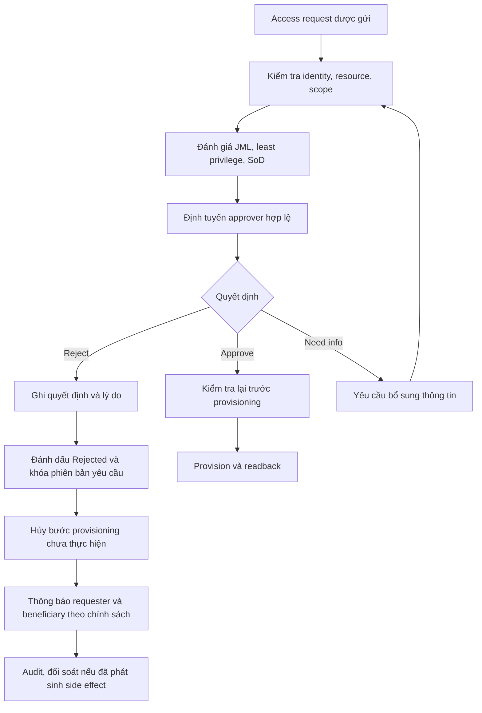

# Từ chối yêu cầu trong Approval workflow của IAM

**Từ chối yêu cầu (Reject access request)** là quyết định không chấp thuận một đề nghị cấp hoặc thay đổi quyền truy cập, sau khi người có thẩm quyền hoặc chính sách đánh giá thông tin về người nhận quyền, tài nguyên, phạm vi, mục đích và rủi ro. Trong **Identity and Access Management (IAM)**, từ chối là một kết quả hợp lệ của quy trình approval, giúp thực thi **least privilege**, **Separation of Duties (SoD)** và những ràng buộc khác trước khi quyền được provision tới hệ thống đích.

Ví dụ, một nhân viên đề nghị role `production-admin` để xem log ứng dụng. Người phê duyệt có thể **từ chối role admin quá rộng**, giải thích rằng tác vụ chỉ cần role `log-reader`, và hướng dẫn gửi yêu cầu thay thế phù hợp. Quy trình tốt không chỉ hiển thị nút “Reject” mà còn **chặn provisioning, ghi bằng chứng, thông báo có kiểm soát và ngăn yêu cầu bị tái sử dụng trái phép**.

Trong vòng đời danh tính **Joiner–Mover–Leaver (JML)**, từ chối yêu cầu phải dựa trên trạng thái quan hệ hiện tại. Một request được gửi khi Joiner chưa đến ngày hiệu lực, khi Mover không còn nhu cầu cũ hoặc sau khi Leaver phải được xử lý sao cho không tạo **quyền truy cập tồn dư**. Tích hợp **IdP, SSO, SCIM, RBAC/ABAC, tài khoản dịch vụ, kiểm toán và reconciliation** giúp quyết định từ chối có hiệu lực trên thực tế.

## 1. Từ chối có ý nghĩa gì trong access request?

Một access request thường có các bên và thông tin:

- **Requester:** người gửi đề nghị, có thể khác người nhận quyền.
- **Beneficiary:** nhân viên, đối tác hoặc workload dự kiến nhận quyền.
- **Resource:** ứng dụng, dữ liệu, API, nhóm, hạ tầng hoặc secret được bảo vệ.
- **Entitlement:** permission, role, group membership hoặc ACL đang được yêu cầu.
- **Scope:** tenant, dự án, môi trường, tài nguyên cụ thể và ngày hiệu lực.
- **Approver:** người được chính sách ủy quyền ra quyết định, có thể là manager, data owner hay application owner.
- **Policy:** quy tắc về eligibility, thẩm quyền, SoD, least privilege, thời hạn và dữ liệu nhạy cảm.

**Reject** nghĩa là đề nghị này **không được cấp theo quyết định hiện tại**. Nó không nhất thiết khẳng định người gửi có ý đồ xấu và cũng không mặc nhiên xóa những quyền người đó đang hợp lệ sở hữu từ trước. Nếu cần thu hồi quyền đã tồn tại, phải có workflow **deprovision/revoke** riêng hoặc được kết nối rõ ràng.

## 2. Phân biệt Reject, Deny, Cancel và Expire

| Kết quả/trạng thái | Ai hoặc điều gì kích hoạt | Ý nghĩa | Hệ quả |
| --- | --- | --- | --- |
| **Rejected** | Approver hợp lệ hoặc chính sách phê duyệt | Không chấp thuận yêu cầu cấp/thay quyền cụ thể | Không provision entitlement được yêu cầu |
| **Authorization Deny** | PDP/PEP tại thời điểm truy cập | Request thực thi không thỏa policy | API/tài nguyên từ chối hành động hiện tại |
| **Cancelled** | Requester hoặc workflow theo quyền hạn | Yêu cầu được rút/hủy trước khi hoàn thành | Không tiếp tục cấp quyền |
| **Expired** | Thời hạn xử lý/yêu cầu hết hiệu lực | Quyết định cũ không còn đủ căn cứ | Cần yêu cầu mới hoặc xét lại |
| **Failed provisioning** | Connector/ứng dụng đích | Đã được duyệt nhưng cập nhật quyền không thành công | Không được gán nhầm trạng thái Rejected |
| **Revoked** | Quy trình thu hồi quyền đang tồn tại | Entitlement đã cấp bị gỡ/vô hiệu | Phải kiểm chứng trạng thái ở đích |

**Approval Rejected khác Authorization Deny.** Người dùng có thể bị từ chối một yêu cầu role mới nhưng vẫn dùng những quyền đã được cấp hợp lệ. Ngược lại, một yêu cầu được phê duyệt chưa chắc API cho phép thao tác nếu sai tenant hoặc account đã bị vô hiệu hóa.

## 3. Những lý do thường dẫn tới từ chối

| Nhóm lý do | Tình huống minh họa | Biện pháp tiếp theo |
| --- | --- | --- |
| **Không đủ điều kiện JML** | Beneficiary đã Leaver hoặc hợp đồng hết hạn | Ngăn cấp mới, kiểm tra quyền cũ |
| **Không có nhu cầu hợp lệ** | Quyền không phục vụ nhiệm vụ được giao | Nêu yêu cầu nghiệp vụ cần bổ sung |
| **Quyền quá rộng** | Xin `admin` để chỉ đọc log | Đề xuất role ít đặc quyền hơn |
| **Sai tài nguyên hoặc tenant** | Yêu cầu dữ liệu thuộc khách hàng khác | Chọn resource đúng phạm vi |
| **Vi phạm SoD** | Đồng thời tạo và phê duyệt thanh toán | Điều chỉnh quyền hoặc tách trách nhiệm |
| **Thiếu phê duyệt bắt buộc** | Data owner không đồng ý truy cập dữ liệu mật | Không cấp, chuyển quy trình phù hợp nếu có |
| **Vượt thời hạn/chính sách** | Xin đặc quyền vô thời hạn thay vì JIT | Đề nghị giới hạn thời gian |
| **Dữ liệu không đáng tin** | Không xác minh được beneficiary/owner | Bổ sung dữ liệu qua nguồn thẩm quyền |
| **Tài nguyên đã ngừng hoạt động** | Request tới hệ thống retired | Cập nhật catalog và chuyển nguồn phù hợp |
| **Rủi ro bảo mật không chấp nhận được** | Workload muốn token có scope toàn tenant | Tách identity và giảm scope |

**Không nên từ chối với lý do mơ hồ “không thích”** khi có thể giải thích dựa trên policy và tác vụ. Tuy nhiên, thông báo cho requester cũng không được tiết lộ bí mật về cấu hình nội bộ hoặc tiêu chí phát hiện gian lận nhạy cảm.

## 4. Luồng từ chối yêu cầu an toàn



Một quy trình hợp lệ phải bảo đảm **không có nhánh tự động từ Rejected sang Provisioned**. Nếu một workflow cho phép sửa yêu cầu hoặc mở lại, đó phải là **chuyển trạng thái có điều kiện**, tạo bản ghi quyết định mới và kiểm tra lại tất cả yêu cầu về phê duyệt.

## 5. Ai có quyền Reject?

Không phải ai thấy một yêu cầu cũng có quyền từ chối thay mặt tổ chức.

**Approver** cần có thẩm quyền với đúng resource hoặc loại entitlement. Ví dụ:

- **Manager** xác nhận nhu cầu công việc; có thể từ chối nếu không thuộc nhiệm vụ.
- **Data owner** từ chối truy cập dữ liệu nhạy cảm ngoài mục đích được chấp nhận.
- **Application owner** xác nhận role có tồn tại và phạm vi kỹ thuật có khả thi.
- **Security/IAM** từ chối khi có vi phạm chính sách, SoD hoặc eligibility.
- **Sponsor của đối tác** từ chối khi hợp đồng không còn phù hợp.

Hệ thống phải kiểm tra **quyền quyết định tại backend**, không chỉ ẩn nút Reject trên UI. Một người không có thẩm quyền không được tự gọi API cập nhật `status=Rejected` cho yêu cầu của người khác.

Nếu approver đã đổi vai trò hoặc Leaver, ủy quyền phê duyệt phải được tính lại từ nguồn có thẩm quyền. Tránh để một account cũ tiếp tục quyết định qua cookie/session tồn dư.

## 6. Mô hình trạng thái và chuyển trạng thái

Một ví dụ state machine:

| Trạng thái đầu | Sự kiện | Trạng thái đích | Điều kiện |
| --- | --- | --- | --- |
| `Submitted` | Đủ dữ liệu ban đầu | `PendingApproval` | Request version hợp lệ |
| `PendingApproval` | Approver từ chối | `Rejected` | Approver có thẩm quyền |
| `PendingApproval` | Cần bổ sung | `NeedsInformation` | Không provision trong lúc chờ |
| `PendingApproval` | Đủ approvals | `Approved` | Đúng chính sách nhiều cấp |
| `PendingApproval` | Requester hủy | `Cancelled` | Theo điều kiện hủy |
| `PendingApproval` | Hết hạn | `Expired` | Không có quyết định hợp lệ |
| `Rejected` | Gửi yêu cầu mới | `Submitted` của request mới | Mở vòng xét duyệt độc lập |

Tên trạng thái chỉ mang tính minh họa. Nhiều hệ thống có workflow song song hoặc đa cấp, vì vậy cần xác định rõ khi **một người Reject thì cả request có bị từ chối ngay không**. Điều này phải theo chính sách: chẳng hạn yêu cầu tất cả approver đồng ý thì một quyết định từ chối có thể kết thúc request, trong khi một quy trình khác có tuyến xử lý khiếu nại hoặc escalation độc lập.

## 7. Lý do Reject phải có cấu trúc và dễ truy vết

Một phản hồi tốt gồm **reason code**, diễn giải ngắn và hướng khắc phục nếu có.

```json
{
  "requestId": "AR-2048",
  "requestVersion": 3,
  "decision": "REJECTED",
  "reasonCode": "EXCESSIVE_PRIVILEGE",
  "comment": "Nhiệm vụ chỉ cần quyền đọc log trong project A.",
  "recommendedEntitlement": "project-a-log-reader",
  "decidedAt": "2026-11-23T03:15:00Z"
}
```

Đây là **dữ liệu minh họa**, không phải schema chuẩn của IAM/SCIM. Trường `approverId`, `decidedAt` và thẩm quyền ra quyết định phải do backend xác nhận hoặc ghi nhận. Không tin giá trị do client tự gửi rồi coi là bằng chứng hợp lệ.

Nên tách:

- **Reason code chuẩn hóa:** dễ thống kê, cảnh báo và xây hướng dẫn.
- **Nội dung giải thích:** rõ người dùng cần sửa yêu cầu như thế nào.
- **Ghi chú nội bộ:** dành cho người phê duyệt, đội an ninh hoặc kiểm toán theo quyền hạn.
- **Bằng chứng policy:** phiên bản quy tắc hoặc ràng buộc đã đánh giá.
- **Dấu vết thao tác:** người quyết định, thời điểm và kết quả thông báo.

Không lưu mật khẩu, token, recovery code hay dữ liệu cá nhân không cần thiết trong bình luận từ chối.

## 8. Từ chối vì least privilege

Một yêu cầu có thể có mục đích hợp lệ nhưng **mức quyền không phù hợp**. Đây là trường hợp cần phân biệt nhu cầu nghiệp vụ với entitlement được đề nghị.

Ví dụ: kỹ sư cần xem log để điều tra sự cố nhưng yêu cầu role `production-admin`.

Hướng xử lý tốt:

1. Từ chối role `production-admin` vì phạm vi vượt nhiệm vụ.
2. Giải thích nhóm quyền đọc log có thể đáp ứng nhu cầu.
3. Cung cấp lựa chọn `log-reader` theo namespace/dự án.
4. Nếu cần thao tác sửa chữa, dùng **Just Enough Administration (JEA)** hoặc **Just-in-Time (JIT)** với thời hạn/phê duyệt.
5. Khi gửi yêu cầu mới, kiểm tra lại role, scope, account và phiên bản policy.

**Không tự thay entitlement từ admin xuống reader rồi cấp quyền dựa trên approval cho admin** nếu hệ thống không có quy tắc cho phép sửa phạm vi được duyệt. Yêu cầu mới hoặc quyết định có phạm vi chỉnh sửa phải được ghi rõ.

## 9. Từ chối vì Separation of Duties

**Separation of Duties (SoD)** ngăn tập hợp quyền tạo xung đột chức năng, ví dụ cùng một người vừa lập vừa tự duyệt lệnh thanh toán.

| Loại kiểm soát | Ví dụ gây Reject |
| --- | --- |
| **Static SoD** | Người đã có `payment-creator` xin thêm `payment-approver` bị cấm đồng thời |
| **Dynamic SoD** | Yêu cầu kích hoạt hai role xung đột trong cùng phiên |
| **Transaction-level SoD** | Người tạo hóa đơn yêu cầu quyền phê duyệt chính hóa đơn đó |
| **Approval SoD** | Người yêu cầu quyền nhạy cảm cố tự phê duyệt yêu cầu |

SoD có thể dựa vào **role trực tiếp, role kế thừa, nhóm lồng nhau, quyền tại ứng dụng và quan hệ tài nguyên**. Kiểm tra chỉ một trường `role` của IdP có thể bỏ sót quyền đã cấp trực tiếp trong ERP.

Nếu chính sách cho phép ngoại lệ vì tình huống khẩn cấp, phải có chủ thể phê duyệt độc lập, thời hạn, phạm vi và hậu kiểm. Không sử dụng tùy tiện cờ `urgent=true` để bỏ qua SoD.

## 10. Từ chối và vòng đời Joiner

Khi Joiner, quyền cơ bản có thể được cấp tự động theo policy nhưng quyền nhạy cảm cần đánh giá riêng. Một yêu cầu có thể bị từ chối nếu:

- Hồ sơ nhân sự chưa được xác minh hoặc identity correlation chưa chắc chắn.
- Ngày hiệu lực quan hệ chưa đến và yêu cầu đòi truy cập sớm ngoài chính sách.
- Quyền không thuộc nhiệm vụ của vị trí mới.
- Tài nguyên/tenant hoặc role được chọn quá rộng.
- Yêu cầu thiếu sponsor hoặc owner cho quyền nhạy cảm.

**Từ chối một quyền đặc biệt không nhất thiết chặn toàn bộ onboarding**. IAM có thể tiếp tục cấp birthright access hợp lệ, trong khi giữ quyền nhạy cảm ở trạng thái không được cấp.

Ví dụ nhân viên mới cần truy cập knowledge base nhưng xin thêm quyền `security-admin`. Approval có thể từ chối admin và vẫn cho phép các quyền thông thường theo quy trình độc lập.

## 11. Từ chối và vòng đời Mover

Ở giai đoạn Mover, người dùng thay đổi bộ phận hoặc dự án. Quyền thuộc vị trí cũ có thể không còn hợp lệ dù trước đây từng được phê duyệt.

| Tình huống | Quyết định | Công việc liên quan |
| --- | --- | --- |
| Nhân viên Finance đã sang Analytics xin lại quyền duyệt hóa đơn | Reject nếu không còn nhiệm vụ | Gỡ role Finance tồn dư tại ERP |
| Người từ dự án A xin tiếp tục toàn bộ dữ liệu A | Reject hoặc yêu cầu ngoại lệ bàn giao có hạn | Thu hồi ACL cũ |
| Nhân viên mới giữ trách nhiệm được cấp quyền đọc hạn chế | Có thể duyệt sau xét policy | Cấp đúng tài nguyên mới |
| Yêu cầu quá phạm vi vì chức danh thay đổi | Reject mức quyền rộng | Đề xuất scope đúng và giới hạn thời gian |

**Từ chối yêu cầu mới không tự động thu hồi quyền cũ.** Nếu Mover đã có role `invoice-approver` trực tiếp trong ERP, quyết định Reject một yêu cầu tương tự không làm role ERP biến mất. Cần **deprovision và readback** riêng.

## 12. Từ chối và vòng đời Leaver

Khi người dùng đã Leaver hoặc hợp đồng partner hết hiệu lực, các yêu cầu cấp quyền đang chờ phải bị **hủy hoặc từ chối theo chính sách**. Một approval được ghi trước ngày nghỉ không nên được dùng để provision quyền sau thời điểm mất điều kiện.

Quy trình phải:

1. Nhận trạng thái quan hệ từ nguồn HR/contract đáng tin.
2. Đánh giá lại eligibility trước mọi lần provisioning.
3. Ngăn yêu cầu mới cho beneficiary không còn hợp lệ.
4. Đóng pending request cũ bằng trạng thái và reason code phù hợp.
5. Đồng bộ disable/deprovision account, role, group và ACL tại đích.
6. Kiểm soát session, refresh/access token hoặc API key còn khả năng truy cập.
7. Thử negative authorization và lưu bằng chứng.

**Reject một access request không phải toàn bộ quy trình Leaver.** Một user có thể không xin quyền mới nhưng vẫn còn credential hoạt động. Phải thu hồi **đường truy cập thực tế**, không chỉ cập nhật ticket.

## 13. Rejection với IdP, SSO, SCIM và authorization

| Thành phần | Khi request bị Reject | Giới hạn |
| --- | --- | --- |
| **IAM/IGA** | Đánh dấu quyết định, không tạo desired entitlement mới | Cần xử lý workflow chạy đồng thời |
| **IdP/SSO** | Không thêm group/claim mới vì request đã bị từ chối | Account vẫn có thể xác thực cho quyền khác |
| **SCIM/connector** | Không được provision entitlement bị Reject | Connector có thể đã nhận lệnh trước khi Reject |
| **RBAC/ABAC/PBAC** | Chỉ Permit các hành động còn căn cứ | Chính sách runtime độc lập với ticket approval |
| **Application** | Không cấp role trực tiếp từ request bị từ chối | Quyền cũ có thể còn |
| **Audit/reconciliation** | Ghi quyết định và phát hiện lệch | Phải đọc trạng thái đích khi có khả năng race |

Nếu connector đã gửi lệnh trước khi quyết định Reject đến, cần có cơ chế **đối soát, bù trừ và xử lý xung đột** thay vì giả định mọi thành phần chạy trong một giao dịch nguyên tử.

## 14. Race condition: Reject trong khi provisioning

Một lỗi nghiêm trọng xảy ra khi hai luồng xử lý đồng thời:

- Workflow A nhận quyết định `Approved` và bắt đầu provisioning.
- Workflow B nhận `Rejected` hoặc `Cancelled` từ một tác nhân khác.
- Connector A vẫn cấp quyền sau khi request bị đóng.

Cách thiết kế:

1. **State transition có điều kiện:** chỉ cho phép thay đổi từ trạng thái thích hợp và xử lý phiên bản.
2. **Immutable decision record:** quyết định gắn với đúng request version, resource và scope.
3. **Pre-provisioning revalidation:** kiểm tra trạng thái hiện tại, approval đầy đủ, beneficiary và thời hạn.
4. **Idempotency:** tránh việc retry tạo thêm role hoặc account sai.
5. **Cancellation fencing:** nếu đã có lệnh đang chạy, phải ghi nhận và kiểm tra kết quả cuối.
6. **Compensating action:** khi quyền được cấp ngoài ý muốn, kích hoạt deprovision phù hợp.
7. **Readback:** xác minh entitlement thực tế sau khi các luồng hoàn tất.

Không thể chỉ ghi `status=Rejected` vào cơ sở dữ liệu yêu cầu mà không quản lý hàng đợi provisioning. **Nhật ký và readback mới cho biết quyền có thực sự được cấp nhầm không**.

## 15. Có được mở lại yêu cầu bị từ chối không?

Có thể có quy trình **appeal, resubmit hoặc review lại**, nhưng không nên âm thầm đổi một yêu cầu `Rejected` sang `Approved` rồi tái sử dụng bằng chứng cũ.

Một cơ chế an toàn cần:

- Nêu rõ **lý do phản hồi hoặc bằng chứng mới**.
- Tạo request mới hoặc version mới với lịch sử bất biến.
- Định tuyến đúng owner hiện hành, không cho requester lựa chọn người duyệt có lợi.
- Kiểm tra lại trạng thái JML, tài nguyên và entitlement.
- Đánh giá SoD, least privilege và thời hạn hiện tại.
- Không cấp quyền khi còn thiếu approval bắt buộc.
- Liên kết request mới với request bị từ chối để audit được toàn bộ chuỗi.

Ví dụ người dùng trước đó xin `production-admin` bị từ chối, sau đó xin `log-reader` cho một dự án cụ thể. Đây là yêu cầu **khác phạm vi** và có thể được xét theo policy mới, không phải lý do để “đảo ngược” quyết định cũ.

## 16. Thông báo từ chối rõ ràng nhưng bảo mật

Thông báo tới requester nên giải thích **quyền nào bị từ chối**, lý do ở mức phù hợp và bước tiếp theo.

Ví dụ cách diễn đạt:

> Yêu cầu cấp quyền quản trị production cho dự án A không được chấp thuận vì phạm vi quyền vượt quá nhu cầu đọc log đã mô tả. Bạn có thể gửi yêu cầu quyền đọc log dành cho dự án A và nêu khoảng thời gian sử dụng cần thiết.

Thông báo không nên chứa credential, token, chi tiết bí mật của chính sách phát hiện rủi ro hoặc dữ liệu nhân sự nhạy cảm. Với các trường hợp nghi ngờ lạm dụng, có thể dùng reason code tổng quát cho người yêu cầu, còn phân tích chi tiết được giới hạn trong hệ thống an ninh.

**Từ chối không nên tạo vòng lặp bế tắc**: khi yêu cầu hợp lệ nhưng mô tả chưa đủ, trạng thái `NeedsInformation` có thể phù hợp hơn `Rejected`, tùy quy trình.

## 17. Từ chối quyền dành cho partner và workload

### Đối tác B2B

Một partner có thể đăng nhập thành công qua IdP liên kết nhưng không mặc nhiên được cấp quyền cho mọi hợp đồng hoặc tenant. IAM nên từ chối nếu request:

- Không có sponsor hoặc hợp đồng còn hiệu lực.
- Chọn resource thuộc tenant/partner khác.
- Xin scope dữ liệu rộng hơn hợp đồng.
- Có thời hạn vượt thời gian hợp tác.
- Trùng hoặc xung đột với entitlement đã có.

Nếu partner đã hết hợp đồng, cần **thu hồi quyền cũ và session**, không chỉ từ chối yêu cầu mới.

### Service account / workload identity

Một workload muốn dùng `cloud-admin` để chỉ đọc dữ liệu báo cáo là yêu cầu quá quyền. Approver có thể từ chối và đề nghị scope nhỏ hơn.

Đối với workload cần kiểm tra **service ID, owner, môi trường, API audience, quyền thật sự cần, credential lifecycle và tính phụ thuộc**. Không tự gán quyền máy–máy cho tài khoản cá nhân của kỹ sư. Khi owner nhân sự Leaver, phải rà soát quyền quản trị secret và chuyển ownership workload.

## 18. Chỉ số và kiểm toán quyết định Reject

Các thông tin audit nên có: request ID/version, requester, beneficiary, resource ID, entitlement/scope, approver ID, policy version, reason code, thời điểm, trạng thái trước–sau, correlation ID, có/không lệnh provisioning và kết quả readback nếu liên quan.

Các chỉ số hữu ích:

| Chỉ số | Mục đích |
| --- | --- |
| **Rejection rate by reason** | Nhận diện request vượt quyền hoặc catalog khó hiểu |
| **Repeat rejected requests** | Phát hiện nhu cầu chưa được hướng dẫn hoặc lạm dụng |
| **Provisioned-after-reject incidents** | Phát hiện race condition nguy hiểm |
| **Unauthorized decision attempts** | Theo dõi người không có thẩm quyền cố Reject/Approve |
| **Pending-to-rejected lead time** | Đo thời gian ra quyết định |
| **Appeal outcome rate** | Đánh giá chất lượng lý do và quy trình review |
| **Mover residual entitlement count** | Đo quyền cũ tồn dư sau đổi nhiệm vụ |
| **Leaver time to deny** | Đo tốc độ thực tế chặn truy cập |
| **Policy-driven rejection accuracy** | Kiểm tra quyết định tự động với dữ liệu nguồn |
| **Approval routing errors** | Nhận diện sai owner/approver |

Một tỷ lệ Reject cao **không tự động chứng minh an ninh tốt**; có thể do catalog khó hiểu, quyền cấp quá thô hoặc chính sách lỗi. Cần phân tích nguyên nhân cùng tỷ lệ cấp đúng quyền và khả năng hoàn thành nhiệm vụ.

## 19. Ma trận kiểm thử workflow Reject

| Tình huống | Kết quả mong muốn |
| --- | --- |
| Approver hợp lệ nhấn Reject | Request chuyển Rejected, không provision |
| User không có thẩm quyền gọi API Reject | Bị từ chối ở backend |
| Một cấp duyệt Reject trong workflow yêu cầu tất cả đồng ý | Không cấp theo combining rule đã định |
| Request cần bổ sung dữ liệu | Chuyển NeedInfo thay vì cấp tự động |
| Beneficiary Leaver trước khi provision | Không cấp từ approval cũ |
| Mover xin lại quyền không còn căn cứ | Reject và kiểm tra quyền cũ tồn dư |
| Request bị Cancelled rồi connector retry | Không tạo entitlement mới |
| Approved và Rejected xảy ra đồng thời | Chuyển trạng thái nhất quán; không cấp ngoài ý muốn |
| Request mới sau khi Rejected | Đánh giá lại theo version và policy hiện tại |
| Partner chọn tenant sai | Reject, không tiết lộ dữ liệu tenant khác |
| Workload xin quyền admin khi chỉ cần read | Reject hoặc đề xuất scope tối thiểu |
| Connector lỡ cấp quyền dù Rejected | Phát hiện qua readback, bù trừ và audit |

Không nên chỉ kiểm thử giao diện. Cần mô phỏng **API gọi trực tiếp, sự kiện trùng/lệch thứ tự, retry connector, thiếu dữ liệu owner và thay đổi JML** để bảo đảm trạng thái Reject ngăn cấp quyền ở mọi đường thực thi.

## 20. Câu hỏi tự kiểm tra

**Tình huống A:** Request xin `crm-admin` để xem báo cáo bị từ chối. Người dùng có nên mất mọi quyền CRM trước đó không? **Không mặc nhiên.** Reject chỉ áp dụng cho yêu cầu cụ thể; thu hồi quyền cũ cần căn cứ riêng.

**Tình huống B:** Request đã bị Reject nhưng job provisioning trong hàng đợi vẫn cấp role. Nguyên nhân kiểm soát? **Thiếu state fencing/revalidation và reconciliation.**

**Tình huống C:** Người dùng bị từ chối quyền Finance sau khi Mover sang Analytics, nhưng ERP vẫn còn role Finance gán từ trước. Quy trình hoàn tất chưa? **Chưa.** Phải thu hồi entitlement tồn dư tại ERP.

**Tình huống D:** Người không có quyền phê duyệt tự gọi API với `decision=REJECTED`. Có thể tin request không? **Không.** Kiểm tra thẩm quyền và session ở backend.

**Tình huống E:** Beneficiary đã Leaver nhưng access request cũ được gửi trước ngày nghỉ. Có thể provision vì request từng hợp lệ không? **Không.** Phải kiểm tra lại trạng thái hiện hành.

**Tình huống F:** Người dùng nhận lý do Reject “cấm truy cập” dù chỉ thiếu project ID. Cách xử lý tốt hơn? **Yêu cầu bổ sung thông tin** nếu quy trình hỗ trợ và không có quyết định từ chối thực chất.

## Ghi nhớ

**Từ chối yêu cầu trong Approval workflow** là quyết định **không chấp thuận một entitlement được đề nghị**, dựa trên thẩm quyền, dữ liệu hợp lệ, **least privilege, SoD và trạng thái Joiner–Mover–Leaver**. Quyết định Reject phải **gắn đúng request version, lý do, người quyết định và phạm vi**, đồng thời ngăn provisioning đang chờ, xử lý race condition, thông báo phù hợp và lưu audit. **Reject không tự xóa quyền cũ**; khi cần phải phối hợp **IdP/SSO, SCIM/connector, RBAC/ABAC, service identity và reconciliation** để xác minh quyền thực tế không bị cấp sai hoặc tồn dư.
