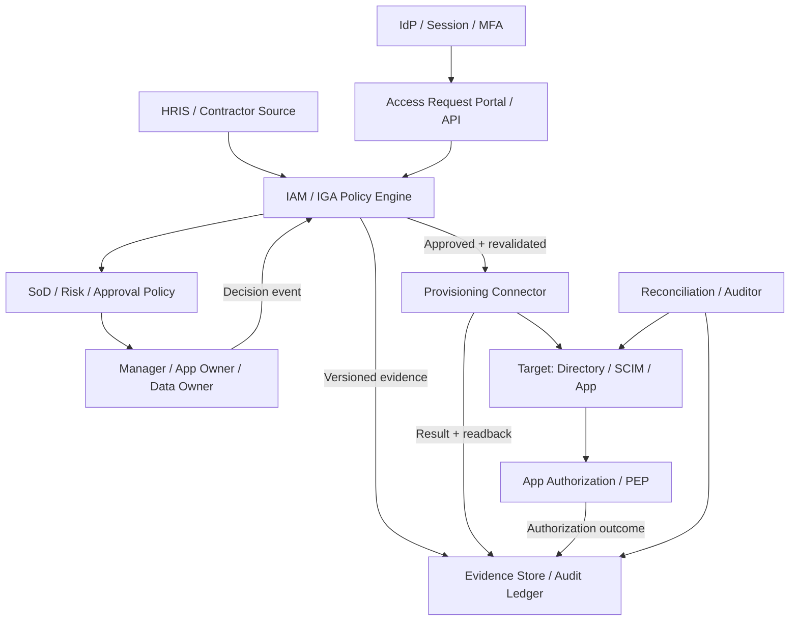
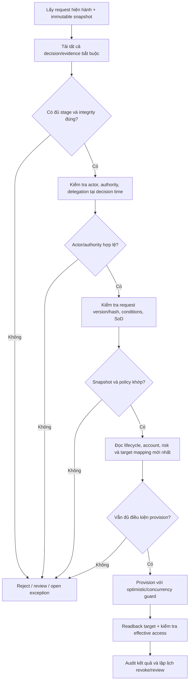

# Bằng chứng approval trong IAM và vòng đời Joiner–Mover–Leaver

## Mục tiêu học tập

Sau bài học, người học có thể:

1. Giải thích **bằng chứng approval (approval evidence)** là gì trong quy trình phê duyệt quyền truy cập IAM và phân biệt nó với **request**, **decision**, **grant**, **provisioning response**, **effective access** và **audit log**.
2. Xác định những bằng chứng cần lưu về **người duyệt, thẩm quyền phê duyệt, nội dung được duyệt, thời điểm, ngữ cảnh, phiên bản policy, kiểm tra SoD, điều kiện và hiệu lực của quyết định**.
3. Thiết kế một **approval evidence envelope** liên kết các sự kiện từ yêu cầu quyền đến quyết định và kết quả thực thi, có correlation ID và immutable request snapshot.
4. Hiểu khả năng và giới hạn của **hash, chữ ký số, HMAC, log append-only, timestamp, bảo vệ khóa và chuỗi bằng chứng** trong việc phát hiện thay đổi hoặc giả mạo.
5. Xử lý bằng chứng từ **portal, API, ticket, email, chat, phê duyệt được ủy quyền, multi-stage approval, auto-approval và break-glass** mà không tự coi mọi tín hiệu là một quyết định hợp lệ.
6. Rà soát **approval còn hiệu lực hay không** khi nội dung request bị sửa, nguồn quyền thay đổi, approver mất thẩm quyền hoặc người nhận quyền bị Mover/Leaver.
7. Kết nối approval evidence với **IdP/SSO, SCIM, RBAC/ABAC, PAM, JIT, access review** và cơ chế xác minh quyền thực tế tại ứng dụng.
8. Thiết kế quy trình kiểm toán, retention, bảo vệ dữ liệu, đối soát và xử lý sự cố bảo đảm truy vết được các quyền đã được cấp hoặc thu hồi.

## 1. Bằng chứng approval là gì?

Trong **Identity and Access Management (IAM)**, **approval** là quyết định của chủ thể hoặc policy engine có thẩm quyền đối với một yêu cầu quyền, chẳng hạn **Approve, Reject, Request more information** hoặc một quyết định có điều kiện.

**Bằng chứng approval (approval evidence)** là tập dữ liệu và dấu vết đủ đáng tin để trả lời: **ai hoặc cơ chế nào đã quyết định, được phép quyết định theo căn cứ nào, đã quyết định đối với nội dung gì, vào thời điểm nào, với kết quả và điều kiện nào, và quyết định đó đã được hệ thống sử dụng ra sao?**

Ví dụ: Lan yêu cầu quyền `invoice.approve` ở chi nhánh A trong 7 ngày. Manager xác nhận nhu cầu, application owner chấp thuận và IGA thực hiện kiểm tra SoD. Một bộ bằng chứng thích hợp phải cho thấy:

- Request thực sự nhắm tới **Lan, đúng account và tenant**.
- Entitlement chính xác là `invoice.approve`, scope chỉ chi nhánh A, hiệu lực tối đa 7 ngày.
- Người duyệt đã được xác thực bằng phiên hoặc cơ chế phù hợp.
- Manager và application owner có **thẩm quyền tương ứng tại thời điểm duyệt**.
- Quyết định gắn với đúng **request version**, chứ không phải một bản yêu cầu khác.
- Chính sách và kết quả SoD được ghi theo version đã áp dụng.
- Thời điểm và trạng thái quyết định rõ ràng: `APPROVED`, `REJECTED` hay `CONDITIONALLY_APPROVED`.
- Sau approval, connector và hệ thống đích có **bằng chứng riêng** về quyền được cấp/thực thi.

**Điểm quan trọng:** ghi “Approved by manager” trong ticket không tự bảo đảm bằng chứng đầy đủ. Cần xác minh **manager nào, manager có thẩm quyền không, đã xác thực thế nào, nội dung lúc duyệt có thay đổi không và quyết định có còn hợp lệ khi provisioning không**.

### 1.1. Phân biệt các lớp bằng chứng

| Lớp | Câu hỏi | Ví dụ evidence |
|---|---|---|
| **Request evidence** | Ai xin quyền gì, cho ai, vì sao, trong phạm vi nào? | Request snapshot + request ID |
| **Eligibility evidence** | Người nhận có đủ điều kiện không? | HR/contractor state, project assignment |
| **Approval evidence** | Ai hoặc policy nào duyệt đúng nội dung đó? | Actor, authority, approval result, version |
| **Policy evidence** | Quy tắc nào quyết định được/không được duyệt? | Policy ID/version, SoD/risk outcome |
| **Provisioning evidence** | Lệnh cấp/gỡ quyền có được gửi và ghi tại đích? | Connector operation, target response |
| **Readback evidence** | Đích có đúng role/group/scope đã duyệt không? | GET target User/Group/role |
| **Runtime authorization evidence** | Quyền thực tế có được cho phép/từ chối đúng không? | PEP/PDP decision, app evaluation |
| **Revocation evidence** | Quyền có bị chặn khi hết hạn, Mover hoặc Leaver không? | Gỡ grant, token/session handling, readback |

Không nên đóng một case với nhãn `GRANTED_VERIFIED` chỉ vì **approval evidence** đã đầy đủ. Đây là hai sự kiện khác nhau với những nguồn dữ liệu khác nhau.

### 1.2. Bằng chứng approval phải liên kết được với nguyên nhân cấp quyền

Một bản ghi approval có thể không nằm cùng nơi lưu account/group. Để điều tra, phải nối được:

```text
Nguồn IAM/HR
  → Access request v3
  → Eligibility & SoD checks
  → Manager decision
  → Application owner decision
  → Final approval decision
  → Provisioning job / SCIM request
  → Target User/Group/role
  → Effective authorization
  → Expiry / Mover / Leaver revoke
  → Evidence review
```

Mỗi tầng có thể tạo ra sự kiện riêng nhưng cần chung **request ID, grant ID, correlation ID, target ID và policy version** ở phạm vi phù hợp.

## 2. Câu hỏi điều tra mà bằng chứng phải trả lời

Khi kiểm toán hỏi: “Tại sao Bình có quyền xuất dữ liệu khách hàng trong tháng trước?”, một hệ thống IAM có khả năng truy vết phải trả lời được:

1. **Ai là người nhận quyền?** Identity ID và account ID nào? Có đúng tenant/pháp nhân không?
2. **Ai gửi yêu cầu?** Requester có khác beneficiary không? Có quyền request thay mặt không?
3. **Yêu cầu quyền nào?** Role/permission/group/entitlement ID và mapping tại ứng dụng?
4. **Phạm vi và thời gian nào?** Resource, action, validFrom/validUntil, reason/ticket?
5. **Ai là người duyệt?** Identity/account của approver, phương thức xác thực và authority snapshot?
6. **Approver có thẩm quyền không?** Vai trò owner, manager/sponsor, delegation, hạn ủy quyền?
7. **Có kiểm tra SoD và rủi ro không?** Kết quả, rule, policy version và ngoại lệ?
8. **Đã duyệt bản request nào?** Version/hash nội dung có trùng với phần đã provision?
9. **Approval có xảy ra trước lệnh cấp quyền không?** Timeline và event sequence?
10. **Có bị hủy, thay thế hoặc hết hạn không?** Trạng thái cuối tại thời điểm provision?
11. **Quyền có được cấp đúng không?** Target readback và effective access?
12. **Đã được thu hồi khi mất điều kiện chưa?** Mover/Leaver/expiry, app session/token và audit?

Một chuỗi log chỉ có `requestId=123 status=approved` không đủ trả lời toàn bộ những câu hỏi này.

## 3. Những nguyên tắc quản trị approval evidence

Bằng chứng có giá trị khi bảo đảm đồng thời các đặc tính:

- **Tính liên kết (binding):** gắn decision với đúng request snapshot, beneficiary, entitlement và tenant.
- **Tính xác thực nguồn (authenticity):** biết actor/service tạo quyết định và xác minh nguồn phát.
- **Tính thẩm quyền (authority):** actor/policy có quyền đưa ra quyết định đối với entitlement tại thời điểm liên quan.
- **Tính toàn vẹn (integrity):** thay đổi trái phép được ngăn ngừa hoặc có thể phát hiện.
- **Tính thời gian (temporal correctness):** lưu thời điểm, version, hiệu lực, thứ tự xử lý.
- **Tính đầy đủ (completeness):** đủ các bước bắt buộc, kể cả rejected, cancelled và exception.
- **Tính truy vết (traceability):** nối tới thao tác cấp/gỡ quyền và bằng chứng đích.
- **Tính tối thiểu dữ liệu (privacy):** không lưu dư PII, credential hoặc token.
- **Tính khả dụng cho kiểm toán (retrievability):** truy xuất được theo retention, có RBAC/SoD và kiểm soát tính nguyên vẹn.
- **Tính tái kiểm tra (verifiability):** người kiểm toán có thể xác minh các assertion quan trọng.

Không có một trường hoặc công nghệ đơn lẻ như hash hay timestamp có thể tự bảo đảm tất cả đặc tính.

### 3.1. Không đánh đồng tính toàn vẹn với tính đúng sự thật

Giả sử một service account bị xâm phạm đã ghi sự kiện “Manager approved”. Nếu log được hash ngay sau khi ghi, hash có thể **bảo đảm nội dung không đổi kể từ lúc hash**, nhưng **không chứng minh manager thực sự đã duyệt**.

Tính toàn vẹn cần đi kèm **xác thực người duyệt, authorization của API quyết định, bảo vệ khóa, nguồn thời gian và cơ chế kiểm tra independent controls**.

### 3.2. Bằng chứng approval không mặc định là chữ ký điện tử pháp lý

Một click `Approve` với session IdP đã xác thực có thể là bằng chứng vận hành nội bộ. Nó **không tự tương đương chữ ký số pháp lý hoặc non-repudiation tuyệt đối**. Giá trị pháp lý tùy quy định, hợp đồng, hình thức xác thực, quy trình và khả năng chứng minh nguồn.

Không tuyên bố mọi approval nội bộ “không thể chối bỏ” chỉ vì hệ thống ghi email người duyệt hoặc dùng SHA-256.

## 4. Kiến trúc thu thập bằng chứng approval

Một quy trình IAM có thể chia thành các thành phần logic:



Trong mô hình này:

- **Access portal** thu request và quyết định người dùng.
- **IdP** cung cấp xác thực của requester/approver; không tự chứng minh authority trên mọi dữ liệu.
- **IAM/IGA** chọn đúng policy, xác minh thẩm quyền, xử lý workflow và version.
- **Owner** đưa ra quyết định thuộc phạm vi thẩm quyền.
- **Evidence store** lưu sự kiện gắn với snapshot và metadata cần thiết.
- **Connector/target** cung cấp dấu vết độc lập cho provisioning.
- **Reconciliation** đọc actual state, tránh chỉ dựa vào ý định trong request.

Bằng chứng có thể được phân tán ở ticketing, IGA, IdP, SIEM, directory hoặc SaaS. Cần biết **system of record cho từng loại bằng chứng**, cách nối dữ liệu và ranh giới đáng tin.

## 5. Immutable request snapshot: duyệt đúng cái gì?

**Nội dung được duyệt** phải được chốt thành một phiên bản không thay đổi hoặc một bản snapshot có thể kiểm chứng tại thời điểm decision.

### 5.1. Những thuộc tính phải ràng buộc vào decision

| Nhóm | Thuộc tính |
|---|---|
| Request | `requestId`, `requestVersion`, `requestType` |
| Chủ thể | `requesterIdentityId`, `beneficiaryIdentityId`, `targetAccountId` |
| Đích | `applicationId`, `targetTenantId`, `entitlementId` |
| Phạm vi | `resourceScope`, `action`, `permissionMapping` |
| Thời gian | `validFrom`, `validUntil`, `requestSubmittedAt` |
| Nghiệp vụ | `businessJustification`, `ticketOrProjectRef` |
| Chính sách | `approvalPolicyId`, `approvalPolicyVersion`, `riskClass` |
| Nguồn | `sourceLifecycleVersion`, `catalogVersion` |
| Nội dung | `requestSnapshotHash` hoặc ID snapshot bất biến |
| Vòng đời | `requestState` lúc duyệt, `decisionSequence` |

Một approval chỉ gắn với `requestId` mà **không có version/snapshot** có thể bị tái sử dụng khi user thay nội dung request sau đó.

### 5.2. Ví dụ đổi quyền sau approval

```text
Request AR-4401 v1:
    Beneficiary: Lan
    Entitlement: ReportReader
    Scope: PROJECT-A
    ValidUntil: 15/12
    Owner approval: Approved v1

Sau đó tạo AR-4401 v2:
    Beneficiary: Lan
    Entitlement: ReportExporter
    Scope: ALL_PROJECTS
    ValidUntil: 31/12
```

Không thể dùng approval v1 để cấp v2. Đây là một dạng **approval replay / scope escalation** nếu hệ thống không ràng buộc nội dung.

Quy trình đúng:

1. Lưu v1 bất biến với decision và dấu thời gian.
2. Tạo v2 mới, đánh dấu quyết định v1 không áp dụng cho fulfillment của v2.
3. Chạy lại eligibility, SoD, risk và approval routing.
4. Chỉ provision khi **tất cả quyết định bắt buộc khớp v2** và vẫn còn hiệu lực.

### 5.3. Canonical snapshot và hash

Để so nội dung, có thể tạo fingerprint bằng cách chuẩn hóa một tập trường đã định rồi tính hash:

```text
requestFingerprint =
    SHA256(canonicalEncode({
        requestId,
        requestVersion,
        beneficiaryIdentityId,
        targetAccountId,
        targetTenantId,
        entitlementId,
        resourceScope,
        validFrom,
        validUntil,
        policyVersion
    }))
```

Đây là pseudocode. **CanonicalEncode** phải được xác định thật cụ thể:

- Thứ tự key không phụ thuộc cách serialize.
- Dữ liệu Unicode và chuỗi được chuẩn hóa nhất quán.
- Phân biệt số và chuỗi, Boolean và null.
- Timestamp được chuyển về định dạng thống nhất.
- Array có thứ tự hay không phải được quy định theo ý nghĩa.
- Những trường ảnh hưởng cấp quyền phải được đưa vào fingerprint.

Hash của một chuỗi JSON ngẫu nhiên có thể khác chỉ vì thứ tự key và **không đủ** để xác minh request nội dung tương đương. Hash cũng **không xác thực người đã duyệt**; nó chỉ hỗ trợ phát hiện thay đổi dữ liệu được băm.

## 6. Approval evidence envelope: cấu trúc một bằng chứng

Một mẫu dữ liệu nội bộ có thể bao gói decision cùng request và những tham chiếu cần thiết:

```json
{
  "evidenceId": "APR-EVD-2026-4801",
  "eventType": "ACCESS_APPROVAL_DECIDED",
  "request": {
    "requestId": "AR-4401",
    "requestVersion": 3,
    "immutableSnapshotId": "REQ-SNAPSHOT-4401-V3",
    "snapshotDigest": "sha256:<illustrative-digest>",
    "beneficiaryIdentityId": "IDN-2048",
    "targetApplicationId": "PROJECT_ANALYTICS",
    "targetTenantId": "corp-vn",
    "entitlementId": "ENT-REPORT-READER",
    "resourceScope": {
      "projectIds": ["PROJECT-A"]
    },
    "validFrom": "2026-12-01T02:00:00Z",
    "validUntil": "2026-12-15T02:00:00Z"
  },
  "decision": {
    "decisionId": "DEC-8091",
    "decision": "APPROVED",
    "decisionStage": "DATA_OWNER",
    "decidedAt": "2026-12-01T01:45:00Z",
    "conditions": [
      "Project A only",
      "Read-only"
    ]
  },
  "actor": {
    "approverIdentityId": "IDN-OWNER-120",
    "authenticatedAccountId": "IDP-U-120",
    "authenticationContextReference": "AUTHN-EVD-991",
    "authorityType": "PROJECT_DATA_OWNER",
    "authoritySnapshotId": "AUTHORITY-120-V7",
    "delegationReference": null
  },
  "checks": {
    "policyId": "project-analytics-approval",
    "policyVersion": "4.2",
    "eligibilityResult": "PASS",
    "sodResult": "PASS",
    "riskDecision": "STANDARD"
  },
  "trace": {
    "correlationId": "IGA-FLOW-7712",
    "eventSequence": 14,
    "capturedAt": "2026-12-01T01:45:01Z"
  }
}
```

Đây là **schema minh họa**, không phải định dạng chuẩn SCIM, SAML, OIDC, JSON Web Signature hoặc một sản phẩm IGA cụ thể. `snapshotDigest` ở ví dụ chỉ là placeholder, **không phải digest hợp lệ có thể dùng xác minh**.

### 6.1. Những ID không nên lẫn lộn

- `requestId` xác định toàn bộ yêu cầu nghiệp vụ.
- `requestVersion` chỉ phiên bản nội dung.
- `decisionId` chỉ một quyết định cụ thể.
- `evidenceId` chỉ bản ghi bằng chứng.
- `correlationId` nối các hệ thống/công việc.
- `targetAccountId` và `targetEntitlementId` xác định nơi áp dụng grant.
- `approverIdentityId` xác định người quyết định; không phải beneficiary.
- `sourceEventId` và `sourceLifecycleVersion` giúp chặn replay của event HR cũ.

Một request có thể có **nhiều decision**, mỗi decision có evidence riêng. Không nên ghi đè `approvedBy` một lần và làm mất dấu vết những giai đoạn trước.

### 6.2. Điều kiện kèm approval

Approval có thể là:

- Chấp thuận đúng entitlement nhưng chỉ trong 7 ngày.
- Chấp thuận quyền đọc nhưng không quyền export.
- Chấp thuận cho project A, không cho project B.
- Chấp thuận nếu có MFA step-up và owner review.
- Chấp thuận có điều kiện sau khi một chứng nhận/kiểm soát hoàn tất.

Nếu hệ thống biểu diễn `CONDITIONALLY_APPROVED`, phải mô hình hóa chính xác **điều kiện nào là bắt buộc** và kiểm chứng chúng trước provision. Không được chuyển mọi approval có điều kiện thành `APPROVED` rồi bỏ qua phần chưa hoàn tất.

## 7. Xác thực người phê duyệt

Một bằng chứng `approverIdentityId` chỉ đáng tin nếu hệ thống biết actor được xác thực và decision thật sự do actor đưa ra hoặc do hệ thống được ủy quyền hợp lệ.

### 7.1. Portal và session IdP

Khi approver bấm `Approve` trong portal:

1. Portal xác minh phiên đăng nhập/token hợp lệ.
2. Actor được xác định bằng identity/account ID ổn định.
3. Portal kiểm tra actor có quyền quyết định request/stage này không.
4. Các điều kiện xác thực tăng cường được kiểm tra nếu policy yêu cầu.
5. Quyết định gắn với request snapshot và tạo event bất biến.
6. Thời điểm ghi do server đáng tin xác định.
7. Evidence tham chiếu authentication event/session context khi phù hợp mà **không lưu token hoặc secret**.

Một mã định danh email hiển thị trong giao diện **không tự chứng minh người sở hữu hộp thư đã chủ động phê duyệt**; cần xác thực theo cơ chế hệ thống.

### 7.2. MFA và step-up

Với quyền cao như `iam.role.assign`, `cloud.admin` hoặc `secrets.read`, tổ chức có thể yêu cầu approver đã thực hiện MFA đủ mạnh và đủ gần thời điểm decision.

Evidence có thể lưu:

```json
{
  "approverIdentityId": "IDN-OWNER-120",
  "authentication": {
    "issuer": "CORPORATE_IDP",
    "assuranceLevel": "STRONG_MFA",
    "authTime": "2026-12-01T01:42:00Z",
    "stepUpPolicyVersion": "approval-mfa-v2"
  }
}
```

Không đưa OTP, passkey private key, WebAuthn secret, access token hoặc recovery code vào evidence. Có thể lưu **tham chiếu sự kiện xác thực** và thông tin assurance tin cậy đủ kiểm toán.

### 7.3. MFA không thay authority

Một người đã xác thực bằng passkey không tự trở thành data owner. **Authentication assurance** trả lời mức tin cậy về ai thực hiện; **approval authority** trả lời người đó có được quyền duyệt yêu cầu cụ thể hay không.

Hai kiểm tra phải tách biệt, cùng phải PASS theo policy.

## 8. Bằng chứng thẩm quyền phê duyệt

Một approval evidence tốt không chỉ lưu **ai duyệt**, mà còn chứng minh **vì sao người đó được phép duyệt**.

### 8.1. Các nguồn thẩm quyền phổ biến

| Loại approver | Nguồn xác nhận | Giới hạn cần kiểm tra |
|---|---|---|
| **Line manager** | HR manager relationship | Có quản lý beneficiary và đúng loại quyền không? |
| **Project sponsor** | Project/contractor management | Dự án còn hoạt động, sponsor còn hiệu lực? |
| **Application owner** | Application ownership catalog | Có quyền duyệt entitlement của ứng dụng này? |
| **Data owner** | Data governance catalog | Có quyền duyệt classification/scope này? |
| **Security reviewer** | Security policy/approval role | Có thẩm quyền duyệt ngoại lệ rủi ro? |
| **PAM approver** | Privileged access policy | Có thể cấp elevated role trong tenant/time window? |
| **Delegated approver** | Delegation registry | Được ủy quyền phạm vi, thời hạn và quyền nào? |
| **Policy engine** | Versioned auto-approval rule | Có rule hợp lệ bao phủ đúng request không? |

Một người là manager tại thời điểm hiện tại **không chứng minh họ là manager tại thời điểm approval lịch sử**. Vì vậy evidence nên có **authority snapshot** hoặc có khả năng khôi phục trạng thái quyền duyệt theo event/version đã lưu.

### 8.2. Approver đổi vị trí sau khi quyết định

Nếu data owner duyệt lúc 09:00 rồi Mover lúc 11:00, approval không nhất thiết bị vô hiệu hồi tố chỉ vì owner không còn vị trí cũ. Cần xét:

- Authority **tại lúc decision** có hợp lệ không?
- Decision có expiry/revocation và điều kiện nào?
- Policy có buộc revalidation trước provisioning không?
- Quyền đã được cấp hay chưa, và rủi ro thay đổi owner có làm yêu cầu phải xét lại không?

**Không tự suy quyền quá khứ từ trạng thái hiện tại**, nhưng cũng không tiếp tục dùng approval cũ vô hạn nếu policy yêu cầu đánh giá lại.

### 8.3. Self-approval và xung đột quyền

Các quyền nhạy cảm thường phải chặn người request **tự phê duyệt cho chính mình**, trực tiếp hoặc gián tiếp qua delegated role. Evidence cần cho phép kiểm tra:

- `requesterIdentityId`.
- `beneficiaryIdentityId`.
- `approverIdentityId`.
- Quan hệ manager/sponsor.
- SoD policy và quyết định ngoại lệ.
- Người đã phê duyệt ngoại lệ nếu có.

Không chỉ so email, vì một identity có nhiều account hoặc alias.

## 9. Bằng chứng cho delegated approval

Approver có thể ủy quyền tạm thời cho người khác khi nghỉ phép hoặc chuyển giao trách nhiệm. Khi đó evidence phải lưu **cả người thực sự quyết định và căn cứ ủy quyền**.

Ví dụ:

```json
{
  "decisionId": "DEC-9012",
  "actualApproverIdentityId": "IDN-DELEGATE-201",
  "authorityOriginIdentityId": "IDN-OWNER-120",
  "delegation": {
    "delegationId": "DEL-221",
    "scope": {
      "applicationIds": ["PROJECT_ANALYTICS"],
      "maxRiskClass": "MODERATE"
    },
    "validFrom": "2026-12-01T00:00:00Z",
    "validUntil": "2026-12-05T00:00:00Z",
    "delegationVersion": 3
  },
  "decision": "APPROVED",
  "decidedAt": "2026-12-02T03:10:00Z"
}
```

Cần kiểm chứng:

1. Authority gốc thực sự có quyền ủy quyền theo policy.
2. Người nhận ủy quyền được xác thực.
3. Thời điểm quyết định nằm trong khoảng delegation.
4. Entitlement, tenant, risk và scope nằm trong phạm vi đã ủy quyền.
5. Không có self-approval/SoD conflict.
6. Delegation chưa bị revoke hoặc supersede trước decision.
7. Evidence liên kết delegation ID/version tới approval cụ thể.

**Người được ủy quyền không được mặc nhiên có quyền rộng hơn chủ sở hữu gốc.** Một delegation áp dụng cho role đọc dữ liệu không được dùng duyệt `SuperAdmin`.

## 10. Bằng chứng multi-stage approval và quorum

Có yêu cầu cần nhiều cấp phê duyệt: manager xác nhận nhu cầu, data owner xác nhận quyền dữ liệu, Security duyệt rủi ro.

### 10.1. Cách lưu decision theo từng giai đoạn

```text
Request AR-4401 v3
  Stage 1: MANAGER
    Decision DEC-100: APPROVED
    Actor: MANAGER-IDN
    Evidence: APR-EVD-100

  Stage 2: DATA_OWNER
    Decision DEC-101: APPROVED
    Actor: OWNER-IDN
    Evidence: APR-EVD-101

  Stage 3: SECURITY
    Decision DEC-102: APPROVED_WITH_CONDITIONS
    Actor: SECURITY-IDN
    Conditions: MFA + TTL <= 7 days
    Evidence: APR-EVD-102

Final decision:
  APPROVED only after all mandatory stages and
  mandatory conditions are satisfied.
```

Hệ thống có thể áp dụng **all-of**, **any-of**, **quorum** hoặc approval theo thứ tự. Phải ghi **policy kết hợp quyết định**, không chỉ ba bản ghi `APPROVED` độc lập rồi tự kết luận.

### 10.2. Tính độc lập của các bên duyệt

Nếu policy yêu cầu hai người duyệt độc lập, không thể chỉ dựa vào hai account khác tên nếu cả hai thuộc cùng identity hoặc cùng một service principal có thể điều khiển.

Kiểm tra theo **identity**, quan hệ delegation, risk policy và separation of duties khi cần.

### 10.3. Một giai đoạn bị từ chối

Nếu manager duyệt, data owner từ chối, Security chưa quyết định, tổng request **không được provision** trừ khi có một workflow ngoại lệ mới hợp lệ theo policy. Evidence phải giữ cả quyết định từ chối và nguyên nhân thích hợp.

Không xóa dấu vết rejection chỉ vì request sau được làm lại và approved.

### 10.4. Một bundle nhiều entitlement

Một request có thể gồm role đọc và role xuất. Nếu chỉ role đọc được duyệt, evidence phải có **decision theo từng line item** hoặc snapshot đủ phân biệt. Không dùng approval của một item để cấp cả bundle.

## 11. Auto-approval: bằng chứng của quyết định tự động

Không phải approval nào cũng do người bấm nút. **Auto-approval** hợp lệ khi policy đã được phê duyệt và đủ căn cứ cho quyền có rủi ro phù hợp.

Ví dụ: người dùng active thuộc dự án A được tự yêu cầu quyền đọc tài liệu dự án A trong 7 ngày, khi không có SoD và scope chỉ A.

Bằng chứng cần thể hiện:

- Hệ thống/service principal nào thực thi decision?
- Policy nào cho auto-approve, version và owner là ai?
- Các thuộc tính dùng đánh giá đến từ nguồn nào và timestamp?
- Kết quả từng mandatory eligibility/risk/SoD guard?
- Request snapshot nào được đánh giá?
- Có giới hạn duration, scope, tenant, resource không?
- Decision có bị đánh dấu superseded sau event mới không?
- Ai đã phê duyệt **chính policy** auto-approval và khi nào?

Ví dụ event rút gọn:

```json
{
  "eventType": "ACCESS_AUTO_APPROVAL_DECIDED",
  "requestId": "AR-5502",
  "requestVersion": 1,
  "decisionId": "AUTO-DEC-821",
  "decision": "APPROVED",
  "decisionActorType": "POLICY_ENGINE",
  "executedByServicePrincipal": "IGA-POLICY-SERVICE",
  "policyId": "project-reader-autoapproval",
  "policyVersion": "3.4",
  "inputEvidenceReferences": [
    "HR-STATE-SNAPSHOT-18",
    "PROJECT-MEMBERSHIP-301"
  ],
  "eligibilityResult": "PASS",
  "sodResult": "PASS",
  "scope": "PROJECT-A",
  "approvedDurationDays": 7
}
```

**Không nên ghi “Approved by SYSTEM” mà không thể giải thích rule/nguồn dữ liệu.** Auto-approval thiếu policy provenance khó kiểm toán và có thể che lỗi cấp quyền hàng loạt.

## 12. Email, chat và ticket có phải bằng chứng approval?

Nhiều tổ chức dùng email/chat/ticket để xác nhận yêu cầu. Những nguồn đó có thể là **ngữ cảnh bổ sung hoặc đầu vào cho workflow**, nhưng độ mạnh bằng chứng phụ thuộc cách thu và xác thực.

### 12.1. Bảng đánh giá nguồn bằng chứng

| Nguồn | Có thể chứng minh | Giới hạn/rủi ro |
|---|---|---|
| **IGA portal authenticated action** | Actor, request version, decision và authority nếu kiểm tra đúng | Session hijack, cấu hình workflow sai |
| **Ticketing approval action** | Người thao tác trong ticket và lịch sử trạng thái | Có thể thiếu mapping entitlement/scope chuẩn |
| **Email reply** | Hộp thư gửi phản hồi theo metadata | Forward/spoof/alias, không gắn snapshot bất biến |
| **Chat reaction/message** | Người dùng gửi tín hiệu trong workspace | Emoji không mặc định là approval; sửa/xóa message |
| **Signed API callback** | Nguồn hệ thống và nội dung callback đã xác thực | Phải kiểm tra signature, audience, replay và authority |
| **Manual document/signature** | Quyết định trong hồ sơ ngoài hệ thống | Cần kiểm chứng tài liệu, signer, bản request và upload integrity |
| **Automated policy event** | Kết quả rule đã đánh giá | Cần policy version và nguồn attribute |
| **Database field `approved=true`** | Trạng thái hiện tại | Có thể thiếu actor, thời điểm, version và lịch sử |

Không nên nhận “Approve” từ một email bất kỳ rồi tự cấp quyền nhạy cảm nếu chưa xác minh nó đến từ **người có thẩm quyền, đúng request version** và qua kênh được phép.

### 12.2. Email approval an toàn hơn như thế nào?

Nếu tổ chức cho duyệt từ email:

1. Email chứa **liên kết** dẫn tới portal yêu cầu đăng nhập và kiểm tra thẩm quyền.
2. Approver thấy đầy đủ entitlement, scope, beneficiary, duration và risk.
3. Link/token chống CSRF và replay, giới hạn thời gian và audience theo thiết kế.
4. Server kiểm tra request vẫn pending, đúng version và lifecycle.
5. Decision được ghi ở hệ thống approval chính, không chỉ dựa vào text email.
6. Email gốc có thể được lưu như tham chiếu/ngữ cảnh theo policy, không thay authorization check.

**Không dùng GET link trong email để tự thay đổi trạng thái approval khi chỉ cần mail scanner mở link**. Thao tác thay đổi trạng thái nên có kiểm soát xác thực và cơ chế request phù hợp.

### 12.3. Screenshot không tự là bằng chứng đủ

Ảnh chụp màn hình “Approved” có thể thiếu:

- Request version.
- Identity người duyệt được xác thực.
- Scope đầy đủ.
- Policy version.
- Kiểm tra SoD.
- Thời gian tin cậy.
- Chứng minh ảnh chưa bị sửa.
- Bằng chứng quyền đã provision.

Nên coi screenshot là **hỗ trợ điều tra**, không thay thế event có cấu trúc của source system nếu có.

## 13. Bảo vệ tính toàn vẹn và chống giả mạo bằng chứng

Bằng chứng approval thường được dùng để giải thích quyền nhạy cảm sau nhiều tháng hoặc năm. Vì vậy cần bảo vệ khỏi sửa/xóa trái phép.

### 13.1. Append-only và event history

Thay vì cập nhật một row `approvedBy`, có thể lưu các sự kiện:

```text
REQUEST_SUBMITTED
REQUEST_VALIDATED
APPROVAL_STAGE_ASSIGNED
APPROVAL_DECISION_APPROVED
APPROVAL_DECISION_REJECTED
REQUEST_CHANGED
REQUEST_CANCELLED
GRANT_PROVISIONING_STARTED
GRANT_APPLIED
TARGET_READBACK_VERIFIED
GRANT_REVOKED
```

Mỗi event có `eventId`, `requestId`, `version`, actor, timestamp, source và correlation.

Khi request thay đổi, **tạo event mới**, không sửa/xóa lịch sử decision cũ. Một sự kiện bị lỗi nên có event sửa sai/bổ sung nêu rõ lý do, không âm thầm ghi đè bằng chứng ban đầu.

### 13.2. Hash và hash chain

Hash có thể hỗ trợ kiểm tra rằng nội dung evidence đã không thay đổi kể từ lần băm. Một hash chain nối event theo thứ tự:

```text
Event 1:
    payloadHash1 = SHA256(canonical(event1))
    chainHash1   = SHA256(genesis || payloadHash1)

Event 2:
    payloadHash2 = SHA256(canonical(event2))
    chainHash2   = SHA256(chainHash1 || payloadHash2)

Event 3:
    payloadHash3 = SHA256(canonical(event3))
    chainHash3   = SHA256(chainHash2 || payloadHash3)
```

Đây là mô hình minh họa. Phải có cách **neo kết quả** ở nơi người sửa dữ liệu không thể tự sửa cả nội dung lẫn hash cuối. Nếu attacker kiểm soát toàn bộ cơ sở dữ liệu và được phép tính lại hash chain, chain có thể bị dựng lại mà không bị phát hiện nếu thiếu anchor độc lập.

### 13.3. HMAC và chữ ký số

| Cơ chế | Bảo vệ gì | Giới hạn |
|---|---|---|
| **SHA-256 digest** | Phát hiện nội dung khác với bản hash đáng tin | Không chứng minh ai tạo hash |
| **HMAC** | Kiểm tra tính toàn vẹn/xác thực giữa các bên giữ chung secret | Bên giữ secret đều có thể tạo MAC; không tự non-repudiation |
| **Digital signature** | Xác minh chữ ký dựa vào private/public key và trust chain | Phụ thuộc quản lý khóa, identity binding và quy trình |
| **Append-only storage** | Hạn chế sửa/xóa bản ghi cũ | Cần cấu hình quyền và quản trị retention |
| **WORM/retention lock** | Ngăn xóa/sửa trong thời hạn quy định theo năng lực nền tảng | Cần cấu hình, kiểm tra và bảo vệ quyền quản trị |
| **Trusted timestamp** | Bổ sung bằng chứng thời điểm theo dịch vụ tin cậy | Không tự chứng minh người duyệt có authority |
| **SIEM/independent log sink** | Tách kiểm toán khỏi nơi cấp quyền | Phải quản lý integrity, time sync và coverage |

**Không dùng mã hóa như bằng chứng integrity độc lập**: encryption bảo vệ tính bí mật, nhưng để phát hiện sửa đổi cần cơ chế integrity/authenticated encryption, MAC hoặc chữ ký phù hợp.

### 13.4. Bảo vệ khóa và phân tách nhiệm vụ

Nếu cùng một IAM admin có thể:

- Tự cấp quyền cho mình,
- Tự sửa approval evidence,
- Tự thay khóa ký,
- Tự xóa audit log,

thì bằng chứng khó đáng tin dù dùng thuật toán mạnh.

Nên có **key management, least privilege, SoD, key rotation, access logging, backup và retention guard**. Với sự kiện rủi ro cao có thể cân nhắc lưu bản sao/anchor ở hệ thống giám sát độc lập.

## 14. Thời gian của approval evidence

### 14.1. Những timestamp cần phân biệt

| Timestamp | Ý nghĩa |
|---|---|
| `requestedAt` | Request được hệ thống nhận |
| `reviewAssignedAt` | Stage được giao cho approver |
| `viewedAt` | Approver đã xem nội dung, nếu hệ thống theo dõi |
| `decidedAt` | Decision được tạo/ghi nhận |
| `capturedAt` | Evidence được lưu tại evidence store |
| `approvedValidUntil` | Approval hết hiệu lực nếu chưa dùng |
| `grantValidFrom` / `grantValidUntil` | Cửa sổ sử dụng quyền |
| `provisionedAt` | Lệnh ghi ở đích |
| `verifiedAt` | Target/readback/runtime được xác nhận |
| `revokedAt` | Quyền được xác nhận thu hồi |

**Thời điểm approval không phải thời điểm quyền bắt đầu.** Thời điểm hết hạn approval cũng không nhất thiết trùng thời điểm hết hạn của grant đã cấp.

### 14.2. Timezone và đồng hồ

Nên lưu timestamp không nhập nhằng, ví dụ ISO 8601 có offset hoặc UTC:

```text
2026-12-05T14:30:00+07:00
2026-12-05T07:30:00Z

Hai giá trị biểu diễn cùng một instant.
```

Hệ thống phải dùng server time đáng tin, đồng bộ đồng hồ và hiểu event ordering. Một client có thể tự sửa giờ máy tính; giờ do client gửi không tự trở thành bằng chứng thời gian approval chính xác.

### 14.3. Event timestamp khác thứ tự sự kiện

Hai hệ thống có đồng hồ lệch có thể ghi:

```text
IGA event:
    APPROVED at 09:00:01

SCIM connector event:
    PROVISIONED at 09:00:00
```

Không vội kết luận provisioning xảy ra trước approval nếu đồng hồ không được đồng bộ hoặc timestamp do các dịch vụ có độ trễ khác nhau. Cần kiểm tra **causal correlation, message offset/sequence, job execution trace, clock health** và nguồn ghi thời gian.

Tuy nhiên, nếu thật sự có cấp quyền trước approval, đó là một sự cố governance cần xử lý, không dùng vấn đề clock skew để mặc nhiên bỏ qua.

## 15. Approval còn hiệu lực khi provisioning không?

Ngay trước khi cấp quyền, IAM phải kiểm tra **decision hiện hành và điều kiện hiện hành**, không chỉ tìm một event `APPROVED` bất kỳ.

### 15.1. Các điều kiện tối thiểu

- Request đang ở trạng thái cho phép fulfillment.
- Request version/hash trùng với decision.
- Đủ các stage/approver bắt buộc theo policy.
- Người duyệt có thẩm quyền tại thời điểm liên quan và delegation hợp lệ.
- Không có rejection chưa được giải quyết theo combining policy.
- Approval chưa hết hạn, bị hủy hoặc bị thay thế.
- Beneficiary/account/tenant/entitlement vẫn đúng.
- Scope và duration không bị tăng sau approval.
- Nguồn HR/contractor/IGA xác nhận identity còn đủ điều kiện.
- SoD/risk/step-up policy vẫn đạt hoặc đã có revalidation cần thiết.
- Không có Leaver, security hold hoặc revoke event ưu tiên hơn.
- Target mapping chưa đổi thành một quyền rộng hơn.

**Approval hợp lệ trong quá khứ không phải giấy phép cấp quyền bất chấp mọi thay đổi tương lai.**

### 15.2. Ví dụ race condition

```text
09:00 Request AR-4401 v3 được owner duyệt.
09:10 HR phát Mover, Lan không còn thuộc dự án A.
09:11 Connector lấy approval v3 từ queue.
09:12 Connector chuẩn bị cấp group Project-A.
```

Nếu IAM không kiểm tra lại eligibility và source version, nó có thể cấp quyền cho người không còn điều kiện. Evidence approval vẫn có thể **đúng về lịch sử**, nhưng **không còn đủ điều kiện thực thi**.

### 15.3. Event Joiner cũ đến sau Leaver

Khi queue xử lý chậm, một event tạo/gán quyền từ Joiner có thể đến sau Leaver. Workflow phải so source lifecycle version hoặc đọc trạng thái mới nhất, không dựa vào thời gian nhận message đơn thuần.

Bằng chứng nên chỉ ra:

- Event nguồn đã dùng để đánh giá.
- Version nguồn.
- Thời điểm kiểm tra lại trước provisioning.
- Decision cuối đã bị block/supersede vì Leaver hay chưa.
- Nếu cấp sai, khi nào thực thi revoke và kiểm chứng.

## 16. Approval evidence trong Joiner–Mover–Leaver

### 16.1. Joiner: quyền cơ sở và quyền cần duyệt

Trong Joiner, HRIS có thể là nguồn cấp **birthright access** theo rule. Khi không có approver người thật, bằng chứng cần là **policy-based authorization/decision** và dữ liệu nguồn đủ điều kiện, không tạo giả event “manager approved”.

Đối với quyền bổ sung, ghi cụ thể approver, scope và thời gian. Account pre-provisioned trước ngày bắt đầu không tự được truy cập nếu chưa đạt proofing, active date và các guard bắt buộc.

### 16.2. Mover: approval quyền mới và thu hồi quyền cũ

Một nhân viên chuyển từ Sales sang Finance. Manager mới có thể duyệt role `FinanceReader`, nhưng approval mới **không tự xóa role Sales**. Workflow Mover phải tính desired state, gỡ quyền cũ không hợp lệ và đối soát app/token.

Evidence cần giữ:

1. Quyền Sales đã được cấp từ approval nào.
2. Tại sao quyền Sales không còn hợp lệ.
3. Ai/phương thức nào đã quyết định/cấp quyền Finance.
4. Có SoD conflict giữa quyền cũ và mới không.
5. Những bước revoke/provision đã được readback đến đâu.

### 16.3. Leaver: ngăn approval đến muộn

Khi Leaver có hiệu lực, các approval pending, callback đã gửi nhưng chưa xử lý và provisioning queue không được tự cấp lại quyền. Bằng chứng cần ghi:

- Leaver source event ID/version và effective timestamp.
- Những request đã `CANCELLED`, `EXPIRED`, `INVALIDATED`.
- Quyết định approval lịch sử còn được giữ để audit, không bị xóa.
- Các grant phải revoke, target readback và session/token handling.
- Lý do callback/request không còn được phép thực thi.

**Một event approval có integrity hợp lệ không vượt quyền quyết định Leaver tại thời điểm provision.**

### 16.4. Rehire

Người cũ trở lại có thể giữ identity ID nhưng hợp đồng, owner và role đã khác. Không tái sử dụng approval/quyền của kỳ làm việc trước như đang còn active chỉ vì record chưa bị xóa. Nên lưu **engagement ID / employment epoch / lifecycle version** để xác định quyết định thuộc giai đoạn nào.

### 16.5. Nhà thầu và guest

Nguồn contractor/sponsor có thể quy định ngày kết thúc, project assignment và ai được làm sponsor. Approval evidence cần liên kết sponsor authority tại thời điểm duyệt, contract/engagement ID và grant expiry.

Đối với guest dùng IdP đối tác, một phiên federation hợp lệ chỉ chứng minh kết quả authentication theo mô hình, **không chứng minh sponsor của tổ chức vẫn đồng ý cấp quyền**.

## 17. Bằng chứng cho quyền đặc biệt, JIT và break-glass

Với quyền quản trị production, database, cloud IAM hoặc truy cập secrets, bằng chứng nên mạnh hơn quyền đọc tài liệu thông thường.

### 17.1. JIT/PAM

Một grant JIT cần chứng minh:

- Người yêu cầu và identity/account đặc quyền.
- Ticket/incident, nhu cầu và resource scope.
- Eligibility và policy rủi ro.
- Người hoặc policy phê duyệt elevation.
- MFA/step-up, thời điểm xác thực.
- Cửa sổ `validFrom` đến `validUntil`.
- PAM session hoặc token reference, không lưu secret.
- Thời điểm kích hoạt và kết thúc.
- Readback quyền ở đích và session termination khi cần.
- Rà soát sau khi dùng nếu policy yêu cầu.

Ví dụ quyền admin 30 phút được approval lúc 14:00 nhưng activation 14:10. Cần xác định rõ TTL bắt đầu từ lúc **approval**, **activation** hay một mốc cố định, chứ không suy từ tên “30-minute access”.

### 17.2. Break-glass

Trong sự cố mà hệ thống approval chính không khả dụng, tổ chức có thể sử dụng break-glass với điều kiện đặc biệt. Evidence có thể ghi:

- Ai kích hoạt và bằng chứng xác thực.
- Lý do sự cố và phạm vi mục tiêu.
- Account/credential khẩn cấp được sử dụng theo cơ chế bảo mật.
- Thời gian bắt đầu, kết thúc và hành động đã thực hiện.
- Alerts và người nhận thông báo độc lập.
- Review hậu kiểm và phê duyệt ngoại lệ khi policy yêu cầu.
- Secret rotation/revoke sau sự cố.
- Các exception chưa xử lý.

**Break-glass không phải đường vòng để tạo một approval giả trước khi cấp quyền.** Cần thể hiện trung thực rằng đây là emergency workflow với guard, retrospective review và evidence riêng.

### 17.3. SoD và hai người duyệt

Một cá nhân có thể được gán hai account khác nhau, hoặc có delegation qua một nhóm. Nếu policy yêu cầu hai người duyệt độc lập, kiểm tra theo **identity và quan hệ thẩm quyền**, không chỉ theo số account bấm Approve.

## 18. Kết nối bằng chứng approval với IdP, SSO, SCIM và RBAC/ABAC

### 18.1. IdP/SSO

IdP và SSO giúp xác minh actor đăng nhập, MFA và một số role/group claims. Nhưng một role trong token có thể stale sau Mover/Leaver. Khi dùng role để xác định approver authority, phải kiểm tra **độ tươi và nguồn đã được quản trị**.

Ví dụ token IdP chứa group `data-owners` lúc 08:00; lúc 09:00 owner bị rút quyền nhưng token chưa hết hạn. Nếu portal duyệt chỉ bằng claim snapshot, approval có thể được chấp nhận sai. Cần cơ chế refresh/revocation/current authority check phù hợp rủi ro.

### 18.2. SCIM

SCIM quản lý `User` và `Group` ở ứng dụng đích, không định nghĩa chuẩn chung cho approval evidence của quy trình IGA.

Ví dụ sau approval, connector thêm account vào Group. Response 2xx chỉ là một phần của **provisioning evidence**. Phải đọc lại `Group.members` hoặc API quyền tương đương và kiểm tra app role/scope.

Một SCIM Group không tự nói “đã được Data Owner phê duyệt”; muốn chứng minh, phải liên kết về **request, decision và authority evidence** tại IAM/IGA.

### 18.3. RBAC/ABAC

Role/permission theo RBAC có thể được cấp qua approval. ABAC quyết định quyền thực tế dựa subject, action, resource và environment. Approval evidence không thay thế runtime authorization:

```text
Approval:
    Lan được duyệt role InvoiceApprover ở BRANCH-A.

RBAC:
    InvoiceApprover có permission invoice.approve.

ABAC:
    Lan còn active?
    Invoice thuộc BRANCH-A?
    Người tạo khác người duyệt?
    MFA đủ mới?
    Grant trong thời hạn?
    Account chưa bị hold?

Enforcement:
    Chỉ Permit khi mọi điều kiện bắt buộc đạt.
```

Khi role hoặc group được gỡ nhưng session/token còn mang claim cũ, audit cần theo dõi **residual access**, không chỉ ghi quyết định revoke.

### 18.4. Tài khoản dịch vụ

Workload/service principal không có HR manager theo cách của con người. Một request quyền cho workload nên có:

- Workload ID, owner team và sponsor.
- Mục đích tích hợp, action/resource/tenant.
- Pipeline/environment và credential mechanism.
- Policy approval của service/data owner.
- Thời hạn hoặc review cadence.
- Evidence cấp quyền và thu hồi khi workload ngừng dùng.

Không tạo event “employee manager approved” cho non-human identity khi thực tế chỉ có một webhook từ pipeline. Bằng chứng phải phản ánh **cơ chế quyết định thật**.

## 19. Lưu trữ, retention và quyền riêng tư

### 19.1. Lưu bao lâu?

Thời hạn lưu approval evidence phụ thuộc quy định, hợp đồng, phân loại dữ liệu, yêu cầu kiểm toán, litigation/legal hold và chính sách tổ chức. Không có một con số ngày/giờ đúng cho mọi môi trường.

Một mô hình retention có thể phân theo:

| Loại evidence | Mục đích | Cân nhắc |
|---|---|---|
| Request/approval event | Chứng minh vì sao quyền được duyệt | Retention của governance/audit |
| Policy version/snapshot | Tái diễn giải decision lịch sử | Phải còn khi decision history còn cần |
| Authority/delegation snapshot | Xác minh thẩm quyền lịch sử | Không phụ thuộc directory hiện hành |
| Provisioning/readback | Chứng minh quyền đích | Đủ phục vụ điều tra sự cố |
| PAM privileged session reference | Điều tra quyền cao | Bảo vệ đặc biệt, quyền truy xuất hạn chế |
| Token/session metadata | Xác minh security context | Không lưu secret/token plaintext |
| Security incident exception | Phân tích và phản hồi sự cố | Có thể chịu retention/legal hold khác |

**Không tự đặt mọi evidence giữ vĩnh viễn**. Hãy đánh giá quyền riêng tư, mục đích xử lý, yêu cầu lưu giữ và khả năng xóa/anonymization theo chính sách áp dụng.

### 19.2. Data minimization

Không nên lưu:

- Password, OTP, secret, private key, API key.
- Access/refresh token, session cookie hoặc mã khôi phục.
- Toàn bộ hồ sơ nhân sự khi chỉ cần `lifecycleState` và source version.
- Nội dung dữ liệu khách hàng không liên quan approval.
- Toàn bộ email cá nhân không cần thiết cho yêu cầu.

Nên ưu tiên **stable ID, source reference, reason code, snapshot được giới hạn**, tài liệu đã kiểm soát và phân quyền đọc theo vai trò.

### 19.3. Ai được xem và sửa evidence?

- IAM service được ghi event theo quyền tối thiểu.
- Approver chỉ thấy request và dữ liệu cần ra quyết định.
- Auditor được đọc evidence có kiểm soát, không tự sửa.
- Security có quyền điều tra nhưng phải được audit truy cập.
- Admin hạ tầng không tự có quyền thay nội dung/phá retention.
- Người dùng có thể được xem trạng thái request của mình nhưng không được xem secret hoặc private details của người khác.

Cần mã hóa lưu trữ/truyền tải theo thiết kế, kiểm soát access log cho evidence store và phân tách duties giữa quản trị IAM và kiểm toán độc lập.

## 20. Các lỗi thường gặp và cách kiểm chứng

| Tình huống | Vì sao evidence không đủ/không hợp lệ | Hành động |
|---|---|---|
| Chỉ có `approved=true` | Không biết actor, nội dung và thời điểm | Bổ sung event/version/source |
| Email “OK” không có request ID | Không gắn decision vào yêu cầu | Yêu cầu phê duyệt lại qua kênh được chấp nhận |
| Request v2 dùng approval v1 | Scope/role có thể thay đổi | So snapshot/version, chặn replay |
| Manager duyệt ngoài phạm vi data owner | Thiếu thẩm quyền | Đánh giá lại approval routing |
| Approver đã bị revoke authority | Decision có thể không hợp lệ tại thời điểm duyệt | Tra authority snapshot/review |
| Self-approval quyền admin | Xung đột SoD | Dual control/independent approval |
| Chữ ký hợp lệ nhưng key bị lộ | Không chắc actor thực | Điều tra, revoke key, xác thực bổ sung |
| Log bị sửa nhưng hash cũng bị ghi đè | Không có anchor độc lập | Dùng append-only/anchoring/SoD |
| SCIM 204 được ghi “approved” | Nhầm provisioning với decision | Tách event stages |
| Người dùng Leaver vẫn được cấp | Approval lịch sử vượt lifecycle mới | Chặn và revoke; investigate stale workflow |
| Chỉ giữ event approved, xóa rejected | Mất lịch sử quyết định | Giữ event theo retention có kiểm soát |
| Không lưu policy version | Không thể giải thích quyết định cũ | Version hóa policy/rule |
| Quên delegation expiry | Người được ủy quyền tiếp tục duyệt | Revoke/expiry enforcement |
| Không lưu điều kiện approval | Cấp quyền rộng hơn điều kiện | Ràng buộc conditions vào fulfillment |
| Timestamp lấy từ browser | Có thể bị chỉnh giờ | Trusted server time và provenance |
| Không có correlation target | Không biết quyết định cấp quyền nào | Link grant/job/target IDs |

### 20.1. Khi dữ liệu bị thiếu

Nếu một yêu cầu có trạng thái `APPROVED` nhưng thiếu identity người duyệt hoặc request version, không tự giả định được approval hợp lệ. Với quyền có rủi ro cao, nên đặt `REVIEW_REQUIRED` hoặc `EVIDENCE_INCOMPLETE`, kiểm tra nguồn độc lập và quyết định remediation/thu hồi theo policy.

Cần phân biệt:

- **Missing evidence:** không thể chứng minh quyết định.
- **Invalid evidence:** có dữ liệu nhưng sai kiểm chứng hoặc không hợp lệ.
- **Superseded evidence:** từng đúng nhưng đã bị thay thế.
- **Valid historical evidence:** đúng ở thời điểm lịch sử, nhưng không còn đủ điều kiện áp dụng.
- **Current valid authorization:** quyết định và mọi điều kiện hiện tại còn hợp lệ.

## 21. Verification workflow: đọc lại trước khi cấp quyền

Một engine có thể xác minh **bằng chứng approval đang áp dụng được** trước khi provisioning:



### 21.1. Pseudocode xác minh decision

```text
function verifyApprovalForFulfillment(requestId):
    req = loadCurrentImmutableRequestSnapshot(requestId)

    if req is missing or req.state != APPROVED:
        return DENY("REQUEST_NOT_APPROVED")

    decisions = loadAllRequiredDecisionEvidence(req.requestId)
    policy = loadApprovalPolicyForDecision(req.approvalPolicyVersion)

    if not decisionsCoverRequiredStages(policy):
        return DENY("MISSING_REQUIRED_APPROVAL")

    for evidence in decisions:
        if not verifyIntegrityAndTrustedSource(evidence):
            return REVIEW("EVIDENCE_INVALID")

        if evidence.requestVersion != req.version:
            return DENY("SNAPSHOT_VERSION_MISMATCH")

        if evidence.requestFingerprint != fingerprint(req):
            return DENY("SNAPSHOT_HASH_MISMATCH")

        if not actorHadAuthorityAtDecisionTime(evidence, policy):
            return DENY("INVALID_APPROVER_AUTHORITY")

        if not delegationAndSoDValid(evidence, req, policy):
            return DENY("APPROVAL_SOD_OR_DELEGATION_INVALID")

    if not combiningRuleYieldsApproval(decisions, policy):
        return DENY("APPROVAL_NOT_SUFFICIENT")

    if req.approvalExpired or req.cancelledOrSuperseded:
        return DENY("APPROVAL_NOT_CURRENT")

    lifecycle = loadLatestAuthoritativeLifecycle(req.beneficiaryIdentityId)
    if not lifecycle.eligibleFor(req.entitlementId, trustedNow()):
        return DENY("BENEFICIARY_NOT_ELIGIBLE")

    if not revalidateTargetAccountScopePolicyAndRisk(req):
        return REVIEW("REVALIDATION_FAILED")

    return READY_FOR_CONDITIONAL_PROVISIONING
```

Pseudocode **không phải chương trình có thể chạy trực tiếp**. Hệ thống thật phải thiết kế concurrency control giữa thời điểm verify và thời điểm write. Kết quả `READY_FOR_CONDITIONAL_PROVISIONING` không tự là `GRANTED_VERIFIED`.

### 21.2. Tránh TOCTOU giữa validate và provision

Một request được xác minh lúc 09:00, nhưng lúc 09:01 beneficiary đã Leaver. Nếu connector ghi quyền lúc 09:02 dựa trên snapshot cũ, hệ thống có thể mở truy cập trái chính sách.

Cần dùng **version guard, state transition nguyên tử khi phù hợp, kiểm tra source mới nhất ngay trước write**, event invalidation và reconciliation xử lý các hệ thống không hỗ trợ transaction xuyên bên.

### 21.3. Chặn callback/replay

Decision callback cần kiểm tra:

- Message source/signature/authentication.
- Intended audience/endpoint.
- Request ID, version, decision ID.
- Trạng thái request còn chờ stage đó.
- Nonce hoặc idempotency key khi có.
- Replay window/expiry.
- Approver authority còn được xác minh theo semantics quyết định.
- Causal ordering/event sequence hợp lệ.

Không dùng một URL callback không xác thực để cập nhật `approved=true` cho bất kỳ request ID nào.

## 22. Reconciliation giữa approval và quyền thực tế

Hai câu hỏi khác nhau:

1. **Có quyền đã cấp mà không có approval hợp lệ hoặc nguồn birthright hợp lệ không?**
2. **Có approval hợp lệ nhưng quyền chưa được cấp đúng không?**

Một quá trình reconciliation có thể lấy:

- **Desired access:** từ lifecycle, birthright policy, approval/grant hợp lệ, project assignment, PAM JIT.
- **Actual access:** từ directory groups, app-local roles, SCIM Groups, cloud IAM, ACL, service principal grants.
- **Authorization runtime:** token/session/PEP/PDP hiện hành và cửa sổ tồn dư theo ứng dụng.

### 22.1. Ma trận sai lệch

| Desired | Actual | Kết luận | Xử lý |
|---|---|---|---|
| Role approved, đủ điều kiện | Không thấy role ở đích | **Missing access** | Retry/provision theo source mới nhất |
| Không có approval/birthright | App có role | **Unauthorized grant** | Điều tra nguồn, thu hồi theo policy |
| Approved chỉ project A | App có role mọi project | **Overprovisioned** | Chặn/sửa scope, incident khi cần |
| Approval v1 bị supersede | App được cấp theo v1 | **Stale decision replay** | Thu hồi, sửa version guard |
| Approval bị hủy | Connector vẫn thêm group | **Late fulfillment** | Revoke và audit |
| Leaver có hiệu lực | App còn access | **Residual access** | Disable/revoke token/session, xác minh |
| Hết hạn grant | Group vẫn chứa User | **Expired entitlement** | Revoke và readback |
| Approval còn hợp lệ | App runtime từ chối | **Provisioning/runtime drift** | Kiểm tra mapping, cache, scope |
| Evidence thiếu integrity | App có role | **Unverifiable authorization** | Risk review, owner case |
| Connector không đọc đủ inventory | Không rõ actual | **Unknown** | Khắc phục collector; không báo verified |

### 22.2. Nhiều nguồn cấp cùng quyền

Một người có thể nhận `report.read` từ birthright và một request dự án. Hết hạn request dự án không nhất thiết làm mất toàn bộ quyền nếu **grant khác hợp lệ cùng scope** vẫn tồn tại.

Evidence phải lưu **provenance của từng grant**, để biết quyền đến từ nguồn nào, source nào đã bị hủy và role đích có nên giữ hay gỡ. Tuy nhiên nếu cùng permission đang cho scope rộng hơn nội dung approved, phải điều tra **effective scope**, không kết luận đúng chỉ vì tên role trùng.

## 23. Bảo vệ approval workflow trước lạm dụng

### 23.1. Những bề mặt tấn công

- **Self-approval:** user tìm cách tự duyệt cho chính mình.
- **Role/group drift:** approver không còn đủ authority nhưng claim cũ vẫn cho phép duyệt.
- **Request tampering:** đổi scope sau approval.
- **Callback replay:** dùng lại thông điệp `APPROVED` đã hết hạn.
- **Email spoofing:** giả thư data owner.
- **Confused deputy:** connector có quyền cao bị dẫn dùng approval của user A để cấp user B.
- **Cross-tenant access:** dùng request và actor của tenant A để cấp ở tenant B.
- **Insider log tampering:** xóa/sửa approval evidence sau thao tác sai.
- **Policy abuse:** tạo auto-approval rule quá rộng.
- **Emergency bypass:** tạo nhiều break-glass grants không được review.
- **Mass approval:** rubber-stamping hoặc bot duyệt hàng loạt không xem scope.

### 23.2. Kiểm soát phòng ngừa

1. RBAC/ABAC cho chính API phê duyệt và phân quyền approver theo entitlement/tenant.
2. Xác thực actor và step-up cho quyền cao.
3. Immutable request version/content fingerprint.
4. SoD, dual control và hạn chế self-approval.
5. Policy approval phiên bản hóa và kiểm thử thay đổi.
6. Delegation scope, expiry và authority validation.
7. Callback authentication, anti-replay và idempotent transition.
8. Kiểm tra lifecycle mới nhất trước provision.
9. Connector least privilege, map stable target IDs.
10. Append-only evidence/independent audit sink.
11. Phát hiện drift giữa approval và target access.
12. Risk-based alert, review và exception management.

### 23.3. Các cảnh báo ưu tiên cao

- Người có thể request quyền `iam.role.assign` cũng tự duyệt request của mình.
- Approval cho request version khác version được provision.
- Role/group tại target được tạo mà không có approval/policy provenance.
- Approver đã Leaver vẫn phát sinh decision qua token cũ.
- Delegated approval vượt giới hạn tenant, risk hoặc thời gian.
- Một source IP/service principal phát hàng trăm approval bất thường.
- Evidence bị thay đổi, chain hash không khớp hoặc retention bất thường.
- Break-glass không có hậu kiểm hoặc kéo dài quá expiry.
- Connector áp dụng grant sau khi request đã `CANCELLED`.
- User Leaver vẫn có quyền sau khi grant từ approval đã được thực thi.

## 24. Metrics và chất lượng approval evidence

| Chỉ số | Ý nghĩa |
|---|---|
| **Approval evidence completeness** | Tỷ lệ decision có actor/authority/request version/policy/timestamp |
| **Request snapshot binding coverage** | Tỷ lệ decision gắn immutable snapshot hoặc fingerprint |
| **Authority verification rate** | Tỷ lệ quyết định có bằng chứng approver được phép duyệt |
| **Delegation audit coverage** | Tỷ lệ delegated approvals có scope/time/issuer evidence |
| **SoD check coverage** | Phần entitlement nhạy cảm được đánh giá SoD |
| **Approval policy version coverage** | Decision lưu được phiên bản policy dùng thực tế |
| **Tamper/integrity verification failures** | Bản ghi integrity không thể kiểm chứng |
| **Stale approval rejection count** | Callback/decision cũ bị chặn đúng |
| **Approval-to-provision binding rate** | Tỷ lệ grant liên kết đúng decision và content |
| **Overprovisioning due to approval mismatch** | Cấp rộng hơn nội dung được duyệt |
| **Evidence retention compliance** | Đủ thời gian lưu và đúng legal hold/privacy |
| **Time-to-retrieve audit evidence** | Khả năng truy xuất hồ sơ phục vụ kiểm toán |
| **Approval-to-grant latency P50/P95** | Thời gian từ decision đến readback tại đích |
| **Leaver residual access cases** | Quyền còn sau Leaver dù approval lịch sử từng hợp lệ |
| **Unauthorized approval attempts** | Thử duyệt ngoài authority, cross-tenant hoặc self-approval |
| **Auto-approval explainability coverage** | Event tự động có policy/input version và reason |

**Bằng chứng đầy đủ không tự chứng minh quyền được cấp đúng.** Nên đo riêng **evidence quality**, **provisioning correctness**, **effective access** và **revocation latency**.

### 24.1. Không làm đẹp tỷ lệ bằng cách bỏ event lỗi

Nếu nhiều request bị từ chối vì thiếu approver, không nên xóa/ẩn chúng khỏi mẫu số để tăng `approval success rate`. Cần phân biệt request bị từ chối hợp lệ, approval bị lỗi kỹ thuật và grant sai.

Một hệ thống có **100% approval** cũng có thể là dấu hiệu kiểm soát yếu nếu không có review/risk guard.

## 25. Bài kiểm thử approval evidence

### 25.1. Bảng kiểm thử

| Tình huống | Kết quả mong muốn |
|---|---|
| Manager hợp lệ duyệt đúng request snapshot | Evidence đầy đủ, decision khớp version |
| Scope thay đổi sau approval | Decision cũ không áp dụng cho version mới |
| Approver không còn authority trước lúc bấm | Reject theo policy |
| Approver Mover sau khi từng duyệt hợp lệ | Có historical authority evidence và revalidation khi cần |
| Email không xác thực ghi “OK” | Không tự provision |
| Link approval bị mail scanner mở bằng GET | Không tự thay đổi quyết định |
| Callback dùng lại decision ID | Chặn replay/idempotent handling |
| User request thay mặt người khác không có thẩm quyền | Reject |
| Self-approval quyền admin | Reject hoặc escalated control theo policy |
| Delegation hết hạn | Không chấp nhận decision mới qua delegation |
| Delegation chỉ đọc nhưng request là admin | Reject |
| Nhiều stage thiếu một approval | Không fulfill |
| Một stage đã reject | Không dùng approvals khác để tự override |
| Auto-approval không có policy version | Không chấp nhận evidence là đủ |
| Hash snapshot bị sửa | Integrity verification fail |
| Bị sửa cả log và hash trong DB | Anchor/independent sink phát hiện theo thiết kế |
| Clock skew giữa connector và IGA | Điều tra ordering bằng correlation/version |
| Request bị cancel trước khi provision | Chặn fulfillment |
| Leaver tới giữa approval và provisioning | Không cấp; revoke phần đã ghi muộn |
| SCIM báo 204 nhưng app không có role | Không `GRANTED_VERIFIED` |
| App role rộng hơn scope approved | Overprovisioning incident |
| Role direct grant không có request/birthright | Unauthorized grant case |
| Evidence có access token plaintext | Kiểm thử phát hiện và loại bỏ secret |
| Reviewer truy xuất evidence của tenant khác | Bị từ chối theo tenant/RBAC |
| Evidence ở legal hold | Không xóa trái chính sách |
| Rehire dùng lại approval từ hợp đồng cũ | Bắt buộc đánh giá lại |
| PAM break-glass thiếu hậu kiểm | Báo exception/alert |

### 25.2. Positive và negative testing

**Positive tests** chứng minh actor hợp lệ duyệt đúng request, policy đủ điều kiện và bằng chứng được lưu/truy xuất chính xác.

**Negative tests** chứng minh một request bị sửa, approval hết hạn, nguồn không đáng tin, actor không có authority hoặc Leaver event không thể tạo đường vòng cấp quyền.

Cần kiểm thử cả **portal UI, backend approval API, queue callback, provisioning worker và evidence query API**. Ẩn nút Approve ở UI không ngăn một actor gọi HTTP API trực tiếp.

### 25.3. Kiểm thử integrity và khôi phục

Một bài test có thể:

1. Tạo request và decision mẫu trong môi trường thử nghiệm.
2. Ghi snapshot hash và event evidence.
3. Sao chép evidence sang audit sink theo policy.
4. Thay một field scope trong bản test.
5. Chạy verifier, phải phát hiện mismatch.
6. Thử xóa một event ở chuỗi, phải phát hiện gap nếu thiết kế có sequence/anchor.
7. Khôi phục từ bản sao và xác minh kết quả.
8. Đảm bảo verifier không cần truy cập private key trong trường hợp chữ ký số phù hợp.

Không sửa evidence thật trong production để kiểm thử; sử dụng môi trường sandbox và các dữ liệu giả.

## 26. Tình huống thực hành: approval hợp lệ nhưng cấp quyền sai

**Bối cảnh:** Công ty sử dụng HRIS, IGA, IdP SSO và SCIM để cấp quyền ứng dụng phân tích dữ liệu. Nhân viên Minh cần xem báo cáo của dự án A trong 7 ngày. Quyền yêu cầu là `ReportReader`, scope `PROJECT-A`. Một manager xác nhận nhu cầu, data owner quyết định entitlement và Security kiểm tra SoD.

Timeline:

```text
09:00  Minh gửi Request AR-8801 phiên bản 1:
       ReportReader, PROJECT-A, 7 ngày.

09:10  Manager duyệt v1. Event DEC-MGR-1 lưu identity,
       authority và request fingerprint.

09:20  Minh chỉnh request thành phiên bản 2:
       ReportExporter, ALL_PROJECTS, 30 ngày.

09:25  Data owner mở email notification cũ của v1
       và bấm link duyệt.

09:27  IGA chấp nhận callback chỉ dựa requestId,
       bỏ qua version và tạo trạng thái APPROVED.

09:30  HR phát Mover: Minh rời dự án A.

09:31  Connector SCIM thêm Minh vào Group
       report-exporters, role đích cho phép export
       tất cả các dự án.

09:40  IGA báo GRANTED_VERIFIED do SCIM trả HTTP 204.

10:00  Audit phát hiện app-local session cũ của Minh
       vẫn còn role export trong token.

Hôm sau, Minh bị Leaver nhưng một callback retry
lại cố thêm Group lần nữa.
```

### 26.1. Câu hỏi phân tích

1. Manager đã duyệt nội dung nào? Có tự động duyệt v2 không?
2. Link email ở 09:25 có đủ bằng chứng actor và snapshot hiện hành không?
3. Điều gì sai khi callback chỉ truyền `requestId`?
4. Thẩm quyền data owner phải được kiểm tra ở giai đoạn nào?
5. Group `report-exporters` có phù hợp approval v1 không?
6. HTTP 204 chứng minh điều gì và chưa chứng minh điều gì?
7. Mover 09:30 ảnh hưởng thế nào tới request và quyền thực tế?
8. Khi Leaver có hiệu lực, callback cũ phải được xử lý ra sao?
9. Cần bảo vệ những evidence/log nào khỏi sửa đổi?
10. Muốn đóng case, cần những dấu vết approval, provisioning và revocation nào?

### 26.2. Hướng giải

**Bước 1 — Xác định nội dung approved.** Manager chỉ duyệt `AR-8801 v1`, không phải v2. Thay role, scope và duration tạo yêu cầu approval mới. Evidence phải gắn immutable snapshot/hash; không tái sử dụng decision v1 cho v2.

**Bước 2 — Kiểm tra nguồn và actor.** Email cũ chỉ là phương tiện thông báo. Khi bấm duyệt, portal cần xác thực data owner, kiểm tra authority, request version và stage. Không tự chấp nhận một URL/GET có thể được mail scanner hoặc người khác mở.

**Bước 3 — Ngăn elevated access ngoài approval.** `ReportExporter` và `ALL_PROJECTS` vượt `ReportReader`/`PROJECT-A`. Connector không được provision phạm vi rộng hơn; nếu target không hỗ trợ scope hẹp, phải chặn/đánh giá lại thay vì âm thầm cấp quá quyền.

**Bước 4 — Revalidate Mover.** Trước provision lúc 09:31, IAM phải kiểm tra HR source version mới nhất. Minh đã rời dự án A, vì vậy request cũ có thể không còn eligibility. Cần chặn/cancel và đối soát mọi grant đã cấp sai.

**Bước 5 — Tách các bằng chứng.** HTTP 204 cho biết API đích báo xử lý thành công nhưng không chứng minh application role/scope hoặc session thực tế. Phải có target readback và runtime review; token cũ cần được đánh giá/revoke theo chính sách.

**Bước 6 — Leaver chặn mọi callback cũ.** Sau Leaver, hệ thống không được thêm lại Group từ retry. Cần event version guard, idempotency, disable account và thu hồi token/session/entitlement, kiểm chứng thực tế.

**Bước 7 — Lưu evidence trung thực.** Audit cần giữ request v1/v2, approval decisions, actor/authority, policy/SoD, connector job, target role/scope, Mover/Leaver events, exception và remediation. Không sửa event `APPROVED` sai để che vấn đề; tạo correction/incident event và liên kết tới bằng chứng gốc.

### 26.3. Câu hỏi đúng/sai

1. “Approval evidence phải chứng minh ai duyệt, duyệt điều gì, khi nào và theo authority nào.”
2. “Một event `APPROVED` tự bảo đảm role đã được cấp chính xác ở application.”
3. “Request version hoặc immutable snapshot giúp ngăn đổi scope sau approval.”
4. “Hash của dữ liệu tự nó chứng minh người cụ thể đã bấm duyệt.”
5. “Một digital signature có thể kiểm tra integrity/authenticity theo quản lý khóa và trust phù hợp.”
6. “Một manager hợp lệ có thể tự duyệt mọi entitlement của mọi data owner.”
7. “Delegated approval cần kiểm tra phạm vi và thời hạn của ủy quyền.”
8. “Email reply ‘OK’ không xác thực luôn tương đương một decision an toàn.”
9. “Một request có nhiều stage nên lưu từng decision và quy tắc kết hợp.”
10. “Auto-approval không cần policy version vì không có người bấm nút.”
11. “Một approval có thể từng hợp lệ nhưng không còn đủ điều kiện provision sau Mover/Leaver.”
12. “SCIM `Group.members` thay thế mọi audit approval ở IGA.”
13. “Approval nội bộ với MFA tự động có giá trị chữ ký pháp lý trong mọi trường hợp.”
14. “Log append-only và independent anchor giúp phát hiện một số kiểu sửa đổi trái phép.”
15. “HMAC và chữ ký số có cùng thuộc tính non-repudiation trong mọi mô hình tin cậy.”
16. “Request ID, decision ID, evidence ID và correlation ID có vai trò khác nhau.”
17. “Không nên ghi access token, password hoặc private key vào approval evidence.”
18. “Một Leaver event không được để approval callback cũ tự tái cấp quyền.”
19. “Approval record đầy đủ không thay thế target readback/effective authorization.”
20. “Bằng chứng lịch sử nên giữ cả quyết định bị từ chối hoặc bị thay thế theo retention.”
21. “Một user có hai account duyệt không nhất thiết là hai người độc lập.”
22. “Nếu approver đổi vị trí sau khi duyệt, lịch sử phải được kiểm chứng theo authority tại decision time.”
23. “Bằng chứng readback và revocation nên liên kết với approval/grant để điều tra residual access.”
24. “Ảnh chụp màn hình Approved luôn đầy đủ hơn event có cấu trúc của portal.”

**Đáp án:** 1 Đúng; 2 Sai; 3 Đúng; 4 Sai; 5 Đúng; 6 Sai; 7 Đúng; 8 Sai; 9 Đúng; 10 Sai; 11 Đúng; 12 Sai; 13 Sai; 14 Đúng; 15 Sai; 16 Đúng; 17 Đúng; 18 Đúng; 19 Đúng; 20 Đúng; 21 Đúng; 22 Đúng; 23 Đúng; 24 Sai.

## 27. Những nguyên tắc cần ghi nhớ

1. **Approval evidence chứng minh một quyết định phê duyệt có thẩm quyền**, không tự chứng minh quyền đã cấp hoặc thu hồi đúng.
2. **Bằng chứng phải gắn actor, authentication context, authority, immutable request snapshot, policy version, thời điểm và điều kiện**; không chỉ lưu `approved=true`.
3. **Requester, beneficiary, approver và service principal thực thi là các chủ thể khác nhau**; phải có stable ID và tenant.
4. **Approval gắn đúng request version/hash**; thay beneficiary, role, scope, duration hoặc target có thể yêu cầu phê duyệt lại.
5. **Delegation, multi-stage approval, auto-approval và break-glass cần evidence phù hợp riêng**, có policy/authority và kiểm soát SoD.
6. **Hash, HMAC, chữ ký, timestamp và append-only storage hỗ trợ integrity nhưng không tự xác minh mọi khẳng định nghiệp vụ**; quản lý khóa, authority và nguồn vẫn quan trọng.
7. **Ngữ cảnh IdP/SSO giúp xác thực người duyệt** nhưng role/group claims có thể stale; phải kiểm tra authority hiện hành theo chính sách.
8. **SCIM/connector thực thi cấp/gỡ account/group**, còn RBAC/ABAC và ứng dụng quyết định quyền thực tế; cần readback và runtime evidence.
9. **Joiner cấp quyền theo nguồn hợp lệ; Mover tính lại eligibility; Leaver chặn approval/provisioning cũ** và yêu cầu revoke mọi đường truy cập trái trạng thái.
10. **Không ghi credential, token hoặc dữ liệu cá nhân dư thừa** vào bằng chứng; áp dụng least privilege, retention, privacy và legal hold phù hợp.
11. **Evidence phải truy xuất và tái kiểm tra được**, có correlation giữa request → decision → provision → effective access → revoke.
12. **Khi integrity/authority/version không đủ bằng chứng, không tự xem decision là hợp lệ**, nhất là đối với quyền có rủi ro cao.
13. **Mọi callback, retry và job cần idempotency, chống replay và revalidation theo lifecycle mới nhất**, tránh cấp lại quyền sau hủy, Mover hoặc Leaver.
14. **Content approval và policy approval cũng cần governance**, vì một policy auto-approve sai có thể cấp quyền hàng loạt.
15. **Audit trung thực phải giữ cả sự kiện thất bại, quyết định bị thay thế và exception**, không chỉ những case được duyệt thành công.

Quản trị tốt **Bằng chứng approval** giúp tổ chức chứng minh một quyền đã được xét duyệt **đúng người, đúng thẩm quyền, đúng nội dung, đúng thời điểm và theo chính sách nào**. Khi liên kết evidence với **IAM/IGA, HRIS, IdP/SSO, SCIM, RBAC/ABAC, PAM, kiểm toán và Joiner–Mover–Leaver**, hệ thống không chỉ cấp quyền minh bạch hơn mà còn phát hiện được cấp sai, sửa quyết định trái phép và **quyền truy cập tồn dư** sau khi điều kiện công việc thay đổi.
