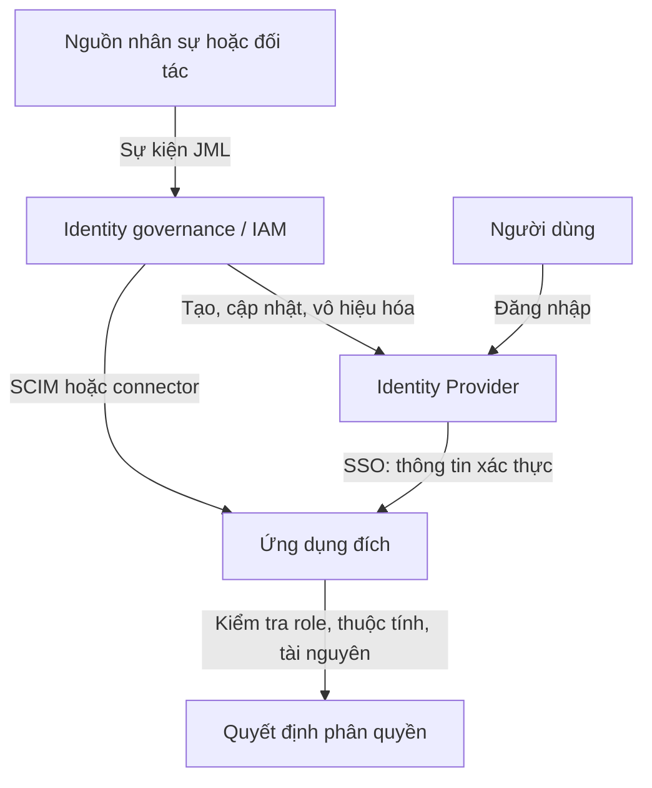

# Human identity trong mô hình danh tính IAM

**Human identity** (danh tính con người) là biểu diễn có quản lý của một cá nhân trong hệ thống Identity and Access Management (IAM): nhân viên, thực tập sinh, nhà thầu, đối tác, khách hàng hoặc người dùng bên ngoài. Danh tính này giúp tổ chức trả lời nhất quán: **người đó là ai, quan hệ của họ với tổ chức là gì, họ được dùng tài nguyên nào, và khi nào quyền đó phải thay đổi hoặc chấm dứt?**

Trong quản lý vòng đời danh tính theo **Joiner–Mover–Leaver (JML)**, human identity là đối tượng được xác minh, tạo tài khoản, cấp quyền, rà soát và thu hồi khi quan hệ hoặc vai trò thay đổi. Một con người có thể sở hữu nhiều tài khoản trên các hệ thống khác nhau, nhưng cần có phương thức liên kết các tài khoản đó với cùng một danh tính gốc đủ tin cậy.

## 1. Phân biệt con người, danh tính, tài khoản và phiên

| Khái niệm | Ý nghĩa | Ví dụ |
| --- | --- | --- |
| Người thật (person) | Cá nhân ngoài đời thực | Nhân viên An |
| Human identity | Hồ sơ danh tính logic, chứa mã định danh và thuộc tính liên quan đến quan hệ với tổ chức | `personId=E02491`, bộ phận, loại hợp đồng, trạng thái |
| Account | Tài khoản cụ thể trên IdP hay một ứng dụng | `an@company.example` trong IdP, tài khoản CRM |
| Credential / authenticator | Bằng chứng dùng để xác thực | Passkey, khóa bảo mật FIDO2, mật khẩu, MFA |
| Session / token | Bối cảnh đăng nhập hoặc bằng chứng cho một phiên truy cập | Phiên trình duyệt SSO, access token |
| Role / entitlement | Vai trò hoặc quyền cụ thể đã cấp | `sales-agent`, quyền xem khách hàng vùng A |

Các khái niệm này không đồng nhất. **Khóa một tài khoản không tự động xóa mọi phiên, token và quyền tại các hệ thống khác**. Ngược lại, đổi địa chỉ email không nên tạo thành một con người mới trong hồ sơ IAM.

### Ví dụ một người có nhiều tài khoản

An là nhân viên kỹ thuật. Một human identity của An có thể được liên kết với:

- Tài khoản đăng nhập tập trung qua Identity Provider (IdP).
- Tài khoản trên hệ thống quản lý mã nguồn qua Single Sign-On (SSO).
- Tài khoản hỗ trợ vận hành với quyền cao, tách biệt tài khoản sử dụng hằng ngày.
- Tài khoản trong ứng dụng cũ chưa tích hợp SSO.

Mỗi tài khoản có vòng đời kỹ thuật riêng. IAM cần quản lý mối quan hệ giữa chúng để quá trình thay đổi vị trí hoặc nghỉ việc không bỏ sót tài khoản thứ cấp, tài khoản cục bộ và quyền đặc biệt.

## 2. Mô hình dữ liệu của human identity

Một hồ sơ danh tính thường gồm những nhóm thuộc tính sau:

| Nhóm thuộc tính | Ví dụ | Nguồn hoặc cách quản trị |
| --- | --- | --- |
| Định danh gốc | `personId` bất biến trong phạm vi tổ chức | Hệ thống định danh có thẩm quyền |
| Thông tin nhận diện | Tên hiển thị, email liên hệ | Hệ thống nhân sự hoặc quy trình xác minh |
| Quan hệ | Nhân viên, nhà thầu, đối tác | HR hoặc hệ thống quản lý đối tác |
| Tổ chức | Bộ phận, đơn vị, người quản lý, vị trí | Nguồn nhân sự |
| Trạng thái vòng đời | Pending, active, suspended, terminated | Sự kiện nghiệp vụ có hiệu lực |
| Mốc thời gian | Ngày bắt đầu, ngày chuyển vị trí, ngày kết thúc | Nguồn có thẩm quyền |
| Liên kết tài khoản | IdP user ID, ứng dụng đích, account ID | Hệ thống IAM/provisioning |
| Quyền | Nhóm, vai trò RBAC, thuộc tính ABAC, quyền ngoại lệ | Chính sách và phê duyệt |

Không nên dùng email, số điện thoại hoặc tên làm định danh gốc duy nhất: chúng có thể đổi, bị dùng lại hoặc trùng giữa các nguồn. Mã định danh gốc cần ổn định, đủ duy nhất trong phạm vi quản lý và có quy tắc xử lý khi hợp nhất hoặc tách hồ sơ.

Ví dụ dữ liệu minh họa (không phải schema chuẩn bắt buộc):

```json
{
  "personId": "E02491",
  "identityType": "human",
  "relationshipType": "employee",
  "lifecycleStatus": "active",
  "department": "customer-support",
  "managerPersonId": "E00120",
  "effectiveFrom": "2026-03-01",
  "accounts": [
    { "system": "central-idp", "externalId": "idp-73210" },
    { "system": "crm", "externalId": "crm-4837" }
  ]
}
```

Nên phân biệt **dữ liệu hồ sơ** với dữ liệu xác thực nhạy cảm. Không đưa mật khẩu, mã khôi phục hoặc token vào hồ sơ identity hiển thị rộng rãi. Chỉ thu thập thuộc tính cần cho nghiệp vụ và phân quyền; việc lưu trữ, chia sẻ, lưu vết và xóa dữ liệu cá nhân cần tuân thủ chính sách bảo vệ dữ liệu áp dụng.

## 3. Vòng đời Joiner–Mover–Leaver của human identity


### Joiner: tạo danh tính có căn cứ

1. Nhận bản ghi tuyển dụng hoặc hợp đồng từ **nguồn có thẩm quyền**; xác định đúng cá nhân, quan hệ, người quản lý và ngày hiệu lực.
2. Kiểm tra trùng danh tính trước khi tạo mới, đặc biệt với nhân sự quay lại tổ chức hoặc nhà thầu chuyển thành nhân viên.
3. Tạo hoặc kích hoạt human identity; cấp mã gốc, tài khoản IdP và cơ chế xác thực phù hợp, ưu tiên MFA hoặc xác thực kháng phishing khi cần.
4. Gán quyền khởi tạo theo nguyên tắc **least privilege** dựa trên công việc, đơn vị và ngày bắt đầu; quyền nhạy cảm có thể cần phê duyệt bổ sung.
5. Đồng bộ tài khoản đến ứng dụng qua cơ chế provisioning, ví dụ **SCIM**, và kiểm chứng kết quả tại hệ thống đích.

Ví dụ: nhân viên chăm sóc khách hàng bắt đầu ngày 1/3. Trước ngày hiệu lực, IAM có thể tạo tài khoản ở trạng thái chưa được phép truy cập theo chính sách; đến ngày bắt đầu mới kích hoạt quyền cần thiết. Điều này giúp tách **chuẩn bị kỹ thuật** khỏi **thời điểm được phép sử dụng**.

### Mover: đổi bối cảnh mà không tích lũy quyền

Khi nhân viên chuyển nhóm hoặc thay nhiệm vụ, danh tính gốc thường vẫn giữ nguyên, còn thuộc tính và entitlement thay đổi:

- Cập nhật đơn vị, vai trò, người quản lý và ngày hiệu lực từ nguồn đáng tin cậy.
- Tính lại quyền theo **RBAC** (vai trò) và/hoặc **ABAC** (thuộc tính người dùng, tài nguyên, môi trường).
- Thu hồi quyền thuộc vai trò cũ nếu không còn căn cứ; cấp quyền mới theo phê duyệt.
- Kiểm tra tài khoản ứng dụng cũ, nhóm phân quyền, phiên/token còn hiệu lực và quyền ngoại lệ có hạn.
- Ghi lại sự kiện, đối soát sau provisioning và thông báo khi có lỗi thu hồi.

Ví dụ: An chuyển từ bộ phận hỗ trợ sang phân tích dữ liệu. An có thể vẫn dùng cùng tài khoản IdP và SSO, nhưng quyền xem từng hồ sơ khách hàng trong CRM cần được đánh giá lại. Đăng nhập thành công **không đủ** để kết luận An được phép truy cập dữ liệu đó.

### Leaver: ngăn truy cập tồn dư

Khi quan hệ kết thúc, IAM phải xác định thời điểm có hiệu lực, vô hiệu hóa khả năng truy cập và thu hồi các quyền liên quan. Tùy ứng dụng và công nghệ, cần xử lý:

- Tài khoản IdP, tài khoản cục bộ, tài khoản đặc quyền và quyền truy cập hệ thống đích.
- Phiên SSO, refresh token, API key cá nhân, credential được cấp riêng và thiết bị đã đăng ký.
- Nhóm, vai trò, chia sẻ dữ liệu, quyền sở hữu tài nguyên cần bàn giao.
- Tài khoản mồ côi, lỗi đồng bộ SCIM và ứng dụng không có cơ chế deprovision tự động.

Một số access token có thể còn hợp lệ cho đến khi hết hạn nếu hệ thống đích không hỗ trợ thu hồi tức thì. Vì vậy, SLA thu hồi quyền phải xét **thời điểm quyền thực sự mất hiệu lực ở nơi thực thi**, không chỉ thời điểm IAM gửi yêu cầu.

Trạng thái `terminated` không nhất thiết có nghĩa phải xóa ngay toàn bộ hồ sơ nhân sự. Thời hạn lưu giữ dữ liệu, bằng chứng kiểm toán và thời điểm xóa cần tuân thủ quy định và chính sách hiện hành.

## 4. Liên kết IdP, SSO, SCIM và quyết định truy cập

Các thành phần thường phối hợp theo luồng:



**IdP** nhận diện và xác thực chủ thể, **SSO** cho phép dùng kết quả đăng nhập ở các ứng dụng tin cậy, còn **SCIM** hỗ trợ chuẩn hóa việc tạo/cập nhật/vô hiệu hóa đối tượng người dùng và nhóm ở ứng dụng đích. **RBAC/ABAC** xác định quyền khi chủ thể thực hiện hành động. Các chức năng liên quan nhưng không thay thế nhau.

Đặc biệt, cần phân biệt **authentication** (xác thực người đăng nhập) với **authorization** (quyết định hành động cụ thể có được phép không). Ứng dụng cần thực thi phân quyền đối với tài nguyên thực tế và xử lý trường hợp thuộc tính hoặc quyền vừa thay đổi.

## 5. Human identity khác service identity

| Tiêu chí | Human identity | Service/workload identity |
| --- | --- | --- |
| Chủ thể | Cá nhân có quan hệ với tổ chức | Ứng dụng, tác vụ tự động, máy hoặc workload |
| Nguồn tạo | Nhân sự, hợp đồng, đăng ký người dùng | Quy trình triển khai, quản lý dịch vụ |
| Xác thực | Passkey, MFA, tài khoản người dùng | Workload federation, chứng thư, khóa quản lý |
| Vòng đời | Joiner–Mover–Leaver theo thay đổi con người | Tạo–thay đổi–ngừng dịch vụ/workload |
| Chủ sở hữu và rà soát | Người dùng, quản lý, bộ phận phụ trách | Nhóm vận hành hoặc service owner |

Một tác vụ chạy tự động **không nên dùng tài khoản cá nhân của nhân viên** làm danh tính lâu dài. Khi nhân viên nghỉ việc, tác vụ có thể bị gián đoạn hoặc vẫn giữ khóa truy cập khó kiểm soát. Service identity riêng giúp phân quyền, xoay vòng credential và thu hồi độc lập.

## 6. Kiểm soát chất lượng dữ liệu và kiểm toán

Mô hình human identity chỉ đáng tin nếu dữ liệu gốc, mối liên kết tài khoản và các thay đổi được quản trị:

1. **Identity correlation:** phát hiện các tài khoản cùng thuộc một cá nhân mà không hợp nhất nhầm hai người khác nhau.
2. **Authoritative source:** xác định hệ thống nào có quyền quyết định từng thuộc tính; giải quyết xung đột trước khi cấp quyền.
3. **Access review:** rà soát quyền đặc quyền, nhóm nhạy cảm, quyền tạm thời và quyền sau Mover.
4. **Reconciliation:** đối chiếu trạng thái IAM/IdP với tài khoản và quyền thực tế trên ứng dụng đích.
5. **Audit trail:** lưu sự kiện tạo, đổi, vô hiệu hóa identity; ai yêu cầu/phê duyệt; chính sách, thời điểm và kết quả thực thi. Hạn chế ghi thông tin cá nhân không cần thiết.
6. **Metrics:** đo độ trễ từ sự kiện Leaver đến lúc truy cập bị chặn, số tài khoản mồ côi, số quyền quá hạn và tỷ lệ tác vụ provisioning thất bại.

## 7. Tình huống thực hành

**Tình huống 1 – Nhân sự quay lại:** Một người từng nghỉ việc được tuyển lại nhưng có email mới. Hệ thống có nên chỉ dựa vào email để tạo danh tính hoàn toàn khác? **Không.** Cần xác minh danh tính và chính sách tái tuyển dụng, xử lý quan hệ với hồ sơ cũ và tài khoản cũ trước khi quyết định tạo hoặc liên kết.

**Tình huống 2 – Chuyển vai trò:** Nhân viên từ phòng tài chính sang hỗ trợ khách hàng. Nhóm tài chính trên IdP đã bị xóa nhưng ứng dụng kế toán vẫn còn quyền cục bộ. **Mover chưa hoàn tất** cho đến khi quyền ứng dụng đích được đối soát và thu hồi theo chính sách.

**Tình huống 3 – Nghỉ việc:** Tài khoản IdP bị vô hiệu hóa nhưng một access token đã phát hành trước đó còn sử dụng được. **Cần kiểm tra cơ chế hiệu lực token ở hệ thống đích**, giảm thời gian sống hoặc thu hồi khi được hỗ trợ, và đo thời gian truy cập thực sự chấm dứt.

**Tình huống 4 – Tự động hóa:** Một script quan trọng chạy bằng tài khoản của người đã chuyển bộ phận. **Nên chuyển sang workload identity có chủ sở hữu rõ ràng**, quyền tối thiểu và cơ chế quản lý credential độc lập.

## Ghi nhớ

Human identity là **đầu mối quản trị vòng đời một con người**, không chỉ là tên đăng nhập. Từ bản ghi có thẩm quyền đến IdP, SSO, SCIM, vai trò RBAC/thuộc tính ABAC, tài khoản ứng dụng và nhật ký kiểm toán, mọi thành phần phải phối hợp để cấp đúng quyền, cập nhật khi **Mover**, và thu hồi hiệu quả khi **Leaver**. Mô hình tốt bảo đảm truy nguyên được **người – danh tính – tài khoản – quyền – quyết định truy cập** và giúp giảm quyền tồn dư.
